# Avonic preview

What Avonic looks like: Ionic's md mode, recreated for Avalonia. Every picture here is a real frame, rendered headless by
Avalonia with Skia at 390 × 844 and a scale of 2, a phone's size. Nothing is mocked up or retouched; all the capture does is
swipe a message open in the inbox, through `AvonicItemSliding.Open()`, and for the two screens the inbox opens, open the menu
(`AvonicMenu.Open()`) or tap a message (its item's `Click`). The font is Roboto, from `tools/fonts/roboto/`, as the sample has
it. They're headless frames, not screenshots of a device or a window.

## Showcase

A small app built only from Avonic controls: the sample's `showcase` page, first on its list. Each screen is a page of its own in
[`samples/Avonic.Sample/Pages/Showcase/`](samples/Avonic.Sample/Pages/Showcase/), in plain XAML, so it doubles as example
code. Dark is Ionic's own dark palette, `avares://Avonic.Themes/Tokens/Palettes/Dark.axaml`, merged into the app's resources
([colour system](docs/infra/color-system/README.md#dark-palette)), with no change to the screens.

<table>
  <tr>
    <th>Inbox</th>
    <th>Discover</th>
    <th>Profile</th>
    <th>Settings</th>
  </tr>
  <tr>
    <td>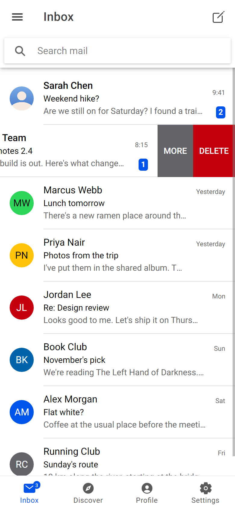</td>
    <td></td>
    <td>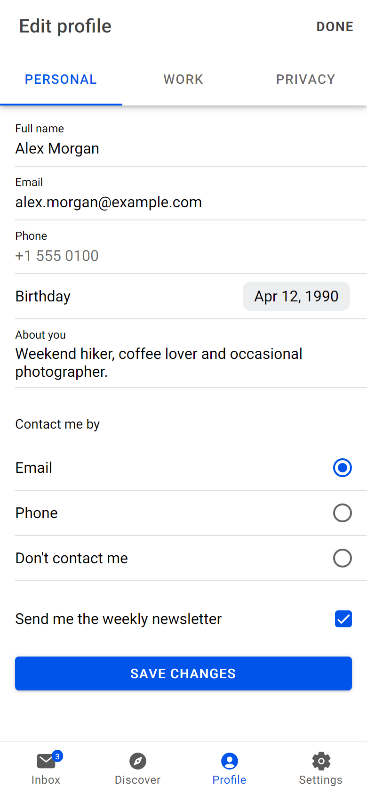</td>
    <td>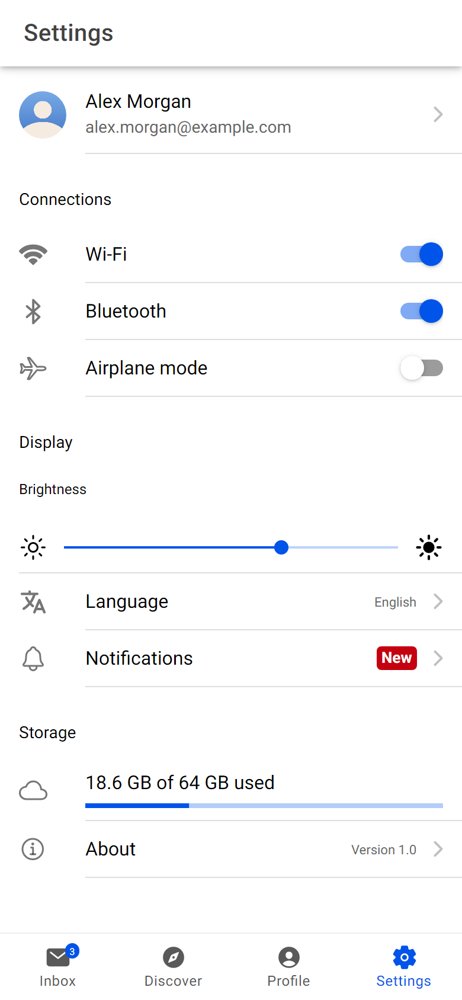</td>
  </tr>
  <tr>
    <td></td>
    <td></td>
    <td></td>
    <td>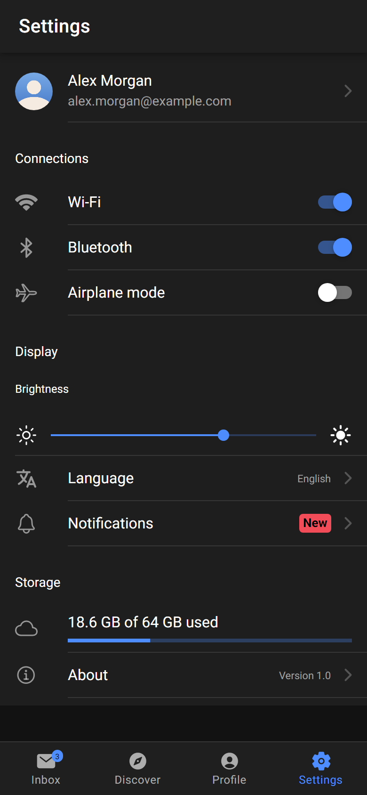</td>
  </tr>
</table>

What the inbox opens:

<table>
  <tr>
    <th>Menu</th>
    <th>Message</th>
    <th>Menu, dark</th>
    <th>Message, dark</th>
  </tr>
  <tr>
    <td>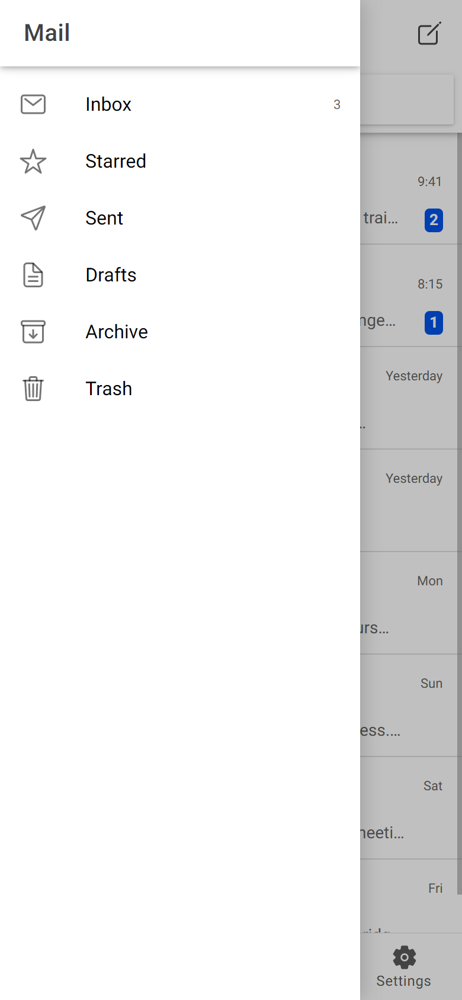</td>
    <td>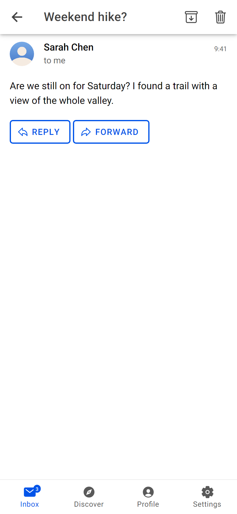</td>
    <td>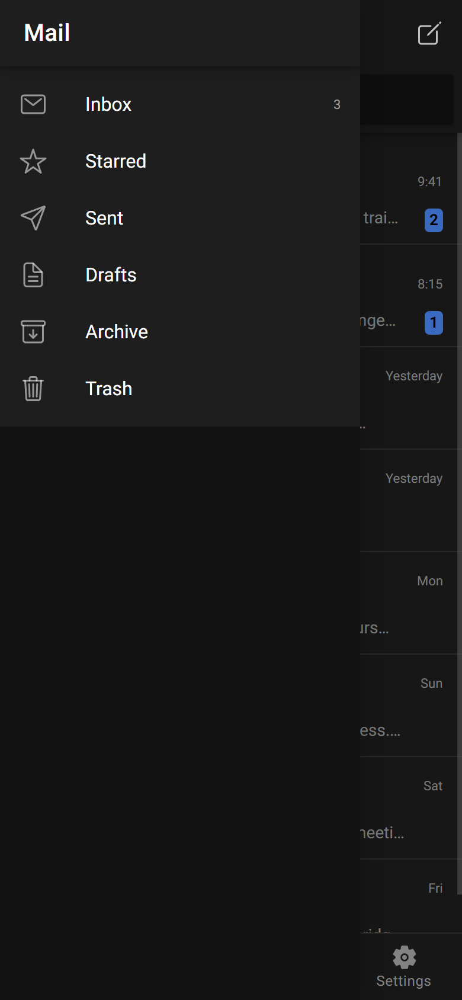</td>
    <td>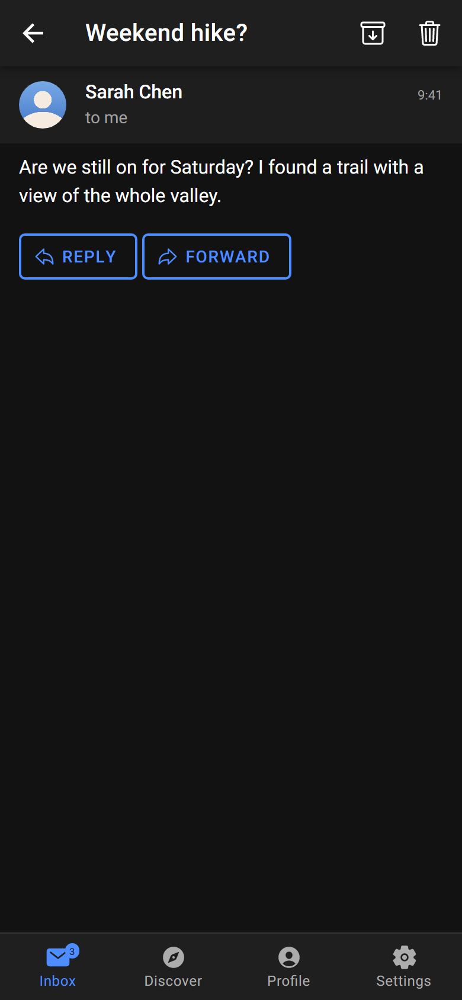</td>
  </tr>
</table>

What's in them:

- **Inbox:** the root of an `ion-nav`, with a header with two toolbars, the first holding an `ion-menu-button` and the second
  `ion-searchbar`; `ion-list` of `ion-item-sliding` messages, each an `ion-item` with an `ion-avatar` (an `ion-img`, or initials
  on one of the palette's colours), an `ion-label` with `h2`, `h3` and `p`, an `ion-note` and an `ion-badge`. One is swiped open
  to show its `ion-item-option`s, whose More opens an `ion-action-sheet`, and whose Archive, on the other side, takes it out of
  the list with an `ion-toast` above the tab bar, whose Undo puts it back. `ion-tabs` with an `ion-tab-bar` at the
  bottom, and a badge on a tab button.
- **Menu:** the menu button opens an `ion-menu` over the tabs, a list of `ion-menu-toggle`d items, each closing it.
- **Message:** a tap on a message pushes it on the nav, with an `ion-back-button` in its toolbar, which pops it.
- **Discover:** `ion-chip`s with icons, `ion-card`s with an `ion-img`, an `ion-card-header` (title and subtitle),
  `ion-card-content` and clear `ion-button`s with icons, a card whose author is an `ion-item`, and an `ion-fab` in the
  content's fixed slot.
- **Profile:** an `ion-segment` in the header, `ion-input`s with floating and stacked labels, an `ion-datetime-button` for the
  birthday, whose `ion-datetime` is in an `ion-modal`, an `ion-textarea` that grows with its text, an `ion-radio-group` under an `ion-list-header`, an `ion-checkbox`, and a block `ion-button`, which opens an
  `ion-alert`.
- **Settings:** items with icons at the start, `ion-toggle`s, an `ion-range` between two icons, an `ion-select` for the language
  (a popover), `ion-note`s for current values, an `ion-progress-bar`, and items with the detail chevron.

## Every sample page

The sample has a page for each control, as its tests and the compare step use it: they show states, colours and edge cases
rather than an app. Each frame is the page as it opens, under a toolbar with its title. The `device` page is left out, as it
shows the machine it runs on.

<table>
  <tr>
    <td align="center">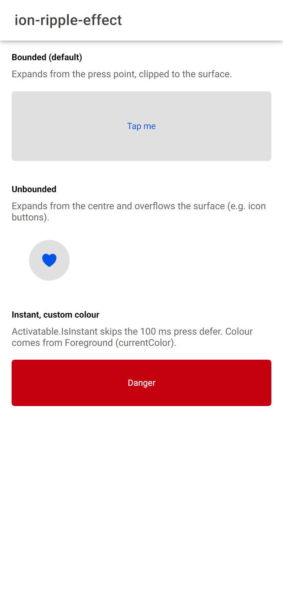<br /><a href="docs/components/ion-ripple-effect/README.md"><code>ion-ripple-effect</code></a></td>
    <td align="center"><br /><a href="docs/infra/color-system/README.md">colour system</a></td>
    <td align="center"><br /><a href="docs/components/ion-icon/README.md"><code>ion-icon</code></a></td>
  </tr>
  <tr>
    <td align="center"><br /><a href="docs/infra/gesture/README.md">gesture</a></td>
    <td align="center"><br /><a href="docs/infra/overlays/README.md">overlays</a>, <a href="docs/components/ion-backdrop/README.md"><code>ion-backdrop</code></a></td>
    <td align="center"><br /><a href="docs/components/ion-item/README.md"><code>ion-item</code></a></td>
  </tr>
  <tr>
    <td align="center"><br /><a href="docs/components/ion-label/README.md"><code>ion-label</code></a></td>
    <td align="center">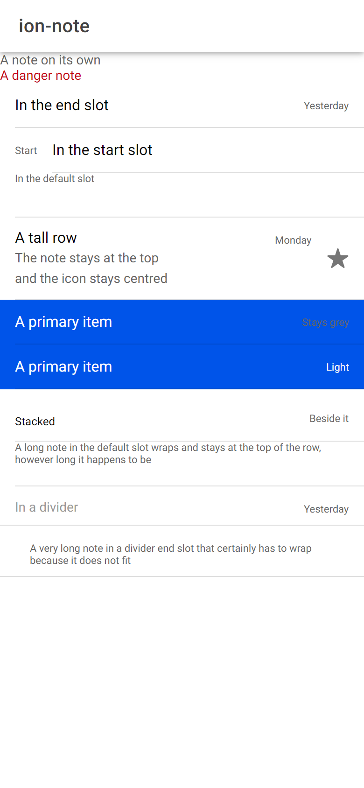<br /><a href="docs/components/ion-note/README.md"><code>ion-note</code></a></td>
    <td align="center"><br /><a href="docs/components/ion-text/README.md"><code>ion-text</code></a></td>
  </tr>
  <tr>
    <td align="center"><br /><a href="docs/components/ion-list/README.md"><code>ion-list</code></a>, <a href="docs/components/ion-list-header/README.md"><code>ion-list-header</code></a>, <a href="docs/components/ion-item-divider/README.md"><code>ion-item-divider</code></a>, <a href="docs/components/ion-item-group/README.md"><code>ion-item-group</code></a></td>
    <td align="center">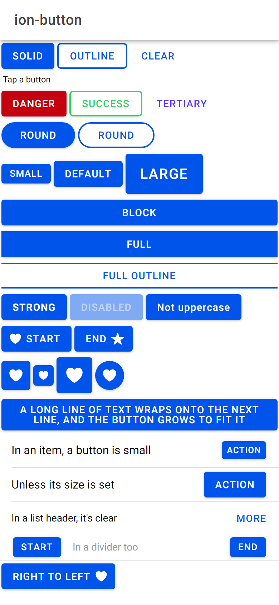<br /><a href="docs/components/ion-button/README.md"><code>ion-button</code></a></td>
    <td align="center"><br /><a href="docs/components/ion-content/README.md"><code>ion-content</code></a></td>
  </tr>
  <tr>
    <td align="center">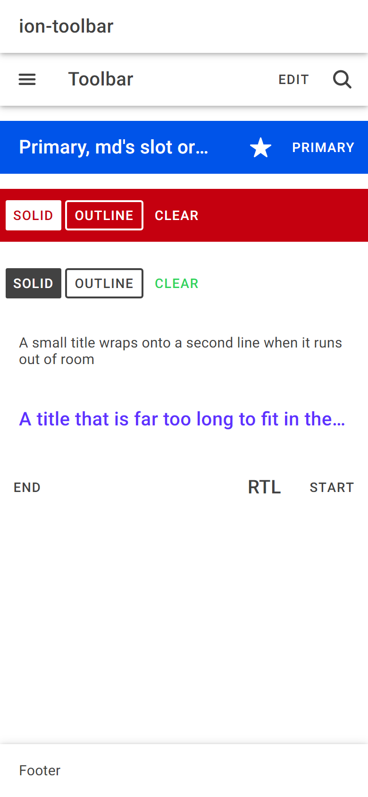<br /><a href="docs/components/ion-toolbar/README.md"><code>ion-toolbar</code></a>, <a href="docs/components/ion-header/README.md"><code>ion-header</code></a>, <a href="docs/components/ion-footer/README.md"><code>ion-footer</code></a>, <a href="docs/components/ion-title/README.md"><code>ion-title</code></a>, <a href="docs/components/ion-buttons/README.md"><code>ion-buttons</code></a></td>
    <td align="center">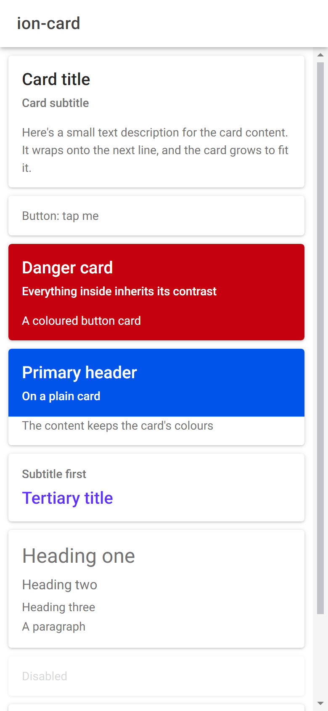<br /><a href="docs/components/ion-card/README.md"><code>ion-card</code></a> and its parts</td>
    <td align="center">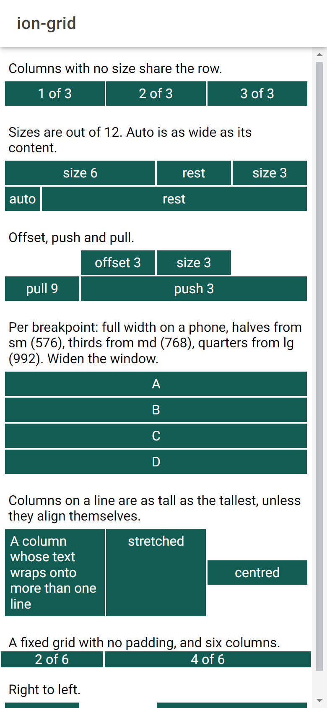<br /><a href="docs/components/ion-grid/README.md"><code>ion-grid</code>, <code>ion-row</code>, <code>ion-col</code></a></td>
  </tr>
  <tr>
    <td align="center"><br /><a href="docs/components/ion-spinner/README.md"><code>ion-spinner</code></a></td>
    <td align="center"><br /><a href="docs/components/ion-badge/README.md"><code>ion-badge</code></a>, <a href="docs/components/ion-avatar/README.md"><code>ion-avatar</code></a>, <a href="docs/components/ion-thumbnail/README.md"><code>ion-thumbnail</code></a></td>
    <td align="center">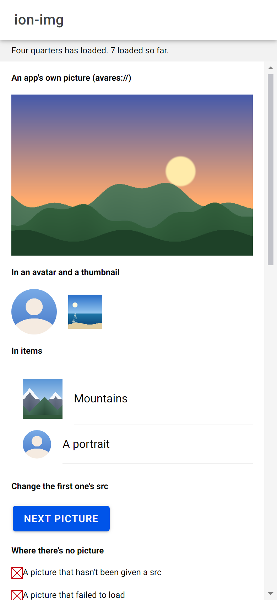<br /><a href="docs/components/ion-img/README.md"><code>ion-img</code></a></td>
  </tr>
  <tr>
    <td align="center">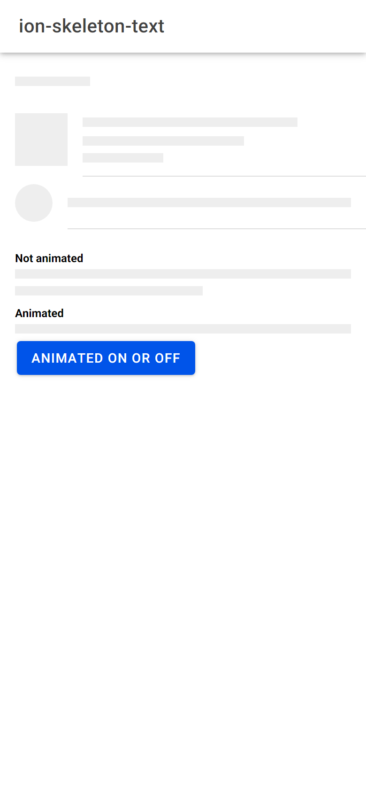<br /><a href="docs/components/ion-skeleton-text/README.md"><code>ion-skeleton-text</code></a></td>
    <td align="center"><br /><a href="docs/components/ion-progress-bar/README.md"><code>ion-progress-bar</code></a></td>
    <td align="center"><br /><a href="docs/components/ion-chip/README.md"><code>ion-chip</code></a></td>
  </tr>
  <tr>
    <td align="center">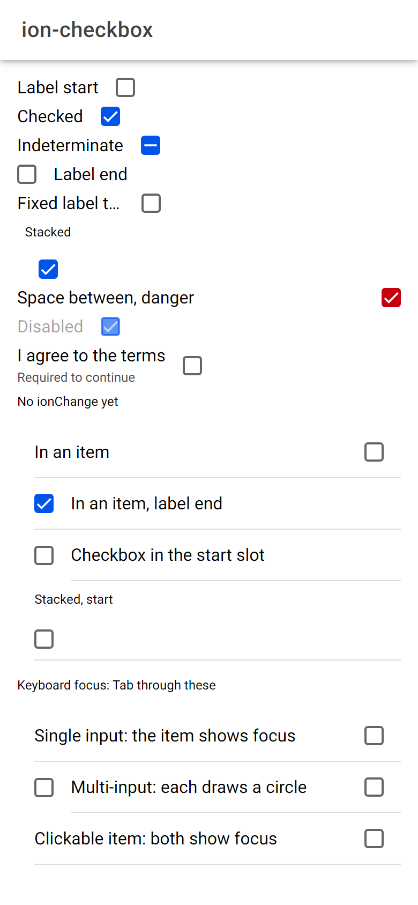<br /><a href="docs/components/ion-checkbox/README.md"><code>ion-checkbox</code></a></td>
    <td align="center"><br /><a href="docs/components/ion-toggle/README.md"><code>ion-toggle</code></a></td>
    <td align="center">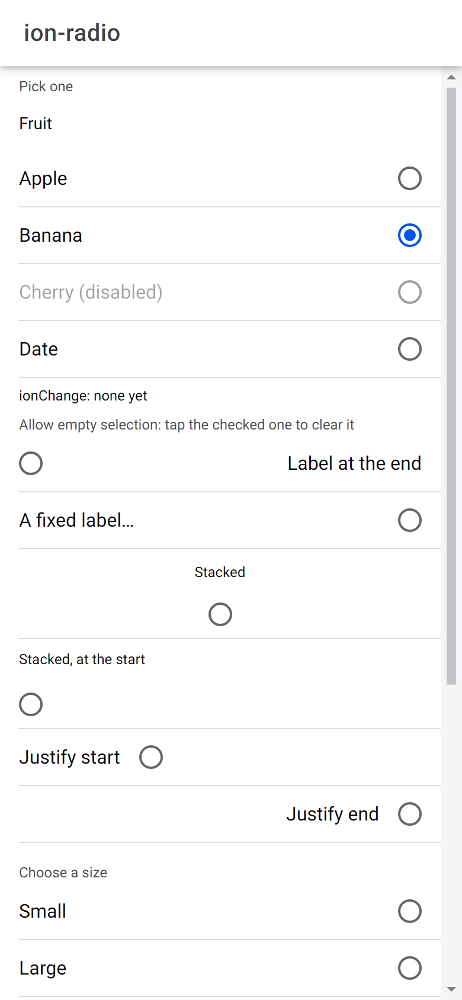<br /><a href="docs/components/ion-radio/README.md"><code>ion-radio</code>, <code>ion-radio-group</code></a></td>
  </tr>
  <tr>
    <td align="center">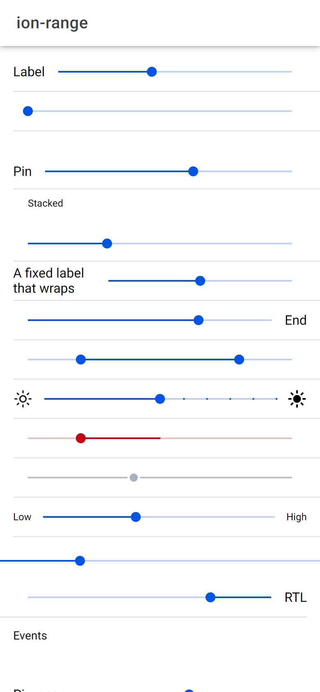<br /><a href="docs/components/ion-range/README.md"><code>ion-range</code></a></td>
    <td align="center">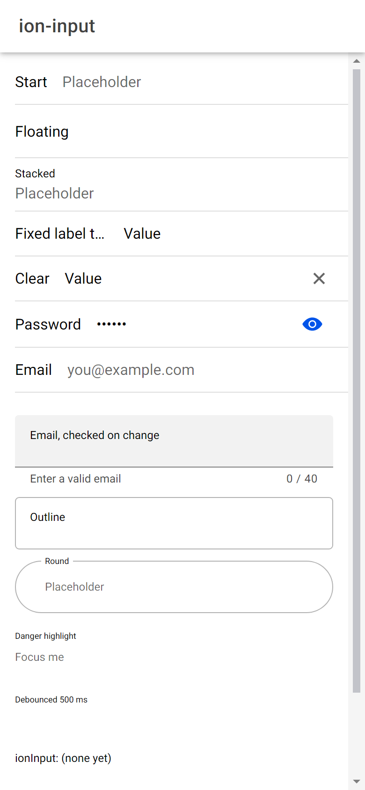<br /><a href="docs/components/ion-input/README.md"><code>ion-input</code></a>, <a href="docs/components/ion-input-password-toggle/README.md"><code>ion-input-password-toggle</code></a></td>
    <td align="center"><br /><a href="docs/components/ion-textarea/README.md"><code>ion-textarea</code></a></td>
  </tr>
  <tr>
    <td align="center"><br /><a href="docs/components/ion-searchbar/README.md"><code>ion-searchbar</code></a></td>
    <td align="center">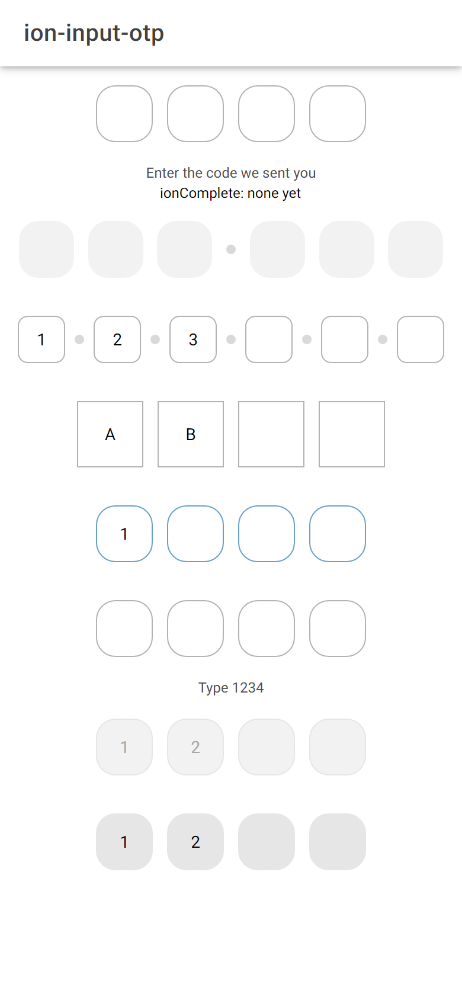<br /><a href="docs/components/ion-input-otp/README.md"><code>ion-input-otp</code></a></td>
    <td align="center"><br /><a href="docs/components/ion-segment/README.md"><code>ion-segment</code></a> and its button, view and content</td>
  </tr>
  <tr>
    <td align="center">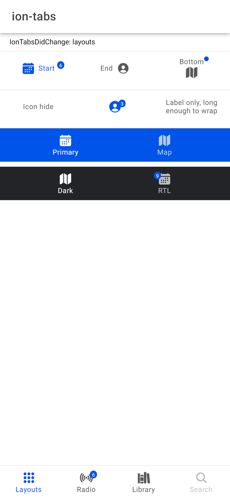<br /><a href="docs/components/ion-tabs/README.md"><code>ion-tabs</code></a>, <code>ion-tab</code>, <code>ion-tab-bar</code>, <code>ion-tab-button</code></td>
    <td align="center">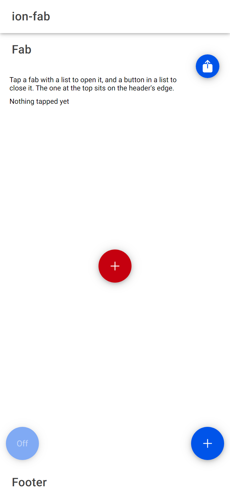<br /><a href="docs/components/ion-fab/README.md"><code>ion-fab</code>, <code>ion-fab-button</code>, <code>ion-fab-list</code></a></td>
    <td align="center"><br /><a href="docs/components/ion-item-sliding/README.md"><code>ion-item-sliding</code>, <code>ion-item-options</code>, <code>ion-item-option</code></a></td>
  </tr>
  <tr>
    <td align="center"><br /><a href="docs/components/ion-accordion/README.md"><code>ion-accordion</code></a>, <a href="docs/components/ion-accordion-group/README.md"><code>ion-accordion-group</code></a></td>
    <td align="center">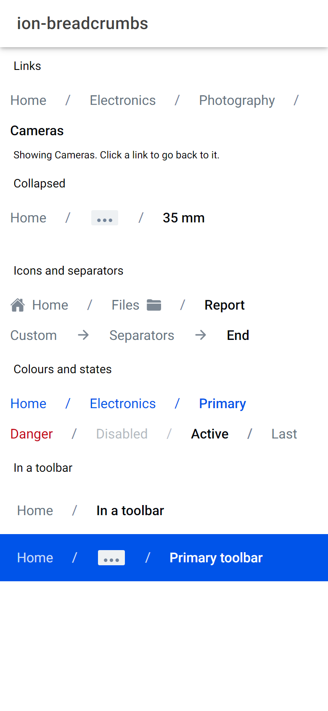<br /><a href="docs/components/ion-breadcrumbs/README.md"><code>ion-breadcrumbs</code>, <code>ion-breadcrumb</code></a></td>
    <td align="center"><br /><a href="docs/components/ion-reorder/README.md"><code>ion-reorder</code>, <code>ion-reorder-group</code></a></td>
  </tr>
  <tr>
    <td align="center">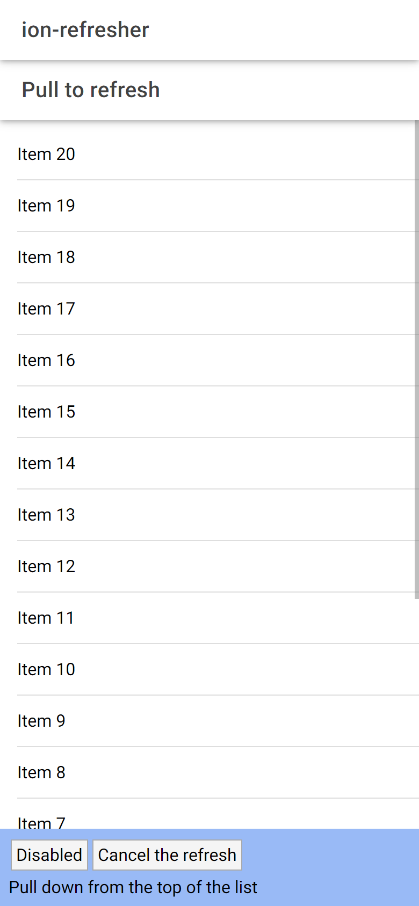<br /><a href="docs/components/ion-refresher/README.md"><code>ion-refresher</code>, <code>ion-refresher-content</code></a></td>
    <td align="center">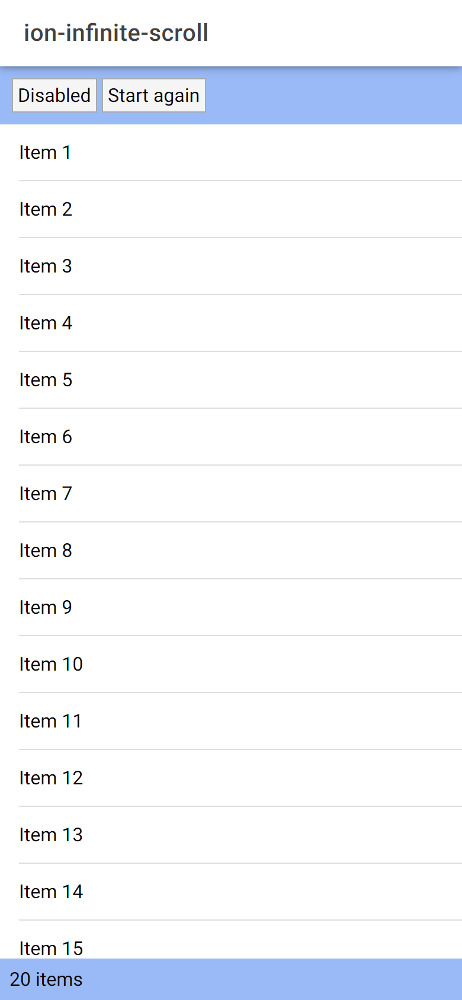<br /><a href="docs/components/ion-infinite-scroll/README.md"><code>ion-infinite-scroll</code>, <code>ion-infinite-scroll-content</code></a></td>
    <td align="center"><br /><a href="docs/components/ion-picker/README.md"><code>ion-picker</code> and its columns</a></td>
  </tr>
  <tr>
    <td align="center">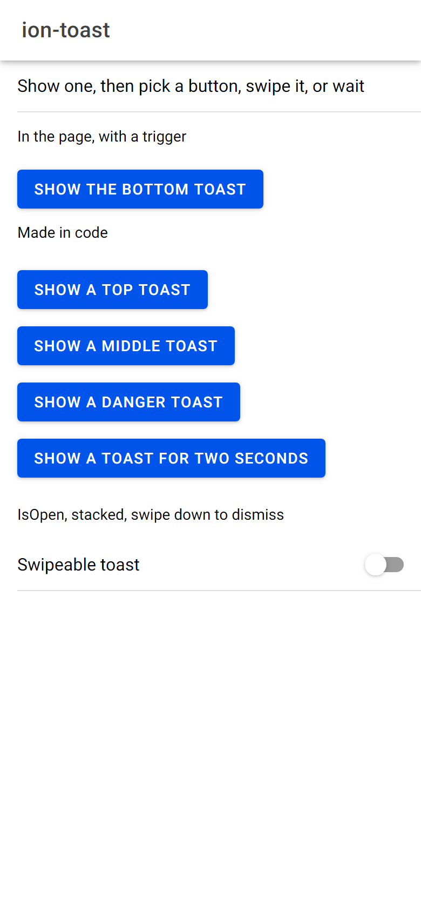<br /><a href="docs/components/ion-toast/README.md"><code>ion-toast</code></a></td>
    <td align="center">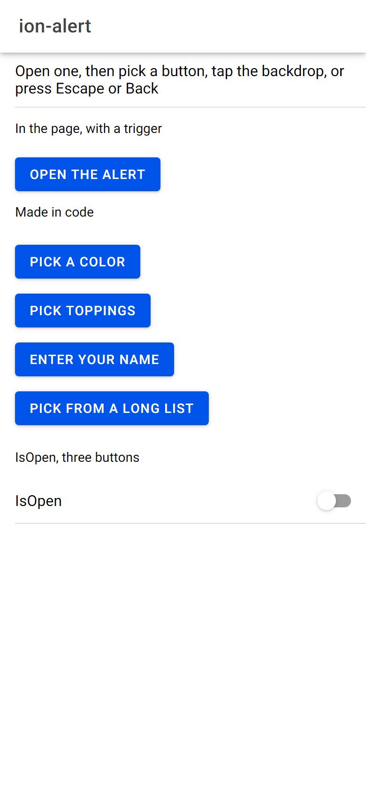<br /><a href="docs/components/ion-alert/README.md"><code>ion-alert</code></a></td>
    <td align="center">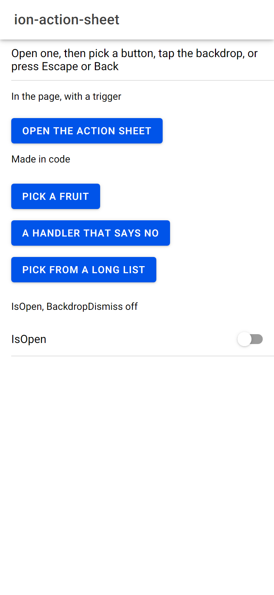<br /><a href="docs/components/ion-action-sheet/README.md"><code>ion-action-sheet</code></a></td>
  </tr>
  <tr>
    <td align="center">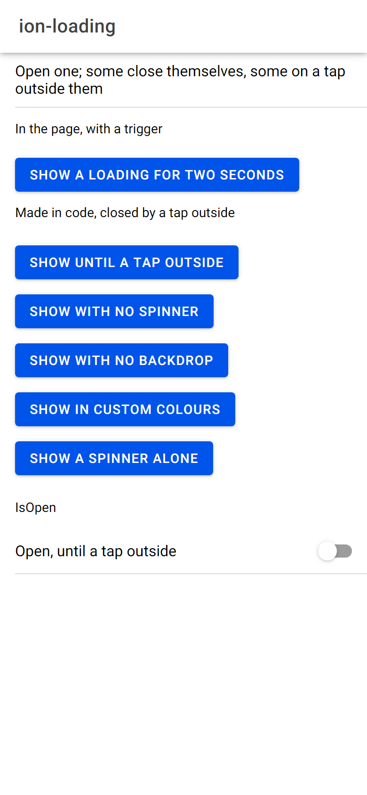<br /><a href="docs/components/ion-loading/README.md"><code>ion-loading</code></a></td>
    <td align="center">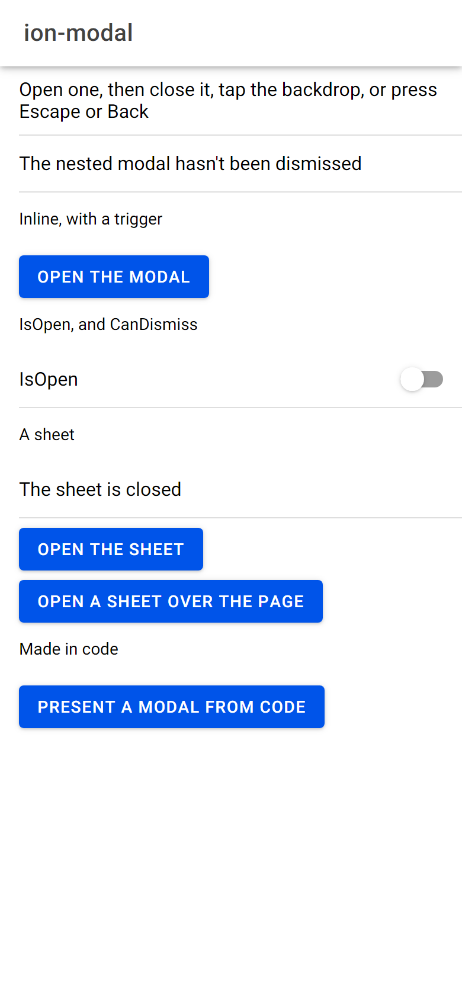<br /><a href="docs/components/ion-modal/README.md"><code>ion-modal</code></a> and its sheet</td>
    <td align="center">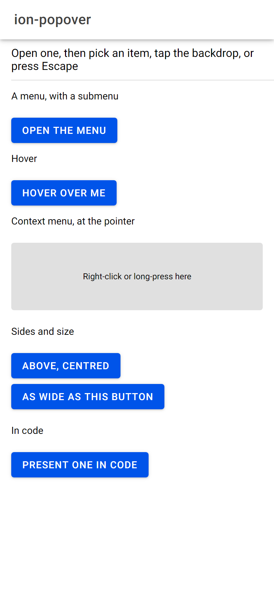<br /><a href="docs/components/ion-popover/README.md"><code>ion-popover</code></a></td>
  </tr>
  <tr>
    <td align="center">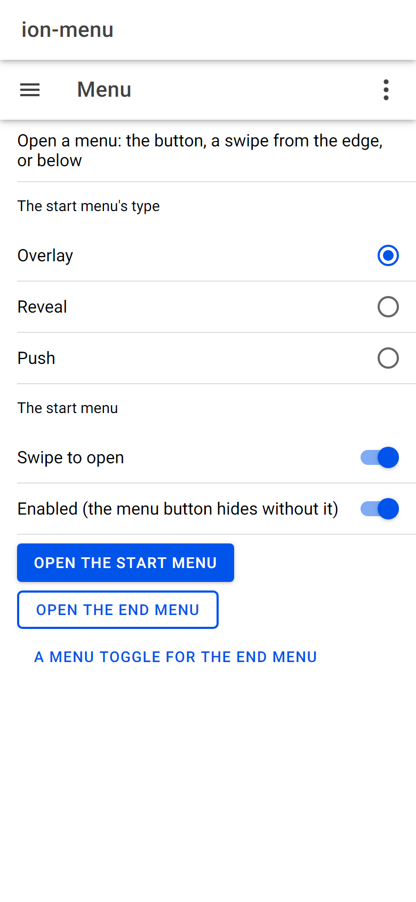<br /><a href="docs/components/ion-menu/README.md"><code>ion-menu</code></a>, <a href="docs/components/ion-menu-button/README.md"><code>ion-menu-button</code></a>, <a href="docs/components/ion-menu-toggle/README.md"><code>ion-menu-toggle</code></a></td>
    <td align="center">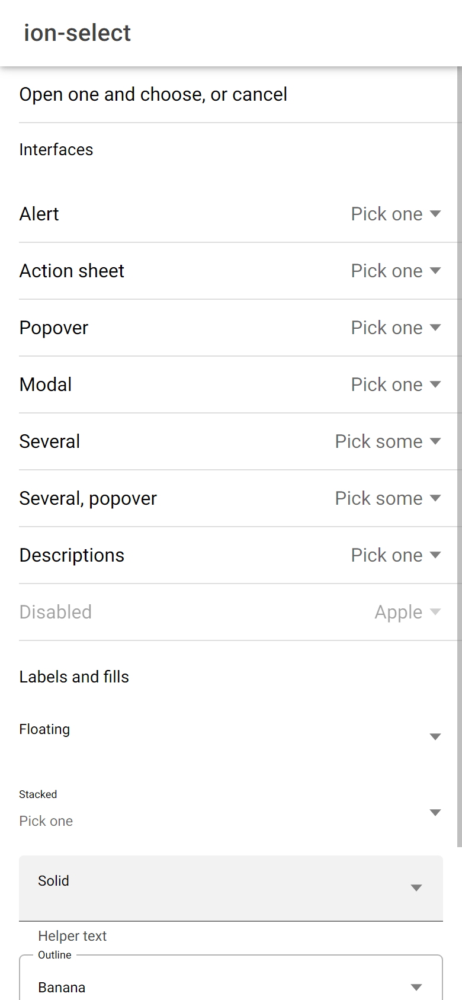<br /><a href="docs/components/ion-select/README.md"><code>ion-select</code></a>, <a href="docs/components/ion-select-option/README.md"><code>ion-select-option</code></a>, <a href="docs/components/ion-select-modal/README.md"><code>ion-select-modal</code></a></td>
    <td align="center">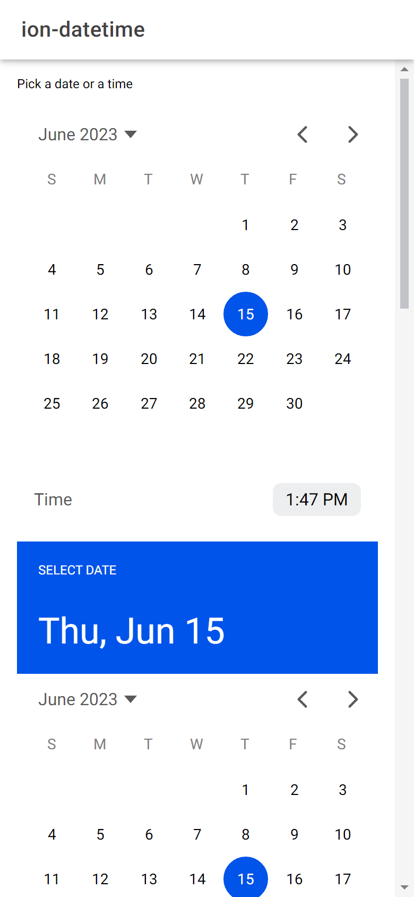<br /><a href="docs/components/ion-datetime/README.md"><code>ion-datetime</code></a></td>
  </tr>
  <tr>
    <td align="center">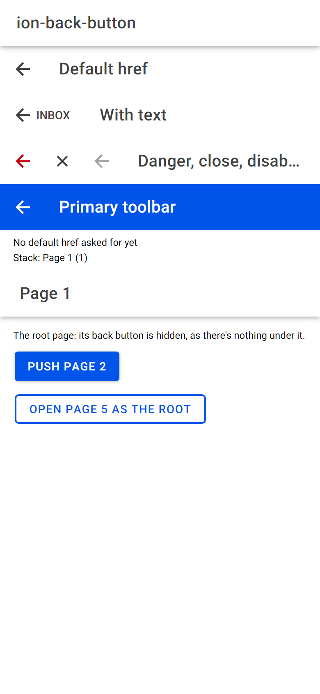<br /><a href="docs/components/ion-back-button/README.md"><code>ion-back-button</code></a></td>
    <td align="center"><br /><a href="docs/components/ion-app/README.md"><code>ion-app</code></a></td>
    <td align="center">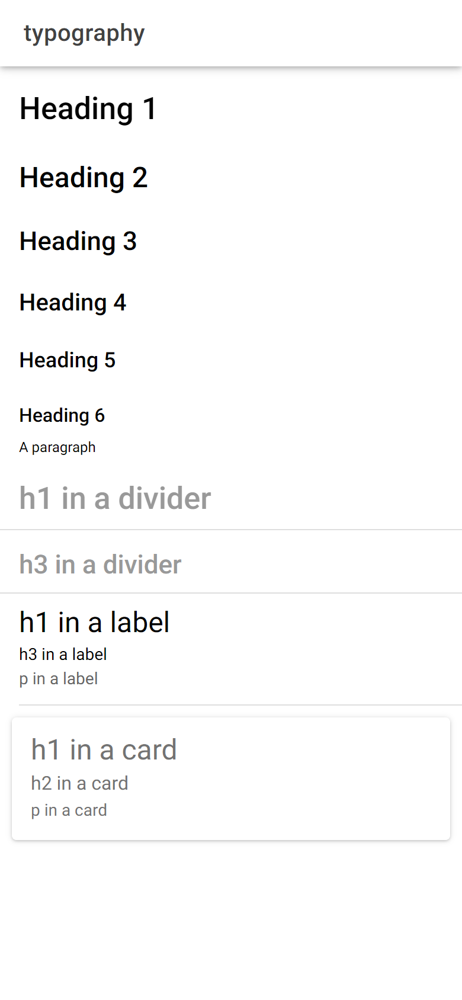<br /><a href="docs/infra/typography/README.md">typography</a></td>
  </tr>
  <tr>
    <td align="center">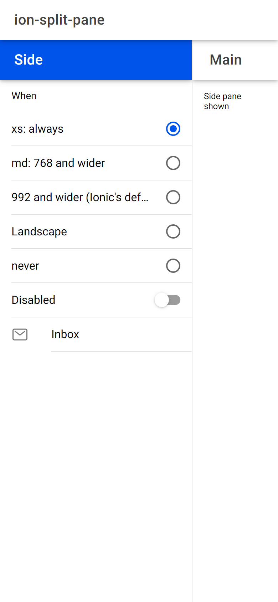<br /><a href="docs/components/ion-split-pane/README.md"><code>ion-split-pane</code></a></td>
    <td align="center">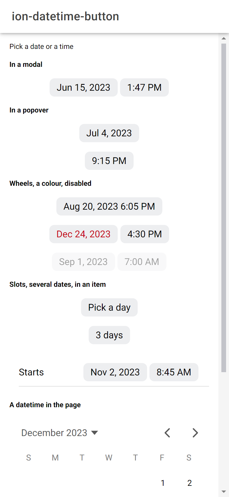<br /><a href="docs/components/ion-datetime-button/README.md"><code>ion-datetime-button</code></a></td>
    <td align="center">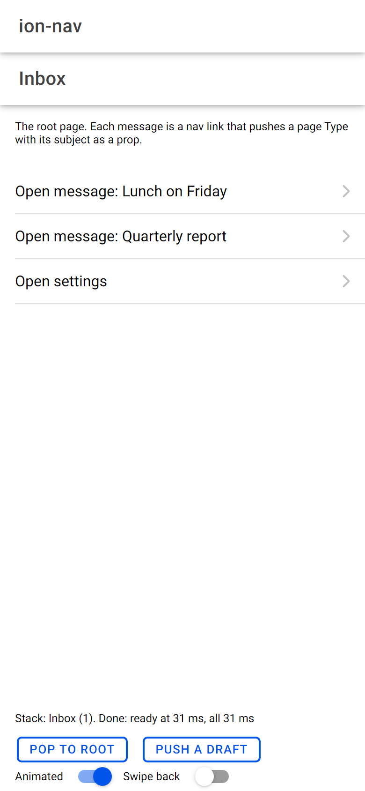<br /><a href="docs/components/ion-nav/README.md"><code>ion-nav</code>, <code>ion-nav-link</code></a></td>
  </tr>
</table>

## Regenerating

The pictures come from `PreviewCaptureTests`, in `tests/Avonic.Components.Tests/Sample/`, which saves them only when
`AVONIC_PREVIEW_DIR` is set (a relative path is from the repository's root). Without it, the same tests still render every frame
and check its size, as part of the normal test run. Delete `docs/preview` first, so that a page that has gone leaves no
picture behind.

Bash:

```sh
rm -rf docs/preview
AVONIC_PREVIEW_DIR=docs/preview dotnet test tests/Avonic.Components.Tests --filter "FullyQualifiedName~PreviewCaptureTests"
```

PowerShell:

```powershell
Remove-Item -Recurse -Force docs/preview -ErrorAction SilentlyContinue
$env:AVONIC_PREVIEW_DIR = 'docs/preview'
dotnet test tests/Avonic.Components.Tests --filter "FullyQualifiedName~PreviewCaptureTests"
Remove-Item Env:AVONIC_PREVIEW_DIR
```

A new sample page gets a picture by itself: add it to the table above. Each roll-up regenerates them
([process](docs/PROCESS.md#rolling-up-the-tables)).
