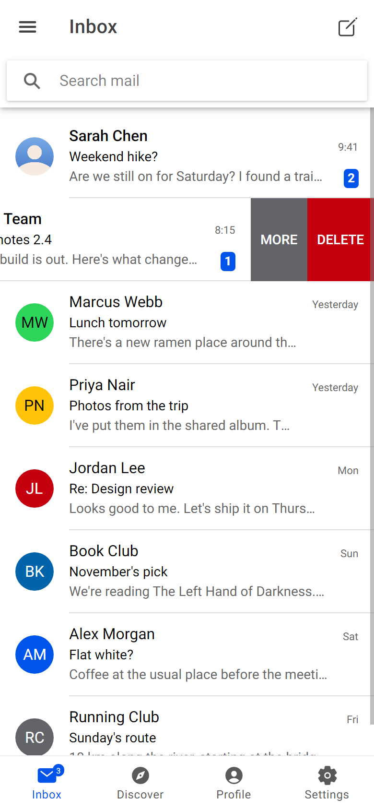
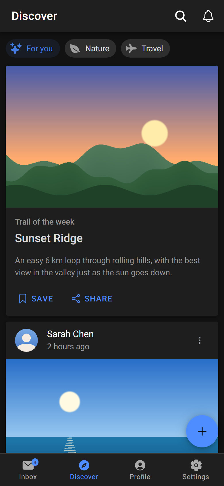
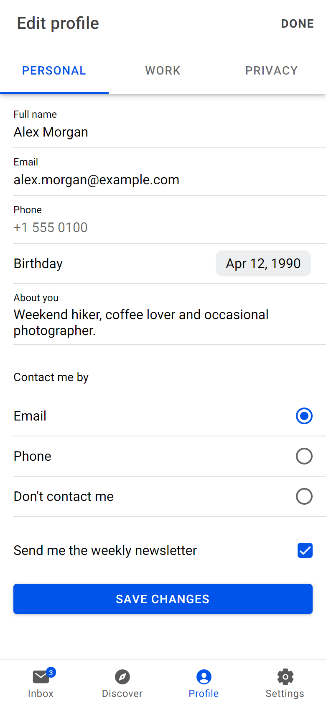
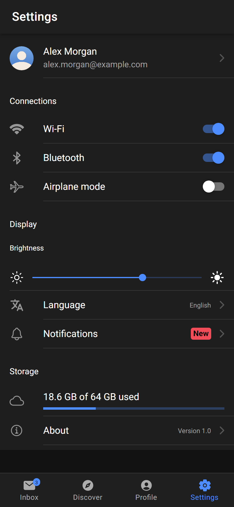

# Avonic

A faithful recreation of [Ionic Framework](https://ionicframework.com/)'s components for
[AvaloniaUI](https://avaloniaui.net/) — mobile and tablet first, desktop supported.

<table>
  <tr>
    <td></td>
    <td></td>
    <td></td>
    <td></td>
  </tr>
</table>

Built only from Avonic controls, rendered by Avalonia, in light and Ionic's dark palette. More in **[PREVIEW.md](PREVIEW.md)**:
every screen in both, and a page for each control.

> **Status: in development, with no release yet.** Every in-scope component of Ionic 9 is done: 90 elements. The router family
> is out of scope, as an Avalonia app routes with its own. Each component's state is in [Status](#status) below; what comes next is
> in [`docs/ROADMAP.md`](docs/ROADMAP.md). v1 was reviewed and discarded; see [`docs/LESSONS_LEARNED.md`](docs/LESSONS_LEARNED.md).

## What "faithful" means here

- **Behaviour** is recreated from Ionic's implementation — gestures, state, events, methods.
- **API** mirrors Ionic's: every prop, event, method and slot from `@ionic/docs` is present or has
  a written reason it isn't (`node tools/ionic-api.js <ion-tag>` generates the checklist).
- **Visuals** recreate Ionic's Material Design (`md`) mode as one skin. Every Ionic CSS variable is
  an `Avonic.*` resource key, so you can restyle without forking templates.
  ([ADR 0001](docs/decisions/0001-single-md-skin.md))

## Status

✅ done · 🚧 in progress · 📋 planned · ❌ won't do. Done means through every step of [`docs/PROCESS.md`](docs/PROCESS.md);
each name links to that component's docs, and its known gaps are in the [open issues](https://github.com/wdcossey/Avonic/issues).

| Component | Done | In progress | Planned | Won't do |
|---|:-:|:-:|:-:|:-:|
| [`ion-ripple-effect`](docs/components/ion-ripple-effect/README.md) | ✅ |  |  |  |
| [`ion-icon`](docs/components/ion-icon/README.md) | ✅ |  |  |  |
| [`ion-label`](docs/components/ion-label/README.md) | ✅ |  |  |  |
| [`ion-note`](docs/components/ion-note/README.md) | ✅ |  |  |  |
| [`ion-text`](docs/components/ion-text/README.md) | ✅ |  |  |  |
| [`ion-badge`](docs/components/ion-badge/README.md) | ✅ |  |  |  |
| [`ion-avatar`](docs/components/ion-avatar/README.md) | ✅ |  |  |  |
| [`ion-thumbnail`](docs/components/ion-thumbnail/README.md) | ✅ |  |  |  |
| [`ion-img`](docs/components/ion-img/README.md) | ✅ |  |  |  |
| [`ion-skeleton-text`](docs/components/ion-skeleton-text/README.md) | ✅ |  |  |  |
| [`ion-spinner`](docs/components/ion-spinner/README.md) | ✅ |  |  |  |
| [`ion-progress-bar`](docs/components/ion-progress-bar/README.md) | ✅ |  |  |  |
| [`ion-chip`](docs/components/ion-chip/README.md) | ✅ |  |  |  |
| [`ion-app`](docs/components/ion-app/README.md) | ✅ |  |  |  |
| [`ion-content`](docs/components/ion-content/README.md) | ✅ |  |  |  |
| [`ion-header`](docs/components/ion-header/README.md) | ✅ |  |  |  |
| [`ion-footer`](docs/components/ion-footer/README.md) | ✅ |  |  |  |
| [`ion-toolbar`](docs/components/ion-toolbar/README.md) | ✅ |  |  |  |
| [`ion-title`](docs/components/ion-title/README.md) | ✅ |  |  |  |
| [`ion-buttons`](docs/components/ion-buttons/README.md) | ✅ |  |  |  |
| [`ion-grid`, `ion-row`, `ion-col`](docs/components/ion-grid/README.md) | ✅ |  |  |  |
| [`ion-card`, `ion-card-header`, `ion-card-title`, `ion-card-subtitle`, `ion-card-content`](docs/components/ion-card/README.md) | ✅ |  |  |  |
| [`ion-split-pane`](docs/components/ion-split-pane/README.md) | ✅ |  |  |  |
| [`ion-list`](docs/components/ion-list/README.md) | ✅ |  |  |  |
| [`ion-list-header`](docs/components/ion-list-header/README.md) | ✅ |  |  |  |
| [`ion-item`](docs/components/ion-item/README.md) | ✅ |  |  |  |
| [`ion-item-divider`](docs/components/ion-item-divider/README.md) | ✅ |  |  |  |
| [`ion-item-group`](docs/components/ion-item-group/README.md) | ✅ |  |  |  |
| [`ion-item-sliding`, `ion-item-options`, `ion-item-option`](docs/components/ion-item-sliding/README.md) | ✅ |  |  |  |
| [`ion-reorder`, `ion-reorder-group`](docs/components/ion-reorder/README.md) | ✅ |  |  |  |
| [`ion-refresher`, `ion-refresher-content`](docs/components/ion-refresher/README.md) | ✅ |  |  |  |
| [`ion-infinite-scroll`, `ion-infinite-scroll-content`](docs/components/ion-infinite-scroll/README.md) | ✅ |  |  |  |
| [`ion-accordion`, `ion-accordion-group`](docs/components/ion-accordion/README.md) | ✅ |  |  |  |
| [`ion-button`](docs/components/ion-button/README.md) | ✅ |  |  |  |
| [`ion-fab`, `ion-fab-button`, `ion-fab-list`](docs/components/ion-fab/README.md) | ✅ |  |  |  |
| [`ion-checkbox`](docs/components/ion-checkbox/README.md) | ✅ |  |  |  |
| [`ion-toggle`](docs/components/ion-toggle/README.md) | ✅ |  |  |  |
| [`ion-radio`, `ion-radio-group`](docs/components/ion-radio/README.md) | ✅ |  |  |  |
| [`ion-range`](docs/components/ion-range/README.md) | ✅ |  |  |  |
| [`ion-input`, `ion-input-password-toggle`](docs/components/ion-input/README.md) | ✅ |  |  |  |
| [`ion-textarea`](docs/components/ion-textarea/README.md) | ✅ |  |  |  |
| [`ion-searchbar`](docs/components/ion-searchbar/README.md) | ✅ |  |  |  |
| [`ion-input-otp`](docs/components/ion-input-otp/README.md) | ✅ |  |  |  |
| [`ion-select`, `ion-select-option`, `ion-select-modal`](docs/components/ion-select/README.md) | ✅ |  |  |  |
| [`ion-segment`, `ion-segment-button`, `ion-segment-view`, `ion-segment-content`](docs/components/ion-segment/README.md) | ✅ |  |  |  |
| [`ion-picker`, `ion-picker-column`, `ion-picker-column-option`](docs/components/ion-picker/README.md) | ✅ |  |  |  |
| [`ion-datetime`](docs/components/ion-datetime/README.md) | ✅ |  |  |  |
| [`ion-datetime-button`](docs/components/ion-datetime-button/README.md) | ✅ |  |  |  |
| [`ion-tabs`, `ion-tab`, `ion-tab-bar`, `ion-tab-button`](docs/components/ion-tabs/README.md) | ✅ |  |  |  |
| [`ion-breadcrumbs`, `ion-breadcrumb`](docs/components/ion-breadcrumbs/README.md) | ✅ |  |  |  |
| [`ion-menu`, `ion-menu-button`, `ion-menu-toggle`](docs/components/ion-menu/README.md) | ✅ |  |  |  |
| [`ion-nav`, `ion-nav-link`](docs/components/ion-nav/README.md) | ✅ |  |  |  |
| [`ion-back-button`](docs/components/ion-back-button/README.md) | ✅ |  |  |  |
| [`ion-backdrop`](docs/components/ion-backdrop/README.md) | ✅ |  |  |  |
| [`ion-alert`](docs/components/ion-alert/README.md) | ✅ |  |  |  |
| [`ion-action-sheet`](docs/components/ion-action-sheet/README.md) | ✅ |  |  |  |
| [`ion-modal`](docs/components/ion-modal/README.md) | ✅ |  |  |  |
| [`ion-popover`](docs/components/ion-popover/README.md) | ✅ |  |  |  |
| [`ion-toast`](docs/components/ion-toast/README.md) | ✅ |  |  |  |
| [`ion-loading`](docs/components/ion-loading/README.md) | ✅ |  |  |  |
| `ion-router`, `ion-route`, `ion-route-redirect`, `ion-router-link`, `ion-router-outlet` ([why](docs/ROADMAP.md#out-of-scope)) |  |  |  | ❌ |
| `ion-picker-legacy` (removed in Ionic 9) |  |  |  | ❌ |

| Work | Done | In progress | Planned | Won't do |
|---|:-:|:-:|:-:|:-:|
| Shared code the last tiers copied ([#266](https://github.com/wdcossey/Avonic/issues/266)) |  |  | 📋 |  |
| A Material 3 theme ([ADR 0003](docs/decisions/0003-material-3-as-a-second-theme.md)) |  |  | 📋 |  |
| Ionic's legacy refresher ([#143](https://github.com/wdcossey/Avonic/issues/143)) |  |  | 📋 |  |
| iOS and macOS heads ([#179](https://github.com/wdcossey/Avonic/issues/179)) |  |  | 📋 |  |
| The sample on desktop and Android | ✅ |  |  |  |
| NuGet packages and a first release |  |  | 📋 |  |
| Ionic's `ios` mode as a skin ([ADR 0001](docs/decisions/0001-single-md-skin.md)) |  |  |  | ❌ |

## Packages

| Package | Contents |
|---|---|
| `Avonic` | Everything — the one most apps want |
| `Avonic.Components` | Controls only, no visual opinion — bring your own theme |
| `Avonic.Themes` | The md-mode theme and resource keys |

Targets .NET 8, Avalonia 12. None is on NuGet yet: until the first release, reference the projects from a clone.

## Building

```sh
npm install                   # Ionic reference material (not committed)
dotnet build Avonic.sln
dotnet test  Avonic.sln
```

## Attribution

Avonic recreates the API, behaviour and Material Design visuals of **Ionic Framework**
(© Ionic, Inc., MIT licensed). It is an independent implementation for the AvaloniaUI ecosystem and
is not affiliated with or endorsed by Ionic, Inc. or the AvaloniaUI team.

Icons are [Ionicons](https://ionic.io/ionicons) (© Ionic, MIT licensed), bundled unmodified. The notice is
in [`src/Avonic.Components/Icons/LICENSE`](src/Avonic.Components/Icons/LICENSE).

## Licence

Apache License 2.0 — see [LICENSE](LICENSE).
