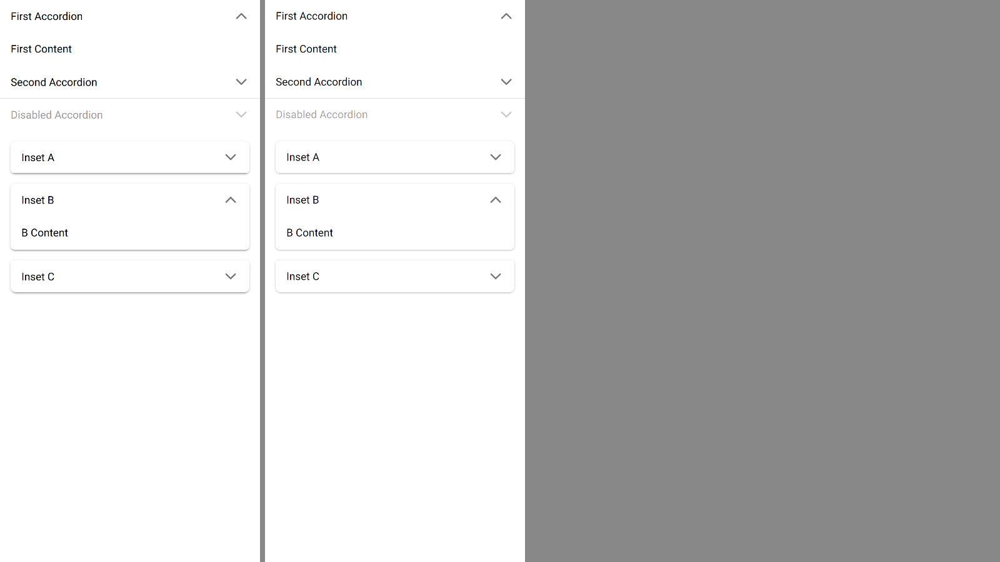

# ion-accordion and ion-accordion-group — Comparison against the web component

> Ionic side: `node tools/ionic-ref/render.js ion-accordion --bare --html '<the snippet below>'` (Chromium, md, 390×844@2x) → [`ref/`](ref/).
> `ref/README.md` holds the exact command, and `ref/page.html` the page. The snippet wraps itself in `ion-app`, with
> `position:static;display:block;contain:none;overflow:visible`.
> Avonic side: `AVONIC_CAPTURE_DIR=… dotnet test` → `AvonicAccordionCaptureTests.Reference_Page` (headless Skia, 2×) → [`compare/`](compare/).
> Not tried in a real window, and not tried on a device.

```html
<ion-app style="position:static;display:block;contain:none;overflow:visible"><div>
<ion-accordion-group value="first">
  <ion-accordion value="first"><ion-item slot="header"><ion-label>First Accordion</ion-label></ion-item><div slot="content" style="padding:16px">First Content</div></ion-accordion>
  <ion-accordion value="second"><ion-item slot="header"><ion-label>Second Accordion</ion-label></ion-item><div slot="content" style="padding:16px">Second Content</div></ion-accordion>
  <ion-accordion value="third" disabled><ion-item slot="header"><ion-label>Disabled Accordion</ion-label></ion-item><div slot="content" style="padding:16px">Third Content</div></ion-accordion>
</ion-accordion-group>
<ion-accordion-group expand="inset" value="b">
  <ion-accordion value="a">…Inset A…</ion-accordion><ion-accordion value="b">…Inset B…</ion-accordion><ion-accordion value="c">…Inset C…</ion-accordion>
</ion-accordion-group>
</div></ion-app>
```

(One line in the real command, with no white space between elements.) The states, the boxes and the timeline below were measured
with throwaway Playwright scripts against the same page: `getComputedStyle` of each accordion, its `#header`, `#content` and the
header item's `.item-native` and `.item-inner`, and, for the timeline, a `requestAnimationFrame` loop after `click()` on the second
header.

## Frames

Ionic on the left, Avonic on the right:



| Ionic | Avonic |
|---|---|
| [ref/page.png](ref/page.png) | [compare/avonic-page.png](compare/avonic-page.png) |

## Boxes

| What | Ionic (measured) | Avonic | |
|---|---|---|---|
| Compact group | 390 × 196 at 0,0 | 390 × 196 | match (capture test) |
| Header item | 48 tall, 49 with its 1 px line | the same | match |
| Open content | 51 tall (16 + 19 + 16) | the content's own height | match |
| Toggle icon | 24 × 24, margin 12 0 12 16, `rgba(0,0,0,0.54)` | the item's end-slot icon rules | match |
| Toggle icon, open | `matrix(-1, 0, 0, -1, 0, 0)` (180°) | `rotate(180deg)` | match |
| Inset group | 358 wide at 16,212, 227 tall | `Rect(16, 212, 358, 227)` | match (capture test) |
| Inset A (first, before an open one) | radius 8 8 6 6, margin 0 | the same | match |
| Inset B (open) | radius 6, margin 16 0 | the same | match |
| Inset C (last, after an open one) | radius 6 6 8 8, margin 0 | the same | match |
| Inset shadow | `0 3 1 -2 .2, 0 2 2 0 .14, 0 1 5 0 .12` | the same | match |
| Header item's bottom border: open, closed, last | 0, 1 px, 0 | the same | match |
| Inset: before an open one, last | 0, 0 | the same | match |
| Disabled | `#header` and `#content` at 0.4, the host at 1 | the same | match |

## Timeline

A click on the second header, with the first open. Chromium's frames are about 16.7 ms apart; Avonic's test clock's are 16.

| Frame | Ionic | Avonic (`TestClock`) |
|---|---|---|
| 1 | both `accordion-animated`; the first `accordion-previous` | the same, at 16 ms |
| 2 | the first's `max-height` set to its height (51) | the same, at 32 ms |
| 3 | the second `accordion-expanding`, the first `accordion-collapsing`; both transitions start | the second shows at 0 at 16 ms; both transitions start at 32 ms |
| … | the height follows `cubic-bezier(0.25, 0.8, 0.5, 1)`: 0.1675, 0.7196, 0.9558 of 51 at 16, 100, 200 ms in | the curve: 0.1615, 0.7199, 0.9558 (the first differs by the transition's start within its frame) |
| end | at 307 ms the last value; at 323 ms `accordion-expanded` / `accordion-collapsed` | the first frame at or after the end: 336 ms |

## Behaviours

| # | Behaviour | Result |
|---|---|---|
| B1 | The group's value opens the matching accordion; with `multiple`, each listed | match |
| B2 | A tap opens a closed one, raises `ionChange`, closes the other | match |
| B3 | A tap on an open one clears the value | match |
| B4 | `multiple` adds or removes, as a new list | match |
| B5 | Setting the value raises no `ionChange` | match |
| B6 | An array without `multiple` warns | match: Avalonia's log, at Warning |
| B7 | `readonly` stops a tap and pointer input; a group's too | match. Group `readonly` set back to false doesn't clear an accordion's own: deliberate |
| B8 | `disabled` stops a tap and dims header and content to 0.4 | match. Deliberate: `IsEnabled` reaches the controls inside, see below |
| B9 | Outside a group nothing opens | match |
| B10 | The header item becomes a button, with no detail and full lines | match |
| B11 | The toggle icon at the end of the item's end slot, unless one is there | match. Deliberate: beside a single control it goes into a `StackPanel` with it |
| B12 | The icon turns 180°, eased once animated | match. The ease is an Avalonia transition, on real time |
| B13 | A click anywhere in the header toggles, once; Enter on the item too | match |
| B14 | No animation before an interaction; then 300 ms, two frames after the request | match, above |
| B15 | `animated` off, on the group or globally, means no animation | match. `prefers-reduced-motion` isn't read: deliberate |
| B16 | A later change of the value animates too | match |
| B17 | `accordion-next`, `accordion-previous` | match, through the inset corners |
| B18 | Inset margins, corners and shadow | match, above. The host's `transition: all` is an Avalonia transition of the margin and the corners, on real time |
| B19 | The header item's border | match, above |
| B20 | Arrow keys, Home and End move focus between headers, wrapping | match. Deliberate: a key that moves focus is handled |
| B21 | Changing an accordion's value works its state out again | match |
| B22 | `aria-expanded` | deliberate: the accordion's own peer has `ExpandCollapse`, as the item's peer is the item's |

## Deliberate differences

- **Disabled reaches the controls inside.** Ionic's `disabled` only sets the accordion's own class, and the item inside isn't
  disabled; Avalonia's `IsEnabled` is inherited. The header item's own disabled opacity (0.3) would dim it again, to 0.12 against
  Ionic's 0.4, so `Styles/Accordion.axaml` keeps an item that isn't disabled itself at 1. A control in the content still dims
  twice if its theme dims it when disabled.
- **`prefers-reduced-motion`** has no equivalent in Avalonia.
- **The host's transitions and the icon's turn** are Avalonia transitions, so they run on real time, not `AvonicConfig`'s clock.
  The content's height, which is the control's own, is on the clock.
- **A request reversed within a frame.** Ionic lets a collapse that hasn't started yet run, even after the group has reopened the
  accordion, and the other way round. Here the pending one is cancelled, so the accordion follows its group.
- **An interrupted transition** starts from the height shown. Not measured against Chromium's own interrupted transitions.
- **The toggle icon beside other content.** A slot holds one child here: a panel there gets the icon added; a single control is put
  into a horizontal `StackPanel` with the icon after it; content that isn't a control gets no icon, and a warning.
