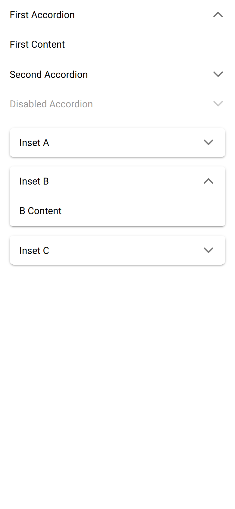
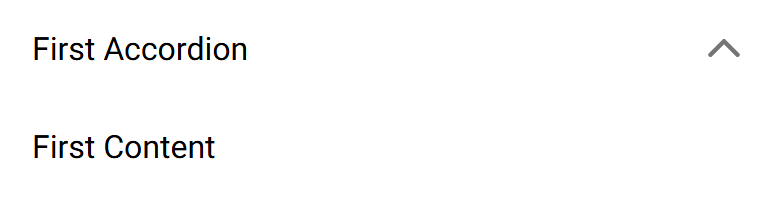

# ion-accordion — reference render (Ionic 8.8.1, md, 390×844@2x)

Generated by `node tools/ionic-ref/render.js ion-accordion --bare --html "<ion-app style=\"position:static;display:block;contain:none;overflow:visible\"><div><ion-accordion-group value=\"first\"><ion-accordion value=\"first\"><ion-item slot=\"header\"><ion-label>First Accordion</ion-label></ion-item><div slot=\"content\" style=\"padding:16px\">First Content</div></ion-accordion><ion-accordion value=\"second\"><ion-item slot=\"header\"><ion-label>Second Accordion</ion-label></ion-item><div slot=\"content\" style=\"padding:16px\">Second Content</div></ion-accordion><ion-accordion value=\"third\" disabled><ion-item slot=\"header\"><ion-label>Disabled Accordion</ion-label></ion-item><div slot=\"content\" style=\"padding:16px\">Third Content</div></ion-accordion></ion-accordion-group><ion-accordion-group expand=\"inset\" value=\"b\"><ion-accordion value=\"a\"><ion-item slot=\"header\"><ion-label>Inset A</ion-label></ion-item><div slot=\"content\" style=\"padding:16px\">A Content</div></ion-accordion><ion-accordion value=\"b\"><ion-item slot=\"header\"><ion-label>Inset B</ion-label></ion-item><div slot=\"content\" style=\"padding:16px\">B Content</div></ion-accordion><ion-accordion value=\"c\"><ion-item slot=\"header\"><ion-label>Inset C</ion-label></ion-item><div slot=\"content\" style=\"padding:16px\">C Content</div></ion-accordion></ion-accordion-group></div></ion-app>"`

```html
<ion-app style="position:static;display:block;contain:none;overflow:visible"><div><ion-accordion-group value="first"><ion-accordion value="first"><ion-item slot="header"><ion-label>First Accordion</ion-label></ion-item><div slot="content" style="padding:16px">First Content</div></ion-accordion><ion-accordion value="second"><ion-item slot="header"><ion-label>Second Accordion</ion-label></ion-item><div slot="content" style="padding:16px">Second Content</div></ion-accordion><ion-accordion value="third" disabled><ion-item slot="header"><ion-label>Disabled Accordion</ion-label></ion-item><div slot="content" style="padding:16px">Third Content</div></ion-accordion></ion-accordion-group><ion-accordion-group expand="inset" value="b"><ion-accordion value="a"><ion-item slot="header"><ion-label>Inset A</ion-label></ion-item><div slot="content" style="padding:16px">A Content</div></ion-accordion><ion-accordion value="b"><ion-item slot="header"><ion-label>Inset B</ion-label></ion-item><div slot="content" style="padding:16px">B Content</div></ion-accordion><ion-accordion value="c"><ion-item slot="header"><ion-label>Inset C</ion-label></ion-item><div slot="content" style="padding:16px">C Content</div></ion-accordion></ion-accordion-group></div></ion-app>
```

 

## Element 1

- attributes: `{"value":"first","class":"md accordion-expanded hydrated"}`
- classes: `md accordion-expanded hydrated`
- rect: `{"x":0,"y":0,"w":390,"h":99}`

### Host computed

| prop | value |
|---|---|
| display | `block` |
| position | `relative` |
| box-sizing | `border-box` |
| width | `390px` |
| height | `99px` |
| min-height | `0px` |
| min-width | `0px` |
| padding | `0px` |
| margin | `0px` |
| border | `0px none rgb(0, 0, 0)` |
| border-radius | `0px` |
| background-color | `rgb(255, 255, 255)` |
| color | `rgb(0, 0, 0)` |
| font-size | `16px` |
| font-weight | `400` |
| font-family | `Roboto, "Helvetica Neue", sans-serif` |
| line-height | `normal` |
| letter-spacing | `normal` |
| text-transform | `none` |
| opacity | `1` |
| overflow | `hidden` |
| contain | `none` |
| pointer-events | `auto` |
| transition | `all` |
| transform | `none` |
| box-shadow | `none` |
| outline | `rgb(0, 0, 0) none 0px` |
| cursor | `auto` |

### Shadow parts

#### part="header expanded" (`div`) rect `{"x":0,"y":0,"w":390,"h":48}`

| prop | value |
|---|---|
| display | `block` |
| position | `static` |
| box-sizing | `content-box` |
| width | `390px` |
| height | `48px` |
| min-height | `0px` |
| min-width | `0px` |
| padding | `0px` |
| margin | `0px` |
| border | `0px none rgb(0, 0, 0)` |
| border-radius | `0px` |
| background-color | `rgba(0, 0, 0, 0)` |
| color | `rgb(0, 0, 0)` |
| font-size | `16px` |
| font-weight | `400` |
| font-family | `Roboto, "Helvetica Neue", sans-serif` |
| line-height | `normal` |
| letter-spacing | `normal` |
| text-transform | `none` |
| opacity | `1` |
| overflow | `visible` |
| contain | `none` |
| pointer-events | `auto` |
| transition | `all` |
| transform | `none` |
| box-shadow | `none` |
| outline | `rgb(0, 0, 0) none 0px` |
| cursor | `auto` |

#### part="content expanded" (`div`) rect `{"x":0,"y":48,"w":390,"h":51}`

| prop | value |
|---|---|
| display | `block` |
| position | `static` |
| box-sizing | `content-box` |
| width | `390px` |
| height | `51px` |
| min-height | `0px` |
| min-width | `0px` |
| padding | `0px` |
| margin | `0px` |
| border | `0px none rgb(0, 0, 0)` |
| border-radius | `0px` |
| background-color | `rgba(0, 0, 0, 0)` |
| color | `rgb(0, 0, 0)` |
| font-size | `16px` |
| font-weight | `400` |
| font-family | `Roboto, "Helvetica Neue", sans-serif` |
| line-height | `normal` |
| letter-spacing | `normal` |
| text-transform | `none` |
| opacity | `1` |
| overflow | `hidden` |
| contain | `none` |
| pointer-events | `auto` |
| transition | `all` |
| transform | `none` |
| box-shadow | `none` |
| outline | `rgb(0, 0, 0) none 0px` |
| cursor | `auto` |

### DOM tree

```
<ion-accordion>
  #shadow-root
    <div#header part="header expanded">
      <slot name="header">
    <div#content part="content expanded">
      <div#content-wrapper>
        <slot name="content">
  <ion-item.item.md.ion-focusable.hydrated.item-label.item-lines-full.ion-activatable slot="header">
    #shadow-root
      <button.item-native part="native">
        <slot name="start">
        <div.item-inner part="inner">
          <div.input-wrapper part="container">
            <slot name="">
          <slot name="end">
        <ion-ripple-effect.md.hydrated>
          #shadow-root
    <ion-label.sc-ion-label-md-h.md.sc-ion-label-md.sc-ion-label-md-s.hydrated>
    <ion-icon.ion-accordion-toggle-icon.md.hydrated slot="end">
      #shadow-root
        <div.icon-inner>
          <svg>
            <path>
  <div slot="content">
```

## Element 2

- attributes: `{"value":"second","class":"md accordion-collapsed accordion-next hydrated"}`
- classes: `md accordion-collapsed accordion-next hydrated`
- rect: `{"x":0,"y":99,"w":390,"h":49}`

### Host computed

| prop | value |
|---|---|
| display | `block` |
| position | `relative` |
| box-sizing | `border-box` |
| width | `390px` |
| height | `49px` |
| min-height | `0px` |
| min-width | `0px` |
| padding | `0px` |
| margin | `0px` |
| border | `0px none rgb(0, 0, 0)` |
| border-radius | `0px` |
| background-color | `rgb(255, 255, 255)` |
| color | `rgb(0, 0, 0)` |
| font-size | `16px` |
| font-weight | `400` |
| font-family | `Roboto, "Helvetica Neue", sans-serif` |
| line-height | `normal` |
| letter-spacing | `normal` |
| text-transform | `none` |
| opacity | `1` |
| overflow | `hidden` |
| contain | `none` |
| pointer-events | `auto` |
| transition | `all` |
| transform | `none` |
| box-shadow | `none` |
| outline | `rgb(0, 0, 0) none 0px` |
| cursor | `auto` |

### Shadow parts

#### part="header" (`div`) rect `{"x":0,"y":99,"w":390,"h":49}`

| prop | value |
|---|---|
| display | `block` |
| position | `static` |
| box-sizing | `content-box` |
| width | `390px` |
| height | `49px` |
| min-height | `0px` |
| min-width | `0px` |
| padding | `0px` |
| margin | `0px` |
| border | `0px none rgb(0, 0, 0)` |
| border-radius | `0px` |
| background-color | `rgba(0, 0, 0, 0)` |
| color | `rgb(0, 0, 0)` |
| font-size | `16px` |
| font-weight | `400` |
| font-family | `Roboto, "Helvetica Neue", sans-serif` |
| line-height | `normal` |
| letter-spacing | `normal` |
| text-transform | `none` |
| opacity | `1` |
| overflow | `visible` |
| contain | `none` |
| pointer-events | `auto` |
| transition | `all` |
| transform | `none` |
| box-shadow | `none` |
| outline | `rgb(0, 0, 0) none 0px` |
| cursor | `auto` |

#### part="content" (`div`) rect `{"x":0,"y":0,"w":0,"h":0}`

| prop | value |
|---|---|
| display | `none` |
| position | `static` |
| box-sizing | `content-box` |
| width | `auto` |
| height | `auto` |
| min-height | `0px` |
| min-width | `0px` |
| padding | `0px` |
| margin | `0px` |
| border | `0px none rgb(0, 0, 0)` |
| border-radius | `0px` |
| background-color | `rgba(0, 0, 0, 0)` |
| color | `rgb(0, 0, 0)` |
| font-size | `16px` |
| font-weight | `400` |
| font-family | `Roboto, "Helvetica Neue", sans-serif` |
| line-height | `normal` |
| letter-spacing | `normal` |
| text-transform | `none` |
| opacity | `1` |
| overflow | `hidden` |
| contain | `none` |
| pointer-events | `auto` |
| transition | `all` |
| transform | `none` |
| box-shadow | `none` |
| outline | `rgb(0, 0, 0) none 0px` |
| cursor | `auto` |

### DOM tree

```
<ion-accordion>
  #shadow-root
    <div#header part="header">
      <slot name="header">
    <div#content part="content">
      <div#content-wrapper>
        <slot name="content">
  <ion-item.item.md.ion-focusable.hydrated.item-label.item-lines-full.ion-activatable slot="header">
    #shadow-root
      <button.item-native part="native">
        <slot name="start">
        <div.item-inner part="inner">
          <div.input-wrapper part="container">
            <slot name="">
          <slot name="end">
        <ion-ripple-effect.md.hydrated>
          #shadow-root
    <ion-label.sc-ion-label-md-h.md.sc-ion-label-md.sc-ion-label-md-s.hydrated>
    <ion-icon.ion-accordion-toggle-icon.md.hydrated slot="end">
      #shadow-root
        <div.icon-inner>
          <svg>
            <path>
  <div slot="content">
```

## Element 3

- attributes: `{"value":"third","disabled":"","class":"md accordion-collapsed accordion-disabled hydrated","tabindex":"-1"}`
- classes: `md accordion-collapsed accordion-disabled hydrated`
- rect: `{"x":0,"y":148,"w":390,"h":48}`

### Host computed

| prop | value |
|---|---|
| display | `block` |
| position | `relative` |
| box-sizing | `border-box` |
| width | `390px` |
| height | `48px` |
| min-height | `0px` |
| min-width | `0px` |
| padding | `0px` |
| margin | `0px` |
| border | `0px none rgb(0, 0, 0)` |
| border-radius | `0px` |
| background-color | `rgb(255, 255, 255)` |
| color | `rgb(0, 0, 0)` |
| font-size | `16px` |
| font-weight | `400` |
| font-family | `Roboto, "Helvetica Neue", sans-serif` |
| line-height | `normal` |
| letter-spacing | `normal` |
| text-transform | `none` |
| opacity | `1` |
| overflow | `hidden` |
| contain | `none` |
| pointer-events | `auto` |
| transition | `all` |
| transform | `none` |
| box-shadow | `none` |
| outline | `rgb(0, 0, 0) none 0px` |
| cursor | `auto` |

### Shadow parts

#### part="header" (`div`) rect `{"x":0,"y":148,"w":390,"h":48}`

| prop | value |
|---|---|
| display | `block` |
| position | `static` |
| box-sizing | `content-box` |
| width | `390px` |
| height | `48px` |
| min-height | `0px` |
| min-width | `0px` |
| padding | `0px` |
| margin | `0px` |
| border | `0px none rgb(0, 0, 0)` |
| border-radius | `0px` |
| background-color | `rgba(0, 0, 0, 0)` |
| color | `rgb(0, 0, 0)` |
| font-size | `16px` |
| font-weight | `400` |
| font-family | `Roboto, "Helvetica Neue", sans-serif` |
| line-height | `normal` |
| letter-spacing | `normal` |
| text-transform | `none` |
| opacity | `0.4` |
| overflow | `visible` |
| contain | `none` |
| pointer-events | `none` |
| transition | `all` |
| transform | `none` |
| box-shadow | `none` |
| outline | `rgb(0, 0, 0) none 0px` |
| cursor | `auto` |

#### part="content" (`div`) rect `{"x":0,"y":0,"w":0,"h":0}`

| prop | value |
|---|---|
| display | `none` |
| position | `static` |
| box-sizing | `content-box` |
| width | `auto` |
| height | `auto` |
| min-height | `0px` |
| min-width | `0px` |
| padding | `0px` |
| margin | `0px` |
| border | `0px none rgb(0, 0, 0)` |
| border-radius | `0px` |
| background-color | `rgba(0, 0, 0, 0)` |
| color | `rgb(0, 0, 0)` |
| font-size | `16px` |
| font-weight | `400` |
| font-family | `Roboto, "Helvetica Neue", sans-serif` |
| line-height | `normal` |
| letter-spacing | `normal` |
| text-transform | `none` |
| opacity | `0.4` |
| overflow | `hidden` |
| contain | `none` |
| pointer-events | `none` |
| transition | `all` |
| transform | `none` |
| box-shadow | `none` |
| outline | `rgb(0, 0, 0) none 0px` |
| cursor | `auto` |

### DOM tree

```
<ion-accordion>
  #shadow-root
    <div#header part="header">
      <slot name="header">
    <div#content part="content">
      <div#content-wrapper>
        <slot name="content">
  <ion-item.item.md.ion-focusable.hydrated.item-label.item-lines-full.ion-activatable slot="header">
    #shadow-root
      <button.item-native part="native">
        <slot name="start">
        <div.item-inner part="inner">
          <div.input-wrapper part="container">
            <slot name="">
          <slot name="end">
        <ion-ripple-effect.md.hydrated>
          #shadow-root
    <ion-label.sc-ion-label-md-h.md.sc-ion-label-md.sc-ion-label-md-s.hydrated>
    <ion-icon.ion-accordion-toggle-icon.md.hydrated slot="end">
      #shadow-root
        <div.icon-inner>
          <svg>
            <path>
  <div slot="content">
```

## Element 4

- attributes: `{"value":"a","class":"md accordion-collapsed accordion-previous hydrated"}`
- classes: `md accordion-collapsed accordion-previous hydrated`
- rect: `{"x":16,"y":212,"w":358,"h":48}`

### Host computed

| prop | value |
|---|---|
| display | `block` |
| position | `relative` |
| box-sizing | `border-box` |
| width | `358px` |
| height | `48px` |
| min-height | `0px` |
| min-width | `0px` |
| padding | `0px` |
| margin | `0px` |
| border | `0px none rgb(0, 0, 0)` |
| border-radius | `8px 8px 6px 6px` |
| background-color | `rgb(255, 255, 255)` |
| color | `rgb(0, 0, 0)` |
| font-size | `16px` |
| font-weight | `400` |
| font-family | `Roboto, "Helvetica Neue", sans-serif` |
| line-height | `normal` |
| letter-spacing | `normal` |
| text-transform | `none` |
| opacity | `1` |
| overflow | `hidden` |
| contain | `none` |
| pointer-events | `auto` |
| transition | `all` |
| transform | `none` |
| box-shadow | `rgba(0, 0, 0, 0.2) 0px 3px 1px -2px, rgba(0, 0, 0, 0.14) 0px 2px 2px 0px, rgba(0, 0, 0, 0.12) 0px 1px 5px 0px` |
| outline | `rgb(0, 0, 0) none 0px` |
| cursor | `auto` |

### Shadow parts

#### part="header" (`div`) rect `{"x":16,"y":212,"w":358,"h":48}`

| prop | value |
|---|---|
| display | `block` |
| position | `static` |
| box-sizing | `content-box` |
| width | `358px` |
| height | `48px` |
| min-height | `0px` |
| min-width | `0px` |
| padding | `0px` |
| margin | `0px` |
| border | `0px none rgb(0, 0, 0)` |
| border-radius | `0px` |
| background-color | `rgba(0, 0, 0, 0)` |
| color | `rgb(0, 0, 0)` |
| font-size | `16px` |
| font-weight | `400` |
| font-family | `Roboto, "Helvetica Neue", sans-serif` |
| line-height | `normal` |
| letter-spacing | `normal` |
| text-transform | `none` |
| opacity | `1` |
| overflow | `visible` |
| contain | `none` |
| pointer-events | `auto` |
| transition | `all` |
| transform | `none` |
| box-shadow | `none` |
| outline | `rgb(0, 0, 0) none 0px` |
| cursor | `auto` |

#### part="content" (`div`) rect `{"x":0,"y":0,"w":0,"h":0}`

| prop | value |
|---|---|
| display | `none` |
| position | `static` |
| box-sizing | `content-box` |
| width | `auto` |
| height | `auto` |
| min-height | `0px` |
| min-width | `0px` |
| padding | `0px` |
| margin | `0px` |
| border | `0px none rgb(0, 0, 0)` |
| border-radius | `0px` |
| background-color | `rgba(0, 0, 0, 0)` |
| color | `rgb(0, 0, 0)` |
| font-size | `16px` |
| font-weight | `400` |
| font-family | `Roboto, "Helvetica Neue", sans-serif` |
| line-height | `normal` |
| letter-spacing | `normal` |
| text-transform | `none` |
| opacity | `1` |
| overflow | `hidden` |
| contain | `none` |
| pointer-events | `auto` |
| transition | `all` |
| transform | `none` |
| box-shadow | `none` |
| outline | `rgb(0, 0, 0) none 0px` |
| cursor | `auto` |

### DOM tree

```
<ion-accordion>
  #shadow-root
    <div#header part="header">
      <slot name="header">
    <div#content part="content">
      <div#content-wrapper>
        <slot name="content">
  <ion-item.item.md.ion-focusable.hydrated.item-label.item-lines-full.ion-activatable slot="header">
    #shadow-root
      <button.item-native part="native">
        <slot name="start">
        <div.item-inner part="inner">
          <div.input-wrapper part="container">
            <slot name="">
          <slot name="end">
        <ion-ripple-effect.md.hydrated>
          #shadow-root
    <ion-label.sc-ion-label-md-h.md.sc-ion-label-md.sc-ion-label-md-s.hydrated>
    <ion-icon.ion-accordion-toggle-icon.md.hydrated slot="end">
      #shadow-root
        <div.icon-inner>
          <svg>
            <path>
  <div slot="content">
```

## Element 5

- attributes: `{"value":"b","class":"md accordion-expanded hydrated"}`
- classes: `md accordion-expanded hydrated`
- rect: `{"x":16,"y":276,"w":358,"h":99}`

### Host computed

| prop | value |
|---|---|
| display | `block` |
| position | `relative` |
| box-sizing | `border-box` |
| width | `358px` |
| height | `99px` |
| min-height | `0px` |
| min-width | `0px` |
| padding | `0px` |
| margin | `16px 0px` |
| border | `0px none rgb(0, 0, 0)` |
| border-radius | `6px` |
| background-color | `rgb(255, 255, 255)` |
| color | `rgb(0, 0, 0)` |
| font-size | `16px` |
| font-weight | `400` |
| font-family | `Roboto, "Helvetica Neue", sans-serif` |
| line-height | `normal` |
| letter-spacing | `normal` |
| text-transform | `none` |
| opacity | `1` |
| overflow | `hidden` |
| contain | `none` |
| pointer-events | `auto` |
| transition | `all` |
| transform | `none` |
| box-shadow | `rgba(0, 0, 0, 0.2) 0px 3px 1px -2px, rgba(0, 0, 0, 0.14) 0px 2px 2px 0px, rgba(0, 0, 0, 0.12) 0px 1px 5px 0px` |
| outline | `rgb(0, 0, 0) none 0px` |
| cursor | `auto` |

### Shadow parts

#### part="header expanded" (`div`) rect `{"x":16,"y":276,"w":358,"h":48}`

| prop | value |
|---|---|
| display | `block` |
| position | `static` |
| box-sizing | `content-box` |
| width | `358px` |
| height | `48px` |
| min-height | `0px` |
| min-width | `0px` |
| padding | `0px` |
| margin | `0px` |
| border | `0px none rgb(0, 0, 0)` |
| border-radius | `0px` |
| background-color | `rgba(0, 0, 0, 0)` |
| color | `rgb(0, 0, 0)` |
| font-size | `16px` |
| font-weight | `400` |
| font-family | `Roboto, "Helvetica Neue", sans-serif` |
| line-height | `normal` |
| letter-spacing | `normal` |
| text-transform | `none` |
| opacity | `1` |
| overflow | `visible` |
| contain | `none` |
| pointer-events | `auto` |
| transition | `all` |
| transform | `none` |
| box-shadow | `none` |
| outline | `rgb(0, 0, 0) none 0px` |
| cursor | `auto` |

#### part="content expanded" (`div`) rect `{"x":16,"y":324,"w":358,"h":51}`

| prop | value |
|---|---|
| display | `block` |
| position | `static` |
| box-sizing | `content-box` |
| width | `358px` |
| height | `51px` |
| min-height | `0px` |
| min-width | `0px` |
| padding | `0px` |
| margin | `0px` |
| border | `0px none rgb(0, 0, 0)` |
| border-radius | `0px` |
| background-color | `rgba(0, 0, 0, 0)` |
| color | `rgb(0, 0, 0)` |
| font-size | `16px` |
| font-weight | `400` |
| font-family | `Roboto, "Helvetica Neue", sans-serif` |
| line-height | `normal` |
| letter-spacing | `normal` |
| text-transform | `none` |
| opacity | `1` |
| overflow | `hidden` |
| contain | `none` |
| pointer-events | `auto` |
| transition | `all` |
| transform | `none` |
| box-shadow | `none` |
| outline | `rgb(0, 0, 0) none 0px` |
| cursor | `auto` |

### DOM tree

```
<ion-accordion>
  #shadow-root
    <div#header part="header expanded">
      <slot name="header">
    <div#content part="content expanded">
      <div#content-wrapper>
        <slot name="content">
  <ion-item.item.md.ion-focusable.hydrated.item-label.item-lines-full.ion-activatable slot="header">
    #shadow-root
      <button.item-native part="native">
        <slot name="start">
        <div.item-inner part="inner">
          <div.input-wrapper part="container">
            <slot name="">
          <slot name="end">
        <ion-ripple-effect.md.hydrated>
          #shadow-root
    <ion-label.sc-ion-label-md-h.md.sc-ion-label-md.sc-ion-label-md-s.hydrated>
    <ion-icon.ion-accordion-toggle-icon.md.hydrated slot="end">
      #shadow-root
        <div.icon-inner>
          <svg>
            <path>
  <div slot="content">
```

## Element 6

- attributes: `{"value":"c","class":"md accordion-collapsed accordion-next hydrated"}`
- classes: `md accordion-collapsed accordion-next hydrated`
- rect: `{"x":16,"y":391,"w":358,"h":48}`

### Host computed

| prop | value |
|---|---|
| display | `block` |
| position | `relative` |
| box-sizing | `border-box` |
| width | `358px` |
| height | `48px` |
| min-height | `0px` |
| min-width | `0px` |
| padding | `0px` |
| margin | `0px` |
| border | `0px none rgb(0, 0, 0)` |
| border-radius | `6px 6px 8px 8px` |
| background-color | `rgb(255, 255, 255)` |
| color | `rgb(0, 0, 0)` |
| font-size | `16px` |
| font-weight | `400` |
| font-family | `Roboto, "Helvetica Neue", sans-serif` |
| line-height | `normal` |
| letter-spacing | `normal` |
| text-transform | `none` |
| opacity | `1` |
| overflow | `hidden` |
| contain | `none` |
| pointer-events | `auto` |
| transition | `all` |
| transform | `none` |
| box-shadow | `rgba(0, 0, 0, 0.2) 0px 3px 1px -2px, rgba(0, 0, 0, 0.14) 0px 2px 2px 0px, rgba(0, 0, 0, 0.12) 0px 1px 5px 0px` |
| outline | `rgb(0, 0, 0) none 0px` |
| cursor | `auto` |

### Shadow parts

#### part="header" (`div`) rect `{"x":16,"y":391,"w":358,"h":48}`

| prop | value |
|---|---|
| display | `block` |
| position | `static` |
| box-sizing | `content-box` |
| width | `358px` |
| height | `48px` |
| min-height | `0px` |
| min-width | `0px` |
| padding | `0px` |
| margin | `0px` |
| border | `0px none rgb(0, 0, 0)` |
| border-radius | `0px` |
| background-color | `rgba(0, 0, 0, 0)` |
| color | `rgb(0, 0, 0)` |
| font-size | `16px` |
| font-weight | `400` |
| font-family | `Roboto, "Helvetica Neue", sans-serif` |
| line-height | `normal` |
| letter-spacing | `normal` |
| text-transform | `none` |
| opacity | `1` |
| overflow | `visible` |
| contain | `none` |
| pointer-events | `auto` |
| transition | `all` |
| transform | `none` |
| box-shadow | `none` |
| outline | `rgb(0, 0, 0) none 0px` |
| cursor | `auto` |

#### part="content" (`div`) rect `{"x":0,"y":0,"w":0,"h":0}`

| prop | value |
|---|---|
| display | `none` |
| position | `static` |
| box-sizing | `content-box` |
| width | `auto` |
| height | `auto` |
| min-height | `0px` |
| min-width | `0px` |
| padding | `0px` |
| margin | `0px` |
| border | `0px none rgb(0, 0, 0)` |
| border-radius | `0px` |
| background-color | `rgba(0, 0, 0, 0)` |
| color | `rgb(0, 0, 0)` |
| font-size | `16px` |
| font-weight | `400` |
| font-family | `Roboto, "Helvetica Neue", sans-serif` |
| line-height | `normal` |
| letter-spacing | `normal` |
| text-transform | `none` |
| opacity | `1` |
| overflow | `hidden` |
| contain | `none` |
| pointer-events | `auto` |
| transition | `all` |
| transform | `none` |
| box-shadow | `none` |
| outline | `rgb(0, 0, 0) none 0px` |
| cursor | `auto` |

### DOM tree

```
<ion-accordion>
  #shadow-root
    <div#header part="header">
      <slot name="header">
    <div#content part="content">
      <div#content-wrapper>
        <slot name="content">
  <ion-item.item.md.ion-focusable.hydrated.item-label.item-lines-full.ion-activatable slot="header">
    #shadow-root
      <button.item-native part="native">
        <slot name="start">
        <div.item-inner part="inner">
          <div.input-wrapper part="container">
            <slot name="">
          <slot name="end">
        <ion-ripple-effect.md.hydrated>
          #shadow-root
    <ion-label.sc-ion-label-md-h.md.sc-ion-label-md.sc-ion-label-md-s.hydrated>
    <ion-icon.ion-accordion-toggle-icon.md.hydrated slot="end">
      #shadow-root
        <div.icon-inner>
          <svg>
            <path>
  <div slot="content">
```
