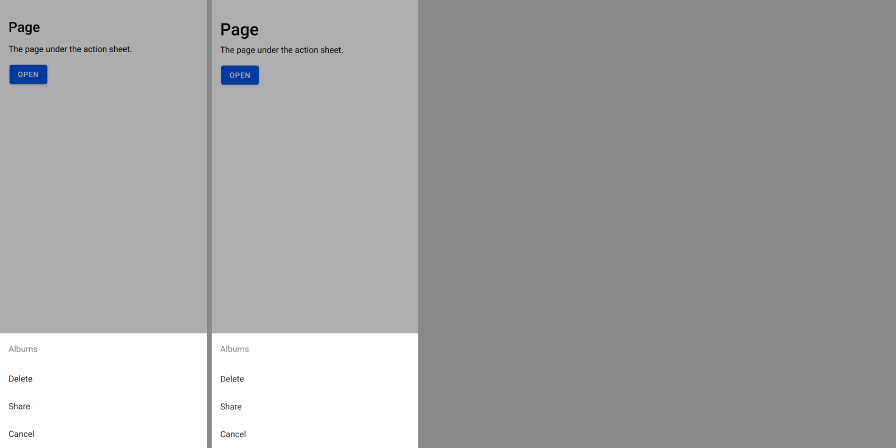
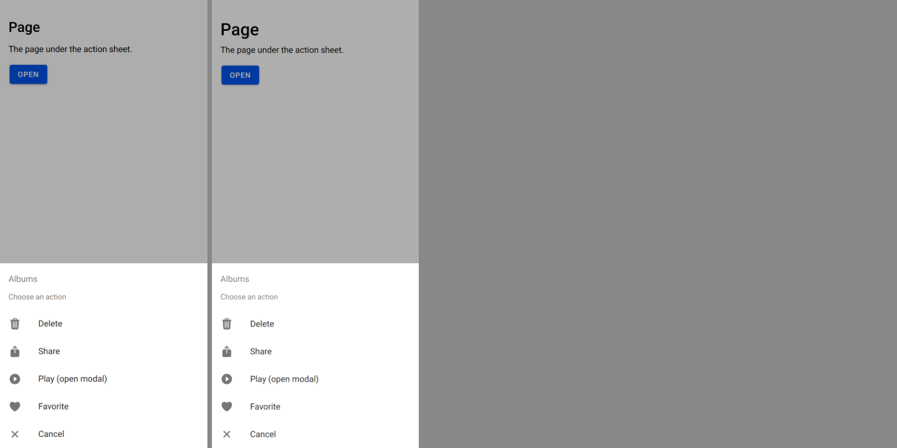
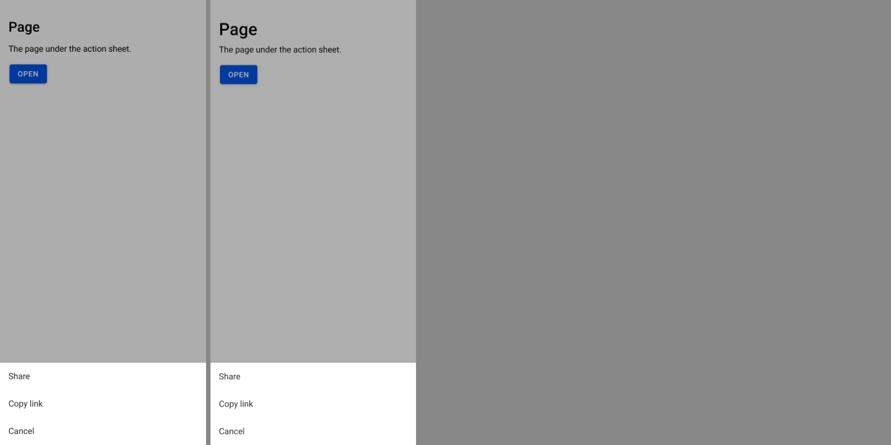
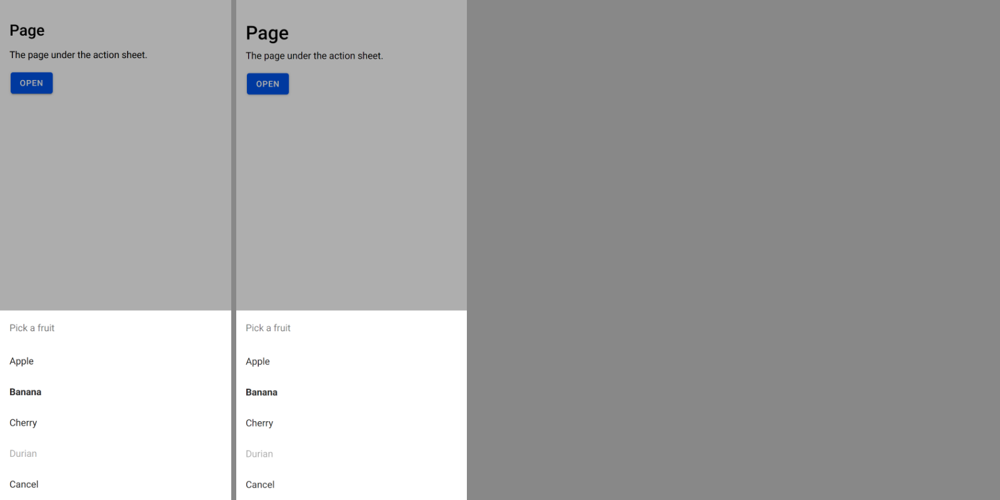
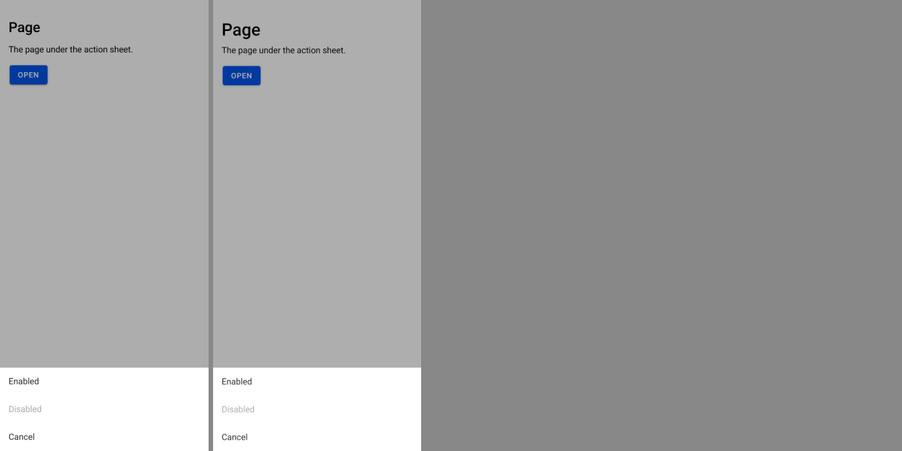
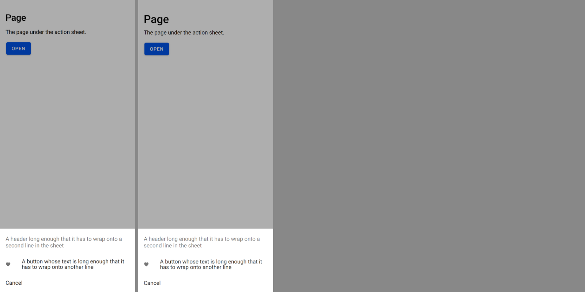
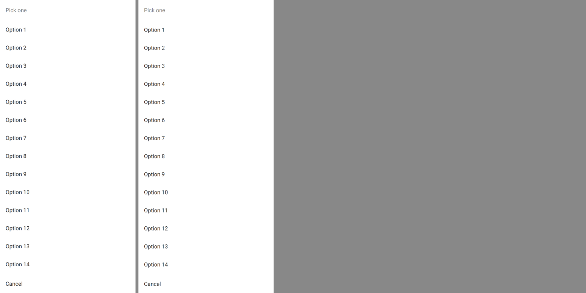
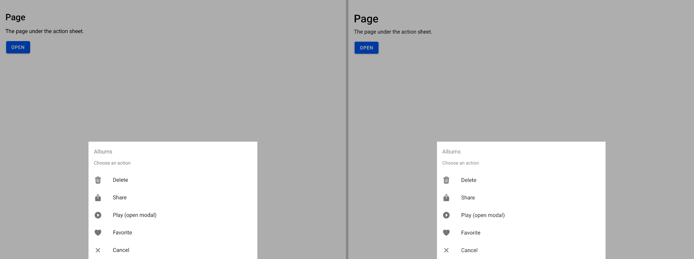
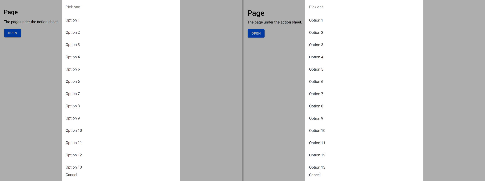

# ion-action-sheet — Comparison

Ionic 9.0.11, md, headless Chromium, beside Avonic headless (Skia) at the same size and 2x. An action sheet's buttons are a
JavaScript property, which `render.js --html` can't set, so the Ionic side comes from one measurement script on `render.js`'s phone
(390 x 844 at 2x, mobile and touch, Roboto from `tools/fonts/roboto/`) and at 1024 x 768, which waits as `render.js` does
(`tools/ionic-ref/settle.js`). It builds an `ion-action-sheet` in an `ion-app` page with a heading, a paragraph and an `ion-button`,
sets its properties from script, and presents it from a real tap on the button, through `trigger`. The raw output is
[`ref/layout.json`](ref/layout.json) (every box, colour and font of each case, and the enter and leave frames with the animation's
own `currentTime`) and [`ref/behaviour.json`](ref/behaviour.json) (real keys and taps), with a frame of each case in [`ref/`](ref/).
The script isn't in the repo, as the swarm brief asks; its cases are the `M` rows of PLAN.md's Measured section. The radios are
measured twice: in a sheet made as the controller makes one (`hasController`, as `ion-select` does), and inline, where Ionic loses
the checked radio ([ionic-issues.md](../../infra/ionic-issues.md)).

Avonic's frames are `AvonicActionSheetCaptureTests`, saved in [`compare/`](compare/), each asserting the boxes beside them. Not tried
in a real window: `tools/real-window/drive.ps1` has an `ion-action-sheet` section for the batch's runner.

| Header, two buttons, Cancel | Header, sub header, icons | No header |
|---|---|---|
|  |  |  |

| Radios, as the select's | Disabled | A long header and label |
|---|---|---|
|  |  |  |

| Thirty options | Tablet | Tablet, thirty options |
|---|---|---|
|  |  |  |

Ionic's on the left of each. The page under the sheet differs a little (Ionic's `h1` from `typography.css`); the sheet is what's
compared.

## Visual

Boxes are x, y, width, height in the window, asserted by the capture tests and `AvonicActionSheetTests` within 0.5 px unless said.

| | Ionic | Avonic | |
|---|---|---|---|
| Basic: wrapper, group, title, buttons, cancel | 0, 628, 390 x 216; group 164; title 60; buttons 52 at 688 and 740; cancel at 792 | the same | Match (asserted) |
| Title text | at 16, 648 (its glyphs 19 high, `line-height: normal`) | the same | Match (asserted) |
| Icons: wrapper, title with a sub title | 0, 496, 390 x 348; title 88; sub title at 551, 16 high | the same | Match (asserted) |
| Icons: icon, label | 24 x 24 at 16, button top + 14; label at 72 | the same | Match (asserted) |
| A button's line | `line-height: 1`, 16 high, centred in the 52 (Chromium centres a `<button>`'s content): its line box 18 down | the same, the line box 18 down within layout rounding | Match (asserted) |
| No header | 0, 688, 390 x 156 | the same | Match (asserted) |
| Thirty options | wrapper 0, 0, 390 x 844; group 792, scrolling 1620; cancel at 792 | the same | Match (asserted) |
| Tablet | 262, 420, 500 x 348; icon at 278, 522 | the same | Match (asserted) |
| Tablet, thirty | 262, 0, 500 x 768; group 716 | the same | Match (asserted) |
| Radios | wrapper 0, 524, 390 x 320; Banana bold; Durian at 0.4 | the same | Match (asserted) |
| A long header and label | title 75 (two lines of 19); the button 56 (two lines of 16); its icon shrunk to 14.78 wide | the same; the icon within 1 | Match (asserted), `FlexRow`'s `flex-shrink` |
| Colours | white groups; title, sub title and icons `rgba(0,0,0,0.54)`; buttons `#262626`; backdrop 0.32 black | the same keys | Match (asserted) |
| Focused button | `::after` `#262626` at 0.12 | the same | Match (asserted) |

## Behaviour

| # | Behaviour | Ionic | Avonic | |
|---|---|---|---|---|
| B1 | Enter | M1: 400 ms `cubic-bezier(.36,.66,.04,1)`; the wrapper 216 to 0, 66.735 at 100 ms; the backdrop 0.01 to 0.32, 0.2242 at 100 ms; `pointer-events: none` until the end | The same values at each frame of the test clock, from `CubicBezierEasing`, which gives Chromium's two values at 100 ms | Match |
| B2 | Leave | M2: 450 ms, the same curve, the backdrop to 0, the wrapper to 216; at rest `translate3d(0, 100%, 0)` | The same; the wrapper rests at `translateY(100%)` after | Match |
| B3 | Events | M3: `ionActionSheetWillPresent`, `willPresent`, `ionActionSheetDidPresent`, `didPresent`, then the dismiss pair with `{data, role}` | The same order, each bubbling | Match |
| B4 | Focus | M12: the host at present; the opener after | The same | Match |
| B5 | A button | M15: the handler, then `{data, role}`; false, or a promise of false, keeps it open; a cancel role dismisses at once | The same; a `Task` or `ValueTask` is awaited | Match |
| B6 | The cancel handler | M16: once for Cancel, Escape and the backdrop, its answer ignored; not for another role | The same | Match |
| B7 | What's rendered | M4 to M6: the first cancel button last, in its own group; a string is a plain button | The same; another cancel button isn't rendered, as Ionic's `filter` and `find` leave it out | Match |
| B8 | Disabled | M10: 0.4, not tappable; the cancel button's `disabled` ignored | The same, its `htmlAttributes.disabled` honoured, as Ionic spreads them there; its own `disabled` takes its ripple and focus highlight away, as `buttonClass` does | Match |
| B9 | Radios | M9, M14: the checked one bold, the one tab stop; arrows move, check and focus, skip a disabled one, wrap, no dismiss; Space checks and clicks, on the press; none of it once a dismiss starts | The same | Match. In Ionic an inline sheet loses its checked radio at present; Avonic keeps it: **deliberate difference**, recorded in [ionic-issues.md](../../infra/ionic-issues.md) |
| B10 | Tab | M13: host, each button, Cancel, round through the sentinels; Shift+Tab back round | The same | Match |
| B11 | `backdropDismiss` | M16 | The same, Escape and back too | Match |
| B12 | Layout | M4 to M11; the container capped at the window less the safe areas whatever `--max-height` is | Above; the same cap | Match |
| B13 | Title | rendered for any header but `undefined`; the sub title inside it, when not empty | The same: an empty header takes no line, as an empty text node makes none | Match |
| B14 | States | focused 0.12, hover 0.04 (`any-hover`), selected 0, activated 0 (the ripple shows the press), disabled 0.4 | The same keys; hover for a mouse or a pen (`:ion-hover`) | Match |
| B15 | Accessibility | `role="dialog"`, `aria-modal`, `aria-labelledby` the title; buttons named by text or `aria-label`, `id`; `role="radio"` with `aria-checked`; the group `role="radiogroup"` | A `Window` peer named by the header and sub header, else `aria-label`; buttons named by text or `aria-label`, `AutomationId`; radios toggleable | Match, as near as Avalonia's control types go; there's no `radiogroup` type for the group (**gap**) |
| B16 | `isOpen`, `trigger`, changes while open | The overlay's; the watchers re-render | The base's; a new list, or a change to an observable one, renders again, focus kept in place | Match |
| B17 | Scrolling | M7: the group scrolls, its scroll bar hidden on a touch screen | A wheel and a finger scroll it; no scroll bar | Match on a phone; a desktop's scroll bar isn't drawn (**gap**, as the alert's) |

## Gaps

| Gap | Why | Measured |
|---|---|---|
| A desktop's scroll bar on the group | Ionic hides it for a coarse pointer; Chromium on a desktop with a mouse shows it. Avonic is mobile first, and draws none | A wheel and a finger still scroll it |
| `role="radiogroup"` on the group | No Avalonia control type for it | |
| `--min-height` taller than the content | The container's `height: 100%` of a wrapper with an `auto` height is `auto` in CSS, so the groups sit at the wrapper's top, leaving a transparent gap at the bottom of the window; here they sit at its bottom | Not measured: md's default is `auto` |
| The host's focus ring | Chromium draws none here either (`outline: none`) | |
