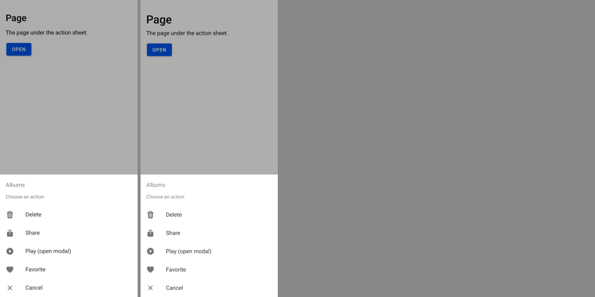

# ion-action-sheet

Status: done · [#40](https://github.com/wdcossey/Avonic/issues/40)

`AvonicActionSheet`, Ionic's `ion-action-sheet`, md: a sheet of buttons that slides up from the bottom of the window, under an
optional header, over a backdrop, on the [overlay system](../../infra/overlays/README.md). Plan: [PLAN.md](PLAN.md); comparison:
[COMPARISON.md](COMPARISON.md).



## Usage

In code, as Ionic's `actionSheetController.create`:

```csharp
var sheet = new AvonicActionSheet
{
    Header = "Albums",
    Buttons =
    [
        new ActionSheetButton { Text = "Delete", Role = "destructive", Icon = "trash", Data = "delete" },
        new ActionSheetButton { Text = "Share", Icon = "share", Data = "share" },
        new ActionSheetButton { Text = "Cancel", Role = "cancel", Icon = "close" },
    ],
};
await sheet.Present();
var (data, role) = await sheet.OnDidDismiss();   // "delete", "destructive"; null, "cancel"; null, "backdrop" for a tap outside
```

In a page, opened by a trigger or `IsOpen`:

```xml
<c:AvonicButton Name="Open" Content="Open" />
<c:AvonicActionSheet Trigger="Open" Header="Albums">
    <c:AvonicActionSheet.Buttons>
        <c:ActionSheetButton Text="Delete" Role="destructive" Icon="trash" Data="delete" />
        <c:ActionSheetButton Text="Cancel" Role="cancel" />
    </c:AvonicActionSheet.Buttons>
</c:AvonicActionSheet>
```

A button's `Handler` runs before the dismiss: return `false` (or a `Task` of it) to keep the sheet open; anything else dismisses with
the button's `Data` and `Role`. A `cancel` button is always shown last, on its own, can't be disabled, and dismisses without waiting
on its handler, which runs whenever the sheet is dismissed with a cancel role: the button, the backdrop, Escape or back. A string is
a plain button: unlike the alert's, `"Cancel"` has no role.

**Radios**, as `ion-select` (`interface="action-sheet"`) builds them: a button with `HtmlAttributes` `role` `"radio"` is a radio,
and the first with `aria-checked` `"true"` is checked, bold and the one tab stop; the arrow keys move between the enabled radios and
check them, and a click or Space checks one and runs its handler.

```csharp
Buttons =
[
    .. options.Select(o => new ActionSheetButton
    {
        Text = o.Label,
        Handler = () => { value = o.Value; return null; },
        HtmlAttributes = new Dictionary<string, object?> { ["role"] = "radio", ["aria-checked"] = o.Value == value ? "true" : "false" },
    }),
    new ActionSheetButton { Text = "Cancel", Role = "cancel" },
]
```

`Buttons` starts as an observable list, which XAML adds to; a new list, or a change to an observable one, renders again, also while
the sheet is open, as Ionic's watcher does.

## Checklist

From `node tools/ionic-api.js ion-action-sheet`; the reasons for each row are in [PLAN.md](PLAN.md).

### Props

| ✓ | Ionic | Avonic |
|---|---|---|
| [x] | `animated` | `Animated` (the overlay's) |
| [x] | `backdropDismiss` | `BackdropDismiss` |
| [x] | `buttons` | `Buttons`, `IList<ActionSheetButton>` |
| [x] | `cssClass` | `CssClass` |
| [x] | `enterAnimation`, `leaveAnimation` | the overlay's |
| [x] | `header` | `Header` |
| [x] | `htmlAttributes` | `HtmlAttributes`: `aria-label`, `id` |
| [x] | `isOpen`, `trigger` | the overlay's |
| [x] | `keyboardClose` | the overlay's |
| [ ] | `mode` | not exposed (ADR 0001) |
| [x] | `subHeader` | `SubHeader` |
| [ ] | `translucent` | not applicable: ios only |

`ActionSheetButton`: `Text`, `Role`, `Icon`, `CssClass`, `Id` (its `AutomationId`), `HtmlAttributes` (`aria-label`, `role`,
`aria-checked`; `disabled` and `id` on the cancel button), `Handler`, `Data`, `Disabled`.

### Events and methods

| ✓ | Ionic | Avonic |
|---|---|---|
| [x] | `ionActionSheetWillPresent`, `ionActionSheetDidPresent`, `ionActionSheetWillDismiss`, `ionActionSheetDidDismiss` | `IonActionSheetWillPresent` and the rest, each before the generic one |
| [x] | `willPresent`, `didPresent`, `willDismiss`, `didDismiss` | the overlay's |
| [x] | `present()`, `dismiss()`, `onDidDismiss()`, `onWillDismiss()` | the overlay's |

### CSS custom properties

| ✓ | Ionic | Avonic resource key | md default |
|---|---|---|---|
| [x] | `--backdrop-opacity` | `Avonic.ActionSheet.BackdropOpacity` | unset: `Avonic.BackdropOpacity`, 0.32 |
| [x] | `--background` | `Avonic.ActionSheet.Background` | unset: `Avonic.OverlayBackgroundColorBrush` |
| [x] | `--color` | `Avonic.ActionSheet.Color` | the text colour at 0.54 |
| [x] | `--width` | `Avonic.ActionSheet.Width` | `100%` |
| [x] | `--min-width` | `Avonic.ActionSheet.MinWidth` | `auto` |
| [x] | `--max-width` | `Avonic.ActionSheet.MaxWidth` | 500 |
| [x] | `--height` | `Avonic.ActionSheet.Height` | `auto` |
| [x] | `--min-height` | `Avonic.ActionSheet.MinHeight` | `auto` |
| [x] | `--max-height` | `Avonic.ActionSheet.MaxHeight` | unset: `100%` less `Avonic.SafeAreaTop` and `Avonic.SafeAreaBottom` |
| [x] | `--button-background` | `Avonic.ActionSheet.ButtonBackground` | transparent |
| [x] | `--button-background-activated`, `-activated-opacity` | `Avonic.ActionSheet.ButtonBackgroundActivated`, `…Opacity` | transparent, 0 |
| [x] | `--button-background-focused`, `-focused-opacity` | `Avonic.ActionSheet.ButtonBackgroundFocused`, `…Opacity` | unset (`currentColor`), 0.12 |
| [x] | `--button-background-hover`, `-hover-opacity` | `Avonic.ActionSheet.ButtonBackgroundHover`, `…Opacity` | unset (`currentColor`), 0.04 |
| [x] | `--button-background-selected`, `-selected-opacity` | `Avonic.ActionSheet.ButtonBackgroundSelected`, `…Opacity` | unset (`currentColor`), 0 |
| [x] | `--button-color` | `Avonic.ActionSheet.ButtonColor` | unset: `Avonic.TextColorStep150Brush` |
| [x] | `--button-color-activated`, `-focused`, `-hover`, `-selected`, `-disabled` | `Avonic.ActionSheet.ButtonColorActivated` and the rest | unset: `--button-color` |

A size takes a number (px) or a CSS string: px, `%`, `vw` and `vh` (of the window), a sum or difference (`100% - 40px`), `calc()`,
`min(a, b)`, `auto`, `none`. Not Ionic variables: `Avonic.ActionSheet.Md.DisabledMask` (the disabled button's 0.4) and
`Avonic.ActionSheet.Md.NoPadding`.

The template's parts: `PART_Backdrop`, `PART_Wrapper` (`.action-sheet-wrapper`), `PART_Container`, `PART_Group`, `PART_Title`,
`PART_TitleText`, `PART_SubTitle`, `PART_Buttons`, `PART_CancelGroup`; each button is an `ActionSheetNativeButton`, with its own
`ControlTheme` (`PART_Highlight`, the `::after`; `PART_Ripple`; `PART_Icon`; `PART_Label`) and pseudoclasses `:role-<role>` and
`:selected`.

## Behaviours

B1 to B17 in [PLAN.md](PLAN.md), each tested in `AvonicActionSheetTests` and `AvonicActionSheetCaptureTests` on the test clock: md's
enter and leave frame by frame, the events in order, focus at present, buttons and their handlers, the cancel handler on Escape and
the backdrop, what's rendered and where, disabled buttons, the radios' tab stop, arrows and Space, Tab and Shift+Tab,
`BackdropDismiss`, the measured boxes on a phone and a tablet, the title, the state colours, automation, `IsOpen` and `Trigger`,
changes while open, and scrolling a long list by wheel and by touch.

## Extensions

None. `Present(TopLevel)` is the overlay's.

## Known gaps

- **A desktop's scroll bar** on the group isn't drawn, as on a phone; a wheel and a finger scroll it.
- **`role="radiogroup"`** on the group has no Avalonia control type.
- **A `--min-height` taller than the content** puts the groups at the bottom of the wrapper, where CSS puts them at its top.
- **Not copied:** Ionic's inline sheet loses its checked radio at present ([ionic-issues.md](../../infra/ionic-issues.md)).
- Not tried in a real window: `tools/real-window/drive.ps1` has an `ion-action-sheet` section for the batch's runner.
