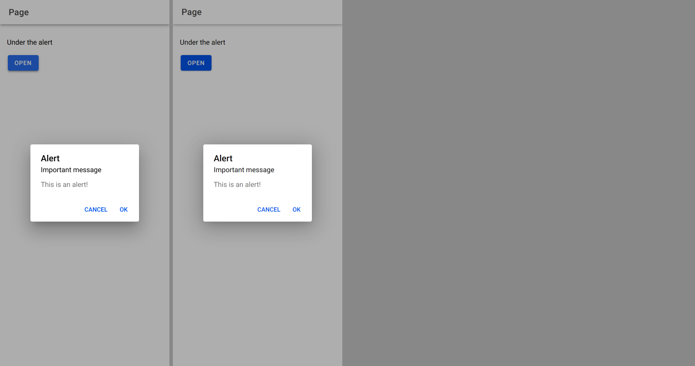
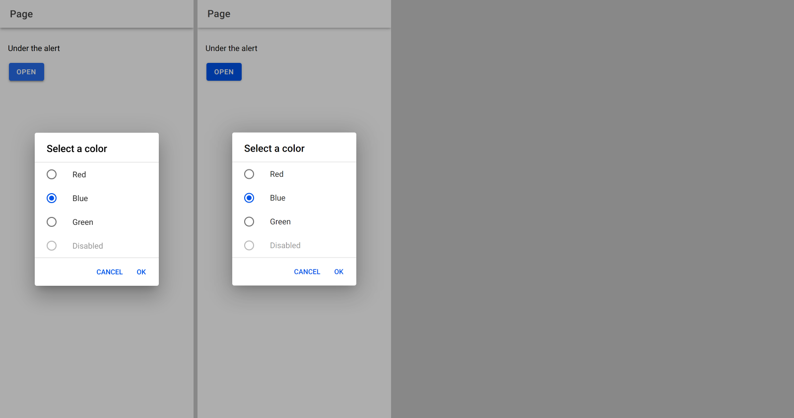
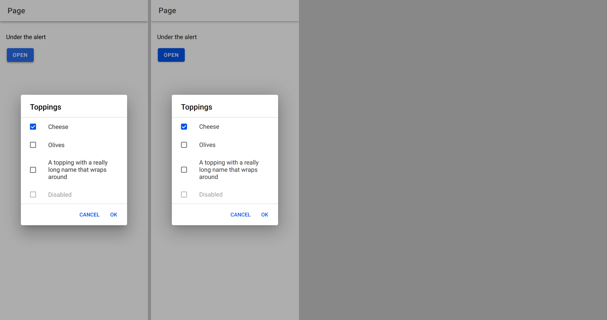
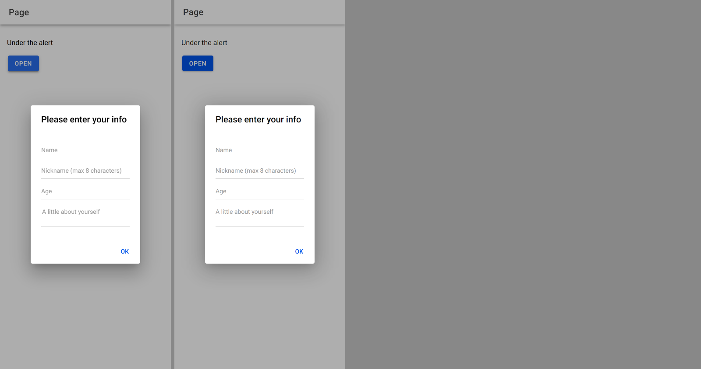
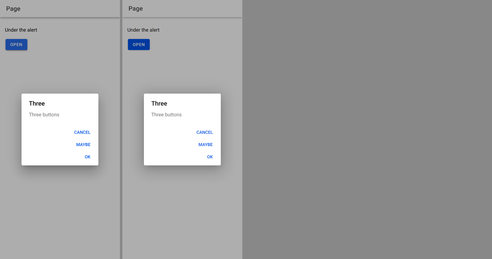
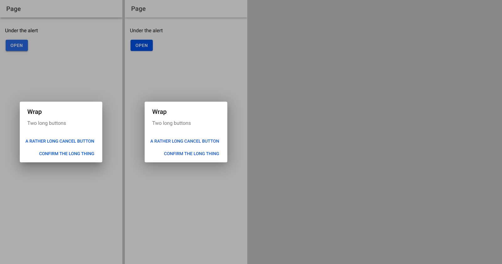
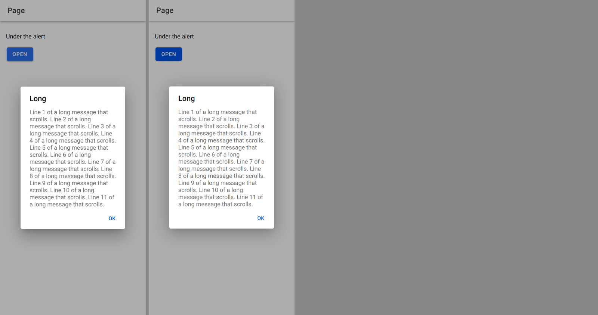
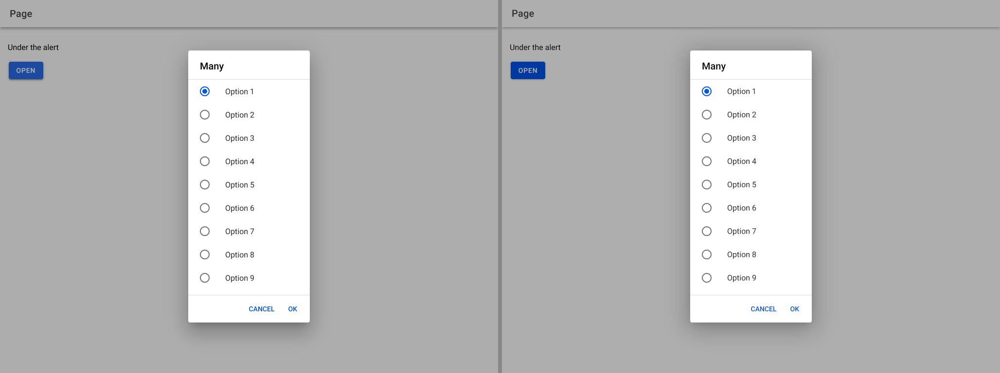

# ion-alert — Comparison

Ionic 9.0.11, md, headless Chromium, beside Avonic headless (Skia) at the same size and 2x. An alert's buttons and inputs are
JavaScript properties, which `render.js --html` can't set, so the Ionic side comes from two measurement scripts on `render.js`'s
phone (390 x 844 at 2x, mobile and touch, Roboto from `tools/fonts/roboto/`) and at 1024 x 768, which wait as `render.js` does
(`tools/ionic-ref/settle.js`). Each builds an `ion-alert` in an `ion-app` page with a header, a paragraph and an `ion-button`, sets
its properties from script, and presents it from a real tap on the button, so that Chromium draws no focus ring on the wrapper it
focuses (one presented from script showed one). The raw output is [`ref/layout.json`](ref/layout.json) (every box, colour and
font, and the enter and leave frames) and [`ref/behaviour.json`](ref/behaviour.json) (real keys and taps), with a frame of each
case in [`ref/`](ref/). The scripts aren't in the repo, as the swarm brief asks; their cases are the `SCEN` and `CASES` tables
listed in PLAN.md's Measured section.

Avonic's frames are `AvonicAlertCaptureTests`, saved in [`compare/`](compare/), each asserting the boxes beside them. Not tried
in a real window: `tools/real-window/drive.ps1` has an `ion-alert` section for the batch's runner.

| Header, message, two buttons | Radios | Checkboxes, a long label |
|---|---|---|
|  |  |  |

| Text fields | Three buttons | Two that wrap |
|---|---|---|
|  |  |  |

| Twenty radios | A long message | Tablet, twenty radios |
|---|---|---|
|  |  |  |

Ionic's on the left of each.

## Visual

Boxes are x, y, width, height in the window, asserted by the capture tests within 0.5 px unless said.

| | Ionic | Avonic | |
|---|---|---|---|
| Basic: the wrapper | 70, 332.91, 250 x 178.19 | 70, 333, 250 x 178 | Match; the 0.19 is the sub header's line (below) |
| Basic: title, message, button group | 94, 352.91, 202 x 24; 70, 416.09, 250 x 39; 70, 455.09, 250 x 56 | the same | Match (asserted) |
| Basic: Cancel, OK | 184.53, 463.09, 72.97 x 40; 265.5, 463.09, 38.5 x 40 | the same within 1 | Match (asserted) |
| The sub header's line | 19.2, `line-height: 1.2` from `typography.css`, which `render.js`'s bundle loads | 19, Chromium's `normal` for 16 px Roboto | **Deliberate difference, 0.2 px:** without the opt-in typography an `h3` is `normal`; `Css/Typography.axaml` doesn't reach the alert's own heading |
| Radios: wrapper, group, rows, the icon | 70, 267.5, 250 x 309; group 194 with its borders; rows 48; the icon 20 at 94, 341.5 | the same | Match (asserted) |
| Checkboxes: a long label makes the wrapper 280; its row 83 | 55, 250, 280 x 344; 55, 406, 280 x 83 | the same | Match (asserted) |
| Text fields: the group, an input, the textarea | 70, 300, 250 x 247; 94, 325, 202 x 37; 94, 466, 202 x 53 | the same | Match (asserted) |
| The textarea's placeholder | 2 px in from the inputs' | at the inputs' left | **Gap, 2 px**, Chromium's own inset of a `<textarea>`'s text, not Ionic's |
| Three buttons: a column | wrapper 250 x 234; each button 226 wide at 78 | the same | Match (asserted) |
| Two that wrap: a column, the wrapper the column's width | 63.31, 325, 263.38 x 194 | within 3 | Match (asserted within 3): the buttons' text is within a pixel |
| Twenty radios: the group capped at 266 | 70, 290.5, 250 x 266 | the same | Match (asserted) |
| A long message: capped at 266, the wrapper 280 | 55, 290.5, 280 x 266 | the same | Match (asserted) |
| Tablet: no 266 cap, the wrapper's 560 cap shrinks the group | wrapper 387, 104, 250 x 560; group 445 | the same | Match (asserted) |
| Colours | wrapper white, title and sub black, message `#737373`, labels `#262626`, icons `#737373`, checked and buttons the primary, borders `#d9d9d9`, placeholder `#999999` | the same keys | Match |
| md's shadow, `0 11px 15px -7px …` | three layers | through `{b:CssShadow}` | Match, best effort, as [box-shadow](../../infra/box-shadow/README.md) says |

## Behaviour

| # | Behaviour | Ionic | Avonic | |
|---|---|---|---|---|
| B1 | Enter | M1: 150 ms `ease-in-out`, backdrop 0.01 to 0.32, `pointer-events: none` until the end, wrapper 0.01 to 1 and `scale(0.9)` to 1 | The same values at each frame of the test clock | Match |
| B2 | Leave | M2: backdrop to 0, wrapper 0.99 to 0, `pointer-events: none` | The same; the wrapper rests at 0 after | Match |
| B3 | Events | M3: `ionAlertWillPresent`, `willPresent`, `ionAlertDidPresent`, `didPresent`, then the dismiss pair with `{data, role}` | The same order, each bubbling | Match |
| B4 | Focus at present | M11: the wrapper; the one button with one button and no inputs; back to the opener after | The same, and without `keyboardClose` too, as Ionic's own `present()` does it | Match |
| B5 | A button | M14, M15, M17: the handler gets the values; false keeps it open; an object joins the data; cancel dismisses at once | The same; a `Task` or `ValueTask` is awaited | Match |
| B6 | Cancel's handler on Escape and the backdrop | M15: called with nothing | The same, its answer ignored | Match |
| B7 | Values | M14: `"red"`, `["a","b"]`, `{"1":"pre","first":"Ann"}` | `"red"`, `object?[]`, `Dictionary<string, object?>` | Match, in .NET's types |
| B8 | Radios | M12, M13: a tap checks one; only the checked or first enabled one is a tab stop; arrows skip a disabled one and wrap | The same | Match. Chromium also scrolls the group by an arrow's default action, which Ionic doesn't prevent; here the arrow is handled, and focus brings the radio into view: **deliberate difference** |
| B9 | Checkboxes | M13: a tap or Space toggles; Enter doesn't | The same | Match |
| B10 | Text fields | M8: placeholder, type, `maxlength` and the rest; the value on each input | The same, where Avalonia's `TextBox` has them; a number's value written in JavaScript's form | Match. `date`, `time`, `week`, `month` and `datetime-local` are plain text boxes here, not the browser's pickers: **gap** |
| B11 | Tab | M12: the wrapper, the inputs, the buttons, round through the sentinels; Shift+Tab on the wrapper to the last button | The same | Match |
| B12 | `backdropDismiss` | M16 | The same, Escape and back too | Match |
| B13 | Enter in a text field | M13: nothing (no form) | Nothing | Match. Enter on a focused button clicks it, as a native `<button>` |
| B14 | Button group | M7: a column for three, or two that wrap, after a frame, latched until the buttons change | The same, the frame's check reading the row again | Match |
| B15 | Layout | M4 to M10 | Above | Match |
| B16 | Head | M6: 35 high with neither header; the sub header an `h3` under a header, else an `h2` | The same, and the heading levels to automation | Match |
| B17 | Message | Text by default (`innerHTMLTemplatesEnabled` off) | A string is text; a control is content | Match for text; content in place of HTML, **deliberate** |
| B18 | `cssClass` | Classes on the host, buttons and inputs; `alert-button-role-<role>` | Style classes; `:role-<role>` | Match |
| B19 | Accessibility | `role="alertdialog"` (`alert` with neither), `aria-modal`, `aria-labelledby`, `aria-describedby`; `role="radio"`/`checkbox` with `aria-checked`; `htmlAttributes` | A `Window` peer named by the header and sub header, else `aria-label`, its help text the message; buttons named by text or `aria-label`; radios and checkboxes toggleable | Match, as near as Avalonia's control types go: it has no `alertdialog`, `alert` or `radiogroup`, and `aria-activedescendant` has no counterpart (**gap**) |
| B20 | `isOpen`, `trigger` | The overlay's | The base's | Match |
| B21 | Changes while open | The watchers re-render; a patched element keeps focus | A new list, or a change to an observable one, renders again; focus on a replaced control goes to the one in its place | Match |

## Gaps

| Gap | Why | Measured |
|---|---|---|
| The date and time types' pickers | A browser's own control, which Avalonia has no counterpart of in a text box | They're text boxes with the text keyboard |
| A desktop's scroll bars on the message and the groups | Ionic hides them for a coarse pointer; Chromium on a desktop with a mouse shows them. Avonic is mobile first, and draws none, as on a phone | A mouse wheel and a finger still scroll them |
| The wrapper's focus ring | Chromium draws its default ring on the wrapper when it's focused by a key (`.alert-wrapper` has no `outline: none`); here none is drawn | Seen in a frame presented from script, which isn't how a user opens one |
| `aria-activedescendant` on the radio group | No Avalonia counterpart | |
