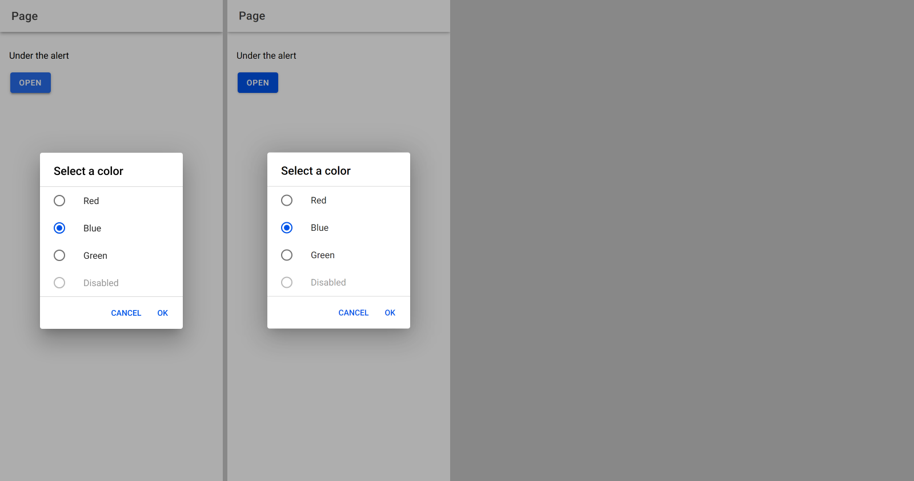

# ion-alert

Status: done · [#39](https://github.com/wdcossey/Avonic/issues/39)

`AvonicAlert`, Ionic's `ion-alert`, md: a dialog of a header, a message, text fields, radios or checkboxes, and buttons, over a
backdrop, on the [overlay system](../../infra/overlays/README.md). Plan: [PLAN.md](PLAN.md); comparison:
[COMPARISON.md](COMPARISON.md).



## Usage

In code, as Ionic's `alertController.create` and as `ion-select` builds its own:

```csharp
var alert = new AvonicAlert
{
    Header = "Select a color",
    Buttons = ["Cancel", "OK"],                       // a string is a button; "cancel" in any case has the cancel role
    Inputs =
    [
        new AlertInput { Type = AlertInputType.Radio, Label = "Red", Value = "red" },
        new AlertInput { Type = AlertInputType.Radio, Label = "Blue", Value = "blue", Checked = true },
    ],
};
await alert.Present();
var (data, role) = await alert.OnDidDismiss();
var color = (data as AlertDismissData)?.Values;      // "blue", or the radio picked; role is null for OK, "cancel", "backdrop"
```

In a page, opened by a trigger or `IsOpen`:

```xml
<c:AvonicButton Name="Open" Content="Open" />
<c:AvonicAlert Trigger="Open" Header="Alert" SubHeader="Important message" Message="This is an alert!">
    <c:AvonicAlert.Buttons>
        <c:AlertButton Text="Cancel" Role="cancel" />
        <c:AlertButton Text="OK" Role="confirm" />
    </c:AvonicAlert.Buttons>
</c:AvonicAlert>
```

A button's `Handler` is given the values: return `false` to keep the alert open, or a dictionary to put beside `values` in the
dismiss's data; a `Task` or `ValueTask` is awaited first.

```csharp
new AlertButton
{
    Text = "Save",
    Handler = values => ((IReadOnlyDictionary<string, object?>)values!)["name"] is string { Length: > 0 }
        ? new Dictionary<string, object?> { ["saved"] = true }
        : false,
};
```

**Values**: none with no inputs; a radio alert's checked value; a checkbox alert's checked values, an `object?[]`; a text alert's
`Dictionary<string, object?>` of each field's `Name` (or its index) to its text (`""` when empty). The alert works on copies of the
inputs, so the app's `AlertInput`s aren't changed; an input's `Handler` gets the copy.

`Buttons` and `Inputs` start as observable lists, which XAML adds to; a new list, or a change to an observable one, renders again,
also while the alert is open, as Ionic's watchers do. A plain `List` changed in place isn't seen, as Ionic doesn't see an array
changed in place.

## Checklist

From `node tools/ionic-api.js ion-alert`; the reasons for each row are in [PLAN.md](PLAN.md).

### Props

| ✓ | Ionic | Avonic |
|---|---|---|
| [x] | `animated` | `Animated` (the overlay's) |
| [x] | `backdropDismiss` | `BackdropDismiss` |
| [x] | `buttons` | `Buttons`, `IList<AlertButton>` |
| [x] | `cssClass` | `CssClass` |
| [x] | `enterAnimation`, `leaveAnimation` | the overlay's |
| [x] | `header` | `Header` |
| [x] | `htmlAttributes` | `HtmlAttributes`: `aria-label`, `id` |
| [x] | `inputs` | `Inputs`, `IList<AlertInput>` |
| [x] | `isOpen`, `trigger` | the overlay's |
| [x] | `keyboardClose` | the overlay's |
| [x] | `message` | `Message`: a string is text, a control is content |
| [ ] | `mode` | not exposed (ADR 0001) |
| [x] | `subHeader` | `SubHeader` |
| [ ] | `translucent` | not applicable: ios only |

`AlertButton`: `Text`, `Role`, `CssClass`, `Id` (its `AutomationId`), `HtmlAttributes` (`aria-label`, `disabled`), `Handler`.
`AlertInput`: `Type`, `Name`, `Placeholder`, `Value`, `Label`, `Checked`, `Disabled`, `Id`, `Handler`, `CssClass`, `Attributes`
(`disabled`, `class`, `maxlength`, `readonly`, `aria-label`, `inputmode`, `autocapitalize`); not `min`, `max` or `tabindex`.

### Events and methods

| ✓ | Ionic | Avonic |
|---|---|---|
| [x] | `ionAlertWillPresent`, `ionAlertDidPresent`, `ionAlertWillDismiss`, `ionAlertDidDismiss` | `IonAlertWillPresent` and the rest, each before the generic one |
| [x] | `willPresent`, `didPresent`, `willDismiss`, `didDismiss` | the overlay's |
| [x] | `present()`, `dismiss()`, `onDidDismiss()`, `onWillDismiss()` | the overlay's |

### CSS custom properties

| ✓ | Ionic | Avonic resource key | md default |
|---|---|---|---|
| [x] | `--backdrop-opacity` | `Avonic.Alert.BackdropOpacity` | unset: `Avonic.BackdropOpacity`, 0.32 |
| [x] | `--background` | `Avonic.Alert.Background` | unset: `Avonic.OverlayBackgroundColorBrush` |
| [x] | `--width` | `Avonic.Alert.Width` | `auto` |
| [x] | `--min-width` | `Avonic.Alert.MinWidth` | 250 |
| [x] | `--max-width` | `Avonic.Alert.MaxWidth` | unset: `Avonic.Alert.Md.MaxWidth` 280; `Avonic.Alert.Md.MaxWidthTablet` `min(100vw - 96px, 560px)` from 768 wide |
| [x] | `--height` | `Avonic.Alert.Height` | `auto` |
| [x] | `--min-height` | `Avonic.Alert.MinHeight` | `auto` |
| [x] | `--max-height` | `Avonic.Alert.MaxHeight` | unset: `Avonic.Alert.Md.MaxHeight` `90%`; `Avonic.Alert.Md.MaxHeightTablet` `min(100vh - 96px, 560px)` from 768 wide |

A size takes a number (px) or a CSS string: px, `%`, `vw`, `vh`, a sum or difference (`100vh - 96px`), `min(a, b)`, `auto`, `none`.
Set an unset key, and it wins at every size, as an app's variable on `ion-alert` does.

## Behaviours

B1 to B21 in [PLAN.md](PLAN.md), each tested in `AvonicAlertTests` and `AvonicAlertCaptureTests` on the test clock: md's enter and
leave frame by frame, the events in order, focus at present (the wrapper, or the one button), buttons and their handlers, the cancel
handler on Escape and the backdrop, the values, the radios' roving tab stop and arrows, the checkboxes' Space but not Enter, the
text fields, Tab and Shift+Tab, `BackdropDismiss`, Enter in a field doing nothing (as Ionic's alert has no form), the button group's
column, the measured boxes, the head, the message, classes and automation, and changes while open.

## The parts

`PART_Backdrop` (`AvonicBackdrop`), `PART_Wrapper` (`AlertWrapper`, `.alert-wrapper`), `PART_Head`, `PART_Title`, `PART_SubTitle`,
`PART_Message`, `PART_InputGroup` and `PART_Inputs` (the alert fills it), `PART_ButtonGroup` (`AlertButtonGroup`). What Ionic renders
for each button and input are types of their own, themed by their own `ControlTheme`s: `AlertActionButton` (`:role-<role>`,
`:ion-focused`), `AlertRadioButton` and `AlertCheckboxButton` (`:checked`), `AlertTextInput` and `AlertTextareaInput`. The
alert's pseudoclasses: `:breakpoint-md`, `:input-group`, `:radio-group`, `:checkbox-group`.

## Extensions

None. `Present(TopLevel)` is the overlay's.

## Known gaps

- `date`, `time`, `week`, `month` and `datetime-local` inputs are text boxes, not the browser's pickers.
- The radios' arrows don't also scroll the group, as Chromium's unprevented default does; focus brings the radio into view.
- No scroll bars on a desktop; a wheel and a finger scroll.
- The sub header's line is 19, Chromium's `normal`, where Ionic's bundle with `typography.css` makes it 19.2.
- Avalonia has no `alertdialog`, `alert` or `radiogroup` control type, nor `aria-activedescendant`: the wrapper is a `Window`.
- `ion-select`'s rich options (`startContent`, `description` and the rest, which only the select passes) are for #45.
- Not tried in a real window yet: `tools/real-window/drive.ps1` has an `ion-alert` section.
