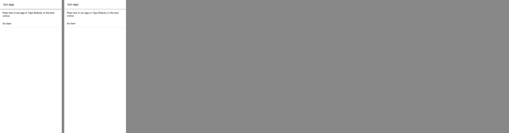

# Comparison: ion-app → AvonicApp

> Reference frame, from the worktree's root:
>
> ```
> node tools/ionic-ref/render.js ion-app --bare --html '<ion-app><ion-header><ion-toolbar><ion-title>ion-app</ion-title></ion-toolbar></ion-header><ion-content><div style="padding:16px">Plain text in ion-app is 16px Roboto, in the text colour.</div><ion-item><ion-label>An item</ion-label></ion-item></ion-content></ion-app>' --out docs/components/ion-app/ref
> ```
>
> The behaviours were measured with a throwaway Playwright script outside the repo, in Chromium (Playwright 1.56's), Ionic 8.8.1,
> md, 390 x 844 at 2×, with Capacitor's events dispatched by hand: see [PLAN.md](PLAN.md#measured).

## The frame

Ionic on the left, Avonic on the right (headless, `AvonicAppCaptureTests.Reference_Page`), at 2×:



The plain text is 16 Roboto in the text colour on both, from `html` and `body` in Ionic and from `AvonicApp`'s theme here, and it
wraps at the same word. Without an `AvonicApp`, Avalonia's 14 would apply.

## Behaviours

The numbers are from [PLAN.md](PLAN.md#behaviours). Each has tests in `AvonicAppTests`, named after its number.

| | Behaviour | Ionic | Avonic | |
|---|---|---|---|---|
| B1 | Highest priority, ties to the last registered, each `next()` runs one more | M1, M2d | the same | match |
| B2 | Busy while a handler's promise runs; a throw doesn't stick | M2, M2b | the same, with a `Task` | match |
| B3 | A back press nothing takes | Capacitor's App plugin takes it: "nothing will happen" | handled; `HandleUnclaimedBack` off leaves it to Android | match, with an extension |
| B4 | Without `ion-app`, nothing; with it, an overlay at 100 over the app's 0, and none when it can't be dismissed | M3b, M8 | the same; an overlay still dismisses on back without an app | match, and a deliberate addition (D5) |
| B5 | `hardwareBackButton: false` | no `ionBackButton`, and back is swallowed (`blockHardwareBackButton`) | nothing raised, overlays stay, and back is left alone | deliberate difference (D6) |
| B6 | Taken out of the page | never happens in Ionic | stops | deliberate: Avalonia apps swap roots |
| B7 | A back request the app already handled | n/a: the document's event | left alone | Avalonia's routing |
| B8 | A desktop's back | the browser's, not `backbutton` | Alt+Left and the mouse's back button, as Avalonia raises `BackRequested` for them | deliberate (D4) |
| K1 | `ionKeyboardDidShow {keyboardHeight}` and `ionKeyboardDidHide`, each as it comes | M5 | the same, once the input pane's animation has finished | match |
| K2 | A change before the last has finished | each passed on | the newer replaces it | deliberate: Avalonia reports at the animation's start, Capacitor at its end |
| T1 | Text in the app | 16px, Roboto, the text colour, on the background (H) | the same, from the theme | match (D1) |
| A1–A3 | The safe area | `env(safe-area-inset-*)` with `viewport-fit=cover` | the keys while `AutoSafeAreaPadding` is off | match (D3) |
| F1–F5 | `setFocus` | M6 | the same | match |
| P1 | `.ion-page`, filling, not clipping | H | the same | match |

## On the Pixel

To be run: see the PR.

## Not tried

- In a real window: the `ion-app` section added to `tools/real-window/drive.ps1` is for the coordinator to run.
- On iOS: no device.
