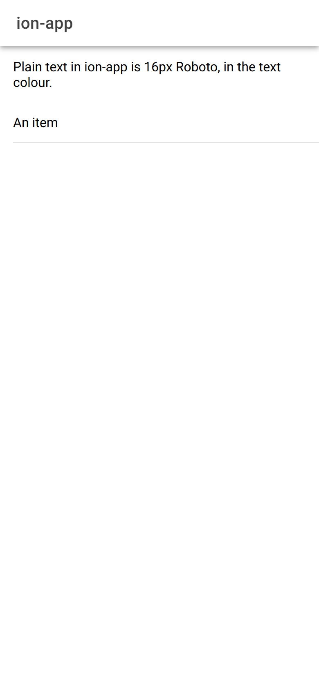

# ion-app — reference render (Ionic 8.8.1, md, 390×844@2x)

Generated by `node tools/ionic-ref/render.js ion-app --bare --html "<ion-app><ion-header><ion-toolbar><ion-title>ion-app</ion-title></ion-toolbar></ion-header><ion-content><div style=\"padding:16px\">Plain text in ion-app is 16px Roboto, in the text colour.</div><ion-item><ion-label>An item</ion-label></ion-item></ion-content></ion-app>" --out docs/components/ion-app/ref`

```html
<ion-app><ion-header><ion-toolbar><ion-title>ion-app</ion-title></ion-toolbar></ion-header><ion-content><div style="padding:16px">Plain text in ion-app is 16px Roboto, in the text colour.</div><ion-item><ion-label>An item</ion-label></ion-item></ion-content></ion-app>
```

 

## Element 1

- attributes: `{"class":"md ion-page hydrated"}`
- classes: `md ion-page hydrated`
- rect: `{"x":0,"y":0,"w":390,"h":844}`

### Host computed

| prop | value |
|---|---|
| display | `flex` |
| position | `absolute` |
| box-sizing | `border-box` |
| width | `390px` |
| height | `844px` |
| min-height | `0px` |
| min-width | `0px` |
| padding | `0px` |
| margin | `0px` |
| border | `0px none rgb(0, 0, 0)` |
| border-radius | `0px` |
| background-color | `rgba(0, 0, 0, 0)` |
| color | `rgb(0, 0, 0)` |
| font-size | `16px` |
| font-weight | `400` |
| font-family | `Roboto, "Helvetica Neue", sans-serif` |
| line-height | `normal` |
| letter-spacing | `normal` |
| text-transform | `none` |
| opacity | `1` |
| overflow | `visible` |
| contain | `size layout style` |
| pointer-events | `auto` |
| transition | `all` |
| transform | `none` |
| box-shadow | `none` |
| outline | `rgb(0, 0, 0) none 0px` |
| cursor | `auto` |

### DOM tree

```
<ion-app>
  <ion-header.md.header-md.header-collapse-none.hydrated>
    <ion-toolbar.md.in-toolbar.hydrated.toolbar-title-default>
      #shadow-root
        <div.toolbar-background part="background">
        <div.toolbar-container part="container">
          <slot name="start">
          <slot name="secondary">
          <div.toolbar-content part="content">
            <slot name="">
          <slot name="primary">
          <slot name="end">
      <ion-title.md.title-default.hydrated>
        #shadow-root
          <div.toolbar-title>
            <slot name="">
  <ion-content.md.content-ltr.hydrated>
    #shadow-root
      <div#background-content part="background">
      <div.inner-scroll.scroll-y part="scroll">
        <slot name="">
      <slot name="fixed">
    <div>
    <ion-item.item.md.item-lines-default.hydrated.item-label>
      #shadow-root
        <div.item-native part="native">
          <slot name="start">
          <div.item-inner part="inner">
            <div.input-wrapper part="container">
              <slot name="">
            <slot name="end">
      <ion-label.sc-ion-label-md-h.md.sc-ion-label-md.sc-ion-label-md-s.hydrated>
```
