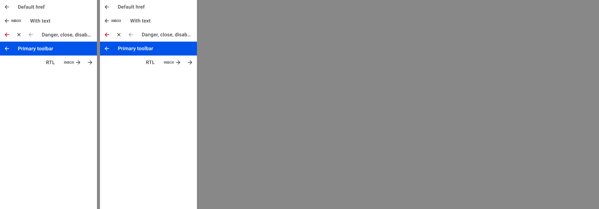

# ion-back-button — Comparison

Ionic 9.0.11, md, headless Chromium, beside Avonic headless (Skia) at the same size and 2x. Not tried in a real window:
`tools/real-window/drive.ps1` has a section for the sample page (`ion-back-button`), not run here.

**The reference.** The frame and boxes are `render.js`'s:

```
node tools/ionic-ref/render.js ion-back-button --bare --html '<ion-app style="position:static;display:block;contain:none;overflow:visible"><ion-toolbar><ion-buttons slot="start"><ion-back-button default-href="/home"></ion-back-button></ion-buttons><ion-title>Default href</ion-title></ion-toolbar><ion-toolbar><ion-buttons slot="start"><ion-back-button default-href="/inbox" text="Inbox"></ion-back-button></ion-buttons><ion-title>With text</ion-title></ion-toolbar><ion-toolbar><ion-buttons slot="start"><ion-back-button default-href="/home" color="danger"></ion-back-button><ion-back-button default-href="/home" icon="close"></ion-back-button><ion-back-button default-href="/home" disabled></ion-back-button></ion-buttons><ion-title>Danger, close, disabled</ion-title></ion-toolbar><ion-toolbar color="primary"><ion-buttons slot="start"><ion-back-button default-href="/home"></ion-back-button></ion-buttons><ion-title>Primary toolbar</ion-title></ion-toolbar><div dir="rtl"><ion-toolbar><ion-buttons slot="start"><ion-back-button default-href="/home"></ion-back-button><ion-back-button default-href="/home" text="Inbox"></ion-back-button></ion-buttons><ion-title>RTL</ion-title></ion-toolbar></div></ion-app>'
```

The behaviour was measured by a throwaway Playwright script on `render.js`'s phone (`measure.js`, kept outside the repo, scenes B1
to B6), in [`ref/measurements.txt`](ref/measurements.txt). Avonic's frame is `AvonicBackButtonCaptureTests.Reference_Page` with
`AVONIC_CAPTURE_DIR` set, in [`compare/avonic-page.png`](compare/avonic-page.png), which asserts the boxes against
`ref/dump.json`; side by side with `node tools/ionic-ref/side.js ref/page.png compare/avonic-page.png compare/side-by-side.png 560`,
Ionic on the left:



## Boxes

| Element | Ionic (`ref/dump.json`) | Avonic | |
|---|---|---|---|
| Icon only, in a toolbar's start buttons | 4, 4, 48 x 48; icon 16, 16, 24 x 24 | the same | Match |
| With `text="Inbox"` | 4, 68, 97.08 x 32; text 49.08 wide at 40 | 4, 68, 32 high, 96 to 98 wide (asserted) | Match within the text's width |
| Danger, close, disabled | 4, 52 and 100, at 116, 48 x 48 | the same | Match |
| In a primary toolbar | 4, 172, 48 x 48, white | the same | Match |
| RTL, icon only | 338, 228, 48 x 48, the arrow mirrored | the same, mirrored | Match |
| Icon only in a plain block (B1) | 390 x 390 (`aspect-ratio: 1/1`) | 390 x 390 (K14) | Match |

## Behaviour

| # | Behaviour | Ionic | Avonic |
|---|---|---|---|
| K1 | Hidden until it has a `defaultHref` (the empty string too) | `display: none`, `.show-back-button` (B1, B2) | Match: `IsVisible` at style priority. An app's style beats a hide that comes after it; one it sets before the button is first shown loses to the first hide, as `AvonicBadge`'s and `AvonicMenuButton`'s do (measured: `IsVisible` false at style priority from a binding made in the constructor beats a window's plain style applied later) |
| K2 | Shown in the header of a page with `can-go-back`, the moment the nav sets it | core.css (B3) | Match: the page's `Classes` followed |
| K3 | Not in the content; not in a header that isn't the page's child | B3 `b2c`, `b2n` | Match; panels between the page and its header count as the page's slot (a deliberate difference, below) |
| K4 | A click pops the closest nav, `skipIfBusy` | B3, B4 | Match |
| K5 | The pop takes `routerAnimation` | `back-button.js` | Match |
| K6 | Stale `can-go-back`: shown, a click does nothing | B3 | Match |
| K7 | Nothing to pop, a `defaultHref`: `router.push(url, 'back', animation)`, or nothing with no router | `openURL` | `DefaultHrefRequested` (extension), by `openURL`'s rule; nothing with no handler |
| K8 | `showGoBack: false` hides the header button; a shown one still pops | B3 | Match |
| K9 | Disabled: opacity 0.5, no click | B1 | Match |
| K10 | Enter, Space; automation's Invoke | native `<button>` | Match |
| K11 | md's `arrow-back-sharp`, `flip-rtl` when `icon` is undefined; config; empty is none | B1, B2 | Match |
| K12 | No text in md; uppercase; config; empty is none | B1, B2 | Match |
| K13 | Icon only 48, radius 50%, unbounded ripple; text 32 high, radius 4, bounded | B1 | Match |
| K14 | `aspect-ratio: 1/1` | B1 | Match: the arranged width is the next measure's height |
| K15 | `backButtonDefaultHref` once, if unset | B2 | Match |
| K16 | Native colour the base; toolbar's colour; a coloured toolbar's contrast | B1 | Match |
| K17 | Hover 0.04, focus 0.12; a colour's base on hover and focus; the native's opacity over 100 ms | md.css | Match |
| K18 | `aria-label` the app's, the text as written, or `back`; icon and text hidden | B1 | Match |
| K19 | No hardware back of its own | `back-button.js` | Match: hardware back is the nav's (`HandleBackButton`) |
| K20 | (Extension) `DefaultPage`: shown; the nav's root with nothing to pop; a pop first; with no nav, `defaultHref`'s | none | Ours. The nav doesn't animate a root that replaces its only page, as Ionic's doesn't (B6), so the back direction and `RouterAnimation` passed with it don't play |

## Deliberate differences

- **The coloured toolbar's `ion-buttons` variables aren't mapped.** `:host-context(.ion-color)::slotted(*) .button` sets `--color: initial`
  and the focused and hover colours to the toolbar's contrast on a back button in a coloured toolbar (B1 `intbc`: all `#fff`).
  The button's `currentColor` there is already the contrast, so nothing drawn changes by default; mapping it would be a global
  rule in `Styles/`. What differs: an app's own `Avonic.BackButton.Color` wins there, where Ionic's `--color` loses.
- **"Direct child of the page" lets panels between.** An Avalonia page holds its header in a `DockPanel` or `Grid`; any number of
  `Panel`s between the page and the header count, a `Border` doesn't.
- **`--icon-font-weight`** is read onto the icon, and draws nothing different: an `AvonicIcon` is a path, as Ionic's SVG is.
- **`type`** isn't mapped: HTML forms, and dead in Ionic, whose click handler prevents a submit (B5: 0 submits).
- **Uppercase is `ToUpperInvariant`**, as `AvonicButton`'s converter has it: CSS's `text-transform` maps `ß` to `SS` and follows
  `lang` (Turkish `i`), which .NET's simple case mapping doesn't.

## Known gaps

- Not tried in a real window or on a device.
- An app's plain style for `IsVisible` loses to the first hide when it's set before the button is shown (K1's note), as for the
  other controls that hide themselves this way.
