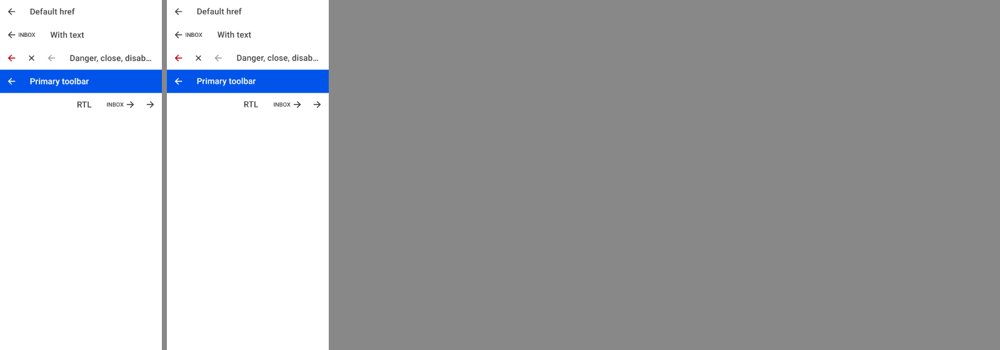

# ion-back-button

Status: done · [#47](https://github.com/wdcossey/Avonic/issues/47)

`AvonicBackButton`: Ionic's `ion-back-button`, md. It pops the closest `AvonicNav` when the nav can go back. It shows only when
there's somewhere to go: in the header of a page that has one under it (the nav's `:can-go-back`), or with a `DefaultHref` or a
`DefaultPage`. Plan: [PLAN.md](PLAN.md); comparison: [COMPARISON.md](COMPARISON.md).



## Usage

In a page the nav builds, in its header's toolbar, as Ionic writes it:

```xml
<DockPanel>
    <c:AvonicHeader DockPanel.Dock="Top">
        <c:AvonicToolbar>
            <c:AvonicToolbar.StartContent>
                <c:AvonicButtons>
                    <c:AvonicBackButton />
                </c:AvonicButtons>
            </c:AvonicToolbar.StartContent>
            <c:AvonicTitle Content="Message" />
        </c:AvonicToolbar>
    </c:AvonicHeader>
    <c:AvonicContent>…</c:AvonicContent>
</DockPanel>
```

The header must be the page's child, or behind `Panel`s only (`.can-go-back > ion-header ion-back-button`): a back button in the
content, or in a header inside a `Border`, shows only with a `DefaultHref` or a `DefaultPage`.

With nothing to pop (a page reached by a deep link, or no nav around), a click:

1. with a `DefaultPage` and a nav around: sets the page as the nav's root;
2. otherwise, with a `DefaultHref` that Ionic's `openURL` would give a router (not starting with `#`, no scheme): raises
   `DefaultHrefRequested`, which bubbles, so one handler serves every back button, as one `ion-router` serves a document;
3. otherwise nothing, as Ionic's core does with no router.

```csharp
window.AddHandler(AvonicBackButton.DefaultHrefRequestedEvent, (_, e) => myRouter.GoBackTo(e.DefaultHref, e.RouterAnimation));
```

## Fidelity checklist

### Props (8)

| ✓ | Ionic | Avonic | Notes |
|---|---|---|---|
| [x] | `color` | `Color` | `ColorPalette` |
| [x] | `defaultHref` | `DefaultHref` (`string?`) | Shows it; with nothing to pop, `DefaultHrefRequested`. Null at the first attach takes `AvonicConfig.BackButtonDefaultHref` |
| [x] | `disabled` | `IsEnabled` (inverted) | |
| [x] | `icon` | `Icon` (`string?`) | An `AvonicIcon.Icon`. Null: `AvonicConfig.BackButtonIcon`, then `arrow-back-sharp`, mirrored in RTL; empty: none |
| [ ] | `mode` | none | Not exposed (ADR 0001) |
| [x] | `routerAnimation` | `RouterAnimation` | The pop's builder, and the event's |
| [x] | `text` | `Text` (`string?`) | Null: `AvonicConfig.BackButtonText`, then none; empty: none. Uppercase by the theme |
| [ ] | `type` | none | Not applicable: HTML form, and dead in Ionic (its click prevents the submit) |

### Parts (3)

| ✓ | Ionic | Avonic |
|---|---|---|
| [x] | `native` | `PART_Native` (`Border`) |
| [x] | `icon` | `PART_Icon` (`AvonicIcon`), in `PART_IconBox`, which takes the icon's padding and margin |
| [x] | `text` | `PART_Text` (`TextBlock`) |

Also `PART_Clip`, `PART_Overlay` (`.button-native::after`), `PART_Ripple`, `PART_Inner`.

### Config (3)

| ✓ | Ionic | Avonic | Read |
|---|---|---|---|
| [x] | `backButtonIcon` | `AvonicConfig.BackButtonIcon` | At each render: the first attach, and each change of a prop |
| [x] | `backButtonText` | `AvonicConfig.BackButtonText` | Likewise |
| [x] | `backButtonDefaultHref` | `AvonicConfig.BackButtonDefaultHref` | Once, at the first attach, if `DefaultHref` is null |

### CSS custom properties → resource keys (32)

| ✓ | Ionic | Avonic resource key | md default |
|---|---|---|---|
| [x] | `--background` | `Avonic.BackButton.Background` | transparent |
| [x] | `--background-focused` | `Avonic.BackButton.BackgroundFocused` | unset: the current colour |
| [x] | `--background-focused-opacity` | `Avonic.BackButton.BackgroundFocusedOpacity` | 0.12 |
| [x] | `--background-hover` | `Avonic.BackButton.BackgroundHover` | unset: the current colour |
| [x] | `--background-hover-opacity` | `Avonic.BackButton.BackgroundHoverOpacity` | 0.04 |
| [x] | `--border-radius` | `Avonic.BackButton.BorderRadius` | unset: `Avonic.BackButton.Md.BorderRadius` 4, `.Md.BorderRadiusIconOnly` 50% |
| [x] | `--color` | `Avonic.BackButton.Color` | unset: inherited |
| [x] | `--color-focused` | `Avonic.BackButton.ColorFocused` | unset: the current colour |
| [x] | `--color-hover` | `Avonic.BackButton.ColorHover` | unset: the current colour |
| [x] | `--icon-font-size` | `Avonic.BackButton.IconFontSize` | 24 |
| [x] | `--icon-font-weight` | `Avonic.BackButton.IconFontWeight` | Normal (draws nothing different on a path) |
| [x] | `--icon-margin-top`, `-end`, `-bottom`, `-start` | `Avonic.BackButton.IconMarginTop` and the rest | 0 |
| [x] | `--icon-padding-top`, `-end`, `-bottom`, `-start` | `Avonic.BackButton.IconPaddingTop` and the rest | 0 |
| [x] | `--margin-top`, `-end`, `-bottom`, `-start` | `Avonic.BackButton.MarginTop` and the rest | 0 |
| [x] | `--min-height` | `Avonic.BackButton.MinHeight` | 32 (48 with only an icon, a literal) |
| [x] | `--min-width` | `Avonic.BackButton.MinWidth` | 44 (48 with only an icon, a literal) |
| [x] | `--opacity` | `Avonic.BackButton.Opacity` | 1 |
| [x] | `--padding-top`, `-bottom` | `Avonic.BackButton.PaddingTop`, `.PaddingBottom` | 0 |
| [x] | `--padding-start`, `-end` | `Avonic.BackButton.PaddingStart`, `.PaddingEnd` | 12 |
| [x] | `--ripple-color` | `Avonic.BackButton.RippleColor` | unset: the current colour |
| [x] | `--transition` | `Avonic.BackButton.Transition` | `Transitions`: the native's opacity over 100 ms, linear |

## Navigation and hardware back

- The back button calls `nav.Pop(new NavOptions { AnimationBuilder = RouterAnimation, SkipIfBusy = true })` on the closest
  `AvonicNav` that can go back, as Ionic's does. It reads the nav's `:can-go-back`, which the nav sets at each transition (and which
  goes stale when a page is removed with no transition, as in Ionic).
- It has no hardware back of its own, as Ionic's has none: `AvonicNav.HandleBackButton` (the nav's extension) takes Android's back,
  a mouse's back button and Alt+Left. A tap and a hardware back together pop once, by `SkipIfBusy`.
  `AvonicConfig.HandleUnclaimedBack` is never reached from the button, and a hardware back never follows its `DefaultHref` or
  `DefaultPage`.

## Extensions

- **`DefaultHrefRequested`** (`BackButtonDefaultHrefEventArgs`: `DefaultHref`, `RouterAnimation`), bubbling: Ionic's
  `router.push(defaultHref, 'back', routerAnimation)`, for the app's own navigation, raised only when `openURL` would hand the URL
  to a router.
- **`DefaultPage`** (`object?`, any of `AvonicNav`'s page forms: a `Control`, a `Type`, a `Func<Control>`, a view model): with
  nothing to pop and a nav around, `nav.SetRoot(page, null, { Direction: Back, AnimationBuilder: RouterAnimation, SkipIfBusy: true })`,
  and no event. It shows the button. The nav doesn't animate a root that replaces its only page, as Ionic's `setRoot` doesn't
  (measured, `ref/measurements.txt` B6), so the page appears at once. With no nav around, the click is `DefaultHref`'s, as if no
  page were set.
- **`TextTransform`**, as `AvonicButton`'s; the md theme sets `Uppercase`.

## Deliberate differences

In [COMPARISON.md](COMPARISON.md#deliberate-differences): the coloured toolbar's `ion-buttons` variables aren't mapped; panels
between a page and its header count as the page's slot; `--icon-font-weight` draws nothing; `type` isn't mapped.
