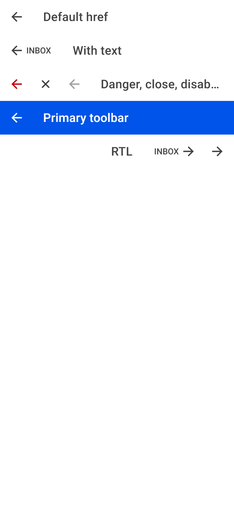
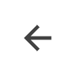

# ion-back-button — reference render (Ionic 9.0.11, md, 390×844@2x)

Generated by `node tools/ionic-ref/render.js ion-back-button --bare --html "<ion-app style=\"position:static;display:block;contain:none;overflow:visible\"><ion-toolbar><ion-buttons slot=\"start\"><ion-back-button default-href=\"/home\"></ion-back-button></ion-buttons><ion-title>Default href</ion-title></ion-toolbar><ion-toolbar><ion-buttons slot=\"start\"><ion-back-button default-href=\"/inbox\" text=\"Inbox\"></ion-back-button></ion-buttons><ion-title>With text</ion-title></ion-toolbar><ion-toolbar><ion-buttons slot=\"start\"><ion-back-button default-href=\"/home\" color=\"danger\"></ion-back-button><ion-back-button default-href=\"/home\" icon=\"close\"></ion-back-button><ion-back-button default-href=\"/home\" disabled></ion-back-button></ion-buttons><ion-title>Danger, close, disabled</ion-title></ion-toolbar><ion-toolbar color=\"primary\"><ion-buttons slot=\"start\"><ion-back-button default-href=\"/home\"></ion-back-button></ion-buttons><ion-title>Primary toolbar</ion-title></ion-toolbar><div dir=\"rtl\"><ion-toolbar><ion-buttons slot=\"start\"><ion-back-button default-href=\"/home\"></ion-back-button><ion-back-button default-href=\"/home\" text=\"Inbox\"></ion-back-button></ion-buttons><ion-title>RTL</ion-title></ion-toolbar></div></ion-app>"`

```html
<ion-app style="position:static;display:block;contain:none;overflow:visible"><ion-toolbar><ion-buttons slot="start"><ion-back-button default-href="/home"></ion-back-button></ion-buttons><ion-title>Default href</ion-title></ion-toolbar><ion-toolbar><ion-buttons slot="start"><ion-back-button default-href="/inbox" text="Inbox"></ion-back-button></ion-buttons><ion-title>With text</ion-title></ion-toolbar><ion-toolbar><ion-buttons slot="start"><ion-back-button default-href="/home" color="danger"></ion-back-button><ion-back-button default-href="/home" icon="close"></ion-back-button><ion-back-button default-href="/home" disabled></ion-back-button></ion-buttons><ion-title>Danger, close, disabled</ion-title></ion-toolbar><ion-toolbar color="primary"><ion-buttons slot="start"><ion-back-button default-href="/home"></ion-back-button></ion-buttons><ion-title>Primary toolbar</ion-title></ion-toolbar><div dir="rtl"><ion-toolbar><ion-buttons slot="start"><ion-back-button default-href="/home"></ion-back-button><ion-back-button default-href="/home" text="Inbox"></ion-back-button></ion-buttons><ion-title>RTL</ion-title></ion-toolbar></div></ion-app>
```

 

## Element 1

- attributes: `{"default-href":"/home","class":"md button back-button-has-icon-only in-toolbar ion-activatable ion-focusable show-back-button hydrated"}`
- classes: `md button back-button-has-icon-only in-toolbar ion-activatable ion-focusable show-back-button hydrated`
- rect: `{"x":4,"y":4,"w":48,"h":48}`

### CSS custom properties (resolved)

| var | value |
|---|---|
| `--background` | `transparent` |
| `--background-focused` | `currentColor` |
| `--background-focused-opacity` | `.12` |
| `--background-hover` | `currentColor` |
| `--background-hover-opacity` | `0.04` |
| `--border-radius` | `50%` |
| `--color` | `currentColor` |
| `--color-focused` | `currentColor` |
| `--color-hover` | `currentColor` |
| `--icon-font-size` | `1.5rem` |
| `--icon-font-weight` | `normal` |
| `--icon-margin-bottom` | `0` |
| `--icon-margin-end` | `0` |
| `--icon-margin-start` | `0` |
| `--icon-margin-top` | `0` |
| `--icon-padding-bottom` | `0` |
| `--icon-padding-end` | `0` |
| `--icon-padding-start` | `0` |
| `--icon-padding-top` | `0` |
| `--margin-bottom` | `0` |
| `--margin-end` | `0` |
| `--margin-start` | `0` |
| `--margin-top` | `0` |
| `--min-height` | `32px` |
| `--min-width` | `44px` |
| `--opacity` | `1` |
| `--padding-bottom` | `0` |
| `--padding-end` | `12px` |
| `--padding-start` | `12px` |
| `--padding-top` | `0` |
| `--ripple-color` | `currentColor` |
| `--transition` | `background-color, opacity 100ms linear` |

### Host computed

| prop | value |
|---|---|
| display | `block` |
| position | `static` |
| box-sizing | `border-box` |
| width | `48px` |
| height | `48px` |
| min-height | `48px` |
| min-width | `48px` |
| padding | `0px` |
| margin | `0px` |
| border | `0px none rgb(66, 66, 66)` |
| border-radius | `0px` |
| background-color | `rgba(0, 0, 0, 0)` |
| color | `rgb(66, 66, 66)` |
| font-size | `14px` |
| font-weight | `500` |
| font-family | `Roboto, "Helvetica Neue", sans-serif` |
| line-height | `normal` |
| letter-spacing | `normal` |
| text-transform | `uppercase` |
| opacity | `1` |
| overflow | `visible` |
| contain | `none` |
| pointer-events | `auto` |
| transition | `all` |
| transform | `none` |
| box-shadow | `none` |
| outline | `rgb(66, 66, 66) none 0px` |
| cursor | `auto` |

### Shadow parts

#### part="native" (`button`) rect `{"x":4,"y":4,"w":48,"h":48}`

| prop | value |
|---|---|
| display | `block` |
| position | `relative` |
| box-sizing | `border-box` |
| width | `48px` |
| height | `48px` |
| min-height | `48px` |
| min-width | `0px` |
| padding | `0px 12px` |
| margin | `0px` |
| border | `0px none rgb(66, 66, 66)` |
| border-radius | `50%` |
| background-color | `rgba(0, 0, 0, 0)` |
| color | `rgb(66, 66, 66)` |
| font-size | `14px` |
| font-weight | `500` |
| font-family | `Roboto, "Helvetica Neue", sans-serif` |
| line-height | `14px` |
| letter-spacing | `normal` |
| text-transform | `uppercase` |
| opacity | `1` |
| overflow | `hidden` |
| contain | `none` |
| pointer-events | `auto` |
| transition | `background-color, opacity 0.1s linear` |
| transform | `none` |
| box-shadow | `none` |
| outline | `rgb(66, 66, 66) none 0px` |
| cursor | `pointer` |

#### part="icon" (`ion-icon`) rect `{"x":16,"y":16,"w":24,"h":24}`

| prop | value |
|---|---|
| display | `flex` |
| position | `static` |
| box-sizing | `content-box` |
| width | `24px` |
| height | `24px` |
| min-height | `auto` |
| min-width | `auto` |
| padding | `0px` |
| margin | `0px` |
| border | `0px none rgb(66, 66, 66)` |
| border-radius | `0px` |
| background-color | `rgba(0, 0, 0, 0)` |
| color | `rgb(66, 66, 66)` |
| font-size | `24px` |
| font-weight | `400` |
| font-family | `Roboto, "Helvetica Neue", sans-serif` |
| line-height | `16.08px` |
| letter-spacing | `normal` |
| text-transform | `uppercase` |
| opacity | `1` |
| overflow | `visible` |
| contain | `layout style` |
| pointer-events | `none` |
| transition | `all` |
| transform | `none` |
| box-shadow | `none` |
| outline | `rgb(66, 66, 66) none 0px` |
| cursor | `pointer` |

### DOM tree

```
<ion-back-button>
  #shadow-root
    <button.button-native part="native">
      <span.button-inner>
        <ion-icon.md.flip-rtl.hydrated part="icon">
          #shadow-root
            <div.icon-inner>
              <svg>
                <path>
      <ion-ripple-effect.md.unbounded.hydrated>
        #shadow-root
```

## Element 2

- attributes: `{"default-href":"/inbox","text":"Inbox","class":"md button in-toolbar ion-activatable ion-focusable show-back-button hydrated"}`
- classes: `md button in-toolbar ion-activatable ion-focusable show-back-button hydrated`
- rect: `{"x":4,"y":68,"w":97.08,"h":32}`

### CSS custom properties (resolved)

| var | value |
|---|---|
| `--background` | `transparent` |
| `--background-focused` | `currentColor` |
| `--background-focused-opacity` | `.12` |
| `--background-hover` | `currentColor` |
| `--background-hover-opacity` | `0.04` |
| `--border-radius` | `4px` |
| `--color` | `currentColor` |
| `--color-focused` | `currentColor` |
| `--color-hover` | `currentColor` |
| `--icon-font-size` | `1.5rem` |
| `--icon-font-weight` | `normal` |
| `--icon-margin-bottom` | `0` |
| `--icon-margin-end` | `0` |
| `--icon-margin-start` | `0` |
| `--icon-margin-top` | `0` |
| `--icon-padding-bottom` | `0` |
| `--icon-padding-end` | `0` |
| `--icon-padding-start` | `0` |
| `--icon-padding-top` | `0` |
| `--margin-bottom` | `0` |
| `--margin-end` | `0` |
| `--margin-start` | `0` |
| `--margin-top` | `0` |
| `--min-height` | `32px` |
| `--min-width` | `44px` |
| `--opacity` | `1` |
| `--padding-bottom` | `0` |
| `--padding-end` | `12px` |
| `--padding-start` | `12px` |
| `--padding-top` | `0` |
| `--ripple-color` | `currentColor` |
| `--transition` | `background-color, opacity 100ms linear` |

### Host computed

| prop | value |
|---|---|
| display | `block` |
| position | `static` |
| box-sizing | `border-box` |
| width | `97.0781px` |
| height | `32px` |
| min-height | `32px` |
| min-width | `44px` |
| padding | `0px` |
| margin | `0px` |
| border | `0px none rgb(66, 66, 66)` |
| border-radius | `0px` |
| background-color | `rgba(0, 0, 0, 0)` |
| color | `rgb(66, 66, 66)` |
| font-size | `14px` |
| font-weight | `500` |
| font-family | `Roboto, "Helvetica Neue", sans-serif` |
| line-height | `normal` |
| letter-spacing | `normal` |
| text-transform | `uppercase` |
| opacity | `1` |
| overflow | `visible` |
| contain | `none` |
| pointer-events | `auto` |
| transition | `all` |
| transform | `none` |
| box-shadow | `none` |
| outline | `rgb(66, 66, 66) none 0px` |
| cursor | `auto` |

### Shadow parts

#### part="native" (`button`) rect `{"x":4,"y":68,"w":97.08,"h":32}`

| prop | value |
|---|---|
| display | `block` |
| position | `relative` |
| box-sizing | `border-box` |
| width | `97.0781px` |
| height | `32px` |
| min-height | `32px` |
| min-width | `0px` |
| padding | `0px 12px` |
| margin | `0px` |
| border | `0px none rgb(66, 66, 66)` |
| border-radius | `4px` |
| background-color | `rgba(0, 0, 0, 0)` |
| color | `rgb(66, 66, 66)` |
| font-size | `14px` |
| font-weight | `500` |
| font-family | `Roboto, "Helvetica Neue", sans-serif` |
| line-height | `14px` |
| letter-spacing | `normal` |
| text-transform | `uppercase` |
| opacity | `1` |
| overflow | `hidden` |
| contain | `none` |
| pointer-events | `auto` |
| transition | `background-color, opacity 0.1s linear` |
| transform | `none` |
| box-shadow | `none` |
| outline | `rgb(66, 66, 66) none 0px` |
| cursor | `pointer` |

#### part="icon" (`ion-icon`) rect `{"x":16,"y":72,"w":24,"h":24}`

| prop | value |
|---|---|
| display | `flex` |
| position | `static` |
| box-sizing | `content-box` |
| width | `24px` |
| height | `24px` |
| min-height | `auto` |
| min-width | `auto` |
| padding | `0px` |
| margin | `0px` |
| border | `0px none rgb(66, 66, 66)` |
| border-radius | `0px` |
| background-color | `rgba(0, 0, 0, 0)` |
| color | `rgb(66, 66, 66)` |
| font-size | `24px` |
| font-weight | `400` |
| font-family | `Roboto, "Helvetica Neue", sans-serif` |
| line-height | `16.08px` |
| letter-spacing | `normal` |
| text-transform | `uppercase` |
| opacity | `1` |
| overflow | `visible` |
| contain | `layout style` |
| pointer-events | `none` |
| transition | `all` |
| transform | `none` |
| box-shadow | `none` |
| outline | `rgb(66, 66, 66) none 0px` |
| cursor | `pointer` |

#### part="text" (`span`) rect `{"x":40,"y":77,"w":49.08,"h":14}`

| prop | value |
|---|---|
| display | `block` |
| position | `static` |
| box-sizing | `content-box` |
| width | `41.0781px` |
| height | `14px` |
| min-height | `auto` |
| min-width | `auto` |
| padding | `0px 4px` |
| margin | `0px` |
| border | `0px none rgb(66, 66, 66)` |
| border-radius | `0px` |
| background-color | `rgba(0, 0, 0, 0)` |
| color | `rgb(66, 66, 66)` |
| font-size | `14px` |
| font-weight | `500` |
| font-family | `Roboto, "Helvetica Neue", sans-serif` |
| line-height | `14px` |
| letter-spacing | `normal` |
| text-transform | `uppercase` |
| opacity | `1` |
| overflow | `visible` |
| contain | `none` |
| pointer-events | `auto` |
| transition | `all` |
| transform | `none` |
| box-shadow | `none` |
| outline | `rgb(66, 66, 66) none 0px` |
| cursor | `pointer` |

### DOM tree

```
<ion-back-button>
  #shadow-root
    <button.button-native part="native">
      <span.button-inner>
        <ion-icon.md.flip-rtl.hydrated part="icon">
          #shadow-root
            <div.icon-inner>
              <svg>
                <path>
        <span.button-text part="text">
      <ion-ripple-effect.md.hydrated>
        #shadow-root
```

## Element 3

- attributes: `{"default-href":"/home","color":"danger","class":"ion-color ion-color-danger md button back-button-has-icon-only in-toolbar ion-activatable ion-focusable show-back-button hydrated"}`
- classes: `ion-color ion-color-danger md button back-button-has-icon-only in-toolbar ion-activatable ion-focusable show-back-button hydrated`
- rect: `{"x":4,"y":116,"w":48,"h":48}`

### CSS custom properties (resolved)

| var | value |
|---|---|
| `--background` | `transparent` |
| `--background-focused` | `currentColor` |
| `--background-focused-opacity` | `.12` |
| `--background-hover` | `currentColor` |
| `--background-hover-opacity` | `0.04` |
| `--border-radius` | `50%` |
| `--color` | `currentColor` |
| `--color-focused` | `currentColor` |
| `--color-hover` | `currentColor` |
| `--icon-font-size` | `1.5rem` |
| `--icon-font-weight` | `normal` |
| `--icon-margin-bottom` | `0` |
| `--icon-margin-end` | `0` |
| `--icon-margin-start` | `0` |
| `--icon-margin-top` | `0` |
| `--icon-padding-bottom` | `0` |
| `--icon-padding-end` | `0` |
| `--icon-padding-start` | `0` |
| `--icon-padding-top` | `0` |
| `--margin-bottom` | `0` |
| `--margin-end` | `0` |
| `--margin-start` | `0` |
| `--margin-top` | `0` |
| `--min-height` | `32px` |
| `--min-width` | `44px` |
| `--opacity` | `1` |
| `--padding-bottom` | `0` |
| `--padding-end` | `12px` |
| `--padding-start` | `12px` |
| `--padding-top` | `0` |
| `--ripple-color` | `currentColor` |
| `--transition` | `background-color, opacity 100ms linear` |

### Host computed

| prop | value |
|---|---|
| display | `block` |
| position | `static` |
| box-sizing | `border-box` |
| width | `48px` |
| height | `48px` |
| min-height | `48px` |
| min-width | `48px` |
| padding | `0px` |
| margin | `0px` |
| border | `0px none rgb(66, 66, 66)` |
| border-radius | `0px` |
| background-color | `rgba(0, 0, 0, 0)` |
| color | `rgb(66, 66, 66)` |
| font-size | `14px` |
| font-weight | `500` |
| font-family | `Roboto, "Helvetica Neue", sans-serif` |
| line-height | `normal` |
| letter-spacing | `normal` |
| text-transform | `uppercase` |
| opacity | `1` |
| overflow | `visible` |
| contain | `none` |
| pointer-events | `auto` |
| transition | `all` |
| transform | `none` |
| box-shadow | `none` |
| outline | `rgb(66, 66, 66) none 0px` |
| cursor | `auto` |

### Shadow parts

#### part="native" (`button`) rect `{"x":4,"y":116,"w":48,"h":48}`

| prop | value |
|---|---|
| display | `block` |
| position | `relative` |
| box-sizing | `border-box` |
| width | `48px` |
| height | `48px` |
| min-height | `48px` |
| min-width | `0px` |
| padding | `0px 12px` |
| margin | `0px` |
| border | `0px none rgb(197, 0, 15)` |
| border-radius | `50%` |
| background-color | `rgba(0, 0, 0, 0)` |
| color | `rgb(197, 0, 15)` |
| font-size | `14px` |
| font-weight | `500` |
| font-family | `Roboto, "Helvetica Neue", sans-serif` |
| line-height | `14px` |
| letter-spacing | `normal` |
| text-transform | `uppercase` |
| opacity | `1` |
| overflow | `hidden` |
| contain | `none` |
| pointer-events | `auto` |
| transition | `background-color, opacity 0.1s linear` |
| transform | `none` |
| box-shadow | `none` |
| outline | `rgb(197, 0, 15) none 0px` |
| cursor | `pointer` |

#### part="icon" (`ion-icon`) rect `{"x":16,"y":128,"w":24,"h":24}`

| prop | value |
|---|---|
| display | `flex` |
| position | `static` |
| box-sizing | `content-box` |
| width | `24px` |
| height | `24px` |
| min-height | `auto` |
| min-width | `auto` |
| padding | `0px` |
| margin | `0px` |
| border | `0px none rgb(197, 0, 15)` |
| border-radius | `0px` |
| background-color | `rgba(0, 0, 0, 0)` |
| color | `rgb(197, 0, 15)` |
| font-size | `24px` |
| font-weight | `400` |
| font-family | `Roboto, "Helvetica Neue", sans-serif` |
| line-height | `16.08px` |
| letter-spacing | `normal` |
| text-transform | `uppercase` |
| opacity | `1` |
| overflow | `visible` |
| contain | `layout style` |
| pointer-events | `none` |
| transition | `all` |
| transform | `none` |
| box-shadow | `none` |
| outline | `rgb(197, 0, 15) none 0px` |
| cursor | `pointer` |

### DOM tree

```
<ion-back-button>
  #shadow-root
    <button.button-native part="native">
      <span.button-inner>
        <ion-icon.md.flip-rtl.hydrated part="icon">
          #shadow-root
            <div.icon-inner>
              <svg>
                <path>
      <ion-ripple-effect.md.unbounded.hydrated>
        #shadow-root
```

## Element 4

- attributes: `{"default-href":"/home","icon":"close","class":"md button back-button-has-icon-only in-toolbar ion-activatable ion-focusable show-back-button hydrated"}`
- classes: `md button back-button-has-icon-only in-toolbar ion-activatable ion-focusable show-back-button hydrated`
- rect: `{"x":52,"y":116,"w":48,"h":48}`

### CSS custom properties (resolved)

| var | value |
|---|---|
| `--background` | `transparent` |
| `--background-focused` | `currentColor` |
| `--background-focused-opacity` | `.12` |
| `--background-hover` | `currentColor` |
| `--background-hover-opacity` | `0.04` |
| `--border-radius` | `50%` |
| `--color` | `currentColor` |
| `--color-focused` | `currentColor` |
| `--color-hover` | `currentColor` |
| `--icon-font-size` | `1.5rem` |
| `--icon-font-weight` | `normal` |
| `--icon-margin-bottom` | `0` |
| `--icon-margin-end` | `0` |
| `--icon-margin-start` | `0` |
| `--icon-margin-top` | `0` |
| `--icon-padding-bottom` | `0` |
| `--icon-padding-end` | `0` |
| `--icon-padding-start` | `0` |
| `--icon-padding-top` | `0` |
| `--margin-bottom` | `0` |
| `--margin-end` | `0` |
| `--margin-start` | `0` |
| `--margin-top` | `0` |
| `--min-height` | `32px` |
| `--min-width` | `44px` |
| `--opacity` | `1` |
| `--padding-bottom` | `0` |
| `--padding-end` | `12px` |
| `--padding-start` | `12px` |
| `--padding-top` | `0` |
| `--ripple-color` | `currentColor` |
| `--transition` | `background-color, opacity 100ms linear` |

### Host computed

| prop | value |
|---|---|
| display | `block` |
| position | `static` |
| box-sizing | `border-box` |
| width | `48px` |
| height | `48px` |
| min-height | `48px` |
| min-width | `48px` |
| padding | `0px` |
| margin | `0px` |
| border | `0px none rgb(66, 66, 66)` |
| border-radius | `0px` |
| background-color | `rgba(0, 0, 0, 0)` |
| color | `rgb(66, 66, 66)` |
| font-size | `14px` |
| font-weight | `500` |
| font-family | `Roboto, "Helvetica Neue", sans-serif` |
| line-height | `normal` |
| letter-spacing | `normal` |
| text-transform | `uppercase` |
| opacity | `1` |
| overflow | `visible` |
| contain | `none` |
| pointer-events | `auto` |
| transition | `all` |
| transform | `none` |
| box-shadow | `none` |
| outline | `rgb(66, 66, 66) none 0px` |
| cursor | `auto` |

### Shadow parts

#### part="native" (`button`) rect `{"x":52,"y":116,"w":48,"h":48}`

| prop | value |
|---|---|
| display | `block` |
| position | `relative` |
| box-sizing | `border-box` |
| width | `48px` |
| height | `48px` |
| min-height | `48px` |
| min-width | `0px` |
| padding | `0px 12px` |
| margin | `0px` |
| border | `0px none rgb(66, 66, 66)` |
| border-radius | `50%` |
| background-color | `rgba(0, 0, 0, 0)` |
| color | `rgb(66, 66, 66)` |
| font-size | `14px` |
| font-weight | `500` |
| font-family | `Roboto, "Helvetica Neue", sans-serif` |
| line-height | `14px` |
| letter-spacing | `normal` |
| text-transform | `uppercase` |
| opacity | `1` |
| overflow | `hidden` |
| contain | `none` |
| pointer-events | `auto` |
| transition | `background-color, opacity 0.1s linear` |
| transform | `none` |
| box-shadow | `none` |
| outline | `rgb(66, 66, 66) none 0px` |
| cursor | `pointer` |

#### part="icon" (`ion-icon`) rect `{"x":64,"y":128,"w":24,"h":24}`

| prop | value |
|---|---|
| display | `flex` |
| position | `static` |
| box-sizing | `content-box` |
| width | `24px` |
| height | `24px` |
| min-height | `auto` |
| min-width | `auto` |
| padding | `0px` |
| margin | `0px` |
| border | `0px none rgb(66, 66, 66)` |
| border-radius | `0px` |
| background-color | `rgba(0, 0, 0, 0)` |
| color | `rgb(66, 66, 66)` |
| font-size | `24px` |
| font-weight | `400` |
| font-family | `Roboto, "Helvetica Neue", sans-serif` |
| line-height | `16.08px` |
| letter-spacing | `normal` |
| text-transform | `uppercase` |
| opacity | `1` |
| overflow | `visible` |
| contain | `layout style` |
| pointer-events | `none` |
| transition | `all` |
| transform | `none` |
| box-shadow | `none` |
| outline | `rgb(66, 66, 66) none 0px` |
| cursor | `pointer` |

### DOM tree

```
<ion-back-button>
  #shadow-root
    <button.button-native part="native">
      <span.button-inner>
        <ion-icon.md.hydrated part="icon">
          #shadow-root
            <div.icon-inner>
              <svg>
                <path>
      <ion-ripple-effect.md.unbounded.hydrated>
        #shadow-root
```

## Element 5

- attributes: `{"default-href":"/home","disabled":"","class":"md button back-button-disabled back-button-has-icon-only in-toolbar ion-activatable ion-focusable show-back-button hydrated"}`
- classes: `md button back-button-disabled back-button-has-icon-only in-toolbar ion-activatable ion-focusable show-back-button hydrated`
- rect: `{"x":100,"y":116,"w":48,"h":48}`

### CSS custom properties (resolved)

| var | value |
|---|---|
| `--background` | `transparent` |
| `--background-focused` | `currentColor` |
| `--background-focused-opacity` | `.12` |
| `--background-hover` | `currentColor` |
| `--background-hover-opacity` | `0.04` |
| `--border-radius` | `50%` |
| `--color` | `currentColor` |
| `--color-focused` | `currentColor` |
| `--color-hover` | `currentColor` |
| `--icon-font-size` | `1.5rem` |
| `--icon-font-weight` | `normal` |
| `--icon-margin-bottom` | `0` |
| `--icon-margin-end` | `0` |
| `--icon-margin-start` | `0` |
| `--icon-margin-top` | `0` |
| `--icon-padding-bottom` | `0` |
| `--icon-padding-end` | `0` |
| `--icon-padding-start` | `0` |
| `--icon-padding-top` | `0` |
| `--margin-bottom` | `0` |
| `--margin-end` | `0` |
| `--margin-start` | `0` |
| `--margin-top` | `0` |
| `--min-height` | `32px` |
| `--min-width` | `44px` |
| `--opacity` | `1` |
| `--padding-bottom` | `0` |
| `--padding-end` | `12px` |
| `--padding-start` | `12px` |
| `--padding-top` | `0` |
| `--ripple-color` | `currentColor` |
| `--transition` | `background-color, opacity 100ms linear` |

### Host computed

| prop | value |
|---|---|
| display | `block` |
| position | `static` |
| box-sizing | `border-box` |
| width | `48px` |
| height | `48px` |
| min-height | `48px` |
| min-width | `48px` |
| padding | `0px` |
| margin | `0px` |
| border | `0px none rgb(66, 66, 66)` |
| border-radius | `0px` |
| background-color | `rgba(0, 0, 0, 0)` |
| color | `rgb(66, 66, 66)` |
| font-size | `14px` |
| font-weight | `500` |
| font-family | `Roboto, "Helvetica Neue", sans-serif` |
| line-height | `normal` |
| letter-spacing | `normal` |
| text-transform | `uppercase` |
| opacity | `0.5` |
| overflow | `visible` |
| contain | `none` |
| pointer-events | `none` |
| transition | `all` |
| transform | `none` |
| box-shadow | `none` |
| outline | `rgb(66, 66, 66) none 0px` |
| cursor | `default` |

### Shadow parts

#### part="native" (`button`) rect `{"x":100,"y":116,"w":48,"h":48}`

| prop | value |
|---|---|
| display | `block` |
| position | `relative` |
| box-sizing | `border-box` |
| width | `48px` |
| height | `48px` |
| min-height | `48px` |
| min-width | `0px` |
| padding | `0px 12px` |
| margin | `0px` |
| border | `0px none rgb(66, 66, 66)` |
| border-radius | `50%` |
| background-color | `rgba(0, 0, 0, 0)` |
| color | `rgb(66, 66, 66)` |
| font-size | `14px` |
| font-weight | `500` |
| font-family | `Roboto, "Helvetica Neue", sans-serif` |
| line-height | `14px` |
| letter-spacing | `normal` |
| text-transform | `uppercase` |
| opacity | `1` |
| overflow | `hidden` |
| contain | `none` |
| pointer-events | `none` |
| transition | `background-color, opacity 0.1s linear` |
| transform | `none` |
| box-shadow | `none` |
| outline | `rgb(66, 66, 66) none 0px` |
| cursor | `pointer` |

#### part="icon" (`ion-icon`) rect `{"x":112,"y":128,"w":24,"h":24}`

| prop | value |
|---|---|
| display | `flex` |
| position | `static` |
| box-sizing | `content-box` |
| width | `24px` |
| height | `24px` |
| min-height | `auto` |
| min-width | `auto` |
| padding | `0px` |
| margin | `0px` |
| border | `0px none rgb(66, 66, 66)` |
| border-radius | `0px` |
| background-color | `rgba(0, 0, 0, 0)` |
| color | `rgb(66, 66, 66)` |
| font-size | `24px` |
| font-weight | `400` |
| font-family | `Roboto, "Helvetica Neue", sans-serif` |
| line-height | `16.08px` |
| letter-spacing | `normal` |
| text-transform | `uppercase` |
| opacity | `1` |
| overflow | `visible` |
| contain | `layout style` |
| pointer-events | `none` |
| transition | `all` |
| transform | `none` |
| box-shadow | `none` |
| outline | `rgb(66, 66, 66) none 0px` |
| cursor | `pointer` |

### DOM tree

```
<ion-back-button>
  #shadow-root
    <button.button-native part="native">
      <span.button-inner>
        <ion-icon.md.flip-rtl.hydrated part="icon">
          #shadow-root
            <div.icon-inner>
              <svg>
                <path>
      <ion-ripple-effect.md.unbounded.hydrated>
        #shadow-root
```

## Element 6

- attributes: `{"default-href":"/home","class":"md button back-button-has-icon-only in-toolbar in-toolbar-color ion-activatable ion-focusable show-back-button hydrated"}`
- classes: `md button back-button-has-icon-only in-toolbar in-toolbar-color ion-activatable ion-focusable show-back-button hydrated`
- rect: `{"x":4,"y":172,"w":48,"h":48}`

### CSS custom properties (resolved)

| var | value |
|---|---|
| `--background` | `transparent` |
| `--background-focused` | `#fff` |
| `--background-focused-opacity` | `.12` |
| `--background-hover` | `#fff` |
| `--background-hover-opacity` | `0.04` |
| `--border-radius` | `50%` |
| `--color` | `(unset)` |
| `--color-focused` | `#fff` |
| `--color-hover` | `#fff` |
| `--icon-font-size` | `1.5rem` |
| `--icon-font-weight` | `normal` |
| `--icon-margin-bottom` | `0` |
| `--icon-margin-end` | `0` |
| `--icon-margin-start` | `0` |
| `--icon-margin-top` | `0` |
| `--icon-padding-bottom` | `0` |
| `--icon-padding-end` | `0` |
| `--icon-padding-start` | `0` |
| `--icon-padding-top` | `0` |
| `--margin-bottom` | `0` |
| `--margin-end` | `0` |
| `--margin-start` | `0` |
| `--margin-top` | `0` |
| `--min-height` | `32px` |
| `--min-width` | `44px` |
| `--opacity` | `1` |
| `--padding-bottom` | `0` |
| `--padding-end` | `12px` |
| `--padding-start` | `12px` |
| `--padding-top` | `0` |
| `--ripple-color` | `currentColor` |
| `--transition` | `background-color, opacity 100ms linear` |

### Host computed

| prop | value |
|---|---|
| display | `block` |
| position | `static` |
| box-sizing | `border-box` |
| width | `48px` |
| height | `48px` |
| min-height | `48px` |
| min-width | `48px` |
| padding | `0px` |
| margin | `0px` |
| border | `0px none rgb(255, 255, 255)` |
| border-radius | `0px` |
| background-color | `rgba(0, 0, 0, 0)` |
| color | `rgb(255, 255, 255)` |
| font-size | `14px` |
| font-weight | `500` |
| font-family | `Roboto, "Helvetica Neue", sans-serif` |
| line-height | `normal` |
| letter-spacing | `normal` |
| text-transform | `uppercase` |
| opacity | `1` |
| overflow | `visible` |
| contain | `none` |
| pointer-events | `auto` |
| transition | `all` |
| transform | `none` |
| box-shadow | `none` |
| outline | `rgb(255, 255, 255) none 0px` |
| cursor | `auto` |

### Shadow parts

#### part="native" (`button`) rect `{"x":4,"y":172,"w":48,"h":48}`

| prop | value |
|---|---|
| display | `block` |
| position | `relative` |
| box-sizing | `border-box` |
| width | `48px` |
| height | `48px` |
| min-height | `48px` |
| min-width | `0px` |
| padding | `0px 12px` |
| margin | `0px` |
| border | `0px none rgb(255, 255, 255)` |
| border-radius | `50%` |
| background-color | `rgba(0, 0, 0, 0)` |
| color | `rgb(255, 255, 255)` |
| font-size | `14px` |
| font-weight | `500` |
| font-family | `Roboto, "Helvetica Neue", sans-serif` |
| line-height | `14px` |
| letter-spacing | `normal` |
| text-transform | `uppercase` |
| opacity | `1` |
| overflow | `hidden` |
| contain | `none` |
| pointer-events | `auto` |
| transition | `background-color, opacity 0.1s linear` |
| transform | `none` |
| box-shadow | `none` |
| outline | `rgb(255, 255, 255) none 0px` |
| cursor | `pointer` |

#### part="icon" (`ion-icon`) rect `{"x":16,"y":184,"w":24,"h":24}`

| prop | value |
|---|---|
| display | `flex` |
| position | `static` |
| box-sizing | `content-box` |
| width | `24px` |
| height | `24px` |
| min-height | `auto` |
| min-width | `auto` |
| padding | `0px` |
| margin | `0px` |
| border | `0px none rgb(255, 255, 255)` |
| border-radius | `0px` |
| background-color | `rgba(0, 0, 0, 0)` |
| color | `rgb(255, 255, 255)` |
| font-size | `24px` |
| font-weight | `400` |
| font-family | `Roboto, "Helvetica Neue", sans-serif` |
| line-height | `16.08px` |
| letter-spacing | `normal` |
| text-transform | `uppercase` |
| opacity | `1` |
| overflow | `visible` |
| contain | `layout style` |
| pointer-events | `none` |
| transition | `all` |
| transform | `none` |
| box-shadow | `none` |
| outline | `rgb(255, 255, 255) none 0px` |
| cursor | `pointer` |

### DOM tree

```
<ion-back-button>
  #shadow-root
    <button.button-native part="native">
      <span.button-inner>
        <ion-icon.md.flip-rtl.hydrated part="icon">
          #shadow-root
            <div.icon-inner>
              <svg>
                <path>
      <ion-ripple-effect.md.unbounded.hydrated>
        #shadow-root
```

## Element 7

- attributes: `{"default-href":"/home","class":"md button back-button-has-icon-only in-toolbar ion-activatable ion-focusable show-back-button hydrated"}`
- classes: `md button back-button-has-icon-only in-toolbar ion-activatable ion-focusable show-back-button hydrated`
- rect: `{"x":338,"y":228,"w":48,"h":48}`

### CSS custom properties (resolved)

| var | value |
|---|---|
| `--background` | `transparent` |
| `--background-focused` | `currentColor` |
| `--background-focused-opacity` | `.12` |
| `--background-hover` | `currentColor` |
| `--background-hover-opacity` | `0.04` |
| `--border-radius` | `50%` |
| `--color` | `currentColor` |
| `--color-focused` | `currentColor` |
| `--color-hover` | `currentColor` |
| `--icon-font-size` | `1.5rem` |
| `--icon-font-weight` | `normal` |
| `--icon-margin-bottom` | `0` |
| `--icon-margin-end` | `0` |
| `--icon-margin-start` | `0` |
| `--icon-margin-top` | `0` |
| `--icon-padding-bottom` | `0` |
| `--icon-padding-end` | `0` |
| `--icon-padding-start` | `0` |
| `--icon-padding-top` | `0` |
| `--margin-bottom` | `0` |
| `--margin-end` | `0` |
| `--margin-start` | `0` |
| `--margin-top` | `0` |
| `--min-height` | `32px` |
| `--min-width` | `44px` |
| `--opacity` | `1` |
| `--padding-bottom` | `0` |
| `--padding-end` | `12px` |
| `--padding-start` | `12px` |
| `--padding-top` | `0` |
| `--ripple-color` | `currentColor` |
| `--transition` | `background-color, opacity 100ms linear` |

### Host computed

| prop | value |
|---|---|
| display | `block` |
| position | `static` |
| box-sizing | `border-box` |
| width | `48px` |
| height | `48px` |
| min-height | `48px` |
| min-width | `48px` |
| padding | `0px` |
| margin | `0px` |
| border | `0px none rgb(66, 66, 66)` |
| border-radius | `0px` |
| background-color | `rgba(0, 0, 0, 0)` |
| color | `rgb(66, 66, 66)` |
| font-size | `14px` |
| font-weight | `500` |
| font-family | `Roboto, "Helvetica Neue", sans-serif` |
| line-height | `normal` |
| letter-spacing | `normal` |
| text-transform | `uppercase` |
| opacity | `1` |
| overflow | `visible` |
| contain | `none` |
| pointer-events | `auto` |
| transition | `all` |
| transform | `none` |
| box-shadow | `none` |
| outline | `rgb(66, 66, 66) none 0px` |
| cursor | `auto` |

### Shadow parts

#### part="native" (`button`) rect `{"x":338,"y":228,"w":48,"h":48}`

| prop | value |
|---|---|
| display | `block` |
| position | `relative` |
| box-sizing | `border-box` |
| width | `48px` |
| height | `48px` |
| min-height | `48px` |
| min-width | `0px` |
| padding | `0px 12px` |
| margin | `0px` |
| border | `0px none rgb(66, 66, 66)` |
| border-radius | `50%` |
| background-color | `rgba(0, 0, 0, 0)` |
| color | `rgb(66, 66, 66)` |
| font-size | `14px` |
| font-weight | `500` |
| font-family | `Roboto, "Helvetica Neue", sans-serif` |
| line-height | `14px` |
| letter-spacing | `normal` |
| text-transform | `uppercase` |
| opacity | `1` |
| overflow | `hidden` |
| contain | `none` |
| pointer-events | `auto` |
| transition | `background-color, opacity 0.1s linear` |
| transform | `none` |
| box-shadow | `none` |
| outline | `rgb(66, 66, 66) none 0px` |
| cursor | `pointer` |

#### part="icon" (`ion-icon`) rect `{"x":350,"y":240,"w":24,"h":24}`

| prop | value |
|---|---|
| display | `flex` |
| position | `static` |
| box-sizing | `content-box` |
| width | `24px` |
| height | `24px` |
| min-height | `auto` |
| min-width | `auto` |
| padding | `0px` |
| margin | `0px` |
| border | `0px none rgb(66, 66, 66)` |
| border-radius | `0px` |
| background-color | `rgba(0, 0, 0, 0)` |
| color | `rgb(66, 66, 66)` |
| font-size | `24px` |
| font-weight | `400` |
| font-family | `Roboto, "Helvetica Neue", sans-serif` |
| line-height | `16.08px` |
| letter-spacing | `normal` |
| text-transform | `uppercase` |
| opacity | `1` |
| overflow | `visible` |
| contain | `layout style` |
| pointer-events | `none` |
| transition | `all` |
| transform | `none` |
| box-shadow | `none` |
| outline | `rgb(66, 66, 66) none 0px` |
| cursor | `pointer` |

### DOM tree

```
<ion-back-button>
  #shadow-root
    <button.button-native part="native">
      <span.button-inner>
        <ion-icon.md.flip-rtl.hydrated part="icon">
          #shadow-root
            <div.icon-inner>
              <svg>
                <path>
      <ion-ripple-effect.md.unbounded.hydrated>
        #shadow-root
```

## Element 8

- attributes: `{"default-href":"/home","text":"Inbox","class":"md button in-toolbar ion-activatable ion-focusable show-back-button hydrated"}`
- classes: `md button in-toolbar ion-activatable ion-focusable show-back-button hydrated`
- rect: `{"x":240.92,"y":236,"w":97.08,"h":32}`

### CSS custom properties (resolved)

| var | value |
|---|---|
| `--background` | `transparent` |
| `--background-focused` | `currentColor` |
| `--background-focused-opacity` | `.12` |
| `--background-hover` | `currentColor` |
| `--background-hover-opacity` | `0.04` |
| `--border-radius` | `4px` |
| `--color` | `currentColor` |
| `--color-focused` | `currentColor` |
| `--color-hover` | `currentColor` |
| `--icon-font-size` | `1.5rem` |
| `--icon-font-weight` | `normal` |
| `--icon-margin-bottom` | `0` |
| `--icon-margin-end` | `0` |
| `--icon-margin-start` | `0` |
| `--icon-margin-top` | `0` |
| `--icon-padding-bottom` | `0` |
| `--icon-padding-end` | `0` |
| `--icon-padding-start` | `0` |
| `--icon-padding-top` | `0` |
| `--margin-bottom` | `0` |
| `--margin-end` | `0` |
| `--margin-start` | `0` |
| `--margin-top` | `0` |
| `--min-height` | `32px` |
| `--min-width` | `44px` |
| `--opacity` | `1` |
| `--padding-bottom` | `0` |
| `--padding-end` | `12px` |
| `--padding-start` | `12px` |
| `--padding-top` | `0` |
| `--ripple-color` | `currentColor` |
| `--transition` | `background-color, opacity 100ms linear` |

### Host computed

| prop | value |
|---|---|
| display | `block` |
| position | `static` |
| box-sizing | `border-box` |
| width | `97.0781px` |
| height | `32px` |
| min-height | `32px` |
| min-width | `44px` |
| padding | `0px` |
| margin | `0px` |
| border | `0px none rgb(66, 66, 66)` |
| border-radius | `0px` |
| background-color | `rgba(0, 0, 0, 0)` |
| color | `rgb(66, 66, 66)` |
| font-size | `14px` |
| font-weight | `500` |
| font-family | `Roboto, "Helvetica Neue", sans-serif` |
| line-height | `normal` |
| letter-spacing | `normal` |
| text-transform | `uppercase` |
| opacity | `1` |
| overflow | `visible` |
| contain | `none` |
| pointer-events | `auto` |
| transition | `all` |
| transform | `none` |
| box-shadow | `none` |
| outline | `rgb(66, 66, 66) none 0px` |
| cursor | `auto` |

### Shadow parts

#### part="native" (`button`) rect `{"x":240.92,"y":236,"w":97.08,"h":32}`

| prop | value |
|---|---|
| display | `block` |
| position | `relative` |
| box-sizing | `border-box` |
| width | `97.0781px` |
| height | `32px` |
| min-height | `32px` |
| min-width | `0px` |
| padding | `0px 12px` |
| margin | `0px` |
| border | `0px none rgb(66, 66, 66)` |
| border-radius | `4px` |
| background-color | `rgba(0, 0, 0, 0)` |
| color | `rgb(66, 66, 66)` |
| font-size | `14px` |
| font-weight | `500` |
| font-family | `Roboto, "Helvetica Neue", sans-serif` |
| line-height | `14px` |
| letter-spacing | `normal` |
| text-transform | `uppercase` |
| opacity | `1` |
| overflow | `hidden` |
| contain | `none` |
| pointer-events | `auto` |
| transition | `background-color, opacity 0.1s linear` |
| transform | `none` |
| box-shadow | `none` |
| outline | `rgb(66, 66, 66) none 0px` |
| cursor | `pointer` |

#### part="icon" (`ion-icon`) rect `{"x":302,"y":240,"w":24,"h":24}`

| prop | value |
|---|---|
| display | `flex` |
| position | `static` |
| box-sizing | `content-box` |
| width | `24px` |
| height | `24px` |
| min-height | `auto` |
| min-width | `auto` |
| padding | `0px` |
| margin | `0px` |
| border | `0px none rgb(66, 66, 66)` |
| border-radius | `0px` |
| background-color | `rgba(0, 0, 0, 0)` |
| color | `rgb(66, 66, 66)` |
| font-size | `24px` |
| font-weight | `400` |
| font-family | `Roboto, "Helvetica Neue", sans-serif` |
| line-height | `16.08px` |
| letter-spacing | `normal` |
| text-transform | `uppercase` |
| opacity | `1` |
| overflow | `visible` |
| contain | `layout style` |
| pointer-events | `none` |
| transition | `all` |
| transform | `none` |
| box-shadow | `none` |
| outline | `rgb(66, 66, 66) none 0px` |
| cursor | `pointer` |

#### part="text" (`span`) rect `{"x":252.92,"y":245,"w":49.08,"h":14}`

| prop | value |
|---|---|
| display | `block` |
| position | `static` |
| box-sizing | `content-box` |
| width | `41.0781px` |
| height | `14px` |
| min-height | `auto` |
| min-width | `auto` |
| padding | `0px 4px` |
| margin | `0px` |
| border | `0px none rgb(66, 66, 66)` |
| border-radius | `0px` |
| background-color | `rgba(0, 0, 0, 0)` |
| color | `rgb(66, 66, 66)` |
| font-size | `14px` |
| font-weight | `500` |
| font-family | `Roboto, "Helvetica Neue", sans-serif` |
| line-height | `14px` |
| letter-spacing | `normal` |
| text-transform | `uppercase` |
| opacity | `1` |
| overflow | `visible` |
| contain | `none` |
| pointer-events | `auto` |
| transition | `all` |
| transform | `none` |
| box-shadow | `none` |
| outline | `rgb(66, 66, 66) none 0px` |
| cursor | `pointer` |

### DOM tree

```
<ion-back-button>
  #shadow-root
    <button.button-native part="native">
      <span.button-inner>
        <ion-icon.md.flip-rtl.hydrated part="icon">
          #shadow-root
            <div.icon-inner>
              <svg>
                <path>
        <span.button-text part="text">
      <ion-ripple-effect.md.hydrated>
        #shadow-root
```
