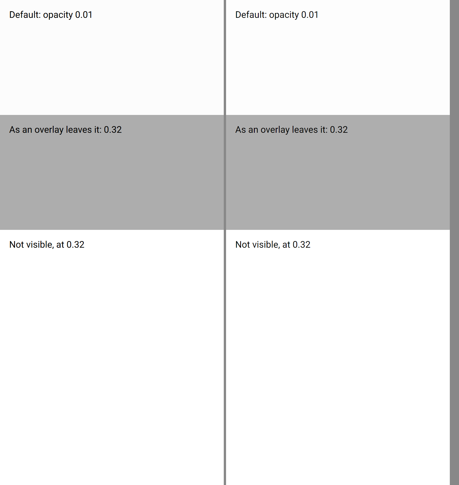

# ion-backdrop — Comparison

Ionic 8.8.1, md, headless Chromium, 390 x 844 at 2x, beside Avonic headless (Skia) at the same size and scale.

```
node tools/ionic-ref/render.js ion-backdrop --bare --html '<div style="font:16px Roboto;color:#000"><div style="position:relative;height:200px;background:#fff"><p style="margin:0;padding:16px">Default: opacity 0.01</p><ion-backdrop></ion-backdrop></div><div style="position:relative;height:200px;background:#fff"><p style="margin:0;padding:16px">As an overlay leaves it: 0.32</p><ion-backdrop style="opacity:0.32"></ion-backdrop></div><div style="position:relative;height:200px;background:#fff"><p style="margin:0;padding:16px">Not visible, at 0.32</p><ion-backdrop visible="false" style="opacity:0.32"></ion-backdrop></div></div>'
```

Avonic's frame is `AvonicBackdropCaptureTests.Reference_Page`, saved as [`compare/avonic-page.png`](compare/avonic-page.png).



## Visual

| | Ionic | Avonic | |
|---|---|---|---|
| Default, a blank pixel (600, 300) | 252 | 253 | Match, to a level: Skia rounds 0.99 of 255 up, Chromium down |
| At 0.32, (600, 700) | 173 | 174 | Match, to a level, the same way |
| Not visible, at 0.32, (600, 1100) | 255 | 255 | Match: transparent |
| The text under it | covered, as the backdrop is above it | covered | Match |

The backdrop's own values match Chromium's computed style (M1 to M3 in the plan): opacity 0.01, black, z-index 2, a hand cursor,
the default cursor when not tappable, transparent when not visible.

## Behaviour

| # | Behaviour | Ionic | Avonic | |
|---|---|---|---|---|
| B1 | Mouse click, and a 60 px mouse drag | `ionBackdropTap` | `IonBackdropTap` | Match. A right click: neither |
| B2 | Finger moving 0 to 15 px; 16, 20, 40 px | tap; none | tap; none | Match (`NativeButton`'s 15 px) |
| B3 | Not tappable | no event; the button under it gets no click | the same | Match |
| B4 | `stopPropagation` | the parent's `click` doesn't come; it does without | a parent's `Tapped`, and an `AvonicButton` around it, don't; they do without | Match, in Avalonia's terms: `Tapped` is a plain element's click |
| B4 | `pointerdown`, `pointerup` on the parent | reach it either way | reach it either way (nothing handles them) | Match |
| B5 | The event bubbles to the overlay | dismisses with `backdrop` | dismisses with `backdrop` | Match |
| B7 | `aria-hidden="true"` | not in the accessibility tree | `NoneAutomationPeer`: neither a control nor content | Match |
| B8 | `inset: 0` | the parent's size | the parent's size | Match |

## Deliberate differences

- **`preventDefault()`** has nothing to prevent on a `div`, so nothing here does it.
- **`touch-action: none`, `contain: strict`, `transform: translateZ(0)`**: no counterpart. An overlay isn't in a `ScrollViewer`, and
  the other two are hints to the browser's renderer.
- **A second quick tap** is Avalonia's `DoubleTapped`, not `Tapped`, so a parent's `Tapped` handler hears one of two quick taps
  with `StopPropagation` false. `IonBackdropTap` comes for both, as `NativeButton` tracks the press itself.

Not tried in a real window: `tools/real-window/drive.ps1`'s `overlays` section does it.
