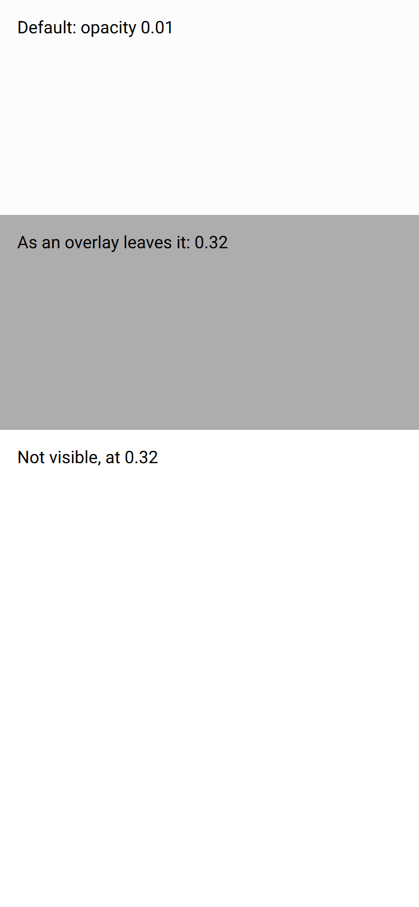
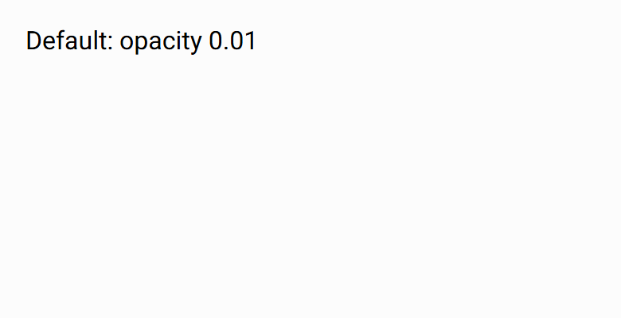

# ion-backdrop — reference render (Ionic 8.8.1, md, 390×844@2x)

Generated by `node tools/ionic-ref/render.js ion-backdrop --bare --html "<div style=\"font:16px Roboto;color:#000\"><div style=\"position:relative;height:200px;background:#fff\"><p style=\"margin:0;padding:16px\">Default: opacity 0.01</p><ion-backdrop></ion-backdrop></div><div style=\"position:relative;height:200px;background:#fff\"><p style=\"margin:0;padding:16px\">As an overlay leaves it: 0.32</p><ion-backdrop style=\"opacity:0.32\"></ion-backdrop></div><div style=\"position:relative;height:200px;background:#fff\"><p style=\"margin:0;padding:16px\">Not visible, at 0.32</p><ion-backdrop visible=\"false\" style=\"opacity:0.32\"></ion-backdrop></div></div>"`

```html
<div style="font:16px Roboto;color:#000"><div style="position:relative;height:200px;background:#fff"><p style="margin:0;padding:16px">Default: opacity 0.01</p><ion-backdrop></ion-backdrop></div><div style="position:relative;height:200px;background:#fff"><p style="margin:0;padding:16px">As an overlay leaves it: 0.32</p><ion-backdrop style="opacity:0.32"></ion-backdrop></div><div style="position:relative;height:200px;background:#fff"><p style="margin:0;padding:16px">Not visible, at 0.32</p><ion-backdrop visible="false" style="opacity:0.32"></ion-backdrop></div></div>
```

 

## Element 1

- attributes: `{"aria-hidden":"true","class":"md hydrated"}`
- classes: `md hydrated`
- rect: `{"x":0,"y":0,"w":390,"h":200}`

### Host computed

| prop | value |
|---|---|
| display | `block` |
| position | `absolute` |
| box-sizing | `border-box` |
| width | `390px` |
| height | `200px` |
| min-height | `0px` |
| min-width | `0px` |
| padding | `0px` |
| margin | `0px` |
| border | `0px none rgb(0, 0, 0)` |
| border-radius | `0px` |
| background-color | `rgb(0, 0, 0)` |
| color | `rgb(0, 0, 0)` |
| font-size | `16px` |
| font-weight | `400` |
| font-family | `Roboto` |
| line-height | `normal` |
| letter-spacing | `normal` |
| text-transform | `none` |
| opacity | `0.01` |
| overflow | `visible` |
| contain | `strict` |
| pointer-events | `auto` |
| transition | `all` |
| transform | `matrix(1, 0, 0, 1, 0, 0)` |
| box-shadow | `none` |
| outline | `rgb(0, 0, 0) none 0px` |
| cursor | `pointer` |

### DOM tree

```
<ion-backdrop>
  #shadow-root
```

## Element 2

- attributes: `{"style":"opacity:0.32","aria-hidden":"true","class":"md hydrated"}`
- classes: `md hydrated`
- rect: `{"x":0,"y":200,"w":390,"h":200}`

### Host computed

| prop | value |
|---|---|
| display | `block` |
| position | `absolute` |
| box-sizing | `border-box` |
| width | `390px` |
| height | `200px` |
| min-height | `0px` |
| min-width | `0px` |
| padding | `0px` |
| margin | `0px` |
| border | `0px none rgb(0, 0, 0)` |
| border-radius | `0px` |
| background-color | `rgb(0, 0, 0)` |
| color | `rgb(0, 0, 0)` |
| font-size | `16px` |
| font-weight | `400` |
| font-family | `Roboto` |
| line-height | `normal` |
| letter-spacing | `normal` |
| text-transform | `none` |
| opacity | `0.32` |
| overflow | `visible` |
| contain | `strict` |
| pointer-events | `auto` |
| transition | `all` |
| transform | `matrix(1, 0, 0, 1, 0, 0)` |
| box-shadow | `none` |
| outline | `rgb(0, 0, 0) none 0px` |
| cursor | `pointer` |

### DOM tree

```
<ion-backdrop>
  #shadow-root
```

## Element 3

- attributes: `{"visible":"false","style":"opacity:0.32","aria-hidden":"true","class":"md backdrop-hide hydrated"}`
- classes: `md backdrop-hide hydrated`
- rect: `{"x":0,"y":400,"w":390,"h":200}`

### Host computed

| prop | value |
|---|---|
| display | `block` |
| position | `absolute` |
| box-sizing | `border-box` |
| width | `390px` |
| height | `200px` |
| min-height | `0px` |
| min-width | `0px` |
| padding | `0px` |
| margin | `0px` |
| border | `0px none rgb(0, 0, 0)` |
| border-radius | `0px` |
| background-color | `rgba(0, 0, 0, 0)` |
| color | `rgb(0, 0, 0)` |
| font-size | `16px` |
| font-weight | `400` |
| font-family | `Roboto` |
| line-height | `normal` |
| letter-spacing | `normal` |
| text-transform | `none` |
| opacity | `0.32` |
| overflow | `visible` |
| contain | `strict` |
| pointer-events | `auto` |
| transition | `all` |
| transform | `matrix(1, 0, 0, 1, 0, 0)` |
| box-shadow | `none` |
| outline | `rgb(0, 0, 0) none 0px` |
| cursor | `pointer` |

### DOM tree

```
<ion-backdrop>
  #shadow-root
```
