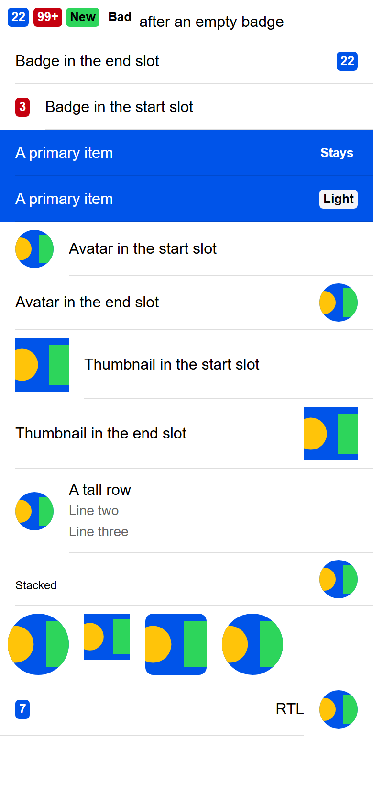
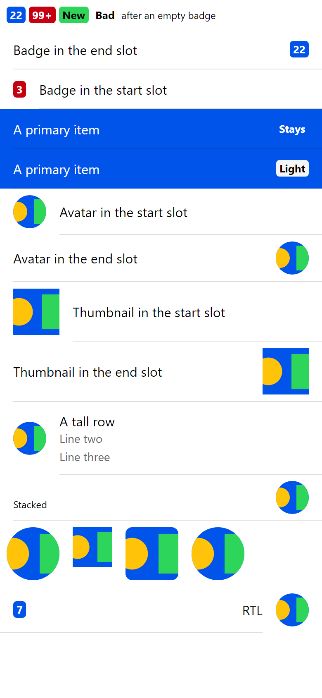

# ion-badge, ion-avatar and ion-thumbnail — Comparison against the web components

> Ionic side (Chromium, md, 390×844@2x) → [`ref/`](ref/). The exact command:
>
> ```
> node tools/ionic-ref/render.js ion-badge --bare --html "<div style=\"padding:8px\"><ion-badge>22</ion-badge> <ion-badge color=\"danger\">99+</ion-badge> <ion-badge color=\"success\">New</ion-badge> <ion-badge color=\"nonexistent\">Bad</ion-badge> <ion-badge></ion-badge><span>after an empty badge</span></div><ion-item><ion-label>Badge in the end slot</ion-label><ion-badge slot=\"end\">22</ion-badge></ion-item><ion-item><ion-badge slot=\"start\" color=\"danger\">3</ion-badge><ion-label>Badge in the start slot</ion-label></ion-item><ion-item color=\"primary\"><ion-label>A primary item</ion-label><ion-badge slot=\"end\">Stays</ion-badge></ion-item><ion-item color=\"primary\"><ion-label>A primary item</ion-label><ion-badge slot=\"end\" color=\"light\">Light</ion-badge></ion-item><ion-item><ion-avatar slot=\"start\"></ion-avatar><ion-label>Avatar in the start slot</ion-label></ion-item><ion-item><ion-label>Avatar in the end slot</ion-label><ion-avatar slot=\"end\"></ion-avatar></ion-item><ion-item><ion-thumbnail slot=\"start\"></ion-thumbnail><ion-label>Thumbnail in the start slot</ion-label></ion-item><ion-item><ion-label>Thumbnail in the end slot</ion-label><ion-thumbnail slot=\"end\"></ion-thumbnail></ion-item><ion-item><ion-avatar slot=\"start\"></ion-avatar><ion-label><h2>A tall row</h2><p>Line two</p><p>Line three</p></ion-label></ion-item><ion-item><ion-label position=\"stacked\">Stacked</ion-label><ion-avatar slot=\"end\"></ion-avatar></ion-item><div style=\"display:flex;gap:16px;padding:8px\"><ion-avatar></ion-avatar><ion-thumbnail></ion-thumbnail><ion-avatar style=\"--border-radius:8px\"></ion-avatar><ion-thumbnail style=\"--size:64px;--border-radius:50%\"></ion-thumbnail></div><div dir=\"rtl\"><ion-item><ion-avatar slot=\"start\"></ion-avatar><ion-label>RTL</ion-label><ion-badge slot=\"end\">7</ion-badge></ion-item></div>"
> ```
>
> Avonic side: `AVONIC_CAPTURE_DIR=… dotnet test` → `AvonicBadgeCaptureTests` (headless Skia, 2×) → [`compare/`](compare/).
> Measurements for the behaviours came from a separate scene, wrapped in `ion-app`, at 390 wide, in
> [`ref/measurements.json`](ref/measurements.json), with its page in [`ref/measurements.png`](ref/measurements.png).

## Frames

| Ionic | Avonic |
|---|---|
|  |  |

Rows from the top: badges in a line (primary, danger, success, an unknown colour, an empty one); a badge in the end slot and in
the start slot; a primary item with a plain badge and with a light one; avatars and thumbnails in the start and end slots; an
avatar beside a tall label; an avatar beside a stacked label; avatars and thumbnails on their own, one avatar with a radius of 8
and one thumbnail of 64 at 50%; and an RTL item with an avatar and a badge.

**Match,** apart from these visible differences:

- **Text.** Roboto isn't installed on this machine, so Chromium uses Arial and Avalonia uses Segoe UI. Badges are 20 high in
  both, as `line-height: 1` is of the font size, but a little wider or narrower with the font: "Default slot" is 80 against 78.8.
- **The first line** is shorter in Avonic, as its text is Avalonia's default size, where a page's is 16
  ([ADR 0002](../../decisions/0002-decisions-from-the-first-swarm.md)). Every row below sits a little higher for it.
- **The line under the RTL item** reaches the left edge in Ionic, and stops 16 short of it in Avonic. That's `ion-item`'s
  inner border in RTL, not these controls: measured `.item-inner` at x = 0, 318 wide. Listed for `ion-item` in the PR.

## Found here, not by the tests

- **An item with an avatar or a thumbnail in the end slot is 1 taller** than with it at the start, as the inner border is under
  the end slot and not the start: 57 against 56, and 73 against 72. Avonic did this already; the tests now hold it.
- **The badge's text test couldn't fail.** Breaking the half leading and the `ClipToBounds` on purpose both passed, as it
  counted the white of the rounded corners as ink. It now looks inside the corners, and compares the text's height with the
  same text drawn plainly, so that it holds on any font.

## Found in review

- **In RTL, uneven corners moved on the background and not on the image.** A `Border`'s corners are mirrored with the rest of
  the element, and an `Image` isn't mirrored, where CSS's `border-radius` is physical. The background's corners now swap back.
- **Deliberate breakage missed four rules,** which won by where their file merges and not by their pseudoclasses: the avatar's
  file merges before `Styles/Item.axaml`, and the thumbnail's after. Tests now merge each file first and last.

## Behaviours

The numbers are from [PLAN.md](PLAN.md#behaviours). Each has tests in `AvonicBadgeTests`, `AvonicAvatarTests` and
`AvonicThumbnailTests`, named after its number.

| # | Behaviour | Ionic | Result |
|---|---|---|---|
| B1 | Alone: 13 px bold, primary on white, radius 4, 20 high, the text in the middle | `alone`: 13 px 700, `rgb(0, 84, 233)`, white, `padding: 3px 4px 4px`, 20 high | match |
| B2 | `Color` paints the base behind the contrast, and follows a change | `alone-danger`: `rgb(197, 0, 15)`, white | match |
| B3 | An unknown colour: no background, inherited text; a coloured item's values in one | `alone-bad`: transparent, `rgb(1, 2, 3)`; `end-primary-bad`: `rgb(0, 84, 233)`, white | match |
| B4 | The tokens set background, text and padding; `Color` beats them | `alone-vars`: `rgb(10, 20, 30)`, `rgb(40, 50, 60)`, 17 high; `alone-vars-color`: danger | match |
| B5 | Empty takes no space, and shows again with content | `alone-empty` 0 × 0 | match. `""` counts as empty |
| B6 | It never wraps | `alone-long`: 547.09 × 20 | match in height. 390 wide, cut, where Ionic's runs off the page: see the differences |
| B7 | Its text plus 8, at least 10 | `alone-1` 15.23, `alone-i` 11.63 | match |
| B8 | In a slot: the slot's 16, centred, 7 beside a stacked label, 13 px in a 30 px item | `end` y = 13.5 in 48, `end-tall` y = 33.59 in 88.19, `end-stacked` `7px 0px 7px 16px`, `end-sized` 20 high, `def` x = 16 | match. y = 14, as layout rounds |
| B9 | A coloured item doesn't change it | `end-primary`: `rgb(0, 84, 233)`, white | match |
| B10 | RTL: an end badge at the left | `end-rtl` x = 16, `margin: 0px 16px 0px 0px` | match |
| B11 | Text centred in a wider badge | `text-align: center` | match |
| A1 | Alone: 64 × 64, no margin, at the left | `av-block` | match |
| A2 | An image fills it, cropped from the middle, cut to a circle | `av-block-img`: 64 × 64, `object-fit: cover`, `border-radius: 50%` | match, by pixel |
| A3 | The radius key, as a `CornerRadius`, a number, a length or a percentage, in one avatar or everywhere | `av-alone-r8`: 8 px on host and image | match |
| A4 | A background follows the radius | `av-bg` | match |
| A5 | Other content isn't cut | the host has no `overflow: hidden` | match |
| A6 | In an item's or a divider's slot: 40, 8 above and below, 16 towards the content | `av-start` `8px 16px 8px 0px`, `av-end`, `av-def` `8px 0px`, rows of 56 and 57, `av-divider` | match |
| A7 | Nested deeper, 64 with no margin | `av-div` | match, for anything but a panel, which stands for the slot |
| A8 | Beside a stacked label: 7 above and below | `av-stacked` `7px 0px 7px 16px` | match |
| A9 | Centred in a tall row | `av-tall` y = 24.09 in 88.19 | match |
| A10 | Its own `Width` and `Height` beat the slot's | `av-vars`: 30 × 30, `8px 16px 8px 0px` | match |
| A11 | RTL: a start avatar at the right, its corners where they were | `av-rtl` x = 334; `border-radius` is physical | match |
| A12 | Not sized by the item's font | `av-sized` 40 | match |
| T1 | Alone: 48 × 48 | `thumbnail.css` | match |
| T2 | An image fills it, cropped from the middle, square | `th-start-img`, `object-fit: cover` | match, by pixel |
| T3 | The size key, alone and in an item; the radius key, 50% a circle | `th-alone-vars` 64 at 50%; `th-vars` 30 in an item | match |
| T4 | In a slot: 56, 8 above and below, 16 towards the content | `th-start`, `th-end`, `th-def`, rows of 72 and 73, `th-divider` | match |
| T5 | Beside a stacked label: 7 | `th-stacked` `7px 0px 7px 16px` | match |
| T6 | Its own `Width` and `Height` beat the slot's | `th-vars` | match |
| T7 | RTL: at the right, its corners where they were | as `av-rtl` | match |

## Deliberate differences and known gaps

All in [PLAN.md](PLAN.md#deliberate-differences), with this one found here:

| Difference | Measured | Why |
|---|---|---|
| A badge wider than its parent is cut at the parent's width | Ionic's `alone-long` is 547.09 wide in a 390 page, and runs off it; Avonic's is 390, its text cut by its own clip | Avalonia gives a child no more than the space it has. Its height and its one line match |

## Real window

Not tried in a real window. The frames are headless.
