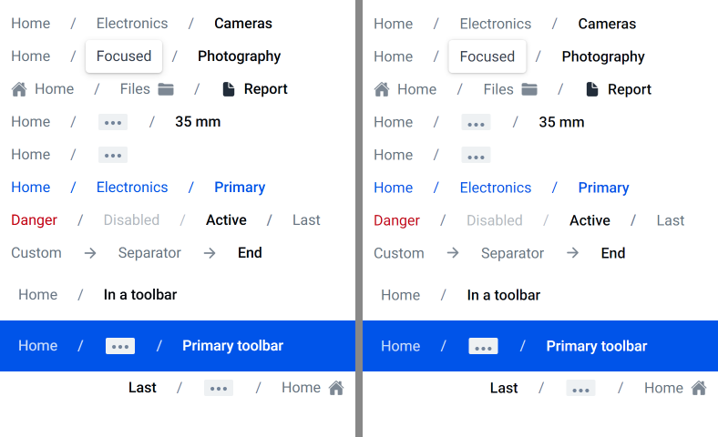
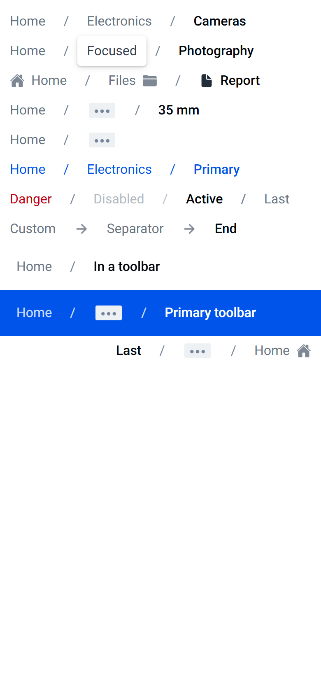
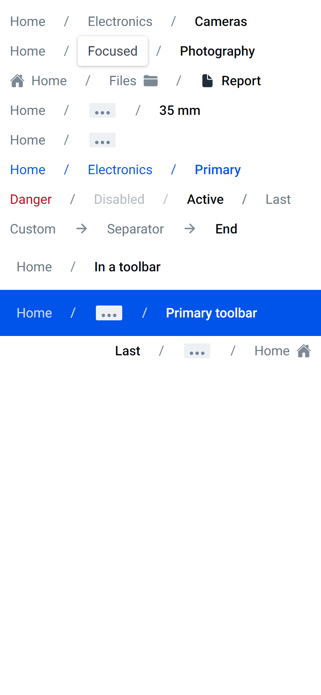

# ion-breadcrumbs — Comparison against the web component

> Ionic side: `node tools/ionic-ref/render.js ion-breadcrumb --bare --out docs/components/ion-breadcrumbs/ref --html '<the snippet below>'`
> (Chromium, md, 390×844@2x) → [`ref/`](ref/). The snippet wraps itself in `ion-app`, with `position:static;display:block;contain:none;overflow:visible`,
> so that tap-click and focus-visible run. `ref/page.html` holds the page, and `ref/README.md` the exact command. Rendered for
> `ion-breadcrumb`, so that the dump has every breadcrumb's parts and variables.
> Avonic side: `AVONIC_CAPTURE_DIR=… dotnet test` → `AvonicBreadcrumbsCaptureTests` (headless Skia, 2×) → [`compare/`](compare/).
> Not tried in a real window, and not tried on a device.

```html
<ion-app style="position:static;display:block;contain:none;overflow:visible"><div style="padding:8px 0">
<ion-breadcrumbs><ion-breadcrumb>Home</ion-breadcrumb><ion-breadcrumb>Electronics</ion-breadcrumb><ion-breadcrumb>Cameras</ion-breadcrumb></ion-breadcrumbs>
<ion-breadcrumbs><ion-breadcrumb href="#home">Home</ion-breadcrumb><ion-breadcrumb href="#focus" class="ion-focused">Focused</ion-breadcrumb><ion-breadcrumb href="#photo">Photography</ion-breadcrumb></ion-breadcrumbs>
<ion-breadcrumbs><ion-breadcrumb><ion-icon slot="start" name="home"></ion-icon>Home</ion-breadcrumb><ion-breadcrumb>Files<ion-icon slot="end" name="folder"></ion-icon></ion-breadcrumb><ion-breadcrumb><ion-icon slot="start" name="document"></ion-icon>Report</ion-breadcrumb></ion-breadcrumbs>
<ion-breadcrumbs max-items="4"><ion-breadcrumb>Home</ion-breadcrumb><ion-breadcrumb>Electronics</ion-breadcrumb><ion-breadcrumb>Photography</ion-breadcrumb><ion-breadcrumb>Cameras</ion-breadcrumb><ion-breadcrumb>Film</ion-breadcrumb><ion-breadcrumb>35 mm</ion-breadcrumb></ion-breadcrumbs>
<ion-breadcrumbs max-items="2" items-after-collapse="0"><ion-breadcrumb>Home</ion-breadcrumb><ion-breadcrumb>Electronics</ion-breadcrumb><ion-breadcrumb>Photography</ion-breadcrumb><ion-breadcrumb>Cameras</ion-breadcrumb></ion-breadcrumbs>
<ion-breadcrumbs color="primary"><ion-breadcrumb>Home</ion-breadcrumb><ion-breadcrumb>Electronics</ion-breadcrumb><ion-breadcrumb>Primary</ion-breadcrumb></ion-breadcrumbs>
<ion-breadcrumbs><ion-breadcrumb color="danger">Danger</ion-breadcrumb><ion-breadcrumb disabled>Disabled</ion-breadcrumb><ion-breadcrumb active>Active</ion-breadcrumb><ion-breadcrumb>Last</ion-breadcrumb></ion-breadcrumbs>
<ion-breadcrumbs><ion-breadcrumb>Custom<ion-icon slot="separator" name="arrow-forward"></ion-icon></ion-breadcrumb><ion-breadcrumb>Separator<ion-icon slot="separator" name="arrow-forward"></ion-icon></ion-breadcrumb><ion-breadcrumb>End</ion-breadcrumb></ion-breadcrumbs>
<ion-toolbar><ion-breadcrumbs><ion-breadcrumb>Home</ion-breadcrumb><ion-breadcrumb>In a toolbar</ion-breadcrumb></ion-breadcrumbs></ion-toolbar>
<ion-toolbar color="primary"><ion-breadcrumbs max-items="2"><ion-breadcrumb>Home</ion-breadcrumb><ion-breadcrumb>Hidden</ion-breadcrumb><ion-breadcrumb>Primary toolbar</ion-breadcrumb></ion-breadcrumbs></ion-toolbar>
<div dir="rtl"><ion-breadcrumbs max-items="3"><ion-breadcrumb><ion-icon slot="start" name="home"></ion-icon>Home</ion-breadcrumb><ion-breadcrumb>Hidden</ion-breadcrumb><ion-breadcrumb>RTL</ion-breadcrumb><ion-breadcrumb>Last</ion-breadcrumb></ion-breadcrumbs></div>
</div></ion-app>
```

(One line in the real command.) `Reference_Page` lays out the same content in a `StackPanel`, and focuses `Focused` by keyboard,
which is what `class="ion-focused"` stands for.

The behaviours in [PLAN.md](PLAN.md) were measured with throwaway Playwright scripts against the same page: changing props and
children, tabbing, pressing Enter and Space, clicking the indicator and hovering with a mouse.

## Frames

The top of the page, Ionic on the left:



| Ionic | Avonic |
|---|---|
|  |  |

**Match,** apart from these visible differences:

- **Text** is drawn from the same Roboto files on both sides, and lands a little lower here, under a pixel, as a 24 px line box
  places 16 px text a little differently. Words differ in width by a fraction of a pixel, so a row's later breadcrumbs drift a
  little. Both read off the zoomed frames, not measured: the boxes are, in the tests, to half a pixel.
- **The collapsed indicator's dots** sit a little lower, under a pixel, also read off the frames: the icon overflows its 18 px
  button by 4, and layout rounds it.

## Behaviours

| # | Behaviour | Ionic | Avonic | |
|---|---|---|---|---|
| 1 | Separators on all but the last; a set value stays | `A:sep=false \| B:sep=true \| C:ALsep=true` | the same | match |
| 2 | The last made active, unless one is | `C:AL` | the same; `Active` reads true, as the prop does | match |
| 3 | A change undoes the first active one if the breadcrumbs ever made one: B set active, E added, C stays | `C:A`, `E:L` | the same | match, Ionic's quirk included |
| 3 | Changes in one task are one `slotchange`: X (active) and Y added at once leave X active; apart, Y | `X:A`; apart `Y:AL` | the same, the change posted to the dispatcher | match |
| 4 | Collapsing from `before` to `count - after` behind the indicator; none if `before + after > maxItems` | `B:CI C:C D:C` | the same | match |
| 5 | `itemsAfterCollapse = 0` makes the indicator's breadcrumb the last, even with nothing collapsed | `B:ACLI`; `maxItems=10` → `B:AL`, `E:sep=true` | the same | match |
| 6 | Nested breadcrumbs count | `Nested:sep=true` | the same, and those from an `ItemTemplate` | match |
| 7 | The indicator, by pointer, Enter or Space: `ionCollapsedClick` with the collapsed ones and the indicator | `collapsed=B,C target=BUTTON` | `CollapsedBreadcrumbs`, `IonShadowTarget` the `Button` | match |
| 8 | A wrapping row, each centred on its line; a breadcrumb wider than the row overflows it | `[0,36,239,36]` at 200 px | parts draw the same 239, past the edge, but the breadcrumb's box is held to the row's 200 | deliberate: Avalonia's `WrapPanel` arranges a child at most as wide as the panel. Nothing visible changes; a hit test past 200 misses |
| 9 | In a toolbar, padding 0 8; contrast in a coloured one | `0px 8px`, white | the same | match |
| 10 | 36 tall, padding 12 and 6, `/` with margins 10 | element 0 | within 0.5 px | match |
| 11, 12 | Collapsed: only the indicator and its separator, 86.61 by 23 | element 10 | 86.61 by 23, within a pixel's rounding | match |
| 13 | Active: `#03060b` at 500 | element 2 | the same | match |
| 14 | Colours: base, the breadcrumbs' base, the toolbar's contrast at 0.8, contrast when active, read at the breadcrumb's render | `hover u` white, `w` black | the same | match |
| 15 | A link: a tab stop, Enter not Space, hover `#03060b` or the shade, hover beating the toolbar's contrast | `tab 0`, `Space on link []`, `hover t` | the same | match |
| 15 | A link navigates | the browser follows `href`, or `ion-router` does | **nothing navigates**: the app follows it from `Click` | deliberate difference: the router family is out of scope ([ROADMAP](../../ROADMAP.md#out-of-scope)) |
| 15 | A link's cursor | the hand, over the `<a>` | the arrow | gap: a desktop detail, on a phone there's none |
| 16 | Focused by keyboard: `#35404e`, white, radius 4, the shadow, no outline | element 4 | the same | match |
| 16 | A focused link that collapses loses focus | `display: none` blurs it | focus is cleared, `IonBlur` raised | match |
| 7 | A finger that moves past 15 px on the indicator | no click at all | neither `IonCollapsedClick` nor `Click`, though the `Button` alone would click | match |
| 17 | `ionFocus`/`ionBlur` from the breadcrumb only | `focus A`, `blur A`, nothing for the indicator | the same | match |
| 18 | Disabled: 0.5, separator too, no input, no tab stop | `Dis` skipped | the same | match |
| 19 | Slotted icons 18, `#7d8894`, `#222d3a` active, 8 beside the text | element 26 | the same | match |
| 20 | The indicator: 32 by 18, `#eef1f3`, 0.7 under a mouse, `#dfe5e8` focused, named | measured | the same | match |
| — | A click on the indicator also clicks its breadcrumb | `click:B` after it | `Click`, after `IonCollapsedClick` | match (the extension) |
| — | `breadcrumbs.md.css`'s indicator rules | can't reach the breadcrumb's shadow root: unchanged in a coloured toolbar | not translated | match |

## Not compared

- **A real window and a device.** Headless only: "real-window run queued", "not tried on a device".
- **RTL** is in the frame and matches; Avalonia mirrors the margins.
- **Dark mode.** The md literals don't follow `Dark.axaml` yet: see the README's known gaps.
- **The popover** an app opens from `ionCollapsedClick`: `ion-popover` isn't built yet. The sample lists the hidden breadcrumbs instead.
