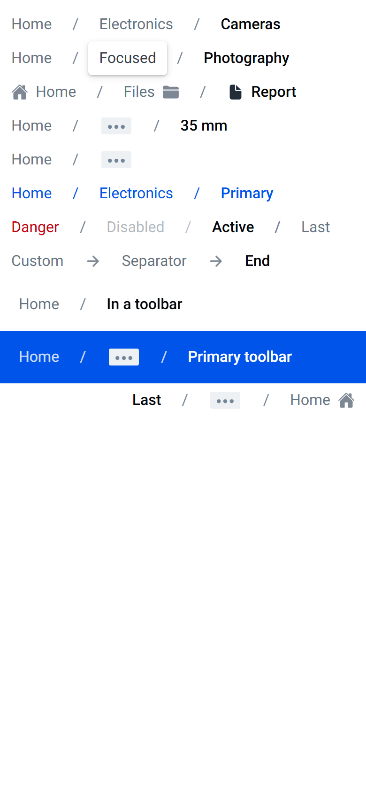
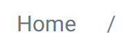

# ion-breadcrumb — reference render (Ionic 8.8.1, md, 390×844@2x)

Generated by `node tools/ionic-ref/render.js ion-breadcrumb --bare --html "<ion-app style=\"position:static;display:block;contain:none;overflow:visible\"><div style=\"padding:8px 0\"><ion-breadcrumbs><ion-breadcrumb>Home</ion-breadcrumb><ion-breadcrumb>Electronics</ion-breadcrumb><ion-breadcrumb>Cameras</ion-breadcrumb></ion-breadcrumbs><ion-breadcrumbs><ion-breadcrumb href=\"#home\">Home</ion-breadcrumb><ion-breadcrumb href=\"#focus\" class=\"ion-focused\">Focused</ion-breadcrumb><ion-breadcrumb href=\"#photo\">Photography</ion-breadcrumb></ion-breadcrumbs><ion-breadcrumbs><ion-breadcrumb><ion-icon slot=\"start\" name=\"home\"></ion-icon>Home</ion-breadcrumb><ion-breadcrumb>Files<ion-icon slot=\"end\" name=\"folder\"></ion-icon></ion-breadcrumb><ion-breadcrumb><ion-icon slot=\"start\" name=\"document\"></ion-icon>Report</ion-breadcrumb></ion-breadcrumbs><ion-breadcrumbs max-items=\"4\"><ion-breadcrumb>Home</ion-breadcrumb><ion-breadcrumb>Electronics</ion-breadcrumb><ion-breadcrumb>Photography</ion-breadcrumb><ion-breadcrumb>Cameras</ion-breadcrumb><ion-breadcrumb>Film</ion-breadcrumb><ion-breadcrumb>35 mm</ion-breadcrumb></ion-breadcrumbs><ion-breadcrumbs max-items=\"2\" items-after-collapse=\"0\"><ion-breadcrumb>Home</ion-breadcrumb><ion-breadcrumb>Electronics</ion-breadcrumb><ion-breadcrumb>Photography</ion-breadcrumb><ion-breadcrumb>Cameras</ion-breadcrumb></ion-breadcrumbs><ion-breadcrumbs color=\"primary\"><ion-breadcrumb>Home</ion-breadcrumb><ion-breadcrumb>Electronics</ion-breadcrumb><ion-breadcrumb>Primary</ion-breadcrumb></ion-breadcrumbs><ion-breadcrumbs><ion-breadcrumb color=\"danger\">Danger</ion-breadcrumb><ion-breadcrumb disabled>Disabled</ion-breadcrumb><ion-breadcrumb active>Active</ion-breadcrumb><ion-breadcrumb>Last</ion-breadcrumb></ion-breadcrumbs><ion-breadcrumbs><ion-breadcrumb>Custom<ion-icon slot=\"separator\" name=\"arrow-forward\"></ion-icon></ion-breadcrumb><ion-breadcrumb>Separator<ion-icon slot=\"separator\" name=\"arrow-forward\"></ion-icon></ion-breadcrumb><ion-breadcrumb>End</ion-breadcrumb></ion-breadcrumbs><ion-toolbar><ion-breadcrumbs><ion-breadcrumb>Home</ion-breadcrumb><ion-breadcrumb>In a toolbar</ion-breadcrumb></ion-breadcrumbs></ion-toolbar><ion-toolbar color=\"primary\"><ion-breadcrumbs max-items=\"2\"><ion-breadcrumb>Home</ion-breadcrumb><ion-breadcrumb>Hidden</ion-breadcrumb><ion-breadcrumb>Primary toolbar</ion-breadcrumb></ion-breadcrumbs></ion-toolbar><div dir=\"rtl\"><ion-breadcrumbs max-items=\"3\"><ion-breadcrumb><ion-icon slot=\"start\" name=\"home\"></ion-icon>Home</ion-breadcrumb><ion-breadcrumb>Hidden</ion-breadcrumb><ion-breadcrumb>RTL</ion-breadcrumb><ion-breadcrumb>Last</ion-breadcrumb></ion-breadcrumbs></div></div></ion-app>" --out docs/components/ion-breadcrumbs/ref`

```html
<ion-app style="position:static;display:block;contain:none;overflow:visible"><div style="padding:8px 0"><ion-breadcrumbs><ion-breadcrumb>Home</ion-breadcrumb><ion-breadcrumb>Electronics</ion-breadcrumb><ion-breadcrumb>Cameras</ion-breadcrumb></ion-breadcrumbs><ion-breadcrumbs><ion-breadcrumb href="#home">Home</ion-breadcrumb><ion-breadcrumb href="#focus" class="ion-focused">Focused</ion-breadcrumb><ion-breadcrumb href="#photo">Photography</ion-breadcrumb></ion-breadcrumbs><ion-breadcrumbs><ion-breadcrumb><ion-icon slot="start" name="home"></ion-icon>Home</ion-breadcrumb><ion-breadcrumb>Files<ion-icon slot="end" name="folder"></ion-icon></ion-breadcrumb><ion-breadcrumb><ion-icon slot="start" name="document"></ion-icon>Report</ion-breadcrumb></ion-breadcrumbs><ion-breadcrumbs max-items="4"><ion-breadcrumb>Home</ion-breadcrumb><ion-breadcrumb>Electronics</ion-breadcrumb><ion-breadcrumb>Photography</ion-breadcrumb><ion-breadcrumb>Cameras</ion-breadcrumb><ion-breadcrumb>Film</ion-breadcrumb><ion-breadcrumb>35 mm</ion-breadcrumb></ion-breadcrumbs><ion-breadcrumbs max-items="2" items-after-collapse="0"><ion-breadcrumb>Home</ion-breadcrumb><ion-breadcrumb>Electronics</ion-breadcrumb><ion-breadcrumb>Photography</ion-breadcrumb><ion-breadcrumb>Cameras</ion-breadcrumb></ion-breadcrumbs><ion-breadcrumbs color="primary"><ion-breadcrumb>Home</ion-breadcrumb><ion-breadcrumb>Electronics</ion-breadcrumb><ion-breadcrumb>Primary</ion-breadcrumb></ion-breadcrumbs><ion-breadcrumbs><ion-breadcrumb color="danger">Danger</ion-breadcrumb><ion-breadcrumb disabled>Disabled</ion-breadcrumb><ion-breadcrumb active>Active</ion-breadcrumb><ion-breadcrumb>Last</ion-breadcrumb></ion-breadcrumbs><ion-breadcrumbs><ion-breadcrumb>Custom<ion-icon slot="separator" name="arrow-forward"></ion-icon></ion-breadcrumb><ion-breadcrumb>Separator<ion-icon slot="separator" name="arrow-forward"></ion-icon></ion-breadcrumb><ion-breadcrumb>End</ion-breadcrumb></ion-breadcrumbs><ion-toolbar><ion-breadcrumbs><ion-breadcrumb>Home</ion-breadcrumb><ion-breadcrumb>In a toolbar</ion-breadcrumb></ion-breadcrumbs></ion-toolbar><ion-toolbar color="primary"><ion-breadcrumbs max-items="2"><ion-breadcrumb>Home</ion-breadcrumb><ion-breadcrumb>Hidden</ion-breadcrumb><ion-breadcrumb>Primary toolbar</ion-breadcrumb></ion-breadcrumbs></ion-toolbar><div dir="rtl"><ion-breadcrumbs max-items="3"><ion-breadcrumb><ion-icon slot="start" name="home"></ion-icon>Home</ion-breadcrumb><ion-breadcrumb>Hidden</ion-breadcrumb><ion-breadcrumb>RTL</ion-breadcrumb><ion-breadcrumb>Last</ion-breadcrumb></ion-breadcrumbs></div></div></ion-app>
```

 

## Element 1

- attributes: `{"class":"md hydrated"}`
- classes: `md hydrated`
- rect: `{"x":0,"y":8,"w":93.67,"h":36}`

### CSS custom properties (resolved)

| var | value |
|---|---|
| `--background-focused` | `#fff` |
| `--color` | `#677483` |
| `--color-active` | `#03060b` |
| `--color-focused` | `#35404e` |
| `--color-hover` | `#03060b` |

### Host computed

| prop | value |
|---|---|
| display | `flex` |
| position | `static` |
| box-sizing | `border-box` |
| width | `93.6719px` |
| height | `36px` |
| min-height | `auto` |
| min-width | `auto` |
| padding | `0px` |
| margin | `0px` |
| border | `0px none rgb(103, 116, 131)` |
| border-radius | `0px` |
| background-color | `rgba(0, 0, 0, 0)` |
| color | `rgb(103, 116, 131)` |
| font-size | `16px` |
| font-weight | `400` |
| font-family | `Roboto, "Helvetica Neue", sans-serif` |
| line-height | `24px` |
| letter-spacing | `normal` |
| text-transform | `none` |
| opacity | `1` |
| overflow | `visible` |
| contain | `none` |
| pointer-events | `auto` |
| transition | `all` |
| transform | `none` |
| box-shadow | `none` |
| outline | `rgb(103, 116, 131) none 0px` |
| cursor | `auto` |

### Shadow parts

#### part="native" (`span`) rect `{"x":0,"y":8,"w":67.06,"h":36}`

| prop | value |
|---|---|
| display | `flex` |
| position | `static` |
| box-sizing | `content-box` |
| width | `43.0625px` |
| height | `24px` |
| min-height | `auto` |
| min-width | `auto` |
| padding | `6px 12px` |
| margin | `0px` |
| border | `0px none rgb(103, 116, 131)` |
| border-radius | `0px` |
| background-color | `rgba(0, 0, 0, 0)` |
| color | `rgb(103, 116, 131)` |
| font-size | `16px` |
| font-weight | `400` |
| font-family | `Roboto, "Helvetica Neue", sans-serif` |
| line-height | `24px` |
| letter-spacing | `normal` |
| text-transform | `none` |
| opacity | `1` |
| overflow | `visible` |
| contain | `none` |
| pointer-events | `auto` |
| transition | `all` |
| transform | `none` |
| box-shadow | `none` |
| outline | `rgb(103, 116, 131) none 0px` |
| cursor | `auto` |

#### part="separator" (`span`) rect `{"x":77.06,"y":13.5,"w":6.61,"h":24}`

| prop | value |
|---|---|
| display | `flex` |
| position | `static` |
| box-sizing | `content-box` |
| width | `6.60938px` |
| height | `24px` |
| min-height | `auto` |
| min-width | `auto` |
| padding | `0px` |
| margin | `-1px 10px 0px` |
| border | `0px none rgb(115, 132, 154)` |
| border-radius | `0px` |
| background-color | `rgba(0, 0, 0, 0)` |
| color | `rgb(115, 132, 154)` |
| font-size | `16px` |
| font-weight | `400` |
| font-family | `Roboto, "Helvetica Neue", sans-serif` |
| line-height | `24px` |
| letter-spacing | `normal` |
| text-transform | `none` |
| opacity | `1` |
| overflow | `visible` |
| contain | `none` |
| pointer-events | `auto` |
| transition | `all` |
| transform | `none` |
| box-shadow | `none` |
| outline | `rgb(115, 132, 154) none 0px` |
| cursor | `auto` |

### DOM tree

```
<ion-breadcrumb>
  #shadow-root
    <span.breadcrumb-native part="native">
      <slot name="start">
      <slot name="">
      <slot name="end">
    <span.breadcrumb-separator part="separator">
      <slot name="separator">
        <span>
```

## Element 2

- attributes: `{"class":"md hydrated"}`
- classes: `md hydrated`
- rect: `{"x":93.67,"y":8,"w":129.44,"h":36}`

### CSS custom properties (resolved)

| var | value |
|---|---|
| `--background-focused` | `#fff` |
| `--color` | `#677483` |
| `--color-active` | `#03060b` |
| `--color-focused` | `#35404e` |
| `--color-hover` | `#03060b` |

### Host computed

| prop | value |
|---|---|
| display | `flex` |
| position | `static` |
| box-sizing | `border-box` |
| width | `129.438px` |
| height | `36px` |
| min-height | `auto` |
| min-width | `auto` |
| padding | `0px` |
| margin | `0px` |
| border | `0px none rgb(103, 116, 131)` |
| border-radius | `0px` |
| background-color | `rgba(0, 0, 0, 0)` |
| color | `rgb(103, 116, 131)` |
| font-size | `16px` |
| font-weight | `400` |
| font-family | `Roboto, "Helvetica Neue", sans-serif` |
| line-height | `24px` |
| letter-spacing | `normal` |
| text-transform | `none` |
| opacity | `1` |
| overflow | `visible` |
| contain | `none` |
| pointer-events | `auto` |
| transition | `all` |
| transform | `none` |
| box-shadow | `none` |
| outline | `rgb(103, 116, 131) none 0px` |
| cursor | `auto` |

### Shadow parts

#### part="native" (`span`) rect `{"x":93.67,"y":8,"w":102.83,"h":36}`

| prop | value |
|---|---|
| display | `flex` |
| position | `static` |
| box-sizing | `content-box` |
| width | `78.8281px` |
| height | `24px` |
| min-height | `auto` |
| min-width | `auto` |
| padding | `6px 12px` |
| margin | `0px` |
| border | `0px none rgb(103, 116, 131)` |
| border-radius | `0px` |
| background-color | `rgba(0, 0, 0, 0)` |
| color | `rgb(103, 116, 131)` |
| font-size | `16px` |
| font-weight | `400` |
| font-family | `Roboto, "Helvetica Neue", sans-serif` |
| line-height | `24px` |
| letter-spacing | `normal` |
| text-transform | `none` |
| opacity | `1` |
| overflow | `visible` |
| contain | `none` |
| pointer-events | `auto` |
| transition | `all` |
| transform | `none` |
| box-shadow | `none` |
| outline | `rgb(103, 116, 131) none 0px` |
| cursor | `auto` |

#### part="separator" (`span`) rect `{"x":206.5,"y":13.5,"w":6.61,"h":24}`

| prop | value |
|---|---|
| display | `flex` |
| position | `static` |
| box-sizing | `content-box` |
| width | `6.60938px` |
| height | `24px` |
| min-height | `auto` |
| min-width | `auto` |
| padding | `0px` |
| margin | `-1px 10px 0px` |
| border | `0px none rgb(115, 132, 154)` |
| border-radius | `0px` |
| background-color | `rgba(0, 0, 0, 0)` |
| color | `rgb(115, 132, 154)` |
| font-size | `16px` |
| font-weight | `400` |
| font-family | `Roboto, "Helvetica Neue", sans-serif` |
| line-height | `24px` |
| letter-spacing | `normal` |
| text-transform | `none` |
| opacity | `1` |
| overflow | `visible` |
| contain | `none` |
| pointer-events | `auto` |
| transition | `all` |
| transform | `none` |
| box-shadow | `none` |
| outline | `rgb(115, 132, 154) none 0px` |
| cursor | `auto` |

### DOM tree

```
<ion-breadcrumb>
  #shadow-root
    <span.breadcrumb-native part="native">
      <slot name="start">
      <slot name="">
      <slot name="end">
    <span.breadcrumb-separator part="separator">
      <slot name="separator">
        <span>
```

## Element 3

- attributes: `{"class":"md breadcrumb-active hydrated"}`
- classes: `md breadcrumb-active hydrated`
- rect: `{"x":223.11,"y":8,"w":87.81,"h":36}`

### CSS custom properties (resolved)

| var | value |
|---|---|
| `--background-focused` | `#fff` |
| `--color` | `#677483` |
| `--color-active` | `#03060b` |
| `--color-focused` | `#35404e` |
| `--color-hover` | `#03060b` |

### Host computed

| prop | value |
|---|---|
| display | `flex` |
| position | `static` |
| box-sizing | `border-box` |
| width | `87.8125px` |
| height | `36px` |
| min-height | `auto` |
| min-width | `auto` |
| padding | `0px` |
| margin | `0px` |
| border | `0px none rgb(3, 6, 11)` |
| border-radius | `0px` |
| background-color | `rgba(0, 0, 0, 0)` |
| color | `rgb(3, 6, 11)` |
| font-size | `16px` |
| font-weight | `500` |
| font-family | `Roboto, "Helvetica Neue", sans-serif` |
| line-height | `24px` |
| letter-spacing | `normal` |
| text-transform | `none` |
| opacity | `1` |
| overflow | `visible` |
| contain | `none` |
| pointer-events | `auto` |
| transition | `all` |
| transform | `none` |
| box-shadow | `none` |
| outline | `rgb(3, 6, 11) none 0px` |
| cursor | `auto` |

### Shadow parts

#### part="native" (`span`) rect `{"x":223.11,"y":8,"w":87.81,"h":36}`

| prop | value |
|---|---|
| display | `flex` |
| position | `static` |
| box-sizing | `content-box` |
| width | `63.8125px` |
| height | `24px` |
| min-height | `auto` |
| min-width | `auto` |
| padding | `6px 12px` |
| margin | `0px` |
| border | `0px none rgb(3, 6, 11)` |
| border-radius | `0px` |
| background-color | `rgba(0, 0, 0, 0)` |
| color | `rgb(3, 6, 11)` |
| font-size | `16px` |
| font-weight | `500` |
| font-family | `Roboto, "Helvetica Neue", sans-serif` |
| line-height | `24px` |
| letter-spacing | `normal` |
| text-transform | `none` |
| opacity | `1` |
| overflow | `visible` |
| contain | `none` |
| pointer-events | `auto` |
| transition | `all` |
| transform | `none` |
| box-shadow | `none` |
| outline | `rgb(3, 6, 11) none 0px` |
| cursor | `auto` |

### DOM tree

```
<ion-breadcrumb>
  #shadow-root
    <span.breadcrumb-native part="native">
      <slot name="start">
      <slot name="">
      <slot name="end">
```

## Element 4

- attributes: `{"href":"#home","class":"md ion-activatable ion-focusable hydrated"}`
- classes: `md ion-activatable ion-focusable hydrated`
- rect: `{"x":0,"y":44,"w":93.67,"h":36}`

### CSS custom properties (resolved)

| var | value |
|---|---|
| `--background-focused` | `#fff` |
| `--color` | `#677483` |
| `--color-active` | `#03060b` |
| `--color-focused` | `#35404e` |
| `--color-hover` | `#03060b` |

### Host computed

| prop | value |
|---|---|
| display | `flex` |
| position | `static` |
| box-sizing | `border-box` |
| width | `93.6719px` |
| height | `36px` |
| min-height | `auto` |
| min-width | `auto` |
| padding | `0px` |
| margin | `0px` |
| border | `0px none rgb(103, 116, 131)` |
| border-radius | `0px` |
| background-color | `rgba(0, 0, 0, 0)` |
| color | `rgb(103, 116, 131)` |
| font-size | `16px` |
| font-weight | `400` |
| font-family | `Roboto, "Helvetica Neue", sans-serif` |
| line-height | `24px` |
| letter-spacing | `normal` |
| text-transform | `none` |
| opacity | `1` |
| overflow | `visible` |
| contain | `none` |
| pointer-events | `auto` |
| transition | `all` |
| transform | `none` |
| box-shadow | `none` |
| outline | `rgb(103, 116, 131) none 0px` |
| cursor | `auto` |

### Shadow parts

#### part="native" (`a`) rect `{"x":0,"y":44,"w":67.06,"h":36}`

| prop | value |
|---|---|
| display | `flex` |
| position | `static` |
| box-sizing | `content-box` |
| width | `43.0625px` |
| height | `24px` |
| min-height | `auto` |
| min-width | `auto` |
| padding | `6px 12px` |
| margin | `0px` |
| border | `0px none rgb(103, 116, 131)` |
| border-radius | `0px` |
| background-color | `rgba(0, 0, 0, 0)` |
| color | `rgb(103, 116, 131)` |
| font-size | `16px` |
| font-weight | `400` |
| font-family | `Roboto, "Helvetica Neue", sans-serif` |
| line-height | `24px` |
| letter-spacing | `normal` |
| text-transform | `none` |
| opacity | `1` |
| overflow | `visible` |
| contain | `none` |
| pointer-events | `auto` |
| transition | `all` |
| transform | `none` |
| box-shadow | `none` |
| outline | `rgb(103, 116, 131) none 0px` |
| cursor | `pointer` |

#### part="separator" (`span`) rect `{"x":77.06,"y":49.5,"w":6.61,"h":24}`

| prop | value |
|---|---|
| display | `flex` |
| position | `static` |
| box-sizing | `content-box` |
| width | `6.60938px` |
| height | `24px` |
| min-height | `auto` |
| min-width | `auto` |
| padding | `0px` |
| margin | `-1px 10px 0px` |
| border | `0px none rgb(115, 132, 154)` |
| border-radius | `0px` |
| background-color | `rgba(0, 0, 0, 0)` |
| color | `rgb(115, 132, 154)` |
| font-size | `16px` |
| font-weight | `400` |
| font-family | `Roboto, "Helvetica Neue", sans-serif` |
| line-height | `24px` |
| letter-spacing | `normal` |
| text-transform | `none` |
| opacity | `1` |
| overflow | `visible` |
| contain | `none` |
| pointer-events | `auto` |
| transition | `all` |
| transform | `none` |
| box-shadow | `none` |
| outline | `rgb(115, 132, 154) none 0px` |
| cursor | `auto` |

### DOM tree

```
<ion-breadcrumb>
  #shadow-root
    <a.breadcrumb-native part="native">
      <slot name="start">
      <slot name="">
      <slot name="end">
    <span.breadcrumb-separator part="separator">
      <slot name="separator">
        <span>
```

## Element 5

- attributes: `{"href":"#focus","class":"ion-focused md ion-activatable ion-focusable hydrated"}`
- classes: `ion-focused md ion-activatable ion-focusable hydrated`
- rect: `{"x":93.67,"y":44,"w":111.38,"h":36}`

### CSS custom properties (resolved)

| var | value |
|---|---|
| `--background-focused` | `#fff` |
| `--color` | `#677483` |
| `--color-active` | `#03060b` |
| `--color-focused` | `#35404e` |
| `--color-hover` | `#03060b` |

### Host computed

| prop | value |
|---|---|
| display | `flex` |
| position | `static` |
| box-sizing | `border-box` |
| width | `111.375px` |
| height | `36px` |
| min-height | `auto` |
| min-width | `auto` |
| padding | `0px` |
| margin | `0px` |
| border | `0px none rgb(53, 64, 78)` |
| border-radius | `0px` |
| background-color | `rgba(0, 0, 0, 0)` |
| color | `rgb(53, 64, 78)` |
| font-size | `16px` |
| font-weight | `400` |
| font-family | `Roboto, "Helvetica Neue", sans-serif` |
| line-height | `24px` |
| letter-spacing | `normal` |
| text-transform | `none` |
| opacity | `1` |
| overflow | `visible` |
| contain | `none` |
| pointer-events | `auto` |
| transition | `all` |
| transform | `none` |
| box-shadow | `none` |
| outline | `rgb(53, 64, 78) none 0px` |
| cursor | `auto` |

### Shadow parts

#### part="native" (`a`) rect `{"x":93.67,"y":44,"w":84.77,"h":36}`

| prop | value |
|---|---|
| display | `flex` |
| position | `static` |
| box-sizing | `content-box` |
| width | `60.7656px` |
| height | `24px` |
| min-height | `auto` |
| min-width | `auto` |
| padding | `6px 12px` |
| margin | `0px` |
| border | `0px none rgb(53, 64, 78)` |
| border-radius | `4px` |
| background-color | `rgb(255, 255, 255)` |
| color | `rgb(53, 64, 78)` |
| font-size | `16px` |
| font-weight | `400` |
| font-family | `Roboto, "Helvetica Neue", sans-serif` |
| line-height | `24px` |
| letter-spacing | `normal` |
| text-transform | `none` |
| opacity | `1` |
| overflow | `visible` |
| contain | `none` |
| pointer-events | `auto` |
| transition | `all` |
| transform | `none` |
| box-shadow | `rgba(0, 0, 0, 0.2) 0px 1px 2px 0px, rgba(0, 0, 0, 0.12) 0px 2px 8px 0px` |
| outline | `rgb(53, 64, 78) none 0px` |
| cursor | `pointer` |

#### part="separator" (`span`) rect `{"x":188.44,"y":49.5,"w":6.61,"h":24}`

| prop | value |
|---|---|
| display | `flex` |
| position | `static` |
| box-sizing | `content-box` |
| width | `6.60938px` |
| height | `24px` |
| min-height | `auto` |
| min-width | `auto` |
| padding | `0px` |
| margin | `-1px 10px 0px` |
| border | `0px none rgb(115, 132, 154)` |
| border-radius | `0px` |
| background-color | `rgba(0, 0, 0, 0)` |
| color | `rgb(115, 132, 154)` |
| font-size | `16px` |
| font-weight | `400` |
| font-family | `Roboto, "Helvetica Neue", sans-serif` |
| line-height | `24px` |
| letter-spacing | `normal` |
| text-transform | `none` |
| opacity | `1` |
| overflow | `visible` |
| contain | `none` |
| pointer-events | `auto` |
| transition | `all` |
| transform | `none` |
| box-shadow | `none` |
| outline | `rgb(115, 132, 154) none 0px` |
| cursor | `auto` |

### DOM tree

```
<ion-breadcrumb>
  #shadow-root
    <a.breadcrumb-native part="native">
      <slot name="start">
      <slot name="">
      <slot name="end">
    <span.breadcrumb-separator part="separator">
      <slot name="separator">
        <span>
```

## Element 6

- attributes: `{"href":"#photo","class":"md breadcrumb-active ion-activatable ion-focusable hydrated"}`
- classes: `md breadcrumb-active ion-activatable ion-focusable hydrated`
- rect: `{"x":205.05,"y":44,"w":115.19,"h":36}`

### CSS custom properties (resolved)

| var | value |
|---|---|
| `--background-focused` | `#fff` |
| `--color` | `#677483` |
| `--color-active` | `#03060b` |
| `--color-focused` | `#35404e` |
| `--color-hover` | `#03060b` |

### Host computed

| prop | value |
|---|---|
| display | `flex` |
| position | `static` |
| box-sizing | `border-box` |
| width | `115.188px` |
| height | `36px` |
| min-height | `auto` |
| min-width | `auto` |
| padding | `0px` |
| margin | `0px` |
| border | `0px none rgb(3, 6, 11)` |
| border-radius | `0px` |
| background-color | `rgba(0, 0, 0, 0)` |
| color | `rgb(3, 6, 11)` |
| font-size | `16px` |
| font-weight | `500` |
| font-family | `Roboto, "Helvetica Neue", sans-serif` |
| line-height | `24px` |
| letter-spacing | `normal` |
| text-transform | `none` |
| opacity | `1` |
| overflow | `visible` |
| contain | `none` |
| pointer-events | `auto` |
| transition | `all` |
| transform | `none` |
| box-shadow | `none` |
| outline | `rgb(3, 6, 11) none 0px` |
| cursor | `auto` |

### Shadow parts

#### part="native" (`a`) rect `{"x":205.05,"y":44,"w":115.19,"h":36}`

| prop | value |
|---|---|
| display | `flex` |
| position | `static` |
| box-sizing | `content-box` |
| width | `91.1875px` |
| height | `24px` |
| min-height | `auto` |
| min-width | `auto` |
| padding | `6px 12px` |
| margin | `0px` |
| border | `0px none rgb(3, 6, 11)` |
| border-radius | `0px` |
| background-color | `rgba(0, 0, 0, 0)` |
| color | `rgb(3, 6, 11)` |
| font-size | `16px` |
| font-weight | `500` |
| font-family | `Roboto, "Helvetica Neue", sans-serif` |
| line-height | `24px` |
| letter-spacing | `normal` |
| text-transform | `none` |
| opacity | `1` |
| overflow | `visible` |
| contain | `none` |
| pointer-events | `auto` |
| transition | `all` |
| transform | `none` |
| box-shadow | `none` |
| outline | `rgb(3, 6, 11) none 0px` |
| cursor | `pointer` |

### DOM tree

```
<ion-breadcrumb>
  #shadow-root
    <a.breadcrumb-native part="native">
      <slot name="start">
      <slot name="">
      <slot name="end">
```

## Element 7

- attributes: `{"class":"md hydrated"}`
- classes: `md hydrated`
- rect: `{"x":0,"y":80,"w":119.67,"h":36}`

### CSS custom properties (resolved)

| var | value |
|---|---|
| `--background-focused` | `#fff` |
| `--color` | `#677483` |
| `--color-active` | `#03060b` |
| `--color-focused` | `#35404e` |
| `--color-hover` | `#03060b` |

### Host computed

| prop | value |
|---|---|
| display | `flex` |
| position | `static` |
| box-sizing | `border-box` |
| width | `119.672px` |
| height | `36px` |
| min-height | `auto` |
| min-width | `auto` |
| padding | `0px` |
| margin | `0px` |
| border | `0px none rgb(103, 116, 131)` |
| border-radius | `0px` |
| background-color | `rgba(0, 0, 0, 0)` |
| color | `rgb(103, 116, 131)` |
| font-size | `16px` |
| font-weight | `400` |
| font-family | `Roboto, "Helvetica Neue", sans-serif` |
| line-height | `24px` |
| letter-spacing | `normal` |
| text-transform | `none` |
| opacity | `1` |
| overflow | `visible` |
| contain | `none` |
| pointer-events | `auto` |
| transition | `all` |
| transform | `none` |
| box-shadow | `none` |
| outline | `rgb(103, 116, 131) none 0px` |
| cursor | `auto` |

### Shadow parts

#### part="native" (`span`) rect `{"x":0,"y":80,"w":93.06,"h":36}`

| prop | value |
|---|---|
| display | `flex` |
| position | `static` |
| box-sizing | `content-box` |
| width | `69.0625px` |
| height | `24px` |
| min-height | `auto` |
| min-width | `auto` |
| padding | `6px 12px` |
| margin | `0px` |
| border | `0px none rgb(103, 116, 131)` |
| border-radius | `0px` |
| background-color | `rgba(0, 0, 0, 0)` |
| color | `rgb(103, 116, 131)` |
| font-size | `16px` |
| font-weight | `400` |
| font-family | `Roboto, "Helvetica Neue", sans-serif` |
| line-height | `24px` |
| letter-spacing | `normal` |
| text-transform | `none` |
| opacity | `1` |
| overflow | `visible` |
| contain | `none` |
| pointer-events | `auto` |
| transition | `all` |
| transform | `none` |
| box-shadow | `none` |
| outline | `rgb(103, 116, 131) none 0px` |
| cursor | `auto` |

#### part="separator" (`span`) rect `{"x":103.06,"y":85.5,"w":6.61,"h":24}`

| prop | value |
|---|---|
| display | `flex` |
| position | `static` |
| box-sizing | `content-box` |
| width | `6.60938px` |
| height | `24px` |
| min-height | `auto` |
| min-width | `auto` |
| padding | `0px` |
| margin | `-1px 10px 0px` |
| border | `0px none rgb(115, 132, 154)` |
| border-radius | `0px` |
| background-color | `rgba(0, 0, 0, 0)` |
| color | `rgb(115, 132, 154)` |
| font-size | `16px` |
| font-weight | `400` |
| font-family | `Roboto, "Helvetica Neue", sans-serif` |
| line-height | `24px` |
| letter-spacing | `normal` |
| text-transform | `none` |
| opacity | `1` |
| overflow | `visible` |
| contain | `none` |
| pointer-events | `auto` |
| transition | `all` |
| transform | `none` |
| box-shadow | `none` |
| outline | `rgb(115, 132, 154) none 0px` |
| cursor | `auto` |

### DOM tree

```
<ion-breadcrumb>
  #shadow-root
    <span.breadcrumb-native part="native">
      <slot name="start">
      <slot name="">
      <slot name="end">
    <span.breadcrumb-separator part="separator">
      <slot name="separator">
        <span>
  <ion-icon.md.hydrated slot="start">
    #shadow-root
      <div.icon-inner>
        <svg>
          <path>
          <path>
```

## Element 8

- attributes: `{"class":"md hydrated"}`
- classes: `md hydrated`
- rect: `{"x":119.67,"y":80,"w":109.98,"h":36}`

### CSS custom properties (resolved)

| var | value |
|---|---|
| `--background-focused` | `#fff` |
| `--color` | `#677483` |
| `--color-active` | `#03060b` |
| `--color-focused` | `#35404e` |
| `--color-hover` | `#03060b` |

### Host computed

| prop | value |
|---|---|
| display | `flex` |
| position | `static` |
| box-sizing | `border-box` |
| width | `109.984px` |
| height | `36px` |
| min-height | `auto` |
| min-width | `auto` |
| padding | `0px` |
| margin | `0px` |
| border | `0px none rgb(103, 116, 131)` |
| border-radius | `0px` |
| background-color | `rgba(0, 0, 0, 0)` |
| color | `rgb(103, 116, 131)` |
| font-size | `16px` |
| font-weight | `400` |
| font-family | `Roboto, "Helvetica Neue", sans-serif` |
| line-height | `24px` |
| letter-spacing | `normal` |
| text-transform | `none` |
| opacity | `1` |
| overflow | `visible` |
| contain | `none` |
| pointer-events | `auto` |
| transition | `all` |
| transform | `none` |
| box-shadow | `none` |
| outline | `rgb(103, 116, 131) none 0px` |
| cursor | `auto` |

### Shadow parts

#### part="native" (`span`) rect `{"x":119.67,"y":80,"w":83.38,"h":36}`

| prop | value |
|---|---|
| display | `flex` |
| position | `static` |
| box-sizing | `content-box` |
| width | `59.375px` |
| height | `24px` |
| min-height | `auto` |
| min-width | `auto` |
| padding | `6px 12px` |
| margin | `0px` |
| border | `0px none rgb(103, 116, 131)` |
| border-radius | `0px` |
| background-color | `rgba(0, 0, 0, 0)` |
| color | `rgb(103, 116, 131)` |
| font-size | `16px` |
| font-weight | `400` |
| font-family | `Roboto, "Helvetica Neue", sans-serif` |
| line-height | `24px` |
| letter-spacing | `normal` |
| text-transform | `none` |
| opacity | `1` |
| overflow | `visible` |
| contain | `none` |
| pointer-events | `auto` |
| transition | `all` |
| transform | `none` |
| box-shadow | `none` |
| outline | `rgb(103, 116, 131) none 0px` |
| cursor | `auto` |

#### part="separator" (`span`) rect `{"x":213.05,"y":85.5,"w":6.61,"h":24}`

| prop | value |
|---|---|
| display | `flex` |
| position | `static` |
| box-sizing | `content-box` |
| width | `6.60938px` |
| height | `24px` |
| min-height | `auto` |
| min-width | `auto` |
| padding | `0px` |
| margin | `-1px 10px 0px` |
| border | `0px none rgb(115, 132, 154)` |
| border-radius | `0px` |
| background-color | `rgba(0, 0, 0, 0)` |
| color | `rgb(115, 132, 154)` |
| font-size | `16px` |
| font-weight | `400` |
| font-family | `Roboto, "Helvetica Neue", sans-serif` |
| line-height | `24px` |
| letter-spacing | `normal` |
| text-transform | `none` |
| opacity | `1` |
| overflow | `visible` |
| contain | `none` |
| pointer-events | `auto` |
| transition | `all` |
| transform | `none` |
| box-shadow | `none` |
| outline | `rgb(115, 132, 154) none 0px` |
| cursor | `auto` |

### DOM tree

```
<ion-breadcrumb>
  #shadow-root
    <span.breadcrumb-native part="native">
      <slot name="start">
      <slot name="">
      <slot name="end">
    <span.breadcrumb-separator part="separator">
      <slot name="separator">
        <span>
  <ion-icon.md.hydrated slot="end">
    #shadow-root
      <div.icon-inner>
        <svg>
          <path>
```

## Element 9

- attributes: `{"class":"md breadcrumb-active hydrated"}`
- classes: `md breadcrumb-active hydrated`
- rect: `{"x":229.66,"y":80,"w":98.09,"h":36}`

### CSS custom properties (resolved)

| var | value |
|---|---|
| `--background-focused` | `#fff` |
| `--color` | `#677483` |
| `--color-active` | `#03060b` |
| `--color-focused` | `#35404e` |
| `--color-hover` | `#03060b` |

### Host computed

| prop | value |
|---|---|
| display | `flex` |
| position | `static` |
| box-sizing | `border-box` |
| width | `98.0938px` |
| height | `36px` |
| min-height | `auto` |
| min-width | `auto` |
| padding | `0px` |
| margin | `0px` |
| border | `0px none rgb(3, 6, 11)` |
| border-radius | `0px` |
| background-color | `rgba(0, 0, 0, 0)` |
| color | `rgb(3, 6, 11)` |
| font-size | `16px` |
| font-weight | `500` |
| font-family | `Roboto, "Helvetica Neue", sans-serif` |
| line-height | `24px` |
| letter-spacing | `normal` |
| text-transform | `none` |
| opacity | `1` |
| overflow | `visible` |
| contain | `none` |
| pointer-events | `auto` |
| transition | `all` |
| transform | `none` |
| box-shadow | `none` |
| outline | `rgb(3, 6, 11) none 0px` |
| cursor | `auto` |

### Shadow parts

#### part="native" (`span`) rect `{"x":229.66,"y":80,"w":98.09,"h":36}`

| prop | value |
|---|---|
| display | `flex` |
| position | `static` |
| box-sizing | `content-box` |
| width | `74.0938px` |
| height | `24px` |
| min-height | `auto` |
| min-width | `auto` |
| padding | `6px 12px` |
| margin | `0px` |
| border | `0px none rgb(3, 6, 11)` |
| border-radius | `0px` |
| background-color | `rgba(0, 0, 0, 0)` |
| color | `rgb(3, 6, 11)` |
| font-size | `16px` |
| font-weight | `500` |
| font-family | `Roboto, "Helvetica Neue", sans-serif` |
| line-height | `24px` |
| letter-spacing | `normal` |
| text-transform | `none` |
| opacity | `1` |
| overflow | `visible` |
| contain | `none` |
| pointer-events | `auto` |
| transition | `all` |
| transform | `none` |
| box-shadow | `none` |
| outline | `rgb(3, 6, 11) none 0px` |
| cursor | `auto` |

### DOM tree

```
<ion-breadcrumb>
  #shadow-root
    <span.breadcrumb-native part="native">
      <slot name="start">
      <slot name="">
      <slot name="end">
  <ion-icon.md.hydrated slot="start">
    #shadow-root
      <div.icon-inner>
        <svg>
          <path>
          <path>
```

## Element 10

- attributes: `{"class":"md hydrated"}`
- classes: `md hydrated`
- rect: `{"x":0,"y":116,"w":93.67,"h":36}`

### CSS custom properties (resolved)

| var | value |
|---|---|
| `--background-focused` | `#fff` |
| `--color` | `#677483` |
| `--color-active` | `#03060b` |
| `--color-focused` | `#35404e` |
| `--color-hover` | `#03060b` |

### Host computed

| prop | value |
|---|---|
| display | `flex` |
| position | `static` |
| box-sizing | `border-box` |
| width | `93.6719px` |
| height | `36px` |
| min-height | `auto` |
| min-width | `auto` |
| padding | `0px` |
| margin | `0px` |
| border | `0px none rgb(103, 116, 131)` |
| border-radius | `0px` |
| background-color | `rgba(0, 0, 0, 0)` |
| color | `rgb(103, 116, 131)` |
| font-size | `16px` |
| font-weight | `400` |
| font-family | `Roboto, "Helvetica Neue", sans-serif` |
| line-height | `24px` |
| letter-spacing | `normal` |
| text-transform | `none` |
| opacity | `1` |
| overflow | `visible` |
| contain | `none` |
| pointer-events | `auto` |
| transition | `all` |
| transform | `none` |
| box-shadow | `none` |
| outline | `rgb(103, 116, 131) none 0px` |
| cursor | `auto` |

### Shadow parts

#### part="native" (`span`) rect `{"x":0,"y":116,"w":67.06,"h":36}`

| prop | value |
|---|---|
| display | `flex` |
| position | `static` |
| box-sizing | `content-box` |
| width | `43.0625px` |
| height | `24px` |
| min-height | `auto` |
| min-width | `auto` |
| padding | `6px 12px` |
| margin | `0px` |
| border | `0px none rgb(103, 116, 131)` |
| border-radius | `0px` |
| background-color | `rgba(0, 0, 0, 0)` |
| color | `rgb(103, 116, 131)` |
| font-size | `16px` |
| font-weight | `400` |
| font-family | `Roboto, "Helvetica Neue", sans-serif` |
| line-height | `24px` |
| letter-spacing | `normal` |
| text-transform | `none` |
| opacity | `1` |
| overflow | `visible` |
| contain | `none` |
| pointer-events | `auto` |
| transition | `all` |
| transform | `none` |
| box-shadow | `none` |
| outline | `rgb(103, 116, 131) none 0px` |
| cursor | `auto` |

#### part="separator" (`span`) rect `{"x":77.06,"y":121.5,"w":6.61,"h":24}`

| prop | value |
|---|---|
| display | `flex` |
| position | `static` |
| box-sizing | `content-box` |
| width | `6.60938px` |
| height | `24px` |
| min-height | `auto` |
| min-width | `auto` |
| padding | `0px` |
| margin | `-1px 10px 0px` |
| border | `0px none rgb(115, 132, 154)` |
| border-radius | `0px` |
| background-color | `rgba(0, 0, 0, 0)` |
| color | `rgb(115, 132, 154)` |
| font-size | `16px` |
| font-weight | `400` |
| font-family | `Roboto, "Helvetica Neue", sans-serif` |
| line-height | `24px` |
| letter-spacing | `normal` |
| text-transform | `none` |
| opacity | `1` |
| overflow | `visible` |
| contain | `none` |
| pointer-events | `auto` |
| transition | `all` |
| transform | `none` |
| box-shadow | `none` |
| outline | `rgb(115, 132, 154) none 0px` |
| cursor | `auto` |

### DOM tree

```
<ion-breadcrumb>
  #shadow-root
    <span.breadcrumb-native part="native">
      <slot name="start">
      <slot name="">
      <slot name="end">
    <span.breadcrumb-separator part="separator">
      <slot name="separator">
        <span>
```

## Element 11

- attributes: `{"class":"md breadcrumb-collapsed hydrated"}`
- classes: `md breadcrumb-collapsed hydrated`
- rect: `{"x":93.67,"y":122.5,"w":86.61,"h":23}`

### CSS custom properties (resolved)

| var | value |
|---|---|
| `--background-focused` | `#fff` |
| `--color` | `#677483` |
| `--color-active` | `#03060b` |
| `--color-focused` | `#35404e` |
| `--color-hover` | `#03060b` |

### Host computed

| prop | value |
|---|---|
| display | `flex` |
| position | `static` |
| box-sizing | `border-box` |
| width | `86.6094px` |
| height | `23px` |
| min-height | `auto` |
| min-width | `auto` |
| padding | `0px` |
| margin | `0px` |
| border | `0px none rgb(103, 116, 131)` |
| border-radius | `0px` |
| background-color | `rgba(0, 0, 0, 0)` |
| color | `rgb(103, 116, 131)` |
| font-size | `16px` |
| font-weight | `400` |
| font-family | `Roboto, "Helvetica Neue", sans-serif` |
| line-height | `24px` |
| letter-spacing | `normal` |
| text-transform | `none` |
| opacity | `1` |
| overflow | `visible` |
| contain | `none` |
| pointer-events | `auto` |
| transition | `all` |
| transform | `none` |
| box-shadow | `none` |
| outline | `rgb(103, 116, 131) none 0px` |
| cursor | `auto` |

### Shadow parts

#### part="native" (`span`) rect `{"x":0,"y":0,"w":0,"h":0}`

| prop | value |
|---|---|
| display | `none` |
| position | `static` |
| box-sizing | `content-box` |
| width | `100%` |
| height | `auto` |
| min-height | `0px` |
| min-width | `0px` |
| padding | `6px 12px` |
| margin | `0px` |
| border | `0px none rgb(103, 116, 131)` |
| border-radius | `0px` |
| background-color | `rgba(0, 0, 0, 0)` |
| color | `rgb(103, 116, 131)` |
| font-size | `16px` |
| font-weight | `400` |
| font-family | `Roboto, "Helvetica Neue", sans-serif` |
| line-height | `24px` |
| letter-spacing | `normal` |
| text-transform | `none` |
| opacity | `1` |
| overflow | `visible` |
| contain | `none` |
| pointer-events | `auto` |
| transition | `all` |
| transform | `none` |
| box-shadow | `none` |
| outline | `rgb(103, 116, 131) none 0px` |
| cursor | `auto` |

#### part="collapsed-indicator" (`button`) rect `{"x":107.67,"y":125,"w":32,"h":18}`

| prop | value |
|---|---|
| display | `flex` |
| position | `static` |
| box-sizing | `border-box` |
| width | `32px` |
| height | `18px` |
| min-height | `auto` |
| min-width | `auto` |
| padding | `0px` |
| margin | `0px 14px` |
| border | `0px none rgb(115, 132, 154)` |
| border-radius | `2px` |
| background-color | `rgb(238, 241, 243)` |
| color | `rgb(115, 132, 154)` |
| font-size | `13.3333px` |
| font-weight | `400` |
| font-family | `Arial` |
| line-height | `normal` |
| letter-spacing | `normal` |
| text-transform | `none` |
| opacity | `1` |
| overflow | `visible` |
| contain | `none` |
| pointer-events | `auto` |
| transition | `all` |
| transform | `none` |
| box-shadow | `none` |
| outline | `rgb(115, 132, 154) none 0px` |
| cursor | `pointer` |

#### part="separator" (`span`) rect `{"x":163.67,"y":121.5,"w":6.61,"h":24}`

| prop | value |
|---|---|
| display | `flex` |
| position | `static` |
| box-sizing | `content-box` |
| width | `6.60938px` |
| height | `24px` |
| min-height | `auto` |
| min-width | `auto` |
| padding | `0px` |
| margin | `-1px 10px 0px` |
| border | `0px none rgb(115, 132, 154)` |
| border-radius | `0px` |
| background-color | `rgba(0, 0, 0, 0)` |
| color | `rgb(115, 132, 154)` |
| font-size | `16px` |
| font-weight | `400` |
| font-family | `Roboto, "Helvetica Neue", sans-serif` |
| line-height | `24px` |
| letter-spacing | `normal` |
| text-transform | `none` |
| opacity | `1` |
| overflow | `visible` |
| contain | `none` |
| pointer-events | `auto` |
| transition | `all` |
| transform | `none` |
| box-shadow | `none` |
| outline | `rgb(115, 132, 154) none 0px` |
| cursor | `auto` |

### DOM tree

```
<ion-breadcrumb>
  #shadow-root
    <span.breadcrumb-native part="native">
      <slot name="start">
      <slot name="">
      <slot name="end">
    <button.breadcrumbs-collapsed-indicator part="collapsed-indicator">
      <ion-icon.md.hydrated>
        #shadow-root
          <div.icon-inner>
            <svg>
              <circle>
              <circle>
              <circle>
    <span.breadcrumb-separator part="separator">
      <slot name="separator">
        <span>
```

## Element 12

- attributes: `{"class":"md breadcrumb-collapsed hydrated"}`
- classes: `md breadcrumb-collapsed hydrated`
- rect: `{"x":180.28,"y":134,"w":0,"h":0}`

### CSS custom properties (resolved)

| var | value |
|---|---|
| `--background-focused` | `#fff` |
| `--color` | `#677483` |
| `--color-active` | `#03060b` |
| `--color-focused` | `#35404e` |
| `--color-hover` | `#03060b` |

### Host computed

| prop | value |
|---|---|
| display | `flex` |
| position | `static` |
| box-sizing | `border-box` |
| width | `0px` |
| height | `0px` |
| min-height | `auto` |
| min-width | `auto` |
| padding | `0px` |
| margin | `0px` |
| border | `0px none rgb(103, 116, 131)` |
| border-radius | `0px` |
| background-color | `rgba(0, 0, 0, 0)` |
| color | `rgb(103, 116, 131)` |
| font-size | `16px` |
| font-weight | `400` |
| font-family | `Roboto, "Helvetica Neue", sans-serif` |
| line-height | `24px` |
| letter-spacing | `normal` |
| text-transform | `none` |
| opacity | `1` |
| overflow | `visible` |
| contain | `none` |
| pointer-events | `auto` |
| transition | `all` |
| transform | `none` |
| box-shadow | `none` |
| outline | `rgb(103, 116, 131) none 0px` |
| cursor | `auto` |

### Shadow parts

#### part="native" (`span`) rect `{"x":0,"y":0,"w":0,"h":0}`

| prop | value |
|---|---|
| display | `none` |
| position | `static` |
| box-sizing | `content-box` |
| width | `100%` |
| height | `auto` |
| min-height | `0px` |
| min-width | `0px` |
| padding | `6px 12px` |
| margin | `0px` |
| border | `0px none rgb(103, 116, 131)` |
| border-radius | `0px` |
| background-color | `rgba(0, 0, 0, 0)` |
| color | `rgb(103, 116, 131)` |
| font-size | `16px` |
| font-weight | `400` |
| font-family | `Roboto, "Helvetica Neue", sans-serif` |
| line-height | `24px` |
| letter-spacing | `normal` |
| text-transform | `none` |
| opacity | `1` |
| overflow | `visible` |
| contain | `none` |
| pointer-events | `auto` |
| transition | `all` |
| transform | `none` |
| box-shadow | `none` |
| outline | `rgb(103, 116, 131) none 0px` |
| cursor | `auto` |

### DOM tree

```
<ion-breadcrumb>
  #shadow-root
    <span.breadcrumb-native part="native">
      <slot name="start">
      <slot name="">
      <slot name="end">
```

## Element 13

- attributes: `{"class":"md breadcrumb-collapsed hydrated"}`
- classes: `md breadcrumb-collapsed hydrated`
- rect: `{"x":180.28,"y":134,"w":0,"h":0}`

### CSS custom properties (resolved)

| var | value |
|---|---|
| `--background-focused` | `#fff` |
| `--color` | `#677483` |
| `--color-active` | `#03060b` |
| `--color-focused` | `#35404e` |
| `--color-hover` | `#03060b` |

### Host computed

| prop | value |
|---|---|
| display | `flex` |
| position | `static` |
| box-sizing | `border-box` |
| width | `0px` |
| height | `0px` |
| min-height | `auto` |
| min-width | `auto` |
| padding | `0px` |
| margin | `0px` |
| border | `0px none rgb(103, 116, 131)` |
| border-radius | `0px` |
| background-color | `rgba(0, 0, 0, 0)` |
| color | `rgb(103, 116, 131)` |
| font-size | `16px` |
| font-weight | `400` |
| font-family | `Roboto, "Helvetica Neue", sans-serif` |
| line-height | `24px` |
| letter-spacing | `normal` |
| text-transform | `none` |
| opacity | `1` |
| overflow | `visible` |
| contain | `none` |
| pointer-events | `auto` |
| transition | `all` |
| transform | `none` |
| box-shadow | `none` |
| outline | `rgb(103, 116, 131) none 0px` |
| cursor | `auto` |

### Shadow parts

#### part="native" (`span`) rect `{"x":0,"y":0,"w":0,"h":0}`

| prop | value |
|---|---|
| display | `none` |
| position | `static` |
| box-sizing | `content-box` |
| width | `100%` |
| height | `auto` |
| min-height | `0px` |
| min-width | `0px` |
| padding | `6px 12px` |
| margin | `0px` |
| border | `0px none rgb(103, 116, 131)` |
| border-radius | `0px` |
| background-color | `rgba(0, 0, 0, 0)` |
| color | `rgb(103, 116, 131)` |
| font-size | `16px` |
| font-weight | `400` |
| font-family | `Roboto, "Helvetica Neue", sans-serif` |
| line-height | `24px` |
| letter-spacing | `normal` |
| text-transform | `none` |
| opacity | `1` |
| overflow | `visible` |
| contain | `none` |
| pointer-events | `auto` |
| transition | `all` |
| transform | `none` |
| box-shadow | `none` |
| outline | `rgb(103, 116, 131) none 0px` |
| cursor | `auto` |

### DOM tree

```
<ion-breadcrumb>
  #shadow-root
    <span.breadcrumb-native part="native">
      <slot name="start">
      <slot name="">
      <slot name="end">
```

## Element 14

- attributes: `{"class":"md breadcrumb-collapsed hydrated"}`
- classes: `md breadcrumb-collapsed hydrated`
- rect: `{"x":180.28,"y":134,"w":0,"h":0}`

### CSS custom properties (resolved)

| var | value |
|---|---|
| `--background-focused` | `#fff` |
| `--color` | `#677483` |
| `--color-active` | `#03060b` |
| `--color-focused` | `#35404e` |
| `--color-hover` | `#03060b` |

### Host computed

| prop | value |
|---|---|
| display | `flex` |
| position | `static` |
| box-sizing | `border-box` |
| width | `0px` |
| height | `0px` |
| min-height | `auto` |
| min-width | `auto` |
| padding | `0px` |
| margin | `0px` |
| border | `0px none rgb(103, 116, 131)` |
| border-radius | `0px` |
| background-color | `rgba(0, 0, 0, 0)` |
| color | `rgb(103, 116, 131)` |
| font-size | `16px` |
| font-weight | `400` |
| font-family | `Roboto, "Helvetica Neue", sans-serif` |
| line-height | `24px` |
| letter-spacing | `normal` |
| text-transform | `none` |
| opacity | `1` |
| overflow | `visible` |
| contain | `none` |
| pointer-events | `auto` |
| transition | `all` |
| transform | `none` |
| box-shadow | `none` |
| outline | `rgb(103, 116, 131) none 0px` |
| cursor | `auto` |

### Shadow parts

#### part="native" (`span`) rect `{"x":0,"y":0,"w":0,"h":0}`

| prop | value |
|---|---|
| display | `none` |
| position | `static` |
| box-sizing | `content-box` |
| width | `100%` |
| height | `auto` |
| min-height | `0px` |
| min-width | `0px` |
| padding | `6px 12px` |
| margin | `0px` |
| border | `0px none rgb(103, 116, 131)` |
| border-radius | `0px` |
| background-color | `rgba(0, 0, 0, 0)` |
| color | `rgb(103, 116, 131)` |
| font-size | `16px` |
| font-weight | `400` |
| font-family | `Roboto, "Helvetica Neue", sans-serif` |
| line-height | `24px` |
| letter-spacing | `normal` |
| text-transform | `none` |
| opacity | `1` |
| overflow | `visible` |
| contain | `none` |
| pointer-events | `auto` |
| transition | `all` |
| transform | `none` |
| box-shadow | `none` |
| outline | `rgb(103, 116, 131) none 0px` |
| cursor | `auto` |

### DOM tree

```
<ion-breadcrumb>
  #shadow-root
    <span.breadcrumb-native part="native">
      <slot name="start">
      <slot name="">
      <slot name="end">
```

## Element 15

- attributes: `{"class":"md breadcrumb-active hydrated"}`
- classes: `md breadcrumb-active hydrated`
- rect: `{"x":180.28,"y":116,"w":74.05,"h":36}`

### CSS custom properties (resolved)

| var | value |
|---|---|
| `--background-focused` | `#fff` |
| `--color` | `#677483` |
| `--color-active` | `#03060b` |
| `--color-focused` | `#35404e` |
| `--color-hover` | `#03060b` |

### Host computed

| prop | value |
|---|---|
| display | `flex` |
| position | `static` |
| box-sizing | `border-box` |
| width | `74.0469px` |
| height | `36px` |
| min-height | `auto` |
| min-width | `auto` |
| padding | `0px` |
| margin | `0px` |
| border | `0px none rgb(3, 6, 11)` |
| border-radius | `0px` |
| background-color | `rgba(0, 0, 0, 0)` |
| color | `rgb(3, 6, 11)` |
| font-size | `16px` |
| font-weight | `500` |
| font-family | `Roboto, "Helvetica Neue", sans-serif` |
| line-height | `24px` |
| letter-spacing | `normal` |
| text-transform | `none` |
| opacity | `1` |
| overflow | `visible` |
| contain | `none` |
| pointer-events | `auto` |
| transition | `all` |
| transform | `none` |
| box-shadow | `none` |
| outline | `rgb(3, 6, 11) none 0px` |
| cursor | `auto` |

### Shadow parts

#### part="native" (`span`) rect `{"x":180.28,"y":116,"w":74.05,"h":36}`

| prop | value |
|---|---|
| display | `flex` |
| position | `static` |
| box-sizing | `content-box` |
| width | `50.0469px` |
| height | `24px` |
| min-height | `auto` |
| min-width | `auto` |
| padding | `6px 12px` |
| margin | `0px` |
| border | `0px none rgb(3, 6, 11)` |
| border-radius | `0px` |
| background-color | `rgba(0, 0, 0, 0)` |
| color | `rgb(3, 6, 11)` |
| font-size | `16px` |
| font-weight | `500` |
| font-family | `Roboto, "Helvetica Neue", sans-serif` |
| line-height | `24px` |
| letter-spacing | `normal` |
| text-transform | `none` |
| opacity | `1` |
| overflow | `visible` |
| contain | `none` |
| pointer-events | `auto` |
| transition | `all` |
| transform | `none` |
| box-shadow | `none` |
| outline | `rgb(3, 6, 11) none 0px` |
| cursor | `auto` |

### DOM tree

```
<ion-breadcrumb>
  #shadow-root
    <span.breadcrumb-native part="native">
      <slot name="start">
      <slot name="">
      <slot name="end">
```

## Element 16

- attributes: `{"class":"md hydrated"}`
- classes: `md hydrated`
- rect: `{"x":0,"y":152,"w":93.67,"h":36}`

### CSS custom properties (resolved)

| var | value |
|---|---|
| `--background-focused` | `#fff` |
| `--color` | `#677483` |
| `--color-active` | `#03060b` |
| `--color-focused` | `#35404e` |
| `--color-hover` | `#03060b` |

### Host computed

| prop | value |
|---|---|
| display | `flex` |
| position | `static` |
| box-sizing | `border-box` |
| width | `93.6719px` |
| height | `36px` |
| min-height | `auto` |
| min-width | `auto` |
| padding | `0px` |
| margin | `0px` |
| border | `0px none rgb(103, 116, 131)` |
| border-radius | `0px` |
| background-color | `rgba(0, 0, 0, 0)` |
| color | `rgb(103, 116, 131)` |
| font-size | `16px` |
| font-weight | `400` |
| font-family | `Roboto, "Helvetica Neue", sans-serif` |
| line-height | `24px` |
| letter-spacing | `normal` |
| text-transform | `none` |
| opacity | `1` |
| overflow | `visible` |
| contain | `none` |
| pointer-events | `auto` |
| transition | `all` |
| transform | `none` |
| box-shadow | `none` |
| outline | `rgb(103, 116, 131) none 0px` |
| cursor | `auto` |

### Shadow parts

#### part="native" (`span`) rect `{"x":0,"y":152,"w":67.06,"h":36}`

| prop | value |
|---|---|
| display | `flex` |
| position | `static` |
| box-sizing | `content-box` |
| width | `43.0625px` |
| height | `24px` |
| min-height | `auto` |
| min-width | `auto` |
| padding | `6px 12px` |
| margin | `0px` |
| border | `0px none rgb(103, 116, 131)` |
| border-radius | `0px` |
| background-color | `rgba(0, 0, 0, 0)` |
| color | `rgb(103, 116, 131)` |
| font-size | `16px` |
| font-weight | `400` |
| font-family | `Roboto, "Helvetica Neue", sans-serif` |
| line-height | `24px` |
| letter-spacing | `normal` |
| text-transform | `none` |
| opacity | `1` |
| overflow | `visible` |
| contain | `none` |
| pointer-events | `auto` |
| transition | `all` |
| transform | `none` |
| box-shadow | `none` |
| outline | `rgb(103, 116, 131) none 0px` |
| cursor | `auto` |

#### part="separator" (`span`) rect `{"x":77.06,"y":157.5,"w":6.61,"h":24}`

| prop | value |
|---|---|
| display | `flex` |
| position | `static` |
| box-sizing | `content-box` |
| width | `6.60938px` |
| height | `24px` |
| min-height | `auto` |
| min-width | `auto` |
| padding | `0px` |
| margin | `-1px 10px 0px` |
| border | `0px none rgb(115, 132, 154)` |
| border-radius | `0px` |
| background-color | `rgba(0, 0, 0, 0)` |
| color | `rgb(115, 132, 154)` |
| font-size | `16px` |
| font-weight | `400` |
| font-family | `Roboto, "Helvetica Neue", sans-serif` |
| line-height | `24px` |
| letter-spacing | `normal` |
| text-transform | `none` |
| opacity | `1` |
| overflow | `visible` |
| contain | `none` |
| pointer-events | `auto` |
| transition | `all` |
| transform | `none` |
| box-shadow | `none` |
| outline | `rgb(115, 132, 154) none 0px` |
| cursor | `auto` |

### DOM tree

```
<ion-breadcrumb>
  #shadow-root
    <span.breadcrumb-native part="native">
      <slot name="start">
      <slot name="">
      <slot name="end">
    <span.breadcrumb-separator part="separator">
      <slot name="separator">
        <span>
```

## Element 17

- attributes: `{"class":"md breadcrumb-active breadcrumb-collapsed hydrated"}`
- classes: `md breadcrumb-active breadcrumb-collapsed hydrated`
- rect: `{"x":93.67,"y":161,"w":60,"h":18}`

### CSS custom properties (resolved)

| var | value |
|---|---|
| `--background-focused` | `#fff` |
| `--color` | `#677483` |
| `--color-active` | `#03060b` |
| `--color-focused` | `#35404e` |
| `--color-hover` | `#03060b` |

### Host computed

| prop | value |
|---|---|
| display | `flex` |
| position | `static` |
| box-sizing | `border-box` |
| width | `60px` |
| height | `18px` |
| min-height | `auto` |
| min-width | `auto` |
| padding | `0px` |
| margin | `0px` |
| border | `0px none rgb(3, 6, 11)` |
| border-radius | `0px` |
| background-color | `rgba(0, 0, 0, 0)` |
| color | `rgb(3, 6, 11)` |
| font-size | `16px` |
| font-weight | `500` |
| font-family | `Roboto, "Helvetica Neue", sans-serif` |
| line-height | `24px` |
| letter-spacing | `normal` |
| text-transform | `none` |
| opacity | `1` |
| overflow | `visible` |
| contain | `none` |
| pointer-events | `auto` |
| transition | `all` |
| transform | `none` |
| box-shadow | `none` |
| outline | `rgb(3, 6, 11) none 0px` |
| cursor | `auto` |

### Shadow parts

#### part="native" (`span`) rect `{"x":0,"y":0,"w":0,"h":0}`

| prop | value |
|---|---|
| display | `none` |
| position | `static` |
| box-sizing | `content-box` |
| width | `100%` |
| height | `auto` |
| min-height | `0px` |
| min-width | `0px` |
| padding | `6px 12px` |
| margin | `0px` |
| border | `0px none rgb(3, 6, 11)` |
| border-radius | `0px` |
| background-color | `rgba(0, 0, 0, 0)` |
| color | `rgb(3, 6, 11)` |
| font-size | `16px` |
| font-weight | `500` |
| font-family | `Roboto, "Helvetica Neue", sans-serif` |
| line-height | `24px` |
| letter-spacing | `normal` |
| text-transform | `none` |
| opacity | `1` |
| overflow | `visible` |
| contain | `none` |
| pointer-events | `auto` |
| transition | `all` |
| transform | `none` |
| box-shadow | `none` |
| outline | `rgb(3, 6, 11) none 0px` |
| cursor | `auto` |

#### part="collapsed-indicator" (`button`) rect `{"x":107.67,"y":161,"w":32,"h":18}`

| prop | value |
|---|---|
| display | `flex` |
| position | `static` |
| box-sizing | `border-box` |
| width | `32px` |
| height | `18px` |
| min-height | `auto` |
| min-width | `auto` |
| padding | `0px` |
| margin | `0px 14px` |
| border | `0px none rgb(115, 132, 154)` |
| border-radius | `2px` |
| background-color | `rgb(238, 241, 243)` |
| color | `rgb(115, 132, 154)` |
| font-size | `13.3333px` |
| font-weight | `400` |
| font-family | `Arial` |
| line-height | `normal` |
| letter-spacing | `normal` |
| text-transform | `none` |
| opacity | `1` |
| overflow | `visible` |
| contain | `none` |
| pointer-events | `auto` |
| transition | `all` |
| transform | `none` |
| box-shadow | `none` |
| outline | `rgb(115, 132, 154) none 0px` |
| cursor | `pointer` |

### DOM tree

```
<ion-breadcrumb>
  #shadow-root
    <span.breadcrumb-native part="native">
      <slot name="start">
      <slot name="">
      <slot name="end">
    <button.breadcrumbs-collapsed-indicator part="collapsed-indicator">
      <ion-icon.md.hydrated>
        #shadow-root
          <div.icon-inner>
            <svg>
              <circle>
              <circle>
              <circle>
```

## Element 18

- attributes: `{"class":"md breadcrumb-collapsed hydrated"}`
- classes: `md breadcrumb-collapsed hydrated`
- rect: `{"x":153.67,"y":170,"w":0,"h":0}`

### CSS custom properties (resolved)

| var | value |
|---|---|
| `--background-focused` | `#fff` |
| `--color` | `#677483` |
| `--color-active` | `#03060b` |
| `--color-focused` | `#35404e` |
| `--color-hover` | `#03060b` |

### Host computed

| prop | value |
|---|---|
| display | `flex` |
| position | `static` |
| box-sizing | `border-box` |
| width | `0px` |
| height | `0px` |
| min-height | `auto` |
| min-width | `auto` |
| padding | `0px` |
| margin | `0px` |
| border | `0px none rgb(103, 116, 131)` |
| border-radius | `0px` |
| background-color | `rgba(0, 0, 0, 0)` |
| color | `rgb(103, 116, 131)` |
| font-size | `16px` |
| font-weight | `400` |
| font-family | `Roboto, "Helvetica Neue", sans-serif` |
| line-height | `24px` |
| letter-spacing | `normal` |
| text-transform | `none` |
| opacity | `1` |
| overflow | `visible` |
| contain | `none` |
| pointer-events | `auto` |
| transition | `all` |
| transform | `none` |
| box-shadow | `none` |
| outline | `rgb(103, 116, 131) none 0px` |
| cursor | `auto` |

### Shadow parts

#### part="native" (`span`) rect `{"x":0,"y":0,"w":0,"h":0}`

| prop | value |
|---|---|
| display | `none` |
| position | `static` |
| box-sizing | `content-box` |
| width | `100%` |
| height | `auto` |
| min-height | `0px` |
| min-width | `0px` |
| padding | `6px 12px` |
| margin | `0px` |
| border | `0px none rgb(103, 116, 131)` |
| border-radius | `0px` |
| background-color | `rgba(0, 0, 0, 0)` |
| color | `rgb(103, 116, 131)` |
| font-size | `16px` |
| font-weight | `400` |
| font-family | `Roboto, "Helvetica Neue", sans-serif` |
| line-height | `24px` |
| letter-spacing | `normal` |
| text-transform | `none` |
| opacity | `1` |
| overflow | `visible` |
| contain | `none` |
| pointer-events | `auto` |
| transition | `all` |
| transform | `none` |
| box-shadow | `none` |
| outline | `rgb(103, 116, 131) none 0px` |
| cursor | `auto` |

### DOM tree

```
<ion-breadcrumb>
  #shadow-root
    <span.breadcrumb-native part="native">
      <slot name="start">
      <slot name="">
      <slot name="end">
```

## Element 19

- attributes: `{"class":"md breadcrumb-collapsed hydrated"}`
- classes: `md breadcrumb-collapsed hydrated`
- rect: `{"x":153.67,"y":170,"w":0,"h":0}`

### CSS custom properties (resolved)

| var | value |
|---|---|
| `--background-focused` | `#fff` |
| `--color` | `#677483` |
| `--color-active` | `#03060b` |
| `--color-focused` | `#35404e` |
| `--color-hover` | `#03060b` |

### Host computed

| prop | value |
|---|---|
| display | `flex` |
| position | `static` |
| box-sizing | `border-box` |
| width | `0px` |
| height | `0px` |
| min-height | `auto` |
| min-width | `auto` |
| padding | `0px` |
| margin | `0px` |
| border | `0px none rgb(103, 116, 131)` |
| border-radius | `0px` |
| background-color | `rgba(0, 0, 0, 0)` |
| color | `rgb(103, 116, 131)` |
| font-size | `16px` |
| font-weight | `400` |
| font-family | `Roboto, "Helvetica Neue", sans-serif` |
| line-height | `24px` |
| letter-spacing | `normal` |
| text-transform | `none` |
| opacity | `1` |
| overflow | `visible` |
| contain | `none` |
| pointer-events | `auto` |
| transition | `all` |
| transform | `none` |
| box-shadow | `none` |
| outline | `rgb(103, 116, 131) none 0px` |
| cursor | `auto` |

### Shadow parts

#### part="native" (`span`) rect `{"x":0,"y":0,"w":0,"h":0}`

| prop | value |
|---|---|
| display | `none` |
| position | `static` |
| box-sizing | `content-box` |
| width | `100%` |
| height | `auto` |
| min-height | `0px` |
| min-width | `0px` |
| padding | `6px 12px` |
| margin | `0px` |
| border | `0px none rgb(103, 116, 131)` |
| border-radius | `0px` |
| background-color | `rgba(0, 0, 0, 0)` |
| color | `rgb(103, 116, 131)` |
| font-size | `16px` |
| font-weight | `400` |
| font-family | `Roboto, "Helvetica Neue", sans-serif` |
| line-height | `24px` |
| letter-spacing | `normal` |
| text-transform | `none` |
| opacity | `1` |
| overflow | `visible` |
| contain | `none` |
| pointer-events | `auto` |
| transition | `all` |
| transform | `none` |
| box-shadow | `none` |
| outline | `rgb(103, 116, 131) none 0px` |
| cursor | `auto` |

### DOM tree

```
<ion-breadcrumb>
  #shadow-root
    <span.breadcrumb-native part="native">
      <slot name="start">
      <slot name="">
      <slot name="end">
```

## Element 20

- attributes: `{"class":"md in-breadcrumbs-color hydrated"}`
- classes: `md in-breadcrumbs-color hydrated`
- rect: `{"x":0,"y":188,"w":93.67,"h":36}`

### CSS custom properties (resolved)

| var | value |
|---|---|
| `--background-focused` | `#fff` |
| `--color` | `#677483` |
| `--color-active` | `#03060b` |
| `--color-focused` | `#35404e` |
| `--color-hover` | `#03060b` |

### Host computed

| prop | value |
|---|---|
| display | `flex` |
| position | `static` |
| box-sizing | `border-box` |
| width | `93.6719px` |
| height | `36px` |
| min-height | `auto` |
| min-width | `auto` |
| padding | `0px` |
| margin | `0px` |
| border | `0px none rgb(0, 84, 233)` |
| border-radius | `0px` |
| background-color | `rgba(0, 0, 0, 0)` |
| color | `rgb(0, 84, 233)` |
| font-size | `16px` |
| font-weight | `400` |
| font-family | `Roboto, "Helvetica Neue", sans-serif` |
| line-height | `24px` |
| letter-spacing | `normal` |
| text-transform | `none` |
| opacity | `1` |
| overflow | `visible` |
| contain | `none` |
| pointer-events | `auto` |
| transition | `all` |
| transform | `none` |
| box-shadow | `none` |
| outline | `rgb(0, 84, 233) none 0px` |
| cursor | `auto` |

### Shadow parts

#### part="native" (`span`) rect `{"x":0,"y":188,"w":67.06,"h":36}`

| prop | value |
|---|---|
| display | `flex` |
| position | `static` |
| box-sizing | `content-box` |
| width | `43.0625px` |
| height | `24px` |
| min-height | `auto` |
| min-width | `auto` |
| padding | `6px 12px` |
| margin | `0px` |
| border | `0px none rgb(0, 84, 233)` |
| border-radius | `0px` |
| background-color | `rgba(0, 0, 0, 0)` |
| color | `rgb(0, 84, 233)` |
| font-size | `16px` |
| font-weight | `400` |
| font-family | `Roboto, "Helvetica Neue", sans-serif` |
| line-height | `24px` |
| letter-spacing | `normal` |
| text-transform | `none` |
| opacity | `1` |
| overflow | `visible` |
| contain | `none` |
| pointer-events | `auto` |
| transition | `all` |
| transform | `none` |
| box-shadow | `none` |
| outline | `rgb(0, 84, 233) none 0px` |
| cursor | `auto` |

#### part="separator" (`span`) rect `{"x":77.06,"y":193.5,"w":6.61,"h":24}`

| prop | value |
|---|---|
| display | `flex` |
| position | `static` |
| box-sizing | `content-box` |
| width | `6.60938px` |
| height | `24px` |
| min-height | `auto` |
| min-width | `auto` |
| padding | `0px` |
| margin | `-1px 10px 0px` |
| border | `0px none rgb(0, 84, 233)` |
| border-radius | `0px` |
| background-color | `rgba(0, 0, 0, 0)` |
| color | `rgb(0, 84, 233)` |
| font-size | `16px` |
| font-weight | `400` |
| font-family | `Roboto, "Helvetica Neue", sans-serif` |
| line-height | `24px` |
| letter-spacing | `normal` |
| text-transform | `none` |
| opacity | `1` |
| overflow | `visible` |
| contain | `none` |
| pointer-events | `auto` |
| transition | `all` |
| transform | `none` |
| box-shadow | `none` |
| outline | `rgb(0, 84, 233) none 0px` |
| cursor | `auto` |

### DOM tree

```
<ion-breadcrumb>
  #shadow-root
    <span.breadcrumb-native part="native">
      <slot name="start">
      <slot name="">
      <slot name="end">
    <span.breadcrumb-separator part="separator">
      <slot name="separator">
        <span>
```

## Element 21

- attributes: `{"class":"md in-breadcrumbs-color hydrated"}`
- classes: `md in-breadcrumbs-color hydrated`
- rect: `{"x":93.67,"y":188,"w":129.44,"h":36}`

### CSS custom properties (resolved)

| var | value |
|---|---|
| `--background-focused` | `#fff` |
| `--color` | `#677483` |
| `--color-active` | `#03060b` |
| `--color-focused` | `#35404e` |
| `--color-hover` | `#03060b` |

### Host computed

| prop | value |
|---|---|
| display | `flex` |
| position | `static` |
| box-sizing | `border-box` |
| width | `129.438px` |
| height | `36px` |
| min-height | `auto` |
| min-width | `auto` |
| padding | `0px` |
| margin | `0px` |
| border | `0px none rgb(0, 84, 233)` |
| border-radius | `0px` |
| background-color | `rgba(0, 0, 0, 0)` |
| color | `rgb(0, 84, 233)` |
| font-size | `16px` |
| font-weight | `400` |
| font-family | `Roboto, "Helvetica Neue", sans-serif` |
| line-height | `24px` |
| letter-spacing | `normal` |
| text-transform | `none` |
| opacity | `1` |
| overflow | `visible` |
| contain | `none` |
| pointer-events | `auto` |
| transition | `all` |
| transform | `none` |
| box-shadow | `none` |
| outline | `rgb(0, 84, 233) none 0px` |
| cursor | `auto` |

### Shadow parts

#### part="native" (`span`) rect `{"x":93.67,"y":188,"w":102.83,"h":36}`

| prop | value |
|---|---|
| display | `flex` |
| position | `static` |
| box-sizing | `content-box` |
| width | `78.8281px` |
| height | `24px` |
| min-height | `auto` |
| min-width | `auto` |
| padding | `6px 12px` |
| margin | `0px` |
| border | `0px none rgb(0, 84, 233)` |
| border-radius | `0px` |
| background-color | `rgba(0, 0, 0, 0)` |
| color | `rgb(0, 84, 233)` |
| font-size | `16px` |
| font-weight | `400` |
| font-family | `Roboto, "Helvetica Neue", sans-serif` |
| line-height | `24px` |
| letter-spacing | `normal` |
| text-transform | `none` |
| opacity | `1` |
| overflow | `visible` |
| contain | `none` |
| pointer-events | `auto` |
| transition | `all` |
| transform | `none` |
| box-shadow | `none` |
| outline | `rgb(0, 84, 233) none 0px` |
| cursor | `auto` |

#### part="separator" (`span`) rect `{"x":206.5,"y":193.5,"w":6.61,"h":24}`

| prop | value |
|---|---|
| display | `flex` |
| position | `static` |
| box-sizing | `content-box` |
| width | `6.60938px` |
| height | `24px` |
| min-height | `auto` |
| min-width | `auto` |
| padding | `0px` |
| margin | `-1px 10px 0px` |
| border | `0px none rgb(0, 84, 233)` |
| border-radius | `0px` |
| background-color | `rgba(0, 0, 0, 0)` |
| color | `rgb(0, 84, 233)` |
| font-size | `16px` |
| font-weight | `400` |
| font-family | `Roboto, "Helvetica Neue", sans-serif` |
| line-height | `24px` |
| letter-spacing | `normal` |
| text-transform | `none` |
| opacity | `1` |
| overflow | `visible` |
| contain | `none` |
| pointer-events | `auto` |
| transition | `all` |
| transform | `none` |
| box-shadow | `none` |
| outline | `rgb(0, 84, 233) none 0px` |
| cursor | `auto` |

### DOM tree

```
<ion-breadcrumb>
  #shadow-root
    <span.breadcrumb-native part="native">
      <slot name="start">
      <slot name="">
      <slot name="end">
    <span.breadcrumb-separator part="separator">
      <slot name="separator">
        <span>
```

## Element 22

- attributes: `{"class":"md breadcrumb-active in-breadcrumbs-color hydrated"}`
- classes: `md breadcrumb-active in-breadcrumbs-color hydrated`
- rect: `{"x":223.11,"y":188,"w":80.14,"h":36}`

### CSS custom properties (resolved)

| var | value |
|---|---|
| `--background-focused` | `#fff` |
| `--color` | `#677483` |
| `--color-active` | `#03060b` |
| `--color-focused` | `#35404e` |
| `--color-hover` | `#03060b` |

### Host computed

| prop | value |
|---|---|
| display | `flex` |
| position | `static` |
| box-sizing | `border-box` |
| width | `80.1406px` |
| height | `36px` |
| min-height | `auto` |
| min-width | `auto` |
| padding | `0px` |
| margin | `0px` |
| border | `0px none rgb(0, 84, 233)` |
| border-radius | `0px` |
| background-color | `rgba(0, 0, 0, 0)` |
| color | `rgb(0, 84, 233)` |
| font-size | `16px` |
| font-weight | `500` |
| font-family | `Roboto, "Helvetica Neue", sans-serif` |
| line-height | `24px` |
| letter-spacing | `normal` |
| text-transform | `none` |
| opacity | `1` |
| overflow | `visible` |
| contain | `none` |
| pointer-events | `auto` |
| transition | `all` |
| transform | `none` |
| box-shadow | `none` |
| outline | `rgb(0, 84, 233) none 0px` |
| cursor | `auto` |

### Shadow parts

#### part="native" (`span`) rect `{"x":223.11,"y":188,"w":80.14,"h":36}`

| prop | value |
|---|---|
| display | `flex` |
| position | `static` |
| box-sizing | `content-box` |
| width | `56.1406px` |
| height | `24px` |
| min-height | `auto` |
| min-width | `auto` |
| padding | `6px 12px` |
| margin | `0px` |
| border | `0px none rgb(0, 84, 233)` |
| border-radius | `0px` |
| background-color | `rgba(0, 0, 0, 0)` |
| color | `rgb(0, 84, 233)` |
| font-size | `16px` |
| font-weight | `500` |
| font-family | `Roboto, "Helvetica Neue", sans-serif` |
| line-height | `24px` |
| letter-spacing | `normal` |
| text-transform | `none` |
| opacity | `1` |
| overflow | `visible` |
| contain | `none` |
| pointer-events | `auto` |
| transition | `all` |
| transform | `none` |
| box-shadow | `none` |
| outline | `rgb(0, 84, 233) none 0px` |
| cursor | `auto` |

### DOM tree

```
<ion-breadcrumb>
  #shadow-root
    <span.breadcrumb-native part="native">
      <slot name="start">
      <slot name="">
      <slot name="end">
```

## Element 23

- attributes: `{"color":"danger","class":"ion-color ion-color-danger md hydrated"}`
- classes: `ion-color ion-color-danger md hydrated`
- rect: `{"x":0,"y":224,"w":101.55,"h":36}`

### CSS custom properties (resolved)

| var | value |
|---|---|
| `--background-focused` | `#fff` |
| `--color` | `#677483` |
| `--color-active` | `#03060b` |
| `--color-focused` | `#35404e` |
| `--color-hover` | `#03060b` |

### Host computed

| prop | value |
|---|---|
| display | `flex` |
| position | `static` |
| box-sizing | `border-box` |
| width | `101.547px` |
| height | `36px` |
| min-height | `auto` |
| min-width | `auto` |
| padding | `0px` |
| margin | `0px` |
| border | `0px none rgb(197, 0, 15)` |
| border-radius | `0px` |
| background-color | `rgba(0, 0, 0, 0)` |
| color | `rgb(197, 0, 15)` |
| font-size | `16px` |
| font-weight | `400` |
| font-family | `Roboto, "Helvetica Neue", sans-serif` |
| line-height | `24px` |
| letter-spacing | `normal` |
| text-transform | `none` |
| opacity | `1` |
| overflow | `visible` |
| contain | `none` |
| pointer-events | `auto` |
| transition | `all` |
| transform | `none` |
| box-shadow | `none` |
| outline | `rgb(197, 0, 15) none 0px` |
| cursor | `auto` |

### Shadow parts

#### part="native" (`span`) rect `{"x":0,"y":224,"w":74.94,"h":36}`

| prop | value |
|---|---|
| display | `flex` |
| position | `static` |
| box-sizing | `content-box` |
| width | `50.9375px` |
| height | `24px` |
| min-height | `auto` |
| min-width | `auto` |
| padding | `6px 12px` |
| margin | `0px` |
| border | `0px none rgb(197, 0, 15)` |
| border-radius | `0px` |
| background-color | `rgba(0, 0, 0, 0)` |
| color | `rgb(197, 0, 15)` |
| font-size | `16px` |
| font-weight | `400` |
| font-family | `Roboto, "Helvetica Neue", sans-serif` |
| line-height | `24px` |
| letter-spacing | `normal` |
| text-transform | `none` |
| opacity | `1` |
| overflow | `visible` |
| contain | `none` |
| pointer-events | `auto` |
| transition | `all` |
| transform | `none` |
| box-shadow | `none` |
| outline | `rgb(197, 0, 15) none 0px` |
| cursor | `auto` |

#### part="separator" (`span`) rect `{"x":84.94,"y":229.5,"w":6.61,"h":24}`

| prop | value |
|---|---|
| display | `flex` |
| position | `static` |
| box-sizing | `content-box` |
| width | `6.60938px` |
| height | `24px` |
| min-height | `auto` |
| min-width | `auto` |
| padding | `0px` |
| margin | `-1px 10px 0px` |
| border | `0px none rgb(115, 132, 154)` |
| border-radius | `0px` |
| background-color | `rgba(0, 0, 0, 0)` |
| color | `rgb(115, 132, 154)` |
| font-size | `16px` |
| font-weight | `400` |
| font-family | `Roboto, "Helvetica Neue", sans-serif` |
| line-height | `24px` |
| letter-spacing | `normal` |
| text-transform | `none` |
| opacity | `1` |
| overflow | `visible` |
| contain | `none` |
| pointer-events | `auto` |
| transition | `all` |
| transform | `none` |
| box-shadow | `none` |
| outline | `rgb(115, 132, 154) none 0px` |
| cursor | `auto` |

### DOM tree

```
<ion-breadcrumb>
  #shadow-root
    <span.breadcrumb-native part="native">
      <slot name="start">
      <slot name="">
      <slot name="end">
    <span.breadcrumb-separator part="separator">
      <slot name="separator">
        <span>
```

## Element 24

- attributes: `{"disabled":"","aria-disabled":"true","class":"md breadcrumb-disabled hydrated"}`
- classes: `md breadcrumb-disabled hydrated`
- rect: `{"x":101.55,"y":224,"w":112.34,"h":36}`

### CSS custom properties (resolved)

| var | value |
|---|---|
| `--background-focused` | `#fff` |
| `--color` | `#677483` |
| `--color-active` | `#03060b` |
| `--color-focused` | `#35404e` |
| `--color-hover` | `#03060b` |

### Host computed

| prop | value |
|---|---|
| display | `flex` |
| position | `static` |
| box-sizing | `border-box` |
| width | `112.344px` |
| height | `36px` |
| min-height | `auto` |
| min-width | `auto` |
| padding | `0px` |
| margin | `0px` |
| border | `0px none rgb(103, 116, 131)` |
| border-radius | `0px` |
| background-color | `rgba(0, 0, 0, 0)` |
| color | `rgb(103, 116, 131)` |
| font-size | `16px` |
| font-weight | `400` |
| font-family | `Roboto, "Helvetica Neue", sans-serif` |
| line-height | `24px` |
| letter-spacing | `normal` |
| text-transform | `none` |
| opacity | `0.5` |
| overflow | `visible` |
| contain | `none` |
| pointer-events | `none` |
| transition | `all` |
| transform | `none` |
| box-shadow | `none` |
| outline | `rgb(103, 116, 131) none 0px` |
| cursor | `default` |

### Shadow parts

#### part="native" (`span`) rect `{"x":101.55,"y":224,"w":85.73,"h":36}`

| prop | value |
|---|---|
| display | `flex` |
| position | `static` |
| box-sizing | `content-box` |
| width | `61.7344px` |
| height | `24px` |
| min-height | `auto` |
| min-width | `auto` |
| padding | `6px 12px` |
| margin | `0px` |
| border | `0px none rgb(103, 116, 131)` |
| border-radius | `0px` |
| background-color | `rgba(0, 0, 0, 0)` |
| color | `rgb(103, 116, 131)` |
| font-size | `16px` |
| font-weight | `400` |
| font-family | `Roboto, "Helvetica Neue", sans-serif` |
| line-height | `24px` |
| letter-spacing | `normal` |
| text-transform | `none` |
| opacity | `1` |
| overflow | `visible` |
| contain | `none` |
| pointer-events | `none` |
| transition | `all` |
| transform | `none` |
| box-shadow | `none` |
| outline | `rgb(103, 116, 131) none 0px` |
| cursor | `default` |

#### part="separator" (`span`) rect `{"x":197.28,"y":229.5,"w":6.61,"h":24}`

| prop | value |
|---|---|
| display | `flex` |
| position | `static` |
| box-sizing | `content-box` |
| width | `6.60938px` |
| height | `24px` |
| min-height | `auto` |
| min-width | `auto` |
| padding | `0px` |
| margin | `-1px 10px 0px` |
| border | `0px none rgb(115, 132, 154)` |
| border-radius | `0px` |
| background-color | `rgba(0, 0, 0, 0)` |
| color | `rgb(115, 132, 154)` |
| font-size | `16px` |
| font-weight | `400` |
| font-family | `Roboto, "Helvetica Neue", sans-serif` |
| line-height | `24px` |
| letter-spacing | `normal` |
| text-transform | `none` |
| opacity | `1` |
| overflow | `visible` |
| contain | `none` |
| pointer-events | `none` |
| transition | `all` |
| transform | `none` |
| box-shadow | `none` |
| outline | `rgb(115, 132, 154) none 0px` |
| cursor | `default` |

### DOM tree

```
<ion-breadcrumb>
  #shadow-root
    <span.breadcrumb-native part="native">
      <slot name="start">
      <slot name="">
      <slot name="end">
    <span.breadcrumb-separator part="separator">
      <slot name="separator">
        <span>
```

## Element 25

- attributes: `{"active":"","class":"md breadcrumb-active hydrated"}`
- classes: `md breadcrumb-active hydrated`
- rect: `{"x":213.89,"y":224,"w":95.03,"h":36}`

### CSS custom properties (resolved)

| var | value |
|---|---|
| `--background-focused` | `#fff` |
| `--color` | `#677483` |
| `--color-active` | `#03060b` |
| `--color-focused` | `#35404e` |
| `--color-hover` | `#03060b` |

### Host computed

| prop | value |
|---|---|
| display | `flex` |
| position | `static` |
| box-sizing | `border-box` |
| width | `95.0312px` |
| height | `36px` |
| min-height | `auto` |
| min-width | `auto` |
| padding | `0px` |
| margin | `0px` |
| border | `0px none rgb(3, 6, 11)` |
| border-radius | `0px` |
| background-color | `rgba(0, 0, 0, 0)` |
| color | `rgb(3, 6, 11)` |
| font-size | `16px` |
| font-weight | `500` |
| font-family | `Roboto, "Helvetica Neue", sans-serif` |
| line-height | `24px` |
| letter-spacing | `normal` |
| text-transform | `none` |
| opacity | `1` |
| overflow | `visible` |
| contain | `none` |
| pointer-events | `auto` |
| transition | `all` |
| transform | `none` |
| box-shadow | `none` |
| outline | `rgb(3, 6, 11) none 0px` |
| cursor | `auto` |

### Shadow parts

#### part="native" (`span`) rect `{"x":213.89,"y":224,"w":68.78,"h":36}`

| prop | value |
|---|---|
| display | `flex` |
| position | `static` |
| box-sizing | `content-box` |
| width | `44.7812px` |
| height | `24px` |
| min-height | `auto` |
| min-width | `auto` |
| padding | `6px 12px` |
| margin | `0px` |
| border | `0px none rgb(3, 6, 11)` |
| border-radius | `0px` |
| background-color | `rgba(0, 0, 0, 0)` |
| color | `rgb(3, 6, 11)` |
| font-size | `16px` |
| font-weight | `500` |
| font-family | `Roboto, "Helvetica Neue", sans-serif` |
| line-height | `24px` |
| letter-spacing | `normal` |
| text-transform | `none` |
| opacity | `1` |
| overflow | `visible` |
| contain | `none` |
| pointer-events | `auto` |
| transition | `all` |
| transform | `none` |
| box-shadow | `none` |
| outline | `rgb(3, 6, 11) none 0px` |
| cursor | `auto` |

#### part="separator" (`span`) rect `{"x":292.67,"y":229.5,"w":6.25,"h":24}`

| prop | value |
|---|---|
| display | `flex` |
| position | `static` |
| box-sizing | `content-box` |
| width | `6.25px` |
| height | `24px` |
| min-height | `auto` |
| min-width | `auto` |
| padding | `0px` |
| margin | `-1px 10px 0px` |
| border | `0px none rgb(115, 132, 154)` |
| border-radius | `0px` |
| background-color | `rgba(0, 0, 0, 0)` |
| color | `rgb(115, 132, 154)` |
| font-size | `16px` |
| font-weight | `500` |
| font-family | `Roboto, "Helvetica Neue", sans-serif` |
| line-height | `24px` |
| letter-spacing | `normal` |
| text-transform | `none` |
| opacity | `1` |
| overflow | `visible` |
| contain | `none` |
| pointer-events | `auto` |
| transition | `all` |
| transform | `none` |
| box-shadow | `none` |
| outline | `rgb(115, 132, 154) none 0px` |
| cursor | `auto` |

### DOM tree

```
<ion-breadcrumb>
  #shadow-root
    <span.breadcrumb-native part="native">
      <slot name="start">
      <slot name="">
      <slot name="end">
    <span.breadcrumb-separator part="separator">
      <slot name="separator">
        <span>
```

## Element 26

- attributes: `{"class":"md hydrated"}`
- classes: `md hydrated`
- rect: `{"x":308.92,"y":224,"w":54.81,"h":36}`

### CSS custom properties (resolved)

| var | value |
|---|---|
| `--background-focused` | `#fff` |
| `--color` | `#677483` |
| `--color-active` | `#03060b` |
| `--color-focused` | `#35404e` |
| `--color-hover` | `#03060b` |

### Host computed

| prop | value |
|---|---|
| display | `flex` |
| position | `static` |
| box-sizing | `border-box` |
| width | `54.8125px` |
| height | `36px` |
| min-height | `auto` |
| min-width | `auto` |
| padding | `0px` |
| margin | `0px` |
| border | `0px none rgb(103, 116, 131)` |
| border-radius | `0px` |
| background-color | `rgba(0, 0, 0, 0)` |
| color | `rgb(103, 116, 131)` |
| font-size | `16px` |
| font-weight | `400` |
| font-family | `Roboto, "Helvetica Neue", sans-serif` |
| line-height | `24px` |
| letter-spacing | `normal` |
| text-transform | `none` |
| opacity | `1` |
| overflow | `visible` |
| contain | `none` |
| pointer-events | `auto` |
| transition | `all` |
| transform | `none` |
| box-shadow | `none` |
| outline | `rgb(103, 116, 131) none 0px` |
| cursor | `auto` |

### Shadow parts

#### part="native" (`span`) rect `{"x":308.92,"y":224,"w":54.81,"h":36}`

| prop | value |
|---|---|
| display | `flex` |
| position | `static` |
| box-sizing | `content-box` |
| width | `30.8125px` |
| height | `24px` |
| min-height | `auto` |
| min-width | `auto` |
| padding | `6px 12px` |
| margin | `0px` |
| border | `0px none rgb(103, 116, 131)` |
| border-radius | `0px` |
| background-color | `rgba(0, 0, 0, 0)` |
| color | `rgb(103, 116, 131)` |
| font-size | `16px` |
| font-weight | `400` |
| font-family | `Roboto, "Helvetica Neue", sans-serif` |
| line-height | `24px` |
| letter-spacing | `normal` |
| text-transform | `none` |
| opacity | `1` |
| overflow | `visible` |
| contain | `none` |
| pointer-events | `auto` |
| transition | `all` |
| transform | `none` |
| box-shadow | `none` |
| outline | `rgb(103, 116, 131) none 0px` |
| cursor | `auto` |

### DOM tree

```
<ion-breadcrumb>
  #shadow-root
    <span.breadcrumb-native part="native">
      <slot name="start">
      <slot name="">
      <slot name="end">
```

## Element 27

- attributes: `{"class":"md hydrated"}`
- classes: `md hydrated`
- rect: `{"x":0,"y":260,"w":117.73,"h":36}`

### CSS custom properties (resolved)

| var | value |
|---|---|
| `--background-focused` | `#fff` |
| `--color` | `#677483` |
| `--color-active` | `#03060b` |
| `--color-focused` | `#35404e` |
| `--color-hover` | `#03060b` |

### Host computed

| prop | value |
|---|---|
| display | `flex` |
| position | `static` |
| box-sizing | `border-box` |
| width | `117.734px` |
| height | `36px` |
| min-height | `auto` |
| min-width | `auto` |
| padding | `0px` |
| margin | `0px` |
| border | `0px none rgb(103, 116, 131)` |
| border-radius | `0px` |
| background-color | `rgba(0, 0, 0, 0)` |
| color | `rgb(103, 116, 131)` |
| font-size | `16px` |
| font-weight | `400` |
| font-family | `Roboto, "Helvetica Neue", sans-serif` |
| line-height | `24px` |
| letter-spacing | `normal` |
| text-transform | `none` |
| opacity | `1` |
| overflow | `visible` |
| contain | `none` |
| pointer-events | `auto` |
| transition | `all` |
| transform | `none` |
| box-shadow | `none` |
| outline | `rgb(103, 116, 131) none 0px` |
| cursor | `auto` |

### Shadow parts

#### part="native" (`span`) rect `{"x":0,"y":260,"w":79.73,"h":36}`

| prop | value |
|---|---|
| display | `flex` |
| position | `static` |
| box-sizing | `content-box` |
| width | `55.7344px` |
| height | `24px` |
| min-height | `auto` |
| min-width | `auto` |
| padding | `6px 12px` |
| margin | `0px` |
| border | `0px none rgb(103, 116, 131)` |
| border-radius | `0px` |
| background-color | `rgba(0, 0, 0, 0)` |
| color | `rgb(103, 116, 131)` |
| font-size | `16px` |
| font-weight | `400` |
| font-family | `Roboto, "Helvetica Neue", sans-serif` |
| line-height | `24px` |
| letter-spacing | `normal` |
| text-transform | `none` |
| opacity | `1` |
| overflow | `visible` |
| contain | `none` |
| pointer-events | `auto` |
| transition | `all` |
| transform | `none` |
| box-shadow | `none` |
| outline | `rgb(103, 116, 131) none 0px` |
| cursor | `auto` |

#### part="separator" (`span`) rect `{"x":89.73,"y":268.5,"w":18,"h":18}`

| prop | value |
|---|---|
| display | `flex` |
| position | `static` |
| box-sizing | `content-box` |
| width | `18px` |
| height | `18px` |
| min-height | `auto` |
| min-width | `auto` |
| padding | `0px` |
| margin | `-1px 10px 0px` |
| border | `0px none rgb(115, 132, 154)` |
| border-radius | `0px` |
| background-color | `rgba(0, 0, 0, 0)` |
| color | `rgb(115, 132, 154)` |
| font-size | `16px` |
| font-weight | `400` |
| font-family | `Roboto, "Helvetica Neue", sans-serif` |
| line-height | `24px` |
| letter-spacing | `normal` |
| text-transform | `none` |
| opacity | `1` |
| overflow | `visible` |
| contain | `none` |
| pointer-events | `auto` |
| transition | `all` |
| transform | `none` |
| box-shadow | `none` |
| outline | `rgb(115, 132, 154) none 0px` |
| cursor | `auto` |

### DOM tree

```
<ion-breadcrumb>
  #shadow-root
    <span.breadcrumb-native part="native">
      <slot name="start">
      <slot name="">
      <slot name="end">
    <span.breadcrumb-separator part="separator">
      <slot name="separator">
        <span>
  <ion-icon.md.flip-rtl.hydrated slot="separator">
    #shadow-root
      <div.icon-inner>
        <svg>
          <path>
```

## Element 28

- attributes: `{"class":"md hydrated"}`
- classes: `md hydrated`
- rect: `{"x":117.73,"y":260,"w":131.11,"h":36}`

### CSS custom properties (resolved)

| var | value |
|---|---|
| `--background-focused` | `#fff` |
| `--color` | `#677483` |
| `--color-active` | `#03060b` |
| `--color-focused` | `#35404e` |
| `--color-hover` | `#03060b` |

### Host computed

| prop | value |
|---|---|
| display | `flex` |
| position | `static` |
| box-sizing | `border-box` |
| width | `131.109px` |
| height | `36px` |
| min-height | `auto` |
| min-width | `auto` |
| padding | `0px` |
| margin | `0px` |
| border | `0px none rgb(103, 116, 131)` |
| border-radius | `0px` |
| background-color | `rgba(0, 0, 0, 0)` |
| color | `rgb(103, 116, 131)` |
| font-size | `16px` |
| font-weight | `400` |
| font-family | `Roboto, "Helvetica Neue", sans-serif` |
| line-height | `24px` |
| letter-spacing | `normal` |
| text-transform | `none` |
| opacity | `1` |
| overflow | `visible` |
| contain | `none` |
| pointer-events | `auto` |
| transition | `all` |
| transform | `none` |
| box-shadow | `none` |
| outline | `rgb(103, 116, 131) none 0px` |
| cursor | `auto` |

### Shadow parts

#### part="native" (`span`) rect `{"x":117.73,"y":260,"w":93.11,"h":36}`

| prop | value |
|---|---|
| display | `flex` |
| position | `static` |
| box-sizing | `content-box` |
| width | `69.1094px` |
| height | `24px` |
| min-height | `auto` |
| min-width | `auto` |
| padding | `6px 12px` |
| margin | `0px` |
| border | `0px none rgb(103, 116, 131)` |
| border-radius | `0px` |
| background-color | `rgba(0, 0, 0, 0)` |
| color | `rgb(103, 116, 131)` |
| font-size | `16px` |
| font-weight | `400` |
| font-family | `Roboto, "Helvetica Neue", sans-serif` |
| line-height | `24px` |
| letter-spacing | `normal` |
| text-transform | `none` |
| opacity | `1` |
| overflow | `visible` |
| contain | `none` |
| pointer-events | `auto` |
| transition | `all` |
| transform | `none` |
| box-shadow | `none` |
| outline | `rgb(103, 116, 131) none 0px` |
| cursor | `auto` |

#### part="separator" (`span`) rect `{"x":220.84,"y":268.5,"w":18,"h":18}`

| prop | value |
|---|---|
| display | `flex` |
| position | `static` |
| box-sizing | `content-box` |
| width | `18px` |
| height | `18px` |
| min-height | `auto` |
| min-width | `auto` |
| padding | `0px` |
| margin | `-1px 10px 0px` |
| border | `0px none rgb(115, 132, 154)` |
| border-radius | `0px` |
| background-color | `rgba(0, 0, 0, 0)` |
| color | `rgb(115, 132, 154)` |
| font-size | `16px` |
| font-weight | `400` |
| font-family | `Roboto, "Helvetica Neue", sans-serif` |
| line-height | `24px` |
| letter-spacing | `normal` |
| text-transform | `none` |
| opacity | `1` |
| overflow | `visible` |
| contain | `none` |
| pointer-events | `auto` |
| transition | `all` |
| transform | `none` |
| box-shadow | `none` |
| outline | `rgb(115, 132, 154) none 0px` |
| cursor | `auto` |

### DOM tree

```
<ion-breadcrumb>
  #shadow-root
    <span.breadcrumb-native part="native">
      <slot name="start">
      <slot name="">
      <slot name="end">
    <span.breadcrumb-separator part="separator">
      <slot name="separator">
        <span>
  <ion-icon.md.flip-rtl.hydrated slot="separator">
    #shadow-root
      <div.icon-inner>
        <svg>
          <path>
```

## Element 29

- attributes: `{"class":"md breadcrumb-active hydrated"}`
- classes: `md breadcrumb-active hydrated`
- rect: `{"x":248.84,"y":260,"w":50.97,"h":36}`

### CSS custom properties (resolved)

| var | value |
|---|---|
| `--background-focused` | `#fff` |
| `--color` | `#677483` |
| `--color-active` | `#03060b` |
| `--color-focused` | `#35404e` |
| `--color-hover` | `#03060b` |

### Host computed

| prop | value |
|---|---|
| display | `flex` |
| position | `static` |
| box-sizing | `border-box` |
| width | `50.9688px` |
| height | `36px` |
| min-height | `auto` |
| min-width | `auto` |
| padding | `0px` |
| margin | `0px` |
| border | `0px none rgb(3, 6, 11)` |
| border-radius | `0px` |
| background-color | `rgba(0, 0, 0, 0)` |
| color | `rgb(3, 6, 11)` |
| font-size | `16px` |
| font-weight | `500` |
| font-family | `Roboto, "Helvetica Neue", sans-serif` |
| line-height | `24px` |
| letter-spacing | `normal` |
| text-transform | `none` |
| opacity | `1` |
| overflow | `visible` |
| contain | `none` |
| pointer-events | `auto` |
| transition | `all` |
| transform | `none` |
| box-shadow | `none` |
| outline | `rgb(3, 6, 11) none 0px` |
| cursor | `auto` |

### Shadow parts

#### part="native" (`span`) rect `{"x":248.84,"y":260,"w":50.97,"h":36}`

| prop | value |
|---|---|
| display | `flex` |
| position | `static` |
| box-sizing | `content-box` |
| width | `26.9688px` |
| height | `24px` |
| min-height | `auto` |
| min-width | `auto` |
| padding | `6px 12px` |
| margin | `0px` |
| border | `0px none rgb(3, 6, 11)` |
| border-radius | `0px` |
| background-color | `rgba(0, 0, 0, 0)` |
| color | `rgb(3, 6, 11)` |
| font-size | `16px` |
| font-weight | `500` |
| font-family | `Roboto, "Helvetica Neue", sans-serif` |
| line-height | `24px` |
| letter-spacing | `normal` |
| text-transform | `none` |
| opacity | `1` |
| overflow | `visible` |
| contain | `none` |
| pointer-events | `auto` |
| transition | `all` |
| transform | `none` |
| box-shadow | `none` |
| outline | `rgb(3, 6, 11) none 0px` |
| cursor | `auto` |

### DOM tree

```
<ion-breadcrumb>
  #shadow-root
    <span.breadcrumb-native part="native">
      <slot name="start">
      <slot name="">
      <slot name="end">
```

## Element 30

- attributes: `{"class":"md in-toolbar hydrated"}`
- classes: `md in-toolbar hydrated`
- rect: `{"x":8,"y":306,"w":93.67,"h":36}`

### CSS custom properties (resolved)

| var | value |
|---|---|
| `--background-focused` | `#fff` |
| `--color` | `#677483` |
| `--color-active` | `#03060b` |
| `--color-focused` | `#35404e` |
| `--color-hover` | `#03060b` |

### Host computed

| prop | value |
|---|---|
| display | `flex` |
| position | `static` |
| box-sizing | `border-box` |
| width | `93.6719px` |
| height | `36px` |
| min-height | `auto` |
| min-width | `auto` |
| padding | `0px` |
| margin | `0px` |
| border | `0px none rgb(103, 116, 131)` |
| border-radius | `0px` |
| background-color | `rgba(0, 0, 0, 0)` |
| color | `rgb(103, 116, 131)` |
| font-size | `16px` |
| font-weight | `400` |
| font-family | `Roboto, "Helvetica Neue", sans-serif` |
| line-height | `24px` |
| letter-spacing | `normal` |
| text-transform | `none` |
| opacity | `1` |
| overflow | `visible` |
| contain | `none` |
| pointer-events | `auto` |
| transition | `all` |
| transform | `none` |
| box-shadow | `none` |
| outline | `rgb(103, 116, 131) none 0px` |
| cursor | `auto` |

### Shadow parts

#### part="native" (`span`) rect `{"x":8,"y":306,"w":67.06,"h":36}`

| prop | value |
|---|---|
| display | `flex` |
| position | `static` |
| box-sizing | `content-box` |
| width | `43.0625px` |
| height | `24px` |
| min-height | `auto` |
| min-width | `auto` |
| padding | `6px 12px` |
| margin | `0px` |
| border | `0px none rgb(103, 116, 131)` |
| border-radius | `0px` |
| background-color | `rgba(0, 0, 0, 0)` |
| color | `rgb(103, 116, 131)` |
| font-size | `16px` |
| font-weight | `400` |
| font-family | `Roboto, "Helvetica Neue", sans-serif` |
| line-height | `24px` |
| letter-spacing | `normal` |
| text-transform | `none` |
| opacity | `1` |
| overflow | `visible` |
| contain | `none` |
| pointer-events | `auto` |
| transition | `all` |
| transform | `none` |
| box-shadow | `none` |
| outline | `rgb(103, 116, 131) none 0px` |
| cursor | `auto` |

#### part="separator" (`span`) rect `{"x":85.06,"y":311.5,"w":6.61,"h":24}`

| prop | value |
|---|---|
| display | `flex` |
| position | `static` |
| box-sizing | `content-box` |
| width | `6.60938px` |
| height | `24px` |
| min-height | `auto` |
| min-width | `auto` |
| padding | `0px` |
| margin | `-1px 10px 0px` |
| border | `0px none rgb(115, 132, 154)` |
| border-radius | `0px` |
| background-color | `rgba(0, 0, 0, 0)` |
| color | `rgb(115, 132, 154)` |
| font-size | `16px` |
| font-weight | `400` |
| font-family | `Roboto, "Helvetica Neue", sans-serif` |
| line-height | `24px` |
| letter-spacing | `normal` |
| text-transform | `none` |
| opacity | `1` |
| overflow | `visible` |
| contain | `none` |
| pointer-events | `auto` |
| transition | `all` |
| transform | `none` |
| box-shadow | `none` |
| outline | `rgb(115, 132, 154) none 0px` |
| cursor | `auto` |

### DOM tree

```
<ion-breadcrumb>
  #shadow-root
    <span.breadcrumb-native part="native">
      <slot name="start">
      <slot name="">
      <slot name="end">
    <span.breadcrumb-separator part="separator">
      <slot name="separator">
        <span>
```

## Element 31

- attributes: `{"class":"md breadcrumb-active in-toolbar hydrated"}`
- classes: `md breadcrumb-active in-toolbar hydrated`
- rect: `{"x":101.67,"y":306,"w":104.67,"h":36}`

### CSS custom properties (resolved)

| var | value |
|---|---|
| `--background-focused` | `#fff` |
| `--color` | `#677483` |
| `--color-active` | `#03060b` |
| `--color-focused` | `#35404e` |
| `--color-hover` | `#03060b` |

### Host computed

| prop | value |
|---|---|
| display | `flex` |
| position | `static` |
| box-sizing | `border-box` |
| width | `104.672px` |
| height | `36px` |
| min-height | `auto` |
| min-width | `auto` |
| padding | `0px` |
| margin | `0px` |
| border | `0px none rgb(3, 6, 11)` |
| border-radius | `0px` |
| background-color | `rgba(0, 0, 0, 0)` |
| color | `rgb(3, 6, 11)` |
| font-size | `16px` |
| font-weight | `500` |
| font-family | `Roboto, "Helvetica Neue", sans-serif` |
| line-height | `24px` |
| letter-spacing | `normal` |
| text-transform | `none` |
| opacity | `1` |
| overflow | `visible` |
| contain | `none` |
| pointer-events | `auto` |
| transition | `all` |
| transform | `none` |
| box-shadow | `none` |
| outline | `rgb(3, 6, 11) none 0px` |
| cursor | `auto` |

### Shadow parts

#### part="native" (`span`) rect `{"x":101.67,"y":306,"w":104.67,"h":36}`

| prop | value |
|---|---|
| display | `flex` |
| position | `static` |
| box-sizing | `content-box` |
| width | `80.6719px` |
| height | `24px` |
| min-height | `auto` |
| min-width | `auto` |
| padding | `6px 12px` |
| margin | `0px` |
| border | `0px none rgb(3, 6, 11)` |
| border-radius | `0px` |
| background-color | `rgba(0, 0, 0, 0)` |
| color | `rgb(3, 6, 11)` |
| font-size | `16px` |
| font-weight | `500` |
| font-family | `Roboto, "Helvetica Neue", sans-serif` |
| line-height | `24px` |
| letter-spacing | `normal` |
| text-transform | `none` |
| opacity | `1` |
| overflow | `visible` |
| contain | `none` |
| pointer-events | `auto` |
| transition | `all` |
| transform | `none` |
| box-shadow | `none` |
| outline | `rgb(3, 6, 11) none 0px` |
| cursor | `auto` |

### DOM tree

```
<ion-breadcrumb>
  #shadow-root
    <span.breadcrumb-native part="native">
      <slot name="start">
      <slot name="">
      <slot name="end">
```

## Element 32

- attributes: `{"class":"md in-toolbar in-toolbar-color hydrated"}`
- classes: `md in-toolbar in-toolbar-color hydrated`
- rect: `{"x":8,"y":362,"w":93.67,"h":36}`

### CSS custom properties (resolved)

| var | value |
|---|---|
| `--background-focused` | `#fff` |
| `--color` | `#677483` |
| `--color-active` | `#03060b` |
| `--color-focused` | `#35404e` |
| `--color-hover` | `#03060b` |

### Host computed

| prop | value |
|---|---|
| display | `flex` |
| position | `static` |
| box-sizing | `border-box` |
| width | `93.6719px` |
| height | `36px` |
| min-height | `auto` |
| min-width | `auto` |
| padding | `0px` |
| margin | `0px` |
| border | `0px none rgba(255, 255, 255, 0.8)` |
| border-radius | `0px` |
| background-color | `rgba(0, 0, 0, 0)` |
| color | `rgba(255, 255, 255, 0.8)` |
| font-size | `16px` |
| font-weight | `400` |
| font-family | `Roboto, "Helvetica Neue", sans-serif` |
| line-height | `24px` |
| letter-spacing | `normal` |
| text-transform | `none` |
| opacity | `1` |
| overflow | `visible` |
| contain | `none` |
| pointer-events | `auto` |
| transition | `all` |
| transform | `none` |
| box-shadow | `none` |
| outline | `rgba(255, 255, 255, 0.8) none 0px` |
| cursor | `auto` |

### Shadow parts

#### part="native" (`span`) rect `{"x":8,"y":362,"w":67.06,"h":36}`

| prop | value |
|---|---|
| display | `flex` |
| position | `static` |
| box-sizing | `content-box` |
| width | `43.0625px` |
| height | `24px` |
| min-height | `auto` |
| min-width | `auto` |
| padding | `6px 12px` |
| margin | `0px` |
| border | `0px none rgba(255, 255, 255, 0.8)` |
| border-radius | `0px` |
| background-color | `rgba(0, 0, 0, 0)` |
| color | `rgba(255, 255, 255, 0.8)` |
| font-size | `16px` |
| font-weight | `400` |
| font-family | `Roboto, "Helvetica Neue", sans-serif` |
| line-height | `24px` |
| letter-spacing | `normal` |
| text-transform | `none` |
| opacity | `1` |
| overflow | `visible` |
| contain | `none` |
| pointer-events | `auto` |
| transition | `all` |
| transform | `none` |
| box-shadow | `none` |
| outline | `rgba(255, 255, 255, 0.8) none 0px` |
| cursor | `auto` |

#### part="separator" (`span`) rect `{"x":85.06,"y":367.5,"w":6.61,"h":24}`

| prop | value |
|---|---|
| display | `flex` |
| position | `static` |
| box-sizing | `content-box` |
| width | `6.60938px` |
| height | `24px` |
| min-height | `auto` |
| min-width | `auto` |
| padding | `0px` |
| margin | `-1px 10px 0px` |
| border | `0px none rgba(255, 255, 255, 0.8)` |
| border-radius | `0px` |
| background-color | `rgba(0, 0, 0, 0)` |
| color | `rgba(255, 255, 255, 0.8)` |
| font-size | `16px` |
| font-weight | `400` |
| font-family | `Roboto, "Helvetica Neue", sans-serif` |
| line-height | `24px` |
| letter-spacing | `normal` |
| text-transform | `none` |
| opacity | `1` |
| overflow | `visible` |
| contain | `none` |
| pointer-events | `auto` |
| transition | `all` |
| transform | `none` |
| box-shadow | `none` |
| outline | `rgba(255, 255, 255, 0.8) none 0px` |
| cursor | `auto` |

### DOM tree

```
<ion-breadcrumb>
  #shadow-root
    <span.breadcrumb-native part="native">
      <slot name="start">
      <slot name="">
      <slot name="end">
    <span.breadcrumb-separator part="separator">
      <slot name="separator">
        <span>
```

## Element 33

- attributes: `{"class":"md breadcrumb-collapsed in-toolbar in-toolbar-color hydrated"}`
- classes: `md breadcrumb-collapsed in-toolbar in-toolbar-color hydrated`
- rect: `{"x":101.67,"y":368.5,"w":86.61,"h":23}`

### CSS custom properties (resolved)

| var | value |
|---|---|
| `--background-focused` | `#fff` |
| `--color` | `#677483` |
| `--color-active` | `#03060b` |
| `--color-focused` | `#35404e` |
| `--color-hover` | `#03060b` |

### Host computed

| prop | value |
|---|---|
| display | `flex` |
| position | `static` |
| box-sizing | `border-box` |
| width | `86.6094px` |
| height | `23px` |
| min-height | `auto` |
| min-width | `auto` |
| padding | `0px` |
| margin | `0px` |
| border | `0px none rgba(255, 255, 255, 0.8)` |
| border-radius | `0px` |
| background-color | `rgba(0, 0, 0, 0)` |
| color | `rgba(255, 255, 255, 0.8)` |
| font-size | `16px` |
| font-weight | `400` |
| font-family | `Roboto, "Helvetica Neue", sans-serif` |
| line-height | `24px` |
| letter-spacing | `normal` |
| text-transform | `none` |
| opacity | `1` |
| overflow | `visible` |
| contain | `none` |
| pointer-events | `auto` |
| transition | `all` |
| transform | `none` |
| box-shadow | `none` |
| outline | `rgba(255, 255, 255, 0.8) none 0px` |
| cursor | `auto` |

### Shadow parts

#### part="native" (`span`) rect `{"x":0,"y":0,"w":0,"h":0}`

| prop | value |
|---|---|
| display | `none` |
| position | `static` |
| box-sizing | `content-box` |
| width | `100%` |
| height | `auto` |
| min-height | `0px` |
| min-width | `0px` |
| padding | `6px 12px` |
| margin | `0px` |
| border | `0px none rgba(255, 255, 255, 0.8)` |
| border-radius | `0px` |
| background-color | `rgba(0, 0, 0, 0)` |
| color | `rgba(255, 255, 255, 0.8)` |
| font-size | `16px` |
| font-weight | `400` |
| font-family | `Roboto, "Helvetica Neue", sans-serif` |
| line-height | `24px` |
| letter-spacing | `normal` |
| text-transform | `none` |
| opacity | `1` |
| overflow | `visible` |
| contain | `none` |
| pointer-events | `auto` |
| transition | `all` |
| transform | `none` |
| box-shadow | `none` |
| outline | `rgba(255, 255, 255, 0.8) none 0px` |
| cursor | `auto` |

#### part="collapsed-indicator" (`button`) rect `{"x":115.67,"y":371,"w":32,"h":18}`

| prop | value |
|---|---|
| display | `flex` |
| position | `static` |
| box-sizing | `border-box` |
| width | `32px` |
| height | `18px` |
| min-height | `auto` |
| min-width | `auto` |
| padding | `0px` |
| margin | `0px 14px` |
| border | `0px none rgb(115, 132, 154)` |
| border-radius | `2px` |
| background-color | `rgb(238, 241, 243)` |
| color | `rgb(115, 132, 154)` |
| font-size | `13.3333px` |
| font-weight | `400` |
| font-family | `Arial` |
| line-height | `normal` |
| letter-spacing | `normal` |
| text-transform | `none` |
| opacity | `1` |
| overflow | `visible` |
| contain | `none` |
| pointer-events | `auto` |
| transition | `all` |
| transform | `none` |
| box-shadow | `none` |
| outline | `rgb(115, 132, 154) none 0px` |
| cursor | `pointer` |

#### part="separator" (`span`) rect `{"x":171.67,"y":367.5,"w":6.61,"h":24}`

| prop | value |
|---|---|
| display | `flex` |
| position | `static` |
| box-sizing | `content-box` |
| width | `6.60938px` |
| height | `24px` |
| min-height | `auto` |
| min-width | `auto` |
| padding | `0px` |
| margin | `-1px 10px 0px` |
| border | `0px none rgba(255, 255, 255, 0.8)` |
| border-radius | `0px` |
| background-color | `rgba(0, 0, 0, 0)` |
| color | `rgba(255, 255, 255, 0.8)` |
| font-size | `16px` |
| font-weight | `400` |
| font-family | `Roboto, "Helvetica Neue", sans-serif` |
| line-height | `24px` |
| letter-spacing | `normal` |
| text-transform | `none` |
| opacity | `1` |
| overflow | `visible` |
| contain | `none` |
| pointer-events | `auto` |
| transition | `all` |
| transform | `none` |
| box-shadow | `none` |
| outline | `rgba(255, 255, 255, 0.8) none 0px` |
| cursor | `auto` |

### DOM tree

```
<ion-breadcrumb>
  #shadow-root
    <span.breadcrumb-native part="native">
      <slot name="start">
      <slot name="">
      <slot name="end">
    <button.breadcrumbs-collapsed-indicator part="collapsed-indicator">
      <ion-icon.md.hydrated>
        #shadow-root
          <div.icon-inner>
            <svg>
              <circle>
              <circle>
              <circle>
    <span.breadcrumb-separator part="separator">
      <slot name="separator">
        <span>
```

## Element 34

- attributes: `{"class":"md breadcrumb-active in-toolbar in-toolbar-color hydrated"}`
- classes: `md breadcrumb-active in-toolbar in-toolbar-color hydrated`
- rect: `{"x":188.28,"y":362,"w":134.77,"h":36}`

### CSS custom properties (resolved)

| var | value |
|---|---|
| `--background-focused` | `#fff` |
| `--color` | `#677483` |
| `--color-active` | `#03060b` |
| `--color-focused` | `#35404e` |
| `--color-hover` | `#03060b` |

### Host computed

| prop | value |
|---|---|
| display | `flex` |
| position | `static` |
| box-sizing | `border-box` |
| width | `134.766px` |
| height | `36px` |
| min-height | `auto` |
| min-width | `auto` |
| padding | `0px` |
| margin | `0px` |
| border | `0px none rgb(255, 255, 255)` |
| border-radius | `0px` |
| background-color | `rgba(0, 0, 0, 0)` |
| color | `rgb(255, 255, 255)` |
| font-size | `16px` |
| font-weight | `500` |
| font-family | `Roboto, "Helvetica Neue", sans-serif` |
| line-height | `24px` |
| letter-spacing | `normal` |
| text-transform | `none` |
| opacity | `1` |
| overflow | `visible` |
| contain | `none` |
| pointer-events | `auto` |
| transition | `all` |
| transform | `none` |
| box-shadow | `none` |
| outline | `rgb(255, 255, 255) none 0px` |
| cursor | `auto` |

### Shadow parts

#### part="native" (`span`) rect `{"x":188.28,"y":362,"w":134.77,"h":36}`

| prop | value |
|---|---|
| display | `flex` |
| position | `static` |
| box-sizing | `content-box` |
| width | `110.766px` |
| height | `24px` |
| min-height | `auto` |
| min-width | `auto` |
| padding | `6px 12px` |
| margin | `0px` |
| border | `0px none rgb(255, 255, 255)` |
| border-radius | `0px` |
| background-color | `rgba(0, 0, 0, 0)` |
| color | `rgb(255, 255, 255)` |
| font-size | `16px` |
| font-weight | `500` |
| font-family | `Roboto, "Helvetica Neue", sans-serif` |
| line-height | `24px` |
| letter-spacing | `normal` |
| text-transform | `none` |
| opacity | `1` |
| overflow | `visible` |
| contain | `none` |
| pointer-events | `auto` |
| transition | `all` |
| transform | `none` |
| box-shadow | `none` |
| outline | `rgb(255, 255, 255) none 0px` |
| cursor | `auto` |

### DOM tree

```
<ion-breadcrumb>
  #shadow-root
    <span.breadcrumb-native part="native">
      <slot name="start">
      <slot name="">
      <slot name="end">
```

## Element 35

- attributes: `{"class":"md hydrated"}`
- classes: `md hydrated`
- rect: `{"x":270.33,"y":408,"w":119.67,"h":36}`

### CSS custom properties (resolved)

| var | value |
|---|---|
| `--background-focused` | `#fff` |
| `--color` | `#677483` |
| `--color-active` | `#03060b` |
| `--color-focused` | `#35404e` |
| `--color-hover` | `#03060b` |

### Host computed

| prop | value |
|---|---|
| display | `flex` |
| position | `static` |
| box-sizing | `border-box` |
| width | `119.672px` |
| height | `36px` |
| min-height | `auto` |
| min-width | `auto` |
| padding | `0px` |
| margin | `0px` |
| border | `0px none rgb(103, 116, 131)` |
| border-radius | `0px` |
| background-color | `rgba(0, 0, 0, 0)` |
| color | `rgb(103, 116, 131)` |
| font-size | `16px` |
| font-weight | `400` |
| font-family | `Roboto, "Helvetica Neue", sans-serif` |
| line-height | `24px` |
| letter-spacing | `normal` |
| text-transform | `none` |
| opacity | `1` |
| overflow | `visible` |
| contain | `none` |
| pointer-events | `auto` |
| transition | `all` |
| transform | `none` |
| box-shadow | `none` |
| outline | `rgb(103, 116, 131) none 0px` |
| cursor | `auto` |

### Shadow parts

#### part="native" (`span`) rect `{"x":296.94,"y":408,"w":93.06,"h":36}`

| prop | value |
|---|---|
| display | `flex` |
| position | `static` |
| box-sizing | `content-box` |
| width | `69.0625px` |
| height | `24px` |
| min-height | `auto` |
| min-width | `auto` |
| padding | `6px 12px` |
| margin | `0px` |
| border | `0px none rgb(103, 116, 131)` |
| border-radius | `0px` |
| background-color | `rgba(0, 0, 0, 0)` |
| color | `rgb(103, 116, 131)` |
| font-size | `16px` |
| font-weight | `400` |
| font-family | `Roboto, "Helvetica Neue", sans-serif` |
| line-height | `24px` |
| letter-spacing | `normal` |
| text-transform | `none` |
| opacity | `1` |
| overflow | `visible` |
| contain | `none` |
| pointer-events | `auto` |
| transition | `all` |
| transform | `none` |
| box-shadow | `none` |
| outline | `rgb(103, 116, 131) none 0px` |
| cursor | `auto` |

#### part="separator" (`span`) rect `{"x":280.33,"y":413.5,"w":6.61,"h":24}`

| prop | value |
|---|---|
| display | `flex` |
| position | `static` |
| box-sizing | `content-box` |
| width | `6.60938px` |
| height | `24px` |
| min-height | `auto` |
| min-width | `auto` |
| padding | `0px` |
| margin | `-1px 10px 0px` |
| border | `0px none rgb(115, 132, 154)` |
| border-radius | `0px` |
| background-color | `rgba(0, 0, 0, 0)` |
| color | `rgb(115, 132, 154)` |
| font-size | `16px` |
| font-weight | `400` |
| font-family | `Roboto, "Helvetica Neue", sans-serif` |
| line-height | `24px` |
| letter-spacing | `normal` |
| text-transform | `none` |
| opacity | `1` |
| overflow | `visible` |
| contain | `none` |
| pointer-events | `auto` |
| transition | `all` |
| transform | `none` |
| box-shadow | `none` |
| outline | `rgb(115, 132, 154) none 0px` |
| cursor | `auto` |

### DOM tree

```
<ion-breadcrumb>
  #shadow-root
    <span.breadcrumb-native part="native">
      <slot name="start">
      <slot name="">
      <slot name="end">
    <span.breadcrumb-separator part="separator">
      <slot name="separator">
        <span>
  <ion-icon.md.hydrated slot="start">
    #shadow-root
      <div.icon-inner>
        <svg>
          <path>
          <path>
```

## Element 36

- attributes: `{"class":"md breadcrumb-collapsed hydrated"}`
- classes: `md breadcrumb-collapsed hydrated`
- rect: `{"x":183.72,"y":414.5,"w":86.61,"h":23}`

### CSS custom properties (resolved)

| var | value |
|---|---|
| `--background-focused` | `#fff` |
| `--color` | `#677483` |
| `--color-active` | `#03060b` |
| `--color-focused` | `#35404e` |
| `--color-hover` | `#03060b` |

### Host computed

| prop | value |
|---|---|
| display | `flex` |
| position | `static` |
| box-sizing | `border-box` |
| width | `86.6094px` |
| height | `23px` |
| min-height | `auto` |
| min-width | `auto` |
| padding | `0px` |
| margin | `0px` |
| border | `0px none rgb(103, 116, 131)` |
| border-radius | `0px` |
| background-color | `rgba(0, 0, 0, 0)` |
| color | `rgb(103, 116, 131)` |
| font-size | `16px` |
| font-weight | `400` |
| font-family | `Roboto, "Helvetica Neue", sans-serif` |
| line-height | `24px` |
| letter-spacing | `normal` |
| text-transform | `none` |
| opacity | `1` |
| overflow | `visible` |
| contain | `none` |
| pointer-events | `auto` |
| transition | `all` |
| transform | `none` |
| box-shadow | `none` |
| outline | `rgb(103, 116, 131) none 0px` |
| cursor | `auto` |

### Shadow parts

#### part="native" (`span`) rect `{"x":0,"y":0,"w":0,"h":0}`

| prop | value |
|---|---|
| display | `none` |
| position | `static` |
| box-sizing | `content-box` |
| width | `100%` |
| height | `auto` |
| min-height | `0px` |
| min-width | `0px` |
| padding | `6px 12px` |
| margin | `0px` |
| border | `0px none rgb(103, 116, 131)` |
| border-radius | `0px` |
| background-color | `rgba(0, 0, 0, 0)` |
| color | `rgb(103, 116, 131)` |
| font-size | `16px` |
| font-weight | `400` |
| font-family | `Roboto, "Helvetica Neue", sans-serif` |
| line-height | `24px` |
| letter-spacing | `normal` |
| text-transform | `none` |
| opacity | `1` |
| overflow | `visible` |
| contain | `none` |
| pointer-events | `auto` |
| transition | `all` |
| transform | `none` |
| box-shadow | `none` |
| outline | `rgb(103, 116, 131) none 0px` |
| cursor | `auto` |

#### part="collapsed-indicator" (`button`) rect `{"x":224.33,"y":417,"w":32,"h":18}`

| prop | value |
|---|---|
| display | `flex` |
| position | `static` |
| box-sizing | `border-box` |
| width | `32px` |
| height | `18px` |
| min-height | `auto` |
| min-width | `auto` |
| padding | `0px` |
| margin | `0px 14px` |
| border | `0px none rgb(115, 132, 154)` |
| border-radius | `2px` |
| background-color | `rgb(238, 241, 243)` |
| color | `rgb(115, 132, 154)` |
| font-size | `13.3333px` |
| font-weight | `400` |
| font-family | `Arial` |
| line-height | `normal` |
| letter-spacing | `normal` |
| text-transform | `none` |
| opacity | `1` |
| overflow | `visible` |
| contain | `none` |
| pointer-events | `auto` |
| transition | `all` |
| transform | `none` |
| box-shadow | `none` |
| outline | `rgb(115, 132, 154) none 0px` |
| cursor | `pointer` |

#### part="separator" (`span`) rect `{"x":193.72,"y":413.5,"w":6.61,"h":24}`

| prop | value |
|---|---|
| display | `flex` |
| position | `static` |
| box-sizing | `content-box` |
| width | `6.60938px` |
| height | `24px` |
| min-height | `auto` |
| min-width | `auto` |
| padding | `0px` |
| margin | `-1px 10px 0px` |
| border | `0px none rgb(115, 132, 154)` |
| border-radius | `0px` |
| background-color | `rgba(0, 0, 0, 0)` |
| color | `rgb(115, 132, 154)` |
| font-size | `16px` |
| font-weight | `400` |
| font-family | `Roboto, "Helvetica Neue", sans-serif` |
| line-height | `24px` |
| letter-spacing | `normal` |
| text-transform | `none` |
| opacity | `1` |
| overflow | `visible` |
| contain | `none` |
| pointer-events | `auto` |
| transition | `all` |
| transform | `none` |
| box-shadow | `none` |
| outline | `rgb(115, 132, 154) none 0px` |
| cursor | `auto` |

### DOM tree

```
<ion-breadcrumb>
  #shadow-root
    <span.breadcrumb-native part="native">
      <slot name="start">
      <slot name="">
      <slot name="end">
    <button.breadcrumbs-collapsed-indicator part="collapsed-indicator">
      <ion-icon.md.hydrated>
        #shadow-root
          <div.icon-inner>
            <svg>
              <circle>
              <circle>
              <circle>
    <span.breadcrumb-separator part="separator">
      <slot name="separator">
        <span>
```

## Element 37

- attributes: `{"class":"md breadcrumb-collapsed hydrated"}`
- classes: `md breadcrumb-collapsed hydrated`
- rect: `{"x":183.72,"y":426,"w":0,"h":0}`

### CSS custom properties (resolved)

| var | value |
|---|---|
| `--background-focused` | `#fff` |
| `--color` | `#677483` |
| `--color-active` | `#03060b` |
| `--color-focused` | `#35404e` |
| `--color-hover` | `#03060b` |

### Host computed

| prop | value |
|---|---|
| display | `flex` |
| position | `static` |
| box-sizing | `border-box` |
| width | `0px` |
| height | `0px` |
| min-height | `auto` |
| min-width | `auto` |
| padding | `0px` |
| margin | `0px` |
| border | `0px none rgb(103, 116, 131)` |
| border-radius | `0px` |
| background-color | `rgba(0, 0, 0, 0)` |
| color | `rgb(103, 116, 131)` |
| font-size | `16px` |
| font-weight | `400` |
| font-family | `Roboto, "Helvetica Neue", sans-serif` |
| line-height | `24px` |
| letter-spacing | `normal` |
| text-transform | `none` |
| opacity | `1` |
| overflow | `visible` |
| contain | `none` |
| pointer-events | `auto` |
| transition | `all` |
| transform | `none` |
| box-shadow | `none` |
| outline | `rgb(103, 116, 131) none 0px` |
| cursor | `auto` |

### Shadow parts

#### part="native" (`span`) rect `{"x":0,"y":0,"w":0,"h":0}`

| prop | value |
|---|---|
| display | `none` |
| position | `static` |
| box-sizing | `content-box` |
| width | `100%` |
| height | `auto` |
| min-height | `0px` |
| min-width | `0px` |
| padding | `6px 12px` |
| margin | `0px` |
| border | `0px none rgb(103, 116, 131)` |
| border-radius | `0px` |
| background-color | `rgba(0, 0, 0, 0)` |
| color | `rgb(103, 116, 131)` |
| font-size | `16px` |
| font-weight | `400` |
| font-family | `Roboto, "Helvetica Neue", sans-serif` |
| line-height | `24px` |
| letter-spacing | `normal` |
| text-transform | `none` |
| opacity | `1` |
| overflow | `visible` |
| contain | `none` |
| pointer-events | `auto` |
| transition | `all` |
| transform | `none` |
| box-shadow | `none` |
| outline | `rgb(103, 116, 131) none 0px` |
| cursor | `auto` |

### DOM tree

```
<ion-breadcrumb>
  #shadow-root
    <span.breadcrumb-native part="native">
      <slot name="start">
      <slot name="">
      <slot name="end">
```

## Element 38

- attributes: `{"class":"md breadcrumb-active hydrated"}`
- classes: `md breadcrumb-active hydrated`
- rect: `{"x":128.89,"y":408,"w":54.83,"h":36}`

### CSS custom properties (resolved)

| var | value |
|---|---|
| `--background-focused` | `#fff` |
| `--color` | `#677483` |
| `--color-active` | `#03060b` |
| `--color-focused` | `#35404e` |
| `--color-hover` | `#03060b` |

### Host computed

| prop | value |
|---|---|
| display | `flex` |
| position | `static` |
| box-sizing | `border-box` |
| width | `54.8281px` |
| height | `36px` |
| min-height | `auto` |
| min-width | `auto` |
| padding | `0px` |
| margin | `0px` |
| border | `0px none rgb(3, 6, 11)` |
| border-radius | `0px` |
| background-color | `rgba(0, 0, 0, 0)` |
| color | `rgb(3, 6, 11)` |
| font-size | `16px` |
| font-weight | `500` |
| font-family | `Roboto, "Helvetica Neue", sans-serif` |
| line-height | `24px` |
| letter-spacing | `normal` |
| text-transform | `none` |
| opacity | `1` |
| overflow | `visible` |
| contain | `none` |
| pointer-events | `auto` |
| transition | `all` |
| transform | `none` |
| box-shadow | `none` |
| outline | `rgb(3, 6, 11) none 0px` |
| cursor | `auto` |

### Shadow parts

#### part="native" (`span`) rect `{"x":128.89,"y":408,"w":54.83,"h":36}`

| prop | value |
|---|---|
| display | `flex` |
| position | `static` |
| box-sizing | `content-box` |
| width | `30.8281px` |
| height | `24px` |
| min-height | `auto` |
| min-width | `auto` |
| padding | `6px 12px` |
| margin | `0px` |
| border | `0px none rgb(3, 6, 11)` |
| border-radius | `0px` |
| background-color | `rgba(0, 0, 0, 0)` |
| color | `rgb(3, 6, 11)` |
| font-size | `16px` |
| font-weight | `500` |
| font-family | `Roboto, "Helvetica Neue", sans-serif` |
| line-height | `24px` |
| letter-spacing | `normal` |
| text-transform | `none` |
| opacity | `1` |
| overflow | `visible` |
| contain | `none` |
| pointer-events | `auto` |
| transition | `all` |
| transform | `none` |
| box-shadow | `none` |
| outline | `rgb(3, 6, 11) none 0px` |
| cursor | `auto` |

### DOM tree

```
<ion-breadcrumb>
  #shadow-root
    <span.breadcrumb-native part="native">
      <slot name="start">
      <slot name="">
      <slot name="end">
```
