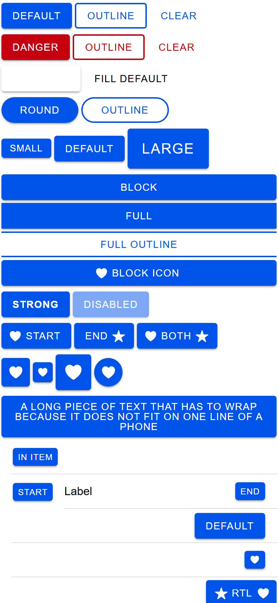
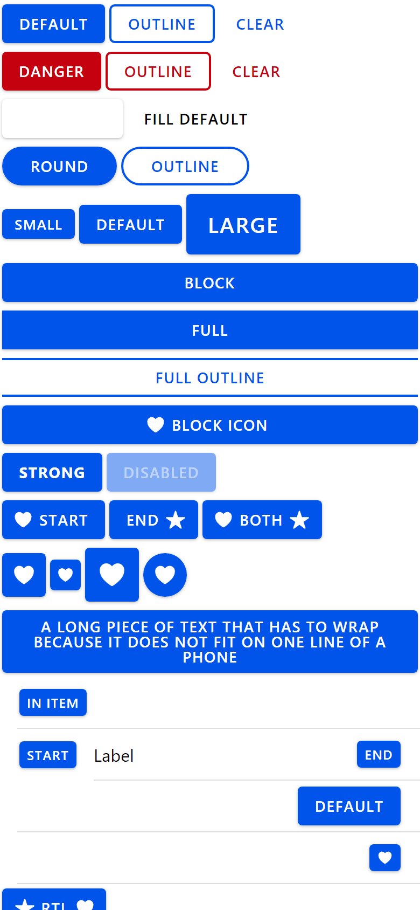
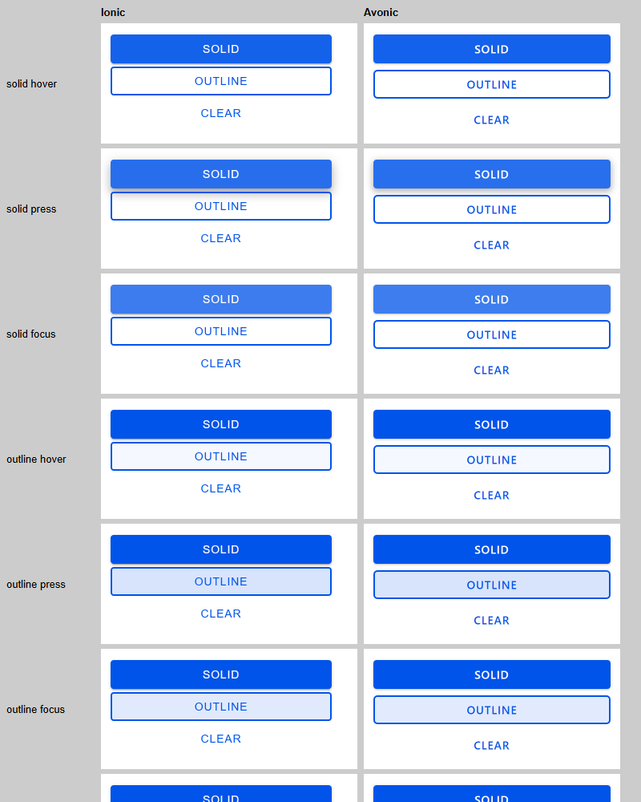

# ion-button — Comparison against the web component

> Ionic side: `node tools/ionic-ref/render.js ion-button --bare --tap --html '<the snippet below>'` (Chromium, md, 390×844@2x) → [`ref/`](ref/). `ref/page.html` holds the snippet.
> `--bare` has no `ion-app`, so `tap-click` and `focus-visible` don't start, and the press frames in `ref/` show no ripple. States were captured from a page wrapped in `ion-app` instead.
> Avonic side: `AVONIC_CAPTURE_DIR=… dotnet test` → `AvonicButtonCaptureTests` (headless Skia, 2×) → [`compare/`](compare/).

The snippet: every fill, colour, shape and size, expand, strong, disabled, slotted icons, icon-only, long text, four items and RTL,
as `Reference_Page` lays them out. Not tried in a real window: this is headless capture only.

## Frames

| Ionic | Avonic |
|---|---|
|  |  |

Hover, press at 300 ms and keyboard focus, for each fill, with Ionic on the left of each pair:

**Match,** apart from these visible differences:

- **Text.** Roboto isn't installed on this machine, so Chromium uses Arial and Avalonia uses Segoe UI, which have different
  widths, so a button with text is a little narrower here. Heights don't depend on the font.
- **Block and full buttons in a column** are 8 apart where CSS collapses their margins to 4. There are three such pairs in the
  scene, so everything below them sits 12 px lower in the frame. Avalonia has no margin collapsing.
- **Solid's shadow is lighter at 2x.** Reading the column under the first button, from its edge: Chromium 165, 179, 204, 221,
  232, 239, 246, 251; Avalonia 205, 219, 229, 238, 246, 250, 253, 254. The values are the same, so this is how Avalonia draws
  them. At 1x, Avalonia reads 164, 219, 235, 248, 253.

## Found here, not by the tests

- **No shadows at all.** A `TemplatedControl` clips by default, and so does a `Border` with `ClipToBounds`, including its own
  `BoxShadow`. The "Unknown" button gave it away, because its shadow is all it has. The property read the right value, so
  only the frame showed it. Fixed by turning off the host's clip, and giving `overflow: hidden` its own part, with a pixel test.
- **Text 3 px low.** Avalonia keeps a line with a small `LineHeight` at the top of its height, and CSS splits the leading. Fixed
  with `HalfLeadingConverter`, with a pixel test.
- **Long text was narrower than Ionic's** and pulled the icons inwards, because Avalonia gives the width of the longest line
  after wrapping, and CSS's shrink-to-fit gives all the room once the text doesn't fit. Fixed in `ButtonInner`.

## Found by the tests

- **A lost tap.** A quick tap on a button straight after a tap on something else at the same spot, such as this button
  just before it was enabled, raised neither `Tapped` nor `DoubleTapped`. In Chromium every press clicks. Fixed by going by
  the click count. `AvonicItem` has the same gap: see the PR.

## Behaviours

The numbers are from [PLAN.md](PLAN.md#behaviours). Each has tests in `AvonicButtonTests`, named after its number. The Ionic
results were measured in Chromium with `ion-app`.

| # | Behaviour | Ionic | Result |
|---|---|---|---|
| 1 | A tap clicks on release, every time | `click@tab1` on release, twice for a double click; none for the right button, a release off it, or disabled | match |
| 2 | Enter on press, Space on release | `enter down: click`, `enter up: nothing`, `space down: nothing`, `space up: click` | match |
| 3 | A tab stop unless disabled; a press focuses it | Tab from `tab1` skips disabled `tab2` to `tab3`; `ionFocus` before `click` | match |
| 4 | `IonFocus` and `IonBlur` | On any focus, bubbling; `focused then disabled: ionBlur`, nothing focused | match |
| 5 | `:activated` and a bounded ripple | `ion-activated`, `type: bounded`, one ripple in the text colour, as big as the button: 98.64 by 36 on `def`, covering the padding | match |
| 6 | Hover, keyboard focus, no outline | Overlay 0.08 and 0.24 on solid, 0.04 and 0.12 otherwise; another key clears it | match |
| 7 | Later beats earlier | Focus and hover: 0.08. Press: 0 | match |
| 8 | Overlays snap | `transition-duration: 0s` on `::after` | match |
| 9 | Solid | `rgb(0, 84, 233)`, white, 2 dp; 8 dp pressed | match, shadow lighter at 2x, above |
| 10 | Outline | Transparent, primary, 2 px primary | match |
| 11 | Clear | Transparent, primary, no border | match |
| 12 | `fill="default"` | Black, no background, ignores `color="danger"`; `after` opacity 1 on hover | match |
| 13 | `Color` | `rgb(197, 0, 15)`; beats `--background` and `--color` (`varsc`) | match |
| 14 | Unknown `Color` | Transparent, white, keeps its shadow; outline border is current colour; `tokbad` hover colour `rgb(17, 17, 17)` | match |
| 15 | In a coloured ancestor | None: primary. Unknown: `rgb(197, 0, 15)` | match |
| 16 | Overlays on a `Color` | Contrast or base, beating `--background-hover`; `after rgb(255, 255, 255) 0.7` pressed | match |
| 17 | Round | 999, padding 26 and 0; small and large beat the padding | match |
| 18 | Default box | 36 high, 14, margin 2 and 4, padding 15.4 and 8 | match |
| 19 | Large and small | 20, 56, 20 and 14; 13, 27.3, 11.7 and 4 | match |
| 20 | Block and full | 2 to 388; full radius 0 and borders `2 0 2 0`; `fullr` stays 999 | match |
| 21 | Text | 500, 700 strong, 0.84 spacing, uppercase, line height 14, no kerning | match, `ß` differs |
| 22 | Long text | 386 wide, 4 lines, 72 high, centred | match in shape. A word wider than the button breaks where Chromium's grows: deliberate |
| 23 | Slotted icons | 18.9, margins −5.67 and 5.67, 5.67 and −3.78, no input | match |
| 24 | Icon-only | 40.04 with 22.4; 28.08 with 16; 50 with 28; `--padding-top: 5px` sets all four | match |
| 25 | Start and end | 11.73 and 357.48 in long text; beside the text in a block | match |
| 26 | Disabled | 0.5; `click dis: nothing`, hit goes to what's behind | match |
| 27 | Tokens | `vars`, `varsr`, `varso`, and `varss` drawing no border | match |
| 28 | Null is small in an item | `initem`, `initemdeep` small; `initemd` isn't | match. Avonic follows a move to another item, deliberately |
| 29 | Directly in a slot | 12, 25, 7.2 and 2; icon-only 29.14 by 25, icon 14.77; deeper 13, 27.3 | match |
| 30 | Margins in a slot | Default 2 and 4; `2 4 16 4`; `16 4 2 4` | match, except beside a stacked label: gap |
| 31 | The item sees a clickable | `it2`: `item-multiple-inputs`; focus: item also `ion-focused` | match |
| 32 | In a button item | `click@initembtn itemclick@it9`; disabled: `itemclick@it9<-it9` | match |
| 33 | Automation | `button "Default"`, `button "Named"`, unnamed icon-only, `button "Favourite"`, `[disabled]` | match, a nested button in a button item's name: gap |
| 34 | RTL | At the right, margin 2, start icon on the right | match |
| 35 | Transitions | `box-shadow, background-color, color`: 0.28 s, 0.015 s, 0.015 s | match |
| 36 | Extensions | None in Ionic | n/a |
