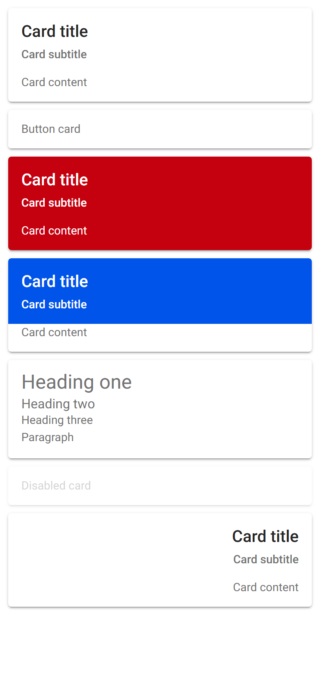
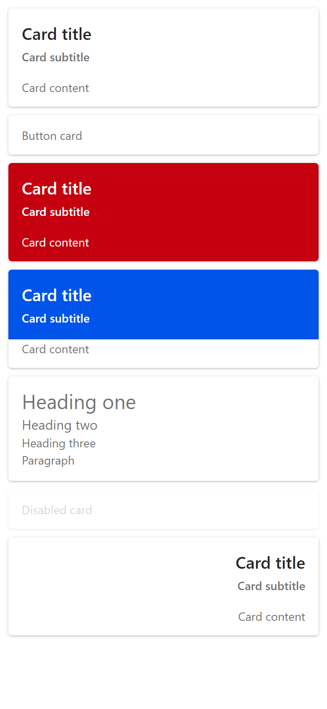
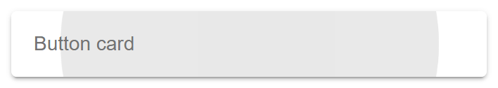
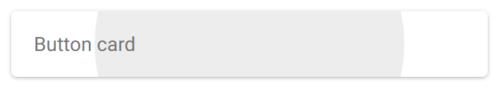
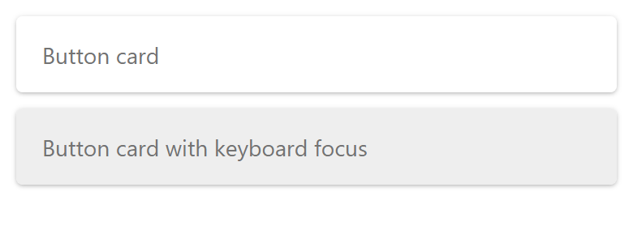

# ion-card family — Comparison against the web component

> Ionic side, in [`ref/`](ref/) (Chromium, md, 390×844@2x):
>
> ```
> node tools/ionic-ref/render.js ion-card --bare --html '<ion-card><ion-card-header><ion-card-title>Card title</ion-card-title><ion-card-subtitle>Card subtitle</ion-card-subtitle></ion-card-header><ion-card-content>Card content</ion-card-content></ion-card><ion-card button><ion-card-content>Button card</ion-card-content></ion-card><ion-card color="danger"><ion-card-header><ion-card-title>Card title</ion-card-title><ion-card-subtitle>Card subtitle</ion-card-subtitle></ion-card-header><ion-card-content>Card content</ion-card-content></ion-card><ion-card><ion-card-header color="primary"><ion-card-title>Card title</ion-card-title><ion-card-subtitle>Card subtitle</ion-card-subtitle></ion-card-header><ion-card-content>Card content</ion-card-content></ion-card><ion-card><ion-card-content><h1>Heading one</h1><h2>Heading two</h2><h3>Heading three</h3><p>Paragraph</p></ion-card-content></ion-card><ion-card disabled><ion-card-content>Disabled card</ion-card-content></ion-card><div dir="rtl"><ion-card><ion-card-header><ion-card-title>Card title</ion-card-title><ion-card-subtitle>Card subtitle</ion-card-subtitle></ion-card-header><ion-card-content>Card content</ion-card-content></ion-card></div>'
> ```
>
> And in [`ref-tap/`](ref-tap/), with `ion-app` so the ripple runs:
>
> ```
> node tools/ionic-ref/render.js ion-card --tap --out docs/components/ion-card/ref-tap --html '<ion-card button><ion-card-content>Button card</ion-card-content></ion-card>'
> ```
>
> Avonic side: `AVONIC_CAPTURE_DIR=… dotnet test` → `AvonicCardCaptureTests` (headless Skia, 2×) → `avonic-card-page.png`,
> `avonic-card-press-160ms.png` and `avonic-card-focus.png`, copied to [`compare/`](compare/) without the `card-`, as capture tests share the folder.
> Not tried in a real window, so this says nothing about a real display or real touch.

## Frames

| Ionic | Avonic |
|---|---|
|  |  |

Cards from the top: plain, button, danger, a primary header on a plain card, headings, disabled, and RTL. The Avonic
scene uses `Spacing="-10"`, for the reason in the plan.

And pressed, 160 ms in, where the ripple has the same shape and reach:

| Ionic | Avonic |
|---|---|
|  |  |

**Match,** apart from these visible differences:

- **Text.** Roboto isn't installed on this machine, so Chromium uses Arial and Avalonia uses Segoe UI. Segoe UI's lines
  are taller, so a subtitle is 19 high against 16, and a card with a header is 117 against 114. Arial has no weight 500, so
  Chromium draws the title and subtitle in regular, and Avalonia's look bolder. Both ask for 500. Line heights Ionic sets
  are the same: the title is 24, and content lines are 21.
- **The shadow at 2× and above.** Avalonia doesn't scale a shadow's offset, though it scales its spread and blur. Measured
  with one of each on its own: an offset of 10 reaches 10 device pixels at 1×, 2× and 3×, a spread of 10 reaches 10, 20 and 30,
  and a blur of 20 reaches 12, 24 and 35. These are the rows straight below and above a card, on white, against Chromium:

  | Scale | | Rows straight below the card | Rows straight above it |
  |---|---|---|---|
  | 1 | Chromium | 170 214 239 250 | 254 253 250 247 |
  | 1 | Avonic | 164 219 235 248 | 255 253 251 247 |
  | 2 | Chromium | 167 180 205 223 233 240 | 252 250 248 246 |
  | 2 | Avonic | 205 219 229 238 246 250 | 252 250 245 240 |
  | 3 | Chromium | 166 173 183 201 214 225 | 249 248 247 245 |
  | 3 | Avonic | 212 221 227 233 239 243 | 247 244 240 235 |

  So at 1× it matches, and on a phone's scale the bottom edge is lighter and the top a little darker. It's visible as a
  softer line under each card. **Known gap,** accepted as best effort. The token holds CSS's own numbers, so it's right if
  Avalonia changes. Faking it would need a converter that knows the render scale.
- **Margins between headings** add up to 4 where CSS collapses them to 2. See the plan.

### Keyboard focus

Not in Ionic, where the two cards look the same. Avonic, with focus on the second:



## Found here, not by the tests

- **The shadow,** above. A test at 2× would have needed to know the answer first.
- **The pixel order in the tests.** `AvonicItemTests.PixelAt` reads Skia's frames as BGRA, and they're RGBA. None of its
  checks depends on red against blue, so it doesn't show, but my orange failed. The helper here checks the format. It's listed in the PR,
  as that file isn't mine to edit.

## Behaviours

The numbers are from [PLAN.md](PLAN.md#behaviours). Each has tests in `AvonicCardTests` (1–14) and `AvonicCardFamilyTests`
(15–28), named after its number. The Ionic results were measured in Chromium with `ion-app`.

| # | Behaviour | Ionic | Result |
|---|---|---|---|
| 1 | `button`: activated, a ripple, a pointer | `ion-activated`, a wave at 160 ms, `cursor: pointer` | match |
| 2 | Plain: none of it | no native part, no ripple | match. `PART_Native` exists, and does nothing |
| 3 | Click on release, every time | one each for three quick clicks; none released outside or disabled | match, except a mouse drag. See below |
| 4 | A child's tap clicks too | `in<inner-btn`; a nested card gets one, as does the outer | match, except a child that only stops the first. See below |
| 5 | Enter on press, Space on release | `enter down` and `space up` | match |
| 6 | Tab stops | `button`, not `dis`, `disbtn` or plain | match. See below for what's inside a disabled card |
| 7 | Hover and focus | `:focus-visible` is true and nothing changes: no class, no colour, no outline | hover matches, including over `SimpleTheme`'s adorner. **Deliberate difference:** keyboard focus shows the text colour at 0.12. See the frame above |
| 8 | The ripple's box and colour | `10,210,370,90`, `rgb(115, 115, 115)`, white on danger; found in the host's shadow root first | match |
| 9 | The box | margin 10, radius 4, three shadows, size 14 | match, except the shadow's offsets above 1× |
| 10 | Defaults | white, `rgb(115, 115, 115)` | match |
| 11 | Tokens | `cvar`, `ivar1` | match. `ivar2`, the item's variables, is a deliberate difference |
| 12 | `color` | `rgb(197, 0, 15)` and white; transparent and inherited for `nonexistent` | match |
| 13 | Disabled | opacity 0.3, `pointer-events: none` | match |
| 14 | Automation | `Named` on the native button; name from content, leaving out `display: none`, measured `Visible`, `Outer Inner` | match |
| 15 | Header box | `10,36,370,80`, padding 16, inherits | match, with the height depending on the font |
| 16 | Header `color` | `rgb(0, 84, 233)` and white; none and inherited; base from an ancestor | match |
| 17 | The 8 above | `full-s` 8, `sub1-t` 8, `div1-t` 8, `nest1-t` 0; 0 after removing what came first | match, directly in a panel in the header |
| 18 | Title | 20, 500, 24, `rgb(38, 38, 38)`; 48 for 40 px | match |
| 19 | Subtitle | 14, 500, normal, `rgb(115, 115, 115)`; 21 in content | match |
| 20 | Their tokens | `rgb(70, 80, 90)`, `rgb(70, 80, 91)` | match |
| 21 | Their `color` | `rgb(197, 0, 15)`, `rgb(45, 213, 91)`; inherited for `nonexistent` | match |
| 22 | `.ion-inherit-color` | white in danger, at any depth, over its own `color`; `a-h` keeps light's background with white text; `o-i` black on danger; `ii-t` isn't affected | match |
| 23 | Heading levels | `role="heading"`, `aria-level` 2 and 3 | match, as `AutomationProperties.HeadingLevel`. Not tried with a screen reader |
| 24 | Content box | `co-c` 47: 13 + 21 + 13; `alone-c` the same | match |
| 25 | After a header | 0 straight after, also outside a card and with the header hidden; 13 with `gap-d` between | match, in a panel |
| 26 | `h1`–`h6`, `p` | 24, 16, 14, 14, 14, 14, 14; 400; 28.8, 19.2, 16.8, 16.8, 16.8, 16.8, 21 | match directly or in a panel, but not deeper. See the plan |
| 27 | RTL | text at the right, the same boxes | match |
| 28 | Together | `full`: 370 wide, header over content | match. 10 between cards needs `Spacing="-10"` |

## Known differences, in behaviour

Measured in Ionic, and recorded in [PLAN.md](PLAN.md#deliberate-differences):

- **A mouse drag within the card.** Ionic clicks (measured: down, move 60 and 130, up, gives `drag<drag`). Avonic gets no
  `Tapped` past Avalonia's small movement limit, so it doesn't click. Touch is meant to match, as a finger that moves is
  scrolling in both, but this was only run with a mouse. **Known gap,** shared with `AvonicItem`.
- **A child that stops the click.** Ionic: two quick taps give none (measured). A child handling `Tapped` stops the
  first, and has to handle `DoubleTapped` too to stop the second. **Known gap,** shared with `AvonicItem`.
- **A nested input in a disabled plain card** is still in Ionic's tab order (measured `dis-input`), and isn't in Avonic's.
- **`--ion-item-background` and `--ion-item-color`** move a card in Ionic (measured `ivar2`), and don't in Avonic.
