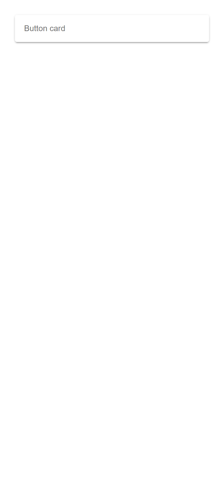
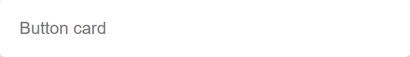
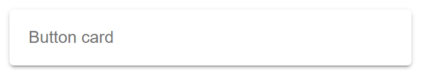
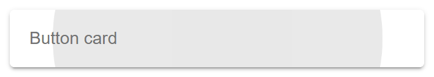
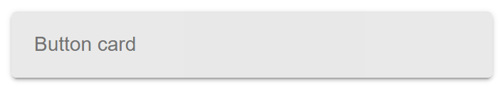

# ion-card — reference render (Ionic 8.8.1, md, 390×844@2x)

Generated by `node tools/ionic-ref/render.js ion-card --tap --out docs/components/ion-card/ref-tap --html "<ion-card button><ion-card-content>Button card</ion-card-content></ion-card>"`

```html
<ion-card button><ion-card-content>Button card</ion-card-content></ion-card>
```

 

## Press / release frames

      

## Element 1

- attributes: `{"button":"","class":"md ion-activatable hydrated"}`
- classes: `md ion-activatable hydrated`
- rect: `{"x":26,"y":26,"w":338,"h":47}`

### CSS custom properties (resolved)

| var | value |
|---|---|
| `--background` | `#fff` |
| `--color` | `#737373` |

### Host computed

| prop | value |
|---|---|
| display | `block` |
| position | `relative` |
| box-sizing | `border-box` |
| width | `338px` |
| height | `47px` |
| min-height | `0px` |
| min-width | `0px` |
| padding | `0px` |
| margin | `10px` |
| border | `0px none rgb(115, 115, 115)` |
| border-radius | `4px` |
| background-color | `rgb(255, 255, 255)` |
| color | `rgb(115, 115, 115)` |
| font-size | `14px` |
| font-weight | `400` |
| font-family | `Roboto, "Helvetica Neue", sans-serif` |
| line-height | `normal` |
| letter-spacing | `normal` |
| text-transform | `none` |
| opacity | `1` |
| overflow | `hidden` |
| contain | `content` |
| pointer-events | `auto` |
| transition | `all` |
| transform | `none` |
| box-shadow | `rgba(0, 0, 0, 0.2) 0px 3px 1px -2px, rgba(0, 0, 0, 0.14) 0px 2px 2px 0px, rgba(0, 0, 0, 0.12) 0px 1px 5px 0px` |
| outline | `rgb(115, 115, 115) none 0px` |
| cursor | `auto` |

### Shadow parts

#### part="native" (`button`) rect `{"x":26,"y":26,"w":338,"h":47}`

| prop | value |
|---|---|
| display | `block` |
| position | `static` |
| box-sizing | `border-box` |
| width | `338px` |
| height | `47px` |
| min-height | `0px` |
| min-width | `0px` |
| padding | `0px` |
| margin | `0px` |
| border | `0px none rgb(115, 115, 115)` |
| border-radius | `0px` |
| background-color | `rgb(255, 255, 255)` |
| color | `rgb(115, 115, 115)` |
| font-size | `14px` |
| font-weight | `400` |
| font-family | `Roboto, "Helvetica Neue", sans-serif` |
| line-height | `normal` |
| letter-spacing | `normal` |
| text-transform | `none` |
| opacity | `1` |
| overflow | `visible` |
| contain | `none` |
| pointer-events | `auto` |
| transition | `all` |
| transform | `none` |
| box-shadow | `none` |
| outline | `rgb(115, 115, 115) none 0px` |
| cursor | `pointer` |

### DOM tree

```
<ion-card>
  #shadow-root
    <button.card-native part="native">
      <slot name="">
      <ion-ripple-effect.md.hydrated>
        #shadow-root
  <ion-card-content.md.card-content-md.hydrated>
```
