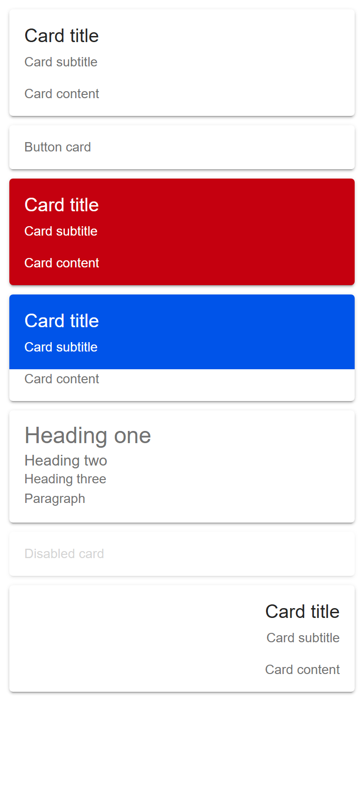
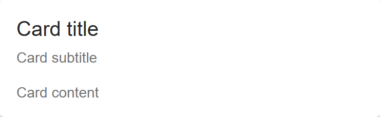

# ion-card — reference render (Ionic 8.8.1, md, 390×844@2x)

Generated by `node tools/ionic-ref/render.js ion-card --bare --html "<ion-card><ion-card-header><ion-card-title>Card title</ion-card-title><ion-card-subtitle>Card subtitle</ion-card-subtitle></ion-card-header><ion-card-content>Card content</ion-card-content></ion-card><ion-card button><ion-card-content>Button card</ion-card-content></ion-card><ion-card color=\"danger\"><ion-card-header><ion-card-title>Card title</ion-card-title><ion-card-subtitle>Card subtitle</ion-card-subtitle></ion-card-header><ion-card-content>Card content</ion-card-content></ion-card><ion-card><ion-card-header color=\"primary\"><ion-card-title>Card title</ion-card-title><ion-card-subtitle>Card subtitle</ion-card-subtitle></ion-card-header><ion-card-content>Card content</ion-card-content></ion-card><ion-card><ion-card-content><h1>Heading one</h1><h2>Heading two</h2><h3>Heading three</h3><p>Paragraph</p></ion-card-content></ion-card><ion-card disabled><ion-card-content>Disabled card</ion-card-content></ion-card><div dir=\"rtl\"><ion-card><ion-card-header><ion-card-title>Card title</ion-card-title><ion-card-subtitle>Card subtitle</ion-card-subtitle></ion-card-header><ion-card-content>Card content</ion-card-content></ion-card></div>"`

```html
<ion-card><ion-card-header><ion-card-title>Card title</ion-card-title><ion-card-subtitle>Card subtitle</ion-card-subtitle></ion-card-header><ion-card-content>Card content</ion-card-content></ion-card><ion-card button><ion-card-content>Button card</ion-card-content></ion-card><ion-card color="danger"><ion-card-header><ion-card-title>Card title</ion-card-title><ion-card-subtitle>Card subtitle</ion-card-subtitle></ion-card-header><ion-card-content>Card content</ion-card-content></ion-card><ion-card><ion-card-header color="primary"><ion-card-title>Card title</ion-card-title><ion-card-subtitle>Card subtitle</ion-card-subtitle></ion-card-header><ion-card-content>Card content</ion-card-content></ion-card><ion-card><ion-card-content><h1>Heading one</h1><h2>Heading two</h2><h3>Heading three</h3><p>Paragraph</p></ion-card-content></ion-card><ion-card disabled><ion-card-content>Disabled card</ion-card-content></ion-card><div dir="rtl"><ion-card><ion-card-header><ion-card-title>Card title</ion-card-title><ion-card-subtitle>Card subtitle</ion-card-subtitle></ion-card-header><ion-card-content>Card content</ion-card-content></ion-card></div>
```

 

## Element 1

- attributes: `{"class":"md hydrated"}`
- classes: `md hydrated`
- rect: `{"x":10,"y":10,"w":370,"h":114}`

### CSS custom properties (resolved)

| var | value |
|---|---|
| `--background` | `#fff` |
| `--color` | `#737373` |

### Host computed

| prop | value |
|---|---|
| display | `block` |
| position | `relative` |
| box-sizing | `border-box` |
| width | `370px` |
| height | `114px` |
| min-height | `0px` |
| min-width | `0px` |
| padding | `0px` |
| margin | `10px` |
| border | `0px none rgb(115, 115, 115)` |
| border-radius | `4px` |
| background-color | `rgb(255, 255, 255)` |
| color | `rgb(115, 115, 115)` |
| font-size | `14px` |
| font-weight | `400` |
| font-family | `Roboto, "Helvetica Neue", sans-serif` |
| line-height | `normal` |
| letter-spacing | `normal` |
| text-transform | `none` |
| opacity | `1` |
| overflow | `hidden` |
| contain | `content` |
| pointer-events | `auto` |
| transition | `all` |
| transform | `none` |
| box-shadow | `rgba(0, 0, 0, 0.2) 0px 3px 1px -2px, rgba(0, 0, 0, 0.14) 0px 2px 2px 0px, rgba(0, 0, 0, 0.12) 0px 1px 5px 0px` |
| outline | `rgb(115, 115, 115) none 0px` |
| cursor | `auto` |

### DOM tree

```
<ion-card>
  #shadow-root
    <slot name="">
  <ion-card-header.ion-inherit-color.md.hydrated>
    #shadow-root
      <slot name="">
    <ion-card-title.ion-inherit-color.md.hydrated>
      #shadow-root
        <slot name="">
    <ion-card-subtitle.ion-inherit-color.md.hydrated>
      #shadow-root
        <slot name="">
  <ion-card-content.md.card-content-md.hydrated>
```

## Element 2

- attributes: `{"button":"","class":"md ion-activatable hydrated"}`
- classes: `md ion-activatable hydrated`
- rect: `{"x":10,"y":134,"w":370,"h":47}`

### CSS custom properties (resolved)

| var | value |
|---|---|
| `--background` | `#fff` |
| `--color` | `#737373` |

### Host computed

| prop | value |
|---|---|
| display | `block` |
| position | `relative` |
| box-sizing | `border-box` |
| width | `370px` |
| height | `47px` |
| min-height | `0px` |
| min-width | `0px` |
| padding | `0px` |
| margin | `10px` |
| border | `0px none rgb(115, 115, 115)` |
| border-radius | `4px` |
| background-color | `rgb(255, 255, 255)` |
| color | `rgb(115, 115, 115)` |
| font-size | `14px` |
| font-weight | `400` |
| font-family | `Roboto, "Helvetica Neue", sans-serif` |
| line-height | `normal` |
| letter-spacing | `normal` |
| text-transform | `none` |
| opacity | `1` |
| overflow | `hidden` |
| contain | `content` |
| pointer-events | `auto` |
| transition | `all` |
| transform | `none` |
| box-shadow | `rgba(0, 0, 0, 0.2) 0px 3px 1px -2px, rgba(0, 0, 0, 0.14) 0px 2px 2px 0px, rgba(0, 0, 0, 0.12) 0px 1px 5px 0px` |
| outline | `rgb(115, 115, 115) none 0px` |
| cursor | `auto` |

### Shadow parts

#### part="native" (`button`) rect `{"x":10,"y":134,"w":370,"h":47}`

| prop | value |
|---|---|
| display | `block` |
| position | `static` |
| box-sizing | `border-box` |
| width | `370px` |
| height | `47px` |
| min-height | `0px` |
| min-width | `0px` |
| padding | `0px` |
| margin | `0px` |
| border | `0px none rgb(115, 115, 115)` |
| border-radius | `0px` |
| background-color | `rgb(255, 255, 255)` |
| color | `rgb(115, 115, 115)` |
| font-size | `14px` |
| font-weight | `400` |
| font-family | `Roboto, "Helvetica Neue", sans-serif` |
| line-height | `normal` |
| letter-spacing | `normal` |
| text-transform | `none` |
| opacity | `1` |
| overflow | `visible` |
| contain | `none` |
| pointer-events | `auto` |
| transition | `all` |
| transform | `none` |
| box-shadow | `none` |
| outline | `rgb(115, 115, 115) none 0px` |
| cursor | `pointer` |

### DOM tree

```
<ion-card>
  #shadow-root
    <button.card-native part="native">
      <slot name="">
      <ion-ripple-effect.md.hydrated>
        #shadow-root
  <ion-card-content.md.card-content-md.hydrated>
```

## Element 3

- attributes: `{"color":"danger","class":"ion-color ion-color-danger md hydrated"}`
- classes: `ion-color ion-color-danger md hydrated`
- rect: `{"x":10,"y":191,"w":370,"h":114}`

### CSS custom properties (resolved)

| var | value |
|---|---|
| `--background` | `#fff` |
| `--color` | `#737373` |

### Host computed

| prop | value |
|---|---|
| display | `block` |
| position | `relative` |
| box-sizing | `border-box` |
| width | `370px` |
| height | `114px` |
| min-height | `0px` |
| min-width | `0px` |
| padding | `0px` |
| margin | `10px` |
| border | `0px none rgb(255, 255, 255)` |
| border-radius | `4px` |
| background-color | `rgb(197, 0, 15)` |
| color | `rgb(255, 255, 255)` |
| font-size | `14px` |
| font-weight | `400` |
| font-family | `Roboto, "Helvetica Neue", sans-serif` |
| line-height | `normal` |
| letter-spacing | `normal` |
| text-transform | `none` |
| opacity | `1` |
| overflow | `hidden` |
| contain | `content` |
| pointer-events | `auto` |
| transition | `all` |
| transform | `none` |
| box-shadow | `rgba(0, 0, 0, 0.2) 0px 3px 1px -2px, rgba(0, 0, 0, 0.14) 0px 2px 2px 0px, rgba(0, 0, 0, 0.12) 0px 1px 5px 0px` |
| outline | `rgb(255, 255, 255) none 0px` |
| cursor | `auto` |

### DOM tree

```
<ion-card>
  #shadow-root
    <slot name="">
  <ion-card-header.ion-inherit-color.md.hydrated>
    #shadow-root
      <slot name="">
    <ion-card-title.ion-inherit-color.md.hydrated>
      #shadow-root
        <slot name="">
    <ion-card-subtitle.ion-inherit-color.md.hydrated>
      #shadow-root
        <slot name="">
  <ion-card-content.md.card-content-md.hydrated>
```

## Element 4

- attributes: `{"class":"md hydrated"}`
- classes: `md hydrated`
- rect: `{"x":10,"y":315,"w":370,"h":114}`

### CSS custom properties (resolved)

| var | value |
|---|---|
| `--background` | `#fff` |
| `--color` | `#737373` |

### Host computed

| prop | value |
|---|---|
| display | `block` |
| position | `relative` |
| box-sizing | `border-box` |
| width | `370px` |
| height | `114px` |
| min-height | `0px` |
| min-width | `0px` |
| padding | `0px` |
| margin | `10px` |
| border | `0px none rgb(115, 115, 115)` |
| border-radius | `4px` |
| background-color | `rgb(255, 255, 255)` |
| color | `rgb(115, 115, 115)` |
| font-size | `14px` |
| font-weight | `400` |
| font-family | `Roboto, "Helvetica Neue", sans-serif` |
| line-height | `normal` |
| letter-spacing | `normal` |
| text-transform | `none` |
| opacity | `1` |
| overflow | `hidden` |
| contain | `content` |
| pointer-events | `auto` |
| transition | `all` |
| transform | `none` |
| box-shadow | `rgba(0, 0, 0, 0.2) 0px 3px 1px -2px, rgba(0, 0, 0, 0.14) 0px 2px 2px 0px, rgba(0, 0, 0, 0.12) 0px 1px 5px 0px` |
| outline | `rgb(115, 115, 115) none 0px` |
| cursor | `auto` |

### DOM tree

```
<ion-card>
  #shadow-root
    <slot name="">
  <ion-card-header.ion-color.ion-color-primary.ion-inherit-color.md.hydrated>
    #shadow-root
      <slot name="">
    <ion-card-title.ion-inherit-color.md.hydrated>
      #shadow-root
        <slot name="">
    <ion-card-subtitle.ion-inherit-color.md.hydrated>
      #shadow-root
        <slot name="">
  <ion-card-content.md.card-content-md.hydrated>
```

## Element 5

- attributes: `{"class":"md hydrated"}`
- classes: `md hydrated`
- rect: `{"x":10,"y":439,"w":370,"h":119.78}`

### CSS custom properties (resolved)

| var | value |
|---|---|
| `--background` | `#fff` |
| `--color` | `#737373` |

### Host computed

| prop | value |
|---|---|
| display | `block` |
| position | `relative` |
| box-sizing | `border-box` |
| width | `370px` |
| height | `119.781px` |
| min-height | `0px` |
| min-width | `0px` |
| padding | `0px` |
| margin | `10px` |
| border | `0px none rgb(115, 115, 115)` |
| border-radius | `4px` |
| background-color | `rgb(255, 255, 255)` |
| color | `rgb(115, 115, 115)` |
| font-size | `14px` |
| font-weight | `400` |
| font-family | `Roboto, "Helvetica Neue", sans-serif` |
| line-height | `normal` |
| letter-spacing | `normal` |
| text-transform | `none` |
| opacity | `1` |
| overflow | `hidden` |
| contain | `content` |
| pointer-events | `auto` |
| transition | `all` |
| transform | `none` |
| box-shadow | `rgba(0, 0, 0, 0.2) 0px 3px 1px -2px, rgba(0, 0, 0, 0.14) 0px 2px 2px 0px, rgba(0, 0, 0, 0.12) 0px 1px 5px 0px` |
| outline | `rgb(115, 115, 115) none 0px` |
| cursor | `auto` |

### DOM tree

```
<ion-card>
  #shadow-root
    <slot name="">
  <ion-card-content.md.card-content-md.hydrated>
    <h1>
    <h2>
    <h3>
    <p>
```

## Element 6

- attributes: `{"disabled":"","class":"md card-disabled hydrated"}`
- classes: `md card-disabled hydrated`
- rect: `{"x":10,"y":568.78,"w":370,"h":47}`

### CSS custom properties (resolved)

| var | value |
|---|---|
| `--background` | `#fff` |
| `--color` | `#737373` |

### Host computed

| prop | value |
|---|---|
| display | `block` |
| position | `relative` |
| box-sizing | `border-box` |
| width | `370px` |
| height | `47px` |
| min-height | `0px` |
| min-width | `0px` |
| padding | `0px` |
| margin | `10px` |
| border | `0px none rgb(115, 115, 115)` |
| border-radius | `4px` |
| background-color | `rgb(255, 255, 255)` |
| color | `rgb(115, 115, 115)` |
| font-size | `14px` |
| font-weight | `400` |
| font-family | `Roboto, "Helvetica Neue", sans-serif` |
| line-height | `normal` |
| letter-spacing | `normal` |
| text-transform | `none` |
| opacity | `0.3` |
| overflow | `hidden` |
| contain | `content` |
| pointer-events | `none` |
| transition | `all` |
| transform | `none` |
| box-shadow | `rgba(0, 0, 0, 0.2) 0px 3px 1px -2px, rgba(0, 0, 0, 0.14) 0px 2px 2px 0px, rgba(0, 0, 0, 0.12) 0px 1px 5px 0px` |
| outline | `rgb(115, 115, 115) none 0px` |
| cursor | `default` |

### DOM tree

```
<ion-card>
  #shadow-root
    <slot name="">
  <ion-card-content.md.card-content-md.hydrated>
```

## Element 7

- attributes: `{"class":"md hydrated"}`
- classes: `md hydrated`
- rect: `{"x":10,"y":625.78,"w":370,"h":114}`

### CSS custom properties (resolved)

| var | value |
|---|---|
| `--background` | `#fff` |
| `--color` | `#737373` |

### Host computed

| prop | value |
|---|---|
| display | `block` |
| position | `relative` |
| box-sizing | `border-box` |
| width | `370px` |
| height | `114px` |
| min-height | `0px` |
| min-width | `0px` |
| padding | `0px` |
| margin | `10px` |
| border | `0px none rgb(115, 115, 115)` |
| border-radius | `4px` |
| background-color | `rgb(255, 255, 255)` |
| color | `rgb(115, 115, 115)` |
| font-size | `14px` |
| font-weight | `400` |
| font-family | `Roboto, "Helvetica Neue", sans-serif` |
| line-height | `normal` |
| letter-spacing | `normal` |
| text-transform | `none` |
| opacity | `1` |
| overflow | `hidden` |
| contain | `content` |
| pointer-events | `auto` |
| transition | `all` |
| transform | `none` |
| box-shadow | `rgba(0, 0, 0, 0.2) 0px 3px 1px -2px, rgba(0, 0, 0, 0.14) 0px 2px 2px 0px, rgba(0, 0, 0, 0.12) 0px 1px 5px 0px` |
| outline | `rgb(115, 115, 115) none 0px` |
| cursor | `auto` |

### DOM tree

```
<ion-card>
  #shadow-root
    <slot name="">
  <ion-card-header.ion-inherit-color.md.hydrated>
    #shadow-root
      <slot name="">
    <ion-card-title.ion-inherit-color.md.hydrated>
      #shadow-root
        <slot name="">
    <ion-card-subtitle.ion-inherit-color.md.hydrated>
      #shadow-root
        <slot name="">
  <ion-card-content.md.card-content-md.hydrated>
```
