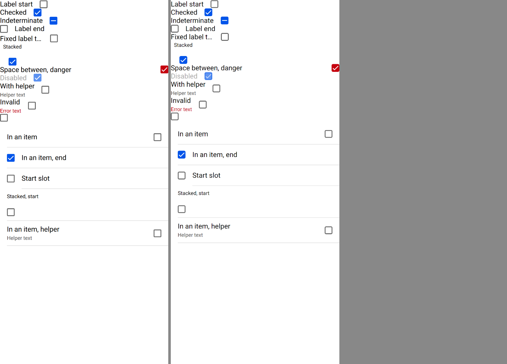

# ion-checkbox — Comparison

Ionic 8.8.1 in headless Chromium, md, 390 wide at a scale of 2, against Avonic in Avalonia.Headless (Skia) at the same size and
scale. Both use Roboto from `tools/fonts`. Headless only: not tried in a real window, and not tried on a device.

## The scene

Each standalone checkbox is in a `<div>` of its own, then a list of items. The reference:

```
node tools/ionic-ref/render.js ion-checkbox --bare --html '<ion-app style="position:static;display:block;contain:none;overflow:visible"><div><ion-checkbox id="c1">Label start</ion-checkbox></div><div><ion-checkbox id="c2" checked>Checked</ion-checkbox></div><div><ion-checkbox id="c3" indeterminate>Indeterminate</ion-checkbox></div><div><ion-checkbox id="c4" label-placement="end">Label end</ion-checkbox></div><div><ion-checkbox id="c5" label-placement="fixed">Fixed label that is long</ion-checkbox></div><div><ion-checkbox id="c6" label-placement="stacked" checked>Stacked</ion-checkbox></div><div><ion-checkbox id="c7" justify="space-between" checked color="danger">Space between, danger</ion-checkbox></div><div><ion-checkbox id="c8" disabled checked>Disabled</ion-checkbox></div><div><ion-checkbox id="c9" helper-text="Helper text">With helper</ion-checkbox></div><div><ion-checkbox id="c10" class="ion-touched ion-invalid" helper-text="Helper text" error-text="Error text">Invalid</ion-checkbox></div><div><ion-checkbox id="c11"></ion-checkbox></div><ion-list><ion-item><ion-checkbox id="i1">In an item</ion-checkbox></ion-item><ion-item><ion-checkbox id="i2" checked label-placement="end">In an item, end</ion-checkbox></ion-item><ion-item><ion-checkbox id="i3" slot="start"></ion-checkbox><ion-label>Start slot</ion-label></ion-item><ion-item><ion-checkbox id="i4" label-placement="stacked" alignment="start">Stacked, start</ion-checkbox></ion-item><ion-item><ion-checkbox id="i5" helper-text="Helper text">In an item, helper</ion-checkbox></ion-item></ion-list></ion-app>'
```

Avonic's is `AvonicCheckboxCaptureTests.Reference_Page`, the same content, saved with `AVONIC_CAPTURE_DIR`.



The boxes, the timeline, the keys, the clicks and the accessibility tree were measured with a throwaway Playwright script in the
same page (Chromium's `getBoundingClientRect`, `getComputedStyle` sampled each `requestAnimationFrame`, `keyboard`, `mouse`,
and CDP's `Accessibility.getFullAXTree`).

## Boxes

x, y, width, height of the host. Avonic lays out at half pixels at a scale of 2.

| id | Ionic | Avonic | |
|---|---|---|---|
| c1 | 0 0 109.89 19 | 0 0 110 19 | match |
| c2 | 0 19 95.55 19 | 0 19 96 19 | match |
| c3 | 0 38 133.02 19 | 0 38 133.5 19 | match |
| c4 | 0 57 103 19, box at 0, label at 34 | 0 57 103 19, the same | match |
| c5 | 0 79.5 134 19, box at 116 | 0 76 134 19, box at 116 | match, but 3.5 higher: see below |
| c6 | 57.28 × 53, label 42.96 × 14.25 at + 7.16, box at + 19.64, + 35 | 57.5 × 53, the same | match |
| c7 | 390 wide, box at 372 | the same | match |
| c9 | 114.19 × 37 | 114.5 × 37.5 | match |
| c11 | 18 × 18 | 18 × 18 | match |
| i1 | 358 × 47 at 16 | the same | match |
| i3 | 18 × 18, 15 into the row | the same | match |
| i4 | 358 × 73, box 45 down | the same | match |
| i5 | 358 × 57 | 358 × 57.5 | match |

The standalone rows drift by a few pixels from `c5` down: the host is `display: inline-block` in a line box, and Chromium's line
box for `c4`'s `<div>` is 22.5 high, not 19, from the inline-block's baseline. That's the page's inline formatting around the
checkbox, which Avalonia doesn't have: a checkbox in a `StackPanel` is as high as itself. The items, which are blocks, line up
again.

## Behaviours

| # | Behaviour | Ionic | Avonic | |
|---|---|---|---|---|
| 1 | A click anywhere toggles once | the box, the label (`c1` at x 20) and the gap (`c7` at x 250): one `ionChange` each | the same | match |
| 2 | Indeterminate, clicked | `{checked: true}`, then `indeterminate` false | the same, `Indeterminate` still true during `IonChange` | match |
| 3 | `checked` set in code | no `ionChange` | none | match |
| 4 | Keys | Enter nothing; Space on key down, every key down, repeats too | the same | match |
| 5 | Focus | a tab stop; a click focuses; `ionFocus`, `ionBlur` | the same | match |
| 6 | Disabled | no click, no Space, no tab stop; label 0.38, box 0.63 | the same | match |
| 7–12 | Layout | see Boxes | | match |
| 13 | Colours | unchecked white with `rgba(0, 0, 0, 0.6)`, 2 px, radius 2.25; checked `rgb(0, 84, 233)` | the same | match |
| 14 | The mark | md's tick and bar, stroke 3 of 24 units, white | the same paths, drawn in code | match, see the zoom below |
| 15 | Drawing the mark | dash offset 30 until 80 ms, 26.67 at 97, 10.03 at 147, 0 at 181; unchecking removes it in the first frame | 30 until 90 ms, then linear to 0 at 180, on `AvonicConfig`'s clock; removed at once | match |
| 16 | The box background | eases 180 ms `cubic-bezier(0.4, 0, 0.2, 1)` both ways: `rgb(177, 203, 248)` at 48 ms; the border at once | a `BrushTransition` of 180 ms with that `CubicBezierEasing`, from the first frame; the border at once | match |
| 17 | Colour | `danger`: `rgb(197, 0, 15)` background and border | the same; an app's key beats it | match |
| 18 | No text | the label's box is `display: none` | hidden | match |
| 19 | Helper and error | helper 12 px `rgb(77, 77, 77)` 4 below; error `rgb(197, 0, 15)` with `ion-touched` and `ion-invalid`; classes added later are followed; `ion-invalid` alone shows the helper | the same | match |
| 21–23 | In an item | see Boxes | | match |
| 24 | A tap on the item's padding | toggles (`i1` at x 5) | toggles | match |
| 25 | Accessibility | `checkbox`, `checked: mixed` when indeterminate; name `With helper Helper text` (the label holds the helper), `Invalid` (not the error); `required` | `CheckBox`, `Indeterminate`; the same names; `AutomationProperties.IsRequiredForForm` | match |
| 26 | Live regions | helper `aria-live="polite"`, error `role="alert"` | `Polite`, `Assertive` | match |

### Deliberate differences and gaps

- **The focus ring.** Chromium draws its own focus ring (`outline: auto`) on a checkbox focused from the keyboard; Ionic doesn't
  style it. Avonic leaves `FocusAdorner` to the base theme, which draws its own on keyboard focus. The same rule, a different ring.
- **Inline layout.** As above, the few pixels a line box adds around an `inline-block` aren't there.
- **A long standalone label.** Ionic's `inline-block` is as wide as its label's one line even when that's wider than the page:
  measured, a 485.2 label makes a 519.2 host in a 390 page, with the box off screen at 501.2. Avalonia gives a control no more than
  the space there is, so here the label ends in an ellipsis and the box is at the end, at 372. In an item, or with `Justify` or
  `Alignment`, both shrink the label to fit (measured 324 in an item), and match.
- **Arranged narrower than measured.** A parent that measures the checkbox wider than it then arranges it clips the label at its
  box, without an ellipsis: measuring the label again during arrange would ask for another layout pass after every one.
- **`aria-invalid`.** Avalonia's automation has no invalid state, so it isn't exposed. The error text is the help text, and its
  change raises the help text's property-changed event, which is what a screen reader announces.
- **`name` and the form.** The hidden `<input>` exists for form submission, which Avalonia doesn't have; `value` is still in
  `IonChange`.
- **A label's text changed later.** Ionic reads `textContent` when it renders, which a change inside the label doesn't cause, so
  text coming into an empty label shows at the next change of a prop. Avonic reads it at the same moments, and at each measure too,
  which a shown label's text changing causes, so a label emptied later hides at once. A hidden label isn't measured, so text coming
  into it waits for a prop, as in Ionic.

## The mark, zoomed

The `c2` box at six times, Ionic left: the tick's ends, joins and width match to the antialiasing.


