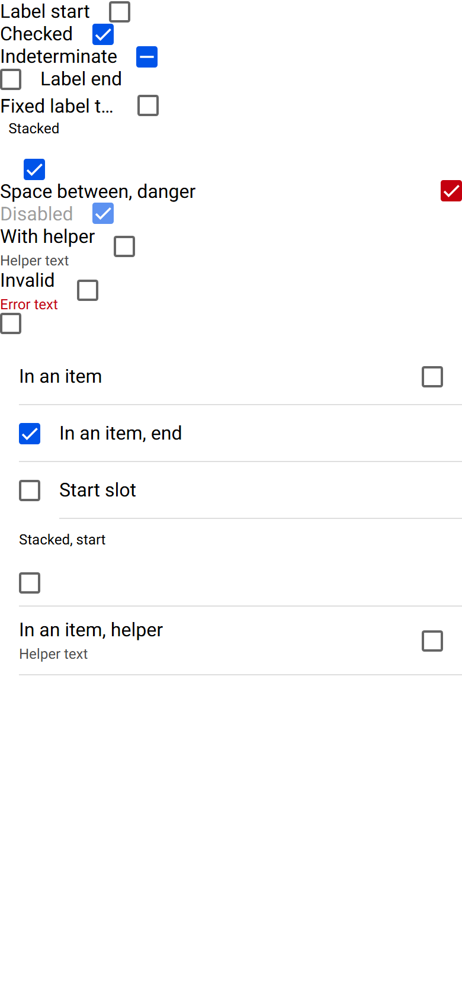

# ion-checkbox — reference render (Ionic 8.8.1, md, 390×844@2x)

Generated by `node tools/ionic-ref/render.js ion-checkbox --bare --html "<ion-app style=\"position:static;display:block;contain:none;overflow:visible\"><div><ion-checkbox id=\"c1\">Label start</ion-checkbox></div><div><ion-checkbox id=\"c2\" checked>Checked</ion-checkbox></div><div><ion-checkbox id=\"c3\" indeterminate>Indeterminate</ion-checkbox></div><div><ion-checkbox id=\"c4\" label-placement=\"end\">Label end</ion-checkbox></div><div><ion-checkbox id=\"c5\" label-placement=\"fixed\">Fixed label that is long</ion-checkbox></div><div><ion-checkbox id=\"c6\" label-placement=\"stacked\" checked>Stacked</ion-checkbox></div><div><ion-checkbox id=\"c7\" justify=\"space-between\" checked color=\"danger\">Space between, danger</ion-checkbox></div><div><ion-checkbox id=\"c8\" disabled checked>Disabled</ion-checkbox></div><div><ion-checkbox id=\"c9\" helper-text=\"Helper text\">With helper</ion-checkbox></div><div><ion-checkbox id=\"c10\" class=\"ion-touched ion-invalid\" helper-text=\"Helper text\" error-text=\"Error text\">Invalid</ion-checkbox></div><div><ion-checkbox id=\"c11\"></ion-checkbox></div><ion-list><ion-item><ion-checkbox id=\"i1\">In an item</ion-checkbox></ion-item><ion-item><ion-checkbox id=\"i2\" checked label-placement=\"end\">In an item, end</ion-checkbox></ion-item><ion-item><ion-checkbox id=\"i3\" slot=\"start\"></ion-checkbox><ion-label>Start slot</ion-label></ion-item><ion-item><ion-checkbox id=\"i4\" label-placement=\"stacked\" alignment=\"start\">Stacked, start</ion-checkbox></ion-item><ion-item><ion-checkbox id=\"i5\" helper-text=\"Helper text\">In an item, helper</ion-checkbox></ion-item></ion-list></ion-app>"`

```html
<ion-app style="position:static;display:block;contain:none;overflow:visible"><div><ion-checkbox id="c1">Label start</ion-checkbox></div><div><ion-checkbox id="c2" checked>Checked</ion-checkbox></div><div><ion-checkbox id="c3" indeterminate>Indeterminate</ion-checkbox></div><div><ion-checkbox id="c4" label-placement="end">Label end</ion-checkbox></div><div><ion-checkbox id="c5" label-placement="fixed">Fixed label that is long</ion-checkbox></div><div><ion-checkbox id="c6" label-placement="stacked" checked>Stacked</ion-checkbox></div><div><ion-checkbox id="c7" justify="space-between" checked color="danger">Space between, danger</ion-checkbox></div><div><ion-checkbox id="c8" disabled checked>Disabled</ion-checkbox></div><div><ion-checkbox id="c9" helper-text="Helper text">With helper</ion-checkbox></div><div><ion-checkbox id="c10" class="ion-touched ion-invalid" helper-text="Helper text" error-text="Error text">Invalid</ion-checkbox></div><div><ion-checkbox id="c11"></ion-checkbox></div><ion-list><ion-item><ion-checkbox id="i1">In an item</ion-checkbox></ion-item><ion-item><ion-checkbox id="i2" checked label-placement="end">In an item, end</ion-checkbox></ion-item><ion-item><ion-checkbox id="i3" slot="start"></ion-checkbox><ion-label>Start slot</ion-label></ion-item><ion-item><ion-checkbox id="i4" label-placement="stacked" alignment="start">Stacked, start</ion-checkbox></ion-item><ion-item><ion-checkbox id="i5" helper-text="Helper text">In an item, helper</ion-checkbox></ion-item></ion-list></ion-app>
```

 

## Element 1

- attributes: `{"id":"c1","role":"checkbox","aria-checked":"false","aria-labelledby":"ion-cb-10-lbl","tabindex":"0","class":"md interactive checkbox-label-placement-start hydrated"}`
- classes: `md interactive checkbox-label-placement-start hydrated`
- rect: `{"x":0,"y":0,"w":109.89,"h":19}`

### CSS custom properties (resolved)

| var | value |
|---|---|
| `--border-color` | `rgb(0, 0, 0, 0.6)` |
| `--border-color-checked` | `#0054e9` |
| `--border-radius` | `calc(18px * .125)` |
| `--border-style` | `solid` |
| `--border-width` | `2px` |
| `--checkbox-background` | `#fff` |
| `--checkbox-background-checked` | `#0054e9` |
| `--checkmark-color` | `#fff` |
| `--checkmark-width` | `3` |
| `--size` | `18px` |
| `--transition` | `background 180ms cubic-bezier(0.4, 0, 0.2, 1)` |

### Host computed

| prop | value |
|---|---|
| display | `inline-block` |
| position | `relative` |
| box-sizing | `border-box` |
| width | `109.891px` |
| height | `19px` |
| min-height | `0px` |
| min-width | `0px` |
| padding | `0px` |
| margin | `0px` |
| border | `0px none rgb(0, 0, 0)` |
| border-radius | `0px` |
| background-color | `rgba(0, 0, 0, 0)` |
| color | `rgb(0, 0, 0)` |
| font-size | `16px` |
| font-weight | `400` |
| font-family | `Roboto, "Helvetica Neue", sans-serif` |
| line-height | `normal` |
| letter-spacing | `normal` |
| text-transform | `none` |
| opacity | `1` |
| overflow | `visible` |
| contain | `none` |
| pointer-events | `auto` |
| transition | `all` |
| transform | `none` |
| box-shadow | `none` |
| outline | `rgb(0, 0, 0) none 0px` |
| cursor | `pointer` |

### Shadow parts

#### part="label" (`div`) rect `{"x":0,"y":0,"w":75.89,"h":19}`

| prop | value |
|---|---|
| display | `block` |
| position | `static` |
| box-sizing | `content-box` |
| width | `75.8906px` |
| height | `19px` |
| min-height | `auto` |
| min-width | `auto` |
| padding | `0px` |
| margin | `0px 16px 0px 0px` |
| border | `0px none rgb(0, 0, 0)` |
| border-radius | `0px` |
| background-color | `rgba(0, 0, 0, 0)` |
| color | `rgb(0, 0, 0)` |
| font-size | `16px` |
| font-weight | `400` |
| font-family | `Roboto, "Helvetica Neue", sans-serif` |
| line-height | `normal` |
| letter-spacing | `normal` |
| text-transform | `none` |
| opacity | `1` |
| overflow | `hidden` |
| contain | `none` |
| pointer-events | `auto` |
| transition | `all` |
| transform | `none` |
| box-shadow | `none` |
| outline | `rgb(0, 0, 0) none 0px` |
| cursor | `pointer` |

#### part="container" (`svg`) rect `{"x":91.89,"y":0.5,"w":18,"h":18}`

| prop | value |
|---|---|
| display | `block` |
| position | `relative` |
| box-sizing | `border-box` |
| width | `18px` |
| height | `18px` |
| min-height | `auto` |
| min-width | `auto` |
| padding | `0px` |
| margin | `0px` |
| border | `2px solid rgba(0, 0, 0, 0.6)` |
| border-radius | `2.25px` |
| background-color | `rgb(255, 255, 255)` |
| color | `rgb(0, 0, 0)` |
| font-size | `16px` |
| font-weight | `400` |
| font-family | `Roboto, "Helvetica Neue", sans-serif` |
| line-height | `normal` |
| letter-spacing | `normal` |
| text-transform | `none` |
| opacity | `1` |
| overflow | `hidden` |
| contain | `none` |
| pointer-events | `auto` |
| transition | `background 0.18s cubic-bezier(0.4, 0, 0.2, 1)` |
| transform | `none` |
| box-shadow | `none` |
| outline | `rgb(0, 0, 0) none 0px` |
| cursor | `pointer` |

#### part="mark" (`path`) rect `{"x":94.9,"y":5.18,"w":12.28,"h":8.57}`

| prop | value |
|---|---|
| display | `inline` |
| position | `static` |
| box-sizing | `content-box` |
| width | `auto` |
| height | `auto` |
| min-height | `0px` |
| min-width | `0px` |
| padding | `0px` |
| margin | `0px` |
| border | `0px none rgb(0, 0, 0)` |
| border-radius | `0px` |
| background-color | `rgba(0, 0, 0, 0)` |
| color | `rgb(0, 0, 0)` |
| font-size | `16px` |
| font-weight | `400` |
| font-family | `Roboto, "Helvetica Neue", sans-serif` |
| line-height | `normal` |
| letter-spacing | `normal` |
| text-transform | `none` |
| opacity | `0` |
| overflow | `visible` |
| contain | `none` |
| pointer-events | `auto` |
| transition | `all` |
| transform | `none` |
| box-shadow | `none` |
| outline | `rgb(0, 0, 0) none 0px` |
| cursor | `pointer` |

### DOM tree

```
<ion-checkbox>
  #shadow-root
    <label.checkbox-wrapper>
      <input#ion-cb-10>
      <div#ion-cb-10-lbl.label-text-wrapper part="label">
        <slot name="">
      <div.native-wrapper>
        <svg part="container">
          <path part="mark">
  <input.aux-input>
```

## Element 2

- attributes: `{"id":"c2","checked":"","role":"checkbox","aria-checked":"true","aria-labelledby":"ion-cb-0-lbl","tabindex":"0","class":"md checkbox-checked interactive checkbox-label-placement-start hydrated"}`
- classes: `md checkbox-checked interactive checkbox-label-placement-start hydrated`
- rect: `{"x":0,"y":19,"w":95.55,"h":19}`

### CSS custom properties (resolved)

| var | value |
|---|---|
| `--border-color` | `rgb(0, 0, 0, 0.6)` |
| `--border-color-checked` | `#0054e9` |
| `--border-radius` | `calc(18px * .125)` |
| `--border-style` | `solid` |
| `--border-width` | `2px` |
| `--checkbox-background` | `#fff` |
| `--checkbox-background-checked` | `#0054e9` |
| `--checkmark-color` | `#fff` |
| `--checkmark-width` | `3` |
| `--size` | `18px` |
| `--transition` | `background 180ms cubic-bezier(0.4, 0, 0.2, 1)` |

### Host computed

| prop | value |
|---|---|
| display | `inline-block` |
| position | `relative` |
| box-sizing | `border-box` |
| width | `95.5469px` |
| height | `19px` |
| min-height | `0px` |
| min-width | `0px` |
| padding | `0px` |
| margin | `0px` |
| border | `0px none rgb(0, 0, 0)` |
| border-radius | `0px` |
| background-color | `rgba(0, 0, 0, 0)` |
| color | `rgb(0, 0, 0)` |
| font-size | `16px` |
| font-weight | `400` |
| font-family | `Roboto, "Helvetica Neue", sans-serif` |
| line-height | `normal` |
| letter-spacing | `normal` |
| text-transform | `none` |
| opacity | `1` |
| overflow | `visible` |
| contain | `none` |
| pointer-events | `auto` |
| transition | `all` |
| transform | `none` |
| box-shadow | `none` |
| outline | `rgb(0, 0, 0) none 0px` |
| cursor | `pointer` |

### Shadow parts

#### part="label" (`div`) rect `{"x":0,"y":19,"w":61.55,"h":19}`

| prop | value |
|---|---|
| display | `block` |
| position | `static` |
| box-sizing | `content-box` |
| width | `61.5469px` |
| height | `19px` |
| min-height | `auto` |
| min-width | `auto` |
| padding | `0px` |
| margin | `0px 16px 0px 0px` |
| border | `0px none rgb(0, 0, 0)` |
| border-radius | `0px` |
| background-color | `rgba(0, 0, 0, 0)` |
| color | `rgb(0, 0, 0)` |
| font-size | `16px` |
| font-weight | `400` |
| font-family | `Roboto, "Helvetica Neue", sans-serif` |
| line-height | `normal` |
| letter-spacing | `normal` |
| text-transform | `none` |
| opacity | `1` |
| overflow | `hidden` |
| contain | `none` |
| pointer-events | `auto` |
| transition | `all` |
| transform | `none` |
| box-shadow | `none` |
| outline | `rgb(0, 0, 0) none 0px` |
| cursor | `pointer` |

#### part="container" (`svg`) rect `{"x":77.55,"y":19.5,"w":18,"h":18}`

| prop | value |
|---|---|
| display | `block` |
| position | `relative` |
| box-sizing | `border-box` |
| width | `18px` |
| height | `18px` |
| min-height | `auto` |
| min-width | `auto` |
| padding | `0px` |
| margin | `0px` |
| border | `2px solid rgb(0, 84, 233)` |
| border-radius | `2.25px` |
| background-color | `rgb(0, 84, 233)` |
| color | `rgb(0, 0, 0)` |
| font-size | `16px` |
| font-weight | `400` |
| font-family | `Roboto, "Helvetica Neue", sans-serif` |
| line-height | `normal` |
| letter-spacing | `normal` |
| text-transform | `none` |
| opacity | `1` |
| overflow | `hidden` |
| contain | `none` |
| pointer-events | `auto` |
| transition | `background 0.18s cubic-bezier(0.4, 0, 0.2, 1)` |
| transform | `none` |
| box-shadow | `none` |
| outline | `rgb(0, 0, 0) none 0px` |
| cursor | `pointer` |

#### part="mark" (`path`) rect `{"x":80.56,"y":24.18,"w":12.28,"h":8.57}`

| prop | value |
|---|---|
| display | `inline` |
| position | `static` |
| box-sizing | `content-box` |
| width | `auto` |
| height | `auto` |
| min-height | `0px` |
| min-width | `0px` |
| padding | `0px` |
| margin | `0px` |
| border | `0px none rgb(0, 0, 0)` |
| border-radius | `0px` |
| background-color | `rgba(0, 0, 0, 0)` |
| color | `rgb(0, 0, 0)` |
| font-size | `16px` |
| font-weight | `400` |
| font-family | `Roboto, "Helvetica Neue", sans-serif` |
| line-height | `normal` |
| letter-spacing | `normal` |
| text-transform | `none` |
| opacity | `1` |
| overflow | `visible` |
| contain | `none` |
| pointer-events | `auto` |
| transition | `stroke-dashoffset 0.09s linear 0.09s` |
| transform | `none` |
| box-shadow | `none` |
| outline | `rgb(0, 0, 0) none 0px` |
| cursor | `pointer` |

### DOM tree

```
<ion-checkbox>
  #shadow-root
    <label.checkbox-wrapper>
      <input#ion-cb-0>
      <div#ion-cb-0-lbl.label-text-wrapper part="label">
        <slot name="">
      <div.native-wrapper>
        <svg part="container">
          <path part="mark">
  <input.aux-input>
```

## Element 3

- attributes: `{"id":"c3","indeterminate":"","role":"checkbox","aria-checked":"mixed","aria-labelledby":"ion-cb-8-lbl","tabindex":"0","class":"md checkbox-indeterminate interactive checkbox-label-placement-start hydrated"}`
- classes: `md checkbox-indeterminate interactive checkbox-label-placement-start hydrated`
- rect: `{"x":0,"y":38,"w":133.02,"h":19}`

### CSS custom properties (resolved)

| var | value |
|---|---|
| `--border-color` | `rgb(0, 0, 0, 0.6)` |
| `--border-color-checked` | `#0054e9` |
| `--border-radius` | `calc(18px * .125)` |
| `--border-style` | `solid` |
| `--border-width` | `2px` |
| `--checkbox-background` | `#fff` |
| `--checkbox-background-checked` | `#0054e9` |
| `--checkmark-color` | `#fff` |
| `--checkmark-width` | `3` |
| `--size` | `18px` |
| `--transition` | `background 180ms cubic-bezier(0.4, 0, 0.2, 1)` |

### Host computed

| prop | value |
|---|---|
| display | `inline-block` |
| position | `relative` |
| box-sizing | `border-box` |
| width | `133.016px` |
| height | `19px` |
| min-height | `0px` |
| min-width | `0px` |
| padding | `0px` |
| margin | `0px` |
| border | `0px none rgb(0, 0, 0)` |
| border-radius | `0px` |
| background-color | `rgba(0, 0, 0, 0)` |
| color | `rgb(0, 0, 0)` |
| font-size | `16px` |
| font-weight | `400` |
| font-family | `Roboto, "Helvetica Neue", sans-serif` |
| line-height | `normal` |
| letter-spacing | `normal` |
| text-transform | `none` |
| opacity | `1` |
| overflow | `visible` |
| contain | `none` |
| pointer-events | `auto` |
| transition | `all` |
| transform | `none` |
| box-shadow | `none` |
| outline | `rgb(0, 0, 0) none 0px` |
| cursor | `pointer` |

### Shadow parts

#### part="label" (`div`) rect `{"x":0,"y":38,"w":99.02,"h":19}`

| prop | value |
|---|---|
| display | `block` |
| position | `static` |
| box-sizing | `content-box` |
| width | `99.0156px` |
| height | `19px` |
| min-height | `auto` |
| min-width | `auto` |
| padding | `0px` |
| margin | `0px 16px 0px 0px` |
| border | `0px none rgb(0, 0, 0)` |
| border-radius | `0px` |
| background-color | `rgba(0, 0, 0, 0)` |
| color | `rgb(0, 0, 0)` |
| font-size | `16px` |
| font-weight | `400` |
| font-family | `Roboto, "Helvetica Neue", sans-serif` |
| line-height | `normal` |
| letter-spacing | `normal` |
| text-transform | `none` |
| opacity | `1` |
| overflow | `hidden` |
| contain | `none` |
| pointer-events | `auto` |
| transition | `all` |
| transform | `none` |
| box-shadow | `none` |
| outline | `rgb(0, 0, 0) none 0px` |
| cursor | `pointer` |

#### part="container" (`svg`) rect `{"x":115.02,"y":38.5,"w":18,"h":18}`

| prop | value |
|---|---|
| display | `block` |
| position | `relative` |
| box-sizing | `border-box` |
| width | `18px` |
| height | `18px` |
| min-height | `auto` |
| min-width | `auto` |
| padding | `0px` |
| margin | `0px` |
| border | `2px solid rgb(0, 84, 233)` |
| border-radius | `2.25px` |
| background-color | `rgb(0, 84, 233)` |
| color | `rgb(0, 0, 0)` |
| font-size | `16px` |
| font-weight | `400` |
| font-family | `Roboto, "Helvetica Neue", sans-serif` |
| line-height | `normal` |
| letter-spacing | `normal` |
| text-transform | `none` |
| opacity | `1` |
| overflow | `hidden` |
| contain | `none` |
| pointer-events | `auto` |
| transition | `background 0.18s cubic-bezier(0.4, 0, 0.2, 1)` |
| transform | `none` |
| box-shadow | `none` |
| outline | `rgb(0, 0, 0) none 0px` |
| cursor | `pointer` |

#### part="mark" (`path`) rect `{"x":118.18,"y":47.5,"w":11.67,"h":0}`

| prop | value |
|---|---|
| display | `inline` |
| position | `static` |
| box-sizing | `content-box` |
| width | `auto` |
| height | `auto` |
| min-height | `0px` |
| min-width | `0px` |
| padding | `0px` |
| margin | `0px` |
| border | `0px none rgb(0, 0, 0)` |
| border-radius | `0px` |
| background-color | `rgba(0, 0, 0, 0)` |
| color | `rgb(0, 0, 0)` |
| font-size | `16px` |
| font-weight | `400` |
| font-family | `Roboto, "Helvetica Neue", sans-serif` |
| line-height | `normal` |
| letter-spacing | `normal` |
| text-transform | `none` |
| opacity | `1` |
| overflow | `visible` |
| contain | `none` |
| pointer-events | `auto` |
| transition | `stroke-dashoffset 0.09s linear 0.09s` |
| transform | `none` |
| box-shadow | `none` |
| outline | `rgb(0, 0, 0) none 0px` |
| cursor | `pointer` |

### DOM tree

```
<ion-checkbox>
  #shadow-root
    <label.checkbox-wrapper>
      <input#ion-cb-8>
      <div#ion-cb-8-lbl.label-text-wrapper part="label">
        <slot name="">
      <div.native-wrapper>
        <svg part="container">
          <path part="mark">
  <input.aux-input>
```

## Element 4

- attributes: `{"id":"c4","label-placement":"end","role":"checkbox","aria-checked":"false","aria-labelledby":"ion-cb-14-lbl","tabindex":"0","class":"md interactive checkbox-label-placement-end hydrated"}`
- classes: `md interactive checkbox-label-placement-end hydrated`
- rect: `{"x":0,"y":57,"w":103,"h":19}`

### CSS custom properties (resolved)

| var | value |
|---|---|
| `--border-color` | `rgb(0, 0, 0, 0.6)` |
| `--border-color-checked` | `#0054e9` |
| `--border-radius` | `calc(18px * .125)` |
| `--border-style` | `solid` |
| `--border-width` | `2px` |
| `--checkbox-background` | `#fff` |
| `--checkbox-background-checked` | `#0054e9` |
| `--checkmark-color` | `#fff` |
| `--checkmark-width` | `3` |
| `--size` | `18px` |
| `--transition` | `background 180ms cubic-bezier(0.4, 0, 0.2, 1)` |

### Host computed

| prop | value |
|---|---|
| display | `inline-block` |
| position | `relative` |
| box-sizing | `border-box` |
| width | `103px` |
| height | `19px` |
| min-height | `0px` |
| min-width | `0px` |
| padding | `0px` |
| margin | `0px` |
| border | `0px none rgb(0, 0, 0)` |
| border-radius | `0px` |
| background-color | `rgba(0, 0, 0, 0)` |
| color | `rgb(0, 0, 0)` |
| font-size | `16px` |
| font-weight | `400` |
| font-family | `Roboto, "Helvetica Neue", sans-serif` |
| line-height | `normal` |
| letter-spacing | `normal` |
| text-transform | `none` |
| opacity | `1` |
| overflow | `visible` |
| contain | `none` |
| pointer-events | `auto` |
| transition | `all` |
| transform | `none` |
| box-shadow | `none` |
| outline | `rgb(0, 0, 0) none 0px` |
| cursor | `pointer` |

### Shadow parts

#### part="label" (`div`) rect `{"x":34,"y":57,"w":69,"h":19}`

| prop | value |
|---|---|
| display | `block` |
| position | `static` |
| box-sizing | `content-box` |
| width | `69px` |
| height | `19px` |
| min-height | `auto` |
| min-width | `auto` |
| padding | `0px` |
| margin | `0px 0px 0px 16px` |
| border | `0px none rgb(0, 0, 0)` |
| border-radius | `0px` |
| background-color | `rgba(0, 0, 0, 0)` |
| color | `rgb(0, 0, 0)` |
| font-size | `16px` |
| font-weight | `400` |
| font-family | `Roboto, "Helvetica Neue", sans-serif` |
| line-height | `normal` |
| letter-spacing | `normal` |
| text-transform | `none` |
| opacity | `1` |
| overflow | `hidden` |
| contain | `none` |
| pointer-events | `auto` |
| transition | `all` |
| transform | `none` |
| box-shadow | `none` |
| outline | `rgb(0, 0, 0) none 0px` |
| cursor | `pointer` |

#### part="container" (`svg`) rect `{"x":0,"y":57.5,"w":18,"h":18}`

| prop | value |
|---|---|
| display | `block` |
| position | `relative` |
| box-sizing | `border-box` |
| width | `18px` |
| height | `18px` |
| min-height | `auto` |
| min-width | `auto` |
| padding | `0px` |
| margin | `0px` |
| border | `2px solid rgba(0, 0, 0, 0.6)` |
| border-radius | `2.25px` |
| background-color | `rgb(255, 255, 255)` |
| color | `rgb(0, 0, 0)` |
| font-size | `16px` |
| font-weight | `400` |
| font-family | `Roboto, "Helvetica Neue", sans-serif` |
| line-height | `normal` |
| letter-spacing | `normal` |
| text-transform | `none` |
| opacity | `1` |
| overflow | `hidden` |
| contain | `none` |
| pointer-events | `auto` |
| transition | `background 0.18s cubic-bezier(0.4, 0, 0.2, 1)` |
| transform | `none` |
| box-shadow | `none` |
| outline | `rgb(0, 0, 0) none 0px` |
| cursor | `pointer` |

#### part="mark" (`path`) rect `{"x":3.01,"y":62.18,"w":12.29,"h":8.57}`

| prop | value |
|---|---|
| display | `inline` |
| position | `static` |
| box-sizing | `content-box` |
| width | `auto` |
| height | `auto` |
| min-height | `0px` |
| min-width | `0px` |
| padding | `0px` |
| margin | `0px` |
| border | `0px none rgb(0, 0, 0)` |
| border-radius | `0px` |
| background-color | `rgba(0, 0, 0, 0)` |
| color | `rgb(0, 0, 0)` |
| font-size | `16px` |
| font-weight | `400` |
| font-family | `Roboto, "Helvetica Neue", sans-serif` |
| line-height | `normal` |
| letter-spacing | `normal` |
| text-transform | `none` |
| opacity | `0` |
| overflow | `visible` |
| contain | `none` |
| pointer-events | `auto` |
| transition | `all` |
| transform | `none` |
| box-shadow | `none` |
| outline | `rgb(0, 0, 0) none 0px` |
| cursor | `pointer` |

### DOM tree

```
<ion-checkbox>
  #shadow-root
    <label.checkbox-wrapper>
      <input#ion-cb-14>
      <div#ion-cb-14-lbl.label-text-wrapper part="label">
        <slot name="">
      <div.native-wrapper>
        <svg part="container">
          <path part="mark">
  <input.aux-input>
```

## Element 5

- attributes: `{"id":"c5","label-placement":"fixed","role":"checkbox","aria-checked":"false","aria-labelledby":"ion-cb-7-lbl","tabindex":"0","class":"md interactive checkbox-label-placement-fixed hydrated"}`
- classes: `md interactive checkbox-label-placement-fixed hydrated`
- rect: `{"x":0,"y":79.5,"w":134,"h":19}`

### CSS custom properties (resolved)

| var | value |
|---|---|
| `--border-color` | `rgb(0, 0, 0, 0.6)` |
| `--border-color-checked` | `#0054e9` |
| `--border-radius` | `calc(18px * .125)` |
| `--border-style` | `solid` |
| `--border-width` | `2px` |
| `--checkbox-background` | `#fff` |
| `--checkbox-background-checked` | `#0054e9` |
| `--checkmark-color` | `#fff` |
| `--checkmark-width` | `3` |
| `--size` | `18px` |
| `--transition` | `background 180ms cubic-bezier(0.4, 0, 0.2, 1)` |

### Host computed

| prop | value |
|---|---|
| display | `inline-block` |
| position | `relative` |
| box-sizing | `border-box` |
| width | `134px` |
| height | `19px` |
| min-height | `0px` |
| min-width | `0px` |
| padding | `0px` |
| margin | `0px` |
| border | `0px none rgb(0, 0, 0)` |
| border-radius | `0px` |
| background-color | `rgba(0, 0, 0, 0)` |
| color | `rgb(0, 0, 0)` |
| font-size | `16px` |
| font-weight | `400` |
| font-family | `Roboto, "Helvetica Neue", sans-serif` |
| line-height | `normal` |
| letter-spacing | `normal` |
| text-transform | `none` |
| opacity | `1` |
| overflow | `visible` |
| contain | `none` |
| pointer-events | `auto` |
| transition | `all` |
| transform | `none` |
| box-shadow | `none` |
| outline | `rgb(0, 0, 0) none 0px` |
| cursor | `pointer` |

### Shadow parts

#### part="label" (`div`) rect `{"x":0,"y":79.5,"w":100,"h":19}`

| prop | value |
|---|---|
| display | `block` |
| position | `static` |
| box-sizing | `content-box` |
| width | `100px` |
| height | `19px` |
| min-height | `auto` |
| min-width | `100px` |
| padding | `0px` |
| margin | `0px 16px 0px 0px` |
| border | `0px none rgb(0, 0, 0)` |
| border-radius | `0px` |
| background-color | `rgba(0, 0, 0, 0)` |
| color | `rgb(0, 0, 0)` |
| font-size | `16px` |
| font-weight | `400` |
| font-family | `Roboto, "Helvetica Neue", sans-serif` |
| line-height | `normal` |
| letter-spacing | `normal` |
| text-transform | `none` |
| opacity | `1` |
| overflow | `hidden` |
| contain | `none` |
| pointer-events | `auto` |
| transition | `all` |
| transform | `none` |
| box-shadow | `none` |
| outline | `rgb(0, 0, 0) none 0px` |
| cursor | `pointer` |

#### part="container" (`svg`) rect `{"x":116,"y":80,"w":18,"h":18}`

| prop | value |
|---|---|
| display | `block` |
| position | `relative` |
| box-sizing | `border-box` |
| width | `18px` |
| height | `18px` |
| min-height | `auto` |
| min-width | `auto` |
| padding | `0px` |
| margin | `0px` |
| border | `2px solid rgba(0, 0, 0, 0.6)` |
| border-radius | `2.25px` |
| background-color | `rgb(255, 255, 255)` |
| color | `rgb(0, 0, 0)` |
| font-size | `16px` |
| font-weight | `400` |
| font-family | `Roboto, "Helvetica Neue", sans-serif` |
| line-height | `normal` |
| letter-spacing | `normal` |
| text-transform | `none` |
| opacity | `1` |
| overflow | `hidden` |
| contain | `none` |
| pointer-events | `auto` |
| transition | `background 0.18s cubic-bezier(0.4, 0, 0.2, 1)` |
| transform | `none` |
| box-shadow | `none` |
| outline | `rgb(0, 0, 0) none 0px` |
| cursor | `pointer` |

#### part="mark" (`path`) rect `{"x":119.01,"y":84.68,"w":12.29,"h":8.57}`

| prop | value |
|---|---|
| display | `inline` |
| position | `static` |
| box-sizing | `content-box` |
| width | `auto` |
| height | `auto` |
| min-height | `0px` |
| min-width | `0px` |
| padding | `0px` |
| margin | `0px` |
| border | `0px none rgb(0, 0, 0)` |
| border-radius | `0px` |
| background-color | `rgba(0, 0, 0, 0)` |
| color | `rgb(0, 0, 0)` |
| font-size | `16px` |
| font-weight | `400` |
| font-family | `Roboto, "Helvetica Neue", sans-serif` |
| line-height | `normal` |
| letter-spacing | `normal` |
| text-transform | `none` |
| opacity | `0` |
| overflow | `visible` |
| contain | `none` |
| pointer-events | `auto` |
| transition | `all` |
| transform | `none` |
| box-shadow | `none` |
| outline | `rgb(0, 0, 0) none 0px` |
| cursor | `pointer` |

### DOM tree

```
<ion-checkbox>
  #shadow-root
    <label.checkbox-wrapper>
      <input#ion-cb-7>
      <div#ion-cb-7-lbl.label-text-wrapper part="label">
        <slot name="">
      <div.native-wrapper>
        <svg part="container">
          <path part="mark">
  <input.aux-input>
```

## Element 6

- attributes: `{"id":"c6","label-placement":"stacked","checked":"","role":"checkbox","aria-checked":"true","aria-labelledby":"ion-cb-11-lbl","tabindex":"0","class":"md checkbox-checked interactive checkbox-label-placement-stacked hydrated"}`
- classes: `md checkbox-checked interactive checkbox-label-placement-stacked hydrated`
- rect: `{"x":0,"y":98.5,"w":57.28,"h":53}`

### CSS custom properties (resolved)

| var | value |
|---|---|
| `--border-color` | `rgb(0, 0, 0, 0.6)` |
| `--border-color-checked` | `#0054e9` |
| `--border-radius` | `calc(18px * .125)` |
| `--border-style` | `solid` |
| `--border-width` | `2px` |
| `--checkbox-background` | `#fff` |
| `--checkbox-background-checked` | `#0054e9` |
| `--checkmark-color` | `#fff` |
| `--checkmark-width` | `3` |
| `--size` | `18px` |
| `--transition` | `background 180ms cubic-bezier(0.4, 0, 0.2, 1)` |

### Host computed

| prop | value |
|---|---|
| display | `inline-block` |
| position | `relative` |
| box-sizing | `border-box` |
| width | `57.2812px` |
| height | `53px` |
| min-height | `0px` |
| min-width | `0px` |
| padding | `0px` |
| margin | `0px` |
| border | `0px none rgb(0, 0, 0)` |
| border-radius | `0px` |
| background-color | `rgba(0, 0, 0, 0)` |
| color | `rgb(0, 0, 0)` |
| font-size | `16px` |
| font-weight | `400` |
| font-family | `Roboto, "Helvetica Neue", sans-serif` |
| line-height | `normal` |
| letter-spacing | `normal` |
| text-transform | `none` |
| opacity | `1` |
| overflow | `visible` |
| contain | `none` |
| pointer-events | `auto` |
| transition | `all` |
| transform | `none` |
| box-shadow | `none` |
| outline | `rgb(0, 0, 0) none 0px` |
| cursor | `pointer` |

### Shadow parts

#### part="label" (`div`) rect `{"x":7.16,"y":100.88,"w":42.96,"h":14.25}`

| prop | value |
|---|---|
| display | `block` |
| position | `static` |
| box-sizing | `content-box` |
| width | `57.2812px` |
| height | `19px` |
| min-height | `auto` |
| min-width | `auto` |
| padding | `0px` |
| margin | `0px 0px 16px` |
| border | `0px none rgb(0, 0, 0)` |
| border-radius | `0px` |
| background-color | `rgba(0, 0, 0, 0)` |
| color | `rgb(0, 0, 0)` |
| font-size | `16px` |
| font-weight | `400` |
| font-family | `Roboto, "Helvetica Neue", sans-serif` |
| line-height | `normal` |
| letter-spacing | `normal` |
| text-transform | `none` |
| opacity | `1` |
| overflow | `hidden` |
| contain | `none` |
| pointer-events | `auto` |
| transition | `all` |
| transform | `matrix(0.75, 0, 0, 0.75, 0, 0)` |
| box-shadow | `none` |
| outline | `rgb(0, 0, 0) none 0px` |
| cursor | `pointer` |

#### part="container" (`svg`) rect `{"x":19.64,"y":133.5,"w":18,"h":18}`

| prop | value |
|---|---|
| display | `block` |
| position | `relative` |
| box-sizing | `border-box` |
| width | `18px` |
| height | `18px` |
| min-height | `auto` |
| min-width | `auto` |
| padding | `0px` |
| margin | `0px` |
| border | `2px solid rgb(0, 84, 233)` |
| border-radius | `2.25px` |
| background-color | `rgb(0, 84, 233)` |
| color | `rgb(0, 0, 0)` |
| font-size | `16px` |
| font-weight | `400` |
| font-family | `Roboto, "Helvetica Neue", sans-serif` |
| line-height | `normal` |
| letter-spacing | `normal` |
| text-transform | `none` |
| opacity | `1` |
| overflow | `hidden` |
| contain | `none` |
| pointer-events | `auto` |
| transition | `background 0.18s cubic-bezier(0.4, 0, 0.2, 1)` |
| transform | `none` |
| box-shadow | `none` |
| outline | `rgb(0, 0, 0) none 0px` |
| cursor | `pointer` |

#### part="mark" (`path`) rect `{"x":22.65,"y":138.18,"w":12.28,"h":8.57}`

| prop | value |
|---|---|
| display | `inline` |
| position | `static` |
| box-sizing | `content-box` |
| width | `auto` |
| height | `auto` |
| min-height | `0px` |
| min-width | `0px` |
| padding | `0px` |
| margin | `0px` |
| border | `0px none rgb(0, 0, 0)` |
| border-radius | `0px` |
| background-color | `rgba(0, 0, 0, 0)` |
| color | `rgb(0, 0, 0)` |
| font-size | `16px` |
| font-weight | `400` |
| font-family | `Roboto, "Helvetica Neue", sans-serif` |
| line-height | `normal` |
| letter-spacing | `normal` |
| text-transform | `none` |
| opacity | `1` |
| overflow | `visible` |
| contain | `none` |
| pointer-events | `auto` |
| transition | `stroke-dashoffset 0.09s linear 0.09s` |
| transform | `none` |
| box-shadow | `none` |
| outline | `rgb(0, 0, 0) none 0px` |
| cursor | `pointer` |

### DOM tree

```
<ion-checkbox>
  #shadow-root
    <label.checkbox-wrapper>
      <input#ion-cb-11>
      <div#ion-cb-11-lbl.label-text-wrapper part="label">
        <slot name="">
      <div.native-wrapper>
        <svg part="container">
          <path part="mark">
  <input.aux-input>
```

## Element 7

- attributes: `{"id":"c7","justify":"space-between","checked":"","color":"danger","role":"checkbox","aria-checked":"true","aria-labelledby":"ion-cb-6-lbl","tabindex":"0","class":"ion-color ion-color-danger md checkbox-checked interactive checkbox-justify-space-between checkbox-label-placement-start hydrated"}`
- classes: `ion-color ion-color-danger md checkbox-checked interactive checkbox-justify-space-between checkbox-label-placement-start hydrated`
- rect: `{"x":0,"y":151.5,"w":390,"h":19}`

### CSS custom properties (resolved)

| var | value |
|---|---|
| `--border-color` | `rgb(0, 0, 0, 0.6)` |
| `--border-color-checked` | `#c5000f` |
| `--border-radius` | `calc(18px * .125)` |
| `--border-style` | `solid` |
| `--border-width` | `2px` |
| `--checkbox-background` | `#fff` |
| `--checkbox-background-checked` | `#c5000f` |
| `--checkmark-color` | `#fff` |
| `--checkmark-width` | `3` |
| `--size` | `18px` |
| `--transition` | `background 180ms cubic-bezier(0.4, 0, 0.2, 1)` |

### Host computed

| prop | value |
|---|---|
| display | `block` |
| position | `relative` |
| box-sizing | `border-box` |
| width | `390px` |
| height | `19px` |
| min-height | `0px` |
| min-width | `0px` |
| padding | `0px` |
| margin | `0px` |
| border | `0px none rgb(0, 0, 0)` |
| border-radius | `0px` |
| background-color | `rgba(0, 0, 0, 0)` |
| color | `rgb(0, 0, 0)` |
| font-size | `16px` |
| font-weight | `400` |
| font-family | `Roboto, "Helvetica Neue", sans-serif` |
| line-height | `normal` |
| letter-spacing | `normal` |
| text-transform | `none` |
| opacity | `1` |
| overflow | `visible` |
| contain | `none` |
| pointer-events | `auto` |
| transition | `all` |
| transform | `none` |
| box-shadow | `none` |
| outline | `rgb(0, 0, 0) none 0px` |
| cursor | `pointer` |

### Shadow parts

#### part="label" (`div`) rect `{"x":0,"y":151.5,"w":165.13,"h":19}`

| prop | value |
|---|---|
| display | `block` |
| position | `static` |
| box-sizing | `content-box` |
| width | `165.125px` |
| height | `19px` |
| min-height | `auto` |
| min-width | `auto` |
| padding | `0px` |
| margin | `0px 16px 0px 0px` |
| border | `0px none rgb(0, 0, 0)` |
| border-radius | `0px` |
| background-color | `rgba(0, 0, 0, 0)` |
| color | `rgb(0, 0, 0)` |
| font-size | `16px` |
| font-weight | `400` |
| font-family | `Roboto, "Helvetica Neue", sans-serif` |
| line-height | `normal` |
| letter-spacing | `normal` |
| text-transform | `none` |
| opacity | `1` |
| overflow | `hidden` |
| contain | `none` |
| pointer-events | `auto` |
| transition | `all` |
| transform | `none` |
| box-shadow | `none` |
| outline | `rgb(0, 0, 0) none 0px` |
| cursor | `pointer` |

#### part="container" (`svg`) rect `{"x":372,"y":152,"w":18,"h":18}`

| prop | value |
|---|---|
| display | `block` |
| position | `relative` |
| box-sizing | `border-box` |
| width | `18px` |
| height | `18px` |
| min-height | `auto` |
| min-width | `auto` |
| padding | `0px` |
| margin | `0px` |
| border | `2px solid rgb(197, 0, 15)` |
| border-radius | `2.25px` |
| background-color | `rgb(197, 0, 15)` |
| color | `rgb(0, 0, 0)` |
| font-size | `16px` |
| font-weight | `400` |
| font-family | `Roboto, "Helvetica Neue", sans-serif` |
| line-height | `normal` |
| letter-spacing | `normal` |
| text-transform | `none` |
| opacity | `1` |
| overflow | `hidden` |
| contain | `none` |
| pointer-events | `auto` |
| transition | `background 0.18s cubic-bezier(0.4, 0, 0.2, 1)` |
| transform | `none` |
| box-shadow | `none` |
| outline | `rgb(0, 0, 0) none 0px` |
| cursor | `pointer` |

#### part="mark" (`path`) rect `{"x":375.01,"y":156.68,"w":12.29,"h":8.57}`

| prop | value |
|---|---|
| display | `inline` |
| position | `static` |
| box-sizing | `content-box` |
| width | `auto` |
| height | `auto` |
| min-height | `0px` |
| min-width | `0px` |
| padding | `0px` |
| margin | `0px` |
| border | `0px none rgb(0, 0, 0)` |
| border-radius | `0px` |
| background-color | `rgba(0, 0, 0, 0)` |
| color | `rgb(0, 0, 0)` |
| font-size | `16px` |
| font-weight | `400` |
| font-family | `Roboto, "Helvetica Neue", sans-serif` |
| line-height | `normal` |
| letter-spacing | `normal` |
| text-transform | `none` |
| opacity | `1` |
| overflow | `visible` |
| contain | `none` |
| pointer-events | `auto` |
| transition | `stroke-dashoffset 0.09s linear 0.09s` |
| transform | `none` |
| box-shadow | `none` |
| outline | `rgb(0, 0, 0) none 0px` |
| cursor | `pointer` |

### DOM tree

```
<ion-checkbox>
  #shadow-root
    <label.checkbox-wrapper>
      <input#ion-cb-6>
      <div#ion-cb-6-lbl.label-text-wrapper part="label">
        <slot name="">
      <div.native-wrapper>
        <svg part="container">
          <path part="mark">
  <input.aux-input>
```

## Element 8

- attributes: `{"id":"c8","disabled":"","checked":"","role":"checkbox","aria-checked":"true","aria-labelledby":"ion-cb-5-lbl","aria-disabled":"true","class":"md checkbox-checked checkbox-disabled interactive checkbox-label-placement-start hydrated"}`
- classes: `md checkbox-checked checkbox-disabled interactive checkbox-label-placement-start hydrated`
- rect: `{"x":0,"y":170.5,"w":95.73,"h":19}`

### CSS custom properties (resolved)

| var | value |
|---|---|
| `--border-color` | `rgb(0, 0, 0, 0.6)` |
| `--border-color-checked` | `#0054e9` |
| `--border-radius` | `calc(18px * .125)` |
| `--border-style` | `solid` |
| `--border-width` | `2px` |
| `--checkbox-background` | `#fff` |
| `--checkbox-background-checked` | `#0054e9` |
| `--checkmark-color` | `#fff` |
| `--checkmark-width` | `3` |
| `--size` | `18px` |
| `--transition` | `background 180ms cubic-bezier(0.4, 0, 0.2, 1)` |

### Host computed

| prop | value |
|---|---|
| display | `inline-block` |
| position | `relative` |
| box-sizing | `border-box` |
| width | `95.7344px` |
| height | `19px` |
| min-height | `0px` |
| min-width | `0px` |
| padding | `0px` |
| margin | `0px` |
| border | `0px none rgb(0, 0, 0)` |
| border-radius | `0px` |
| background-color | `rgba(0, 0, 0, 0)` |
| color | `rgb(0, 0, 0)` |
| font-size | `16px` |
| font-weight | `400` |
| font-family | `Roboto, "Helvetica Neue", sans-serif` |
| line-height | `normal` |
| letter-spacing | `normal` |
| text-transform | `none` |
| opacity | `1` |
| overflow | `visible` |
| contain | `none` |
| pointer-events | `none` |
| transition | `all` |
| transform | `none` |
| box-shadow | `none` |
| outline | `rgb(0, 0, 0) none 0px` |
| cursor | `pointer` |

### Shadow parts

#### part="label" (`div`) rect `{"x":0,"y":170.5,"w":61.73,"h":19}`

| prop | value |
|---|---|
| display | `block` |
| position | `static` |
| box-sizing | `content-box` |
| width | `61.7344px` |
| height | `19px` |
| min-height | `auto` |
| min-width | `auto` |
| padding | `0px` |
| margin | `0px 16px 0px 0px` |
| border | `0px none rgb(0, 0, 0)` |
| border-radius | `0px` |
| background-color | `rgba(0, 0, 0, 0)` |
| color | `rgb(0, 0, 0)` |
| font-size | `16px` |
| font-weight | `400` |
| font-family | `Roboto, "Helvetica Neue", sans-serif` |
| line-height | `normal` |
| letter-spacing | `normal` |
| text-transform | `none` |
| opacity | `0.38` |
| overflow | `hidden` |
| contain | `none` |
| pointer-events | `none` |
| transition | `all` |
| transform | `none` |
| box-shadow | `none` |
| outline | `rgb(0, 0, 0) none 0px` |
| cursor | `pointer` |

#### part="container" (`svg`) rect `{"x":77.73,"y":171,"w":18,"h":18}`

| prop | value |
|---|---|
| display | `block` |
| position | `relative` |
| box-sizing | `border-box` |
| width | `18px` |
| height | `18px` |
| min-height | `auto` |
| min-width | `auto` |
| padding | `0px` |
| margin | `0px` |
| border | `2px solid rgb(0, 84, 233)` |
| border-radius | `2.25px` |
| background-color | `rgb(0, 84, 233)` |
| color | `rgb(0, 0, 0)` |
| font-size | `16px` |
| font-weight | `400` |
| font-family | `Roboto, "Helvetica Neue", sans-serif` |
| line-height | `normal` |
| letter-spacing | `normal` |
| text-transform | `none` |
| opacity | `1` |
| overflow | `hidden` |
| contain | `none` |
| pointer-events | `none` |
| transition | `background 0.18s cubic-bezier(0.4, 0, 0.2, 1)` |
| transform | `none` |
| box-shadow | `none` |
| outline | `rgb(0, 0, 0) none 0px` |
| cursor | `pointer` |

#### part="mark" (`path`) rect `{"x":80.74,"y":175.68,"w":12.28,"h":8.57}`

| prop | value |
|---|---|
| display | `inline` |
| position | `static` |
| box-sizing | `content-box` |
| width | `auto` |
| height | `auto` |
| min-height | `0px` |
| min-width | `0px` |
| padding | `0px` |
| margin | `0px` |
| border | `0px none rgb(0, 0, 0)` |
| border-radius | `0px` |
| background-color | `rgba(0, 0, 0, 0)` |
| color | `rgb(0, 0, 0)` |
| font-size | `16px` |
| font-weight | `400` |
| font-family | `Roboto, "Helvetica Neue", sans-serif` |
| line-height | `normal` |
| letter-spacing | `normal` |
| text-transform | `none` |
| opacity | `1` |
| overflow | `visible` |
| contain | `none` |
| pointer-events | `none` |
| transition | `stroke-dashoffset 0.09s linear 0.09s` |
| transform | `none` |
| box-shadow | `none` |
| outline | `rgb(0, 0, 0) none 0px` |
| cursor | `pointer` |

### DOM tree

```
<ion-checkbox>
  #shadow-root
    <label.checkbox-wrapper>
      <input#ion-cb-5>
      <div#ion-cb-5-lbl.label-text-wrapper part="label">
        <slot name="">
      <div.native-wrapper>
        <svg part="container">
          <path part="mark">
  <input.aux-input>
```

## Element 9

- attributes: `{"id":"c9","helper-text":"Helper text","role":"checkbox","aria-checked":"false","aria-describedby":"ion-cb-12-helper-text","aria-labelledby":"ion-cb-12-lbl","tabindex":"0","class":"md interactive checkbox-label-placement-start hydrated"}`
- classes: `md interactive checkbox-label-placement-start hydrated`
- rect: `{"x":0,"y":189.5,"w":114.19,"h":37}`

### CSS custom properties (resolved)

| var | value |
|---|---|
| `--border-color` | `rgb(0, 0, 0, 0.6)` |
| `--border-color-checked` | `#0054e9` |
| `--border-radius` | `calc(18px * .125)` |
| `--border-style` | `solid` |
| `--border-width` | `2px` |
| `--checkbox-background` | `#fff` |
| `--checkbox-background-checked` | `#0054e9` |
| `--checkmark-color` | `#fff` |
| `--checkmark-width` | `3` |
| `--size` | `18px` |
| `--transition` | `background 180ms cubic-bezier(0.4, 0, 0.2, 1)` |

### Host computed

| prop | value |
|---|---|
| display | `inline-block` |
| position | `relative` |
| box-sizing | `border-box` |
| width | `114.188px` |
| height | `37px` |
| min-height | `0px` |
| min-width | `0px` |
| padding | `0px` |
| margin | `0px` |
| border | `0px none rgb(0, 0, 0)` |
| border-radius | `0px` |
| background-color | `rgba(0, 0, 0, 0)` |
| color | `rgb(0, 0, 0)` |
| font-size | `16px` |
| font-weight | `400` |
| font-family | `Roboto, "Helvetica Neue", sans-serif` |
| line-height | `normal` |
| letter-spacing | `normal` |
| text-transform | `none` |
| opacity | `1` |
| overflow | `visible` |
| contain | `none` |
| pointer-events | `auto` |
| transition | `all` |
| transform | `none` |
| box-shadow | `none` |
| outline | `rgb(0, 0, 0) none 0px` |
| cursor | `pointer` |

### Shadow parts

#### part="label" (`div`) rect `{"x":0,"y":189.5,"w":80.19,"h":37}`

| prop | value |
|---|---|
| display | `block` |
| position | `static` |
| box-sizing | `content-box` |
| width | `80.1875px` |
| height | `37px` |
| min-height | `auto` |
| min-width | `auto` |
| padding | `0px` |
| margin | `0px 16px 0px 0px` |
| border | `0px none rgb(0, 0, 0)` |
| border-radius | `0px` |
| background-color | `rgba(0, 0, 0, 0)` |
| color | `rgb(0, 0, 0)` |
| font-size | `16px` |
| font-weight | `400` |
| font-family | `Roboto, "Helvetica Neue", sans-serif` |
| line-height | `normal` |
| letter-spacing | `normal` |
| text-transform | `none` |
| opacity | `1` |
| overflow | `hidden` |
| contain | `none` |
| pointer-events | `auto` |
| transition | `all` |
| transform | `none` |
| box-shadow | `none` |
| outline | `rgb(0, 0, 0) none 0px` |
| cursor | `pointer` |

#### part="supporting-text helper-text" (`div`) rect `{"x":0,"y":212.5,"w":58.16,"h":14}`

| prop | value |
|---|---|
| display | `block` |
| position | `static` |
| box-sizing | `content-box` |
| width | `58.1562px` |
| height | `14px` |
| min-height | `auto` |
| min-width | `auto` |
| padding | `0px` |
| margin | `0px` |
| border | `0px none rgb(77, 77, 77)` |
| border-radius | `0px` |
| background-color | `rgba(0, 0, 0, 0)` |
| color | `rgb(77, 77, 77)` |
| font-size | `12px` |
| font-weight | `400` |
| font-family | `Roboto, "Helvetica Neue", sans-serif` |
| line-height | `normal` |
| letter-spacing | `normal` |
| text-transform | `none` |
| opacity | `1` |
| overflow | `visible` |
| contain | `none` |
| pointer-events | `auto` |
| transition | `all` |
| transform | `none` |
| box-shadow | `none` |
| outline | `rgb(77, 77, 77) none 0px` |
| cursor | `pointer` |

#### part="supporting-text error-text" (`div`) rect `{"x":0,"y":0,"w":0,"h":0}`

| prop | value |
|---|---|
| display | `none` |
| position | `static` |
| box-sizing | `content-box` |
| width | `auto` |
| height | `auto` |
| min-height | `0px` |
| min-width | `0px` |
| padding | `0px` |
| margin | `0px` |
| border | `0px none rgb(197, 0, 15)` |
| border-radius | `0px` |
| background-color | `rgba(0, 0, 0, 0)` |
| color | `rgb(197, 0, 15)` |
| font-size | `12px` |
| font-weight | `400` |
| font-family | `Roboto, "Helvetica Neue", sans-serif` |
| line-height | `normal` |
| letter-spacing | `normal` |
| text-transform | `none` |
| opacity | `1` |
| overflow | `visible` |
| contain | `none` |
| pointer-events | `auto` |
| transition | `all` |
| transform | `none` |
| box-shadow | `none` |
| outline | `rgb(197, 0, 15) none 0px` |
| cursor | `pointer` |

#### part="container" (`svg`) rect `{"x":96.19,"y":199,"w":18,"h":18}`

| prop | value |
|---|---|
| display | `block` |
| position | `relative` |
| box-sizing | `border-box` |
| width | `18px` |
| height | `18px` |
| min-height | `auto` |
| min-width | `auto` |
| padding | `0px` |
| margin | `0px` |
| border | `2px solid rgba(0, 0, 0, 0.6)` |
| border-radius | `2.25px` |
| background-color | `rgb(255, 255, 255)` |
| color | `rgb(0, 0, 0)` |
| font-size | `16px` |
| font-weight | `400` |
| font-family | `Roboto, "Helvetica Neue", sans-serif` |
| line-height | `normal` |
| letter-spacing | `normal` |
| text-transform | `none` |
| opacity | `1` |
| overflow | `hidden` |
| contain | `none` |
| pointer-events | `auto` |
| transition | `background 0.18s cubic-bezier(0.4, 0, 0.2, 1)` |
| transform | `none` |
| box-shadow | `none` |
| outline | `rgb(0, 0, 0) none 0px` |
| cursor | `pointer` |

#### part="mark" (`path`) rect `{"x":99.2,"y":203.68,"w":12.28,"h":8.57}`

| prop | value |
|---|---|
| display | `inline` |
| position | `static` |
| box-sizing | `content-box` |
| width | `auto` |
| height | `auto` |
| min-height | `0px` |
| min-width | `0px` |
| padding | `0px` |
| margin | `0px` |
| border | `0px none rgb(0, 0, 0)` |
| border-radius | `0px` |
| background-color | `rgba(0, 0, 0, 0)` |
| color | `rgb(0, 0, 0)` |
| font-size | `16px` |
| font-weight | `400` |
| font-family | `Roboto, "Helvetica Neue", sans-serif` |
| line-height | `normal` |
| letter-spacing | `normal` |
| text-transform | `none` |
| opacity | `0` |
| overflow | `visible` |
| contain | `none` |
| pointer-events | `auto` |
| transition | `all` |
| transform | `none` |
| box-shadow | `none` |
| outline | `rgb(0, 0, 0) none 0px` |
| cursor | `pointer` |

### DOM tree

```
<ion-checkbox>
  #shadow-root
    <label.checkbox-wrapper>
      <input#ion-cb-12>
      <div#ion-cb-12-lbl.label-text-wrapper part="label">
        <slot name="">
        <div.checkbox-bottom>
          <div#ion-cb-12-helper-text.helper-text part="supporting-text helper-text">
          <div#ion-cb-12-error-text.error-text part="supporting-text error-text">
      <div.native-wrapper>
        <svg part="container">
          <path part="mark">
  <input.aux-input>
```

## Element 10

- attributes: `{"id":"c10","class":"ion-touched ion-invalid md interactive checkbox-label-placement-start hydrated","helper-text":"Helper text","error-text":"Error text","role":"checkbox","aria-checked":"false","aria-describedby":"ion-cb-9-error-text","aria-invalid":"true","aria-labelledby":"ion-cb-9-lbl","tabindex":"0"}`
- classes: `ion-touched ion-invalid md interactive checkbox-label-placement-start hydrated`
- rect: `{"x":0,"y":226.5,"w":82.89,"h":37}`

### CSS custom properties (resolved)

| var | value |
|---|---|
| `--border-color` | `rgb(0, 0, 0, 0.6)` |
| `--border-color-checked` | `#0054e9` |
| `--border-radius` | `calc(18px * .125)` |
| `--border-style` | `solid` |
| `--border-width` | `2px` |
| `--checkbox-background` | `#fff` |
| `--checkbox-background-checked` | `#0054e9` |
| `--checkmark-color` | `#fff` |
| `--checkmark-width` | `3` |
| `--size` | `18px` |
| `--transition` | `background 180ms cubic-bezier(0.4, 0, 0.2, 1)` |

### Host computed

| prop | value |
|---|---|
| display | `inline-block` |
| position | `relative` |
| box-sizing | `border-box` |
| width | `82.8906px` |
| height | `37px` |
| min-height | `0px` |
| min-width | `0px` |
| padding | `0px` |
| margin | `0px` |
| border | `0px none rgb(0, 0, 0)` |
| border-radius | `0px` |
| background-color | `rgba(0, 0, 0, 0)` |
| color | `rgb(0, 0, 0)` |
| font-size | `16px` |
| font-weight | `400` |
| font-family | `Roboto, "Helvetica Neue", sans-serif` |
| line-height | `normal` |
| letter-spacing | `normal` |
| text-transform | `none` |
| opacity | `1` |
| overflow | `visible` |
| contain | `none` |
| pointer-events | `auto` |
| transition | `all` |
| transform | `none` |
| box-shadow | `none` |
| outline | `rgb(0, 0, 0) none 0px` |
| cursor | `pointer` |

### Shadow parts

#### part="label" (`div`) rect `{"x":0,"y":226.5,"w":48.89,"h":37}`

| prop | value |
|---|---|
| display | `block` |
| position | `static` |
| box-sizing | `content-box` |
| width | `48.8906px` |
| height | `37px` |
| min-height | `auto` |
| min-width | `auto` |
| padding | `0px` |
| margin | `0px 16px 0px 0px` |
| border | `0px none rgb(0, 0, 0)` |
| border-radius | `0px` |
| background-color | `rgba(0, 0, 0, 0)` |
| color | `rgb(0, 0, 0)` |
| font-size | `16px` |
| font-weight | `400` |
| font-family | `Roboto, "Helvetica Neue", sans-serif` |
| line-height | `normal` |
| letter-spacing | `normal` |
| text-transform | `none` |
| opacity | `1` |
| overflow | `hidden` |
| contain | `none` |
| pointer-events | `auto` |
| transition | `all` |
| transform | `none` |
| box-shadow | `none` |
| outline | `rgb(0, 0, 0) none 0px` |
| cursor | `pointer` |

#### part="supporting-text helper-text" (`div`) rect `{"x":0,"y":0,"w":0,"h":0}`

| prop | value |
|---|---|
| display | `none` |
| position | `static` |
| box-sizing | `content-box` |
| width | `auto` |
| height | `auto` |
| min-height | `0px` |
| min-width | `0px` |
| padding | `0px` |
| margin | `0px` |
| border | `0px none rgb(77, 77, 77)` |
| border-radius | `0px` |
| background-color | `rgba(0, 0, 0, 0)` |
| color | `rgb(77, 77, 77)` |
| font-size | `12px` |
| font-weight | `400` |
| font-family | `Roboto, "Helvetica Neue", sans-serif` |
| line-height | `normal` |
| letter-spacing | `normal` |
| text-transform | `none` |
| opacity | `1` |
| overflow | `visible` |
| contain | `none` |
| pointer-events | `auto` |
| transition | `all` |
| transform | `none` |
| box-shadow | `none` |
| outline | `rgb(77, 77, 77) none 0px` |
| cursor | `pointer` |

#### part="supporting-text error-text" (`div`) rect `{"x":0,"y":249.5,"w":48.89,"h":14}`

| prop | value |
|---|---|
| display | `block` |
| position | `static` |
| box-sizing | `content-box` |
| width | `48.8906px` |
| height | `14px` |
| min-height | `auto` |
| min-width | `auto` |
| padding | `0px` |
| margin | `0px` |
| border | `0px none rgb(197, 0, 15)` |
| border-radius | `0px` |
| background-color | `rgba(0, 0, 0, 0)` |
| color | `rgb(197, 0, 15)` |
| font-size | `12px` |
| font-weight | `400` |
| font-family | `Roboto, "Helvetica Neue", sans-serif` |
| line-height | `normal` |
| letter-spacing | `normal` |
| text-transform | `none` |
| opacity | `1` |
| overflow | `visible` |
| contain | `none` |
| pointer-events | `auto` |
| transition | `all` |
| transform | `none` |
| box-shadow | `none` |
| outline | `rgb(197, 0, 15) none 0px` |
| cursor | `pointer` |

#### part="container" (`svg`) rect `{"x":64.89,"y":236,"w":18,"h":18}`

| prop | value |
|---|---|
| display | `block` |
| position | `relative` |
| box-sizing | `border-box` |
| width | `18px` |
| height | `18px` |
| min-height | `auto` |
| min-width | `auto` |
| padding | `0px` |
| margin | `0px` |
| border | `2px solid rgba(0, 0, 0, 0.6)` |
| border-radius | `2.25px` |
| background-color | `rgb(255, 255, 255)` |
| color | `rgb(0, 0, 0)` |
| font-size | `16px` |
| font-weight | `400` |
| font-family | `Roboto, "Helvetica Neue", sans-serif` |
| line-height | `normal` |
| letter-spacing | `normal` |
| text-transform | `none` |
| opacity | `1` |
| overflow | `hidden` |
| contain | `none` |
| pointer-events | `auto` |
| transition | `background 0.18s cubic-bezier(0.4, 0, 0.2, 1)` |
| transform | `none` |
| box-shadow | `none` |
| outline | `rgb(0, 0, 0) none 0px` |
| cursor | `pointer` |

#### part="mark" (`path`) rect `{"x":67.9,"y":240.68,"w":12.28,"h":8.57}`

| prop | value |
|---|---|
| display | `inline` |
| position | `static` |
| box-sizing | `content-box` |
| width | `auto` |
| height | `auto` |
| min-height | `0px` |
| min-width | `0px` |
| padding | `0px` |
| margin | `0px` |
| border | `0px none rgb(0, 0, 0)` |
| border-radius | `0px` |
| background-color | `rgba(0, 0, 0, 0)` |
| color | `rgb(0, 0, 0)` |
| font-size | `16px` |
| font-weight | `400` |
| font-family | `Roboto, "Helvetica Neue", sans-serif` |
| line-height | `normal` |
| letter-spacing | `normal` |
| text-transform | `none` |
| opacity | `0` |
| overflow | `visible` |
| contain | `none` |
| pointer-events | `auto` |
| transition | `all` |
| transform | `none` |
| box-shadow | `none` |
| outline | `rgb(0, 0, 0) none 0px` |
| cursor | `pointer` |

### DOM tree

```
<ion-checkbox>
  #shadow-root
    <label.checkbox-wrapper>
      <input#ion-cb-9>
      <div#ion-cb-9-lbl.label-text-wrapper part="label">
        <slot name="">
        <div.checkbox-bottom>
          <div#ion-cb-9-helper-text.helper-text part="supporting-text helper-text">
          <div#ion-cb-9-error-text.error-text part="supporting-text error-text">
      <div.native-wrapper>
        <svg part="container">
          <path part="mark">
  <input.aux-input>
```

## Element 11

- attributes: `{"id":"c11","role":"checkbox","aria-checked":"false","tabindex":"0","class":"md interactive checkbox-label-placement-start hydrated"}`
- classes: `md interactive checkbox-label-placement-start hydrated`
- rect: `{"x":0,"y":263.5,"w":18,"h":18}`

### CSS custom properties (resolved)

| var | value |
|---|---|
| `--border-color` | `rgb(0, 0, 0, 0.6)` |
| `--border-color-checked` | `#0054e9` |
| `--border-radius` | `calc(18px * .125)` |
| `--border-style` | `solid` |
| `--border-width` | `2px` |
| `--checkbox-background` | `#fff` |
| `--checkbox-background-checked` | `#0054e9` |
| `--checkmark-color` | `#fff` |
| `--checkmark-width` | `3` |
| `--size` | `18px` |
| `--transition` | `background 180ms cubic-bezier(0.4, 0, 0.2, 1)` |

### Host computed

| prop | value |
|---|---|
| display | `inline-block` |
| position | `relative` |
| box-sizing | `border-box` |
| width | `18px` |
| height | `18px` |
| min-height | `0px` |
| min-width | `0px` |
| padding | `0px` |
| margin | `0px` |
| border | `0px none rgb(0, 0, 0)` |
| border-radius | `0px` |
| background-color | `rgba(0, 0, 0, 0)` |
| color | `rgb(0, 0, 0)` |
| font-size | `16px` |
| font-weight | `400` |
| font-family | `Roboto, "Helvetica Neue", sans-serif` |
| line-height | `normal` |
| letter-spacing | `normal` |
| text-transform | `none` |
| opacity | `1` |
| overflow | `visible` |
| contain | `none` |
| pointer-events | `auto` |
| transition | `all` |
| transform | `none` |
| box-shadow | `none` |
| outline | `rgb(0, 0, 0) none 0px` |
| cursor | `pointer` |

### Shadow parts

#### part="label" (`div`) rect `{"x":0,"y":0,"w":0,"h":0}`

| prop | value |
|---|---|
| display | `none` |
| position | `static` |
| box-sizing | `content-box` |
| width | `auto` |
| height | `auto` |
| min-height | `0px` |
| min-width | `0px` |
| padding | `0px` |
| margin | `0px 16px 0px 0px` |
| border | `0px none rgb(0, 0, 0)` |
| border-radius | `0px` |
| background-color | `rgba(0, 0, 0, 0)` |
| color | `rgb(0, 0, 0)` |
| font-size | `16px` |
| font-weight | `400` |
| font-family | `Roboto, "Helvetica Neue", sans-serif` |
| line-height | `normal` |
| letter-spacing | `normal` |
| text-transform | `none` |
| opacity | `1` |
| overflow | `hidden` |
| contain | `none` |
| pointer-events | `auto` |
| transition | `all` |
| transform | `none` |
| box-shadow | `none` |
| outline | `rgb(0, 0, 0) none 0px` |
| cursor | `pointer` |

#### part="container" (`svg`) rect `{"x":0,"y":263.5,"w":18,"h":18}`

| prop | value |
|---|---|
| display | `block` |
| position | `relative` |
| box-sizing | `border-box` |
| width | `18px` |
| height | `18px` |
| min-height | `auto` |
| min-width | `auto` |
| padding | `0px` |
| margin | `0px` |
| border | `2px solid rgba(0, 0, 0, 0.6)` |
| border-radius | `2.25px` |
| background-color | `rgb(255, 255, 255)` |
| color | `rgb(0, 0, 0)` |
| font-size | `16px` |
| font-weight | `400` |
| font-family | `Roboto, "Helvetica Neue", sans-serif` |
| line-height | `normal` |
| letter-spacing | `normal` |
| text-transform | `none` |
| opacity | `1` |
| overflow | `hidden` |
| contain | `none` |
| pointer-events | `auto` |
| transition | `background 0.18s cubic-bezier(0.4, 0, 0.2, 1)` |
| transform | `none` |
| box-shadow | `none` |
| outline | `rgb(0, 0, 0) none 0px` |
| cursor | `pointer` |

#### part="mark" (`path`) rect `{"x":3.01,"y":268.18,"w":12.29,"h":8.57}`

| prop | value |
|---|---|
| display | `inline` |
| position | `static` |
| box-sizing | `content-box` |
| width | `auto` |
| height | `auto` |
| min-height | `0px` |
| min-width | `0px` |
| padding | `0px` |
| margin | `0px` |
| border | `0px none rgb(0, 0, 0)` |
| border-radius | `0px` |
| background-color | `rgba(0, 0, 0, 0)` |
| color | `rgb(0, 0, 0)` |
| font-size | `16px` |
| font-weight | `400` |
| font-family | `Roboto, "Helvetica Neue", sans-serif` |
| line-height | `normal` |
| letter-spacing | `normal` |
| text-transform | `none` |
| opacity | `0` |
| overflow | `visible` |
| contain | `none` |
| pointer-events | `auto` |
| transition | `all` |
| transform | `none` |
| box-shadow | `none` |
| outline | `rgb(0, 0, 0) none 0px` |
| cursor | `pointer` |

### DOM tree

```
<ion-checkbox>
  #shadow-root
    <label.checkbox-wrapper>
      <input#ion-cb-2>
      <div#ion-cb-2-lbl.label-text-wrapper.label-text-wrapper-hidden part="label">
        <slot name="">
      <div.native-wrapper>
        <svg part="container">
          <path part="mark">
  <input.aux-input>
```

## Element 12

- attributes: `{"id":"i1","role":"checkbox","aria-checked":"false","aria-labelledby":"ion-cb-4-lbl","tabindex":"0","class":"md in-item interactive checkbox-label-placement-start hydrated"}`
- classes: `md in-item interactive checkbox-label-placement-start hydrated`
- rect: `{"x":16,"y":293.5,"w":358,"h":47}`

### CSS custom properties (resolved)

| var | value |
|---|---|
| `--border-color` | `rgb(0, 0, 0, 0.6)` |
| `--border-color-checked` | `#0054e9` |
| `--border-radius` | `calc(18px * .125)` |
| `--border-style` | `solid` |
| `--border-width` | `2px` |
| `--checkbox-background` | `#fff` |
| `--checkbox-background-checked` | `#0054e9` |
| `--checkmark-color` | `#fff` |
| `--checkmark-width` | `3` |
| `--size` | `18px` |
| `--transition` | `background 180ms cubic-bezier(0.4, 0, 0.2, 1)` |

### Host computed

| prop | value |
|---|---|
| display | `block` |
| position | `relative` |
| box-sizing | `border-box` |
| width | `358px` |
| height | `47px` |
| min-height | `auto` |
| min-width | `auto` |
| padding | `0px` |
| margin | `0px` |
| border | `0px none rgb(0, 0, 0)` |
| border-radius | `0px` |
| background-color | `rgba(0, 0, 0, 0)` |
| color | `rgb(0, 0, 0)` |
| font-size | `16px` |
| font-weight | `400` |
| font-family | `Roboto, "Helvetica Neue", sans-serif` |
| line-height | `normal` |
| letter-spacing | `normal` |
| text-transform | `none` |
| opacity | `1` |
| overflow | `visible` |
| contain | `none` |
| pointer-events | `auto` |
| transition | `all` |
| transform | `none` |
| box-shadow | `none` |
| outline | `rgb(0, 0, 0) none 0px` |
| cursor | `pointer` |

### Shadow parts

#### part="label" (`div`) rect `{"x":16,"y":307.5,"w":70.31,"h":19}`

| prop | value |
|---|---|
| display | `block` |
| position | `static` |
| box-sizing | `content-box` |
| width | `70.3125px` |
| height | `19px` |
| min-height | `auto` |
| min-width | `auto` |
| padding | `0px` |
| margin | `10px 16px 10px 0px` |
| border | `0px none rgb(0, 0, 0)` |
| border-radius | `0px` |
| background-color | `rgba(0, 0, 0, 0)` |
| color | `rgb(0, 0, 0)` |
| font-size | `16px` |
| font-weight | `400` |
| font-family | `Roboto, "Helvetica Neue", sans-serif` |
| line-height | `normal` |
| letter-spacing | `normal` |
| text-transform | `none` |
| opacity | `1` |
| overflow | `hidden` |
| contain | `none` |
| pointer-events | `auto` |
| transition | `all` |
| transform | `none` |
| box-shadow | `none` |
| outline | `rgb(0, 0, 0) none 0px` |
| cursor | `pointer` |

#### part="container" (`svg`) rect `{"x":356,"y":308,"w":18,"h":18}`

| prop | value |
|---|---|
| display | `block` |
| position | `relative` |
| box-sizing | `border-box` |
| width | `18px` |
| height | `18px` |
| min-height | `auto` |
| min-width | `auto` |
| padding | `0px` |
| margin | `0px` |
| border | `2px solid rgba(0, 0, 0, 0.6)` |
| border-radius | `2.25px` |
| background-color | `rgb(255, 255, 255)` |
| color | `rgb(0, 0, 0)` |
| font-size | `16px` |
| font-weight | `400` |
| font-family | `Roboto, "Helvetica Neue", sans-serif` |
| line-height | `normal` |
| letter-spacing | `normal` |
| text-transform | `none` |
| opacity | `1` |
| overflow | `hidden` |
| contain | `none` |
| pointer-events | `auto` |
| transition | `background 0.18s cubic-bezier(0.4, 0, 0.2, 1)` |
| transform | `none` |
| box-shadow | `none` |
| outline | `rgb(0, 0, 0) none 0px` |
| cursor | `pointer` |

#### part="mark" (`path`) rect `{"x":359.01,"y":312.68,"w":12.29,"h":8.57}`

| prop | value |
|---|---|
| display | `inline` |
| position | `static` |
| box-sizing | `content-box` |
| width | `auto` |
| height | `auto` |
| min-height | `0px` |
| min-width | `0px` |
| padding | `0px` |
| margin | `0px` |
| border | `0px none rgb(0, 0, 0)` |
| border-radius | `0px` |
| background-color | `rgba(0, 0, 0, 0)` |
| color | `rgb(0, 0, 0)` |
| font-size | `16px` |
| font-weight | `400` |
| font-family | `Roboto, "Helvetica Neue", sans-serif` |
| line-height | `normal` |
| letter-spacing | `normal` |
| text-transform | `none` |
| opacity | `0` |
| overflow | `visible` |
| contain | `none` |
| pointer-events | `auto` |
| transition | `all` |
| transform | `none` |
| box-shadow | `none` |
| outline | `rgb(0, 0, 0) none 0px` |
| cursor | `pointer` |

### DOM tree

```
<ion-checkbox>
  #shadow-root
    <label.checkbox-wrapper>
      <input#ion-cb-4>
      <div#ion-cb-4-lbl.label-text-wrapper part="label">
        <slot name="">
      <div.native-wrapper>
        <svg part="container">
          <path part="mark">
  <input.aux-input>
```

## Element 13

- attributes: `{"id":"i2","checked":"","label-placement":"end","role":"checkbox","aria-checked":"true","aria-labelledby":"ion-cb-1-lbl","tabindex":"0","class":"md in-item checkbox-checked interactive checkbox-label-placement-end hydrated"}`
- classes: `md in-item checkbox-checked interactive checkbox-label-placement-end hydrated`
- rect: `{"x":16,"y":341.5,"w":358,"h":47}`

### CSS custom properties (resolved)

| var | value |
|---|---|
| `--border-color` | `rgb(0, 0, 0, 0.6)` |
| `--border-color-checked` | `#0054e9` |
| `--border-radius` | `calc(18px * .125)` |
| `--border-style` | `solid` |
| `--border-width` | `2px` |
| `--checkbox-background` | `#fff` |
| `--checkbox-background-checked` | `#0054e9` |
| `--checkmark-color` | `#fff` |
| `--checkmark-width` | `3` |
| `--size` | `18px` |
| `--transition` | `background 180ms cubic-bezier(0.4, 0, 0.2, 1)` |

### Host computed

| prop | value |
|---|---|
| display | `block` |
| position | `relative` |
| box-sizing | `border-box` |
| width | `358px` |
| height | `47px` |
| min-height | `auto` |
| min-width | `auto` |
| padding | `0px` |
| margin | `0px` |
| border | `0px none rgb(0, 0, 0)` |
| border-radius | `0px` |
| background-color | `rgba(0, 0, 0, 0)` |
| color | `rgb(0, 0, 0)` |
| font-size | `16px` |
| font-weight | `400` |
| font-family | `Roboto, "Helvetica Neue", sans-serif` |
| line-height | `normal` |
| letter-spacing | `normal` |
| text-transform | `none` |
| opacity | `1` |
| overflow | `visible` |
| contain | `none` |
| pointer-events | `auto` |
| transition | `all` |
| transform | `none` |
| box-shadow | `none` |
| outline | `rgb(0, 0, 0) none 0px` |
| cursor | `pointer` |

### Shadow parts

#### part="label" (`div`) rect `{"x":50,"y":355.5,"w":103.77,"h":19}`

| prop | value |
|---|---|
| display | `block` |
| position | `static` |
| box-sizing | `content-box` |
| width | `103.766px` |
| height | `19px` |
| min-height | `auto` |
| min-width | `auto` |
| padding | `0px` |
| margin | `10px 0px 10px 16px` |
| border | `0px none rgb(0, 0, 0)` |
| border-radius | `0px` |
| background-color | `rgba(0, 0, 0, 0)` |
| color | `rgb(0, 0, 0)` |
| font-size | `16px` |
| font-weight | `400` |
| font-family | `Roboto, "Helvetica Neue", sans-serif` |
| line-height | `normal` |
| letter-spacing | `normal` |
| text-transform | `none` |
| opacity | `1` |
| overflow | `hidden` |
| contain | `none` |
| pointer-events | `auto` |
| transition | `all` |
| transform | `none` |
| box-shadow | `none` |
| outline | `rgb(0, 0, 0) none 0px` |
| cursor | `pointer` |

#### part="container" (`svg`) rect `{"x":16,"y":356,"w":18,"h":18}`

| prop | value |
|---|---|
| display | `block` |
| position | `relative` |
| box-sizing | `border-box` |
| width | `18px` |
| height | `18px` |
| min-height | `auto` |
| min-width | `auto` |
| padding | `0px` |
| margin | `0px` |
| border | `2px solid rgb(0, 84, 233)` |
| border-radius | `2.25px` |
| background-color | `rgb(0, 84, 233)` |
| color | `rgb(0, 0, 0)` |
| font-size | `16px` |
| font-weight | `400` |
| font-family | `Roboto, "Helvetica Neue", sans-serif` |
| line-height | `normal` |
| letter-spacing | `normal` |
| text-transform | `none` |
| opacity | `1` |
| overflow | `hidden` |
| contain | `none` |
| pointer-events | `auto` |
| transition | `background 0.18s cubic-bezier(0.4, 0, 0.2, 1)` |
| transform | `none` |
| box-shadow | `none` |
| outline | `rgb(0, 0, 0) none 0px` |
| cursor | `pointer` |

#### part="mark" (`path`) rect `{"x":19.01,"y":360.68,"w":12.28,"h":8.57}`

| prop | value |
|---|---|
| display | `inline` |
| position | `static` |
| box-sizing | `content-box` |
| width | `auto` |
| height | `auto` |
| min-height | `0px` |
| min-width | `0px` |
| padding | `0px` |
| margin | `0px` |
| border | `0px none rgb(0, 0, 0)` |
| border-radius | `0px` |
| background-color | `rgba(0, 0, 0, 0)` |
| color | `rgb(0, 0, 0)` |
| font-size | `16px` |
| font-weight | `400` |
| font-family | `Roboto, "Helvetica Neue", sans-serif` |
| line-height | `normal` |
| letter-spacing | `normal` |
| text-transform | `none` |
| opacity | `1` |
| overflow | `visible` |
| contain | `none` |
| pointer-events | `auto` |
| transition | `stroke-dashoffset 0.09s linear 0.09s` |
| transform | `none` |
| box-shadow | `none` |
| outline | `rgb(0, 0, 0) none 0px` |
| cursor | `pointer` |

### DOM tree

```
<ion-checkbox>
  #shadow-root
    <label.checkbox-wrapper>
      <input#ion-cb-1>
      <div#ion-cb-1-lbl.label-text-wrapper part="label">
        <slot name="">
      <div.native-wrapper>
        <svg part="container">
          <path part="mark">
  <input.aux-input>
```

## Element 14

- attributes: `{"id":"i3","slot":"start","role":"checkbox","aria-checked":"false","tabindex":"0","class":"md in-item interactive checkbox-label-placement-start hydrated"}`
- classes: `md in-item interactive checkbox-label-placement-start hydrated`
- rect: `{"x":16,"y":404.5,"w":18,"h":18}`

### CSS custom properties (resolved)

| var | value |
|---|---|
| `--border-color` | `rgb(0, 0, 0, 0.6)` |
| `--border-color-checked` | `#0054e9` |
| `--border-radius` | `calc(18px * .125)` |
| `--border-style` | `solid` |
| `--border-width` | `2px` |
| `--checkbox-background` | `#fff` |
| `--checkbox-background-checked` | `#0054e9` |
| `--checkmark-color` | `#fff` |
| `--checkmark-width` | `3` |
| `--size` | `18px` |
| `--transition` | `background 180ms cubic-bezier(0.4, 0, 0.2, 1)` |

### Host computed

| prop | value |
|---|---|
| display | `block` |
| position | `relative` |
| box-sizing | `border-box` |
| width | `18px` |
| height | `18px` |
| min-height | `auto` |
| min-width | `auto` |
| padding | `0px` |
| margin | `0px 16px 0px 0px` |
| border | `0px none rgb(0, 0, 0)` |
| border-radius | `0px` |
| background-color | `rgba(0, 0, 0, 0)` |
| color | `rgb(0, 0, 0)` |
| font-size | `16px` |
| font-weight | `400` |
| font-family | `Roboto, "Helvetica Neue", sans-serif` |
| line-height | `normal` |
| letter-spacing | `normal` |
| text-transform | `none` |
| opacity | `1` |
| overflow | `visible` |
| contain | `none` |
| pointer-events | `auto` |
| transition | `all` |
| transform | `none` |
| box-shadow | `none` |
| outline | `rgb(0, 0, 0) none 0px` |
| cursor | `pointer` |

### Shadow parts

#### part="label" (`div`) rect `{"x":0,"y":0,"w":0,"h":0}`

| prop | value |
|---|---|
| display | `none` |
| position | `static` |
| box-sizing | `content-box` |
| width | `auto` |
| height | `auto` |
| min-height | `0px` |
| min-width | `0px` |
| padding | `0px` |
| margin | `10px 16px 10px 0px` |
| border | `0px none rgb(0, 0, 0)` |
| border-radius | `0px` |
| background-color | `rgba(0, 0, 0, 0)` |
| color | `rgb(0, 0, 0)` |
| font-size | `16px` |
| font-weight | `400` |
| font-family | `Roboto, "Helvetica Neue", sans-serif` |
| line-height | `normal` |
| letter-spacing | `normal` |
| text-transform | `none` |
| opacity | `1` |
| overflow | `hidden` |
| contain | `none` |
| pointer-events | `auto` |
| transition | `all` |
| transform | `none` |
| box-shadow | `none` |
| outline | `rgb(0, 0, 0) none 0px` |
| cursor | `pointer` |

#### part="container" (`svg`) rect `{"x":16,"y":404.5,"w":18,"h":18}`

| prop | value |
|---|---|
| display | `block` |
| position | `relative` |
| box-sizing | `border-box` |
| width | `18px` |
| height | `18px` |
| min-height | `auto` |
| min-width | `auto` |
| padding | `0px` |
| margin | `0px` |
| border | `2px solid rgba(0, 0, 0, 0.6)` |
| border-radius | `2.25px` |
| background-color | `rgb(255, 255, 255)` |
| color | `rgb(0, 0, 0)` |
| font-size | `16px` |
| font-weight | `400` |
| font-family | `Roboto, "Helvetica Neue", sans-serif` |
| line-height | `normal` |
| letter-spacing | `normal` |
| text-transform | `none` |
| opacity | `1` |
| overflow | `hidden` |
| contain | `none` |
| pointer-events | `auto` |
| transition | `background 0.18s cubic-bezier(0.4, 0, 0.2, 1)` |
| transform | `none` |
| box-shadow | `none` |
| outline | `rgb(0, 0, 0) none 0px` |
| cursor | `pointer` |

#### part="mark" (`path`) rect `{"x":19.01,"y":409.18,"w":12.28,"h":8.57}`

| prop | value |
|---|---|
| display | `inline` |
| position | `static` |
| box-sizing | `content-box` |
| width | `auto` |
| height | `auto` |
| min-height | `0px` |
| min-width | `0px` |
| padding | `0px` |
| margin | `0px` |
| border | `0px none rgb(0, 0, 0)` |
| border-radius | `0px` |
| background-color | `rgba(0, 0, 0, 0)` |
| color | `rgb(0, 0, 0)` |
| font-size | `16px` |
| font-weight | `400` |
| font-family | `Roboto, "Helvetica Neue", sans-serif` |
| line-height | `normal` |
| letter-spacing | `normal` |
| text-transform | `none` |
| opacity | `0` |
| overflow | `visible` |
| contain | `none` |
| pointer-events | `auto` |
| transition | `all` |
| transform | `none` |
| box-shadow | `none` |
| outline | `rgb(0, 0, 0) none 0px` |
| cursor | `pointer` |

### DOM tree

```
<ion-checkbox>
  #shadow-root
    <label.checkbox-wrapper>
      <input#ion-cb-3>
      <div#ion-cb-3-lbl.label-text-wrapper.label-text-wrapper-hidden part="label">
        <slot name="">
      <div.native-wrapper>
        <svg part="container">
          <path part="mark">
  <input.aux-input>
```

## Element 15

- attributes: `{"id":"i4","label-placement":"stacked","alignment":"start","role":"checkbox","aria-checked":"false","aria-labelledby":"ion-cb-15-lbl","tabindex":"0","class":"md in-item interactive checkbox-alignment-start checkbox-label-placement-stacked hydrated"}`
- classes: `md in-item interactive checkbox-alignment-start checkbox-label-placement-stacked hydrated`
- rect: `{"x":16,"y":437.5,"w":358,"h":73}`

### CSS custom properties (resolved)

| var | value |
|---|---|
| `--border-color` | `rgb(0, 0, 0, 0.6)` |
| `--border-color-checked` | `#0054e9` |
| `--border-radius` | `calc(18px * .125)` |
| `--border-style` | `solid` |
| `--border-width` | `2px` |
| `--checkbox-background` | `#fff` |
| `--checkbox-background-checked` | `#0054e9` |
| `--checkmark-color` | `#fff` |
| `--checkmark-width` | `3` |
| `--size` | `18px` |
| `--transition` | `background 180ms cubic-bezier(0.4, 0, 0.2, 1)` |

### Host computed

| prop | value |
|---|---|
| display | `block` |
| position | `relative` |
| box-sizing | `border-box` |
| width | `358px` |
| height | `73px` |
| min-height | `auto` |
| min-width | `auto` |
| padding | `0px` |
| margin | `0px` |
| border | `0px none rgb(0, 0, 0)` |
| border-radius | `0px` |
| background-color | `rgba(0, 0, 0, 0)` |
| color | `rgb(0, 0, 0)` |
| font-size | `16px` |
| font-weight | `400` |
| font-family | `Roboto, "Helvetica Neue", sans-serif` |
| line-height | `normal` |
| letter-spacing | `normal` |
| text-transform | `none` |
| opacity | `1` |
| overflow | `visible` |
| contain | `none` |
| pointer-events | `auto` |
| transition | `all` |
| transform | `none` |
| box-shadow | `none` |
| outline | `rgb(0, 0, 0) none 0px` |
| cursor | `pointer` |

### Shadow parts

#### part="label" (`div`) rect `{"x":16,"y":447.5,"w":73.23,"h":14.25}`

| prop | value |
|---|---|
| display | `block` |
| position | `static` |
| box-sizing | `content-box` |
| width | `97.6406px` |
| height | `19px` |
| min-height | `auto` |
| min-width | `auto` |
| padding | `0px` |
| margin | `10px 0px 16px` |
| border | `0px none rgb(0, 0, 0)` |
| border-radius | `0px` |
| background-color | `rgba(0, 0, 0, 0)` |
| color | `rgb(0, 0, 0)` |
| font-size | `16px` |
| font-weight | `400` |
| font-family | `Roboto, "Helvetica Neue", sans-serif` |
| line-height | `normal` |
| letter-spacing | `normal` |
| text-transform | `none` |
| opacity | `1` |
| overflow | `hidden` |
| contain | `none` |
| pointer-events | `auto` |
| transition | `all` |
| transform | `matrix(0.75, 0, 0, 0.75, 0, 0)` |
| box-shadow | `none` |
| outline | `rgb(0, 0, 0) none 0px` |
| cursor | `pointer` |

#### part="container" (`svg`) rect `{"x":16,"y":482.5,"w":18,"h":18}`

| prop | value |
|---|---|
| display | `block` |
| position | `relative` |
| box-sizing | `border-box` |
| width | `18px` |
| height | `18px` |
| min-height | `auto` |
| min-width | `auto` |
| padding | `0px` |
| margin | `0px` |
| border | `2px solid rgba(0, 0, 0, 0.6)` |
| border-radius | `2.25px` |
| background-color | `rgb(255, 255, 255)` |
| color | `rgb(0, 0, 0)` |
| font-size | `16px` |
| font-weight | `400` |
| font-family | `Roboto, "Helvetica Neue", sans-serif` |
| line-height | `normal` |
| letter-spacing | `normal` |
| text-transform | `none` |
| opacity | `1` |
| overflow | `hidden` |
| contain | `none` |
| pointer-events | `auto` |
| transition | `background 0.18s cubic-bezier(0.4, 0, 0.2, 1)` |
| transform | `none` |
| box-shadow | `none` |
| outline | `rgb(0, 0, 0) none 0px` |
| cursor | `pointer` |

#### part="mark" (`path`) rect `{"x":19.01,"y":487.18,"w":12.28,"h":8.57}`

| prop | value |
|---|---|
| display | `inline` |
| position | `static` |
| box-sizing | `content-box` |
| width | `auto` |
| height | `auto` |
| min-height | `0px` |
| min-width | `0px` |
| padding | `0px` |
| margin | `0px` |
| border | `0px none rgb(0, 0, 0)` |
| border-radius | `0px` |
| background-color | `rgba(0, 0, 0, 0)` |
| color | `rgb(0, 0, 0)` |
| font-size | `16px` |
| font-weight | `400` |
| font-family | `Roboto, "Helvetica Neue", sans-serif` |
| line-height | `normal` |
| letter-spacing | `normal` |
| text-transform | `none` |
| opacity | `0` |
| overflow | `visible` |
| contain | `none` |
| pointer-events | `auto` |
| transition | `all` |
| transform | `none` |
| box-shadow | `none` |
| outline | `rgb(0, 0, 0) none 0px` |
| cursor | `pointer` |

### DOM tree

```
<ion-checkbox>
  #shadow-root
    <label.checkbox-wrapper>
      <input#ion-cb-15>
      <div#ion-cb-15-lbl.label-text-wrapper part="label">
        <slot name="">
      <div.native-wrapper>
        <svg part="container">
          <path part="mark">
  <input.aux-input>
```

## Element 16

- attributes: `{"id":"i5","helper-text":"Helper text","role":"checkbox","aria-checked":"false","aria-describedby":"ion-cb-13-helper-text","aria-labelledby":"ion-cb-13-lbl","tabindex":"0","class":"md in-item interactive checkbox-label-placement-start hydrated"}`
- classes: `md in-item interactive checkbox-label-placement-start hydrated`
- rect: `{"x":16,"y":511.5,"w":358,"h":57}`

### CSS custom properties (resolved)

| var | value |
|---|---|
| `--border-color` | `rgb(0, 0, 0, 0.6)` |
| `--border-color-checked` | `#0054e9` |
| `--border-radius` | `calc(18px * .125)` |
| `--border-style` | `solid` |
| `--border-width` | `2px` |
| `--checkbox-background` | `#fff` |
| `--checkbox-background-checked` | `#0054e9` |
| `--checkmark-color` | `#fff` |
| `--checkmark-width` | `3` |
| `--size` | `18px` |
| `--transition` | `background 180ms cubic-bezier(0.4, 0, 0.2, 1)` |

### Host computed

| prop | value |
|---|---|
| display | `block` |
| position | `relative` |
| box-sizing | `border-box` |
| width | `358px` |
| height | `57px` |
| min-height | `auto` |
| min-width | `auto` |
| padding | `0px` |
| margin | `0px` |
| border | `0px none rgb(0, 0, 0)` |
| border-radius | `0px` |
| background-color | `rgba(0, 0, 0, 0)` |
| color | `rgb(0, 0, 0)` |
| font-size | `16px` |
| font-weight | `400` |
| font-family | `Roboto, "Helvetica Neue", sans-serif` |
| line-height | `normal` |
| letter-spacing | `normal` |
| text-transform | `none` |
| opacity | `1` |
| overflow | `visible` |
| contain | `none` |
| pointer-events | `auto` |
| transition | `all` |
| transform | `none` |
| box-shadow | `none` |
| outline | `rgb(0, 0, 0) none 0px` |
| cursor | `pointer` |

### Shadow parts

#### part="label" (`div`) rect `{"x":16,"y":521.5,"w":121.5,"h":37}`

| prop | value |
|---|---|
| display | `block` |
| position | `static` |
| box-sizing | `content-box` |
| width | `121.5px` |
| height | `37px` |
| min-height | `auto` |
| min-width | `auto` |
| padding | `0px` |
| margin | `10px 16px 10px 0px` |
| border | `0px none rgb(0, 0, 0)` |
| border-radius | `0px` |
| background-color | `rgba(0, 0, 0, 0)` |
| color | `rgb(0, 0, 0)` |
| font-size | `16px` |
| font-weight | `400` |
| font-family | `Roboto, "Helvetica Neue", sans-serif` |
| line-height | `normal` |
| letter-spacing | `normal` |
| text-transform | `none` |
| opacity | `1` |
| overflow | `hidden` |
| contain | `none` |
| pointer-events | `auto` |
| transition | `all` |
| transform | `none` |
| box-shadow | `none` |
| outline | `rgb(0, 0, 0) none 0px` |
| cursor | `pointer` |

#### part="supporting-text helper-text" (`div`) rect `{"x":16,"y":544.5,"w":58.16,"h":14}`

| prop | value |
|---|---|
| display | `block` |
| position | `static` |
| box-sizing | `content-box` |
| width | `58.1562px` |
| height | `14px` |
| min-height | `auto` |
| min-width | `auto` |
| padding | `0px` |
| margin | `0px` |
| border | `0px none rgb(77, 77, 77)` |
| border-radius | `0px` |
| background-color | `rgba(0, 0, 0, 0)` |
| color | `rgb(77, 77, 77)` |
| font-size | `12px` |
| font-weight | `400` |
| font-family | `Roboto, "Helvetica Neue", sans-serif` |
| line-height | `normal` |
| letter-spacing | `normal` |
| text-transform | `none` |
| opacity | `1` |
| overflow | `visible` |
| contain | `none` |
| pointer-events | `auto` |
| transition | `all` |
| transform | `none` |
| box-shadow | `none` |
| outline | `rgb(77, 77, 77) none 0px` |
| cursor | `pointer` |

#### part="supporting-text error-text" (`div`) rect `{"x":0,"y":0,"w":0,"h":0}`

| prop | value |
|---|---|
| display | `none` |
| position | `static` |
| box-sizing | `content-box` |
| width | `auto` |
| height | `auto` |
| min-height | `0px` |
| min-width | `0px` |
| padding | `0px` |
| margin | `0px` |
| border | `0px none rgb(197, 0, 15)` |
| border-radius | `0px` |
| background-color | `rgba(0, 0, 0, 0)` |
| color | `rgb(197, 0, 15)` |
| font-size | `12px` |
| font-weight | `400` |
| font-family | `Roboto, "Helvetica Neue", sans-serif` |
| line-height | `normal` |
| letter-spacing | `normal` |
| text-transform | `none` |
| opacity | `1` |
| overflow | `visible` |
| contain | `none` |
| pointer-events | `auto` |
| transition | `all` |
| transform | `none` |
| box-shadow | `none` |
| outline | `rgb(197, 0, 15) none 0px` |
| cursor | `pointer` |

#### part="container" (`svg`) rect `{"x":356,"y":531,"w":18,"h":18}`

| prop | value |
|---|---|
| display | `block` |
| position | `relative` |
| box-sizing | `border-box` |
| width | `18px` |
| height | `18px` |
| min-height | `auto` |
| min-width | `auto` |
| padding | `0px` |
| margin | `0px` |
| border | `2px solid rgba(0, 0, 0, 0.6)` |
| border-radius | `2.25px` |
| background-color | `rgb(255, 255, 255)` |
| color | `rgb(0, 0, 0)` |
| font-size | `16px` |
| font-weight | `400` |
| font-family | `Roboto, "Helvetica Neue", sans-serif` |
| line-height | `normal` |
| letter-spacing | `normal` |
| text-transform | `none` |
| opacity | `1` |
| overflow | `hidden` |
| contain | `none` |
| pointer-events | `auto` |
| transition | `background 0.18s cubic-bezier(0.4, 0, 0.2, 1)` |
| transform | `none` |
| box-shadow | `none` |
| outline | `rgb(0, 0, 0) none 0px` |
| cursor | `pointer` |

#### part="mark" (`path`) rect `{"x":359.01,"y":535.68,"w":12.29,"h":8.57}`

| prop | value |
|---|---|
| display | `inline` |
| position | `static` |
| box-sizing | `content-box` |
| width | `auto` |
| height | `auto` |
| min-height | `0px` |
| min-width | `0px` |
| padding | `0px` |
| margin | `0px` |
| border | `0px none rgb(0, 0, 0)` |
| border-radius | `0px` |
| background-color | `rgba(0, 0, 0, 0)` |
| color | `rgb(0, 0, 0)` |
| font-size | `16px` |
| font-weight | `400` |
| font-family | `Roboto, "Helvetica Neue", sans-serif` |
| line-height | `normal` |
| letter-spacing | `normal` |
| text-transform | `none` |
| opacity | `0` |
| overflow | `visible` |
| contain | `none` |
| pointer-events | `auto` |
| transition | `all` |
| transform | `none` |
| box-shadow | `none` |
| outline | `rgb(0, 0, 0) none 0px` |
| cursor | `pointer` |

### DOM tree

```
<ion-checkbox>
  #shadow-root
    <label.checkbox-wrapper>
      <input#ion-cb-13>
      <div#ion-cb-13-lbl.label-text-wrapper part="label">
        <slot name="">
        <div.checkbox-bottom>
          <div#ion-cb-13-helper-text.helper-text part="supporting-text helper-text">
          <div#ion-cb-13-error-text.error-text part="supporting-text error-text">
      <div.native-wrapper>
        <svg part="container">
          <path part="mark">
  <input.aux-input>
```
