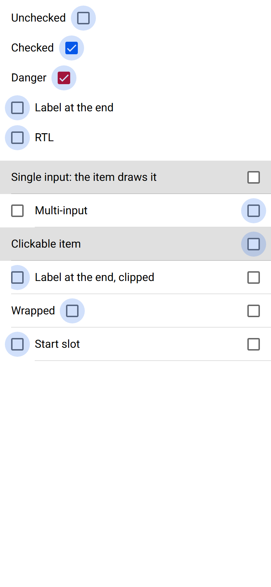

# ion-checkbox — reference render (Ionic 8.8.19, md, 390×844@2x)

Generated by `node tools/ionic-ref/render.js ion-checkbox --bare --html "<ion-app style=\"position:static;display:block;contain:none;overflow:visible\"><div style=\"padding:16px;display:flex;flex-direction:column;gap:24px;align-items:flex-start\"><ion-checkbox class=\"ion-focused\">Unchecked</ion-checkbox><ion-checkbox class=\"ion-focused\" checked>Checked</ion-checkbox><ion-checkbox class=\"ion-focused\" checked color=\"danger\">Danger</ion-checkbox><ion-checkbox class=\"ion-focused\" label-placement=\"end\">Label at the end</ion-checkbox><div dir=\"rtl\"><ion-checkbox class=\"ion-focused\">RTL</ion-checkbox></div></div><ion-list><ion-item class=\"ion-focused\"><ion-checkbox>Single input: the item draws it</ion-checkbox></ion-item><ion-item><ion-checkbox slot=\"start\"></ion-checkbox><ion-checkbox class=\"ion-focused\">Multi-input</ion-checkbox></ion-item><ion-item class=\"ion-focused\" button><ion-checkbox class=\"ion-focused\">Clickable item</ion-checkbox></ion-item><ion-item><ion-checkbox class=\"ion-focused\" label-placement=\"end\">Label at the end, clipped</ion-checkbox><ion-checkbox slot=\"end\"></ion-checkbox></ion-item><ion-item><div><ion-checkbox class=\"ion-focused\">Wrapped</ion-checkbox></div><ion-checkbox slot=\"end\"></ion-checkbox></ion-item><ion-item><ion-checkbox slot=\"start\" class=\"ion-focused\"></ion-checkbox><ion-label>Start slot</ion-label><ion-checkbox slot=\"end\"></ion-checkbox></ion-item></ion-list></ion-app>" --out docs/components/ion-checkbox/ref/focus`

```html
<ion-app style="position:static;display:block;contain:none;overflow:visible"><div style="padding:16px;display:flex;flex-direction:column;gap:24px;align-items:flex-start"><ion-checkbox class="ion-focused">Unchecked</ion-checkbox><ion-checkbox class="ion-focused" checked>Checked</ion-checkbox><ion-checkbox class="ion-focused" checked color="danger">Danger</ion-checkbox><ion-checkbox class="ion-focused" label-placement="end">Label at the end</ion-checkbox><div dir="rtl"><ion-checkbox class="ion-focused">RTL</ion-checkbox></div></div><ion-list><ion-item class="ion-focused"><ion-checkbox>Single input: the item draws it</ion-checkbox></ion-item><ion-item><ion-checkbox slot="start"></ion-checkbox><ion-checkbox class="ion-focused">Multi-input</ion-checkbox></ion-item><ion-item class="ion-focused" button><ion-checkbox class="ion-focused">Clickable item</ion-checkbox></ion-item><ion-item><ion-checkbox class="ion-focused" label-placement="end">Label at the end, clipped</ion-checkbox><ion-checkbox slot="end"></ion-checkbox></ion-item><ion-item><div><ion-checkbox class="ion-focused">Wrapped</ion-checkbox></div><ion-checkbox slot="end"></ion-checkbox></ion-item><ion-item><ion-checkbox slot="start" class="ion-focused"></ion-checkbox><ion-label>Start slot</ion-label><ion-checkbox slot="end"></ion-checkbox></ion-item></ion-list></ion-app>
```

 

## Element 1

- attributes: `{"class":"ion-focused md interactive ion-focusable checkbox-label-placement-start hydrated","role":"checkbox","aria-checked":"false","aria-labelledby":"ion-cb-0-lbl","tabindex":"0"}`
- classes: `ion-focused md interactive ion-focusable checkbox-label-placement-start hydrated`
- rect: `{"x":16,"y":16,"w":112.72,"h":19}`

### CSS custom properties (resolved)

| var | value |
|---|---|
| `--border-color` | `rgb(0, 0, 0, 0.6)` |
| `--border-color-checked` | `#0054e9` |
| `--border-radius` | `calc(18px * .125)` |
| `--border-style` | `solid` |
| `--border-width` | `2px` |
| `--checkbox-background` | `#fff` |
| `--checkbox-background-checked` | `#0054e9` |
| `--checkmark-color` | `#fff` |
| `--checkmark-width` | `3` |
| `--size` | `18px` |
| `--transition` | `background 180ms cubic-bezier(0.4, 0, 0.2, 1)` |

### Host computed

| prop | value |
|---|---|
| display | `block` |
| position | `relative` |
| box-sizing | `border-box` |
| width | `112.719px` |
| height | `19px` |
| min-height | `auto` |
| min-width | `auto` |
| padding | `0px` |
| margin | `0px` |
| border | `0px none rgb(0, 0, 0)` |
| border-radius | `0px` |
| background-color | `rgba(0, 0, 0, 0)` |
| color | `rgb(0, 0, 0)` |
| font-size | `16px` |
| font-weight | `400` |
| font-family | `Roboto, "Helvetica Neue", sans-serif` |
| line-height | `normal` |
| letter-spacing | `normal` |
| text-transform | `none` |
| opacity | `1` |
| overflow | `visible` |
| contain | `none` |
| pointer-events | `auto` |
| transition | `all` |
| transform | `none` |
| box-shadow | `none` |
| outline | `rgb(0, 0, 0) none 0px` |
| cursor | `pointer` |

### Shadow parts

#### part="label" (`div`) rect `{"x":16,"y":16,"w":78.72,"h":19}`

| prop | value |
|---|---|
| display | `block` |
| position | `static` |
| box-sizing | `content-box` |
| width | `78.7188px` |
| height | `19px` |
| min-height | `auto` |
| min-width | `auto` |
| padding | `0px` |
| margin | `0px 16px 0px 0px` |
| border | `0px none rgb(0, 0, 0)` |
| border-radius | `0px` |
| background-color | `rgba(0, 0, 0, 0)` |
| color | `rgb(0, 0, 0)` |
| font-size | `16px` |
| font-weight | `400` |
| font-family | `Roboto, "Helvetica Neue", sans-serif` |
| line-height | `normal` |
| letter-spacing | `normal` |
| text-transform | `none` |
| opacity | `1` |
| overflow | `hidden` |
| contain | `none` |
| pointer-events | `auto` |
| transition | `all` |
| transform | `none` |
| box-shadow | `none` |
| outline | `rgb(0, 0, 0) none 0px` |
| cursor | `pointer` |

#### part="container" (`svg`) rect `{"x":110.72,"y":16.5,"w":18,"h":18}`

| prop | value |
|---|---|
| display | `block` |
| position | `relative` |
| box-sizing | `border-box` |
| width | `18px` |
| height | `18px` |
| min-height | `auto` |
| min-width | `auto` |
| padding | `0px` |
| margin | `0px` |
| border | `2px solid rgba(0, 0, 0, 0.6)` |
| border-radius | `2.25px` |
| background-color | `rgb(255, 255, 255)` |
| color | `rgb(0, 0, 0)` |
| font-size | `16px` |
| font-weight | `400` |
| font-family | `Roboto, "Helvetica Neue", sans-serif` |
| line-height | `normal` |
| letter-spacing | `normal` |
| text-transform | `none` |
| opacity | `1` |
| overflow | `hidden` |
| contain | `none` |
| pointer-events | `auto` |
| transition | `background 0.18s cubic-bezier(0.4, 0, 0.2, 1)` |
| transform | `none` |
| box-shadow | `none` |
| outline | `rgb(0, 0, 0) none 0px` |
| cursor | `pointer` |

#### part="mark" (`path`) rect `{"x":113.73,"y":21.18,"w":12.28,"h":8.57}`

| prop | value |
|---|---|
| display | `inline` |
| position | `static` |
| box-sizing | `content-box` |
| width | `auto` |
| height | `auto` |
| min-height | `0px` |
| min-width | `0px` |
| padding | `0px` |
| margin | `0px` |
| border | `0px none rgb(0, 0, 0)` |
| border-radius | `0px` |
| background-color | `rgba(0, 0, 0, 0)` |
| color | `rgb(0, 0, 0)` |
| font-size | `16px` |
| font-weight | `400` |
| font-family | `Roboto, "Helvetica Neue", sans-serif` |
| line-height | `normal` |
| letter-spacing | `normal` |
| text-transform | `none` |
| opacity | `0` |
| overflow | `visible` |
| contain | `none` |
| pointer-events | `auto` |
| transition | `all` |
| transform | `none` |
| box-shadow | `none` |
| outline | `rgb(0, 0, 0) none 0px` |
| cursor | `pointer` |

### DOM tree

```
<ion-checkbox>
  #shadow-root
    <label.checkbox-wrapper>
      <input#ion-cb-0>
      <div#ion-cb-0-lbl.label-text-wrapper part="label">
        <slot name="">
      <div.native-wrapper>
        <svg part="container">
          <path part="mark">
  <input.aux-input>
```

## Element 2

- attributes: `{"class":"ion-focused md checkbox-checked interactive ion-focusable checkbox-label-placement-start hydrated","checked":"","role":"checkbox","aria-checked":"true","aria-labelledby":"ion-cb-1-lbl","tabindex":"0"}`
- classes: `ion-focused md checkbox-checked interactive ion-focusable checkbox-label-placement-start hydrated`
- rect: `{"x":16,"y":59,"w":95.55,"h":19}`

### CSS custom properties (resolved)

| var | value |
|---|---|
| `--border-color` | `rgb(0, 0, 0, 0.6)` |
| `--border-color-checked` | `#0054e9` |
| `--border-radius` | `calc(18px * .125)` |
| `--border-style` | `solid` |
| `--border-width` | `2px` |
| `--checkbox-background` | `#fff` |
| `--checkbox-background-checked` | `#0054e9` |
| `--checkmark-color` | `#fff` |
| `--checkmark-width` | `3` |
| `--size` | `18px` |
| `--transition` | `background 180ms cubic-bezier(0.4, 0, 0.2, 1)` |

### Host computed

| prop | value |
|---|---|
| display | `block` |
| position | `relative` |
| box-sizing | `border-box` |
| width | `95.5469px` |
| height | `19px` |
| min-height | `auto` |
| min-width | `auto` |
| padding | `0px` |
| margin | `0px` |
| border | `0px none rgb(0, 0, 0)` |
| border-radius | `0px` |
| background-color | `rgba(0, 0, 0, 0)` |
| color | `rgb(0, 0, 0)` |
| font-size | `16px` |
| font-weight | `400` |
| font-family | `Roboto, "Helvetica Neue", sans-serif` |
| line-height | `normal` |
| letter-spacing | `normal` |
| text-transform | `none` |
| opacity | `1` |
| overflow | `visible` |
| contain | `none` |
| pointer-events | `auto` |
| transition | `all` |
| transform | `none` |
| box-shadow | `none` |
| outline | `rgb(0, 0, 0) none 0px` |
| cursor | `pointer` |

### Shadow parts

#### part="label" (`div`) rect `{"x":16,"y":59,"w":61.55,"h":19}`

| prop | value |
|---|---|
| display | `block` |
| position | `static` |
| box-sizing | `content-box` |
| width | `61.5469px` |
| height | `19px` |
| min-height | `auto` |
| min-width | `auto` |
| padding | `0px` |
| margin | `0px 16px 0px 0px` |
| border | `0px none rgb(0, 0, 0)` |
| border-radius | `0px` |
| background-color | `rgba(0, 0, 0, 0)` |
| color | `rgb(0, 0, 0)` |
| font-size | `16px` |
| font-weight | `400` |
| font-family | `Roboto, "Helvetica Neue", sans-serif` |
| line-height | `normal` |
| letter-spacing | `normal` |
| text-transform | `none` |
| opacity | `1` |
| overflow | `hidden` |
| contain | `none` |
| pointer-events | `auto` |
| transition | `all` |
| transform | `none` |
| box-shadow | `none` |
| outline | `rgb(0, 0, 0) none 0px` |
| cursor | `pointer` |

#### part="container" (`svg`) rect `{"x":93.55,"y":59.5,"w":18,"h":18}`

| prop | value |
|---|---|
| display | `block` |
| position | `relative` |
| box-sizing | `border-box` |
| width | `18px` |
| height | `18px` |
| min-height | `auto` |
| min-width | `auto` |
| padding | `0px` |
| margin | `0px` |
| border | `2px solid rgb(0, 84, 233)` |
| border-radius | `2.25px` |
| background-color | `rgb(0, 84, 233)` |
| color | `rgb(0, 0, 0)` |
| font-size | `16px` |
| font-weight | `400` |
| font-family | `Roboto, "Helvetica Neue", sans-serif` |
| line-height | `normal` |
| letter-spacing | `normal` |
| text-transform | `none` |
| opacity | `1` |
| overflow | `hidden` |
| contain | `none` |
| pointer-events | `auto` |
| transition | `background 0.18s cubic-bezier(0.4, 0, 0.2, 1)` |
| transform | `none` |
| box-shadow | `none` |
| outline | `rgb(0, 0, 0) none 0px` |
| cursor | `pointer` |

#### part="mark" (`path`) rect `{"x":96.56,"y":64.18,"w":12.28,"h":8.57}`

| prop | value |
|---|---|
| display | `inline` |
| position | `static` |
| box-sizing | `content-box` |
| width | `auto` |
| height | `auto` |
| min-height | `0px` |
| min-width | `0px` |
| padding | `0px` |
| margin | `0px` |
| border | `0px none rgb(0, 0, 0)` |
| border-radius | `0px` |
| background-color | `rgba(0, 0, 0, 0)` |
| color | `rgb(0, 0, 0)` |
| font-size | `16px` |
| font-weight | `400` |
| font-family | `Roboto, "Helvetica Neue", sans-serif` |
| line-height | `normal` |
| letter-spacing | `normal` |
| text-transform | `none` |
| opacity | `1` |
| overflow | `visible` |
| contain | `none` |
| pointer-events | `auto` |
| transition | `stroke-dashoffset 0.09s linear 0.09s` |
| transform | `none` |
| box-shadow | `none` |
| outline | `rgb(0, 0, 0) none 0px` |
| cursor | `pointer` |

### DOM tree

```
<ion-checkbox>
  #shadow-root
    <label.checkbox-wrapper>
      <input#ion-cb-1>
      <div#ion-cb-1-lbl.label-text-wrapper part="label">
        <slot name="">
      <div.native-wrapper>
        <svg part="container">
          <path part="mark">
  <input.aux-input>
```

## Element 3

- attributes: `{"class":"ion-focused ion-color ion-color-danger md checkbox-checked interactive ion-focusable checkbox-label-placement-start hydrated","checked":"","color":"danger","role":"checkbox","aria-checked":"true","aria-labelledby":"ion-cb-2-lbl","tabindex":"0"}`
- classes: `ion-focused ion-color ion-color-danger md checkbox-checked interactive ion-focusable checkbox-label-placement-start hydrated`
- rect: `{"x":16,"y":102,"w":84.94,"h":19}`

### CSS custom properties (resolved)

| var | value |
|---|---|
| `--border-color` | `rgb(0, 0, 0, 0.6)` |
| `--border-color-checked` | `#c5000f` |
| `--border-radius` | `calc(18px * .125)` |
| `--border-style` | `solid` |
| `--border-width` | `2px` |
| `--checkbox-background` | `#fff` |
| `--checkbox-background-checked` | `#c5000f` |
| `--checkmark-color` | `#fff` |
| `--checkmark-width` | `3` |
| `--size` | `18px` |
| `--transition` | `background 180ms cubic-bezier(0.4, 0, 0.2, 1)` |

### Host computed

| prop | value |
|---|---|
| display | `block` |
| position | `relative` |
| box-sizing | `border-box` |
| width | `84.9375px` |
| height | `19px` |
| min-height | `auto` |
| min-width | `auto` |
| padding | `0px` |
| margin | `0px` |
| border | `0px none rgb(0, 0, 0)` |
| border-radius | `0px` |
| background-color | `rgba(0, 0, 0, 0)` |
| color | `rgb(0, 0, 0)` |
| font-size | `16px` |
| font-weight | `400` |
| font-family | `Roboto, "Helvetica Neue", sans-serif` |
| line-height | `normal` |
| letter-spacing | `normal` |
| text-transform | `none` |
| opacity | `1` |
| overflow | `visible` |
| contain | `none` |
| pointer-events | `auto` |
| transition | `all` |
| transform | `none` |
| box-shadow | `none` |
| outline | `rgb(0, 0, 0) none 0px` |
| cursor | `pointer` |

### Shadow parts

#### part="label" (`div`) rect `{"x":16,"y":102,"w":50.94,"h":19}`

| prop | value |
|---|---|
| display | `block` |
| position | `static` |
| box-sizing | `content-box` |
| width | `50.9375px` |
| height | `19px` |
| min-height | `auto` |
| min-width | `auto` |
| padding | `0px` |
| margin | `0px 16px 0px 0px` |
| border | `0px none rgb(0, 0, 0)` |
| border-radius | `0px` |
| background-color | `rgba(0, 0, 0, 0)` |
| color | `rgb(0, 0, 0)` |
| font-size | `16px` |
| font-weight | `400` |
| font-family | `Roboto, "Helvetica Neue", sans-serif` |
| line-height | `normal` |
| letter-spacing | `normal` |
| text-transform | `none` |
| opacity | `1` |
| overflow | `hidden` |
| contain | `none` |
| pointer-events | `auto` |
| transition | `all` |
| transform | `none` |
| box-shadow | `none` |
| outline | `rgb(0, 0, 0) none 0px` |
| cursor | `pointer` |

#### part="container" (`svg`) rect `{"x":82.94,"y":102.5,"w":18,"h":18}`

| prop | value |
|---|---|
| display | `block` |
| position | `relative` |
| box-sizing | `border-box` |
| width | `18px` |
| height | `18px` |
| min-height | `auto` |
| min-width | `auto` |
| padding | `0px` |
| margin | `0px` |
| border | `2px solid rgb(197, 0, 15)` |
| border-radius | `2.25px` |
| background-color | `rgb(197, 0, 15)` |
| color | `rgb(0, 0, 0)` |
| font-size | `16px` |
| font-weight | `400` |
| font-family | `Roboto, "Helvetica Neue", sans-serif` |
| line-height | `normal` |
| letter-spacing | `normal` |
| text-transform | `none` |
| opacity | `1` |
| overflow | `hidden` |
| contain | `none` |
| pointer-events | `auto` |
| transition | `background 0.18s cubic-bezier(0.4, 0, 0.2, 1)` |
| transform | `none` |
| box-shadow | `none` |
| outline | `rgb(0, 0, 0) none 0px` |
| cursor | `pointer` |

#### part="mark" (`path`) rect `{"x":85.95,"y":107.18,"w":12.28,"h":8.57}`

| prop | value |
|---|---|
| display | `inline` |
| position | `static` |
| box-sizing | `content-box` |
| width | `auto` |
| height | `auto` |
| min-height | `0px` |
| min-width | `0px` |
| padding | `0px` |
| margin | `0px` |
| border | `0px none rgb(0, 0, 0)` |
| border-radius | `0px` |
| background-color | `rgba(0, 0, 0, 0)` |
| color | `rgb(0, 0, 0)` |
| font-size | `16px` |
| font-weight | `400` |
| font-family | `Roboto, "Helvetica Neue", sans-serif` |
| line-height | `normal` |
| letter-spacing | `normal` |
| text-transform | `none` |
| opacity | `1` |
| overflow | `visible` |
| contain | `none` |
| pointer-events | `auto` |
| transition | `stroke-dashoffset 0.09s linear 0.09s` |
| transform | `none` |
| box-shadow | `none` |
| outline | `rgb(0, 0, 0) none 0px` |
| cursor | `pointer` |

### DOM tree

```
<ion-checkbox>
  #shadow-root
    <label.checkbox-wrapper>
      <input#ion-cb-2>
      <div#ion-cb-2-lbl.label-text-wrapper part="label">
        <slot name="">
      <div.native-wrapper>
        <svg part="container">
          <path part="mark">
  <input.aux-input>
```

## Element 4

- attributes: `{"class":"ion-focused md interactive ion-focusable checkbox-label-placement-end hydrated","label-placement":"end","role":"checkbox","aria-checked":"false","aria-labelledby":"ion-cb-3-lbl","tabindex":"0"}`
- classes: `ion-focused md interactive ion-focusable checkbox-label-placement-end hydrated`
- rect: `{"x":16,"y":145,"w":147.41,"h":19}`

### CSS custom properties (resolved)

| var | value |
|---|---|
| `--border-color` | `rgb(0, 0, 0, 0.6)` |
| `--border-color-checked` | `#0054e9` |
| `--border-radius` | `calc(18px * .125)` |
| `--border-style` | `solid` |
| `--border-width` | `2px` |
| `--checkbox-background` | `#fff` |
| `--checkbox-background-checked` | `#0054e9` |
| `--checkmark-color` | `#fff` |
| `--checkmark-width` | `3` |
| `--size` | `18px` |
| `--transition` | `background 180ms cubic-bezier(0.4, 0, 0.2, 1)` |

### Host computed

| prop | value |
|---|---|
| display | `block` |
| position | `relative` |
| box-sizing | `border-box` |
| width | `147.406px` |
| height | `19px` |
| min-height | `auto` |
| min-width | `auto` |
| padding | `0px` |
| margin | `0px` |
| border | `0px none rgb(0, 0, 0)` |
| border-radius | `0px` |
| background-color | `rgba(0, 0, 0, 0)` |
| color | `rgb(0, 0, 0)` |
| font-size | `16px` |
| font-weight | `400` |
| font-family | `Roboto, "Helvetica Neue", sans-serif` |
| line-height | `normal` |
| letter-spacing | `normal` |
| text-transform | `none` |
| opacity | `1` |
| overflow | `visible` |
| contain | `none` |
| pointer-events | `auto` |
| transition | `all` |
| transform | `none` |
| box-shadow | `none` |
| outline | `rgb(0, 0, 0) none 0px` |
| cursor | `pointer` |

### Shadow parts

#### part="label" (`div`) rect `{"x":50,"y":145,"w":113.41,"h":19}`

| prop | value |
|---|---|
| display | `block` |
| position | `static` |
| box-sizing | `content-box` |
| width | `113.406px` |
| height | `19px` |
| min-height | `auto` |
| min-width | `auto` |
| padding | `0px` |
| margin | `0px 0px 0px 16px` |
| border | `0px none rgb(0, 0, 0)` |
| border-radius | `0px` |
| background-color | `rgba(0, 0, 0, 0)` |
| color | `rgb(0, 0, 0)` |
| font-size | `16px` |
| font-weight | `400` |
| font-family | `Roboto, "Helvetica Neue", sans-serif` |
| line-height | `normal` |
| letter-spacing | `normal` |
| text-transform | `none` |
| opacity | `1` |
| overflow | `hidden` |
| contain | `none` |
| pointer-events | `auto` |
| transition | `all` |
| transform | `none` |
| box-shadow | `none` |
| outline | `rgb(0, 0, 0) none 0px` |
| cursor | `pointer` |

#### part="container" (`svg`) rect `{"x":16,"y":145.5,"w":18,"h":18}`

| prop | value |
|---|---|
| display | `block` |
| position | `relative` |
| box-sizing | `border-box` |
| width | `18px` |
| height | `18px` |
| min-height | `auto` |
| min-width | `auto` |
| padding | `0px` |
| margin | `0px` |
| border | `2px solid rgba(0, 0, 0, 0.6)` |
| border-radius | `2.25px` |
| background-color | `rgb(255, 255, 255)` |
| color | `rgb(0, 0, 0)` |
| font-size | `16px` |
| font-weight | `400` |
| font-family | `Roboto, "Helvetica Neue", sans-serif` |
| line-height | `normal` |
| letter-spacing | `normal` |
| text-transform | `none` |
| opacity | `1` |
| overflow | `hidden` |
| contain | `none` |
| pointer-events | `auto` |
| transition | `background 0.18s cubic-bezier(0.4, 0, 0.2, 1)` |
| transform | `none` |
| box-shadow | `none` |
| outline | `rgb(0, 0, 0) none 0px` |
| cursor | `pointer` |

#### part="mark" (`path`) rect `{"x":19.01,"y":150.18,"w":12.28,"h":8.57}`

| prop | value |
|---|---|
| display | `inline` |
| position | `static` |
| box-sizing | `content-box` |
| width | `auto` |
| height | `auto` |
| min-height | `0px` |
| min-width | `0px` |
| padding | `0px` |
| margin | `0px` |
| border | `0px none rgb(0, 0, 0)` |
| border-radius | `0px` |
| background-color | `rgba(0, 0, 0, 0)` |
| color | `rgb(0, 0, 0)` |
| font-size | `16px` |
| font-weight | `400` |
| font-family | `Roboto, "Helvetica Neue", sans-serif` |
| line-height | `normal` |
| letter-spacing | `normal` |
| text-transform | `none` |
| opacity | `0` |
| overflow | `visible` |
| contain | `none` |
| pointer-events | `auto` |
| transition | `all` |
| transform | `none` |
| box-shadow | `none` |
| outline | `rgb(0, 0, 0) none 0px` |
| cursor | `pointer` |

### DOM tree

```
<ion-checkbox>
  #shadow-root
    <label.checkbox-wrapper>
      <input#ion-cb-3>
      <div#ion-cb-3-lbl.label-text-wrapper part="label">
        <slot name="">
      <div.native-wrapper>
        <svg part="container">
          <path part="mark">
  <input.aux-input>
```

## Element 5

- attributes: `{"class":"ion-focused md interactive ion-focusable checkbox-label-placement-start hydrated","role":"checkbox","aria-checked":"false","aria-labelledby":"ion-cb-4-lbl","tabindex":"0"}`
- classes: `ion-focused md interactive ion-focusable checkbox-label-placement-start hydrated`
- rect: `{"x":16,"y":188,"w":61.41,"h":19}`

### CSS custom properties (resolved)

| var | value |
|---|---|
| `--border-color` | `rgb(0, 0, 0, 0.6)` |
| `--border-color-checked` | `#0054e9` |
| `--border-radius` | `calc(18px * .125)` |
| `--border-style` | `solid` |
| `--border-width` | `2px` |
| `--checkbox-background` | `#fff` |
| `--checkbox-background-checked` | `#0054e9` |
| `--checkmark-color` | `#fff` |
| `--checkmark-width` | `3` |
| `--size` | `18px` |
| `--transition` | `background 180ms cubic-bezier(0.4, 0, 0.2, 1)` |

### Host computed

| prop | value |
|---|---|
| display | `inline-block` |
| position | `relative` |
| box-sizing | `border-box` |
| width | `61.4062px` |
| height | `19px` |
| min-height | `0px` |
| min-width | `0px` |
| padding | `0px` |
| margin | `0px` |
| border | `0px none rgb(0, 0, 0)` |
| border-radius | `0px` |
| background-color | `rgba(0, 0, 0, 0)` |
| color | `rgb(0, 0, 0)` |
| font-size | `16px` |
| font-weight | `400` |
| font-family | `Roboto, "Helvetica Neue", sans-serif` |
| line-height | `normal` |
| letter-spacing | `normal` |
| text-transform | `none` |
| opacity | `1` |
| overflow | `visible` |
| contain | `none` |
| pointer-events | `auto` |
| transition | `all` |
| transform | `none` |
| box-shadow | `none` |
| outline | `rgb(0, 0, 0) none 0px` |
| cursor | `pointer` |

### Shadow parts

#### part="label" (`div`) rect `{"x":50,"y":188,"w":27.41,"h":19}`

| prop | value |
|---|---|
| display | `block` |
| position | `static` |
| box-sizing | `content-box` |
| width | `27.4062px` |
| height | `19px` |
| min-height | `auto` |
| min-width | `auto` |
| padding | `0px` |
| margin | `0px 0px 0px 16px` |
| border | `0px none rgb(0, 0, 0)` |
| border-radius | `0px` |
| background-color | `rgba(0, 0, 0, 0)` |
| color | `rgb(0, 0, 0)` |
| font-size | `16px` |
| font-weight | `400` |
| font-family | `Roboto, "Helvetica Neue", sans-serif` |
| line-height | `normal` |
| letter-spacing | `normal` |
| text-transform | `none` |
| opacity | `1` |
| overflow | `hidden` |
| contain | `none` |
| pointer-events | `auto` |
| transition | `all` |
| transform | `none` |
| box-shadow | `none` |
| outline | `rgb(0, 0, 0) none 0px` |
| cursor | `pointer` |

#### part="container" (`svg`) rect `{"x":16,"y":188.5,"w":18,"h":18}`

| prop | value |
|---|---|
| display | `block` |
| position | `relative` |
| box-sizing | `border-box` |
| width | `18px` |
| height | `18px` |
| min-height | `auto` |
| min-width | `auto` |
| padding | `0px` |
| margin | `0px` |
| border | `2px solid rgba(0, 0, 0, 0.6)` |
| border-radius | `2.25px` |
| background-color | `rgb(255, 255, 255)` |
| color | `rgb(0, 0, 0)` |
| font-size | `16px` |
| font-weight | `400` |
| font-family | `Roboto, "Helvetica Neue", sans-serif` |
| line-height | `normal` |
| letter-spacing | `normal` |
| text-transform | `none` |
| opacity | `1` |
| overflow | `hidden` |
| contain | `none` |
| pointer-events | `auto` |
| transition | `background 0.18s cubic-bezier(0.4, 0, 0.2, 1)` |
| transform | `none` |
| box-shadow | `none` |
| outline | `rgb(0, 0, 0) none 0px` |
| cursor | `pointer` |

#### part="mark" (`path`) rect `{"x":19.01,"y":193.18,"w":12.28,"h":8.57}`

| prop | value |
|---|---|
| display | `inline` |
| position | `static` |
| box-sizing | `content-box` |
| width | `auto` |
| height | `auto` |
| min-height | `0px` |
| min-width | `0px` |
| padding | `0px` |
| margin | `0px` |
| border | `0px none rgb(0, 0, 0)` |
| border-radius | `0px` |
| background-color | `rgba(0, 0, 0, 0)` |
| color | `rgb(0, 0, 0)` |
| font-size | `16px` |
| font-weight | `400` |
| font-family | `Roboto, "Helvetica Neue", sans-serif` |
| line-height | `normal` |
| letter-spacing | `normal` |
| text-transform | `none` |
| opacity | `0` |
| overflow | `visible` |
| contain | `none` |
| pointer-events | `auto` |
| transition | `all` |
| transform | `none` |
| box-shadow | `none` |
| outline | `rgb(0, 0, 0) none 0px` |
| cursor | `pointer` |

### DOM tree

```
<ion-checkbox>
  #shadow-root
    <label.checkbox-wrapper>
      <input#ion-cb-4>
      <div#ion-cb-4-lbl.label-text-wrapper part="label">
        <slot name="">
      <div.native-wrapper>
        <svg part="container">
          <path part="mark">
  <input.aux-input>
```

## Element 6

- attributes: `{"role":"checkbox","aria-checked":"false","aria-labelledby":"ion-cb-5-lbl","tabindex":"0","class":"md in-item interactive checkbox-label-placement-start hydrated"}`
- classes: `md in-item interactive checkbox-label-placement-start hydrated`
- rect: `{"x":16,"y":231,"w":358,"h":47}`

### CSS custom properties (resolved)

| var | value |
|---|---|
| `--border-color` | `rgb(0, 0, 0, 0.6)` |
| `--border-color-checked` | `#0054e9` |
| `--border-radius` | `calc(18px * .125)` |
| `--border-style` | `solid` |
| `--border-width` | `2px` |
| `--checkbox-background` | `#fff` |
| `--checkbox-background-checked` | `#0054e9` |
| `--checkmark-color` | `#fff` |
| `--checkmark-width` | `3` |
| `--size` | `18px` |
| `--transition` | `background 180ms cubic-bezier(0.4, 0, 0.2, 1)` |

### Host computed

| prop | value |
|---|---|
| display | `block` |
| position | `relative` |
| box-sizing | `border-box` |
| width | `358px` |
| height | `47px` |
| min-height | `auto` |
| min-width | `auto` |
| padding | `0px` |
| margin | `0px` |
| border | `0px none rgb(0, 0, 0)` |
| border-radius | `0px` |
| background-color | `rgba(0, 0, 0, 0)` |
| color | `rgb(0, 0, 0)` |
| font-size | `16px` |
| font-weight | `400` |
| font-family | `Roboto, "Helvetica Neue", sans-serif` |
| line-height | `normal` |
| letter-spacing | `normal` |
| text-transform | `none` |
| opacity | `1` |
| overflow | `visible` |
| contain | `none` |
| pointer-events | `auto` |
| transition | `all` |
| transform | `none` |
| box-shadow | `none` |
| outline | `rgb(0, 0, 0) none 0px` |
| cursor | `pointer` |

### Shadow parts

#### part="label" (`div`) rect `{"x":16,"y":245,"w":209.48,"h":19}`

| prop | value |
|---|---|
| display | `block` |
| position | `static` |
| box-sizing | `content-box` |
| width | `209.484px` |
| height | `19px` |
| min-height | `auto` |
| min-width | `auto` |
| padding | `0px` |
| margin | `10px 16px 10px 0px` |
| border | `0px none rgb(0, 0, 0)` |
| border-radius | `0px` |
| background-color | `rgba(0, 0, 0, 0)` |
| color | `rgb(0, 0, 0)` |
| font-size | `16px` |
| font-weight | `400` |
| font-family | `Roboto, "Helvetica Neue", sans-serif` |
| line-height | `normal` |
| letter-spacing | `normal` |
| text-transform | `none` |
| opacity | `1` |
| overflow | `hidden` |
| contain | `none` |
| pointer-events | `auto` |
| transition | `all` |
| transform | `none` |
| box-shadow | `none` |
| outline | `rgb(0, 0, 0) none 0px` |
| cursor | `pointer` |

#### part="container" (`svg`) rect `{"x":356,"y":245.5,"w":18,"h":18}`

| prop | value |
|---|---|
| display | `block` |
| position | `relative` |
| box-sizing | `border-box` |
| width | `18px` |
| height | `18px` |
| min-height | `auto` |
| min-width | `auto` |
| padding | `0px` |
| margin | `0px` |
| border | `2px solid rgba(0, 0, 0, 0.6)` |
| border-radius | `2.25px` |
| background-color | `rgb(255, 255, 255)` |
| color | `rgb(0, 0, 0)` |
| font-size | `16px` |
| font-weight | `400` |
| font-family | `Roboto, "Helvetica Neue", sans-serif` |
| line-height | `normal` |
| letter-spacing | `normal` |
| text-transform | `none` |
| opacity | `1` |
| overflow | `hidden` |
| contain | `none` |
| pointer-events | `auto` |
| transition | `background 0.18s cubic-bezier(0.4, 0, 0.2, 1)` |
| transform | `none` |
| box-shadow | `none` |
| outline | `rgb(0, 0, 0) none 0px` |
| cursor | `pointer` |

#### part="mark" (`path`) rect `{"x":359.01,"y":250.18,"w":12.29,"h":8.57}`

| prop | value |
|---|---|
| display | `inline` |
| position | `static` |
| box-sizing | `content-box` |
| width | `auto` |
| height | `auto` |
| min-height | `0px` |
| min-width | `0px` |
| padding | `0px` |
| margin | `0px` |
| border | `0px none rgb(0, 0, 0)` |
| border-radius | `0px` |
| background-color | `rgba(0, 0, 0, 0)` |
| color | `rgb(0, 0, 0)` |
| font-size | `16px` |
| font-weight | `400` |
| font-family | `Roboto, "Helvetica Neue", sans-serif` |
| line-height | `normal` |
| letter-spacing | `normal` |
| text-transform | `none` |
| opacity | `0` |
| overflow | `visible` |
| contain | `none` |
| pointer-events | `auto` |
| transition | `all` |
| transform | `none` |
| box-shadow | `none` |
| outline | `rgb(0, 0, 0) none 0px` |
| cursor | `pointer` |

### DOM tree

```
<ion-checkbox>
  #shadow-root
    <label.checkbox-wrapper>
      <input#ion-cb-5>
      <div#ion-cb-5-lbl.label-text-wrapper part="label">
        <slot name="">
      <div.native-wrapper>
        <svg part="container">
          <path part="mark">
  <input.aux-input>
```

## Element 7

- attributes: `{"slot":"start","role":"checkbox","aria-checked":"false","tabindex":"0","class":"md in-item interactive checkbox-label-placement-start hydrated ion-focusable"}`
- classes: `md in-item interactive checkbox-label-placement-start hydrated ion-focusable`
- rect: `{"x":16,"y":294,"w":18,"h":18}`

### CSS custom properties (resolved)

| var | value |
|---|---|
| `--border-color` | `rgb(0, 0, 0, 0.6)` |
| `--border-color-checked` | `#0054e9` |
| `--border-radius` | `calc(18px * .125)` |
| `--border-style` | `solid` |
| `--border-width` | `2px` |
| `--checkbox-background` | `#fff` |
| `--checkbox-background-checked` | `#0054e9` |
| `--checkmark-color` | `#fff` |
| `--checkmark-width` | `3` |
| `--size` | `18px` |
| `--transition` | `background 180ms cubic-bezier(0.4, 0, 0.2, 1)` |

### Host computed

| prop | value |
|---|---|
| display | `block` |
| position | `relative` |
| box-sizing | `border-box` |
| width | `18px` |
| height | `18px` |
| min-height | `auto` |
| min-width | `auto` |
| padding | `0px` |
| margin | `0px 16px 0px 0px` |
| border | `0px none rgb(0, 0, 0)` |
| border-radius | `0px` |
| background-color | `rgba(0, 0, 0, 0)` |
| color | `rgb(0, 0, 0)` |
| font-size | `16px` |
| font-weight | `400` |
| font-family | `Roboto, "Helvetica Neue", sans-serif` |
| line-height | `normal` |
| letter-spacing | `normal` |
| text-transform | `none` |
| opacity | `1` |
| overflow | `visible` |
| contain | `none` |
| pointer-events | `auto` |
| transition | `all` |
| transform | `none` |
| box-shadow | `none` |
| outline | `rgb(0, 0, 0) none 0px` |
| cursor | `pointer` |

### Shadow parts

#### part="label" (`div`) rect `{"x":0,"y":0,"w":0,"h":0}`

| prop | value |
|---|---|
| display | `none` |
| position | `static` |
| box-sizing | `content-box` |
| width | `auto` |
| height | `auto` |
| min-height | `0px` |
| min-width | `0px` |
| padding | `0px` |
| margin | `10px 16px 10px 0px` |
| border | `0px none rgb(0, 0, 0)` |
| border-radius | `0px` |
| background-color | `rgba(0, 0, 0, 0)` |
| color | `rgb(0, 0, 0)` |
| font-size | `16px` |
| font-weight | `400` |
| font-family | `Roboto, "Helvetica Neue", sans-serif` |
| line-height | `normal` |
| letter-spacing | `normal` |
| text-transform | `none` |
| opacity | `1` |
| overflow | `hidden` |
| contain | `none` |
| pointer-events | `auto` |
| transition | `all` |
| transform | `none` |
| box-shadow | `none` |
| outline | `rgb(0, 0, 0) none 0px` |
| cursor | `pointer` |

#### part="container" (`svg`) rect `{"x":16,"y":294,"w":18,"h":18}`

| prop | value |
|---|---|
| display | `block` |
| position | `relative` |
| box-sizing | `border-box` |
| width | `18px` |
| height | `18px` |
| min-height | `auto` |
| min-width | `auto` |
| padding | `0px` |
| margin | `0px` |
| border | `2px solid rgba(0, 0, 0, 0.6)` |
| border-radius | `2.25px` |
| background-color | `rgb(255, 255, 255)` |
| color | `rgb(0, 0, 0)` |
| font-size | `16px` |
| font-weight | `400` |
| font-family | `Roboto, "Helvetica Neue", sans-serif` |
| line-height | `normal` |
| letter-spacing | `normal` |
| text-transform | `none` |
| opacity | `1` |
| overflow | `hidden` |
| contain | `none` |
| pointer-events | `auto` |
| transition | `background 0.18s cubic-bezier(0.4, 0, 0.2, 1)` |
| transform | `none` |
| box-shadow | `none` |
| outline | `rgb(0, 0, 0) none 0px` |
| cursor | `pointer` |

#### part="mark" (`path`) rect `{"x":19.01,"y":298.68,"w":12.28,"h":8.57}`

| prop | value |
|---|---|
| display | `inline` |
| position | `static` |
| box-sizing | `content-box` |
| width | `auto` |
| height | `auto` |
| min-height | `0px` |
| min-width | `0px` |
| padding | `0px` |
| margin | `0px` |
| border | `0px none rgb(0, 0, 0)` |
| border-radius | `0px` |
| background-color | `rgba(0, 0, 0, 0)` |
| color | `rgb(0, 0, 0)` |
| font-size | `16px` |
| font-weight | `400` |
| font-family | `Roboto, "Helvetica Neue", sans-serif` |
| line-height | `normal` |
| letter-spacing | `normal` |
| text-transform | `none` |
| opacity | `0` |
| overflow | `visible` |
| contain | `none` |
| pointer-events | `auto` |
| transition | `all` |
| transform | `none` |
| box-shadow | `none` |
| outline | `rgb(0, 0, 0) none 0px` |
| cursor | `pointer` |

### DOM tree

```
<ion-checkbox>
  #shadow-root
    <label.checkbox-wrapper>
      <input#ion-cb-6>
      <div#ion-cb-6-lbl.label-text-wrapper.label-text-wrapper-hidden part="label">
        <slot name="">
      <div.native-wrapper>
        <svg part="container">
          <path part="mark">
  <input.aux-input>
```

## Element 8

- attributes: `{"class":"ion-focused md in-item interactive checkbox-label-placement-start hydrated ion-focusable","role":"checkbox","aria-checked":"false","aria-labelledby":"ion-cb-7-lbl","tabindex":"0"}`
- classes: `ion-focused md in-item interactive checkbox-label-placement-start hydrated ion-focusable`
- rect: `{"x":50,"y":279,"w":324,"h":47}`

### CSS custom properties (resolved)

| var | value |
|---|---|
| `--border-color` | `rgb(0, 0, 0, 0.6)` |
| `--border-color-checked` | `#0054e9` |
| `--border-radius` | `calc(18px * .125)` |
| `--border-style` | `solid` |
| `--border-width` | `2px` |
| `--checkbox-background` | `#fff` |
| `--checkbox-background-checked` | `#0054e9` |
| `--checkmark-color` | `#fff` |
| `--checkmark-width` | `3` |
| `--size` | `18px` |
| `--transition` | `background 180ms cubic-bezier(0.4, 0, 0.2, 1)` |

### Host computed

| prop | value |
|---|---|
| display | `block` |
| position | `relative` |
| box-sizing | `border-box` |
| width | `324px` |
| height | `47px` |
| min-height | `auto` |
| min-width | `auto` |
| padding | `0px` |
| margin | `0px` |
| border | `0px none rgb(0, 0, 0)` |
| border-radius | `0px` |
| background-color | `rgba(0, 0, 0, 0)` |
| color | `rgb(0, 0, 0)` |
| font-size | `16px` |
| font-weight | `400` |
| font-family | `Roboto, "Helvetica Neue", sans-serif` |
| line-height | `normal` |
| letter-spacing | `normal` |
| text-transform | `none` |
| opacity | `1` |
| overflow | `visible` |
| contain | `none` |
| pointer-events | `auto` |
| transition | `all` |
| transform | `none` |
| box-shadow | `none` |
| outline | `rgb(0, 0, 0) none 0px` |
| cursor | `pointer` |

### Shadow parts

#### part="label" (`div`) rect `{"x":50,"y":293,"w":76,"h":19}`

| prop | value |
|---|---|
| display | `block` |
| position | `static` |
| box-sizing | `content-box` |
| width | `76px` |
| height | `19px` |
| min-height | `auto` |
| min-width | `auto` |
| padding | `0px` |
| margin | `10px 16px 10px 0px` |
| border | `0px none rgb(0, 0, 0)` |
| border-radius | `0px` |
| background-color | `rgba(0, 0, 0, 0)` |
| color | `rgb(0, 0, 0)` |
| font-size | `16px` |
| font-weight | `400` |
| font-family | `Roboto, "Helvetica Neue", sans-serif` |
| line-height | `normal` |
| letter-spacing | `normal` |
| text-transform | `none` |
| opacity | `1` |
| overflow | `hidden` |
| contain | `none` |
| pointer-events | `auto` |
| transition | `all` |
| transform | `none` |
| box-shadow | `none` |
| outline | `rgb(0, 0, 0) none 0px` |
| cursor | `pointer` |

#### part="container" (`svg`) rect `{"x":356,"y":293.5,"w":18,"h":18}`

| prop | value |
|---|---|
| display | `block` |
| position | `relative` |
| box-sizing | `border-box` |
| width | `18px` |
| height | `18px` |
| min-height | `auto` |
| min-width | `auto` |
| padding | `0px` |
| margin | `0px` |
| border | `2px solid rgba(0, 0, 0, 0.6)` |
| border-radius | `2.25px` |
| background-color | `rgb(255, 255, 255)` |
| color | `rgb(0, 0, 0)` |
| font-size | `16px` |
| font-weight | `400` |
| font-family | `Roboto, "Helvetica Neue", sans-serif` |
| line-height | `normal` |
| letter-spacing | `normal` |
| text-transform | `none` |
| opacity | `1` |
| overflow | `hidden` |
| contain | `none` |
| pointer-events | `auto` |
| transition | `background 0.18s cubic-bezier(0.4, 0, 0.2, 1)` |
| transform | `none` |
| box-shadow | `none` |
| outline | `rgb(0, 0, 0) none 0px` |
| cursor | `pointer` |

#### part="mark" (`path`) rect `{"x":359.01,"y":298.18,"w":12.29,"h":8.57}`

| prop | value |
|---|---|
| display | `inline` |
| position | `static` |
| box-sizing | `content-box` |
| width | `auto` |
| height | `auto` |
| min-height | `0px` |
| min-width | `0px` |
| padding | `0px` |
| margin | `0px` |
| border | `0px none rgb(0, 0, 0)` |
| border-radius | `0px` |
| background-color | `rgba(0, 0, 0, 0)` |
| color | `rgb(0, 0, 0)` |
| font-size | `16px` |
| font-weight | `400` |
| font-family | `Roboto, "Helvetica Neue", sans-serif` |
| line-height | `normal` |
| letter-spacing | `normal` |
| text-transform | `none` |
| opacity | `0` |
| overflow | `visible` |
| contain | `none` |
| pointer-events | `auto` |
| transition | `all` |
| transform | `none` |
| box-shadow | `none` |
| outline | `rgb(0, 0, 0) none 0px` |
| cursor | `pointer` |

### DOM tree

```
<ion-checkbox>
  #shadow-root
    <label.checkbox-wrapper>
      <input#ion-cb-7>
      <div#ion-cb-7-lbl.label-text-wrapper part="label">
        <slot name="">
      <div.native-wrapper>
        <svg part="container">
          <path part="mark">
  <input.aux-input>
```

## Element 9

- attributes: `{"class":"ion-focused md in-item interactive checkbox-label-placement-start hydrated ion-focusable","role":"checkbox","aria-checked":"false","aria-labelledby":"ion-cb-8-lbl","tabindex":"0"}`
- classes: `ion-focused md in-item interactive checkbox-label-placement-start hydrated ion-focusable`
- rect: `{"x":16,"y":327,"w":358,"h":47}`

### CSS custom properties (resolved)

| var | value |
|---|---|
| `--border-color` | `rgb(0, 0, 0, 0.6)` |
| `--border-color-checked` | `#0054e9` |
| `--border-radius` | `calc(18px * .125)` |
| `--border-style` | `solid` |
| `--border-width` | `2px` |
| `--checkbox-background` | `#fff` |
| `--checkbox-background-checked` | `#0054e9` |
| `--checkmark-color` | `#fff` |
| `--checkmark-width` | `3` |
| `--size` | `18px` |
| `--transition` | `background 180ms cubic-bezier(0.4, 0, 0.2, 1)` |

### Host computed

| prop | value |
|---|---|
| display | `block` |
| position | `relative` |
| box-sizing | `border-box` |
| width | `358px` |
| height | `47px` |
| min-height | `auto` |
| min-width | `auto` |
| padding | `0px` |
| margin | `0px` |
| border | `0px none rgb(0, 0, 0)` |
| border-radius | `0px` |
| background-color | `rgba(0, 0, 0, 0)` |
| color | `rgb(0, 0, 0)` |
| font-size | `16px` |
| font-weight | `400` |
| font-family | `Roboto, "Helvetica Neue", sans-serif` |
| line-height | `normal` |
| letter-spacing | `normal` |
| text-transform | `none` |
| opacity | `1` |
| overflow | `visible` |
| contain | `none` |
| pointer-events | `auto` |
| transition | `all` |
| transform | `none` |
| box-shadow | `none` |
| outline | `rgb(0, 0, 0) none 0px` |
| cursor | `pointer` |

### Shadow parts

#### part="label" (`div`) rect `{"x":16,"y":341,"w":100.36,"h":19}`

| prop | value |
|---|---|
| display | `block` |
| position | `static` |
| box-sizing | `content-box` |
| width | `100.359px` |
| height | `19px` |
| min-height | `auto` |
| min-width | `auto` |
| padding | `0px` |
| margin | `10px 16px 10px 0px` |
| border | `0px none rgb(0, 0, 0)` |
| border-radius | `0px` |
| background-color | `rgba(0, 0, 0, 0)` |
| color | `rgb(0, 0, 0)` |
| font-size | `16px` |
| font-weight | `400` |
| font-family | `Roboto, "Helvetica Neue", sans-serif` |
| line-height | `normal` |
| letter-spacing | `normal` |
| text-transform | `none` |
| opacity | `1` |
| overflow | `hidden` |
| contain | `none` |
| pointer-events | `auto` |
| transition | `all` |
| transform | `none` |
| box-shadow | `none` |
| outline | `rgb(0, 0, 0) none 0px` |
| cursor | `pointer` |

#### part="container" (`svg`) rect `{"x":356,"y":341.5,"w":18,"h":18}`

| prop | value |
|---|---|
| display | `block` |
| position | `relative` |
| box-sizing | `border-box` |
| width | `18px` |
| height | `18px` |
| min-height | `auto` |
| min-width | `auto` |
| padding | `0px` |
| margin | `0px` |
| border | `2px solid rgba(0, 0, 0, 0.6)` |
| border-radius | `2.25px` |
| background-color | `rgb(255, 255, 255)` |
| color | `rgb(0, 0, 0)` |
| font-size | `16px` |
| font-weight | `400` |
| font-family | `Roboto, "Helvetica Neue", sans-serif` |
| line-height | `normal` |
| letter-spacing | `normal` |
| text-transform | `none` |
| opacity | `1` |
| overflow | `hidden` |
| contain | `none` |
| pointer-events | `auto` |
| transition | `background 0.18s cubic-bezier(0.4, 0, 0.2, 1)` |
| transform | `none` |
| box-shadow | `none` |
| outline | `rgb(0, 0, 0) none 0px` |
| cursor | `pointer` |

#### part="mark" (`path`) rect `{"x":359.01,"y":346.18,"w":12.29,"h":8.57}`

| prop | value |
|---|---|
| display | `inline` |
| position | `static` |
| box-sizing | `content-box` |
| width | `auto` |
| height | `auto` |
| min-height | `0px` |
| min-width | `0px` |
| padding | `0px` |
| margin | `0px` |
| border | `0px none rgb(0, 0, 0)` |
| border-radius | `0px` |
| background-color | `rgba(0, 0, 0, 0)` |
| color | `rgb(0, 0, 0)` |
| font-size | `16px` |
| font-weight | `400` |
| font-family | `Roboto, "Helvetica Neue", sans-serif` |
| line-height | `normal` |
| letter-spacing | `normal` |
| text-transform | `none` |
| opacity | `0` |
| overflow | `visible` |
| contain | `none` |
| pointer-events | `auto` |
| transition | `all` |
| transform | `none` |
| box-shadow | `none` |
| outline | `rgb(0, 0, 0) none 0px` |
| cursor | `pointer` |

### DOM tree

```
<ion-checkbox>
  #shadow-root
    <label.checkbox-wrapper>
      <input#ion-cb-8>
      <div#ion-cb-8-lbl.label-text-wrapper part="label">
        <slot name="">
      <div.native-wrapper>
        <svg part="container">
          <path part="mark">
  <input.aux-input>
```

## Element 10

- attributes: `{"class":"ion-focused md in-item interactive checkbox-label-placement-end hydrated ion-focusable","label-placement":"end","role":"checkbox","aria-checked":"false","aria-labelledby":"ion-cb-9-lbl","tabindex":"0"}`
- classes: `ion-focused md in-item interactive checkbox-label-placement-end hydrated ion-focusable`
- rect: `{"x":16,"y":375,"w":324,"h":47}`

### CSS custom properties (resolved)

| var | value |
|---|---|
| `--border-color` | `rgb(0, 0, 0, 0.6)` |
| `--border-color-checked` | `#0054e9` |
| `--border-radius` | `calc(18px * .125)` |
| `--border-style` | `solid` |
| `--border-width` | `2px` |
| `--checkbox-background` | `#fff` |
| `--checkbox-background-checked` | `#0054e9` |
| `--checkmark-color` | `#fff` |
| `--checkmark-width` | `3` |
| `--size` | `18px` |
| `--transition` | `background 180ms cubic-bezier(0.4, 0, 0.2, 1)` |

### Host computed

| prop | value |
|---|---|
| display | `block` |
| position | `relative` |
| box-sizing | `border-box` |
| width | `324px` |
| height | `47px` |
| min-height | `auto` |
| min-width | `auto` |
| padding | `0px` |
| margin | `0px` |
| border | `0px none rgb(0, 0, 0)` |
| border-radius | `0px` |
| background-color | `rgba(0, 0, 0, 0)` |
| color | `rgb(0, 0, 0)` |
| font-size | `16px` |
| font-weight | `400` |
| font-family | `Roboto, "Helvetica Neue", sans-serif` |
| line-height | `normal` |
| letter-spacing | `normal` |
| text-transform | `none` |
| opacity | `1` |
| overflow | `visible` |
| contain | `none` |
| pointer-events | `auto` |
| transition | `all` |
| transform | `none` |
| box-shadow | `none` |
| outline | `rgb(0, 0, 0) none 0px` |
| cursor | `pointer` |

### Shadow parts

#### part="label" (`div`) rect `{"x":50,"y":389,"w":172.16,"h":19}`

| prop | value |
|---|---|
| display | `block` |
| position | `static` |
| box-sizing | `content-box` |
| width | `172.156px` |
| height | `19px` |
| min-height | `auto` |
| min-width | `auto` |
| padding | `0px` |
| margin | `10px 0px 10px 16px` |
| border | `0px none rgb(0, 0, 0)` |
| border-radius | `0px` |
| background-color | `rgba(0, 0, 0, 0)` |
| color | `rgb(0, 0, 0)` |
| font-size | `16px` |
| font-weight | `400` |
| font-family | `Roboto, "Helvetica Neue", sans-serif` |
| line-height | `normal` |
| letter-spacing | `normal` |
| text-transform | `none` |
| opacity | `1` |
| overflow | `hidden` |
| contain | `none` |
| pointer-events | `auto` |
| transition | `all` |
| transform | `none` |
| box-shadow | `none` |
| outline | `rgb(0, 0, 0) none 0px` |
| cursor | `pointer` |

#### part="container" (`svg`) rect `{"x":16,"y":389.5,"w":18,"h":18}`

| prop | value |
|---|---|
| display | `block` |
| position | `relative` |
| box-sizing | `border-box` |
| width | `18px` |
| height | `18px` |
| min-height | `auto` |
| min-width | `auto` |
| padding | `0px` |
| margin | `0px` |
| border | `2px solid rgba(0, 0, 0, 0.6)` |
| border-radius | `2.25px` |
| background-color | `rgb(255, 255, 255)` |
| color | `rgb(0, 0, 0)` |
| font-size | `16px` |
| font-weight | `400` |
| font-family | `Roboto, "Helvetica Neue", sans-serif` |
| line-height | `normal` |
| letter-spacing | `normal` |
| text-transform | `none` |
| opacity | `1` |
| overflow | `hidden` |
| contain | `none` |
| pointer-events | `auto` |
| transition | `background 0.18s cubic-bezier(0.4, 0, 0.2, 1)` |
| transform | `none` |
| box-shadow | `none` |
| outline | `rgb(0, 0, 0) none 0px` |
| cursor | `pointer` |

#### part="mark" (`path`) rect `{"x":19.01,"y":394.18,"w":12.28,"h":8.57}`

| prop | value |
|---|---|
| display | `inline` |
| position | `static` |
| box-sizing | `content-box` |
| width | `auto` |
| height | `auto` |
| min-height | `0px` |
| min-width | `0px` |
| padding | `0px` |
| margin | `0px` |
| border | `0px none rgb(0, 0, 0)` |
| border-radius | `0px` |
| background-color | `rgba(0, 0, 0, 0)` |
| color | `rgb(0, 0, 0)` |
| font-size | `16px` |
| font-weight | `400` |
| font-family | `Roboto, "Helvetica Neue", sans-serif` |
| line-height | `normal` |
| letter-spacing | `normal` |
| text-transform | `none` |
| opacity | `0` |
| overflow | `visible` |
| contain | `none` |
| pointer-events | `auto` |
| transition | `all` |
| transform | `none` |
| box-shadow | `none` |
| outline | `rgb(0, 0, 0) none 0px` |
| cursor | `pointer` |

### DOM tree

```
<ion-checkbox>
  #shadow-root
    <label.checkbox-wrapper>
      <input#ion-cb-9>
      <div#ion-cb-9-lbl.label-text-wrapper part="label">
        <slot name="">
      <div.native-wrapper>
        <svg part="container">
          <path part="mark">
  <input.aux-input>
```

## Element 11

- attributes: `{"slot":"end","role":"checkbox","aria-checked":"false","tabindex":"0","class":"md in-item interactive checkbox-label-placement-start hydrated ion-focusable"}`
- classes: `md in-item interactive checkbox-label-placement-start hydrated ion-focusable`
- rect: `{"x":356,"y":375,"w":18,"h":47}`

### CSS custom properties (resolved)

| var | value |
|---|---|
| `--border-color` | `rgb(0, 0, 0, 0.6)` |
| `--border-color-checked` | `#0054e9` |
| `--border-radius` | `calc(18px * .125)` |
| `--border-style` | `solid` |
| `--border-width` | `2px` |
| `--checkbox-background` | `#fff` |
| `--checkbox-background-checked` | `#0054e9` |
| `--checkmark-color` | `#fff` |
| `--checkmark-width` | `3` |
| `--size` | `18px` |
| `--transition` | `background 180ms cubic-bezier(0.4, 0, 0.2, 1)` |

### Host computed

| prop | value |
|---|---|
| display | `block` |
| position | `relative` |
| box-sizing | `border-box` |
| width | `18px` |
| height | `47px` |
| min-height | `auto` |
| min-width | `auto` |
| padding | `0px` |
| margin | `0px 0px 0px 16px` |
| border | `0px none rgb(0, 0, 0)` |
| border-radius | `0px` |
| background-color | `rgba(0, 0, 0, 0)` |
| color | `rgb(0, 0, 0)` |
| font-size | `16px` |
| font-weight | `400` |
| font-family | `Roboto, "Helvetica Neue", sans-serif` |
| line-height | `normal` |
| letter-spacing | `normal` |
| text-transform | `none` |
| opacity | `1` |
| overflow | `visible` |
| contain | `none` |
| pointer-events | `auto` |
| transition | `all` |
| transform | `none` |
| box-shadow | `none` |
| outline | `rgb(0, 0, 0) none 0px` |
| cursor | `pointer` |

### Shadow parts

#### part="label" (`div`) rect `{"x":0,"y":0,"w":0,"h":0}`

| prop | value |
|---|---|
| display | `none` |
| position | `static` |
| box-sizing | `content-box` |
| width | `auto` |
| height | `auto` |
| min-height | `0px` |
| min-width | `0px` |
| padding | `0px` |
| margin | `10px 16px 10px 0px` |
| border | `0px none rgb(0, 0, 0)` |
| border-radius | `0px` |
| background-color | `rgba(0, 0, 0, 0)` |
| color | `rgb(0, 0, 0)` |
| font-size | `16px` |
| font-weight | `400` |
| font-family | `Roboto, "Helvetica Neue", sans-serif` |
| line-height | `normal` |
| letter-spacing | `normal` |
| text-transform | `none` |
| opacity | `1` |
| overflow | `hidden` |
| contain | `none` |
| pointer-events | `auto` |
| transition | `all` |
| transform | `none` |
| box-shadow | `none` |
| outline | `rgb(0, 0, 0) none 0px` |
| cursor | `pointer` |

#### part="container" (`svg`) rect `{"x":356,"y":389.5,"w":18,"h":18}`

| prop | value |
|---|---|
| display | `block` |
| position | `relative` |
| box-sizing | `border-box` |
| width | `18px` |
| height | `18px` |
| min-height | `auto` |
| min-width | `auto` |
| padding | `0px` |
| margin | `0px` |
| border | `2px solid rgba(0, 0, 0, 0.6)` |
| border-radius | `2.25px` |
| background-color | `rgb(255, 255, 255)` |
| color | `rgb(0, 0, 0)` |
| font-size | `16px` |
| font-weight | `400` |
| font-family | `Roboto, "Helvetica Neue", sans-serif` |
| line-height | `normal` |
| letter-spacing | `normal` |
| text-transform | `none` |
| opacity | `1` |
| overflow | `hidden` |
| contain | `none` |
| pointer-events | `auto` |
| transition | `background 0.18s cubic-bezier(0.4, 0, 0.2, 1)` |
| transform | `none` |
| box-shadow | `none` |
| outline | `rgb(0, 0, 0) none 0px` |
| cursor | `pointer` |

#### part="mark" (`path`) rect `{"x":359.01,"y":394.18,"w":12.29,"h":8.57}`

| prop | value |
|---|---|
| display | `inline` |
| position | `static` |
| box-sizing | `content-box` |
| width | `auto` |
| height | `auto` |
| min-height | `0px` |
| min-width | `0px` |
| padding | `0px` |
| margin | `0px` |
| border | `0px none rgb(0, 0, 0)` |
| border-radius | `0px` |
| background-color | `rgba(0, 0, 0, 0)` |
| color | `rgb(0, 0, 0)` |
| font-size | `16px` |
| font-weight | `400` |
| font-family | `Roboto, "Helvetica Neue", sans-serif` |
| line-height | `normal` |
| letter-spacing | `normal` |
| text-transform | `none` |
| opacity | `0` |
| overflow | `visible` |
| contain | `none` |
| pointer-events | `auto` |
| transition | `all` |
| transform | `none` |
| box-shadow | `none` |
| outline | `rgb(0, 0, 0) none 0px` |
| cursor | `pointer` |

### DOM tree

```
<ion-checkbox>
  #shadow-root
    <label.checkbox-wrapper>
      <input#ion-cb-10>
      <div#ion-cb-10-lbl.label-text-wrapper.label-text-wrapper-hidden part="label">
        <slot name="">
      <div.native-wrapper>
        <svg part="container">
          <path part="mark">
  <input.aux-input>
```

## Element 12

- attributes: `{"class":"ion-focused md in-item interactive checkbox-label-placement-start hydrated ion-focusable","role":"checkbox","aria-checked":"false","aria-labelledby":"ion-cb-11-lbl","tabindex":"0"}`
- classes: `ion-focused md in-item interactive checkbox-label-placement-start hydrated ion-focusable`
- rect: `{"x":16,"y":427,"w":97.33,"h":39}`

### CSS custom properties (resolved)

| var | value |
|---|---|
| `--border-color` | `rgb(0, 0, 0, 0.6)` |
| `--border-color-checked` | `#0054e9` |
| `--border-radius` | `calc(18px * .125)` |
| `--border-style` | `solid` |
| `--border-width` | `2px` |
| `--checkbox-background` | `#fff` |
| `--checkbox-background-checked` | `#0054e9` |
| `--checkmark-color` | `#fff` |
| `--checkmark-width` | `3` |
| `--size` | `18px` |
| `--transition` | `background 180ms cubic-bezier(0.4, 0, 0.2, 1)` |

### Host computed

| prop | value |
|---|---|
| display | `inline-block` |
| position | `relative` |
| box-sizing | `border-box` |
| width | `97.3281px` |
| height | `39px` |
| min-height | `0px` |
| min-width | `0px` |
| padding | `0px` |
| margin | `0px` |
| border | `0px none rgb(0, 0, 0)` |
| border-radius | `0px` |
| background-color | `rgba(0, 0, 0, 0)` |
| color | `rgb(0, 0, 0)` |
| font-size | `16px` |
| font-weight | `400` |
| font-family | `Roboto, "Helvetica Neue", sans-serif` |
| line-height | `normal` |
| letter-spacing | `normal` |
| text-transform | `none` |
| opacity | `1` |
| overflow | `visible` |
| contain | `none` |
| pointer-events | `auto` |
| transition | `all` |
| transform | `none` |
| box-shadow | `none` |
| outline | `rgb(0, 0, 0) none 0px` |
| cursor | `pointer` |

### Shadow parts

#### part="label" (`div`) rect `{"x":16,"y":437,"w":63.33,"h":19}`

| prop | value |
|---|---|
| display | `block` |
| position | `static` |
| box-sizing | `content-box` |
| width | `63.3281px` |
| height | `19px` |
| min-height | `auto` |
| min-width | `auto` |
| padding | `0px` |
| margin | `10px 16px 10px 0px` |
| border | `0px none rgb(0, 0, 0)` |
| border-radius | `0px` |
| background-color | `rgba(0, 0, 0, 0)` |
| color | `rgb(0, 0, 0)` |
| font-size | `16px` |
| font-weight | `400` |
| font-family | `Roboto, "Helvetica Neue", sans-serif` |
| line-height | `normal` |
| letter-spacing | `normal` |
| text-transform | `none` |
| opacity | `1` |
| overflow | `hidden` |
| contain | `none` |
| pointer-events | `auto` |
| transition | `all` |
| transform | `none` |
| box-shadow | `none` |
| outline | `rgb(0, 0, 0) none 0px` |
| cursor | `pointer` |

#### part="container" (`svg`) rect `{"x":95.33,"y":437.5,"w":18,"h":18}`

| prop | value |
|---|---|
| display | `block` |
| position | `relative` |
| box-sizing | `border-box` |
| width | `18px` |
| height | `18px` |
| min-height | `auto` |
| min-width | `auto` |
| padding | `0px` |
| margin | `0px` |
| border | `2px solid rgba(0, 0, 0, 0.6)` |
| border-radius | `2.25px` |
| background-color | `rgb(255, 255, 255)` |
| color | `rgb(0, 0, 0)` |
| font-size | `16px` |
| font-weight | `400` |
| font-family | `Roboto, "Helvetica Neue", sans-serif` |
| line-height | `normal` |
| letter-spacing | `normal` |
| text-transform | `none` |
| opacity | `1` |
| overflow | `hidden` |
| contain | `none` |
| pointer-events | `auto` |
| transition | `background 0.18s cubic-bezier(0.4, 0, 0.2, 1)` |
| transform | `none` |
| box-shadow | `none` |
| outline | `rgb(0, 0, 0) none 0px` |
| cursor | `pointer` |

#### part="mark" (`path`) rect `{"x":98.34,"y":442.18,"w":12.28,"h":8.57}`

| prop | value |
|---|---|
| display | `inline` |
| position | `static` |
| box-sizing | `content-box` |
| width | `auto` |
| height | `auto` |
| min-height | `0px` |
| min-width | `0px` |
| padding | `0px` |
| margin | `0px` |
| border | `0px none rgb(0, 0, 0)` |
| border-radius | `0px` |
| background-color | `rgba(0, 0, 0, 0)` |
| color | `rgb(0, 0, 0)` |
| font-size | `16px` |
| font-weight | `400` |
| font-family | `Roboto, "Helvetica Neue", sans-serif` |
| line-height | `normal` |
| letter-spacing | `normal` |
| text-transform | `none` |
| opacity | `0` |
| overflow | `visible` |
| contain | `none` |
| pointer-events | `auto` |
| transition | `all` |
| transform | `none` |
| box-shadow | `none` |
| outline | `rgb(0, 0, 0) none 0px` |
| cursor | `pointer` |

### DOM tree

```
<ion-checkbox>
  #shadow-root
    <label.checkbox-wrapper>
      <input#ion-cb-11>
      <div#ion-cb-11-lbl.label-text-wrapper part="label">
        <slot name="">
      <div.native-wrapper>
        <svg part="container">
          <path part="mark">
  <input.aux-input>
```

## Element 13

- attributes: `{"slot":"end","role":"checkbox","aria-checked":"false","tabindex":"0","class":"md in-item interactive checkbox-label-placement-start hydrated ion-focusable"}`
- classes: `md in-item interactive checkbox-label-placement-start hydrated ion-focusable`
- rect: `{"x":356,"y":423,"w":18,"h":47}`

### CSS custom properties (resolved)

| var | value |
|---|---|
| `--border-color` | `rgb(0, 0, 0, 0.6)` |
| `--border-color-checked` | `#0054e9` |
| `--border-radius` | `calc(18px * .125)` |
| `--border-style` | `solid` |
| `--border-width` | `2px` |
| `--checkbox-background` | `#fff` |
| `--checkbox-background-checked` | `#0054e9` |
| `--checkmark-color` | `#fff` |
| `--checkmark-width` | `3` |
| `--size` | `18px` |
| `--transition` | `background 180ms cubic-bezier(0.4, 0, 0.2, 1)` |

### Host computed

| prop | value |
|---|---|
| display | `block` |
| position | `relative` |
| box-sizing | `border-box` |
| width | `18px` |
| height | `47px` |
| min-height | `auto` |
| min-width | `auto` |
| padding | `0px` |
| margin | `0px 0px 0px 16px` |
| border | `0px none rgb(0, 0, 0)` |
| border-radius | `0px` |
| background-color | `rgba(0, 0, 0, 0)` |
| color | `rgb(0, 0, 0)` |
| font-size | `16px` |
| font-weight | `400` |
| font-family | `Roboto, "Helvetica Neue", sans-serif` |
| line-height | `normal` |
| letter-spacing | `normal` |
| text-transform | `none` |
| opacity | `1` |
| overflow | `visible` |
| contain | `none` |
| pointer-events | `auto` |
| transition | `all` |
| transform | `none` |
| box-shadow | `none` |
| outline | `rgb(0, 0, 0) none 0px` |
| cursor | `pointer` |

### Shadow parts

#### part="label" (`div`) rect `{"x":0,"y":0,"w":0,"h":0}`

| prop | value |
|---|---|
| display | `none` |
| position | `static` |
| box-sizing | `content-box` |
| width | `auto` |
| height | `auto` |
| min-height | `0px` |
| min-width | `0px` |
| padding | `0px` |
| margin | `10px 16px 10px 0px` |
| border | `0px none rgb(0, 0, 0)` |
| border-radius | `0px` |
| background-color | `rgba(0, 0, 0, 0)` |
| color | `rgb(0, 0, 0)` |
| font-size | `16px` |
| font-weight | `400` |
| font-family | `Roboto, "Helvetica Neue", sans-serif` |
| line-height | `normal` |
| letter-spacing | `normal` |
| text-transform | `none` |
| opacity | `1` |
| overflow | `hidden` |
| contain | `none` |
| pointer-events | `auto` |
| transition | `all` |
| transform | `none` |
| box-shadow | `none` |
| outline | `rgb(0, 0, 0) none 0px` |
| cursor | `pointer` |

#### part="container" (`svg`) rect `{"x":356,"y":437.5,"w":18,"h":18}`

| prop | value |
|---|---|
| display | `block` |
| position | `relative` |
| box-sizing | `border-box` |
| width | `18px` |
| height | `18px` |
| min-height | `auto` |
| min-width | `auto` |
| padding | `0px` |
| margin | `0px` |
| border | `2px solid rgba(0, 0, 0, 0.6)` |
| border-radius | `2.25px` |
| background-color | `rgb(255, 255, 255)` |
| color | `rgb(0, 0, 0)` |
| font-size | `16px` |
| font-weight | `400` |
| font-family | `Roboto, "Helvetica Neue", sans-serif` |
| line-height | `normal` |
| letter-spacing | `normal` |
| text-transform | `none` |
| opacity | `1` |
| overflow | `hidden` |
| contain | `none` |
| pointer-events | `auto` |
| transition | `background 0.18s cubic-bezier(0.4, 0, 0.2, 1)` |
| transform | `none` |
| box-shadow | `none` |
| outline | `rgb(0, 0, 0) none 0px` |
| cursor | `pointer` |

#### part="mark" (`path`) rect `{"x":359.01,"y":442.18,"w":12.29,"h":8.57}`

| prop | value |
|---|---|
| display | `inline` |
| position | `static` |
| box-sizing | `content-box` |
| width | `auto` |
| height | `auto` |
| min-height | `0px` |
| min-width | `0px` |
| padding | `0px` |
| margin | `0px` |
| border | `0px none rgb(0, 0, 0)` |
| border-radius | `0px` |
| background-color | `rgba(0, 0, 0, 0)` |
| color | `rgb(0, 0, 0)` |
| font-size | `16px` |
| font-weight | `400` |
| font-family | `Roboto, "Helvetica Neue", sans-serif` |
| line-height | `normal` |
| letter-spacing | `normal` |
| text-transform | `none` |
| opacity | `0` |
| overflow | `visible` |
| contain | `none` |
| pointer-events | `auto` |
| transition | `all` |
| transform | `none` |
| box-shadow | `none` |
| outline | `rgb(0, 0, 0) none 0px` |
| cursor | `pointer` |

### DOM tree

```
<ion-checkbox>
  #shadow-root
    <label.checkbox-wrapper>
      <input#ion-cb-12>
      <div#ion-cb-12-lbl.label-text-wrapper.label-text-wrapper-hidden part="label">
        <slot name="">
      <div.native-wrapper>
        <svg part="container">
          <path part="mark">
  <input.aux-input>
```

## Element 14

- attributes: `{"slot":"start","class":"ion-focused md in-item interactive checkbox-label-placement-start hydrated ion-focusable","role":"checkbox","aria-checked":"false","tabindex":"0"}`
- classes: `ion-focused md in-item interactive checkbox-label-placement-start hydrated ion-focusable`
- rect: `{"x":16,"y":486,"w":18,"h":18}`

### CSS custom properties (resolved)

| var | value |
|---|---|
| `--border-color` | `rgb(0, 0, 0, 0.6)` |
| `--border-color-checked` | `#0054e9` |
| `--border-radius` | `calc(18px * .125)` |
| `--border-style` | `solid` |
| `--border-width` | `2px` |
| `--checkbox-background` | `#fff` |
| `--checkbox-background-checked` | `#0054e9` |
| `--checkmark-color` | `#fff` |
| `--checkmark-width` | `3` |
| `--size` | `18px` |
| `--transition` | `background 180ms cubic-bezier(0.4, 0, 0.2, 1)` |

### Host computed

| prop | value |
|---|---|
| display | `block` |
| position | `relative` |
| box-sizing | `border-box` |
| width | `18px` |
| height | `18px` |
| min-height | `auto` |
| min-width | `auto` |
| padding | `0px` |
| margin | `0px 16px 0px 0px` |
| border | `0px none rgb(0, 0, 0)` |
| border-radius | `0px` |
| background-color | `rgba(0, 0, 0, 0)` |
| color | `rgb(0, 0, 0)` |
| font-size | `16px` |
| font-weight | `400` |
| font-family | `Roboto, "Helvetica Neue", sans-serif` |
| line-height | `normal` |
| letter-spacing | `normal` |
| text-transform | `none` |
| opacity | `1` |
| overflow | `visible` |
| contain | `none` |
| pointer-events | `auto` |
| transition | `all` |
| transform | `none` |
| box-shadow | `none` |
| outline | `rgb(0, 0, 0) none 0px` |
| cursor | `pointer` |

### Shadow parts

#### part="label" (`div`) rect `{"x":0,"y":0,"w":0,"h":0}`

| prop | value |
|---|---|
| display | `none` |
| position | `static` |
| box-sizing | `content-box` |
| width | `auto` |
| height | `auto` |
| min-height | `0px` |
| min-width | `0px` |
| padding | `0px` |
| margin | `10px 16px 10px 0px` |
| border | `0px none rgb(0, 0, 0)` |
| border-radius | `0px` |
| background-color | `rgba(0, 0, 0, 0)` |
| color | `rgb(0, 0, 0)` |
| font-size | `16px` |
| font-weight | `400` |
| font-family | `Roboto, "Helvetica Neue", sans-serif` |
| line-height | `normal` |
| letter-spacing | `normal` |
| text-transform | `none` |
| opacity | `1` |
| overflow | `hidden` |
| contain | `none` |
| pointer-events | `auto` |
| transition | `all` |
| transform | `none` |
| box-shadow | `none` |
| outline | `rgb(0, 0, 0) none 0px` |
| cursor | `pointer` |

#### part="container" (`svg`) rect `{"x":16,"y":486,"w":18,"h":18}`

| prop | value |
|---|---|
| display | `block` |
| position | `relative` |
| box-sizing | `border-box` |
| width | `18px` |
| height | `18px` |
| min-height | `auto` |
| min-width | `auto` |
| padding | `0px` |
| margin | `0px` |
| border | `2px solid rgba(0, 0, 0, 0.6)` |
| border-radius | `2.25px` |
| background-color | `rgb(255, 255, 255)` |
| color | `rgb(0, 0, 0)` |
| font-size | `16px` |
| font-weight | `400` |
| font-family | `Roboto, "Helvetica Neue", sans-serif` |
| line-height | `normal` |
| letter-spacing | `normal` |
| text-transform | `none` |
| opacity | `1` |
| overflow | `hidden` |
| contain | `none` |
| pointer-events | `auto` |
| transition | `background 0.18s cubic-bezier(0.4, 0, 0.2, 1)` |
| transform | `none` |
| box-shadow | `none` |
| outline | `rgb(0, 0, 0) none 0px` |
| cursor | `pointer` |

#### part="mark" (`path`) rect `{"x":19.01,"y":490.68,"w":12.28,"h":8.57}`

| prop | value |
|---|---|
| display | `inline` |
| position | `static` |
| box-sizing | `content-box` |
| width | `auto` |
| height | `auto` |
| min-height | `0px` |
| min-width | `0px` |
| padding | `0px` |
| margin | `0px` |
| border | `0px none rgb(0, 0, 0)` |
| border-radius | `0px` |
| background-color | `rgba(0, 0, 0, 0)` |
| color | `rgb(0, 0, 0)` |
| font-size | `16px` |
| font-weight | `400` |
| font-family | `Roboto, "Helvetica Neue", sans-serif` |
| line-height | `normal` |
| letter-spacing | `normal` |
| text-transform | `none` |
| opacity | `0` |
| overflow | `visible` |
| contain | `none` |
| pointer-events | `auto` |
| transition | `all` |
| transform | `none` |
| box-shadow | `none` |
| outline | `rgb(0, 0, 0) none 0px` |
| cursor | `pointer` |

### DOM tree

```
<ion-checkbox>
  #shadow-root
    <label.checkbox-wrapper>
      <input#ion-cb-13>
      <div#ion-cb-13-lbl.label-text-wrapper.label-text-wrapper-hidden part="label">
        <slot name="">
      <div.native-wrapper>
        <svg part="container">
          <path part="mark">
  <input.aux-input>
```

## Element 15

- attributes: `{"slot":"end","role":"checkbox","aria-checked":"false","tabindex":"0","class":"md in-item interactive checkbox-label-placement-start hydrated ion-focusable"}`
- classes: `md in-item interactive checkbox-label-placement-start hydrated ion-focusable`
- rect: `{"x":356,"y":471,"w":18,"h":47}`

### CSS custom properties (resolved)

| var | value |
|---|---|
| `--border-color` | `rgb(0, 0, 0, 0.6)` |
| `--border-color-checked` | `#0054e9` |
| `--border-radius` | `calc(18px * .125)` |
| `--border-style` | `solid` |
| `--border-width` | `2px` |
| `--checkbox-background` | `#fff` |
| `--checkbox-background-checked` | `#0054e9` |
| `--checkmark-color` | `#fff` |
| `--checkmark-width` | `3` |
| `--size` | `18px` |
| `--transition` | `background 180ms cubic-bezier(0.4, 0, 0.2, 1)` |

### Host computed

| prop | value |
|---|---|
| display | `block` |
| position | `relative` |
| box-sizing | `border-box` |
| width | `18px` |
| height | `47px` |
| min-height | `auto` |
| min-width | `auto` |
| padding | `0px` |
| margin | `0px 0px 0px 16px` |
| border | `0px none rgb(0, 0, 0)` |
| border-radius | `0px` |
| background-color | `rgba(0, 0, 0, 0)` |
| color | `rgb(0, 0, 0)` |
| font-size | `16px` |
| font-weight | `400` |
| font-family | `Roboto, "Helvetica Neue", sans-serif` |
| line-height | `normal` |
| letter-spacing | `normal` |
| text-transform | `none` |
| opacity | `1` |
| overflow | `visible` |
| contain | `none` |
| pointer-events | `auto` |
| transition | `all` |
| transform | `none` |
| box-shadow | `none` |
| outline | `rgb(0, 0, 0) none 0px` |
| cursor | `pointer` |

### Shadow parts

#### part="label" (`div`) rect `{"x":0,"y":0,"w":0,"h":0}`

| prop | value |
|---|---|
| display | `none` |
| position | `static` |
| box-sizing | `content-box` |
| width | `auto` |
| height | `auto` |
| min-height | `0px` |
| min-width | `0px` |
| padding | `0px` |
| margin | `10px 16px 10px 0px` |
| border | `0px none rgb(0, 0, 0)` |
| border-radius | `0px` |
| background-color | `rgba(0, 0, 0, 0)` |
| color | `rgb(0, 0, 0)` |
| font-size | `16px` |
| font-weight | `400` |
| font-family | `Roboto, "Helvetica Neue", sans-serif` |
| line-height | `normal` |
| letter-spacing | `normal` |
| text-transform | `none` |
| opacity | `1` |
| overflow | `hidden` |
| contain | `none` |
| pointer-events | `auto` |
| transition | `all` |
| transform | `none` |
| box-shadow | `none` |
| outline | `rgb(0, 0, 0) none 0px` |
| cursor | `pointer` |

#### part="container" (`svg`) rect `{"x":356,"y":485.5,"w":18,"h":18}`

| prop | value |
|---|---|
| display | `block` |
| position | `relative` |
| box-sizing | `border-box` |
| width | `18px` |
| height | `18px` |
| min-height | `auto` |
| min-width | `auto` |
| padding | `0px` |
| margin | `0px` |
| border | `2px solid rgba(0, 0, 0, 0.6)` |
| border-radius | `2.25px` |
| background-color | `rgb(255, 255, 255)` |
| color | `rgb(0, 0, 0)` |
| font-size | `16px` |
| font-weight | `400` |
| font-family | `Roboto, "Helvetica Neue", sans-serif` |
| line-height | `normal` |
| letter-spacing | `normal` |
| text-transform | `none` |
| opacity | `1` |
| overflow | `hidden` |
| contain | `none` |
| pointer-events | `auto` |
| transition | `background 0.18s cubic-bezier(0.4, 0, 0.2, 1)` |
| transform | `none` |
| box-shadow | `none` |
| outline | `rgb(0, 0, 0) none 0px` |
| cursor | `pointer` |

#### part="mark" (`path`) rect `{"x":359.01,"y":490.18,"w":12.29,"h":8.57}`

| prop | value |
|---|---|
| display | `inline` |
| position | `static` |
| box-sizing | `content-box` |
| width | `auto` |
| height | `auto` |
| min-height | `0px` |
| min-width | `0px` |
| padding | `0px` |
| margin | `0px` |
| border | `0px none rgb(0, 0, 0)` |
| border-radius | `0px` |
| background-color | `rgba(0, 0, 0, 0)` |
| color | `rgb(0, 0, 0)` |
| font-size | `16px` |
| font-weight | `400` |
| font-family | `Roboto, "Helvetica Neue", sans-serif` |
| line-height | `normal` |
| letter-spacing | `normal` |
| text-transform | `none` |
| opacity | `0` |
| overflow | `visible` |
| contain | `none` |
| pointer-events | `auto` |
| transition | `all` |
| transform | `none` |
| box-shadow | `none` |
| outline | `rgb(0, 0, 0) none 0px` |
| cursor | `pointer` |

### DOM tree

```
<ion-checkbox>
  #shadow-root
    <label.checkbox-wrapper>
      <input#ion-cb-14>
      <div#ion-cb-14-lbl.label-text-wrapper.label-text-wrapper-hidden part="label">
        <slot name="">
      <div.native-wrapper>
        <svg part="container">
          <path part="mark">
  <input.aux-input>
```
