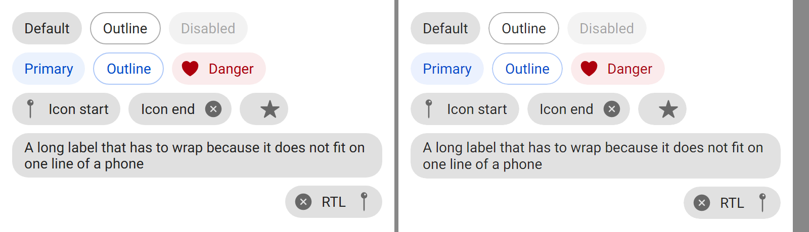
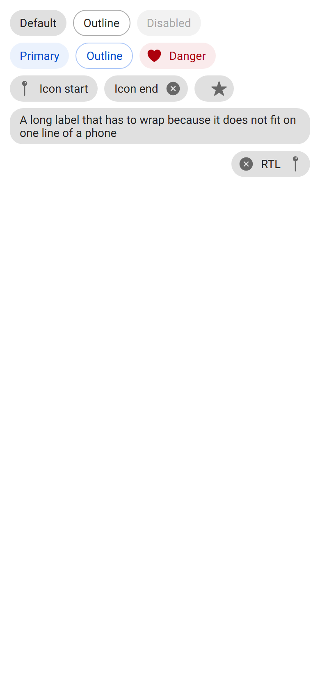
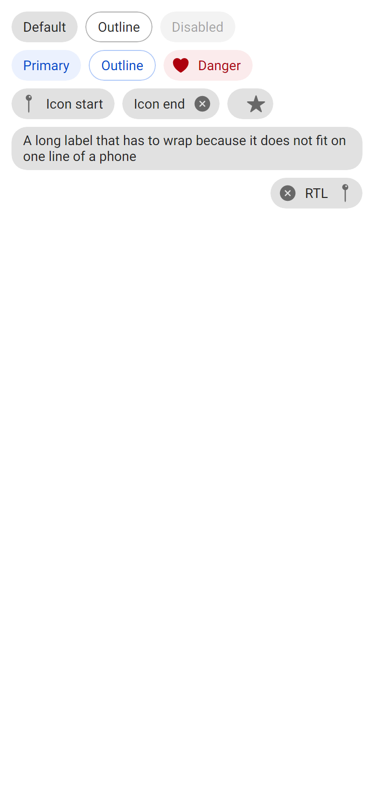
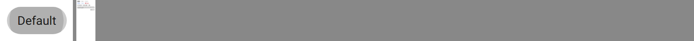
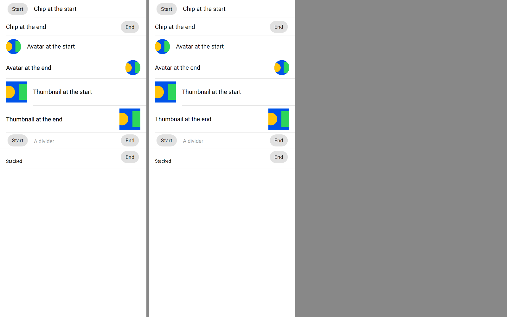

# ion-chip — Comparison against the web component

> Ionic side: `node tools/ionic-ref/render.js ion-chip --bare --tap --html '<the snippet below>'` (Chromium, md, 390×844@2x) → [`ref/`](ref/).
> The snippet wraps itself in `ion-app`, with `position:static;display:block;contain:none;overflow:visible`, so that `tap-click` runs and the
> press frames show the ripple. `ref/page.html` holds the page, and `ref/README.md` the exact command.
> Avonic side: `AVONIC_CAPTURE_DIR=… dotnet test` → `AvonicChipCaptureTests` (headless Skia, 2×) → [`compare/`](compare/). Not tried in a real window.

```html
<ion-app style="position:static;display:block;contain:none;overflow:visible"><div style="padding:8px">
<div style="display:flex;align-items:center"><ion-chip><ion-label>Default</ion-label></ion-chip><ion-chip outline><ion-label>Outline</ion-label></ion-chip><ion-chip disabled><ion-label>Disabled</ion-label></ion-chip></div>
<div style="display:flex;align-items:center"><ion-chip color="primary"><ion-label>Primary</ion-label></ion-chip><ion-chip color="primary" outline><ion-label>Outline</ion-label></ion-chip><ion-chip color="danger"><ion-icon name="heart"></ion-icon><ion-label>Danger</ion-label></ion-chip></div>
<div style="display:flex;align-items:center"><ion-chip><ion-icon name="pin"></ion-icon><ion-label>Icon start</ion-label></ion-chip><ion-chip><ion-label>Icon end</ion-label><ion-icon name="close-circle"></ion-icon></ion-chip><ion-chip><ion-icon name="star"></ion-icon></ion-chip></div>
<div style="display:flex;align-items:center"><ion-chip><ion-label>A long label that has to wrap because it does not fit on one line of a phone</ion-label></ion-chip></div>
<div dir="rtl" style="display:flex;align-items:center"><ion-chip><ion-icon name="pin"></ion-icon><ion-label>RTL</ion-label><ion-icon name="close-circle"></ion-icon></ion-chip></div>
</div></ion-app>
```

(One line in the real command, with no white space between the chips: a space between inline boxes would be a gap that a row of
controls doesn't have.) `Reference_Page` lays out the same content, with the rows as horizontal `StackPanel`s.

The states, the variables and the scenes named in [PLAN.md](PLAN.md) were measured with throwaway Playwright scripts against the same
page, with a mouse in a desktop context and with CDP touch events in a mobile one, which has no `any-hover: hover`.

## Frames

The top of the page, Ionic on the left:



| Ionic | Avonic |
|---|---|
|  |  |

The first chip pressed with a mouse at its centre, 160 ms in, as `render.js --tap` does it, Ionic on the left:



**Match,** apart from these visible differences:

- **Text** is drawn from the same Roboto files on both sides since #100 ([`tools/fonts/roboto/`](../../../tools/fonts/roboto/README.md)). A line of 14 px text is 16.4 high, which Chromium
  rounds to 16, so the long chip's two lines are 45 high here against 44. The other chips are 32, as in Ionic. With a child of a
  known height the box is exact, which the tests check.
- **The press frame's ripple is smaller.** Both are the same ripple, from `ion-ripple-effect`, which is done. `render.js` names a
  frame for when it asks for the screenshot, and taking it isn't instant, so Chromium's most likely shows a later moment. Not measured. The hover background under it,
  0.16, is the same, as hover beats a press: measured.

### In a slot (#88)

A chip, an avatar and a thumbnail in an item's start and end slots, chips in a divider's, and a chip beside a stacked label,
Ionic on the left. Ionic side: `node tools/ionic-ref/render.js ion-chip --bare --html '…' --out docs/components/ion-chip/ref-slots`,
with the exact command in [`ref-slots/README.md`](ref-slots/README.md). Avonic side: `AvonicChipCaptureTests.Slots_Page`, saved
as [`compare/avonic-slots.png`](compare/avonic-slots.png). The chips have plain text in them, not an `ion-label`, which in an item
takes the item's stacked class away: `ion-item` keeps one set of `ionStyle` classes per tag, and the chip's label is the last.



**Match.** The chips are at x = 20, `4px 16px 4px 4px`, and end at 370, `4px 4px 4px 16px`, in the item and the divider, and
`7px 4px 7px 16px` beside the stacked label, which the tests check. Before #88 they were at x = 16 with no top or bottom margin.
The avatar and thumbnail are where they were, and every row is the height Ionic's is.

## Found here, not by the tests

- **No slotted icon rule applied at all.** The previous draft had the rules as `ContentPresenter:nth-child(1) > c|AvonicIcon`, and
  the first frame showed black 14 px icons with no margins. A control in `Items` is the chip's logical child, not its container's,
  and an `ItemsControl` counts only containers for `:nth-child`, so a wrapped child was at index −1. Fixed by the chip counting its
  children by item, with `IChildIndexProvider`, and the rules as `c|AvonicChip > c|AvonicIcon`. Tests: `B12_*`.
- **Every icon made its chip 1 px wider.** `1.4285714286em` of 14 is 20.0000000004, and layout rounding took it to 21. Measured
  only icon chip: 49, against Ionic's 48. Fixed in the factor, as [PLAN.md](PLAN.md#the-icons-size) says.
- **The long chip was narrower than Ionic's,** 367 where Ionic's is 382 in a 390 window, because wrapped text reports its longest
  line. CSS's shrink-to-fit takes all the room once the content doesn't fit on one line. Fixed in the chip's measure, as
  `ButtonInner` does for the button.

## Found by the reviews

Three passes of `/code-review` at high effort, the second on the first's fixes and the third on the second's.

The first:

- **Automation called the chip a list,** as an `ItemsControl`'s own peer does. Chromium gives it no role. It has its own peer now,
  a `Group`. The draft's docs said it reported nothing, which was wrong.
- **An icon made by an `ItemTemplate` wasn't slotted,** as it's the slot's logical child, not the chip's. Each rule has a second
  alternative for it now.

The second:

- **Two equal values from an `ItemsSource` both counted as the first child,** as the first fix counted a slot by its item. The chip
  counts a slot by its container's index now, and raises the reset again when the panel moves a container, as
  the index is still the old one when `Items` raises its change: a test that inserts at the front shows it.
- **A string counted as a child,** so an icon then text gave the icon the first child's margins, where CSS counts only elements and
  the icon is the last child too: measured `-4px -4px -4px 8px`.
- **A click was documented as leaving focus where it was,** where Chromium moves it to the body. It's a deliberate difference now.
- **The slot's alignment pushed a new value frame each time the slot was reused.** It's set once, when the slot is made.

The third:

- **Only a string was text.** A number, or any value with no template, is shown as its text too, as is an item through
  `DisplayMemberBinding`, and a string that a `DataTemplate` around the chip makes into an icon is an element. The chip asks for the
  template as the slot does now. Tests: `B12_Any_Value_Shown_As_Text_Is_Not_A_Child`, `B12_A_String_That_A_Data_Template_Makes_An_Icon_Is_A_Child`.
- **A control among templated items showed its type name.** Found by the test written for the item above: the chip gives every
  slot the `ItemTemplate`, and a presenter with a template builds from it even for a control, so a control among strings with a
  template for strings was a `TextBlock` reading `Avonic.Components.Controls.AvonicIcon`. A control's slot has no template now,
  as a control in a stock `ItemsControl` is its own container. Test: `B12_A_Template_Set_Later_Makes_Text_A_Child`.
- **A chip in a parent taller than it is centred,** where an inline chip sits at the top of its line, measured below. Recorded as a
  deliberate difference.
- **Content that can't shrink is clipped at the container,** where Ionic's chip grows past it, measured below. Recorded as a gap.

Waived, with the reason:

- **The chip measures twice when its content doesn't fit on one line,** and **wraps every child in a slot,** which is why it has to
  count its children itself. Both would be better in `FlexRow`, as a max-content size and an `align-items` of its own, which is a
  shared file, so it's proposed in the PR. The shrink-to-fit measure is the same as `ButtonInner`'s, another control's file, and
  belongs in the same place.
- **One insert raises a reset for each container it moves,** each of which counts every child again. A chip holds a few children,
  so it's a few dozen comparisons. Coalescing them would leave the margins stale until the dispatcher ran.
- **The theme repeats the stub's template,** as every control here does. **`Avonic.Chip.Md.IconColor` has the same value as
  `Avonic.ItemIconBrush`,** and stays the chip's own, so that restyling an item's icons doesn't restyle a chip's.

## Found by deliberate breakage

- **The `OnKeyDown` override did nothing.** It was there to stop an `ItemsControl` moving focus with the arrows, and they don't move
  it without it, as nothing in a `FlexSlot` is a focusable container. Removed. The keys test stays, for the behaviour.
- **Letting content that can't shrink overflow did nothing,** as the arrange clamps to the space anyway. Removed.
- **Four of the five places the chip raised its index reset did nothing on their own,** the second review's fix. Breaking them in
  pairs showed what each covers: the change to `Items`, for a control, whose index is its item's, and a slot's own index change,
  for a templated one, are enough, and each has a test that fails without it. Raising it again when a slot is prepared or cleared,
  or when `ItemTemplate` changes, which remakes the slots anyway, did nothing, so they're gone. A test for a template set later and
  for a templated item taken away stays.
- **Two of the third review's lines went unseen.** A null item was already no element, as no template is found for it, so
  that shortcut is gone. `DisplayMemberBinding` only matters when a data template around the chip would match the item, as the
  slot takes the display member's template first, so its test has one now.
- **Three template changes went unseen,** as their tests ran on the stub only: the ripple under the children, the ripple after
  them, and the stub's row. The ripple tests run on both now, and there's a layout test on the stub.

## Behaviours

The numbers are from [PLAN.md](PLAN.md#behaviours). Each has tests in `AvonicChipTests`, named after its number.

| # | Behaviour | Ionic | Result |
|---|---|---|---|
| 1 | A row as wide as its content | 68.36 by 32 for `Default`; padding 12 and 6, min-height 32, margin 4, radius 16, 14 px; children centred | match, with the font's width |
| 2 | Plain | `rgba(0, 0, 0, 0.12)` behind `rgba(0, 0, 0, 0.87)` | match |
| 3 | Outline | Transparent, `1px solid rgba(0, 0, 0, 0.32)`, 70.36 by 32 | match |
| 4 | `Color` | `rgba(0, 84, 233, 0.08)` behind `rgb(0, 74, 205)`; outline transparent with `rgba(0, 84, 233, 0.32)`; danger icon `rgb(173, 0, 13)` | match |
| 5 | Unknown `Color` | Transparent, the text inherited, an outline's border the current colour; inside a coloured ancestor, its base and shade | match |
| 6 | Disabled | 0.4; a tap reaches what's behind it; not activated | match. A disabled panel fades it too: deliberate, as the button |
| 7 | Activatable, with a ripple | `ion-activated` after 100 ms, or at once on a quick tap; a bounded ripple in the current colour, the padding box, clipped by the radius | match |
| 8 | Activated, with a finger | Plain 0.2, outline 0.08, colour 0.16 with or without outline | match |
| 9 | Hover, with a mouse | Plain 0.16, outline 0.04, colour 0.12; a mouse press shows hover's | match |
| 10 | Focus | Not a tab stop, and a click doesn't focus it, but moves focus to the body. With `tabindex`: 0.16, 0.04, 0.12 for any focus, no outline | match, with `Focusable="True"` for `tabindex`. A click leaves focus where it was: deliberate |
| 11 | The variables | `--background` beats every state on a plain chip; outline and colour ignore it, and colour ignores `--color` | match |
| 12 | A slotted icon | 20, `rgba(0, 0, 0, 0.54)` or the shade; first `−4 8`, last `8 −4`, only child as last, 48 wide; nested gets none; RTL mirrors | match |
| 13 | Long content | 366 by 44, label wrapped; an icon beside it shrinks to 11.72 | match in shape: the full width, and the icon shrinks |
| 14 | Keys | Nothing: no click on Enter or Space, no arrow navigation | match |
| 15 | In a slot | `4px 16px 4px 4px` at the start, `4px 4px 4px 16px` at the end, in an item and a divider; `7px 4px 7px 16px` beside a stacked or floating label; 4 in a panel; a page's `margin: 3px` beats it | match (#88), but beside a stacked label the app's style loses: deliberate, below |
| E1 | `Click`, an extension | The DOM `click`: 3 for a click then a double click, 2 for two quick taps, 1 for a finger moved 14 and 0 for 16, 1 for a mouse dragged off and back, 0 released off, 0 disabled, 0 for Enter and Space | match (#88). `Tapped` would miss the quick second press |
| E2 | `Command`, an extension | Nothing in Ionic | runs after `Click` unless it's handled; one that can't execute disables the chip |
| — | Automation | No role, only its text; `aria-disabled` | match: a `Group`, not a content element, disabled when it is |

## Deliberate differences

| Difference | Measured | Why |
|---|---|---|
| A click leaves focus where it was | `clickPlainFocus`: Chromium moves it to the body | A click on what can't take focus leaves it alone in Avalonia, for every control |
| A disabled ancestor fades the chip to 0.4 | A disabled `fieldset` does nothing to an `ion-chip` | A disabled ancestor disables the control in Avalonia, and it should look it, as `ion-button` recorded |
| A flex parent doesn't stretch it | `tall`: 64 high in a 72 flex row, label centred | `VerticalAlignment` is `Center`, for `vertical-align: middle`. Set `Stretch` for a stretched chip, and the children stay centred |
| A parent taller than the chip centres it | `blk`: in a 100 px block, at the top, `y` 4 inside it | The same `Center`, which lines chips of different heights up in a row, as `vertical-align: middle` does. Avalonia has no line box, so one value can't do both. Set `Top` |
| Beside a stacked or floating label, an app's plain `Margin` style loses to the slot's `16,7,4,7` | `c-appstacked`: a page's `margin: 3px` is 3 | The slot's rule depends on the item's state, a pseudoclass, which is an activator, and that beats a plain style. As for every control in that slot |
| The icon's factor is `1.42857142857` | Chromium: 20 | 14 × `1.4285714286` rounds up to 21 in Avalonia's layout |

## Gaps

| Gap | Why |
|---|---|
| `::slotted(ion-avatar)` in a chip | Not in this PR or #88; it goes in `Styles/Chip.axaml` |
| Content that can't shrink, such as a label with `ion-text-nowrap`, is clipped at the container's width | `nw`: 308.84 wide in a 200 px container, past its edge | Avalonia arranges a child within the space it has, so the chip can't overflow its parent. Letting its measure overflow changed nothing, as deliberate breakage showed |
