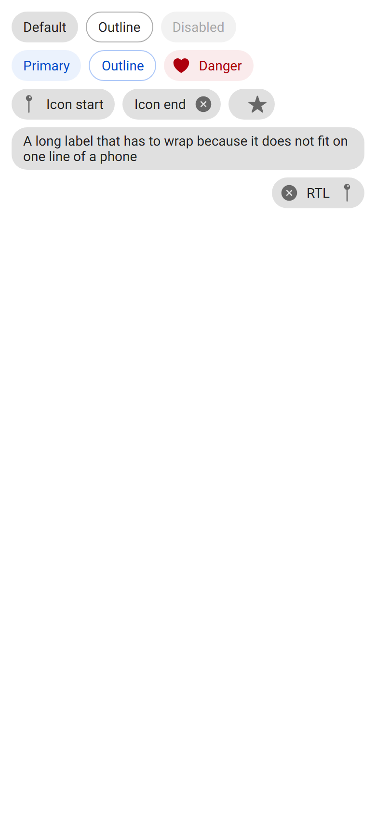
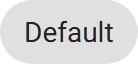
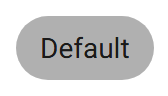
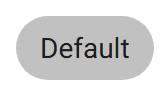
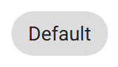

# ion-chip — reference render (Ionic 8.8.1, md, 390×844@2x)

Generated by `node tools/ionic-ref/render.js ion-chip --bare --tap --html "<ion-app style=\"position:static;display:block;contain:none;overflow:visible\"><div style=\"padding:8px\"><div style=\"display:flex;align-items:center\"><ion-chip><ion-label>Default</ion-label></ion-chip><ion-chip outline><ion-label>Outline</ion-label></ion-chip><ion-chip disabled><ion-label>Disabled</ion-label></ion-chip></div><div style=\"display:flex;align-items:center\"><ion-chip color=\"primary\"><ion-label>Primary</ion-label></ion-chip><ion-chip color=\"primary\" outline><ion-label>Outline</ion-label></ion-chip><ion-chip color=\"danger\"><ion-icon name=\"heart\"></ion-icon><ion-label>Danger</ion-label></ion-chip></div><div style=\"display:flex;align-items:center\"><ion-chip><ion-icon name=\"pin\"></ion-icon><ion-label>Icon start</ion-label></ion-chip><ion-chip><ion-label>Icon end</ion-label><ion-icon name=\"close-circle\"></ion-icon></ion-chip><ion-chip><ion-icon name=\"star\"></ion-icon></ion-chip></div><div style=\"display:flex;align-items:center\"><ion-chip><ion-label>A long label that has to wrap because it does not fit on one line of a phone</ion-label></ion-chip></div><div dir=\"rtl\" style=\"display:flex;align-items:center\"><ion-chip><ion-icon name=\"pin\"></ion-icon><ion-label>RTL</ion-label><ion-icon name=\"close-circle\"></ion-icon></ion-chip></div></div></ion-app>"`

```html
<ion-app style="position:static;display:block;contain:none;overflow:visible"><div style="padding:8px"><div style="display:flex;align-items:center"><ion-chip><ion-label>Default</ion-label></ion-chip><ion-chip outline><ion-label>Outline</ion-label></ion-chip><ion-chip disabled><ion-label>Disabled</ion-label></ion-chip></div><div style="display:flex;align-items:center"><ion-chip color="primary"><ion-label>Primary</ion-label></ion-chip><ion-chip color="primary" outline><ion-label>Outline</ion-label></ion-chip><ion-chip color="danger"><ion-icon name="heart"></ion-icon><ion-label>Danger</ion-label></ion-chip></div><div style="display:flex;align-items:center"><ion-chip><ion-icon name="pin"></ion-icon><ion-label>Icon start</ion-label></ion-chip><ion-chip><ion-label>Icon end</ion-label><ion-icon name="close-circle"></ion-icon></ion-chip><ion-chip><ion-icon name="star"></ion-icon></ion-chip></div><div style="display:flex;align-items:center"><ion-chip><ion-label>A long label that has to wrap because it does not fit on one line of a phone</ion-label></ion-chip></div><div dir="rtl" style="display:flex;align-items:center"><ion-chip><ion-icon name="pin"></ion-icon><ion-label>RTL</ion-label><ion-icon name="close-circle"></ion-icon></ion-chip></div></div></ion-app>
```

 

## Press / release frames

      

## Element 1

- attributes: `{"class":"md ion-activatable hydrated"}`
- classes: `md ion-activatable hydrated`
- rect: `{"x":12,"y":12,"w":68.8,"h":32}`

### CSS custom properties (resolved)

| var | value |
|---|---|
| `--background` | `rgba(0, 0, 0, 0.12)` |
| `--color` | `rgba(0, 0, 0, 0.87)` |

### Host computed

| prop | value |
|---|---|
| display | `flex` |
| position | `relative` |
| box-sizing | `border-box` |
| width | `68.7969px` |
| height | `32px` |
| min-height | `32px` |
| min-width | `auto` |
| padding | `6px 12px` |
| margin | `4px` |
| border | `0px none rgba(0, 0, 0, 0.87)` |
| border-radius | `16px` |
| background-color | `rgba(0, 0, 0, 0.12)` |
| color | `rgba(0, 0, 0, 0.87)` |
| font-size | `14px` |
| font-weight | `400` |
| font-family | `Roboto, "Helvetica Neue", sans-serif` |
| line-height | `normal` |
| letter-spacing | `normal` |
| text-transform | `none` |
| opacity | `1` |
| overflow | `hidden` |
| contain | `none` |
| pointer-events | `auto` |
| transition | `all` |
| transform | `none` |
| box-shadow | `none` |
| outline | `rgba(0, 0, 0, 0.87) none 0px` |
| cursor | `pointer` |

### DOM tree

```
<ion-chip>
  #shadow-root
    <slot name="">
    <ion-ripple-effect.md.hydrated>
      #shadow-root
  <ion-label.sc-ion-label-md-h.md.sc-ion-label-md.sc-ion-label-md-s.hydrated>
```

## Element 2

- attributes: `{"outline":"","class":"md chip-outline ion-activatable hydrated"}`
- classes: `md chip-outline ion-activatable hydrated`
- rect: `{"x":88.8,"y":12,"w":69.91,"h":32}`

### CSS custom properties (resolved)

| var | value |
|---|---|
| `--background` | `rgba(0, 0, 0, 0.12)` |
| `--color` | `rgba(0, 0, 0, 0.87)` |

### Host computed

| prop | value |
|---|---|
| display | `flex` |
| position | `relative` |
| box-sizing | `border-box` |
| width | `69.9062px` |
| height | `32px` |
| min-height | `32px` |
| min-width | `auto` |
| padding | `6px 12px` |
| margin | `4px` |
| border | `1px solid rgba(0, 0, 0, 0.32)` |
| border-radius | `16px` |
| background-color | `rgba(0, 0, 0, 0)` |
| color | `rgba(0, 0, 0, 0.87)` |
| font-size | `14px` |
| font-weight | `400` |
| font-family | `Roboto, "Helvetica Neue", sans-serif` |
| line-height | `normal` |
| letter-spacing | `normal` |
| text-transform | `none` |
| opacity | `1` |
| overflow | `hidden` |
| contain | `none` |
| pointer-events | `auto` |
| transition | `all` |
| transform | `none` |
| box-shadow | `none` |
| outline | `rgba(0, 0, 0, 0.87) none 0px` |
| cursor | `pointer` |

### DOM tree

```
<ion-chip>
  #shadow-root
    <slot name="">
    <ion-ripple-effect.md.hydrated>
      #shadow-root
  <ion-label.sc-ion-label-md-h.md.sc-ion-label-md.sc-ion-label-md-s.hydrated>
```

## Element 3

- attributes: `{"disabled":"","aria-disabled":"true","class":"md chip-disabled ion-activatable hydrated"}`
- classes: `md chip-disabled ion-activatable hydrated`
- rect: `{"x":166.7,"y":12,"w":78.03,"h":32}`

### CSS custom properties (resolved)

| var | value |
|---|---|
| `--background` | `rgba(0, 0, 0, 0.12)` |
| `--color` | `rgba(0, 0, 0, 0.87)` |

### Host computed

| prop | value |
|---|---|
| display | `flex` |
| position | `relative` |
| box-sizing | `border-box` |
| width | `78.0312px` |
| height | `32px` |
| min-height | `32px` |
| min-width | `auto` |
| padding | `6px 12px` |
| margin | `4px` |
| border | `0px none rgba(0, 0, 0, 0.87)` |
| border-radius | `16px` |
| background-color | `rgba(0, 0, 0, 0.12)` |
| color | `rgba(0, 0, 0, 0.87)` |
| font-size | `14px` |
| font-weight | `400` |
| font-family | `Roboto, "Helvetica Neue", sans-serif` |
| line-height | `normal` |
| letter-spacing | `normal` |
| text-transform | `none` |
| opacity | `0.4` |
| overflow | `hidden` |
| contain | `none` |
| pointer-events | `none` |
| transition | `all` |
| transform | `none` |
| box-shadow | `none` |
| outline | `rgba(0, 0, 0, 0.87) none 0px` |
| cursor | `default` |

### DOM tree

```
<ion-chip>
  #shadow-root
    <slot name="">
    <ion-ripple-effect.md.hydrated>
      #shadow-root
  <ion-label.sc-ion-label-md-h.md.sc-ion-label-md.sc-ion-label-md-s.hydrated>
```

## Element 4

- attributes: `{"color":"primary","class":"ion-color ion-color-primary md ion-activatable hydrated"}`
- classes: `ion-color ion-color-primary md ion-activatable hydrated`
- rect: `{"x":12,"y":52,"w":72.38,"h":32}`

### CSS custom properties (resolved)

| var | value |
|---|---|
| `--background` | `rgba(0, 0, 0, 0.12)` |
| `--color` | `rgba(0, 0, 0, 0.87)` |

### Host computed

| prop | value |
|---|---|
| display | `flex` |
| position | `relative` |
| box-sizing | `border-box` |
| width | `72.375px` |
| height | `32px` |
| min-height | `32px` |
| min-width | `auto` |
| padding | `6px 12px` |
| margin | `4px` |
| border | `0px none rgb(0, 74, 205)` |
| border-radius | `16px` |
| background-color | `rgba(0, 84, 233, 0.08)` |
| color | `rgb(0, 74, 205)` |
| font-size | `14px` |
| font-weight | `400` |
| font-family | `Roboto, "Helvetica Neue", sans-serif` |
| line-height | `normal` |
| letter-spacing | `normal` |
| text-transform | `none` |
| opacity | `1` |
| overflow | `hidden` |
| contain | `none` |
| pointer-events | `auto` |
| transition | `all` |
| transform | `none` |
| box-shadow | `none` |
| outline | `rgb(0, 74, 205) none 0px` |
| cursor | `pointer` |

### DOM tree

```
<ion-chip>
  #shadow-root
    <slot name="">
    <ion-ripple-effect.md.hydrated>
      #shadow-root
  <ion-label.sc-ion-label-md-h.md.sc-ion-label-md.sc-ion-label-md-s.hydrated>
```

## Element 5

- attributes: `{"color":"primary","outline":"","class":"ion-color ion-color-primary md chip-outline ion-activatable hydrated"}`
- classes: `ion-color ion-color-primary md chip-outline ion-activatable hydrated`
- rect: `{"x":92.38,"y":52,"w":69.91,"h":32}`

### CSS custom properties (resolved)

| var | value |
|---|---|
| `--background` | `rgba(0, 0, 0, 0.12)` |
| `--color` | `rgba(0, 0, 0, 0.87)` |

### Host computed

| prop | value |
|---|---|
| display | `flex` |
| position | `relative` |
| box-sizing | `border-box` |
| width | `69.9062px` |
| height | `32px` |
| min-height | `32px` |
| min-width | `auto` |
| padding | `6px 12px` |
| margin | `4px` |
| border | `1px solid rgba(0, 84, 233, 0.32)` |
| border-radius | `16px` |
| background-color | `rgba(0, 0, 0, 0)` |
| color | `rgb(0, 74, 205)` |
| font-size | `14px` |
| font-weight | `400` |
| font-family | `Roboto, "Helvetica Neue", sans-serif` |
| line-height | `normal` |
| letter-spacing | `normal` |
| text-transform | `none` |
| opacity | `1` |
| overflow | `hidden` |
| contain | `none` |
| pointer-events | `auto` |
| transition | `all` |
| transform | `none` |
| box-shadow | `none` |
| outline | `rgb(0, 74, 205) none 0px` |
| cursor | `pointer` |

### DOM tree

```
<ion-chip>
  #shadow-root
    <slot name="">
    <ion-ripple-effect.md.hydrated>
      #shadow-root
  <ion-label.sc-ion-label-md-h.md.sc-ion-label-md.sc-ion-label-md-s.hydrated>
```

## Element 6

- attributes: `{"color":"danger","class":"ion-color ion-color-danger md ion-activatable hydrated"}`
- classes: `ion-color ion-color-danger md ion-activatable hydrated`
- rect: `{"x":170.28,"y":52,"w":92.58,"h":32}`

### CSS custom properties (resolved)

| var | value |
|---|---|
| `--background` | `rgba(0, 0, 0, 0.12)` |
| `--color` | `rgba(0, 0, 0, 0.87)` |

### Host computed

| prop | value |
|---|---|
| display | `flex` |
| position | `relative` |
| box-sizing | `border-box` |
| width | `92.5781px` |
| height | `32px` |
| min-height | `32px` |
| min-width | `auto` |
| padding | `6px 12px` |
| margin | `4px` |
| border | `0px none rgb(173, 0, 13)` |
| border-radius | `16px` |
| background-color | `rgba(197, 0, 15, 0.08)` |
| color | `rgb(173, 0, 13)` |
| font-size | `14px` |
| font-weight | `400` |
| font-family | `Roboto, "Helvetica Neue", sans-serif` |
| line-height | `normal` |
| letter-spacing | `normal` |
| text-transform | `none` |
| opacity | `1` |
| overflow | `hidden` |
| contain | `none` |
| pointer-events | `auto` |
| transition | `all` |
| transform | `none` |
| box-shadow | `none` |
| outline | `rgb(173, 0, 13) none 0px` |
| cursor | `pointer` |

### DOM tree

```
<ion-chip>
  #shadow-root
    <slot name="">
    <ion-ripple-effect.md.hydrated>
      #shadow-root
  <ion-icon.md.hydrated>
    #shadow-root
      <div.icon-inner>
        <svg>
          <path>
  <ion-label.sc-ion-label-md-h.md.sc-ion-label-md.sc-ion-label-md-s.hydrated>
```

## Element 7

- attributes: `{"class":"md ion-activatable hydrated"}`
- classes: `md ion-activatable hydrated`
- rect: `{"x":12,"y":92,"w":107.42,"h":32}`

### CSS custom properties (resolved)

| var | value |
|---|---|
| `--background` | `rgba(0, 0, 0, 0.12)` |
| `--color` | `rgba(0, 0, 0, 0.87)` |

### Host computed

| prop | value |
|---|---|
| display | `flex` |
| position | `relative` |
| box-sizing | `border-box` |
| width | `107.422px` |
| height | `32px` |
| min-height | `32px` |
| min-width | `auto` |
| padding | `6px 12px` |
| margin | `4px` |
| border | `0px none rgba(0, 0, 0, 0.87)` |
| border-radius | `16px` |
| background-color | `rgba(0, 0, 0, 0.12)` |
| color | `rgba(0, 0, 0, 0.87)` |
| font-size | `14px` |
| font-weight | `400` |
| font-family | `Roboto, "Helvetica Neue", sans-serif` |
| line-height | `normal` |
| letter-spacing | `normal` |
| text-transform | `none` |
| opacity | `1` |
| overflow | `hidden` |
| contain | `none` |
| pointer-events | `auto` |
| transition | `all` |
| transform | `none` |
| box-shadow | `none` |
| outline | `rgba(0, 0, 0, 0.87) none 0px` |
| cursor | `pointer` |

### DOM tree

```
<ion-chip>
  #shadow-root
    <slot name="">
    <ion-ripple-effect.md.hydrated>
      #shadow-root
  <ion-icon.md.hydrated>
    #shadow-root
      <div.icon-inner>
        <svg>
          <path>
  <ion-label.sc-ion-label-md-h.md.sc-ion-label-md.sc-ion-label-md-s.hydrated>
```

## Element 8

- attributes: `{"class":"md ion-activatable hydrated"}`
- classes: `md ion-activatable hydrated`
- rect: `{"x":127.42,"y":92,"w":101.38,"h":32}`

### CSS custom properties (resolved)

| var | value |
|---|---|
| `--background` | `rgba(0, 0, 0, 0.12)` |
| `--color` | `rgba(0, 0, 0, 0.87)` |

### Host computed

| prop | value |
|---|---|
| display | `flex` |
| position | `relative` |
| box-sizing | `border-box` |
| width | `101.375px` |
| height | `32px` |
| min-height | `32px` |
| min-width | `auto` |
| padding | `6px 12px` |
| margin | `4px` |
| border | `0px none rgba(0, 0, 0, 0.87)` |
| border-radius | `16px` |
| background-color | `rgba(0, 0, 0, 0.12)` |
| color | `rgba(0, 0, 0, 0.87)` |
| font-size | `14px` |
| font-weight | `400` |
| font-family | `Roboto, "Helvetica Neue", sans-serif` |
| line-height | `normal` |
| letter-spacing | `normal` |
| text-transform | `none` |
| opacity | `1` |
| overflow | `hidden` |
| contain | `none` |
| pointer-events | `auto` |
| transition | `all` |
| transform | `none` |
| box-shadow | `none` |
| outline | `rgba(0, 0, 0, 0.87) none 0px` |
| cursor | `pointer` |

### DOM tree

```
<ion-chip>
  #shadow-root
    <slot name="">
    <ion-ripple-effect.md.hydrated>
      #shadow-root
  <ion-label.sc-ion-label-md-h.md.sc-ion-label-md.sc-ion-label-md-s.hydrated>
  <ion-icon.md.hydrated>
    #shadow-root
      <div.icon-inner>
        <svg>
          <path>
```

## Element 9

- attributes: `{"class":"md ion-activatable hydrated"}`
- classes: `md ion-activatable hydrated`
- rect: `{"x":236.8,"y":92,"w":48,"h":32}`

### CSS custom properties (resolved)

| var | value |
|---|---|
| `--background` | `rgba(0, 0, 0, 0.12)` |
| `--color` | `rgba(0, 0, 0, 0.87)` |

### Host computed

| prop | value |
|---|---|
| display | `flex` |
| position | `relative` |
| box-sizing | `border-box` |
| width | `48px` |
| height | `32px` |
| min-height | `32px` |
| min-width | `auto` |
| padding | `6px 12px` |
| margin | `4px` |
| border | `0px none rgba(0, 0, 0, 0.87)` |
| border-radius | `16px` |
| background-color | `rgba(0, 0, 0, 0.12)` |
| color | `rgba(0, 0, 0, 0.87)` |
| font-size | `14px` |
| font-weight | `400` |
| font-family | `Roboto, "Helvetica Neue", sans-serif` |
| line-height | `normal` |
| letter-spacing | `normal` |
| text-transform | `none` |
| opacity | `1` |
| overflow | `hidden` |
| contain | `none` |
| pointer-events | `auto` |
| transition | `all` |
| transform | `none` |
| box-shadow | `none` |
| outline | `rgba(0, 0, 0, 0.87) none 0px` |
| cursor | `pointer` |

### DOM tree

```
<ion-chip>
  #shadow-root
    <slot name="">
    <ion-ripple-effect.md.hydrated>
      #shadow-root
  <ion-icon.md.hydrated>
    #shadow-root
      <div.icon-inner>
        <svg>
          <path>
```

## Element 10

- attributes: `{"class":"md ion-activatable hydrated"}`
- classes: `md ion-activatable hydrated`
- rect: `{"x":12,"y":132,"w":366,"h":44}`

### CSS custom properties (resolved)

| var | value |
|---|---|
| `--background` | `rgba(0, 0, 0, 0.12)` |
| `--color` | `rgba(0, 0, 0, 0.87)` |

### Host computed

| prop | value |
|---|---|
| display | `flex` |
| position | `relative` |
| box-sizing | `border-box` |
| width | `366px` |
| height | `44px` |
| min-height | `32px` |
| min-width | `auto` |
| padding | `6px 12px` |
| margin | `4px` |
| border | `0px none rgba(0, 0, 0, 0.87)` |
| border-radius | `16px` |
| background-color | `rgba(0, 0, 0, 0.12)` |
| color | `rgba(0, 0, 0, 0.87)` |
| font-size | `14px` |
| font-weight | `400` |
| font-family | `Roboto, "Helvetica Neue", sans-serif` |
| line-height | `normal` |
| letter-spacing | `normal` |
| text-transform | `none` |
| opacity | `1` |
| overflow | `hidden` |
| contain | `none` |
| pointer-events | `auto` |
| transition | `all` |
| transform | `none` |
| box-shadow | `none` |
| outline | `rgba(0, 0, 0, 0.87) none 0px` |
| cursor | `pointer` |

### DOM tree

```
<ion-chip>
  #shadow-root
    <slot name="">
    <ion-ripple-effect.md.hydrated>
      #shadow-root
  <ion-label.sc-ion-label-md-h.md.sc-ion-label-md.sc-ion-label-md-s.hydrated>
```

## Element 11

- attributes: `{"class":"md ion-activatable hydrated"}`
- classes: `md ion-activatable hydrated`
- rect: `{"x":282.02,"y":184,"w":95.98,"h":32}`

### CSS custom properties (resolved)

| var | value |
|---|---|
| `--background` | `rgba(0, 0, 0, 0.12)` |
| `--color` | `rgba(0, 0, 0, 0.87)` |

### Host computed

| prop | value |
|---|---|
| display | `flex` |
| position | `relative` |
| box-sizing | `border-box` |
| width | `95.9844px` |
| height | `32px` |
| min-height | `32px` |
| min-width | `auto` |
| padding | `6px 12px` |
| margin | `4px` |
| border | `0px none rgba(0, 0, 0, 0.87)` |
| border-radius | `16px` |
| background-color | `rgba(0, 0, 0, 0.12)` |
| color | `rgba(0, 0, 0, 0.87)` |
| font-size | `14px` |
| font-weight | `400` |
| font-family | `Roboto, "Helvetica Neue", sans-serif` |
| line-height | `normal` |
| letter-spacing | `normal` |
| text-transform | `none` |
| opacity | `1` |
| overflow | `hidden` |
| contain | `none` |
| pointer-events | `auto` |
| transition | `all` |
| transform | `none` |
| box-shadow | `none` |
| outline | `rgba(0, 0, 0, 0.87) none 0px` |
| cursor | `pointer` |

### DOM tree

```
<ion-chip>
  #shadow-root
    <slot name="">
    <ion-ripple-effect.md.hydrated>
      #shadow-root
  <ion-icon.md.hydrated>
    #shadow-root
      <div.icon-inner>
        <svg>
          <path>
  <ion-label.sc-ion-label-md-h.md.sc-ion-label-md.sc-ion-label-md-s.hydrated>
  <ion-icon.md.hydrated>
    #shadow-root
      <div.icon-inner>
        <svg>
          <path>
```
