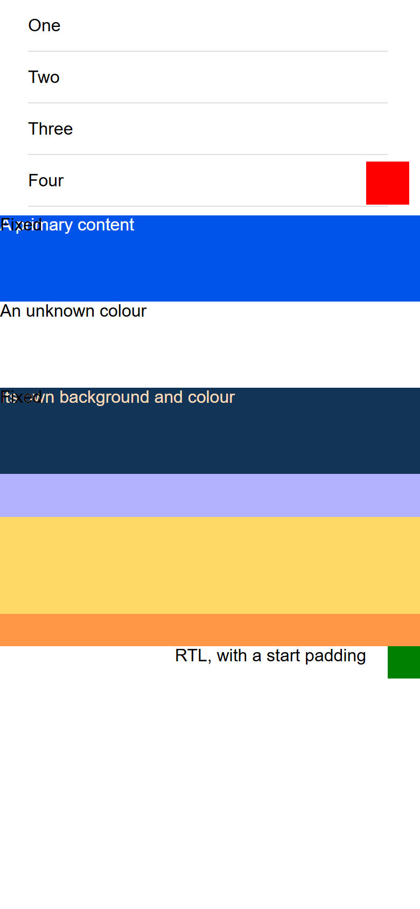
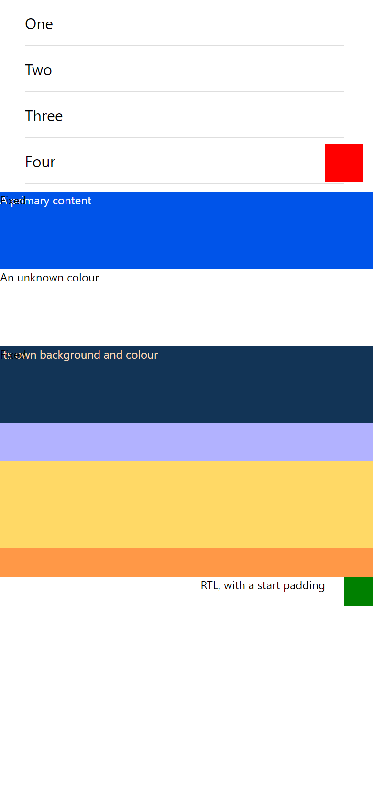

# ion-content — Comparison against the web component

> Ionic side (Chromium, md, 390×844@2x) → [`ref/`](ref/), with this exact command:
>
> ```sh
> node tools/ionic-ref/render.js ion-content --bare --html '<div style="position:relative;height:200px"><ion-content id="padded" style="--padding-start:10px;--padding-top:20px;--padding-end:30px;--padding-bottom:40px"><ion-item><ion-label>One</ion-label></ion-item><ion-item><ion-label>Two</ion-label></ion-item><ion-item><ion-label>Three</ion-label></ion-item><ion-item><ion-label>Four</ion-label></ion-item><ion-item><ion-label>Five</ion-label></ion-item><div slot="fixed" style="right:10px;bottom:10px;width:40px;height:40px;background:red"></div></ion-content></div><div style="position:relative;height:80px"><ion-content color="primary">A primary content<span slot="fixed">Fixed</span></ion-content></div><div style="position:relative;height:80px"><ion-content color="nonexistent">An unknown colour</ion-content></div><div style="position:relative;height:80px"><ion-content style="--background:#123456;--color:#fedcba">Its own background and colour<span slot="fixed">Fixed</span></ion-content></div><div class="ion-page" style="position:relative;contain:none;display:flex;flex-direction:column;height:160px;z-index:auto"><div style="height:40px;flex:none;background:rgba(0,0,255,.3);position:relative;z-index:10"></div><ion-content fullscreen="true"><div style="height:300px;background:#ffd966"></div></ion-content><div style="height:30px;flex:none;background:rgba(255,0,0,.3);position:relative;z-index:10"></div></div><div dir="rtl" style="position:relative;height:80px"><ion-content style="--padding-start:50px">RTL, with a start padding<div slot="fixed" style="width:30px;height:30px;background:green"></div></ion-content></div><script>customElements.whenDefined("ion-content").then(()=>setTimeout(()=>document.getElementById("padded").scrollToPoint(null,20),50))</script>'
> ```
>
> Avonic side: `AVONIC_CAPTURE_DIR=… dotnet test` → `AvonicContentCaptureTests` (headless Skia, 2×) → [`compare/`](compare/).
> **Not tried in a real window, and not on real touch hardware.**

## Frames

| Ionic | Avonic |
|---|---|
|  |  |

From the top: padding, scrolled by 20, with a fixed square placed at the bottom end; primary with a fixed label; an unknown colour;
its own background and colour with a fixed label; fullscreen between two translucent bands, with the yellow content showing through both;
and RTL with a start padding and an unplaced fixed square.

**Match,** apart from these visible differences:

- **Text size.** A web page's default is 16 and Avalonia's is 14, so the bare text is smaller. An open project question, left as it is. The rows are in items,
  which set 16 themselves, and match. Fonts also differ: Roboto isn't installed on this machine.
- **Half a pixel per row.** Avonic's rows are at 200.5, 281, 361.5 and so on, where the scene asks for 200, 280, 360. It's Avalonia's `Grid` at a scale of 2:
  plain `Border`s get 200.5 and 80.5 too, so it's the capture's layout and not this control.

## Found here, not by the plan

- **`Fullscreen` didn't paint or take input outside the host.** Avalonia's `ClipToBounds` is on by default, and every layout test still passed, because `Bounds`
  were right. A hit test in the extended area found it. Fixed in the control, with a pixel test.
- **A nested content passed a drag on at its limit.** A `ScrollGestureRecognizer` given `Offset`, `Viewport` and `Extent`, as in `SimpleTheme`'s template,
  gives up at the limit, and the outer one takes the drag. The wheel was already right, so only a drag test showed it. Measured `inner at end`: `0, 200`.
  Fixed by not giving it those.
- **Hit tests read the last rendered scene** in the headless platform, so they return null until a render. Tests call `Render()` first.

## Behaviours

The numbers are from [PLAN.md](PLAN.md#behaviours). Each has tests in `AvonicContentTests`, named after its number. The Ionic results were measured in Chromium with `ion-app`.

| # | Behaviour | Ionic | Result |
|---|---|---|---|
| 1 | Fills what it's given; zero high with nothing to fill | `c3` 390×150; `c2` 390×0; `nest` 100 with an explicit height | match |
| 2 | Parts fill the host, with no bars | `c` clientWidth 390, scrollHeight 1000 | match. The reference hides scroll bars, as a phone does; see known gaps |
| 3 | White, black, global font, tokens | `c` white/black; `v` `#123456`/`#fedcba` | match |
| 4 | `Color` on the scroll part | `p` `rgb(0, 84, 233)`/white, background white; `vp` | match |
| 5 | An unknown `Color` | `bad` transparent, host's colour; `in` `rgb(197, 0, 15)` | match |
| 6 | The fixed slot keeps what the host inherits | `pf` black on primary; `vf` black with `--color`; `gf` green | match |
| 7 | Padding, keyboard offset, RTL | `pac` 10,20,350×100; `pb` 1060; `kb` 1050; `rtl` `0 0 10 0` | match |
| 8 | Text wraps | `fitc` 390×54 | match without `ScrollX`. **Deliberate difference** with it |
| 9 | A child is as high as its content | `blkc` 18 | match |
| 10 | The wheel moves axes that are on | `y` 0,60; `nn` 0,0; `xx` 30,60; `xo` 30,0 | match |
| 10 | Script on an axis that's off | `y` `scrollLeft` 50; `nn` `scrollTop` 100, `scrollY false` 100 | **deliberate difference**: stays at 0 |
| 10 | RTL offset | `-100` | **deliberate difference**: `100`, from the start edge |
| 11 | Wheel at the limit, nested | `[0, 200]`; on a short one `[50, 200]` | match |
| 12 | Drag, nested | `inner at end` `[0, 200]`; `inner at top` `[100, 0]`; short and `scroll-y=false` move the outer | match |
| 12 | Drag over a button item | `activatedMid` false, 0 clicks | match, in headless touch |
| 13 | `ForceOverscroll` | `t` 301, max 1; `l` 1000; `d`, `f` 300; `nx` 300; `pd` 301 | match. `sx` 301 by script is the same deliberate difference as `ScrollY` off |
| 14 | Timeline | `one` start 0, scroll in the frame, end 203; `steps` end 304; `gap 90` end 310 | match: 0, 16, 200; `gap 90` ends at 300. Chromium's are the same intervals with timer drift |
| 15 | Coalescing, no change, shrinking | `same tick twice` 310; `no real change` none; `content shrinks` 300 | match |
| 16 | Detail | `one`, `steps`: 0.2201 = 10 / 31.8 × 0.7 | match |
| 17 | Base detail, bubbling | `{isScrolling}`; `bubbles` | match. `cancelable` has no meaning here: nothing reads it |
| 18 | Removal ends a scroll | `seen` the end before `removed` | match. A waiting `IonScroll` is dropped: **deliberate difference** |
| 19 | `ScrollEvents` off part-way | From the code: `onScroll` goes, and the watchdog stays | match |
| 20 | `GetScrollElement` | `part="scroll"` | match, and synchronous |
| 21 | Jumps | `0 sync?` 100 after one await; `31 vs 32`; `null keeps` 40; `past` 700; `neg` 0 | match, and synchronous |
| 22 | Animation | `frac anim` 100; `timeline 300` eases over about 300 ms after a frame | match. `TestClock` checks the formula exactly, and Chromium's frames can't be compared to the millisecond |
| 23 | Nothing cancels it | `concurrent` `[500, 100]`; `user during` `[10, 500]`; `detached` done | match |
| 24 | `animated: false` | 264 of 500 at 60 ms: Ionic ignores it | **deliberate difference**: it jumps |
| 25 | The other methods | `bottom` 700, `by` 61 from 30 and 30.5, `byNeg` 0; `short` 0; `added then bottom` 1300; `before attached` waits, then 100 | match, except `by`: Chromium rounds to 61, and Avonic keeps 60.5: **deliberate difference** |
| 26 | `Fullscreen` | `fs` host 466–770, parts 410–810, first child 466, `56`/`40`; `nest` 18/182; `hit at head` the head | match |
| 27 | `Fullscreen` changes | `toggle on`, `toggle off`; `head grows` 56 until a resize and 100 ms | match for toggles. **Deliberate difference** for the head: it follows at once |
| 28 | The fixed slot in `Fullscreen` | `fs` fixed at 466 | match |
| 29 | Fixed sizes | `nop-f` own size at the corner; `ri-f`; `wh-f` | match, with alignments for insets |
| 30 | Fixed doesn't scroll | `scroll keeps fixed` | match |
| 31 | Placement, pointer | `after` hit the button; `before` hit the body, order background, slot, scroll | match |
| 32 | Placement, tab | `after-mb`, `after-f`, `before-f`, `before-mb` | match |
| 33 | Role | `role="main"` | match, as the `Main` landmark |
| 34 | Focus scrolls into view | A browser's own | match in kind; Avalonia's minimal scroll |
| 35 | Templates | — | Avonic only |
| 36, 37 | Token defaults | `--padding-*` etc. `0px` | match |

## Deliberate differences and known gaps

These are in [PLAN.md](PLAN.md#deliberate-differences), each with its measurement and reason, and [known gaps](PLAN.md#known-gaps): the keyboard, no scroll
indicator, no bounce, and Avalonia's momentum.

## What this doesn't show

Touch is headless only. The drag tests use Avalonia's `TouchBegin`, `TouchMove` and `TouchEnd`, with inertia off, because it runs on real timers. Nobody has
felt this on a phone, and momentum hasn't been compared with anything.
