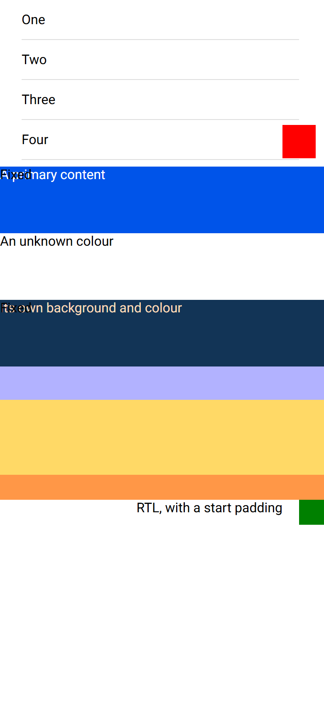
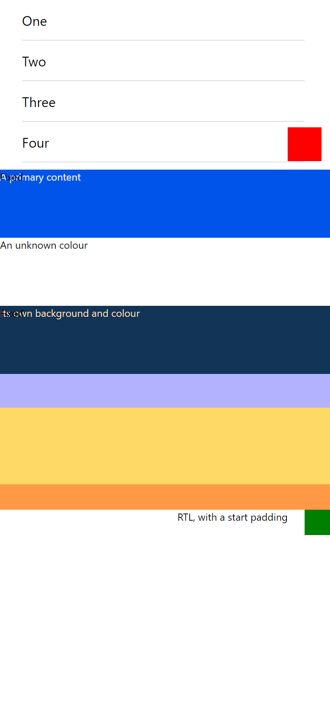
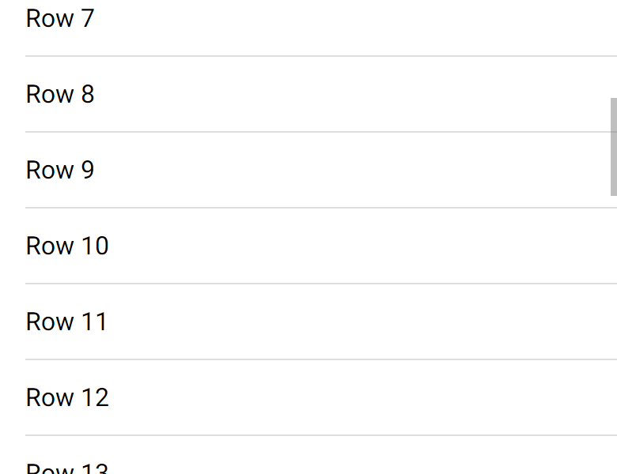
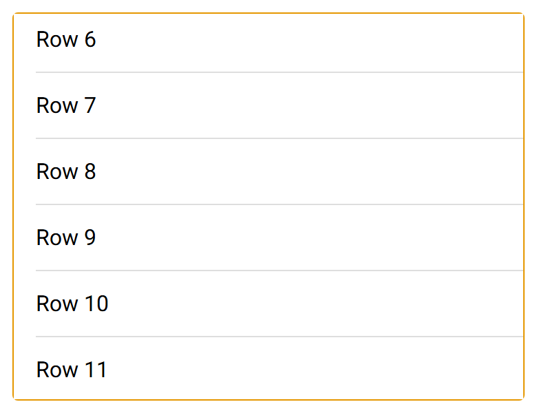
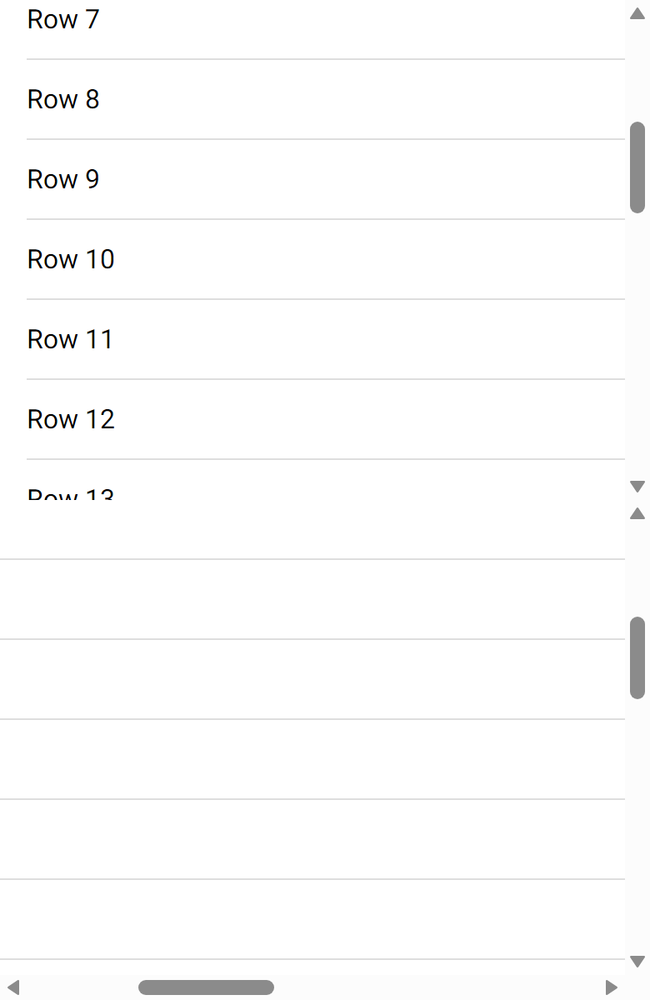

# ion-content — Comparison against the web component

> Ionic side (Chromium, md, 390×844@2x) → [`ref/`](ref/), with this exact command:
>
> ```sh
> node tools/ionic-ref/render.js ion-content --bare --html '<div style="position:relative;height:200px"><ion-content id="padded" style="--padding-start:10px;--padding-top:20px;--padding-end:30px;--padding-bottom:40px"><ion-item><ion-label>One</ion-label></ion-item><ion-item><ion-label>Two</ion-label></ion-item><ion-item><ion-label>Three</ion-label></ion-item><ion-item><ion-label>Four</ion-label></ion-item><ion-item><ion-label>Five</ion-label></ion-item><div slot="fixed" style="right:10px;bottom:10px;width:40px;height:40px;background:red"></div></ion-content></div><div style="position:relative;height:80px"><ion-content color="primary">A primary content<span slot="fixed">Fixed</span></ion-content></div><div style="position:relative;height:80px"><ion-content color="nonexistent">An unknown colour</ion-content></div><div style="position:relative;height:80px"><ion-content style="--background:#123456;--color:#fedcba">Its own background and colour<span slot="fixed">Fixed</span></ion-content></div><div class="ion-page" style="position:relative;contain:none;display:flex;flex-direction:column;height:160px;z-index:auto"><div style="height:40px;flex:none;background:rgba(0,0,255,.3);position:relative;z-index:10"></div><ion-content fullscreen="true"><div style="height:300px;background:#ffd966"></div></ion-content><div style="height:30px;flex:none;background:rgba(255,0,0,.3);position:relative;z-index:10"></div></div><div dir="rtl" style="position:relative;height:80px"><ion-content style="--padding-start:50px">RTL, with a start padding<div slot="fixed" style="width:30px;height:30px;background:green"></div></ion-content></div><script>customElements.whenDefined("ion-content").then(()=>setTimeout(()=>document.getElementById("padded").scrollToPoint(null,20),50))</script>'
> ```
>
> Avonic side: `AVONIC_CAPTURE_DIR=… dotnet test` → `AvonicContentCaptureTests` (headless Skia, 2×) → [`compare/`](compare/).
> **Real window:** tried on Windows at 125%, with real mouse and keyboard, and touch through Windows' touch injection.
> **Not on real touch hardware.** See [the frame](compare/real-window.png). It found one bug that headless capture had missed:
> the sample's pages were in a `ScrollViewer`, which measures with no height and arranges at the viewport's, and the fixed
> slot's button was measured at zero and didn't show. Wheel, drag, flick, `ScrollToTop`, `ScrollToBottom`, `ScrollByPoint`,
> `Fullscreen` and the scroll events all worked. Momentum ran on, at 0.15 px/ms 800 ms after a slow drag, and hasn't been
> compared with a real device.

## Frames

| Ionic | Avonic |
|---|---|
|  |  |

From the top: padding, scrolled by 20, with a fixed square placed at the bottom end; primary with a fixed label; an unknown colour;
its own background and colour with a fixed label; fullscreen between two translucent bands, with the yellow content showing through both;
and RTL with a start padding and an unplaced fixed square.

**Match,** apart from these visible differences:

- **Text size.** A web page's default is 16 and Avalonia's is 14, so the bare text is smaller. An open project question, left as it is. The rows are in items,
  which set 16 themselves, and match.
- **Half a pixel per row.** Avonic's rows are at 200.5, 281, 361.5 and so on, where the scene asks for 200, 280, 360. It's Avalonia's `Grid` at a scale of 2:
  plain `Border`s get 200.5 and 80.5 too, so it's the capture's layout and not this control.

## Found here, not by the plan

- **`Fullscreen` didn't paint or take input outside the host.** Avalonia's `ClipToBounds` is on by default, and every layout test still passed, because `Bounds`
  were right. A hit test in the extended area found it. Fixed in the control, with a pixel test.
- **A nested content passed a drag on at its limit.** A `ScrollGestureRecognizer` given `Offset`, `Viewport` and `Extent`, as in `SimpleTheme`'s template,
  gives up at the limit, and the outer one takes the drag. The wheel was already right, so only a drag test showed it. Measured `inner at end`: `0, 200`.
  Fixed by not giving it those.
- **Hit tests read the last rendered scene** in the headless platform, so they return null until a render. Tests call `Render()` first.

Code review found more, which are in the PR: a `TextBox` wrapping, a position lost on turning `ScrollY` off, and a peer a screen reader would skip.

## Behaviours

The numbers are from [PLAN.md](PLAN.md#behaviours). Each has tests in `AvonicContentTests`, named after its number. The Ionic results were measured in Chromium with `ion-app`.

| # | Behaviour | Ionic | Result |
|---|---|---|---|
| 1 | Fills what it's given; zero high with nothing to fill | `c3` 390×150; `c2` 390×0; `nest` 100 with an explicit height | match |
| 2 | Parts fill the host, with no bars | `c` clientWidth 390, scrollHeight 1000 | match. The reference hides scroll bars, as a phone does; see known gaps |
| 3 | White, black, global font, tokens | `c` white/black; `v` `#123456`/`#fedcba` | match |
| 4 | `Color` on the scroll part | `p` `rgb(0, 84, 233)`/white, background white; `vp` | match |
| 5 | An unknown `Color` | `bad` transparent, host's colour; `in` `rgb(197, 0, 15)` | match |
| 6 | The fixed slot keeps what the host inherits | `pf` black on primary; `vf` black with `--color`; `gf` green | match |
| 7 | Padding, keyboard offset, RTL | `pac` 10,20,350×100; `pb` 1060; `kb` 1050; `rtl` `0 0 10 0` | match |
| 8 | Text wraps | `fitc` 390×54 | match without `ScrollX`, though the number of lines follows the font. **Deliberate difference** with it |
| 9 | A child is as high as its content | `blkc` 18 | match |
| 10 | The wheel moves axes that are on | `y` 0,60; `nn` 0,0; `xx` 30,60; `xo` 30,0 | match |
| 10 | Script on an axis that's off | `nn` `scrollTop` 100, `scrollY false` 100; `y` `scrollLeft` 50; `xo` `scrollTop` 100 | match for `ScrollY` alone. **Deliberate difference** for `ScrollX` off, and for `ScrollY` off with `ScrollX` on: stays at 0 |
| 10 | RTL offset | `-100` | **deliberate difference**: `100`, from the start edge |
| 11 | Wheel at the limit, nested | `[0, 200]`; on a short one `[50, 200]` | match |
| 12 | Drag, nested | `inner at end` `[0, 200]`; `inner at top` `[100, 0]`; short and `scroll-y=false` move the outer | match |
| 12 | Drag over a button item | `activatedMid` false, 0 clicks | match, in headless touch |
| 13 | `ForceOverscroll` | `t` 301, max 1; `l` 1000; `d`, `f` 300; `nx` 300; `pd` 301 | match. `sx` 301 by script is the same deliberate difference as `ScrollY` off |
| 14 | Timeline | `one` start 0, scroll in the frame, end 203; `steps` end 304; `gap 90` end 310 | match: 0, 16, 200; `gap 90` ends at 300. Chromium's are the same intervals with timer drift |
| 15 | Coalescing, no change, shrinking | `same tick twice` 310; `no real change` none; `content shrinks` 300 | match |
| 16 | Detail | `one`, `steps`: 0.2201 = 10 / 31.8 × 0.7 | match |
| 17 | Base detail, bubbling | `{isScrolling}`; `bubbles` | match. `cancelable` has no meaning here: nothing reads it |
| 18 | Removal ends a scroll | `seen` the end before `removed` | match. A waiting `IonScroll` is dropped: **deliberate difference** |
| 19 | `ScrollEvents` off part-way | From the code: `onScroll` goes, and the watchdog stays | match |
| 20 | `GetScrollElement` | `part="scroll"` | match, and synchronous. **Deliberate difference**: null with no tree, where Ionic's waits |
| 21 | Jumps | `0 sync?` 100 after one await; `31 vs 32`; `null keeps` 40; `past` 700; `neg` 0 | match, and synchronous |
| 22 | Animation | `frac anim` 100; `timeline 300` eases over about 300 ms after a frame | match. `TestClock` checks the formula exactly, and Chromium's frames can't be compared to the millisecond |
| 23 | Nothing cancels it | `concurrent` `[500, 100]`; `user during` `[10, 500]`; `detached` done | match |
| 24 | `animated: false` | 264 of 500 at 60 ms: Ionic ignores it | match: it still eases |
| 25 | The other methods | `bottom` 700, `by` 61 from 30 and 30.5, `byNeg` 0; `short` 0; `added then bottom` 1300; `before attached` waits, then 100 | match, except `by`: Chromium rounds to 61, and Avonic keeps 60.5: **deliberate difference** |
| 26 | `Fullscreen` | `fs` host 466–770, parts 410–810, first child 466, `56`/`40`; `nest` 18/182; `hit at head` the head | match |
| 27 | `Fullscreen` changes | `toggle on`, `toggle off`; on 8.8.19, `head grows` 100 and 40 a frame later, from the host's `ResizeObserver` (56 until a resize and 100 ms on 8.8.1); `head and foot`, a move of the same size, 56 and 40 until a resize | match for toggles and `head grows`, here in the layout pass. **Deliberate difference** for a move of the same size: it follows at once |
| 28 | The fixed slot in `Fullscreen` | `fs` fixed at 466 | match |
| 29 | Fixed sizes | `nop-f` own size at the corner; `ri-f`; `wh-f` | match, with alignments for insets |
| 30 | Fixed doesn't scroll | `scroll keeps fixed` | match |
| 31 | Placement, pointer | `after` hit the button; `before` hit the body, order background, slot, scroll | match |
| 32 | Placement, tab | `after-mb`, `after-f`, `before-f`, `before-mb` | match |
| 33 | Role | `role="main"` | match, as the `Main` landmark. Only checked through the automation peer, not with a screen reader |
| 34 | Focus scrolls into view | A browser's own | match in kind; Avalonia's minimal scroll |
| 35 | Templates | — | Avonic only |
| 36, 37 | Token defaults | `--padding-*` etc. `0px` | match |

## Keyboard scrolling and the scroll indicator (#67)

> Ionic side: Chromium 141 (Playwright 1.56's headless shell), md, Android emulation at 390 × 300, 2×, **with `--hide-scrollbars` off**, which
> `render.js` can't do, so with a script of its own, as the rest of #67's measuring was: 30 `ion-item`s in an `ion-content` 300 high in
> `ion-app`; for the indicator, a first wheel and its fade to clear the thumb emulation shows from load, then a wheel of 300 and a
> screenshot 100 ms later; for the ring, the content 10 in from the edges, Tab, Page Down and 400 ms. → [`ref/indicator.png`](ref/indicator.png),
> [`ref/indicator-gone.png`](ref/indicator-gone.png), [`ref/focus-ring.png`](ref/focus-ring.png).
>
> Avonic side: `AvonicContentCaptureTests.Indicator_Frame` and `Focus_Ring_Frame`, headless Skia at 2×, the same scenes, on `TestClock`.
> **Not tried in a real window**: `tools/real-window/drive.ps1` has a new section for it, not yet run.

| | Ionic | Avonic |
|---|---|---|
| The indicator, 100 ms after a wheel of 300 |  |  |
| Tab, then Page Down |  |  |

**The thumb matches to the pixel:** 386 to 390 across and 62 to 124 down on both, 191 grey on white (read from the frames at 2×). Both
frames are white there a second later. **The ring matches:** one orange pixel outside the content beside the rows, as their own background
covers its inner pixel on both sides, and the same rounded corners. Both scrolled to 245 on Page Down, 87.5% of 280. The text and the rows
are the page's, as in the frame above.

**Found here, not by the plan:** the ring was first Avalonia's `FocusAdorner`, which the adorner layer drew over the rows, 2 px wide, and
clipped on two sides, where Chromium paints the outline under the scrolling content. It's now a part under the content. See
[PLAN.md](PLAN.md#design-1).

| # | Behaviour | Chromium | Avonic |
|---|---|---|---|
| 38 | Arrows | 40; sideways only with `scroll-x`; physical in RTL | match |
| 39 | Pages | 87, 175, 262, 350, 525, 738 for 100 to 844; Space, Shift+Space, Alt+Up, Alt+Down | match |
| 40 | Home, End | top, bottom, with Ctrl too; vertical only | match. Cmd+Up and Cmd+Down on macOS too, from Chromium's bindings, not measured |
| 41 | Other modifiers | nothing | match, and Avalonia's own page keys don't act either |
| 42 | The curve | 150 ms of `cubic-bezier(0.42, 0, 0.58, 1)` from the key, for 40 as for 4,398 | match: within 1.5 px of Chromium's 240 Hz frames at 64, 96 and 128 ms |
| 43 | A key during one | 80 at about 207 ms; 524; 400; Page Down then Up: 222 at about 135 | match, the model of Chromium's `UpdateTarget` within a pixel of every frame |
| 44 | Something else scrolls | not measured | stops, as `SmoothScroll` |
| 45 | At the limit | the content around, past `overscroll-behavior: contain` | match |
| 46 | Tab stop | when it can scroll and has nothing focusable; not when it fits or with `scroll-y="false"`; `forceOverscroll` counts | match |
| 47 | Something focusable inside | Tab goes into it; nested, the inner is the stop | match |
| 48 | A press on the content | keys scroll it, focus stays on `body`; a touch that scrolls moves no focus | **deliberate difference**: a mouse press or a tap focuses the scroller, with no ring. A finger that scrolls moves no focus: match |
| 49 | A focused button or checkbox | keeps Space, the rest scroll | match |
| 50 | A text field | keeps the arrows, Home, End and Space; pages scroll; a caret out of view scrolls back | match for the keys, over a base theme too, whose `TextBox` takes the page keys and does nothing with them. **Known gap**: a caret isn't brought back into the content's view |
| 50 | A `<textarea>` | Page Down moves the caret, then scrolls | **deliberate difference**: a multi-line `TextBox` keeps the page keys, as a base theme's takes them |
| 51 | The ring | 2 px, a pixel outside, `#E59700`, by key only, under the content | match |
| 52 | Scroll events | Ionic's `onScroll` | match |
| I1 | The thumb's size and place | 4 px; 75 at 75, 237 at 84, 4 at 2; the corner left with both axes; left in RTL | match |
| I2 | What shows it | the wheel, a finger; not a script, `scrollToPoint`, `scrollTo` smooth, a key | match. Headless touch, with Avalonia's gesture |
| I3 | Timing | about 300 ms, then a steady fade over about 300 ms | match, at exactly 300 and 300 |
| I4 | An axis that can't scroll | nothing | match; `ForceOverscroll`'s pixel draws a thumb of 299 |
| I5 | Input, order | none, over the content, under the fixed slot | match |
| I6 | Colour | `rgba(128, 128, 128, 0.5)`, the same on black | match, from a token |
| — | From the page's load | emulation shows the thumb until the first scroll by the user | **deliberate difference**: hidden until a scroll. See "For you to decide" |
| — | Desktop | a 15 px bar that takes the width | **deliberate difference**: the phone's thumb everywhere, unless an app turns on `ScrollBars` (#175, below) |

## A draggable scroll bar, by config (#175)

> Ionic side: Chromium 141 (Playwright 1.56's headless shell) on Windows 11, **no emulation**, 390 × 600 at 2×, **with `--hide-scrollbars`
> off**, which `render.js` can't do, so with a script of its own, kept in the issue's temp folder: two `ion-content`s 300 high in `ion-app`,
> 30 `ion-item`s each, the second with `scroll-x` and its rows 1560 wide; the first scrolled to 300, the second to 300, 300; the pointer over
> the content. → [`ref/scroll-bar.png`](ref/scroll-bar.png).
>
> Avonic side: `AvonicContentCaptureTests.Scroll_Bar_Frame`, headless Skia at 2×, the same scene with `ScrollBars` on.
> **Not tried in a real window**: `tools/real-window/drive.ps1` has a new section for it, `ion-content: the scroll bar`, not yet run.

| Ionic | Avonic |
|---|---|
|  |  |

Read from the frames at 2×: **the vertical thumbs match to the device pixel**, 147 to 255 down on both, 139 grey on 252; the arrows are in
the same places to a css pixel and a half (solid 139 down the middle column from 10 to 21 and 578 to 589 on Chromium's, 10 to 22 and
577 to 586 on Avonic's); the horizontal thumb is 168 to 325 on Chromium's and 168 to 326 on Avonic's. The corner and the track
are `#FCFCFC` on both. The arrows' rounded corners differ by a device pixel's anti-aliasing: Avonic draws a triangle with a round stroke.

| # | Behaviour | Chromium | Avonic |
|---|---|---|---|
| S1 | Off | the thumb, nothing takes the width | match: the default |
| S2 | On | 15 thick, `clientWidth` 375 of 390, `clientHeight` 285 with `scroll-x`; the left in RTL; the corner | match |
| S3 | Where | `overflow: auto`: only with somewhere to scroll; none with `overflow: hidden` | match |
| S4 | The config | not Ionic's | a default read when the content is made, at style priority |
| S5 | The indicator | one or the other | match |
| S6 | A drag | 50 scrolls 273 | match, 272.7; **deliberate difference**: no snap-back 182 px to the side (Windows') |
| S7 | Arrow, track | 40 and 262, eased about 150 ms, on the press | match, through the keys' curve |
| S8 | Held | after about 250 ms, 800 px/s and 20 pages a second; the track until the thumb reaches the pointer | **deliberate difference**: the same speeds in steps every 50 ms, so the track's last can carry the thumb a page past the pointer |
| S9 | The look | 18 buttons, a 9 thick thumb, at least 17, `#8B8B8B`, `#636363` under the pointer | match |
| — | A press on the bar | no focus moves: a field keeps it, and with nothing focused the keys scroll the content after | match with something focused; with nothing focused, **deliberate difference**: the scroller takes focus, as from a press on the content (#67), with no ring, so the keys scroll it |
| — | An `ion-refresher` at the top | a drag of the thumb scrolls, and pulls nothing | match: a press on a `ScrollBar` starts no gesture |

## Deliberate differences and known gaps

These are in [PLAN.md](PLAN.md#deliberate-differences), each with its measurement and reason, and [known gaps](PLAN.md#known-gaps): no bounce, and
Avalonia's momentum. #67's are in [its own table](PLAN.md#deliberate-differences-1).

## What this doesn't show

Touch is headless only. The drag tests use Avalonia's `TouchBegin`, `TouchMove` and `TouchEnd`, with inertia off, because it runs on real timers. Nobody has
felt this on a phone, and momentum hasn't been compared with anything.
