# ion-datetime-button — Comparison

Ionic 9.0.11, md, headless Chromium, beside Avonic headless (Skia) at the same size and 2x. The Ionic side comes from a measurement
script on `render.js`'s phone (390 x 844 at 2x, mobile and touch, Roboto from `tools/fonts/roboto/`) that serves `render.js`'s page
and waits as it does (`tools/ionic-ref/settle.js`), with the clock pinned to 2023-06-20 10:00 UTC (Playwright's
`clock.setFixedTime`), the time zone UTC and the locale `en-US`. Each case is an `ion-app` whose stage is padded 16, the
`ion-datetime-button` first, then its `ion-datetime` (`value="2023-06-15T13:47:00"` unless the case says otherwise) in an
`ion-modal` or `ion-popover` with `keep-contents-mounted`, or in the page. For each case and each step it records each button's text,
slotted text, box, computed colour, background, opacity, padding, margin, radius, font, outline and transition, its
`aria-expanded` and `disabled`; the host's classes, box and `pointer-events`; the datetime's presentation, value and box; the
overlay's classes, wrapper box and `--width`; and, for a present and a dismiss, a timeline of the overlay's events, `ionRender` and
each class change, in ms. The raw output is [`ref/behaviour.json`](ref/behaviour.json) (73 cases), with frames in
[`ref/frames/`](ref/frames/). The script isn't in the repo, as the swarm brief asks. `ref/page.png` and `ref/dump.json` are
`render.js`'s own:

```
node tools/ionic-ref/render.js ion-datetime-button --bare --html '<ion-app style="position:static;display:block;contain:none;overflow:visible"><div style="padding:16px"><ion-datetime-button datetime="dt"></ion-datetime-button><ion-datetime-button datetime="dt2"></ion-datetime-button><ion-datetime-button datetime="dt3" disabled="true"></ion-datetime-button><ion-modal keep-contents-mounted="true"><ion-datetime id="dt" value="2023-06-15T13:47:00"></ion-datetime></ion-modal><ion-modal keep-contents-mounted="true"><ion-datetime id="dt2" presentation="date" value="2023-06-15T13:47:00"></ion-datetime></ion-modal><ion-modal keep-contents-mounted="true"><ion-datetime id="dt3" value="2023-06-15T13:47:00"></ion-datetime></ion-modal></div></ion-app>'
```

Avonic's frames are `AvonicDatetimeButtonCaptureTests`, which assert the boxes against Chromium's (each within 1 px), and
`AvonicDatetimeButtonTests` the behaviours; the frames side by side are in [`compare/`](compare/), Ionic on the left. **Not tried in a
real window**: `tools/real-window/drive.ps1` has an `ion-datetime-button` section for the batch's runner.

## Frames

| `date-time`, the default | `date` | `time` |
|---|---|---|
| 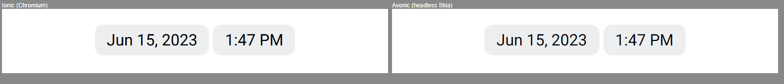 | 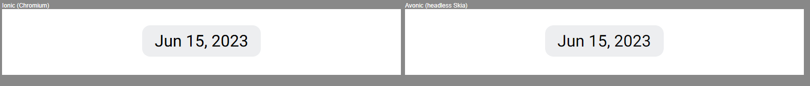 | 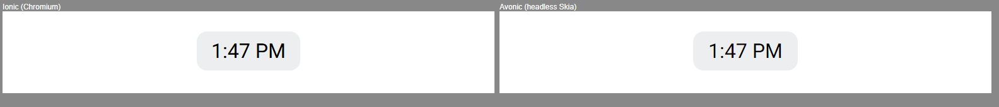 |

| `month-year` | `preferWheel` | Disabled |
|---|---|---|
| 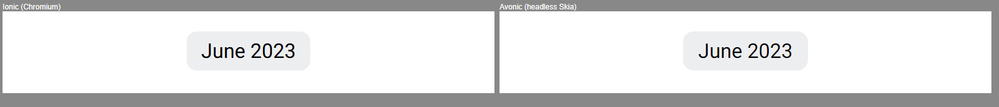 | 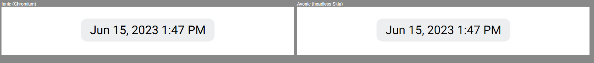 | 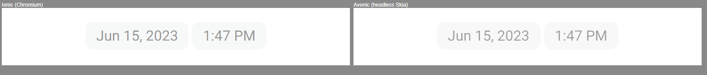 |

| The slots | `color="danger"`, active | Tab: Chromium's focus ring |
|---|---|---|
| 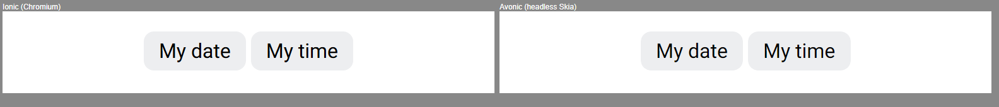 | 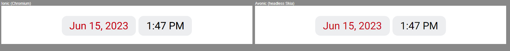 | 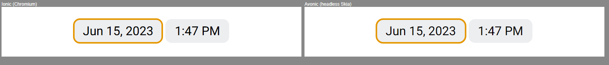 |

| 150 wide: the row wraps | Six locales and `h23` |
|---|---|
| 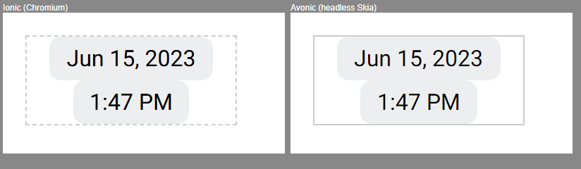 | 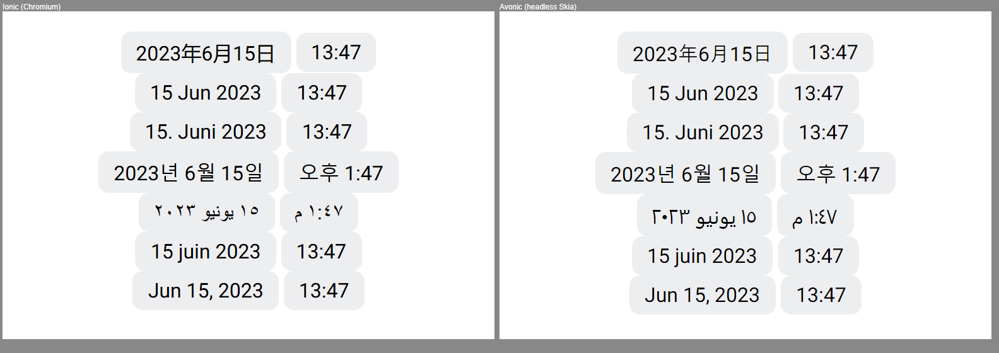 |

| The date button: the modal | The time button: the modal | `preferWheel`: the modal |
|---|---|---|
| 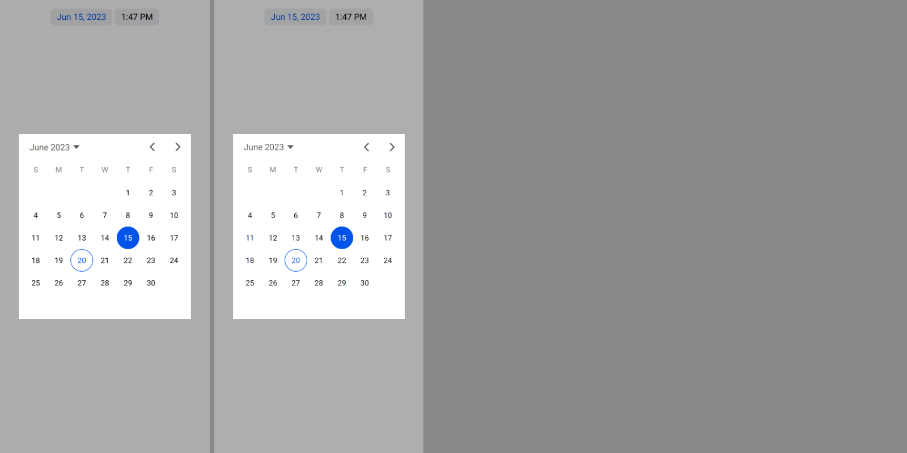 | 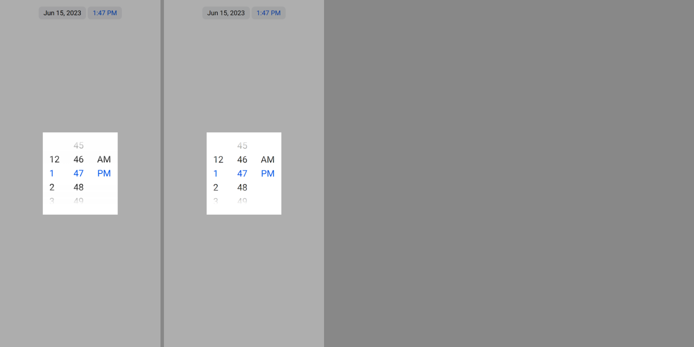 | 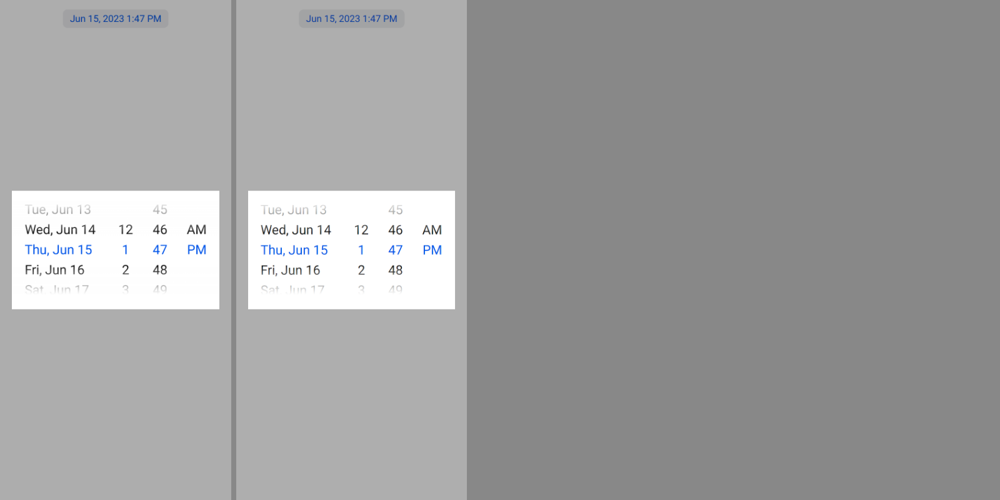 |

| The date button: the popover | The time button: the popover | A time alone: the popover |
|---|---|---|
| 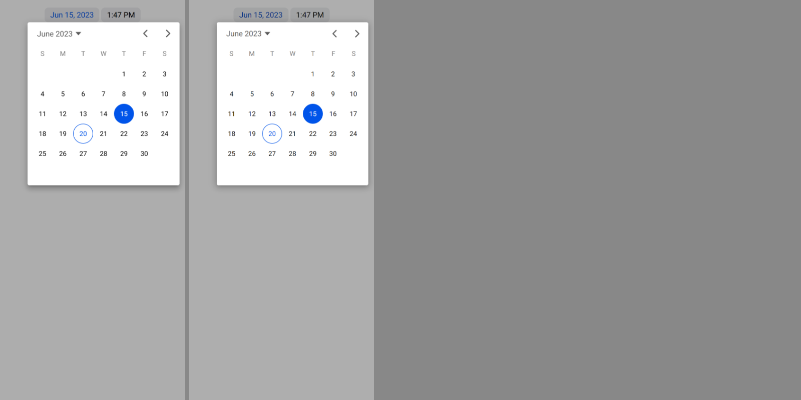 | 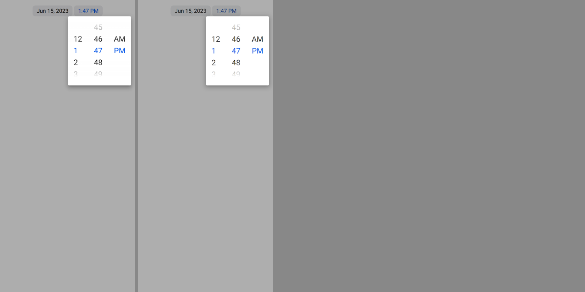 | 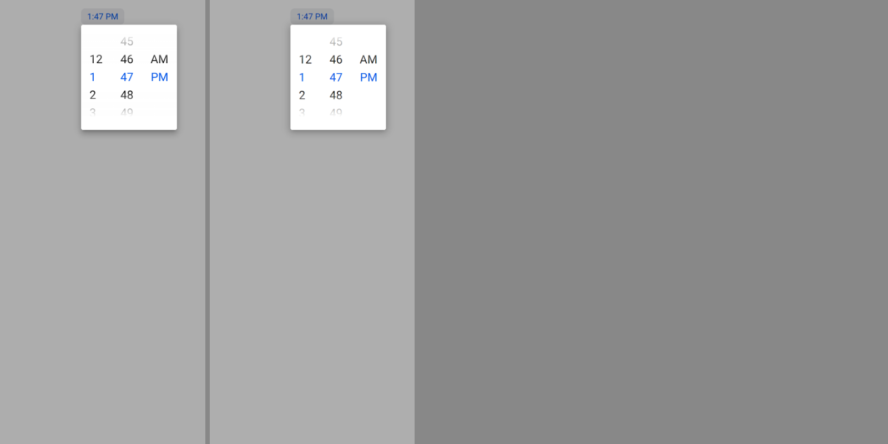 |

| In the page: `date-time` | In the page: `time-date` |
|---|---|
| 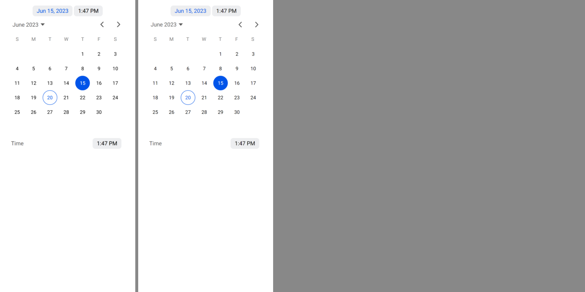 | 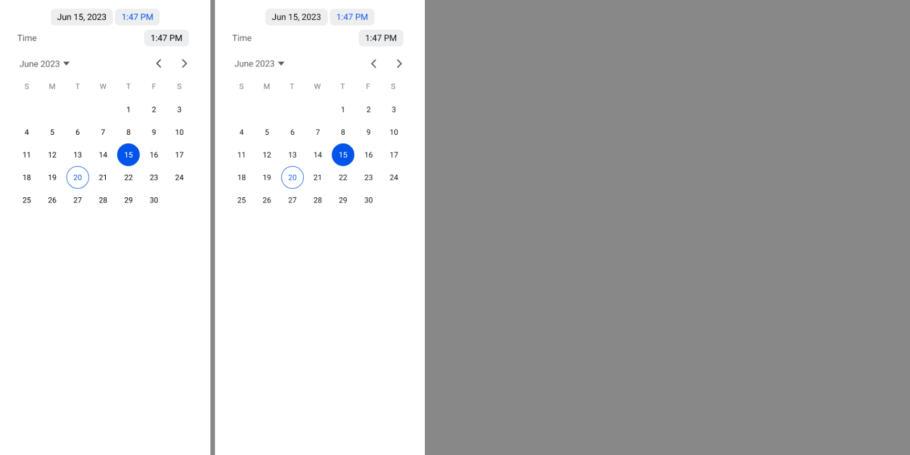 |

**What the frames show.** The buttons match to the pixel's edge: the host 358 x 31 at 16, 16; the date 115.53 x 31 at 93.78, the
time 82.89 x 31 at 213.31, 4 apart; radius 8; `#edeef0` behind black 16 px Roboto (each box asserted within 1 px). Disabled, both at
0.4. The active button's text is primary, or `danger`'s `rgb(197, 0, 15)`. The focus ring is Chromium's orange, 2 px from 1 outside
to 1 inside, rounded. At 150 wide the two buttons wrap onto two lines, each centred. The modal and the popover are the datetime's
size: 320 x 344 for the calendar, 181.56 x 200 for the time, 350 x 200 for the wheels; the popover under the button tapped, kept 12 in
from the right (58, 47 and 196.44, 47), a time alone at its button's left (153.55, 47) (each asserted within 1 px). **Different:** the
narrow frame's border is dashed in Ionic's page and solid in the test's stage; the Arabic, Japanese and Korean rows' heights differ
a little, as in the datetime's own frames: Roboto has none of their glyphs, and Avalonia's fallback font isn't Chromium's.

## Behaviours

| # | Behaviour | Chromium | Avonic |
|---|---|---|---|
| B1 | The datetime by its id; the three errors | `getElementById` at load; `noId`, `wrongId`, `notDatetime` log Ionic's errors, the host 0 high | match: the `Name` in the nearest name scope (as an overlay's `Trigger`), read once at the first attach; the same messages at `Error`, the host 0 high |
| B2 | The text of each presentation | `Jun 15, 2023` / `1:47 PM`; `June 2023`; `June`; `2023`; wheels together `Jun 15, 2023 1:47 PM`; format options (`Fri, June 16`, `09:05 AM`, `Jul 24`, `7/15`, `1 PM`); six locales and `h23` | match, every one: the datetime's own `DatetimeIntl` |
| B3 | The values | a list's first; none: the datetime's default part (`8:20 AM` with value lists); `nonsense` keeps the text; `undefined` is today again; a date alone `Invalid Time`; a time alone `Jan 1, 2023` | match |
| B4 | `multiple` | `3 days`, `0 days`, one value `Jun 5, 2023`; the formatter given the strings; its exception printed, `2 days` | match |
| B5 | Updates | on `ionValueChange`: a confirm, a value in code; not a selection waiting for Done, nor a change of locale or presentation alone (the next value in German, both buttons still) | match. Detached, the listener is off; attached again, the text is worked out again (Ionic never removes it; nothing an app sees differs) |
| B6 | A tap | date: `date-time` → `date`, time → `time`; wheels unchanged; the modal presented; the popover after `ionRender` (70 ms), by the button tapped; in the page only the presentation | match; `Rendered` then `IonPopoverWillPresent`, a frame after the click. The presentation by `SetCurrentValue`, so an app's binding stays |
| B7 | Active | `date-active` / `time-active` and `aria-expanded` from the observer: on 13 ms after `ionModalWillPresent`, off 16 ms after `ionModalDidDismiss`; at 1% of the datetime's area (4 px of 391 on, 3 off); hidden around it, off | match in what's seen: on from the present's first layout pass, off after the dismiss; 4 px on, 3 off; hidden, off. Checked on each layout pass (below) |
| B8 | The overlay | `ion-datetime-button-overlay` on it; `--width` and `--height` `fit-content`; a calendar 320 wide, at least 320 high | match: the class, and the theme's `fit-content` keys merged into its resources (an app's own key wins); boxes as above |
| B9 | Disabled | `pointer-events: none`, each button disabled at 0.4 | match: `IsEnabled`, an `OpacityMask` of 0.4 on each button |
| B10 | The slots | in place of the text, only in a button that shows | match; the button named by the slotted text |
| B11 | The native buttons | `ion-activatable`, the ripple; Tab: date, then time; Enter and Space click; the focus ring on Tab only | match |
| B12 | Layout | the boxes above; the wrap; RTL: the date on the right (180.69, the time at 93.8) | match, asserted |
| B13 | `month`, `year` with format options | `formatOptions.time` (`01:47 PM` for a month) | **deliberate difference** ([ADR 0005](../../decisions/0005-dont-copy-an-ionic-bug.md)): `formatOptions.date` (`Jul`, `24`), `docs/infra/ionic-issues.md` |
| B14 | A popover's datetime never shown | (Ionic's datetime renders while hidden, so `ionRender` always comes) | match: the datetime now raises `Rendered` without a template too; before, the popover never opened |
| B15 | The colour | primary, the colour's base; `transition: 150ms color ease-in-out`, which runs even on the first frame (black at 13 ms, the class at 29, primary at 173) | match: a `BrushTransition` of 150 ms, `cubic-bezier(0.42, 0, 0.58, 1)`, from the first change |

### Deviations Avalonia forces

- **The observer.** Avalonia has nothing that tells a control when another is hidden by an ancestor, or scrolled out of view, as
  `IntersectionObserver` does. The button checks on each layout pass of its window (`LayoutUpdated`): the datetime in the same
  top level, effectively visible, and 1% of its box inside the window and every ancestor that clips (`ClipToBounds`), transformed.
  A scroll, a present, a dismiss and a hide each cause a layout pass, so each is seen within the frame, as measured above. A render
  transform alone (an animation) causes none: a datetime moved into or out of view only by an animation isn't seen until the next
  layout pass. Avalonia's `TemplatedControl`s clip by default where CSS doesn't, so a datetime overflowing such an ancestor counts
  only what's inside it.
- **`fit-content` around a datetime.** An `AvonicDatetime` fills the room it's measured with, up to its 350, as a block's
  `width: auto`; a modal or popover measures its content with the room it has, so a time datetime would be 350 wide where Chromium's
  `fit-content` gives the wheels' 181.56. A second rule in `Styles/DatetimeButton.axaml` stretches a datetime inside the class, which
  makes it report its content's width. Two global alternatives in all (the style budget 284 → 286).

### Gaps

- **Focus back after Escape.** Chromium gives the button its focus ring again when the overlay closes by Escape (`x_space`,
  `x_clickFocus`); the overlay gives the focus back here, without `:focus-visible`, so no ring. It's the overlays' focus restore
  (`AvonicOverlay`), not this control's.
- **The colour's first frame** is Avalonia's: the class can come in the frame the button is first drawn, where Chromium's comes a
  frame later; both then ease over 150 ms.
