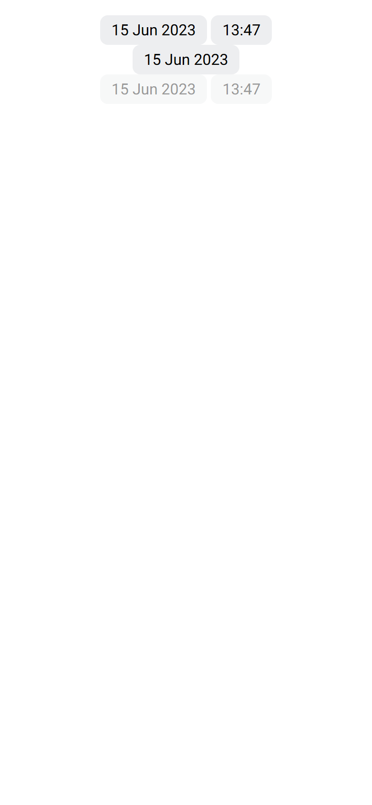

# ion-datetime-button — reference render (Ionic 9.0.11, md, 390×844@2x)

Generated by `node tools/ionic-ref/render.js ion-datetime-button --bare --html "<ion-app style=\"position:static;display:block;contain:none;overflow:visible\"><div style=\"padding:16px\"><ion-datetime-button datetime=\"dt\"></ion-datetime-button><ion-datetime-button datetime=\"dt2\"></ion-datetime-button><ion-datetime-button datetime=\"dt3\" disabled=\"true\"></ion-datetime-button><ion-modal keep-contents-mounted=\"true\"><ion-datetime id=\"dt\" value=\"2023-06-15T13:47:00\"></ion-datetime></ion-modal><ion-modal keep-contents-mounted=\"true\"><ion-datetime id=\"dt2\" presentation=\"date\" value=\"2023-06-15T13:47:00\"></ion-datetime></ion-modal><ion-modal keep-contents-mounted=\"true\"><ion-datetime id=\"dt3\" value=\"2023-06-15T13:47:00\"></ion-datetime></ion-modal></div></ion-app>"`

```html
<ion-app style="position:static;display:block;contain:none;overflow:visible"><div style="padding:16px"><ion-datetime-button datetime="dt"></ion-datetime-button><ion-datetime-button datetime="dt2"></ion-datetime-button><ion-datetime-button datetime="dt3" disabled="true"></ion-datetime-button><ion-modal keep-contents-mounted="true"><ion-datetime id="dt" value="2023-06-15T13:47:00"></ion-datetime></ion-modal><ion-modal keep-contents-mounted="true"><ion-datetime id="dt2" presentation="date" value="2023-06-15T13:47:00"></ion-datetime></ion-modal><ion-modal keep-contents-mounted="true"><ion-datetime id="dt3" value="2023-06-15T13:47:00"></ion-datetime></ion-modal></div></ion-app>
```

 

## Element 1

- attributes: `{"datetime":"dt","class":"md hydrated"}`
- classes: `md hydrated`
- rect: `{"x":16,"y":16,"w":358,"h":31}`

### Host computed

| prop | value |
|---|---|
| display | `flex` |
| position | `static` |
| box-sizing | `border-box` |
| width | `358px` |
| height | `31px` |
| min-height | `0px` |
| min-width | `0px` |
| padding | `0px` |
| margin | `0px` |
| border | `0px none rgb(0, 0, 0)` |
| border-radius | `0px` |
| background-color | `rgba(0, 0, 0, 0)` |
| color | `rgb(0, 0, 0)` |
| font-size | `16px` |
| font-weight | `400` |
| font-family | `Roboto, "Helvetica Neue", sans-serif` |
| line-height | `normal` |
| letter-spacing | `normal` |
| text-transform | `none` |
| opacity | `1` |
| overflow | `visible` |
| contain | `none` |
| pointer-events | `auto` |
| transition | `all` |
| transform | `none` |
| box-shadow | `none` |
| outline | `rgb(0, 0, 0) none 0px` |
| cursor | `auto` |

### Shadow parts

#### part="native" (`button`) rect `{"x":104.89,"y":16,"w":112.38,"h":31}`

| prop | value |
|---|---|
| display | `block` |
| position | `relative` |
| box-sizing | `border-box` |
| width | `112.375px` |
| height | `31px` |
| min-height | `auto` |
| min-width | `auto` |
| padding | `6px 12px` |
| margin | `0px 2px` |
| border | `0px none rgb(0, 0, 0)` |
| border-radius | `8px` |
| background-color | `rgb(237, 238, 240)` |
| color | `rgb(0, 0, 0)` |
| font-size | `16px` |
| font-weight | `400` |
| font-family | `Roboto, "Helvetica Neue", sans-serif` |
| line-height | `normal` |
| letter-spacing | `normal` |
| text-transform | `none` |
| opacity | `1` |
| overflow | `hidden` |
| contain | `none` |
| pointer-events | `auto` |
| transition | `color 0.15s ease-in-out` |
| transform | `none` |
| box-shadow | `none` |
| outline | `rgb(0, 0, 0) none 0px` |
| cursor | `pointer` |

#### part="native" (`button`) rect `{"x":221.27,"y":16,"w":63.84,"h":31}`

| prop | value |
|---|---|
| display | `block` |
| position | `relative` |
| box-sizing | `border-box` |
| width | `63.8438px` |
| height | `31px` |
| min-height | `auto` |
| min-width | `auto` |
| padding | `6px 12px` |
| margin | `0px 2px` |
| border | `0px none rgb(0, 0, 0)` |
| border-radius | `8px` |
| background-color | `rgb(237, 238, 240)` |
| color | `rgb(0, 0, 0)` |
| font-size | `16px` |
| font-weight | `400` |
| font-family | `Roboto, "Helvetica Neue", sans-serif` |
| line-height | `normal` |
| letter-spacing | `normal` |
| text-transform | `none` |
| opacity | `1` |
| overflow | `hidden` |
| contain | `none` |
| pointer-events | `auto` |
| transition | `color 0.15s ease-in-out` |
| transform | `none` |
| box-shadow | `none` |
| outline | `rgb(0, 0, 0) none 0px` |
| cursor | `pointer` |

### DOM tree

```
<ion-datetime-button>
  #shadow-root
    <button#date-button.ion-activatable part="native">
      <slot name="date-target">
      <ion-ripple-effect.md.hydrated>
        #shadow-root
    <button#time-button.ion-activatable part="native">
      <slot name="time-target">
      <ion-ripple-effect.md.hydrated>
        #shadow-root
```

## Element 2

- attributes: `{"datetime":"dt2","class":"md hydrated"}`
- classes: `md hydrated`
- rect: `{"x":16,"y":47,"w":358,"h":31}`

### Host computed

| prop | value |
|---|---|
| display | `flex` |
| position | `static` |
| box-sizing | `border-box` |
| width | `358px` |
| height | `31px` |
| min-height | `0px` |
| min-width | `0px` |
| padding | `0px` |
| margin | `0px` |
| border | `0px none rgb(0, 0, 0)` |
| border-radius | `0px` |
| background-color | `rgba(0, 0, 0, 0)` |
| color | `rgb(0, 0, 0)` |
| font-size | `16px` |
| font-weight | `400` |
| font-family | `Roboto, "Helvetica Neue", sans-serif` |
| line-height | `normal` |
| letter-spacing | `normal` |
| text-transform | `none` |
| opacity | `1` |
| overflow | `visible` |
| contain | `none` |
| pointer-events | `auto` |
| transition | `all` |
| transform | `none` |
| box-shadow | `none` |
| outline | `rgb(0, 0, 0) none 0px` |
| cursor | `auto` |

### Shadow parts

#### part="native" (`button`) rect `{"x":138.81,"y":47,"w":112.38,"h":31}`

| prop | value |
|---|---|
| display | `block` |
| position | `relative` |
| box-sizing | `border-box` |
| width | `112.375px` |
| height | `31px` |
| min-height | `auto` |
| min-width | `auto` |
| padding | `6px 12px` |
| margin | `0px 2px` |
| border | `0px none rgb(0, 0, 0)` |
| border-radius | `8px` |
| background-color | `rgb(237, 238, 240)` |
| color | `rgb(0, 0, 0)` |
| font-size | `16px` |
| font-weight | `400` |
| font-family | `Roboto, "Helvetica Neue", sans-serif` |
| line-height | `normal` |
| letter-spacing | `normal` |
| text-transform | `none` |
| opacity | `1` |
| overflow | `hidden` |
| contain | `none` |
| pointer-events | `auto` |
| transition | `color 0.15s ease-in-out` |
| transform | `none` |
| box-shadow | `none` |
| outline | `rgb(0, 0, 0) none 0px` |
| cursor | `pointer` |

### DOM tree

```
<ion-datetime-button>
  #shadow-root
    <button#date-button.ion-activatable part="native">
      <slot name="date-target">
      <ion-ripple-effect.md.hydrated>
        #shadow-root
```

## Element 3

- attributes: `{"datetime":"dt3","disabled":"","class":"md datetime-button-disabled hydrated"}`
- classes: `md datetime-button-disabled hydrated`
- rect: `{"x":16,"y":78,"w":358,"h":31}`

### Host computed

| prop | value |
|---|---|
| display | `flex` |
| position | `static` |
| box-sizing | `border-box` |
| width | `358px` |
| height | `31px` |
| min-height | `0px` |
| min-width | `0px` |
| padding | `0px` |
| margin | `0px` |
| border | `0px none rgb(0, 0, 0)` |
| border-radius | `0px` |
| background-color | `rgba(0, 0, 0, 0)` |
| color | `rgb(0, 0, 0)` |
| font-size | `16px` |
| font-weight | `400` |
| font-family | `Roboto, "Helvetica Neue", sans-serif` |
| line-height | `normal` |
| letter-spacing | `normal` |
| text-transform | `none` |
| opacity | `1` |
| overflow | `visible` |
| contain | `none` |
| pointer-events | `none` |
| transition | `all` |
| transform | `none` |
| box-shadow | `none` |
| outline | `rgb(0, 0, 0) none 0px` |
| cursor | `auto` |

### Shadow parts

#### part="native" (`button`) rect `{"x":104.89,"y":78,"w":112.38,"h":31}`

| prop | value |
|---|---|
| display | `block` |
| position | `relative` |
| box-sizing | `border-box` |
| width | `112.375px` |
| height | `31px` |
| min-height | `auto` |
| min-width | `auto` |
| padding | `6px 12px` |
| margin | `0px 2px` |
| border | `0px none rgb(0, 0, 0)` |
| border-radius | `8px` |
| background-color | `rgb(237, 238, 240)` |
| color | `rgb(0, 0, 0)` |
| font-size | `16px` |
| font-weight | `400` |
| font-family | `Roboto, "Helvetica Neue", sans-serif` |
| line-height | `normal` |
| letter-spacing | `normal` |
| text-transform | `none` |
| opacity | `0.4` |
| overflow | `hidden` |
| contain | `none` |
| pointer-events | `none` |
| transition | `color 0.15s ease-in-out` |
| transform | `none` |
| box-shadow | `none` |
| outline | `rgb(0, 0, 0) none 0px` |
| cursor | `pointer` |

#### part="native" (`button`) rect `{"x":221.27,"y":78,"w":63.84,"h":31}`

| prop | value |
|---|---|
| display | `block` |
| position | `relative` |
| box-sizing | `border-box` |
| width | `63.8438px` |
| height | `31px` |
| min-height | `auto` |
| min-width | `auto` |
| padding | `6px 12px` |
| margin | `0px 2px` |
| border | `0px none rgb(0, 0, 0)` |
| border-radius | `8px` |
| background-color | `rgb(237, 238, 240)` |
| color | `rgb(0, 0, 0)` |
| font-size | `16px` |
| font-weight | `400` |
| font-family | `Roboto, "Helvetica Neue", sans-serif` |
| line-height | `normal` |
| letter-spacing | `normal` |
| text-transform | `none` |
| opacity | `0.4` |
| overflow | `hidden` |
| contain | `none` |
| pointer-events | `none` |
| transition | `color 0.15s ease-in-out` |
| transform | `none` |
| box-shadow | `none` |
| outline | `rgb(0, 0, 0) none 0px` |
| cursor | `pointer` |

### DOM tree

```
<ion-datetime-button>
  #shadow-root
    <button#date-button.ion-activatable part="native">
      <slot name="date-target">
      <ion-ripple-effect.md.hydrated>
        #shadow-root
    <button#time-button.ion-activatable part="native">
      <slot name="time-target">
      <ion-ripple-effect.md.hydrated>
        #shadow-root
```
