# ion-datetime — Comparison

Ionic 9.0.11, md, headless Chromium, beside Avonic headless (Skia) at the same size and 2x. `ion-datetime` reads today's date, and
several of its props are JavaScript (`isDateEnabled`, `highlightedDates`, `titleSelectedDatesFormatter`), which `render.js --html`
can neither pin nor set, so the Ionic side comes from four measurement scripts on `render.js`'s phone (390 x 844 at 2x, mobile and
touch, Roboto from `tools/fonts/roboto/`) that wait as `render.js` does (`tools/ionic-ref/settle.js`), with the clock pinned to
2023-06-20 10:00 UTC (Playwright's `clock.setFixedTime`), the time zone UTC and the locale `en-US` unless a case names another. Each
page is an `ion-app` with the datetime 16 in from the top left. The raw output is [`ref/layout.json`](ref/layout.json) (29 layouts:
every part's box and text, the days, the columns and their options, the buttons), [`ref/behaviour.json`](ref/behaviour.json) (34
cases: events with their times and details, the state after each step, scroll positions frame by frame, real keys and clicks),
[`ref/intl.json`](ref/intl.json) (every `Intl` call Ionic makes, in 20 locales) and [`ref/locales.json`](ref/locales.json) (Arabic in
RTL, Japanese, British English, German, Korean, and a read-only calendar with adjacent days), with a frame of each case in
[`ref/`](ref/). The scripts aren't in the repo, as the swarm brief asks; their cases are the `M` rows and the numbered behaviours of
PLAN.md.

Avonic's frames are `AvonicDatetimeCaptureTests`, which assert each host's box against Chromium's (every one matches to 0.5 px but
Arabic's height, below), saved in [`compare/`](compare/) beside Ionic's. Not tried in a real window: `tools/real-window/drive.ps1` has
an `ion-datetime` section for the batch's runner.

| `date-time`, the default | A header, default buttons and Clear | `color="danger"` |
|---|---|---|
| 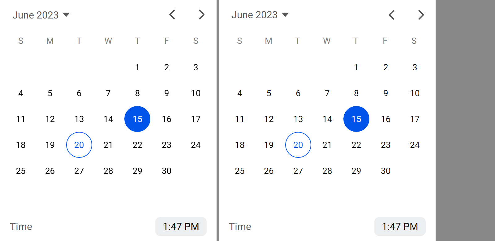 | 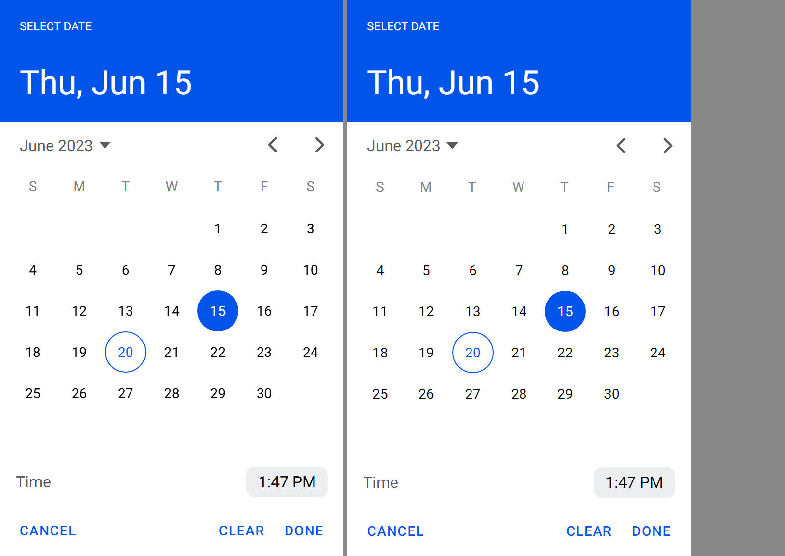 | 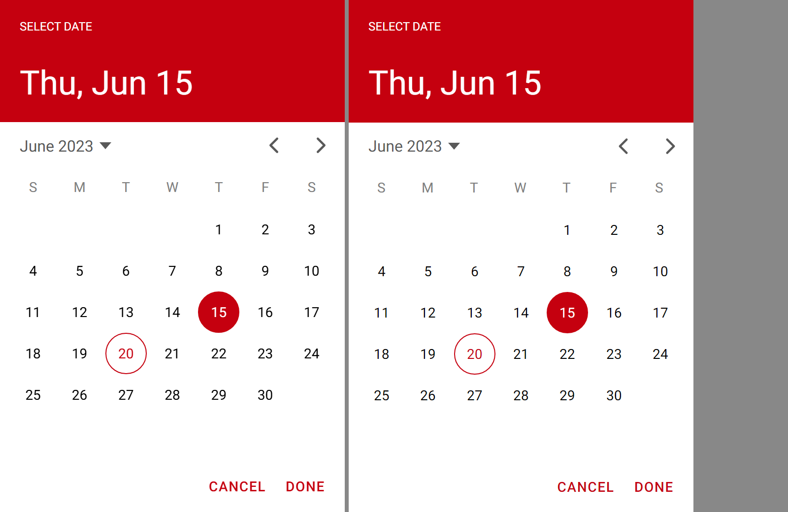 |

| Disabled | Read-only | `min` and `max` |
|---|---|---|
| 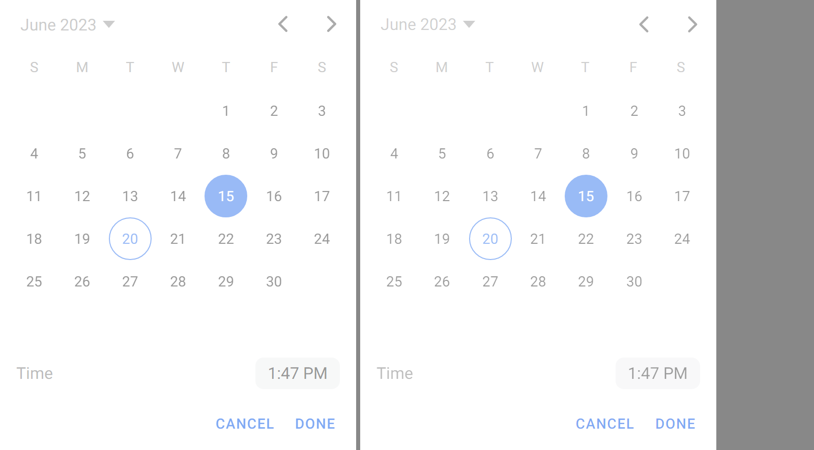 | 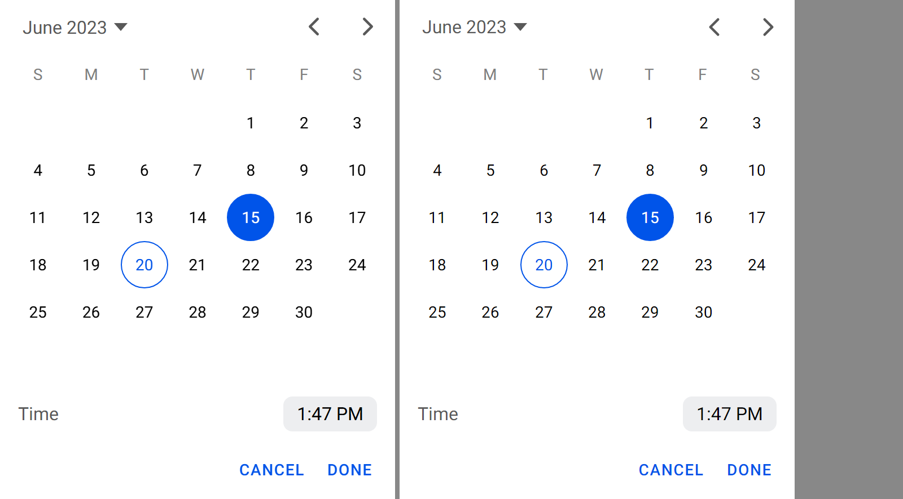 | 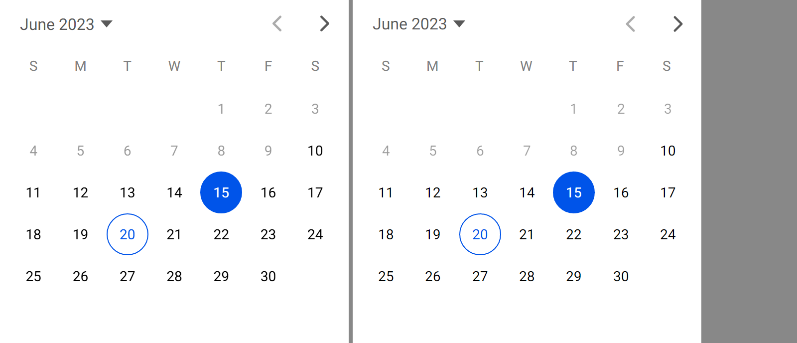 |

| Adjacent days | The month/year wheel open | The time popover (the page) |
|---|---|---|
| 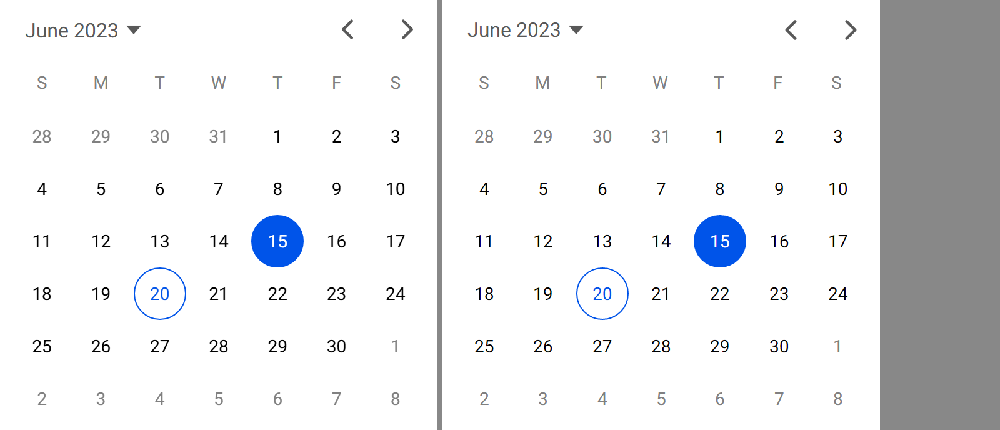 | 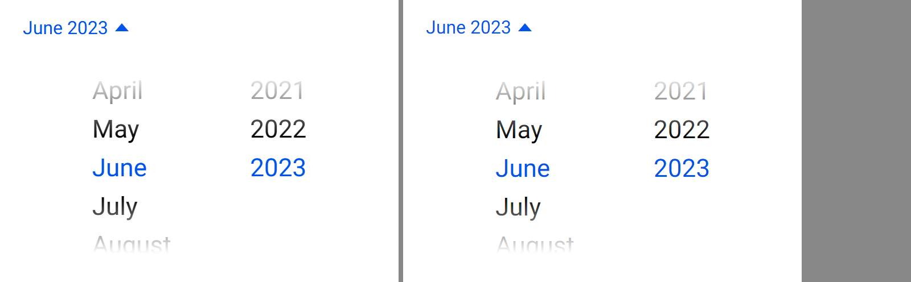 | 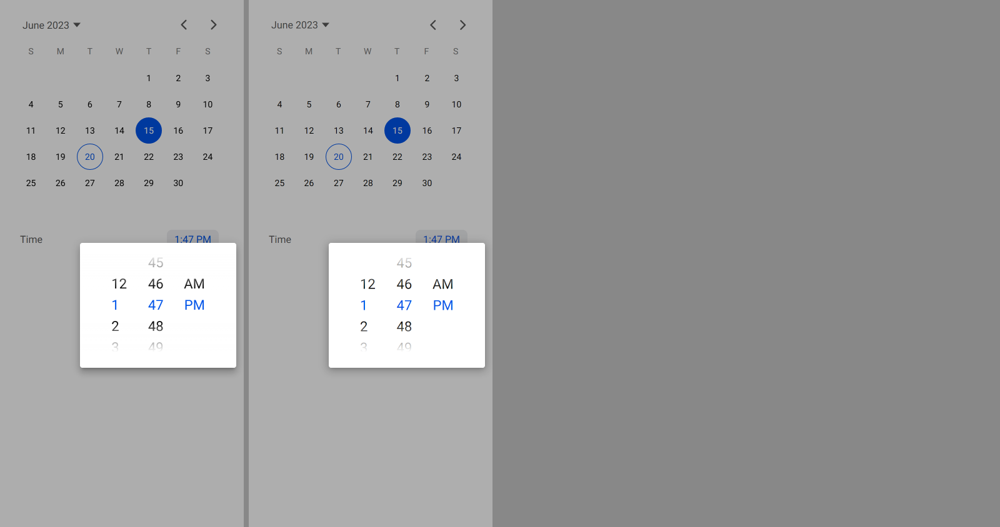 |

| `preferWheel`, `date-time` | `time` | `month-year` |
|---|---|---|
| 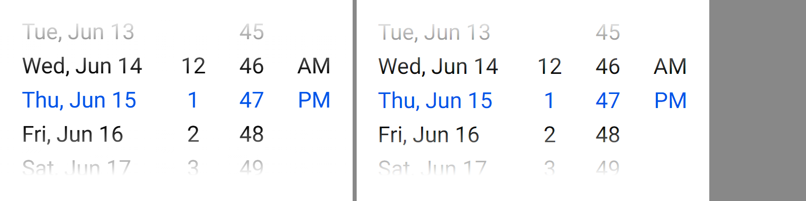 | 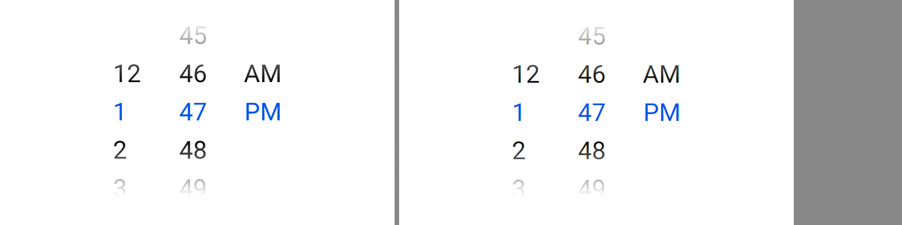 | 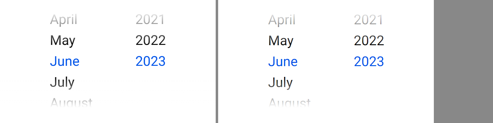 |

| `ar-EG`, RTL | `ja-JP` | `ja-JP` wheel (year first) |
|---|---|---|
| 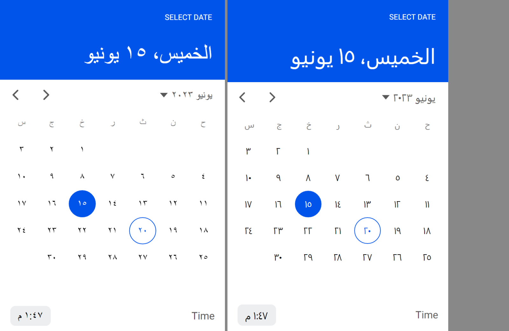 | 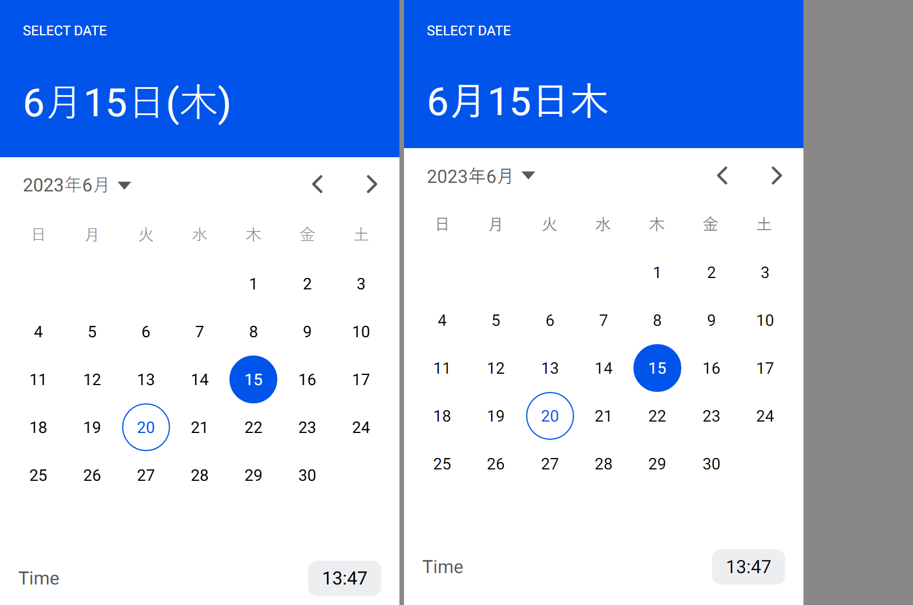 | 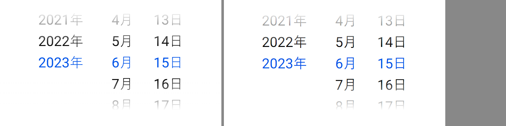 |

| `en-GB` wheel (day first) | `de-DE`, Monday first | `ko-KR` time (AM/PM first) |
|---|---|---|
| 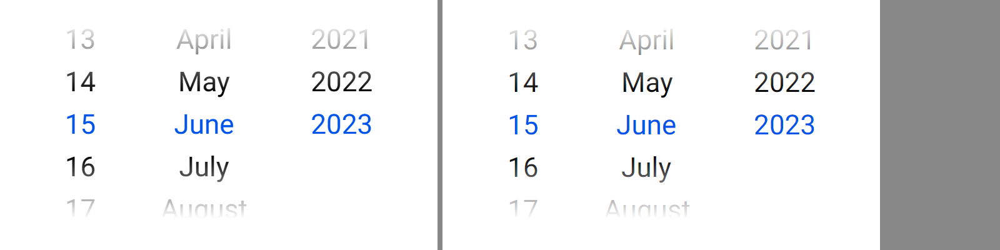 | 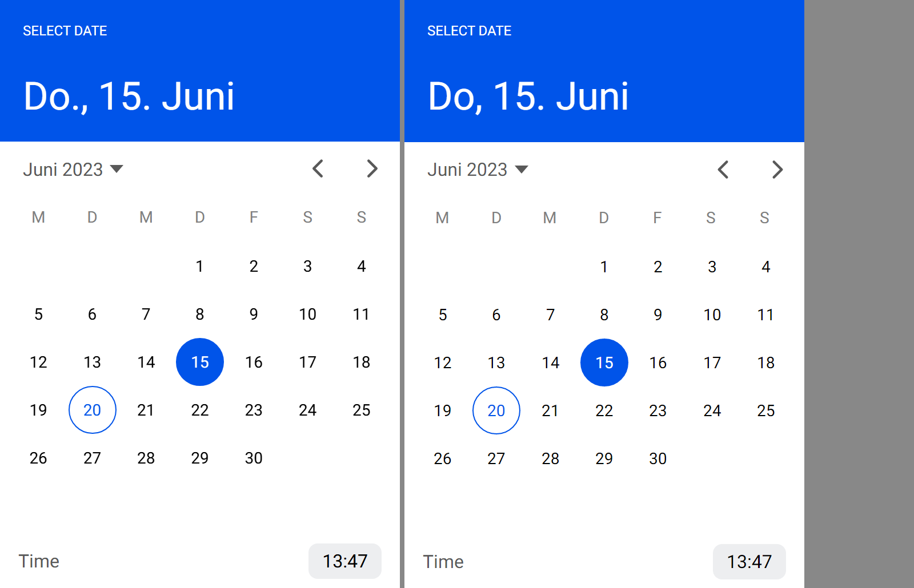 | 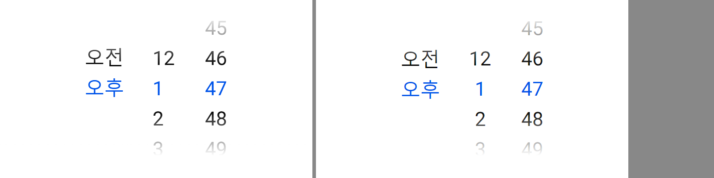 |

## Layout

Every host box is Chromium's (`Near` in each capture test): `date-time` 350 x 391, `date` 344, the wheels 200, the header 124, the
footer 52, `cover` 358, the month/year wheel open 248, and the time popover's content at (128, 389) 250 x 200 within 1 px. The parts
inside are Chromium's too (the days 42 x 42, 47.14 apart from 12.57; the month/year button 131 x 48; the arrows 48 x 48 at 254 and 302;
the time button 83 x 31 at 251).

| | Ionic | Avonic | |
|---|---|---|---|
| Arabic text | Chromium's fallback for Arabic | Avalonia's fallback, taller lines | **gap**: Roboto has no Arabic, and Avalonia's fallback font gives the header and the days taller lines, so the RTL page is 523.5 high, not 515. The positions are mirrored as Chromium's (the host 24 in, the arrows at the left) |
| The chevrons | ionicons' `chevron-back` | the same artwork | match: the stroke looks a little thinner at 2x, as every icon does (`compare-icons.js`) |

## Behaviour

| # | Behaviour | Result |
|---|---|---|
| B1 | Working, active, default and today parts | match (the utilities ported one for one; `DatetimeUtilsTests`) |
| B2 | A value in code: its month, its day, no `ionChange`; an unparsable one changes nothing; a list shows its last date's month | match (`valueProgrammatic`, `multipleValue`) |
| B3 | Time zones dropped, the wall clock kept | match (read from `parseDate`; Avonic parses with Ionic's own regex) |
| B4 | The value written; no value takes today's time | match (`clickDayNoValue`: `2023-06-22T10:00:00`) |
| B5 | A selection confirms at once without buttons, again on the same day; nothing when read-only | match (`clickDay`, `readonly`) |
| B6 | Confirm, the default buttons and the buttons slot; nothing chosen gives no value in the grid, the working parts with `preferWheel`; the parent overlay closes with `datetime-confirm` | match (`buttonsConfirm`, `confirmNoSelection`, `confirmNoSelectionWheel`, `inPopover`) |
| B7 | Cancel: `ionCancel`, the selection discarded, the month back; `datetime-cancel` | match (`cancelRevert`, `inPopover`) |
| B8 | Reset | match (`reset`) |
| B9 | The parent overlay's present discards an unconfirmed selection | match (`unconfirmedInPopover`) |
| B10 | Clear | match (`clear`) |
| B11 | The grid: 7 columns from `firstDayOfWeek`, blanks or adjacent days | match (`firstDay`, `adjacent`) |
| B12 | The month changes 50 ms after the scroll rests on the first or last month; a month outside min and max isn't snapped to | match in the logic. **Deliberate**: Avalonia's snapping after a touch swipe is its own (it jumps or aims a fling at the snap point, where Chromium eases), as for the picker and the segment view |
| B13 | Previous and next scroll smoothly (√distance / 60 s, measured 300 ms for 350 px), at once with `AvonicConfig.Animated` off; disabled outside min and max | match (`nextPrev`, `minMax`) |
| B14 | A value in another month is drawn in place of the next one and scrolled to | match (`valueProgrammatic`: one 300 ms scroll to September) |
| B15 | Today, the selected day, disabled days, `isDateEnabled` given `"2023-05-01"` for three months, the days' names | match (`isDateEnabled`, `isDateEnabledIso`: 92 calls) |
| B16 | Multiple: add, remove, the header's count and formatter | match (`multiple`) |
| B17 | Highlighted dates, never on the selected day | match (`highlighted`) |
| B18 | The month/year button and wheel; a month there is a selection | match (`monthYear`) |
| B19 | The keyboard: Tab to the working day, the arrows, Home, End, the pages, a disabled day, Enter | match (`keyboard`, `keyboardFirstDay`, `keyboardMin`). Followed, though odd: the arrows aren't mirrored in RTL (`keyboardRtl`) |
| B20 | The time button and its popover | match (`timeButton`, M9) |
| B21 | The time wheels: the cycles, the lists, min and max on their day, AM/PM | match (`minMaxTime`) |
| B22 | `presentation="time"` | match (`time`) |
| B23 | The date wheels and the combined date column with "Today" | match (`wheelChange`, `wheelDateTimeChange`) |
| B24 | The day wheel follows the month | match (`wheelChange`: 28 for February) |
| B25 | The header, its title and the selected date; `formatOptions` | match (`title`, `titleSlot`) |
| B26 | The footer buttons, disabled when read-only at full opacity | match (`title`, `readonly`) |
| B27 | Disabled | match (`disabledClick`) |
| B28 | Read-only browses but doesn't select | match (`readonly`, `readonlyAdjacent`) |
| B29 | In an item: `item-interactive`, `item-datetime` | match (`inItem`) |
| B30 | `size` | match (`cover`: 358) |
| B31 | Hidden in an overlay, the month/year wheel closes | **deliberate**: closed at the parent overlay's next present, as Avalonia doesn't say when an ancestor hides; the same as the picker's known gap |
| B32 | The locale | see below |
| B33 | An adjacent day with the default buttons | **deliberate** ([ADR 0005](../../decisions/0005-dont-copy-an-ionic-bug.md)): Ionic confirms at once (`adjacent`), Avonic waits for Done; `docs/infra/ionic-issues.md` |
| B35 | A date clamped to `max` and then cut to the month asked for | **deliberate** (ADR 0005, read in `manipulation.js`): Ionic can write a date past max (2021-01-28 for max 2021-01-15) and move max itself; Avonic cuts only a date that wasn't clamped; `docs/infra/ionic-issues.md` |
| B34 | Done with nothing chosen on a `time`, `month` or `year` wheel | **deliberate** (ADR 0005): Ionic writes no value (`confirmNoSelectionTime`), Avonic the time shown, as Ionic's comment means; `docs/infra/ionic-issues.md` |

Two inputs Ionic draws as garbage, which Avonic shows sensibly (read in `datetime.js`, not measured): a time alone (`"13:47"`) in a
grid presentation, which has no month for the calendar (Ionic renders `NaN` months and "Invalid Date"; Avonic shows the default
parts' month, today's, with the time), and a negative `firstDayOfWeek`, which JavaScript's `%` keeps negative (Avonic reads it in 0 to 6).
A month before year 1 or after 9999, beside a value at either end, has no days, as `DateTime` can't hold it.

`ionFocus` and `ionBlur` come once as focus enters and leaves the datetime, not as it moves between its parts (`keyboard`: one of
each); the inner buttons' own stop at the datetime. Match.

## Locale

ADR 0004's note for #46: .NET's `CultureInfo` does `Intl`'s job, measured against Chromium. `DatetimeIntlTests` compares every
`Intl` call Ionic makes (25 per locale) with `ref/intl.json` in 20 locales: **`en-US`, `pt-BR`, `ar-EG`, `he-IL`, `hi-IN`, `nl-NL`,
`pl-PL` and `fr-FR` match in every one**; the rest match except what `DatetimeIntlTests.Gaps` lists:

| Locale | What | Chromium | Avonic | Why |
|---|---|---|---|---|
| `en-GB` | a day's name, a full date | `Thursday 15 June` | `Thursday, 15 June` | .NET's long date has a comma CLDR's skeleton hasn't |
| `fa-IR` | the date column, a day's name, a long date | `پنجشنبه ۲۵ خرداد` | `خرداد ۲۵, پنجشنبه` | .NET's Persian long date is year first |
| `ru-RU` | the month and year | `июнь 2023 г.` (a no-break space) | `июнь 2023 г.` | .NET's pattern has a plain space |
| `ja-JP`, `ko-KR`, `de-DE`, `es-ES`, `th-TH` | the date column, the header | `6月15日(木)`, `6월 15일 (목)`, `Do., 15. Juni`, `jue, 15 jun`, `พฤ. 15 มิ.ย.` | `6月15日木`, `6월 15일 목`, `Do, 15. Juni`, `jue, 15 de jun`, `พฤ.ที่ 15 มิ.ย.` | Intl's short skeleton (`MMMEd`), which .NET hasn't; Avonic cuts down the long date |
| `sv-SE` | which comes first of day and month | day | month | .NET's short date is `yyyy-MM-dd` |
| `tr-TR`, `zh-CN`, `ja-JP` | a 12-hour time asked of a 24-hour locale | `ÖS 1:47`, `下午1:47`, `午後1:47` | `1:47 ÖS`, `1:47 下午`, `1:47 午後` | .NET has no 12-hour pattern for them, so AM/PM goes after |
| `ar-SA`, `th-TH` | the era | `١٤٤٤ هـ`, `2566` | `١٤٤٤ بعد الهجرة`, `พ.ศ. 2566` | .NET's era names and where it puts them |

What .NET doesn't do and Avonic does, all matching Chromium: Arabic-Indic and Persian digits (`DigitSubstitution`), the `h11` and
`h24` cycles, narrow day names, a day alone with its suffix (`15日`), and AM/PM as `AM`/`PM` in a 24-hour locale. "Today"
(`Intl.RelativeTimeFormat`) is a table of the 20 measured languages and Italian, and English otherwise. Measured on Windows, whose
.NET uses ICU. **Linux's .NET differs** (CI, Ubuntu's ICU 74): its `ShortestDayNames` are the short names (`Su`, `Mo`), which
Avonic cuts to their first letter in a cased script (so `S M T W T F S` as Chromium); it writes a narrow no-break space before AM
and PM, which Avonic writes as a space, as V8 does; and some locales' AM and PM come out in English (Korean, Hebrew, Thai), Hindi's
October is a later CLDR's, and `ar-SA` is Gregorian. `DatetimeIntlTests` compares every call on Windows and en-US and the narrow
days of the Latin and Cyrillic locales elsewhere. Android, iOS and macOS use their own ICU, and weren't measured.

## Deviation: the single grid (an option)

`CalendarRendering="SingleGrid"` (README, Extensions; #248, spike A) isn't Ionic's, and isn't the default. Ionic's calendar is three
months in a horizontally snapping scroller; the single grid is one month drawn again in place. What it shows is the same: its frame of
June 2023 (`AvonicDatetimeSingleGridTests.Capture_Single_Grid`) is pixel for pixel the scrolled calendar's
(`AvonicDatetimeCaptureTests.Reference_DateTime`), and each day's text, state, automation name and pseudoclasses equal the scrolled
calendar's working month in six cases (four locales, four first days, adjacent days, `Min`, `Max`, `IsDateEnabled` and
`HighlightedDates`). What differs, by design:

| | Ionic (and `ScrolledMonths`) | `SingleGrid` |
|---|---|---|
| A change of month | a smooth scroll of about 330 ms, then the month 50 ms after it rests (a `Background` timer in Avonic) | a fade: out 90 ms, the month, in 210 ms, on frames only |
| The heading | when the scroll rests (Pixel 8: 383 ms median) | at the end of the fade out (about 100 ms) |
| `animated: false` | the scroll jumps | the month changes at once |
| A swipe | drags the months with the finger, then snaps | changes the month once, at its end, past 50 px or a flick |
| Days made | 126 (103 shown and templated in June 2023's three months) | 42 (34 shown) |

The swipe that doesn't follow the finger is the deliberate deviation. Elements on the `datetime-x1` perf page (one default datetime),
headless: 726 scrolled (725 before the grid's part, empty in this rendering, was added) and 292 as a single grid, as the two hidden
months' days were most of the calendar.

## Not in Avonic

- `name` (an HTML form's hidden input) and `mode`, as the plan says.
- The iOS rubber-band fix, md has none.
