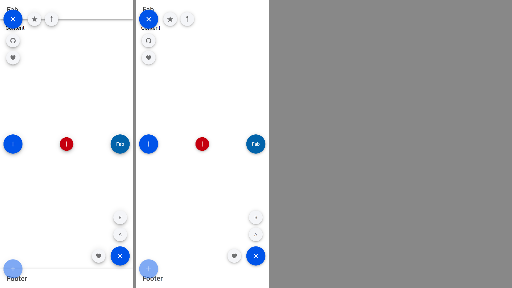

# ion-fab family — Comparison against the web component

> Ionic side: `node tools/ionic-ref/render.js ion-fab --bare --html '<the snippet below>' --out docs/components/ion-fab/ref`
> (Chromium, md, 390×844@2x) → [`ref/`](ref/). `ref/README.md` holds the exact command, and `ref/page.html` the page. The
> behaviours were measured with throwaway Playwright scripts on the same page setup, wrapped in `ion-app` so that `tap-click`
> runs.
> Avonic side: `AVONIC_CAPTURE_DIR=… dotnet test` → `AvonicFabCaptureTests.Reference_Page` (headless Skia, 2×) →
> [`compare/avonic-page.png`](compare/avonic-page.png). **Not tried in a real window, and not tried on a device.**

```html
<ion-app style="position:static;display:block;contain:none;overflow:visible"><div style="display:flex;flex-direction:column;height:844px">
<ion-header><ion-toolbar><ion-title>Fab</ion-title></ion-toolbar></ion-header>
<ion-content style="flex:1"><p style="margin:16px">Content</p>
<ion-fab slot="fixed" vertical="top" horizontal="start" edge activated><ion-fab-button><ion-icon name="share"></ion-icon></ion-fab-button>
  <ion-fab-list side="bottom"><ion-fab-button><ion-icon name="logo-github"></ion-icon></ion-fab-button><ion-fab-button><ion-icon name="heart"></ion-icon></ion-fab-button></ion-fab-list>
  <ion-fab-list side="end"><ion-fab-button><ion-icon name="star"></ion-icon></ion-fab-button><ion-fab-button><ion-icon name="pin"></ion-icon></ion-fab-button></ion-fab-list></ion-fab>
<ion-fab slot="fixed" vertical="center" horizontal="start"><ion-fab-button><ion-icon name="add"></ion-icon></ion-fab-button></ion-fab>
<ion-fab slot="fixed" vertical="center" horizontal="center"><ion-fab-button color="danger" size="small"><ion-icon name="add"></ion-icon></ion-fab-button></ion-fab>
<ion-fab slot="fixed" vertical="center" horizontal="end"><ion-fab-button color="secondary">Fab</ion-fab-button></ion-fab>
<ion-fab slot="fixed" vertical="bottom" horizontal="end" activated><ion-fab-button><ion-icon name="add"></ion-icon></ion-fab-button>
  <ion-fab-list side="top"><ion-fab-button>A</ion-fab-button><ion-fab-button>B</ion-fab-button></ion-fab-list>
  <ion-fab-list side="start"><ion-fab-button><ion-icon name="heart"></ion-icon></ion-fab-button></ion-fab-list></ion-fab>
<ion-fab slot="fixed" vertical="bottom" horizontal="start" edge><ion-fab-button disabled><ion-icon name="add"></ion-icon></ion-fab-button></ion-fab>
</ion-content>
<ion-footer><ion-toolbar><ion-title>Footer</ion-title></ion-toolbar></ion-footer></div></ion-app>
```

(One line in the real command.) `Reference_Page` lays out the same content: a `Grid` of an `AvonicHeader`, an `AvonicContent` and an
`AvonicFooter`, with the six fabs in a stretched `Panel` in the content's `FixedContent`.

## Side by side

Ionic on the left, Avonic on the right.



Every fab is where Ionic puts it, to the pixel: `Reference_Page` asserts the six boxes Chromium measured (10, 56, 56 × 28;
10, 394; 167, 394; 324, 394; 324, 722; 10, 760, 56 × 28). The lists, the icons, the colours, the close icons and the disabled
fab's half opacity match.

### Deliberate differences

- **The header's shadow and the footer's top line are hidden.** An edge fab sits half over the header or footer. In Ionic it paints
  above them because its `z-index: 999` reaches the page's stacking context. Avalonia's `ZIndex` only sorts siblings, so the content
  has to be above the header and footer (`ZIndex="11"`, over their 10) for the fab to be, and then the content's background covers
  the header's shadow and the footer's border too. Without it, the fab's outer half is under them. It's the app's choice; the
  sample and the reference page put the content on top. Forced by Avalonia.
- **The shadows are lighter**, as `ion-button`'s are: the same `box-shadow` values, drawn by Avalonia. Reading the column under the
  centre-start button from its edge, at 2×: Chromium 182, 189, 200, 210, 220, 228, 233, 237; Avalonia 191, 204, 217, 227, 235, 242,
  246, 249. Beside it, from its right edge: Chromium 218, 228, 235, 240, 243, 246, 248, 250; Avalonia 214, 226, 236, 242, 246, 249,
  251, 253.
- **Several fabs in the one fixed slot need a panel.** `FixedContent` holds one child, which `AvonicContent` puts at its top start
  as `position: absolute` would, unless it's a `Panel`, which stands for the slot: it covers the content, and the fabs place
  themselves in it. (Until #131's roll-up the app had to set the panel's alignments to `Stretch`.)

### Found here, not by the tests

- **No shadow at all.** `background-clip: padding-box` was first `BackgroundSizing="InnerBorderEdge"`, and Avalonia then draws no
  `BoxShadow`: a column under the button read 255 all the way. The tests checked the `BoxShadow` property, which was right. With the
  default sizing it reads 177, 187, 198, … at 1×, next to Chromium's, and `B1_A_Round_Primary_56_Square_With_A_Shadow_And_A_24_Icon`
  now reads the pixel under the button, and fails with the old setter. The border is 0 unless an app sets one, so the clip makes no
  difference here.
- **An edge fab under the header and footer.** The first frame had the content at `ZIndex` 1, under the header's and footer's 10, and
  the fabs' outer halves were cut off. See above.

### Found in review

- **Enter on a list button that had closed the fab opened it again.** A browser blurs a button whose list goes `display: none`;
  Avalonia leaves the focus on it. A button that isn't shown now takes no click, from a key or from automation, and is offscreen to
  automation, as `visibility: hidden` takes it out of the accessibility tree.
- **A pressed overlay had no transparent default**, so with an app's `BackgroundActivatedOpacity` it showed the focus or hover
  colour. It's `Avonic.FabButton.Md.BackgroundActivated`, transparent, now.
- **A list taken out of the tree during its stagger came back with buttons hidden.** Ionic cancels the timeouts in
  `disconnectedCallback` and never restarts them. Here a list that's put back finishes what was cancelled: a page leaves the tree
  and comes back far more often in Avalonia than a node moves in the DOM. A deliberate difference.
- **A list from `ItemsSource` and a template was laid out in the flow**, under the button, as its presenter isn't a list. The panel
  looks inside the presenter now.
- **Buttons and lists from `ItemsSource` and a template were never reached**: a closed list isn't laid out, so its templated
  buttons don't exist when it opens, and a fab's templated children don't exist before its first layout. The stagger, and the
  fab's `Activated`, wait for the first layout now. In the DOM they exist all along.
- **The fab's load ran on every return to the tree**, which reopened a list an app had closed. It runs once, as
  `componentDidLoad` does. A list put back only finishes a stagger that was really cut off, not one that had finished.
- **A child in the fab's flow other than its button kept its own width**, where `display: block` is as wide as the fab, and the
  fab's width wasn't kept within the room there is, as `fit-content` is.
- **A list's side changing from bottom to top kept its order**, and **one with its own margin didn't move**, as nothing else
  changed size. Both now have tests, found by the breakage run.

## Behaviours

Measured in Chromium on Ionic 8.8.1. The ids are the behaviours in [PLAN.md](PLAN.md).

| # | Behaviour | Ionic | Avonic | Result |
|---|---|---|---|---|
| F1 | Horizontal and vertical | start 10, centre 167, end 324; top 66, centre 394, bottom 722 in a content at 56, 390 × 732 | same, `Reference_Page` and `F1_*` | match |
| F1 | Safe area | start `calc(10px + safe-area-left)`, swapped in RTL; top has none | `Avonic.SafeAreaLeft` / `Right`, swapped; none on top | match |
| F2 | Neither | 0, 56, 56 × 56: the content's top start | 0, 0 in the content, 56 × 56 | match |
| F3 | Edge | fab 10, 56, 56 × 28; button 10, 28. Bottom: 760, 56 × 28. Small: 332, 768 | same | match |
| F4 | `activated` | first button and every list; at load; close icon with no list | same | match |
| F5 | A click toggles | main toggles; a list button closes; no list, nothing; disabled, nothing; Enter opens, Space closes | same | match |
| F6 | `close()` | `activated` false | same | match |
| F7 | `z-index: 999` | above everything in the page | `ZIndex` 999: above its siblings only | deliberate difference: see above |
| F8 | Lists | top 324, 374, 56 × 150; start 214, 534, 100 × 56; end 390, 534; bottom 324, 600; buttons 8 in, 5 apart along | same, relative to the fab | match |
| F9 | Not clipped | the edge button and the lists are drawn and take a tap outside the fab | same | match |
| B1 | Standard | 56, round, `rgb(0, 84, 233)`, white, 6 dp, 14 px, icon 24 at 16, 16 | same | match; shadow lighter, above |
| B2 | Small | 40 with 8 margins | same | match |
| B3 | Close icon | `scale(0.4) rotate(-45deg)` → `scale(1)`, 300 ms ease-in-out; the content the other way | same, on Avalonia's transitions | match |
| B4 | `closeIcon` | the icon's name | `PART_CloseIcon.Icon` | match |
| B5 | Native button | click, Enter, Space | same, with `Click` and `Command` | match |
| B6 | `ionFocus`, `ionBlur` | `focus,blur,focus` | same | match |
| B7 | Focus-visible | overlay white 0.24; in a list `rgb(215, 216, 218)` 0.24, text `rgba(0, 0, 0, 0.54)`; no outline | same; no focus adorner | match |
| B8 | Hover | 0.08 of the current colour (CSS; the phone context has no hover) | same, mouse and pen | match, from the CSS |
| B9 | Press | 12 dp shadow, no overlay, ripple | same | match; shadow lighter |
| B10 | `color` | base and contrast in every state | same | match |
| B11 | Disabled | 0.5; shown in a list, 1 | same | match |
| B12 | In a list | 40, `rgb(244, 245, 248)`, `rgba(0, 0, 0, 0.54)`, icon 18; hidden until `show`, then at once | same | match |
| B13 | `show` outside a list | nothing | nothing | match |
| B14 | List margins | `5px 0` in a column, `0 5px` in a row | same | match |
| B15 | Automation | a button named by its text | same | match |
| L1 | `display: none` | until `activated` | `IsVisible` false until `Activated`, at style priority | match |
| L2 | Stagger | 0, ~30, ~60 ms; hide after 0 ms; cancelled on change and on leaving | same, on `AvonicConfig`'s clock | match |
| L3 | Side | column, column-reverse, row-reverse, row; centred across; min 56 | same | match |
| L4 | Tab order | main, a, b, c, start list | same | match |

## Gaps

- **Hover** wasn't measured: the phone context has no `any-hover`. It's from the CSS.
- **A list's buttons in Ionic don't animate in or out**, measured frame by frame, and neither do Avonic's. The 270 ms transform and
  15 ms opacity in `--transition` are on `.button-native`, whose transform and opacity never change.
- **A fab whose own `FlowDirection` differs from its container's** is placed by its own: start in an RTL fab inside an LTR content
  is on the left, where Ionic's `:dir(rtl)` puts it on the right. A page that's RTL all through, the usual case, matches.
- **`::slotted` rules lose to an app's style in Ionic, and here the list's margins on its buttons are a rule with an activator** in the
  button's own theme, which an app's plain style for `Margin` doesn't beat. A local value does.
