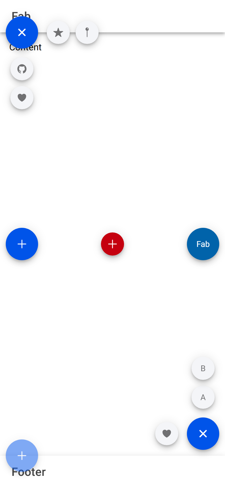

# ion-fab — reference render (Ionic 8.8.1, md, 390×844@2x)

Generated by `node tools/ionic-ref/render.js ion-fab --bare --html "<ion-app style=\"position:static;display:block;contain:none;overflow:visible\"><div style=\"display:flex;flex-direction:column;height:844px\"><ion-header><ion-toolbar><ion-title>Fab</ion-title></ion-toolbar></ion-header><ion-content style=\"flex:1\"><p style=\"margin:16px\">Content</p><ion-fab slot=\"fixed\" vertical=\"top\" horizontal=\"start\" edge activated><ion-fab-button><ion-icon name=\"share\"></ion-icon></ion-fab-button><ion-fab-list side=\"bottom\"><ion-fab-button><ion-icon name=\"logo-github\"></ion-icon></ion-fab-button><ion-fab-button><ion-icon name=\"heart\"></ion-icon></ion-fab-button></ion-fab-list><ion-fab-list side=\"end\"><ion-fab-button><ion-icon name=\"star\"></ion-icon></ion-fab-button><ion-fab-button><ion-icon name=\"pin\"></ion-icon></ion-fab-button></ion-fab-list></ion-fab><ion-fab slot=\"fixed\" vertical=\"center\" horizontal=\"start\"><ion-fab-button><ion-icon name=\"add\"></ion-icon></ion-fab-button></ion-fab><ion-fab slot=\"fixed\" vertical=\"center\" horizontal=\"center\"><ion-fab-button color=\"danger\" size=\"small\"><ion-icon name=\"add\"></ion-icon></ion-fab-button></ion-fab><ion-fab slot=\"fixed\" vertical=\"center\" horizontal=\"end\"><ion-fab-button color=\"secondary\">Fab</ion-fab-button></ion-fab><ion-fab slot=\"fixed\" vertical=\"bottom\" horizontal=\"end\" activated><ion-fab-button><ion-icon name=\"add\"></ion-icon></ion-fab-button><ion-fab-list side=\"top\"><ion-fab-button>A</ion-fab-button><ion-fab-button>B</ion-fab-button></ion-fab-list><ion-fab-list side=\"start\"><ion-fab-button><ion-icon name=\"heart\"></ion-icon></ion-fab-button></ion-fab-list></ion-fab><ion-fab slot=\"fixed\" vertical=\"bottom\" horizontal=\"start\" edge><ion-fab-button disabled><ion-icon name=\"add\"></ion-icon></ion-fab-button></ion-fab></ion-content><ion-footer><ion-toolbar><ion-title>Footer</ion-title></ion-toolbar></ion-footer></div></ion-app>" --out docs/components/ion-fab/ref`

```html
<ion-app style="position:static;display:block;contain:none;overflow:visible"><div style="display:flex;flex-direction:column;height:844px"><ion-header><ion-toolbar><ion-title>Fab</ion-title></ion-toolbar></ion-header><ion-content style="flex:1"><p style="margin:16px">Content</p><ion-fab slot="fixed" vertical="top" horizontal="start" edge activated><ion-fab-button><ion-icon name="share"></ion-icon></ion-fab-button><ion-fab-list side="bottom"><ion-fab-button><ion-icon name="logo-github"></ion-icon></ion-fab-button><ion-fab-button><ion-icon name="heart"></ion-icon></ion-fab-button></ion-fab-list><ion-fab-list side="end"><ion-fab-button><ion-icon name="star"></ion-icon></ion-fab-button><ion-fab-button><ion-icon name="pin"></ion-icon></ion-fab-button></ion-fab-list></ion-fab><ion-fab slot="fixed" vertical="center" horizontal="start"><ion-fab-button><ion-icon name="add"></ion-icon></ion-fab-button></ion-fab><ion-fab slot="fixed" vertical="center" horizontal="center"><ion-fab-button color="danger" size="small"><ion-icon name="add"></ion-icon></ion-fab-button></ion-fab><ion-fab slot="fixed" vertical="center" horizontal="end"><ion-fab-button color="secondary">Fab</ion-fab-button></ion-fab><ion-fab slot="fixed" vertical="bottom" horizontal="end" activated><ion-fab-button><ion-icon name="add"></ion-icon></ion-fab-button><ion-fab-list side="top"><ion-fab-button>A</ion-fab-button><ion-fab-button>B</ion-fab-button></ion-fab-list><ion-fab-list side="start"><ion-fab-button><ion-icon name="heart"></ion-icon></ion-fab-button></ion-fab-list></ion-fab><ion-fab slot="fixed" vertical="bottom" horizontal="start" edge><ion-fab-button disabled><ion-icon name="add"></ion-icon></ion-fab-button></ion-fab></ion-content><ion-footer><ion-toolbar><ion-title>Footer</ion-title></ion-toolbar></ion-footer></div></ion-app>
```

 

## Element 1

- attributes: `{"slot":"fixed","vertical":"top","horizontal":"start","edge":"","activated":"","class":"md fab-horizontal-start fab-vertical-top fab-edge hydrated"}`
- classes: `md fab-horizontal-start fab-vertical-top fab-edge hydrated`
- rect: `{"x":10,"y":56,"w":56,"h":28}`

### Host computed

| prop | value |
|---|---|
| display | `block` |
| position | `absolute` |
| box-sizing | `border-box` |
| width | `56px` |
| height | `28px` |
| min-height | `0px` |
| min-width | `0px` |
| padding | `0px` |
| margin | `0px` |
| border | `0px none rgb(0, 0, 0)` |
| border-radius | `0px` |
| background-color | `rgba(0, 0, 0, 0)` |
| color | `rgb(0, 0, 0)` |
| font-size | `16px` |
| font-weight | `400` |
| font-family | `Roboto, "Helvetica Neue", sans-serif` |
| line-height | `normal` |
| letter-spacing | `normal` |
| text-transform | `none` |
| opacity | `1` |
| overflow | `visible` |
| contain | `none` |
| pointer-events | `auto` |
| transition | `all` |
| transform | `matrix(1, 0, 0, 1, 0, 0)` |
| box-shadow | `none` |
| outline | `rgb(0, 0, 0) none 0px` |
| cursor | `auto` |

### DOM tree

```
<ion-fab>
  #shadow-root
    <slot name="">
  <ion-fab-button.md.ion-activatable.ion-focusable.hydrated.fab-button-close-active>
    #shadow-root
      <button.button-native part="native">
        <ion-icon.close-icon.md.hydrated part="close-icon">
          #shadow-root
            <div.icon-inner>
              <svg>
                <path>
        <span.button-inner>
          <slot name="">
        <ion-ripple-effect.md.hydrated>
          #shadow-root
    <ion-icon.md.hydrated>
      #shadow-root
        <div.icon-inner>
          <svg>
            <path>
  <ion-fab-list.md.fab-list-side-bottom.hydrated.fab-list-active>
    #shadow-root
      <slot name="">
    <ion-fab-button.md.fab-button-in-list.ion-activatable.ion-focusable.hydrated.fab-button-show>
      #shadow-root
        <button.button-native part="native">
          <ion-icon.close-icon.md.hydrated part="close-icon">
            #shadow-root
              <div.icon-inner>
                <svg>
                  <path>
          <span.button-inner>
            <slot name="">
          <ion-ripple-effect.md.hydrated>
            #shadow-root
      <ion-icon.md.hydrated>
        #shadow-root
          <div.icon-inner>
            <svg>
              <path>
    <ion-fab-button.md.fab-button-in-list.ion-activatable.ion-focusable.hydrated.fab-button-show>
      #shadow-root
        <button.button-native part="native">
          <ion-icon.close-icon.md.hydrated part="close-icon">
            #shadow-root
              <div.icon-inner>
                <svg>
                  <path>
          <span.button-inner>
            <slot name="">
          <ion-ripple-effect.md.hydrated>
            #shadow-root
      <ion-icon.md.hydrated>
        #shadow-root
          <div.icon-inner>
            <svg>
              <path>
  <ion-fab-list.md.fab-list-side-end.hydrated.fab-list-active>
    #shadow-root
      <slot name="">
    <ion-fab-button.md.fab-button-in-list.ion-activatable.ion-focusable.hydrated.fab-button-show>
      #shadow-root
        <button.button-native part="native">
          <ion-icon.close-icon.md.hydrated part="close-icon">
            #shadow-root
              <div.icon-inner>
                <svg>
                  <path>
          <span.button-inner>
            <slot name="">
          <ion-ripple-effect.md.hydrated>
            #shadow-root
      <ion-icon.md.hydrated>
        #shadow-root
          <div.icon-inner>
            <svg>
              <path>
    <ion-fab-button.md.fab-button-in-list.ion-activatable.ion-focusable.hydrated.fab-button-show>
      #shadow-root
        <button.button-native part="native">
          <ion-icon.close-icon.md.hydrated part="close-icon">
            #shadow-root
              <div.icon-inner>
                <svg>
                  <path>
          <span.button-inner>
            <slot name="">
          <ion-ripple-effect.md.hydrated>
            #shadow-root
      <ion-icon.md.hydrated>
        #shadow-root
          <div.icon-inner>
            <svg>
              <path>
```

## Element 2

- attributes: `{"slot":"fixed","vertical":"center","horizontal":"start","class":"md fab-horizontal-start fab-vertical-center hydrated"}`
- classes: `md fab-horizontal-start fab-vertical-center hydrated`
- rect: `{"x":10,"y":394,"w":56,"h":56}`

### Host computed

| prop | value |
|---|---|
| display | `block` |
| position | `absolute` |
| box-sizing | `border-box` |
| width | `56px` |
| height | `56px` |
| min-height | `0px` |
| min-width | `0px` |
| padding | `0px` |
| margin | `338px 0px` |
| border | `0px none rgb(0, 0, 0)` |
| border-radius | `0px` |
| background-color | `rgba(0, 0, 0, 0)` |
| color | `rgb(0, 0, 0)` |
| font-size | `16px` |
| font-weight | `400` |
| font-family | `Roboto, "Helvetica Neue", sans-serif` |
| line-height | `normal` |
| letter-spacing | `normal` |
| text-transform | `none` |
| opacity | `1` |
| overflow | `visible` |
| contain | `none` |
| pointer-events | `auto` |
| transition | `all` |
| transform | `matrix(1, 0, 0, 1, 0, 0)` |
| box-shadow | `none` |
| outline | `rgb(0, 0, 0) none 0px` |
| cursor | `auto` |

### DOM tree

```
<ion-fab>
  #shadow-root
    <slot name="">
  <ion-fab-button.md.ion-activatable.ion-focusable.hydrated>
    #shadow-root
      <button.button-native part="native">
        <ion-icon.close-icon.md.hydrated part="close-icon">
          #shadow-root
            <div.icon-inner>
              <svg>
                <path>
        <span.button-inner>
          <slot name="">
        <ion-ripple-effect.md.hydrated>
          #shadow-root
    <ion-icon.md.hydrated>
      #shadow-root
        <div.icon-inner>
          <svg>
            <path>
```

## Element 3

- attributes: `{"slot":"fixed","vertical":"center","horizontal":"center","class":"md fab-horizontal-center fab-vertical-center hydrated"}`
- classes: `md fab-horizontal-center fab-vertical-center hydrated`
- rect: `{"x":167,"y":394,"w":56,"h":56}`

### Host computed

| prop | value |
|---|---|
| display | `block` |
| position | `absolute` |
| box-sizing | `border-box` |
| width | `56px` |
| height | `56px` |
| min-height | `0px` |
| min-width | `0px` |
| padding | `0px` |
| margin | `338px 167px` |
| border | `0px none rgb(0, 0, 0)` |
| border-radius | `0px` |
| background-color | `rgba(0, 0, 0, 0)` |
| color | `rgb(0, 0, 0)` |
| font-size | `16px` |
| font-weight | `400` |
| font-family | `Roboto, "Helvetica Neue", sans-serif` |
| line-height | `normal` |
| letter-spacing | `normal` |
| text-transform | `none` |
| opacity | `1` |
| overflow | `visible` |
| contain | `none` |
| pointer-events | `auto` |
| transition | `all` |
| transform | `matrix(1, 0, 0, 1, 0, 0)` |
| box-shadow | `none` |
| outline | `rgb(0, 0, 0) none 0px` |
| cursor | `auto` |

### DOM tree

```
<ion-fab>
  #shadow-root
    <slot name="">
  <ion-fab-button.ion-color.ion-color-danger.md.ion-activatable.ion-focusable.fab-button-small.hydrated>
    #shadow-root
      <button.button-native part="native">
        <ion-icon.close-icon.md.hydrated part="close-icon">
          #shadow-root
            <div.icon-inner>
              <svg>
                <path>
        <span.button-inner>
          <slot name="">
        <ion-ripple-effect.md.hydrated>
          #shadow-root
    <ion-icon.md.hydrated>
      #shadow-root
        <div.icon-inner>
          <svg>
            <path>
```

## Element 4

- attributes: `{"slot":"fixed","vertical":"center","horizontal":"end","class":"md fab-horizontal-end fab-vertical-center hydrated"}`
- classes: `md fab-horizontal-end fab-vertical-center hydrated`
- rect: `{"x":324,"y":394,"w":56,"h":56}`

### Host computed

| prop | value |
|---|---|
| display | `block` |
| position | `absolute` |
| box-sizing | `border-box` |
| width | `56px` |
| height | `56px` |
| min-height | `0px` |
| min-width | `0px` |
| padding | `0px` |
| margin | `338px 0px` |
| border | `0px none rgb(0, 0, 0)` |
| border-radius | `0px` |
| background-color | `rgba(0, 0, 0, 0)` |
| color | `rgb(0, 0, 0)` |
| font-size | `16px` |
| font-weight | `400` |
| font-family | `Roboto, "Helvetica Neue", sans-serif` |
| line-height | `normal` |
| letter-spacing | `normal` |
| text-transform | `none` |
| opacity | `1` |
| overflow | `visible` |
| contain | `none` |
| pointer-events | `auto` |
| transition | `all` |
| transform | `matrix(1, 0, 0, 1, 0, 0)` |
| box-shadow | `none` |
| outline | `rgb(0, 0, 0) none 0px` |
| cursor | `auto` |

### DOM tree

```
<ion-fab>
  #shadow-root
    <slot name="">
  <ion-fab-button.ion-color.ion-color-secondary.md.ion-activatable.ion-focusable.hydrated>
    #shadow-root
      <button.button-native part="native">
        <ion-icon.close-icon.md.hydrated part="close-icon">
          #shadow-root
            <div.icon-inner>
              <svg>
                <path>
        <span.button-inner>
          <slot name="">
        <ion-ripple-effect.md.hydrated>
          #shadow-root
```

## Element 5

- attributes: `{"slot":"fixed","vertical":"bottom","horizontal":"end","activated":"","class":"md fab-horizontal-end fab-vertical-bottom hydrated"}`
- classes: `md fab-horizontal-end fab-vertical-bottom hydrated`
- rect: `{"x":324,"y":722,"w":56,"h":56}`

### Host computed

| prop | value |
|---|---|
| display | `block` |
| position | `absolute` |
| box-sizing | `border-box` |
| width | `56px` |
| height | `56px` |
| min-height | `0px` |
| min-width | `0px` |
| padding | `0px` |
| margin | `0px` |
| border | `0px none rgb(0, 0, 0)` |
| border-radius | `0px` |
| background-color | `rgba(0, 0, 0, 0)` |
| color | `rgb(0, 0, 0)` |
| font-size | `16px` |
| font-weight | `400` |
| font-family | `Roboto, "Helvetica Neue", sans-serif` |
| line-height | `normal` |
| letter-spacing | `normal` |
| text-transform | `none` |
| opacity | `1` |
| overflow | `visible` |
| contain | `none` |
| pointer-events | `auto` |
| transition | `all` |
| transform | `matrix(1, 0, 0, 1, 0, 0)` |
| box-shadow | `none` |
| outline | `rgb(0, 0, 0) none 0px` |
| cursor | `auto` |

### DOM tree

```
<ion-fab>
  #shadow-root
    <slot name="">
  <ion-fab-button.md.ion-activatable.ion-focusable.hydrated.fab-button-close-active>
    #shadow-root
      <button.button-native part="native">
        <ion-icon.close-icon.md.hydrated part="close-icon">
          #shadow-root
            <div.icon-inner>
              <svg>
                <path>
        <span.button-inner>
          <slot name="">
        <ion-ripple-effect.md.hydrated>
          #shadow-root
    <ion-icon.md.hydrated>
      #shadow-root
        <div.icon-inner>
          <svg>
            <path>
  <ion-fab-list.md.fab-list-side-top.hydrated.fab-list-active>
    #shadow-root
      <slot name="">
    <ion-fab-button.md.fab-button-in-list.ion-activatable.ion-focusable.hydrated.fab-button-show>
      #shadow-root
        <button.button-native part="native">
          <ion-icon.close-icon.md.hydrated part="close-icon">
            #shadow-root
              <div.icon-inner>
                <svg>
                  <path>
          <span.button-inner>
            <slot name="">
          <ion-ripple-effect.md.hydrated>
            #shadow-root
    <ion-fab-button.md.fab-button-in-list.ion-activatable.ion-focusable.hydrated.fab-button-show>
      #shadow-root
        <button.button-native part="native">
          <ion-icon.close-icon.md.hydrated part="close-icon">
            #shadow-root
              <div.icon-inner>
                <svg>
                  <path>
          <span.button-inner>
            <slot name="">
          <ion-ripple-effect.md.hydrated>
            #shadow-root
  <ion-fab-list.md.fab-list-side-start.hydrated.fab-list-active>
    #shadow-root
      <slot name="">
    <ion-fab-button.md.fab-button-in-list.ion-activatable.ion-focusable.hydrated.fab-button-show>
      #shadow-root
        <button.button-native part="native">
          <ion-icon.close-icon.md.hydrated part="close-icon">
            #shadow-root
              <div.icon-inner>
                <svg>
                  <path>
          <span.button-inner>
            <slot name="">
          <ion-ripple-effect.md.hydrated>
            #shadow-root
      <ion-icon.md.hydrated>
        #shadow-root
          <div.icon-inner>
            <svg>
              <path>
```

## Element 6

- attributes: `{"slot":"fixed","vertical":"bottom","horizontal":"start","edge":"","class":"md fab-horizontal-start fab-vertical-bottom fab-edge hydrated"}`
- classes: `md fab-horizontal-start fab-vertical-bottom fab-edge hydrated`
- rect: `{"x":10,"y":760,"w":56,"h":28}`

### Host computed

| prop | value |
|---|---|
| display | `block` |
| position | `absolute` |
| box-sizing | `border-box` |
| width | `56px` |
| height | `28px` |
| min-height | `0px` |
| min-width | `0px` |
| padding | `0px` |
| margin | `0px` |
| border | `0px none rgb(0, 0, 0)` |
| border-radius | `0px` |
| background-color | `rgba(0, 0, 0, 0)` |
| color | `rgb(0, 0, 0)` |
| font-size | `16px` |
| font-weight | `400` |
| font-family | `Roboto, "Helvetica Neue", sans-serif` |
| line-height | `normal` |
| letter-spacing | `normal` |
| text-transform | `none` |
| opacity | `1` |
| overflow | `visible` |
| contain | `none` |
| pointer-events | `auto` |
| transition | `all` |
| transform | `matrix(1, 0, 0, 1, 0, 0)` |
| box-shadow | `none` |
| outline | `rgb(0, 0, 0) none 0px` |
| cursor | `auto` |

### DOM tree

```
<ion-fab>
  #shadow-root
    <slot name="">
  <ion-fab-button.md.fab-button-disabled.ion-activatable.ion-focusable.hydrated>
    #shadow-root
      <button.button-native part="native">
        <ion-icon.close-icon.md.hydrated part="close-icon">
          #shadow-root
            <div.icon-inner>
              <svg>
                <path>
        <span.button-inner>
          <slot name="">
        <ion-ripple-effect.md.hydrated>
          #shadow-root
    <ion-icon.md.hydrated>
      #shadow-root
        <div.icon-inner>
          <svg>
            <path>
```
