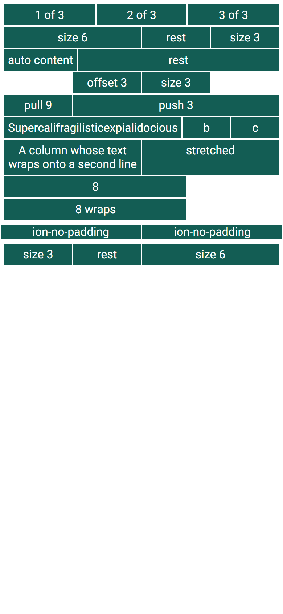
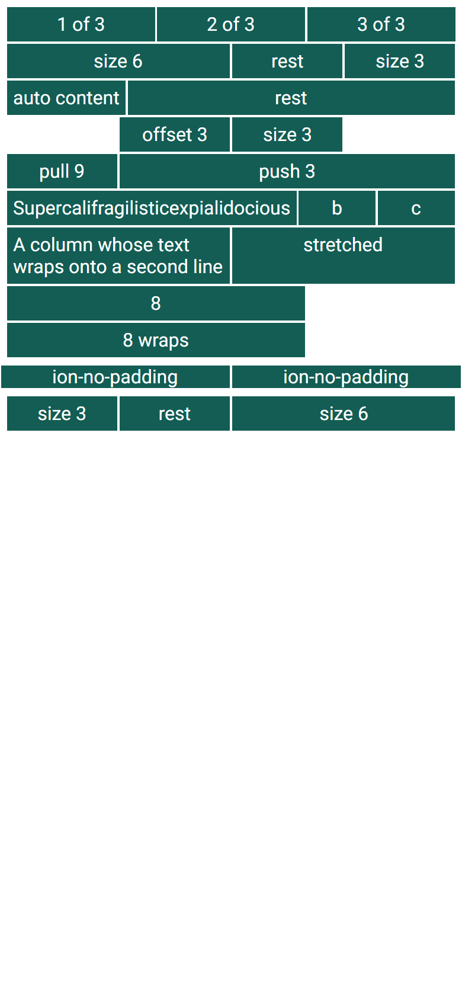

# ion-grid family — Comparison against the web component

> Ionic side, in [`ref/`](ref/) (Chromium, md, 390×844@2x):
>
> ```
> node tools/ionic-ref/render.js ion-grid --bare --html '<style>ion-col{background-color:#135d54;border:solid 1px #fff;color:#fff;text-align:center}</style><ion-grid><ion-row><ion-col>1 of 3</ion-col><ion-col>2 of 3</ion-col><ion-col>3 of 3</ion-col></ion-row><ion-row><ion-col size="6">size 6</ion-col><ion-col>rest</ion-col><ion-col size="3">size 3</ion-col></ion-row><ion-row><ion-col size="auto">auto content</ion-col><ion-col>rest</ion-col></ion-row><ion-row><ion-col size="3" offset="3">offset 3</ion-col><ion-col size="3">size 3</ion-col></ion-row><ion-row><ion-col size="9" push="3">push 3</ion-col><ion-col size="3" pull="9">pull 9</ion-col></ion-row><ion-row><ion-col>Supercalifragilisticexpialidocious</ion-col><ion-col>b</ion-col><ion-col>c</ion-col></ion-row><ion-row><ion-col size="6">A column whose text wraps onto a second line</ion-col><ion-col>stretched</ion-col></ion-row><ion-row><ion-col size="8">8</ion-col><ion-col size="8">8 wraps</ion-col></ion-row></ion-grid><ion-grid class="ion-no-padding"><ion-row><ion-col>ion-no-padding</ion-col><ion-col>ion-no-padding</ion-col></ion-row></ion-grid><ion-grid dir="rtl"><ion-row><ion-col size="6">size 6</ion-col><ion-col>rest</ion-col><ion-col size="3">size 3</ion-col></ion-row></ion-grid>'
> ```
>
> The style is Ionic's own demo style for a grid, so the columns show. Avonic side: `AVONIC_CAPTURE_DIR=… dotnet test` →
> `AvonicGridCaptureTests` (headless Skia, 2×) → `avonic-grid-page.png`, copied to [`compare/`](compare/) without the `grid-`,
> as capture tests share the folder. **Not tried in a real window.**
>
> The behaviours were measured with scripts outside the repo, in Chromium with `ion-app`, at the widths each row gives, with
> Roboto loaded as `render.js` loads it.

## Frames

| Ionic | Avonic |
|---|---|
|  |  |

From the top: equal columns; sizes 6, none and 3; auto; offset; push and pull; a long word; wrapped text with a stretched
neighbour; two 8s that wrap; a grid with `ion-no-padding`; and an RTL grid. **Match.** Compared pixel by pixel, as
column colour or not, every column edge is within one device pixel of Chromium's (at 2×, the top row differs only in
slivers a pixel wide at x = 265, 514, 518 and 768, on the white borders), and the text wraps at the same words. The rest of the 15,692 differing pixels,
out of 1,316,640, are glyph antialiasing. Avalonia rounds layout to device pixels, where Chromium keeps fractions, so at
1× an edge can be half a pixel off and a width a pixel wider. The tests allow 1 px for that, and nothing else needed it.

## Behaviours

The numbers are from [PLAN.md](PLAN.md#behaviours). Each has tests in `AvonicGridTests`, named after its number.

| # | Behaviour | Ionic | Result |
|---|---|---|---|
| 1 | Columns with no size share the row | 126.67 each | match |
| 2 | A size is n / 12, the rest share; a change re-lays; a templated column counts, a hidden one doesn't | 190, 95, 95; 190 after a change | match |
| 3 | Auto: content width, never wider than the row, then the next wraps | 99.83; 380 × 2 lines | match |
| 4 | Wrapping | two 8s, one under the other | match |
| 5 | Offset | x = 100; with no size, 68.33 and 158.33 wide | match |
| 6 | Push, pull, push wins, an invalid push leaves pull | 100, 5; 100; −26.66; no move for `push="0"` | match |
| 7 | Per breakpoint | 380, 283, 252.66, 245.5, 198.33 at 390 … 1200; `xs` beats the plain prop | match |
| 8 | An empty value goes back to no size | 126.67, 758, 1190 | match |
| 9 | The viewport, not the container | 145 in a 300 box at 768 | match |
| 10 | A resize re-lays the columns and the grid | the grid's padding at once, the column a frame later | match, with no lag: see below |
| 11 | Odd sizes | 142.5, 10, 10, 411.66, 15.83, 316.66; `abc` 36.06, `4.` 23.22 | match |
| 12 | Odd offsets and pushes | `0` none, `-1` 36.67, `11` 353.33, invalid ignored | match |
| 13 | `Avonic.GridColumns` | 6: 183 and an offset of 61 | match; a change re-lays, and 0 is 12 |
| 14 | Column padding | 2 and `-xs` 7: 7; `-md` 9 at 768, 5 at 390 and 1200; `-5px` 0 | match; a value that isn't a length is 0 too |
| 15 | Grid padding | 12; `-md` 20 at 800 | match |
| 16 | Fixed | 540 at x = 18, 720, 960, 1140; 300; 200; 150 in a 150 box | match |
| 17 | `ion-no-padding` | 0 on the grid and its columns; a nested grid keeps 5, its columns 0; an inline `-xs: 3px` wins at 390 and not at 768; on a column, 0 | match |
| 18 | Stretch, and `align-self` | 67 and 67; a `div` inside 19 at the top; start and center | match. `align-self` is the column's `VerticalAlignment` |
| 19 | The longest word; a clipping part; a grid inside | 244.11 and three of 45.3; a button's column 215.67; 126.67 with the inner columns stacked at 106.67 | match |
| 20 | Not a column | 58.94, the column the rest | match |
| 21 | RTL | 195, 163.33, 242.5, 290 | match, with `FlowDirection` on the window |
| 22 | Rows stack; an empty grid; an empty column | 380 at x = 5; 10; 1 | match |
| 23 | Text wraps; nothing clips | 67 high; 411.66 past the row, visible | match |
| 24 | `flex: 1` | 358 in an item; the rest after a `span` in a row: 345.22 | match |
| 25 | Arrow keys | focus stays | match |
| 26 | No role | not in the accessibility tree | match: not control elements, not lists; a button inside is still found |

## Known differences, in behaviour

| Difference | Measured | Why |
|---|---|---|
| A column follows a resize in the same layout pass. Ionic's grid padding changes in the `resize` event, and its columns one frame later | 45 ms padding, 60 ms the column, from a 390 to 800 resize | Stencil schedules the re-render. Nothing reads that frame |
| RTL is each column's `FlowDirection`. Ionic reads `document.dir`, so under a `dir="rtl"` element in an LTR page its offset lands at the end, and push and pull go the wrong way | offset 3: the column stayed at the start, x = 290, with the gap after it; push 3: x = 385, outside the row | A whole RTL app matches. The local case is a bug in Ionic |
| A size, offset, push or pull has to be a CSS number. Ionic pastes the string into `calc()` | `"3 + 1"` isn't tried | No one means an expression |
| Width variables are lengths | — | `Infinity` is the default `100%` |
| `Avonic.GridColumns` that isn't a positive number is 12 | — | CSS would divide by it |
| `min-content` is estimated, as `FlexRow` does | the long word's 244.11 matches | `Measure` can't report it |
| In a horizontally scrolling `ScrollViewer`, columns are content-wide on one line | — | Avalonia measures with no width there; re-laying at arrange loops |
| A column outside a row is a block. Ionic's is `display: inline` there | 41.45 wide in Chromium | Not how a column is used |
| **Not tested:** a grid in a `Popup` reads the window it belongs to | — | The headless platform has no popup windows, and throws. The code follows `PopupRoot.ParentTopLevel` |
