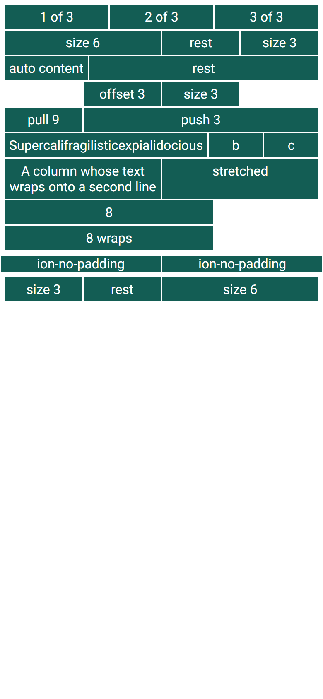
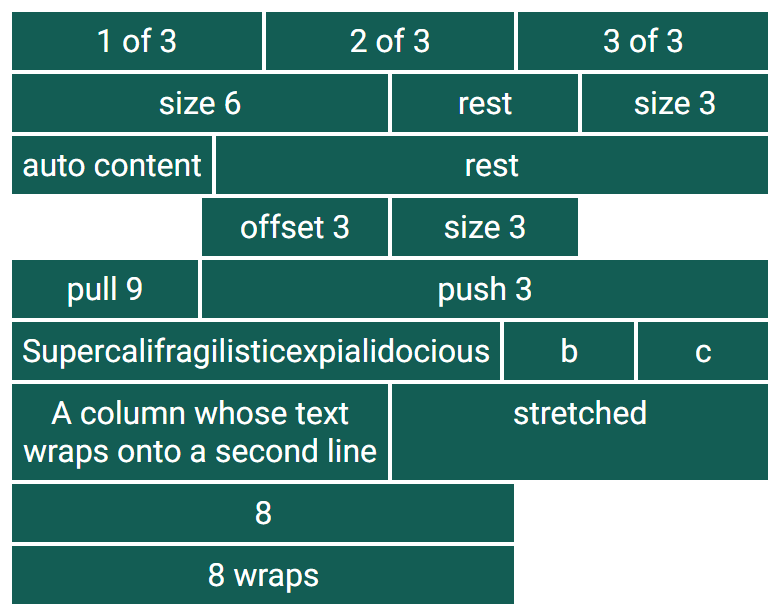

# ion-grid — reference render (Ionic 8.8.1, md, 390×844@2x)

Generated by `node tools/ionic-ref/render.js ion-grid --bare --html "<style>ion-col{background-color:#135d54;border:solid 1px #fff;color:#fff;text-align:center}</style><ion-grid><ion-row><ion-col>1 of 3</ion-col><ion-col>2 of 3</ion-col><ion-col>3 of 3</ion-col></ion-row><ion-row><ion-col size=\"6\">size 6</ion-col><ion-col>rest</ion-col><ion-col size=\"3\">size 3</ion-col></ion-row><ion-row><ion-col size=\"auto\">auto content</ion-col><ion-col>rest</ion-col></ion-row><ion-row><ion-col size=\"3\" offset=\"3\">offset 3</ion-col><ion-col size=\"3\">size 3</ion-col></ion-row><ion-row><ion-col size=\"9\" push=\"3\">push 3</ion-col><ion-col size=\"3\" pull=\"9\">pull 9</ion-col></ion-row><ion-row><ion-col>Supercalifragilisticexpialidocious</ion-col><ion-col>b</ion-col><ion-col>c</ion-col></ion-row><ion-row><ion-col size=\"6\">A column whose text wraps onto a second line</ion-col><ion-col>stretched</ion-col></ion-row><ion-row><ion-col size=\"8\">8</ion-col><ion-col size=\"8\">8 wraps</ion-col></ion-row></ion-grid><ion-grid class=\"ion-no-padding\"><ion-row><ion-col>ion-no-padding</ion-col><ion-col>ion-no-padding</ion-col></ion-row></ion-grid><ion-grid dir=\"rtl\"><ion-row><ion-col size=\"6\">size 6</ion-col><ion-col>rest</ion-col><ion-col size=\"3\">size 3</ion-col></ion-row></ion-grid>"`

```html
<style>ion-col{background-color:#135d54;border:solid 1px #fff;color:#fff;text-align:center}</style><ion-grid><ion-row><ion-col>1 of 3</ion-col><ion-col>2 of 3</ion-col><ion-col>3 of 3</ion-col></ion-row><ion-row><ion-col size="6">size 6</ion-col><ion-col>rest</ion-col><ion-col size="3">size 3</ion-col></ion-row><ion-row><ion-col size="auto">auto content</ion-col><ion-col>rest</ion-col></ion-row><ion-row><ion-col size="3" offset="3">offset 3</ion-col><ion-col size="3">size 3</ion-col></ion-row><ion-row><ion-col size="9" push="3">push 3</ion-col><ion-col size="3" pull="9">pull 9</ion-col></ion-row><ion-row><ion-col>Supercalifragilisticexpialidocious</ion-col><ion-col>b</ion-col><ion-col>c</ion-col></ion-row><ion-row><ion-col size="6">A column whose text wraps onto a second line</ion-col><ion-col>stretched</ion-col></ion-row><ion-row><ion-col size="8">8</ion-col><ion-col size="8">8 wraps</ion-col></ion-row></ion-grid><ion-grid class="ion-no-padding"><ion-row><ion-col>ion-no-padding</ion-col><ion-col>ion-no-padding</ion-col></ion-row></ion-grid><ion-grid dir="rtl"><ion-row><ion-col size="6">size 6</ion-col><ion-col>rest</ion-col><ion-col size="3">size 3</ion-col></ion-row></ion-grid>
```

 

## Element 1

- attributes: `{"class":"md hydrated"}`
- classes: `md hydrated`
- rect: `{"x":0,"y":0,"w":390,"h":308}`

### CSS custom properties (resolved)

| var | value |
|---|---|
| `--ion-grid-padding` | `(unset)` |
| `--ion-grid-padding-lg` | `(unset)` |
| `--ion-grid-padding-md` | `(unset)` |
| `--ion-grid-padding-sm` | `(unset)` |
| `--ion-grid-padding-xl` | `(unset)` |
| `--ion-grid-padding-xs` | `(unset)` |
| `--ion-grid-width` | `(unset)` |
| `--ion-grid-width-lg` | `(unset)` |
| `--ion-grid-width-md` | `(unset)` |
| `--ion-grid-width-sm` | `(unset)` |
| `--ion-grid-width-xl` | `(unset)` |
| `--ion-grid-width-xs` | `(unset)` |

### Host computed

| prop | value |
|---|---|
| display | `block` |
| position | `static` |
| box-sizing | `border-box` |
| width | `390px` |
| height | `308px` |
| min-height | `0px` |
| min-width | `0px` |
| padding | `5px` |
| margin | `0px` |
| border | `0px none rgb(0, 0, 0)` |
| border-radius | `0px` |
| background-color | `rgba(0, 0, 0, 0)` |
| color | `rgb(0, 0, 0)` |
| font-size | `16px` |
| font-weight | `400` |
| font-family | `Roboto, "Helvetica Neue", sans-serif` |
| line-height | `normal` |
| letter-spacing | `normal` |
| text-transform | `none` |
| opacity | `1` |
| overflow | `visible` |
| contain | `none` |
| pointer-events | `auto` |
| transition | `all` |
| transform | `none` |
| box-shadow | `none` |
| outline | `rgb(0, 0, 0) none 0px` |
| cursor | `auto` |

### DOM tree

```
<ion-grid>
  #shadow-root
    <slot name="">
  <ion-row.md.hydrated>
    #shadow-root
      <slot name="">
    <ion-col.md.hydrated>
      #shadow-root
        <slot name="">
    <ion-col.md.hydrated>
      #shadow-root
        <slot name="">
    <ion-col.md.hydrated>
      #shadow-root
        <slot name="">
  <ion-row.md.hydrated>
    #shadow-root
      <slot name="">
    <ion-col.md.hydrated>
      #shadow-root
        <slot name="">
    <ion-col.md.hydrated>
      #shadow-root
        <slot name="">
    <ion-col.md.hydrated>
      #shadow-root
        <slot name="">
  <ion-row.md.hydrated>
    #shadow-root
      <slot name="">
    <ion-col.md.hydrated>
      #shadow-root
        <slot name="">
    <ion-col.md.hydrated>
      #shadow-root
        <slot name="">
  <ion-row.md.hydrated>
    #shadow-root
      <slot name="">
    <ion-col.md.hydrated>
      #shadow-root
        <slot name="">
    <ion-col.md.hydrated>
      #shadow-root
        <slot name="">
  <ion-row.md.hydrated>
    #shadow-root
      <slot name="">
    <ion-col.md.hydrated>
      #shadow-root
        <slot name="">
    <ion-col.md.hydrated>
      #shadow-root
        <slot name="">
  <ion-row.md.hydrated>
    #shadow-root
      <slot name="">
    <ion-col.md.hydrated>
      #shadow-root
        <slot name="">
    <ion-col.md.hydrated>
      #shadow-root
        <slot name="">
    <ion-col.md.hydrated>
      #shadow-root
        <slot name="">
  <ion-row.md.hydrated>
    #shadow-root
      <slot name="">
    <ion-col.md.hydrated>
      #shadow-root
        <slot name="">
    <ion-col.md.hydrated>
      #shadow-root
        <slot name="">
  <ion-row.md.hydrated>
    #shadow-root
      <slot name="">
    <ion-col.md.hydrated>
      #shadow-root
        <slot name="">
    <ion-col.md.hydrated>
      #shadow-root
        <slot name="">
```

## Element 2

- attributes: `{"class":"ion-no-padding md hydrated"}`
- classes: `ion-no-padding md hydrated`
- rect: `{"x":0,"y":308,"w":390,"h":21}`

### CSS custom properties (resolved)

| var | value |
|---|---|
| `--ion-grid-padding` | `(unset)` |
| `--ion-grid-padding-lg` | `(unset)` |
| `--ion-grid-padding-md` | `(unset)` |
| `--ion-grid-padding-sm` | `(unset)` |
| `--ion-grid-padding-xl` | `(unset)` |
| `--ion-grid-padding-xs` | `(unset)` |
| `--ion-grid-width` | `(unset)` |
| `--ion-grid-width-lg` | `(unset)` |
| `--ion-grid-width-md` | `(unset)` |
| `--ion-grid-width-sm` | `(unset)` |
| `--ion-grid-width-xl` | `(unset)` |
| `--ion-grid-width-xs` | `(unset)` |

### Host computed

| prop | value |
|---|---|
| display | `block` |
| position | `static` |
| box-sizing | `border-box` |
| width | `390px` |
| height | `21px` |
| min-height | `0px` |
| min-width | `0px` |
| padding | `0px` |
| margin | `0px` |
| border | `0px none rgb(0, 0, 0)` |
| border-radius | `0px` |
| background-color | `rgba(0, 0, 0, 0)` |
| color | `rgb(0, 0, 0)` |
| font-size | `16px` |
| font-weight | `400` |
| font-family | `Roboto, "Helvetica Neue", sans-serif` |
| line-height | `normal` |
| letter-spacing | `normal` |
| text-transform | `none` |
| opacity | `1` |
| overflow | `visible` |
| contain | `none` |
| pointer-events | `auto` |
| transition | `all` |
| transform | `none` |
| box-shadow | `none` |
| outline | `rgb(0, 0, 0) none 0px` |
| cursor | `auto` |

### DOM tree

```
<ion-grid>
  #shadow-root
    <slot name="">
  <ion-row.md.hydrated>
    #shadow-root
      <slot name="">
    <ion-col.md.hydrated>
      #shadow-root
        <slot name="">
    <ion-col.md.hydrated>
      #shadow-root
        <slot name="">
```

## Element 3

- attributes: `{"dir":"rtl","class":"md hydrated"}`
- classes: `md hydrated`
- rect: `{"x":0,"y":329,"w":390,"h":41}`

### CSS custom properties (resolved)

| var | value |
|---|---|
| `--ion-grid-padding` | `(unset)` |
| `--ion-grid-padding-lg` | `(unset)` |
| `--ion-grid-padding-md` | `(unset)` |
| `--ion-grid-padding-sm` | `(unset)` |
| `--ion-grid-padding-xl` | `(unset)` |
| `--ion-grid-padding-xs` | `(unset)` |
| `--ion-grid-width` | `(unset)` |
| `--ion-grid-width-lg` | `(unset)` |
| `--ion-grid-width-md` | `(unset)` |
| `--ion-grid-width-sm` | `(unset)` |
| `--ion-grid-width-xl` | `(unset)` |
| `--ion-grid-width-xs` | `(unset)` |

### Host computed

| prop | value |
|---|---|
| display | `block` |
| position | `static` |
| box-sizing | `border-box` |
| width | `390px` |
| height | `41px` |
| min-height | `0px` |
| min-width | `0px` |
| padding | `5px` |
| margin | `0px` |
| border | `0px none rgb(0, 0, 0)` |
| border-radius | `0px` |
| background-color | `rgba(0, 0, 0, 0)` |
| color | `rgb(0, 0, 0)` |
| font-size | `16px` |
| font-weight | `400` |
| font-family | `Roboto, "Helvetica Neue", sans-serif` |
| line-height | `normal` |
| letter-spacing | `normal` |
| text-transform | `none` |
| opacity | `1` |
| overflow | `visible` |
| contain | `none` |
| pointer-events | `auto` |
| transition | `all` |
| transform | `none` |
| box-shadow | `none` |
| outline | `rgb(0, 0, 0) none 0px` |
| cursor | `auto` |

### DOM tree

```
<ion-grid>
  #shadow-root
    <slot name="">
  <ion-row.md.hydrated>
    #shadow-root
      <slot name="">
    <ion-col.md.hydrated>
      #shadow-root
        <slot name="">
    <ion-col.md.hydrated>
      #shadow-root
        <slot name="">
    <ion-col.md.hydrated>
      #shadow-root
        <slot name="">
```
