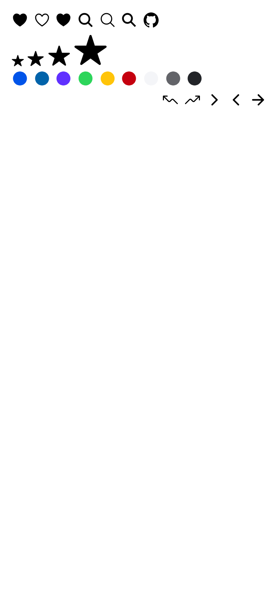
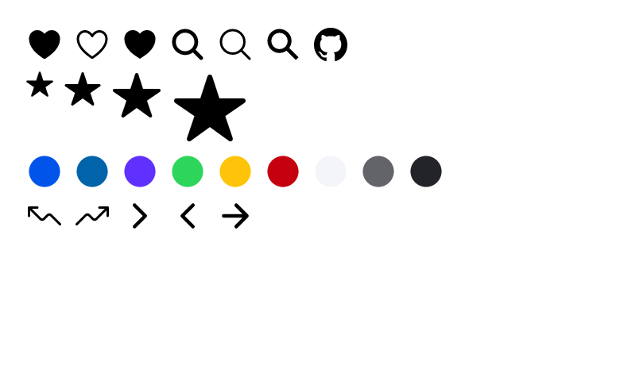
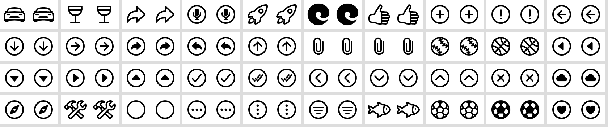

# ion-icon — Comparison against the web component

> Ionic side: `node tools/ionic-ref/render.js ion-icon` (Chromium, md, 390×844@2x) → [`ref/`](ref/).
> Avonic side: `AVONIC_CAPTURE_DIR=… dotnet test` → `AvonicIconCaptureTests` (headless Skia, 2×) → [`compare/`](compare/).
> Every icon: `node tools/ionic-ref/compare-icons.js <capture dir>`.

## Frames

| Ionic | Avonic |
|---|---|
|  |  |

Rows from the top: variants, sizes, the nine colours, and right-to-left. **Match.** Icons sit slightly differently
because Ionic aligns inline elements to a text baseline, and this capture uses a plain row. In the last row, Ionic's
sits on the right because the row itself is `dir="rtl"`, and this capture aligns it left. Both read the same in
order, with the same icons flipped.

## Every icon

All 1357 icons at 32 px, 2×, black on white, in the same grid on both sides. A pixel differs if a channel is off by
more than 25%.

| | Result |
|---|---|
| Icons with no differing pixel | **1238** of 1357 |
| Differing pixels per icon | median 0, 99th percentile 2, **max 11** |
| Icons differing by over 1% of their ink | 3 |
| Icons differing by over 5% of their ink | **0** |
| Mean absolute difference, 0–255 | average 0.40, max 1.46 |

The 40 worst pairs, with Chromium on the left of each. Nothing here is visible at normal size: the remaining
differences are anti-aliasing, along curves.

**This comparison found a real bug.** With `StreamGeometry.Parse` alone, six icons differed by over 5% of their ink,
the worst by 237 pixels, and `wifi-outline`, `infinite` and `logo-playstation` were visibly warped. Their paths have
a smooth curve after a non-curve command. `SvgPath` corrects the path data for the 39 icons affected, and fixed all
six. See [PLAN.md](PLAN.md#streamgeometryparse-in-avalonia-1214).

## Behaviours

The numbers are from [PLAN.md](PLAN.md#behaviours). Each is covered in `AvonicIconTests`, `IconResolverTests`,
`SvgPathTests` or `IconArtworkTests`. The Ionic results were measured in Chromium with computed styles.

| # | Behaviour | Ionic | Result |
|---|---|---|---|
| 1 | `src` beats everything, if it contains `/` or `.` | from `getUrl` | match |
| 2 | `md` beats `name`, and `name` beats `icon` | `md="star"` drew the star | match |
| 3 | `icon` is a name, or a source if it contains `/` or `.` | from `getName` | match |
| 4 | Names are lowercased | `HEART` drew the heart | match |
| 5 | An invalid or blank name resolves to nothing | `he_art`: no SVG | match |
| 6 | Unknown, missing or no icon: full-size box, nothing painted | 20×20, no SVG | match |
| 7 | A registered name beats the bundle; changes reload, except a change to no icon keeps the last | from `getNamedUrl`, `if (url)` in `loadIcon` | match |
| 8 | `addCircle` also registers `add-circle` | from `addIcons` | match |
| 9 | The first registration of a name wins | from `addToIconMap` | match |
| 10 | The box is `1em` square, and doesn't stretch | `font-size: 40px` gave 40×40; `display: inline-block` | match |
| 11 | `Size` gives 18 or 32 and beats `FontSize` | 18×18 with `font-size: 40px` | match |
| 12 | An explicit box wins, with the artwork centred | 64×32 | match |
| 13 | Painting is clipped to the box | `contain: strict`, `overflow: hidden` | match |
| 14 | Fill and stroke follow the inherited colour | `rgb(0, 255, 0)` | match |
| 15 | `Color` gives the base and beats a local colour | `rgb(197, 0, 15)` with `color: lime` | match |
| 16 | An unknown `Color` falls back to the inherited colour | `rgb(0, 0, 0)` | match |
| 17 | An unknown `Color` in a coloured ancestor uses its base | from [#2](../../infra/color-system/PLAN.md#measured-behaviour) | match |
| 18 | In RTL, arrows and chevrons flip, unless `FlipRtl` is false | `matrix(-1, 0, 0, 1, 0, 0)` | match |
| 19 | The flip check uses the name even with `Src` | `flip-rtl` class present | match |
| 20 | Nothing flips in LTR | `matrix(1, 0, 0, 1, 0, 0)` | match |
| 21 | `.ionicon` gives every element a stroke, 1 unit by default | `stroke-width: 1px` on a filled shape | match |
| 22 | Butt cap, miter join, miter limit 4 | `butt`, `miter`, `4` | match |
| 23 | Fill rule defaults to nonzero | browser default | match |
| 24 | Attributes inherit, and transforms compose | browser default | match |
| 25 | `.ionicon-fill-none`, and `.ionicon-stroke-width` with its variable | `8px`, or `32px` by default | match |
| 26 | `<script>`, `on*` or a non-SVG root is blank | `/evil.svg`: no SVG | match |
| 27 | `role="img"`, with a label | `role="img"` | match |
| — | `--ionicon-stroke-width` doesn't affect built-in icons | stayed at `48px` | match |
| — | An unknown size has no effect | `size="huge"` stayed 20×20 | not representable: `IconSize` is an enum |

## Deliberate differences

| Difference | Why |
|---|---|
| `name` is `IconName` | `StyledElement.Name` already exists |
| `ios`, `mode`, `lazy` and `sanitize` aren't declared, and `icon` doesn't take `{ ios, md }` | Each would be a dead prop here. See the [checklist](PLAN.md#props-11) |
| `http(s)` and relative sources are blank | Fetching is deferred, and there's no page to be relative to. See [Sources](PLAN.md#sources) |
| A subset of SVG | Covers every built-in icon. Gradients, `<text>`, `<image>` and `style=` aren't drawn in a custom SVG |
| A default size from Avalonia's `FontSize`, not 16 px | The `1em` rule matches. A page-level default isn't this control's decision |
| An SVG with unsafe content is always blank | Ionic can turn this off with `sanitize`. Nothing executes here, so there's no reason to |
| In a custom SVG, a malformed path draws nothing, and so do valid numbers like `+1` | Ionic's browser keeps the part before an error. Avalonia's parser doesn't, and no built-in icon is affected |
| A custom SVG has to be well-formed XML, with at most 256 levels of nesting | Ionic's `innerHTML` is more forgiving. No built-in icon is affected |

## Gaps

None. Remote sources are a documented omission rather than an open gap in the control.
