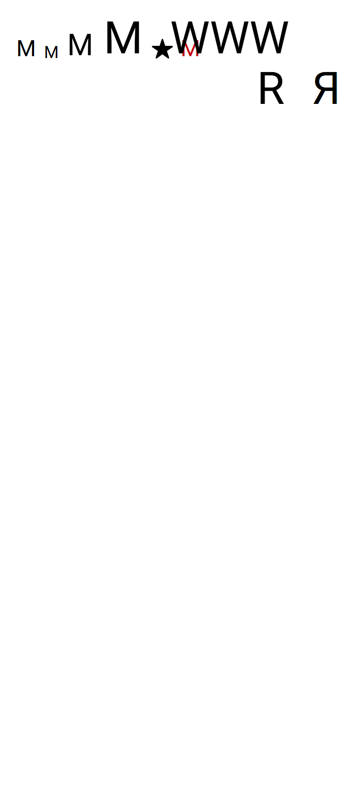
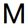

# ion-icon — reference render (Ionic 9.0.11, md, 390×844@2x)

Generated by `node tools/ionic-ref/render.js ion-icon --html "<div style=\"font-size:24px\"><ion-icon><span>M</span></ion-icon> <ion-icon size=\"small\"><span style=\"font-size:40px\">M</span></ion-icon> <ion-icon size=\"large\"><span>M</span></ion-icon> <ion-icon style=\"font-size:48px\"><span>M</span></ion-icon> <ion-icon name=\"star\"><span>M</span></ion-icon> <ion-icon color=\"danger\"><span>M</span></ion-icon> <ion-icon style=\"font-size:48px\"><span>WWW</span></ion-icon></div><div style=\"font-size:48px\" dir=\"rtl\"><ion-icon flip-rtl=\"true\"><span>R</span></ion-icon> <ion-icon><span>R</span></ion-icon></div>" --out docs/components/ion-icon/ref-font`

```html
<div style="font-size:24px"><ion-icon><span>M</span></ion-icon> <ion-icon size="small"><span style="font-size:40px">M</span></ion-icon> <ion-icon size="large"><span>M</span></ion-icon> <ion-icon style="font-size:48px"><span>M</span></ion-icon> <ion-icon name="star"><span>M</span></ion-icon> <ion-icon color="danger"><span>M</span></ion-icon> <ion-icon style="font-size:48px"><span>WWW</span></ion-icon></div><div style="font-size:48px" dir="rtl"><ion-icon flip-rtl="true"><span>R</span></ion-icon> <ion-icon><span>R</span></ion-icon></div>
```

 

## Element 1

- attributes: `{"role":"img","class":"md hydrated"}`
- classes: `md hydrated`
- rect: `{"x":16,"y":40,"w":24,"h":24}`

### CSS custom properties (resolved)

| var | value |
|---|---|
| `--ionicon-stroke-width` | `(unset)` |

### Host computed

| prop | value |
|---|---|
| display | `inline-block` |
| position | `static` |
| box-sizing | `content-box` |
| width | `24px` |
| height | `24px` |
| min-height | `0px` |
| min-width | `0px` |
| padding | `0px` |
| margin | `0px` |
| border | `0px none rgb(0, 0, 0)` |
| border-radius | `0px` |
| background-color | `rgba(0, 0, 0, 0)` |
| color | `rgb(0, 0, 0)` |
| font-size | `24px` |
| font-weight | `400` |
| font-family | `Roboto, "Helvetica Neue", sans-serif` |
| line-height | `normal` |
| letter-spacing | `normal` |
| text-transform | `none` |
| opacity | `1` |
| overflow | `visible` |
| contain | `layout style` |
| pointer-events | `auto` |
| transition | `all` |
| transform | `none` |
| box-shadow | `none` |
| outline | `rgb(0, 0, 0) none 0px` |
| cursor | `auto` |

### DOM tree

```
<ion-icon>
  #shadow-root
    <div.icon-inner>
      <slot name="">
  <span>
```

## Element 2

- attributes: `{"size":"small","role":"img","class":"md icon-small hydrated"}`
- classes: `md icon-small hydrated`
- rect: `{"x":45.95,"y":46,"w":18,"h":18}`

### CSS custom properties (resolved)

| var | value |
|---|---|
| `--ionicon-stroke-width` | `(unset)` |

### Host computed

| prop | value |
|---|---|
| display | `inline-block` |
| position | `static` |
| box-sizing | `content-box` |
| width | `18px` |
| height | `18px` |
| min-height | `0px` |
| min-width | `0px` |
| padding | `0px` |
| margin | `0px` |
| border | `0px none rgb(0, 0, 0)` |
| border-radius | `0px` |
| background-color | `rgba(0, 0, 0, 0)` |
| color | `rgb(0, 0, 0)` |
| font-size | `18px` |
| font-weight | `400` |
| font-family | `Roboto, "Helvetica Neue", sans-serif` |
| line-height | `normal` |
| letter-spacing | `normal` |
| text-transform | `none` |
| opacity | `1` |
| overflow | `visible` |
| contain | `layout style` |
| pointer-events | `auto` |
| transition | `all` |
| transform | `none` |
| box-shadow | `none` |
| outline | `rgb(0, 0, 0) none 0px` |
| cursor | `auto` |

### DOM tree

```
<ion-icon>
  #shadow-root
    <div.icon-inner>
      <slot name="">
  <span>
```

## Element 3

- attributes: `{"size":"large","role":"img","class":"md icon-large hydrated"}`
- classes: `md icon-large hydrated`
- rect: `{"x":69.91,"y":32,"w":32,"h":32}`

### CSS custom properties (resolved)

| var | value |
|---|---|
| `--ionicon-stroke-width` | `(unset)` |

### Host computed

| prop | value |
|---|---|
| display | `inline-block` |
| position | `static` |
| box-sizing | `content-box` |
| width | `32px` |
| height | `32px` |
| min-height | `0px` |
| min-width | `0px` |
| padding | `0px` |
| margin | `0px` |
| border | `0px none rgb(0, 0, 0)` |
| border-radius | `0px` |
| background-color | `rgba(0, 0, 0, 0)` |
| color | `rgb(0, 0, 0)` |
| font-size | `32px` |
| font-weight | `400` |
| font-family | `Roboto, "Helvetica Neue", sans-serif` |
| line-height | `normal` |
| letter-spacing | `normal` |
| text-transform | `none` |
| opacity | `1` |
| overflow | `visible` |
| contain | `layout style` |
| pointer-events | `auto` |
| transition | `all` |
| transform | `none` |
| box-shadow | `none` |
| outline | `rgb(0, 0, 0) none 0px` |
| cursor | `auto` |

### DOM tree

```
<ion-icon>
  #shadow-root
    <div.icon-inner>
      <slot name="">
  <span>
```

## Element 4

- attributes: `{"style":"font-size:48px","role":"img","class":"md hydrated"}`
- classes: `md hydrated`
- rect: `{"x":107.86,"y":16,"w":48,"h":48}`

### CSS custom properties (resolved)

| var | value |
|---|---|
| `--ionicon-stroke-width` | `(unset)` |

### Host computed

| prop | value |
|---|---|
| display | `inline-block` |
| position | `static` |
| box-sizing | `content-box` |
| width | `48px` |
| height | `48px` |
| min-height | `0px` |
| min-width | `0px` |
| padding | `0px` |
| margin | `0px` |
| border | `0px none rgb(0, 0, 0)` |
| border-radius | `0px` |
| background-color | `rgba(0, 0, 0, 0)` |
| color | `rgb(0, 0, 0)` |
| font-size | `48px` |
| font-weight | `400` |
| font-family | `Roboto, "Helvetica Neue", sans-serif` |
| line-height | `normal` |
| letter-spacing | `normal` |
| text-transform | `none` |
| opacity | `1` |
| overflow | `visible` |
| contain | `layout style` |
| pointer-events | `auto` |
| transition | `all` |
| transform | `none` |
| box-shadow | `none` |
| outline | `rgb(0, 0, 0) none 0px` |
| cursor | `auto` |

### DOM tree

```
<ion-icon>
  #shadow-root
    <div.icon-inner>
      <slot name="">
  <span>
```

## Element 5

- attributes: `{"name":"star","role":"img","class":"md hydrated"}`
- classes: `md hydrated`
- rect: `{"x":161.81,"y":40,"w":24,"h":24}`

### CSS custom properties (resolved)

| var | value |
|---|---|
| `--ionicon-stroke-width` | `(unset)` |

### Host computed

| prop | value |
|---|---|
| display | `inline-block` |
| position | `static` |
| box-sizing | `content-box` |
| width | `24px` |
| height | `24px` |
| min-height | `0px` |
| min-width | `0px` |
| padding | `0px` |
| margin | `0px` |
| border | `0px none rgb(0, 0, 0)` |
| border-radius | `0px` |
| background-color | `rgba(0, 0, 0, 0)` |
| color | `rgb(0, 0, 0)` |
| font-size | `24px` |
| font-weight | `400` |
| font-family | `Roboto, "Helvetica Neue", sans-serif` |
| line-height | `normal` |
| letter-spacing | `normal` |
| text-transform | `none` |
| opacity | `1` |
| overflow | `visible` |
| contain | `layout style` |
| pointer-events | `auto` |
| transition | `all` |
| transform | `none` |
| box-shadow | `none` |
| outline | `rgb(0, 0, 0) none 0px` |
| cursor | `auto` |

### DOM tree

```
<ion-icon>
  #shadow-root
    <div.icon-inner>
      <svg>
        <path>
  <span>
```

## Element 6

- attributes: `{"color":"danger","role":"img","class":"md ion-color ion-color-danger hydrated"}`
- classes: `md ion-color ion-color-danger hydrated`
- rect: `{"x":191.77,"y":40,"w":24,"h":24}`

### CSS custom properties (resolved)

| var | value |
|---|---|
| `--ionicon-stroke-width` | `(unset)` |

### Host computed

| prop | value |
|---|---|
| display | `inline-block` |
| position | `static` |
| box-sizing | `content-box` |
| width | `24px` |
| height | `24px` |
| min-height | `0px` |
| min-width | `0px` |
| padding | `0px` |
| margin | `0px` |
| border | `0px none rgb(197, 0, 15)` |
| border-radius | `0px` |
| background-color | `rgba(0, 0, 0, 0)` |
| color | `rgb(197, 0, 15)` |
| font-size | `24px` |
| font-weight | `400` |
| font-family | `Roboto, "Helvetica Neue", sans-serif` |
| line-height | `normal` |
| letter-spacing | `normal` |
| text-transform | `none` |
| opacity | `1` |
| overflow | `visible` |
| contain | `layout style` |
| pointer-events | `auto` |
| transition | `all` |
| transform | `none` |
| box-shadow | `none` |
| outline | `rgb(197, 0, 15) none 0px` |
| cursor | `auto` |

### DOM tree

```
<ion-icon>
  #shadow-root
    <div.icon-inner>
      <slot name="">
  <span>
```

## Element 7

- attributes: `{"style":"font-size:48px","role":"img","class":"md hydrated"}`
- classes: `md hydrated`
- rect: `{"x":221.72,"y":16,"w":48,"h":48}`

### CSS custom properties (resolved)

| var | value |
|---|---|
| `--ionicon-stroke-width` | `(unset)` |

### Host computed

| prop | value |
|---|---|
| display | `inline-block` |
| position | `static` |
| box-sizing | `content-box` |
| width | `48px` |
| height | `48px` |
| min-height | `0px` |
| min-width | `0px` |
| padding | `0px` |
| margin | `0px` |
| border | `0px none rgb(0, 0, 0)` |
| border-radius | `0px` |
| background-color | `rgba(0, 0, 0, 0)` |
| color | `rgb(0, 0, 0)` |
| font-size | `48px` |
| font-weight | `400` |
| font-family | `Roboto, "Helvetica Neue", sans-serif` |
| line-height | `normal` |
| letter-spacing | `normal` |
| text-transform | `none` |
| opacity | `1` |
| overflow | `visible` |
| contain | `layout style` |
| pointer-events | `auto` |
| transition | `all` |
| transform | `none` |
| box-shadow | `none` |
| outline | `rgb(0, 0, 0) none 0px` |
| cursor | `auto` |

### DOM tree

```
<ion-icon>
  #shadow-root
    <div.icon-inner>
      <slot name="">
  <span>
```

## Element 8

- attributes: `{"flip-rtl":"true","role":"img","class":"md flip-rtl hydrated"}`
- classes: `md flip-rtl hydrated`
- rect: `{"x":326,"y":70,"w":48,"h":48}`

### CSS custom properties (resolved)

| var | value |
|---|---|
| `--ionicon-stroke-width` | `(unset)` |

### Host computed

| prop | value |
|---|---|
| display | `inline-block` |
| position | `static` |
| box-sizing | `content-box` |
| width | `48px` |
| height | `48px` |
| min-height | `0px` |
| min-width | `0px` |
| padding | `0px` |
| margin | `0px` |
| border | `0px none rgb(0, 0, 0)` |
| border-radius | `0px` |
| background-color | `rgba(0, 0, 0, 0)` |
| color | `rgb(0, 0, 0)` |
| font-size | `48px` |
| font-weight | `400` |
| font-family | `Roboto, "Helvetica Neue", sans-serif` |
| line-height | `normal` |
| letter-spacing | `normal` |
| text-transform | `none` |
| opacity | `1` |
| overflow | `visible` |
| contain | `layout style` |
| pointer-events | `auto` |
| transition | `all` |
| transform | `none` |
| box-shadow | `none` |
| outline | `rgb(0, 0, 0) none 0px` |
| cursor | `auto` |

### DOM tree

```
<ion-icon>
  #shadow-root
    <div.icon-inner>
      <slot name="">
  <span>
```

## Element 9

- attributes: `{"role":"img","class":"md hydrated"}`
- classes: `md hydrated`
- rect: `{"x":266.09,"y":70,"w":48,"h":48}`

### CSS custom properties (resolved)

| var | value |
|---|---|
| `--ionicon-stroke-width` | `(unset)` |

### Host computed

| prop | value |
|---|---|
| display | `inline-block` |
| position | `static` |
| box-sizing | `content-box` |
| width | `48px` |
| height | `48px` |
| min-height | `0px` |
| min-width | `0px` |
| padding | `0px` |
| margin | `0px` |
| border | `0px none rgb(0, 0, 0)` |
| border-radius | `0px` |
| background-color | `rgba(0, 0, 0, 0)` |
| color | `rgb(0, 0, 0)` |
| font-size | `48px` |
| font-weight | `400` |
| font-family | `Roboto, "Helvetica Neue", sans-serif` |
| line-height | `normal` |
| letter-spacing | `normal` |
| text-transform | `none` |
| opacity | `1` |
| overflow | `visible` |
| contain | `layout style` |
| pointer-events | `auto` |
| transition | `all` |
| transform | `none` |
| box-shadow | `none` |
| outline | `rgb(0, 0, 0) none 0px` |
| cursor | `auto` |

### DOM tree

```
<ion-icon>
  #shadow-root
    <div.icon-inner>
      <slot name="">
  <span>
```
