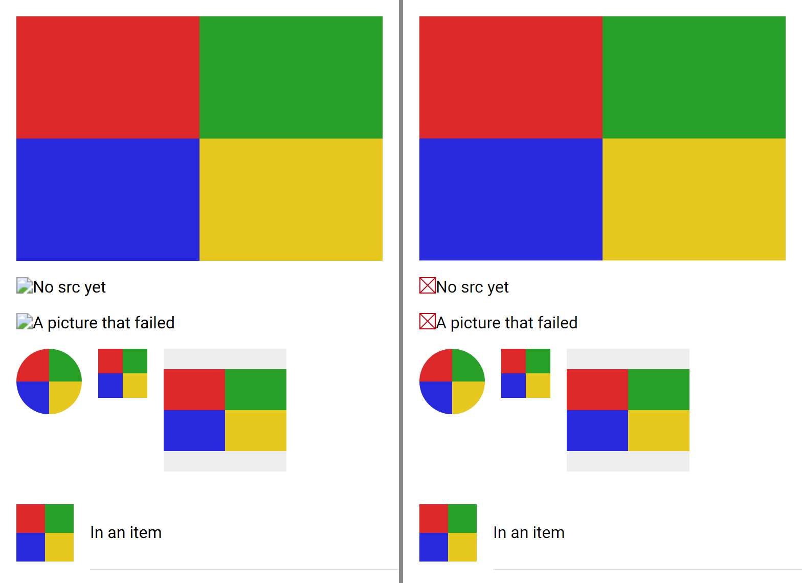
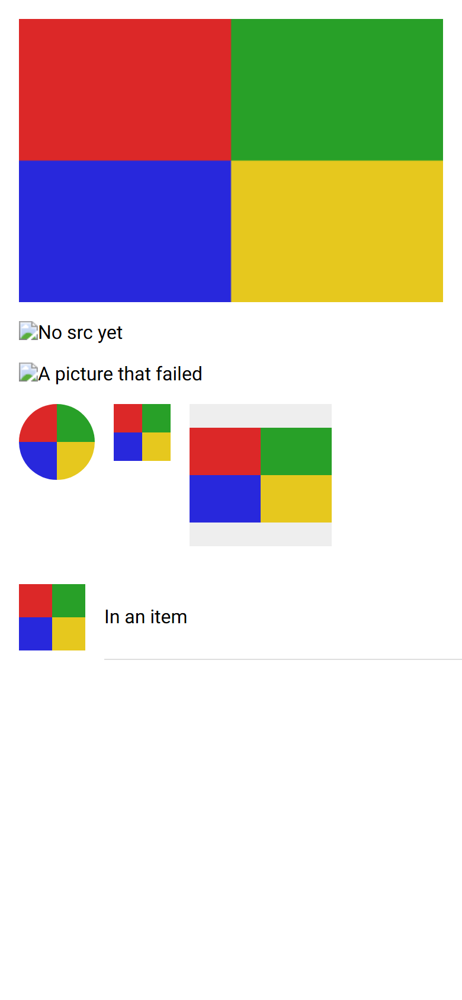
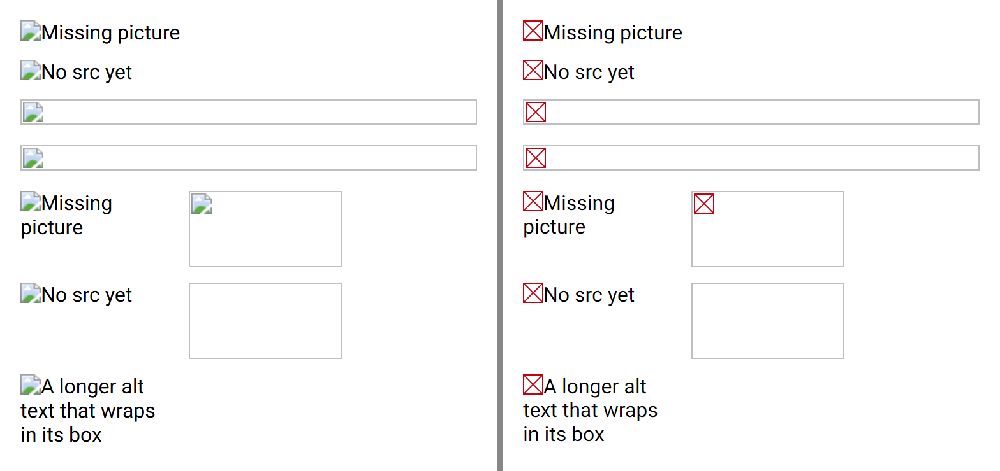
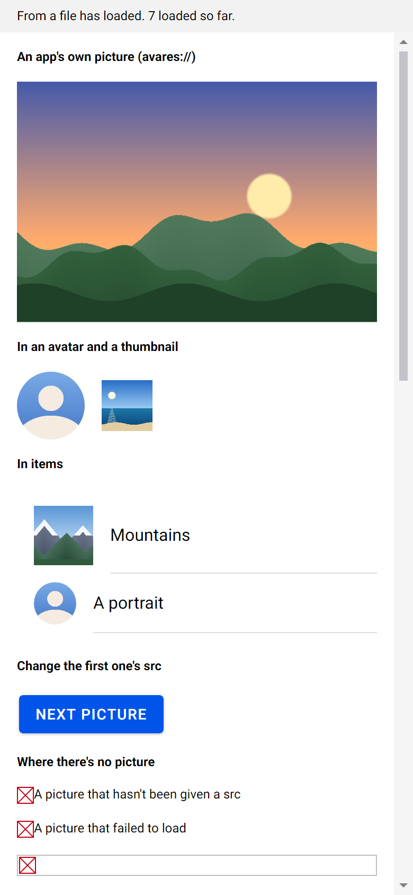

# ion-img — Comparison against the web component

> Ionic side (Chromium, md, 390×844@2x) → [`ref/`](ref/). The exact command:
>
> ```
> node tools/ionic-ref/render.js ion-img --bare --html '<div style="padding:16px"><ion-img src="/docs/components/ion-img/picture.png" alt="Four quarters"></ion-img><ion-img alt="No src yet" style="margin-top:16px"></ion-img><ion-img src="/docs/components/ion-img/missing.png" alt="A picture that failed" style="margin-top:16px"></ion-img><div style="display:flex;gap:16px;margin-top:16px;align-items:flex-start"><ion-avatar><ion-img src="/docs/components/ion-img/picture.png"></ion-img></ion-avatar><ion-thumbnail><ion-img src="/docs/components/ion-img/picture.png"></ion-img></ion-thumbnail><ion-img src="/docs/components/ion-img/picture.png" style="width:120px;height:120px;background:#eee"></ion-img></div></div><ion-list><ion-item><ion-thumbnail slot="start"><ion-img src="/docs/components/ion-img/picture.png"></ion-img></ion-thumbnail><ion-label>In an item</ion-label></ion-item></ion-list>'
> ```
>
> [`picture.png`](picture.png) is the 300 × 200 picture of four quarters the measuring scripts served, and `missing.png` is a
> 404, which is `ref/dump.json`'s one console error. The behaviours were measured by throwaway `playwright-core` scripts that
> served the same picture with a delay, a 404 and a file that isn't a picture: see [PLAN.md](PLAN.md#measured).
>
> Avonic side: `AVONIC_CAPTURE_DIR=… dotnet test` → `AvonicImgCaptureTests` (headless Skia, 2×), with `FakeLoader` giving the
> same picture, drawn by `TestPicture`, and failing `missing.png`. It writes `avonic-img-page.png`, as capture tests share the
> folder, which is copied to [`compare/avonic-page.png`](compare/avonic-page.png).

> The broken image, with no picture: [`ref-broken/`](ref-broken/), from
>
> ```
> node tools/ionic-ref/render.js ion-img --bare --out docs/components/ion-img/ref-broken --html '<div style="padding:16px"><div style="margin-bottom:12px"><ion-img alt="Missing picture" src="/docs/components/ion-img/missing.png"></ion-img></div><div style="margin-bottom:12px"><ion-img alt="No src yet"></ion-img></div><div style="margin-bottom:12px"><ion-img src="/docs/components/ion-img/missing.png"></ion-img></div><div style="margin-bottom:12px"><ion-img alt="" src="/docs/components/ion-img/missing.png"></ion-img></div><div style="display:flex;flex-wrap:wrap;gap:12px"><ion-img alt="Missing picture" src="/docs/components/ion-img/missing.png" style="width:120px;height:60px"></ion-img><ion-img src="/docs/components/ion-img/missing.png" style="width:120px;height:60px"></ion-img><ion-img alt="No src yet" style="width:120px;height:60px"></ion-img><ion-img style="width:120px;height:60px"></ion-img><ion-img alt="A longer alt text that wraps in its box" src="/docs/components/ion-img/missing.png" style="width:120px;height:60px"></ion-img></div></div>'
> ```
>
> and `AvonicImgCaptureTests.Broken_Image_Page`, which writes `avonic-img-broken.png`, copied to
> [`compare/avonic-broken.png`](compare/avonic-broken.png).

## Frames

The top 570 px of each. Ionic on the left, Avonic on the right:



| Ionic | Avonic |
|---|---|
|  |  |

From the top: the picture at the page's width, an `ion-img` with no `src`, one whose `src` is a 404, then one in an avatar, one in
a thumbnail and one in a 120 × 120 box with a grey background, and one in a thumbnail in an item.

**Match.** The picture is 358 × 238.66 on both, contained in the 120 box at 120 × 80 in the middle, and covers the avatar (cut to
a circle), the thumbnail and the item's thumbnail, cropped from the middle. The alt texts are 19 high, in the inherited 16 px
Roboto, after a 16 px broken-image icon: Chromium's artwork on the left, Avonic's own drawing on the right, in the same place.

### The broken image

The top 370 px of each, Ionic on the left:



From the top: an alt text and a 404; an alt text and no `src`; a 404 with no alt; a 404 with `alt=""`; then boxes of 120 × 60: an
alt text and a 404, a 404 with no alt, an alt text and no `src`, neither, and a longer alt text that wraps.

**Match, but for the icon's artwork.** The icon is 16 × 16 at the top left, and the text starts at x 16 and wraps to x 0; with no
alt, the box is 358 × 20 in a line 24 high, with a 1 px grey border and the icon at 2, 2, or fills a box of its own size; and a box
with no `src` and no alt has no icon. The border is `#BFBFBF`, where Chromium's is `rgb(192, 192, 192)`.

The sample's page, headless, with the pictures it ships as `avares://` resources, and the broken image below them. It needs the
line proposed for `Avonic.Sample.csproj` in the PR; this frame was taken with it applied:



## Behaviours

The numbers are from [PLAN.md](PLAN.md#behaviours). Each has tests in `AvonicImgTests` or `AvonicImgLoaderTests`, named after its
number.

| # | Behaviour | Ionic | Result |
|---|---|---|---|
| 1 | Loads when it intersects the viewport | `ionImgWillLoad` at the first observer callback, then `ionImgDidLoad` | match: `IonImgWillLoad` after the first layout pass, `IonImgDidLoad` when the picture is shown |
| 2 | The viewport's edge, no margin | in an `ion-content` 844 high: 843 and 844 load, 845 waits for a scroll of 1 px | match, in a `ScrollViewer` 844 high at the same three, and in an `AvonicContent` scrolled to it; and one that grows into a clip |
| 3 | Clipped by an ancestor | outside a 100 wide `overflow: hidden` box: no; on its edge: yes | match, with `ClipToBounds` |
| 4 | Hidden | `display: none`: no load; shown: loads | match, on an ancestor, and on itself after a layout |
| 5 | Removed before it loaded | loads when attached again | match |
| 6 | Once | `removeIO()` after `load()` | match: it stops listening |
| 7 | Size | 358 × 238.66, contained and centred in a box of its own size, at the top of a taller one | match. 239 at a scale of 1, as Avalonia rounds layout to whole pixels |
| 8 | Before and while loading | the icon and the alt text, 19 high; with no alt, 0, or the empty box with a size; nothing while a first picture loads | match, with Avonic's icon |
| 9 | Failure | `ionError`, no `ionImgDidLoad`, the icon and the alt text; with no alt, the 24 high grey box with the icon | match, with Avonic's icon |
| 10 | A change of `src` | `ionImgWillLoad`; the old picture stays until the new one loads; one set by an `ionImgWillLoad` handler is dropped | match, and the alt text when the new one fails |
| 11 | Two changes in a row | only the last one's `ionImgDidLoad` | match, and the first request is cancelled, with no `IonError` and the picture shown kept |
| 12 | `src` to `undefined`, or none at first | nothing; the picture stays | match |
| 13 | Automation | ``: an image named by `alt`; `alt=""` is decorative | match, from the HTML spec, not measured |
| 14 | In an avatar or a thumbnail | `::slotted(ion-img)`: fills, covers, the avatar's circle | match. Not deeper down, as `::slotted` is a direct child |
| 15 | Bubbling | `bubbles: true` | match |
| 16 | The loader | the browser's | Avonic's own: `http(s)`, `data:` in base64, `avares:`, `file:` and paths. SVG doesn't load: a deliberate difference |
| 17 | Decoding | `decoding="async"` | match: on the thread pool |
| 18 | The broken image | the icon at the top left, the text from x 16; the box, 20 in a line 24, or the size it has; the icon only after a failure with no alt; nothing while loading | match, but for the artwork, and the circle's clip in an avatar |

## Found here, not by the tests

The plan's first listener check assumed `EffectiveViewportChanged` would come by itself. Measuring it showed a new listener on a
laid-out tree hears nothing until something asks for a layout, and a shown control hears nothing at all. Both are in the plan's
design, and `B4_Hidden_Itself_After_It_Was_Laid_Out_It_Does_Not_Load_And_Shown_It_Does` and `B12_With_No_Src_At_First…` fail
without the fix.

## Deliberate differences and known gaps

All in [PLAN.md](PLAN.md#deliberate-differences).

## Real window

Not tried in a real window. The frames above are headless.
