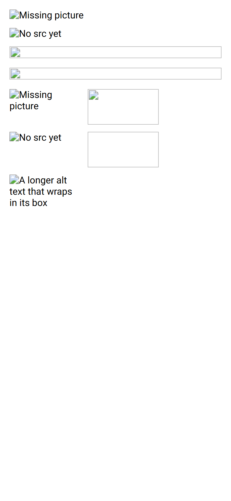

# ion-img — reference render (Ionic 8.8.1, md, 390×844@2x)

Generated by `node tools/ionic-ref/render.js ion-img --bare --html "<div style=\"padding:16px\"><div style=\"margin-bottom:12px\"><ion-img alt=\"Missing picture\" src=\"/docs/components/ion-img/missing.png\"></ion-img></div><div style=\"margin-bottom:12px\"><ion-img alt=\"No src yet\"></ion-img></div><div style=\"margin-bottom:12px\"><ion-img src=\"/docs/components/ion-img/missing.png\"></ion-img></div><div style=\"margin-bottom:12px\"><ion-img alt=\"\" src=\"/docs/components/ion-img/missing.png\"></ion-img></div><div style=\"display:flex;flex-wrap:wrap;gap:12px\"><ion-img alt=\"Missing picture\" src=\"/docs/components/ion-img/missing.png\" style=\"width:120px;height:60px\"></ion-img><ion-img src=\"/docs/components/ion-img/missing.png\" style=\"width:120px;height:60px\"></ion-img><ion-img alt=\"No src yet\" style=\"width:120px;height:60px\"></ion-img><ion-img style=\"width:120px;height:60px\"></ion-img><ion-img alt=\"A longer alt text that wraps in its box\" src=\"/docs/components/ion-img/missing.png\" style=\"width:120px;height:60px\"></ion-img></div></div>" --out docs/components/ion-img/ref-broken`

```html
<div style="padding:16px"><div style="margin-bottom:12px"><ion-img alt="Missing picture" src="/docs/components/ion-img/missing.png"></ion-img></div><div style="margin-bottom:12px"><ion-img alt="No src yet"></ion-img></div><div style="margin-bottom:12px"><ion-img src="/docs/components/ion-img/missing.png"></ion-img></div><div style="margin-bottom:12px"><ion-img alt="" src="/docs/components/ion-img/missing.png"></ion-img></div><div style="display:flex;flex-wrap:wrap;gap:12px"><ion-img alt="Missing picture" src="/docs/components/ion-img/missing.png" style="width:120px;height:60px"></ion-img><ion-img src="/docs/components/ion-img/missing.png" style="width:120px;height:60px"></ion-img><ion-img alt="No src yet" style="width:120px;height:60px"></ion-img><ion-img style="width:120px;height:60px"></ion-img><ion-img alt="A longer alt text that wraps in its box" src="/docs/components/ion-img/missing.png" style="width:120px;height:60px"></ion-img></div></div>
```

 

## Console errors

- Failed to load resource: the server responded with a status of 404 (Not Found)

## Element 1

- attributes: `{"alt":"Missing picture","src":"/docs/components/ion-img/missing.png","class":"md hydrated"}`
- classes: `md hydrated`
- rect: `{"x":16,"y":16,"w":358,"h":19}`

### Host computed

| prop | value |
|---|---|
| display | `block` |
| position | `static` |
| box-sizing | `border-box` |
| width | `358px` |
| height | `19px` |
| min-height | `0px` |
| min-width | `0px` |
| padding | `0px` |
| margin | `0px` |
| border | `0px none rgb(0, 0, 0)` |
| border-radius | `0px` |
| background-color | `rgba(0, 0, 0, 0)` |
| color | `rgb(0, 0, 0)` |
| font-size | `16px` |
| font-weight | `400` |
| font-family | `Roboto, "Helvetica Neue", sans-serif` |
| line-height | `normal` |
| letter-spacing | `normal` |
| text-transform | `none` |
| opacity | `1` |
| overflow | `visible` |
| contain | `none` |
| pointer-events | `auto` |
| transition | `all` |
| transform | `none` |
| box-shadow | `none` |
| outline | `rgb(0, 0, 0) none 0px` |
| cursor | `auto` |

### Shadow parts

#### part="image" (`img`) rect `{"x":16,"y":16,"w":358,"h":19}`

| prop | value |
|---|---|
| display | `block` |
| position | `static` |
| box-sizing | `content-box` |
| width | `358px` |
| height | `19px` |
| min-height | `0px` |
| min-width | `0px` |
| padding | `0px` |
| margin | `0px` |
| border | `0px none rgb(0, 0, 0)` |
| border-radius | `0px` |
| background-color | `rgba(0, 0, 0, 0)` |
| color | `rgb(0, 0, 0)` |
| font-size | `16px` |
| font-weight | `400` |
| font-family | `Roboto, "Helvetica Neue", sans-serif` |
| line-height | `normal` |
| letter-spacing | `normal` |
| text-transform | `none` |
| opacity | `1` |
| overflow | `clip` |
| contain | `none` |
| pointer-events | `auto` |
| transition | `all` |
| transform | `none` |
| box-shadow | `none` |
| outline | `rgb(0, 0, 0) none 0px` |
| cursor | `auto` |

### DOM tree

```
<ion-img>
  #shadow-root
    
```

## Element 2

- attributes: `{"alt":"No src yet","class":"md hydrated"}`
- classes: `md hydrated`
- rect: `{"x":16,"y":47,"w":358,"h":19}`

### Host computed

| prop | value |
|---|---|
| display | `block` |
| position | `static` |
| box-sizing | `border-box` |
| width | `358px` |
| height | `19px` |
| min-height | `0px` |
| min-width | `0px` |
| padding | `0px` |
| margin | `0px` |
| border | `0px none rgb(0, 0, 0)` |
| border-radius | `0px` |
| background-color | `rgba(0, 0, 0, 0)` |
| color | `rgb(0, 0, 0)` |
| font-size | `16px` |
| font-weight | `400` |
| font-family | `Roboto, "Helvetica Neue", sans-serif` |
| line-height | `normal` |
| letter-spacing | `normal` |
| text-transform | `none` |
| opacity | `1` |
| overflow | `visible` |
| contain | `none` |
| pointer-events | `auto` |
| transition | `all` |
| transform | `none` |
| box-shadow | `none` |
| outline | `rgb(0, 0, 0) none 0px` |
| cursor | `auto` |

### Shadow parts

#### part="image" (`img`) rect `{"x":16,"y":47,"w":358,"h":19}`

| prop | value |
|---|---|
| display | `block` |
| position | `static` |
| box-sizing | `content-box` |
| width | `358px` |
| height | `19px` |
| min-height | `0px` |
| min-width | `0px` |
| padding | `0px` |
| margin | `0px` |
| border | `0px none rgb(0, 0, 0)` |
| border-radius | `0px` |
| background-color | `rgba(0, 0, 0, 0)` |
| color | `rgb(0, 0, 0)` |
| font-size | `16px` |
| font-weight | `400` |
| font-family | `Roboto, "Helvetica Neue", sans-serif` |
| line-height | `normal` |
| letter-spacing | `normal` |
| text-transform | `none` |
| opacity | `1` |
| overflow | `clip` |
| contain | `none` |
| pointer-events | `auto` |
| transition | `all` |
| transform | `none` |
| box-shadow | `none` |
| outline | `rgb(0, 0, 0) none 0px` |
| cursor | `auto` |

### DOM tree

```
<ion-img>
  #shadow-root
    
```

## Element 3

- attributes: `{"src":"/docs/components/ion-img/missing.png","class":"md hydrated"}`
- classes: `md hydrated`
- rect: `{"x":16,"y":78,"w":358,"h":24}`

### Host computed

| prop | value |
|---|---|
| display | `block` |
| position | `static` |
| box-sizing | `border-box` |
| width | `358px` |
| height | `24px` |
| min-height | `0px` |
| min-width | `0px` |
| padding | `0px` |
| margin | `0px` |
| border | `0px none rgb(0, 0, 0)` |
| border-radius | `0px` |
| background-color | `rgba(0, 0, 0, 0)` |
| color | `rgb(0, 0, 0)` |
| font-size | `16px` |
| font-weight | `400` |
| font-family | `Roboto, "Helvetica Neue", sans-serif` |
| line-height | `normal` |
| letter-spacing | `normal` |
| text-transform | `none` |
| opacity | `1` |
| overflow | `visible` |
| contain | `none` |
| pointer-events | `auto` |
| transition | `all` |
| transform | `none` |
| box-shadow | `none` |
| outline | `rgb(0, 0, 0) none 0px` |
| cursor | `auto` |

### Shadow parts

#### part="image" (`img`) rect `{"x":16,"y":78,"w":358,"h":24}`

| prop | value |
|---|---|
| display | `block` |
| position | `static` |
| box-sizing | `content-box` |
| width | `358px` |
| height | `24px` |
| min-height | `0px` |
| min-width | `0px` |
| padding | `0px` |
| margin | `0px` |
| border | `0px none rgb(0, 0, 0)` |
| border-radius | `0px` |
| background-color | `rgba(0, 0, 0, 0)` |
| color | `rgb(0, 0, 0)` |
| font-size | `16px` |
| font-weight | `400` |
| font-family | `Roboto, "Helvetica Neue", sans-serif` |
| line-height | `normal` |
| letter-spacing | `normal` |
| text-transform | `none` |
| opacity | `1` |
| overflow | `clip` |
| contain | `none` |
| pointer-events | `auto` |
| transition | `all` |
| transform | `none` |
| box-shadow | `none` |
| outline | `rgb(0, 0, 0) none 0px` |
| cursor | `auto` |

### DOM tree

```
<ion-img>
  #shadow-root
    
```

## Element 4

- attributes: `{"alt":"","src":"/docs/components/ion-img/missing.png","class":"md hydrated"}`
- classes: `md hydrated`
- rect: `{"x":16,"y":114,"w":358,"h":24}`

### Host computed

| prop | value |
|---|---|
| display | `block` |
| position | `static` |
| box-sizing | `border-box` |
| width | `358px` |
| height | `24px` |
| min-height | `0px` |
| min-width | `0px` |
| padding | `0px` |
| margin | `0px` |
| border | `0px none rgb(0, 0, 0)` |
| border-radius | `0px` |
| background-color | `rgba(0, 0, 0, 0)` |
| color | `rgb(0, 0, 0)` |
| font-size | `16px` |
| font-weight | `400` |
| font-family | `Roboto, "Helvetica Neue", sans-serif` |
| line-height | `normal` |
| letter-spacing | `normal` |
| text-transform | `none` |
| opacity | `1` |
| overflow | `visible` |
| contain | `none` |
| pointer-events | `auto` |
| transition | `all` |
| transform | `none` |
| box-shadow | `none` |
| outline | `rgb(0, 0, 0) none 0px` |
| cursor | `auto` |

### Shadow parts

#### part="image" (`img`) rect `{"x":16,"y":114,"w":358,"h":24}`

| prop | value |
|---|---|
| display | `block` |
| position | `static` |
| box-sizing | `content-box` |
| width | `358px` |
| height | `24px` |
| min-height | `0px` |
| min-width | `0px` |
| padding | `0px` |
| margin | `0px` |
| border | `0px none rgb(0, 0, 0)` |
| border-radius | `0px` |
| background-color | `rgba(0, 0, 0, 0)` |
| color | `rgb(0, 0, 0)` |
| font-size | `16px` |
| font-weight | `400` |
| font-family | `Roboto, "Helvetica Neue", sans-serif` |
| line-height | `normal` |
| letter-spacing | `normal` |
| text-transform | `none` |
| opacity | `1` |
| overflow | `clip` |
| contain | `none` |
| pointer-events | `auto` |
| transition | `all` |
| transform | `none` |
| box-shadow | `none` |
| outline | `rgb(0, 0, 0) none 0px` |
| cursor | `auto` |

### DOM tree

```
<ion-img>
  #shadow-root
    
```

## Element 5

- attributes: `{"alt":"Missing picture","src":"/docs/components/ion-img/missing.png","style":"width:120px;height:60px","class":"md hydrated"}`
- classes: `md hydrated`
- rect: `{"x":16,"y":150,"w":120,"h":60}`

### Host computed

| prop | value |
|---|---|
| display | `block` |
| position | `static` |
| box-sizing | `border-box` |
| width | `120px` |
| height | `60px` |
| min-height | `auto` |
| min-width | `auto` |
| padding | `0px` |
| margin | `0px` |
| border | `0px none rgb(0, 0, 0)` |
| border-radius | `0px` |
| background-color | `rgba(0, 0, 0, 0)` |
| color | `rgb(0, 0, 0)` |
| font-size | `16px` |
| font-weight | `400` |
| font-family | `Roboto, "Helvetica Neue", sans-serif` |
| line-height | `normal` |
| letter-spacing | `normal` |
| text-transform | `none` |
| opacity | `1` |
| overflow | `visible` |
| contain | `none` |
| pointer-events | `auto` |
| transition | `all` |
| transform | `none` |
| box-shadow | `none` |
| outline | `rgb(0, 0, 0) none 0px` |
| cursor | `auto` |

### Shadow parts

#### part="image" (`img`) rect `{"x":16,"y":150,"w":120,"h":60}`

| prop | value |
|---|---|
| display | `block` |
| position | `static` |
| box-sizing | `content-box` |
| width | `120px` |
| height | `60px` |
| min-height | `0px` |
| min-width | `0px` |
| padding | `0px` |
| margin | `0px` |
| border | `0px none rgb(0, 0, 0)` |
| border-radius | `0px` |
| background-color | `rgba(0, 0, 0, 0)` |
| color | `rgb(0, 0, 0)` |
| font-size | `16px` |
| font-weight | `400` |
| font-family | `Roboto, "Helvetica Neue", sans-serif` |
| line-height | `normal` |
| letter-spacing | `normal` |
| text-transform | `none` |
| opacity | `1` |
| overflow | `clip` |
| contain | `none` |
| pointer-events | `auto` |
| transition | `all` |
| transform | `none` |
| box-shadow | `none` |
| outline | `rgb(0, 0, 0) none 0px` |
| cursor | `auto` |

### DOM tree

```
<ion-img>
  #shadow-root
    
```

## Element 6

- attributes: `{"src":"/docs/components/ion-img/missing.png","style":"width:120px;height:60px","class":"md hydrated"}`
- classes: `md hydrated`
- rect: `{"x":148,"y":150,"w":120,"h":60}`

### Host computed

| prop | value |
|---|---|
| display | `block` |
| position | `static` |
| box-sizing | `border-box` |
| width | `120px` |
| height | `60px` |
| min-height | `auto` |
| min-width | `auto` |
| padding | `0px` |
| margin | `0px` |
| border | `0px none rgb(0, 0, 0)` |
| border-radius | `0px` |
| background-color | `rgba(0, 0, 0, 0)` |
| color | `rgb(0, 0, 0)` |
| font-size | `16px` |
| font-weight | `400` |
| font-family | `Roboto, "Helvetica Neue", sans-serif` |
| line-height | `normal` |
| letter-spacing | `normal` |
| text-transform | `none` |
| opacity | `1` |
| overflow | `visible` |
| contain | `none` |
| pointer-events | `auto` |
| transition | `all` |
| transform | `none` |
| box-shadow | `none` |
| outline | `rgb(0, 0, 0) none 0px` |
| cursor | `auto` |

### Shadow parts

#### part="image" (`img`) rect `{"x":148,"y":150,"w":120,"h":60}`

| prop | value |
|---|---|
| display | `block` |
| position | `static` |
| box-sizing | `content-box` |
| width | `120px` |
| height | `60px` |
| min-height | `0px` |
| min-width | `0px` |
| padding | `0px` |
| margin | `0px` |
| border | `0px none rgb(0, 0, 0)` |
| border-radius | `0px` |
| background-color | `rgba(0, 0, 0, 0)` |
| color | `rgb(0, 0, 0)` |
| font-size | `16px` |
| font-weight | `400` |
| font-family | `Roboto, "Helvetica Neue", sans-serif` |
| line-height | `normal` |
| letter-spacing | `normal` |
| text-transform | `none` |
| opacity | `1` |
| overflow | `clip` |
| contain | `none` |
| pointer-events | `auto` |
| transition | `all` |
| transform | `none` |
| box-shadow | `none` |
| outline | `rgb(0, 0, 0) none 0px` |
| cursor | `auto` |

### DOM tree

```
<ion-img>
  #shadow-root
    
```

## Element 7

- attributes: `{"alt":"No src yet","style":"width:120px;height:60px","class":"md hydrated"}`
- classes: `md hydrated`
- rect: `{"x":16,"y":222,"w":120,"h":60}`

### Host computed

| prop | value |
|---|---|
| display | `block` |
| position | `static` |
| box-sizing | `border-box` |
| width | `120px` |
| height | `60px` |
| min-height | `auto` |
| min-width | `auto` |
| padding | `0px` |
| margin | `0px` |
| border | `0px none rgb(0, 0, 0)` |
| border-radius | `0px` |
| background-color | `rgba(0, 0, 0, 0)` |
| color | `rgb(0, 0, 0)` |
| font-size | `16px` |
| font-weight | `400` |
| font-family | `Roboto, "Helvetica Neue", sans-serif` |
| line-height | `normal` |
| letter-spacing | `normal` |
| text-transform | `none` |
| opacity | `1` |
| overflow | `visible` |
| contain | `none` |
| pointer-events | `auto` |
| transition | `all` |
| transform | `none` |
| box-shadow | `none` |
| outline | `rgb(0, 0, 0) none 0px` |
| cursor | `auto` |

### Shadow parts

#### part="image" (`img`) rect `{"x":16,"y":222,"w":120,"h":60}`

| prop | value |
|---|---|
| display | `block` |
| position | `static` |
| box-sizing | `content-box` |
| width | `120px` |
| height | `60px` |
| min-height | `0px` |
| min-width | `0px` |
| padding | `0px` |
| margin | `0px` |
| border | `0px none rgb(0, 0, 0)` |
| border-radius | `0px` |
| background-color | `rgba(0, 0, 0, 0)` |
| color | `rgb(0, 0, 0)` |
| font-size | `16px` |
| font-weight | `400` |
| font-family | `Roboto, "Helvetica Neue", sans-serif` |
| line-height | `normal` |
| letter-spacing | `normal` |
| text-transform | `none` |
| opacity | `1` |
| overflow | `clip` |
| contain | `none` |
| pointer-events | `auto` |
| transition | `all` |
| transform | `none` |
| box-shadow | `none` |
| outline | `rgb(0, 0, 0) none 0px` |
| cursor | `auto` |

### DOM tree

```
<ion-img>
  #shadow-root
    
```

## Element 8

- attributes: `{"style":"width:120px;height:60px","class":"md hydrated"}`
- classes: `md hydrated`
- rect: `{"x":148,"y":222,"w":120,"h":60}`

### Host computed

| prop | value |
|---|---|
| display | `block` |
| position | `static` |
| box-sizing | `border-box` |
| width | `120px` |
| height | `60px` |
| min-height | `auto` |
| min-width | `auto` |
| padding | `0px` |
| margin | `0px` |
| border | `0px none rgb(0, 0, 0)` |
| border-radius | `0px` |
| background-color | `rgba(0, 0, 0, 0)` |
| color | `rgb(0, 0, 0)` |
| font-size | `16px` |
| font-weight | `400` |
| font-family | `Roboto, "Helvetica Neue", sans-serif` |
| line-height | `normal` |
| letter-spacing | `normal` |
| text-transform | `none` |
| opacity | `1` |
| overflow | `visible` |
| contain | `none` |
| pointer-events | `auto` |
| transition | `all` |
| transform | `none` |
| box-shadow | `none` |
| outline | `rgb(0, 0, 0) none 0px` |
| cursor | `auto` |

### Shadow parts

#### part="image" (`img`) rect `{"x":148,"y":222,"w":120,"h":60}`

| prop | value |
|---|---|
| display | `block` |
| position | `static` |
| box-sizing | `content-box` |
| width | `120px` |
| height | `60px` |
| min-height | `0px` |
| min-width | `0px` |
| padding | `0px` |
| margin | `0px` |
| border | `0px none rgb(0, 0, 0)` |
| border-radius | `0px` |
| background-color | `rgba(0, 0, 0, 0)` |
| color | `rgb(0, 0, 0)` |
| font-size | `16px` |
| font-weight | `400` |
| font-family | `Roboto, "Helvetica Neue", sans-serif` |
| line-height | `normal` |
| letter-spacing | `normal` |
| text-transform | `none` |
| opacity | `1` |
| overflow | `clip` |
| contain | `none` |
| pointer-events | `auto` |
| transition | `all` |
| transform | `none` |
| box-shadow | `none` |
| outline | `rgb(0, 0, 0) none 0px` |
| cursor | `auto` |

### DOM tree

```
<ion-img>
  #shadow-root
    
```

## Element 9

- attributes: `{"alt":"A longer alt text that wraps in its box","src":"/docs/components/ion-img/missing.png","style":"width:120px;height:60px","class":"md hydrated"}`
- classes: `md hydrated`
- rect: `{"x":16,"y":294,"w":120,"h":60}`

### Host computed

| prop | value |
|---|---|
| display | `block` |
| position | `static` |
| box-sizing | `border-box` |
| width | `120px` |
| height | `60px` |
| min-height | `auto` |
| min-width | `auto` |
| padding | `0px` |
| margin | `0px` |
| border | `0px none rgb(0, 0, 0)` |
| border-radius | `0px` |
| background-color | `rgba(0, 0, 0, 0)` |
| color | `rgb(0, 0, 0)` |
| font-size | `16px` |
| font-weight | `400` |
| font-family | `Roboto, "Helvetica Neue", sans-serif` |
| line-height | `normal` |
| letter-spacing | `normal` |
| text-transform | `none` |
| opacity | `1` |
| overflow | `visible` |
| contain | `none` |
| pointer-events | `auto` |
| transition | `all` |
| transform | `none` |
| box-shadow | `none` |
| outline | `rgb(0, 0, 0) none 0px` |
| cursor | `auto` |

### Shadow parts

#### part="image" (`img`) rect `{"x":16,"y":294,"w":120,"h":60}`

| prop | value |
|---|---|
| display | `block` |
| position | `static` |
| box-sizing | `content-box` |
| width | `120px` |
| height | `60px` |
| min-height | `0px` |
| min-width | `0px` |
| padding | `0px` |
| margin | `0px` |
| border | `0px none rgb(0, 0, 0)` |
| border-radius | `0px` |
| background-color | `rgba(0, 0, 0, 0)` |
| color | `rgb(0, 0, 0)` |
| font-size | `16px` |
| font-weight | `400` |
| font-family | `Roboto, "Helvetica Neue", sans-serif` |
| line-height | `normal` |
| letter-spacing | `normal` |
| text-transform | `none` |
| opacity | `1` |
| overflow | `clip` |
| contain | `none` |
| pointer-events | `auto` |
| transition | `all` |
| transform | `none` |
| box-shadow | `none` |
| outline | `rgb(0, 0, 0) none 0px` |
| cursor | `auto` |

### DOM tree

```
<ion-img>
  #shadow-root
    
```
