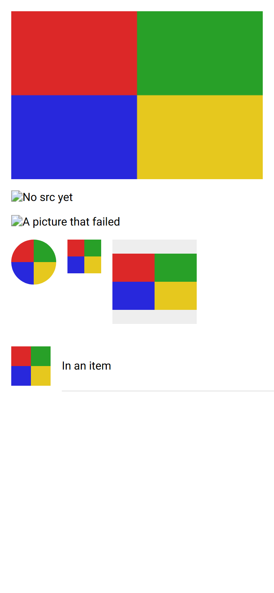
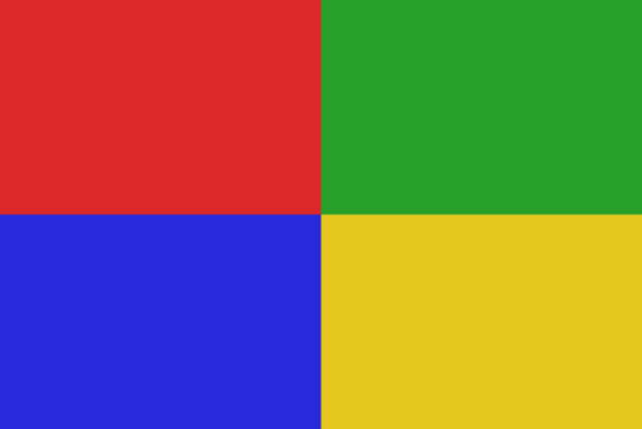

# ion-img — reference render (Ionic 8.8.1, md, 390×844@2x)

Generated by `node tools/ionic-ref/render.js ion-img --bare --html "<div style=\"padding:16px\"><ion-img src=\"/docs/components/ion-img/picture.png\" alt=\"Four quarters\"></ion-img><ion-img alt=\"No src yet\" style=\"margin-top:16px\"></ion-img><ion-img src=\"/docs/components/ion-img/missing.png\" alt=\"A picture that failed\" style=\"margin-top:16px\"></ion-img><div style=\"display:flex;gap:16px;margin-top:16px;align-items:flex-start\"><ion-avatar><ion-img src=\"/docs/components/ion-img/picture.png\"></ion-img></ion-avatar><ion-thumbnail><ion-img src=\"/docs/components/ion-img/picture.png\"></ion-img></ion-thumbnail><ion-img src=\"/docs/components/ion-img/picture.png\" style=\"width:120px;height:120px;background:#eee\"></ion-img></div></div><ion-list><ion-item><ion-thumbnail slot=\"start\"><ion-img src=\"/docs/components/ion-img/picture.png\"></ion-img></ion-thumbnail><ion-label>In an item</ion-label></ion-item></ion-list>"`

```html
<div style="padding:16px"><ion-img src="/docs/components/ion-img/picture.png" alt="Four quarters"></ion-img><ion-img alt="No src yet" style="margin-top:16px"></ion-img><ion-img src="/docs/components/ion-img/missing.png" alt="A picture that failed" style="margin-top:16px"></ion-img><div style="display:flex;gap:16px;margin-top:16px;align-items:flex-start"><ion-avatar><ion-img src="/docs/components/ion-img/picture.png"></ion-img></ion-avatar><ion-thumbnail><ion-img src="/docs/components/ion-img/picture.png"></ion-img></ion-thumbnail><ion-img src="/docs/components/ion-img/picture.png" style="width:120px;height:120px;background:#eee"></ion-img></div></div><ion-list><ion-item><ion-thumbnail slot="start"><ion-img src="/docs/components/ion-img/picture.png"></ion-img></ion-thumbnail><ion-label>In an item</ion-label></ion-item></ion-list>
```

 

## Console errors

- Failed to load resource: the server responded with a status of 404 (Not Found)

## Element 1

- attributes: `{"src":"/docs/components/ion-img/picture.png","alt":"Four quarters","class":"md hydrated"}`
- classes: `md hydrated`
- rect: `{"x":16,"y":16,"w":358,"h":238.66}`

### Host computed

| prop | value |
|---|---|
| display | `block` |
| position | `static` |
| box-sizing | `border-box` |
| width | `358px` |
| height | `238.656px` |
| min-height | `0px` |
| min-width | `0px` |
| padding | `0px` |
| margin | `0px` |
| border | `0px none rgb(0, 0, 0)` |
| border-radius | `0px` |
| background-color | `rgba(0, 0, 0, 0)` |
| color | `rgb(0, 0, 0)` |
| font-size | `16px` |
| font-weight | `400` |
| font-family | `Roboto, "Helvetica Neue", sans-serif` |
| line-height | `normal` |
| letter-spacing | `normal` |
| text-transform | `none` |
| opacity | `1` |
| overflow | `visible` |
| contain | `none` |
| pointer-events | `auto` |
| transition | `all` |
| transform | `none` |
| box-shadow | `none` |
| outline | `rgb(0, 0, 0) none 0px` |
| cursor | `auto` |

### Shadow parts

#### part="image" (`img`) rect `{"x":16,"y":16,"w":358,"h":238.66}`

| prop | value |
|---|---|
| display | `block` |
| position | `static` |
| box-sizing | `content-box` |
| width | `358px` |
| height | `238.656px` |
| min-height | `0px` |
| min-width | `0px` |
| padding | `0px` |
| margin | `0px` |
| border | `0px none rgb(0, 0, 0)` |
| border-radius | `0px` |
| background-color | `rgba(0, 0, 0, 0)` |
| color | `rgb(0, 0, 0)` |
| font-size | `16px` |
| font-weight | `400` |
| font-family | `Roboto, "Helvetica Neue", sans-serif` |
| line-height | `normal` |
| letter-spacing | `normal` |
| text-transform | `none` |
| opacity | `1` |
| overflow | `clip` |
| contain | `none` |
| pointer-events | `auto` |
| transition | `all` |
| transform | `none` |
| box-shadow | `none` |
| outline | `rgb(0, 0, 0) none 0px` |
| cursor | `auto` |

### DOM tree

```
<ion-img>
  #shadow-root
    
```

## Element 2

- attributes: `{"alt":"No src yet","style":"margin-top:16px","class":"md hydrated"}`
- classes: `md hydrated`
- rect: `{"x":16,"y":270.66,"w":358,"h":19}`

### Host computed

| prop | value |
|---|---|
| display | `block` |
| position | `static` |
| box-sizing | `border-box` |
| width | `358px` |
| height | `19px` |
| min-height | `0px` |
| min-width | `0px` |
| padding | `0px` |
| margin | `16px 0px 0px` |
| border | `0px none rgb(0, 0, 0)` |
| border-radius | `0px` |
| background-color | `rgba(0, 0, 0, 0)` |
| color | `rgb(0, 0, 0)` |
| font-size | `16px` |
| font-weight | `400` |
| font-family | `Roboto, "Helvetica Neue", sans-serif` |
| line-height | `normal` |
| letter-spacing | `normal` |
| text-transform | `none` |
| opacity | `1` |
| overflow | `visible` |
| contain | `none` |
| pointer-events | `auto` |
| transition | `all` |
| transform | `none` |
| box-shadow | `none` |
| outline | `rgb(0, 0, 0) none 0px` |
| cursor | `auto` |

### Shadow parts

#### part="image" (`img`) rect `{"x":16,"y":270.66,"w":358,"h":19}`

| prop | value |
|---|---|
| display | `block` |
| position | `static` |
| box-sizing | `content-box` |
| width | `358px` |
| height | `19px` |
| min-height | `0px` |
| min-width | `0px` |
| padding | `0px` |
| margin | `0px` |
| border | `0px none rgb(0, 0, 0)` |
| border-radius | `0px` |
| background-color | `rgba(0, 0, 0, 0)` |
| color | `rgb(0, 0, 0)` |
| font-size | `16px` |
| font-weight | `400` |
| font-family | `Roboto, "Helvetica Neue", sans-serif` |
| line-height | `normal` |
| letter-spacing | `normal` |
| text-transform | `none` |
| opacity | `1` |
| overflow | `clip` |
| contain | `none` |
| pointer-events | `auto` |
| transition | `all` |
| transform | `none` |
| box-shadow | `none` |
| outline | `rgb(0, 0, 0) none 0px` |
| cursor | `auto` |

### DOM tree

```
<ion-img>
  #shadow-root
    
```

## Element 3

- attributes: `{"src":"/docs/components/ion-img/missing.png","alt":"A picture that failed","style":"margin-top:16px","class":"md hydrated"}`
- classes: `md hydrated`
- rect: `{"x":16,"y":305.66,"w":358,"h":19}`

### Host computed

| prop | value |
|---|---|
| display | `block` |
| position | `static` |
| box-sizing | `border-box` |
| width | `358px` |
| height | `19px` |
| min-height | `0px` |
| min-width | `0px` |
| padding | `0px` |
| margin | `16px 0px 0px` |
| border | `0px none rgb(0, 0, 0)` |
| border-radius | `0px` |
| background-color | `rgba(0, 0, 0, 0)` |
| color | `rgb(0, 0, 0)` |
| font-size | `16px` |
| font-weight | `400` |
| font-family | `Roboto, "Helvetica Neue", sans-serif` |
| line-height | `normal` |
| letter-spacing | `normal` |
| text-transform | `none` |
| opacity | `1` |
| overflow | `visible` |
| contain | `none` |
| pointer-events | `auto` |
| transition | `all` |
| transform | `none` |
| box-shadow | `none` |
| outline | `rgb(0, 0, 0) none 0px` |
| cursor | `auto` |

### Shadow parts

#### part="image" (`img`) rect `{"x":16,"y":305.66,"w":358,"h":19}`

| prop | value |
|---|---|
| display | `block` |
| position | `static` |
| box-sizing | `content-box` |
| width | `358px` |
| height | `19px` |
| min-height | `0px` |
| min-width | `0px` |
| padding | `0px` |
| margin | `0px` |
| border | `0px none rgb(0, 0, 0)` |
| border-radius | `0px` |
| background-color | `rgba(0, 0, 0, 0)` |
| color | `rgb(0, 0, 0)` |
| font-size | `16px` |
| font-weight | `400` |
| font-family | `Roboto, "Helvetica Neue", sans-serif` |
| line-height | `normal` |
| letter-spacing | `normal` |
| text-transform | `none` |
| opacity | `1` |
| overflow | `clip` |
| contain | `none` |
| pointer-events | `auto` |
| transition | `all` |
| transform | `none` |
| box-shadow | `none` |
| outline | `rgb(0, 0, 0) none 0px` |
| cursor | `auto` |

### DOM tree

```
<ion-img>
  #shadow-root
    
```

## Element 4

- attributes: `{"src":"/docs/components/ion-img/picture.png","class":"md hydrated"}`
- classes: `md hydrated`
- rect: `{"x":16,"y":340.66,"w":64,"h":64}`

### Host computed

| prop | value |
|---|---|
| display | `block` |
| position | `static` |
| box-sizing | `border-box` |
| width | `64px` |
| height | `64px` |
| min-height | `0px` |
| min-width | `0px` |
| padding | `0px` |
| margin | `0px` |
| border | `0px none rgb(0, 0, 0)` |
| border-radius | `50%` |
| background-color | `rgba(0, 0, 0, 0)` |
| color | `rgb(0, 0, 0)` |
| font-size | `16px` |
| font-weight | `400` |
| font-family | `Roboto, "Helvetica Neue", sans-serif` |
| line-height | `normal` |
| letter-spacing | `normal` |
| text-transform | `none` |
| opacity | `1` |
| overflow | `hidden` |
| contain | `none` |
| pointer-events | `auto` |
| transition | `all` |
| transform | `none` |
| box-shadow | `none` |
| outline | `rgb(0, 0, 0) none 0px` |
| cursor | `auto` |

### Shadow parts

#### part="image" (`img`) rect `{"x":16,"y":340.66,"w":64,"h":64}`

| prop | value |
|---|---|
| display | `block` |
| position | `static` |
| box-sizing | `content-box` |
| width | `64px` |
| height | `64px` |
| min-height | `0px` |
| min-width | `0px` |
| padding | `0px` |
| margin | `0px` |
| border | `0px none rgb(0, 0, 0)` |
| border-radius | `0px` |
| background-color | `rgba(0, 0, 0, 0)` |
| color | `rgb(0, 0, 0)` |
| font-size | `16px` |
| font-weight | `400` |
| font-family | `Roboto, "Helvetica Neue", sans-serif` |
| line-height | `normal` |
| letter-spacing | `normal` |
| text-transform | `none` |
| opacity | `1` |
| overflow | `clip` |
| contain | `none` |
| pointer-events | `auto` |
| transition | `all` |
| transform | `none` |
| box-shadow | `none` |
| outline | `rgb(0, 0, 0) none 0px` |
| cursor | `auto` |

### DOM tree

```
<ion-img>
  #shadow-root
    
```

## Element 5

- attributes: `{"src":"/docs/components/ion-img/picture.png","class":"md hydrated"}`
- classes: `md hydrated`
- rect: `{"x":96,"y":340.66,"w":48,"h":48}`

### Host computed

| prop | value |
|---|---|
| display | `block` |
| position | `static` |
| box-sizing | `border-box` |
| width | `48px` |
| height | `48px` |
| min-height | `0px` |
| min-width | `0px` |
| padding | `0px` |
| margin | `0px` |
| border | `0px none rgb(0, 0, 0)` |
| border-radius | `0px` |
| background-color | `rgba(0, 0, 0, 0)` |
| color | `rgb(0, 0, 0)` |
| font-size | `16px` |
| font-weight | `400` |
| font-family | `Roboto, "Helvetica Neue", sans-serif` |
| line-height | `normal` |
| letter-spacing | `normal` |
| text-transform | `none` |
| opacity | `1` |
| overflow | `hidden` |
| contain | `none` |
| pointer-events | `auto` |
| transition | `all` |
| transform | `none` |
| box-shadow | `none` |
| outline | `rgb(0, 0, 0) none 0px` |
| cursor | `auto` |

### Shadow parts

#### part="image" (`img`) rect `{"x":96,"y":340.66,"w":48,"h":48}`

| prop | value |
|---|---|
| display | `block` |
| position | `static` |
| box-sizing | `content-box` |
| width | `48px` |
| height | `48px` |
| min-height | `0px` |
| min-width | `0px` |
| padding | `0px` |
| margin | `0px` |
| border | `0px none rgb(0, 0, 0)` |
| border-radius | `0px` |
| background-color | `rgba(0, 0, 0, 0)` |
| color | `rgb(0, 0, 0)` |
| font-size | `16px` |
| font-weight | `400` |
| font-family | `Roboto, "Helvetica Neue", sans-serif` |
| line-height | `normal` |
| letter-spacing | `normal` |
| text-transform | `none` |
| opacity | `1` |
| overflow | `clip` |
| contain | `none` |
| pointer-events | `auto` |
| transition | `all` |
| transform | `none` |
| box-shadow | `none` |
| outline | `rgb(0, 0, 0) none 0px` |
| cursor | `auto` |

### DOM tree

```
<ion-img>
  #shadow-root
    
```

## Element 6

- attributes: `{"src":"/docs/components/ion-img/picture.png","style":"width:120px;height:120px;background:#eee","class":"md hydrated"}`
- classes: `md hydrated`
- rect: `{"x":160,"y":340.66,"w":120,"h":120}`

### Host computed

| prop | value |
|---|---|
| display | `block` |
| position | `static` |
| box-sizing | `border-box` |
| width | `120px` |
| height | `120px` |
| min-height | `auto` |
| min-width | `auto` |
| padding | `0px` |
| margin | `0px` |
| border | `0px none rgb(0, 0, 0)` |
| border-radius | `0px` |
| background-color | `rgb(238, 238, 238)` |
| color | `rgb(0, 0, 0)` |
| font-size | `16px` |
| font-weight | `400` |
| font-family | `Roboto, "Helvetica Neue", sans-serif` |
| line-height | `normal` |
| letter-spacing | `normal` |
| text-transform | `none` |
| opacity | `1` |
| overflow | `visible` |
| contain | `none` |
| pointer-events | `auto` |
| transition | `all` |
| transform | `none` |
| box-shadow | `none` |
| outline | `rgb(0, 0, 0) none 0px` |
| cursor | `auto` |

### Shadow parts

#### part="image" (`img`) rect `{"x":160,"y":340.66,"w":120,"h":120}`

| prop | value |
|---|---|
| display | `block` |
| position | `static` |
| box-sizing | `content-box` |
| width | `120px` |
| height | `120px` |
| min-height | `0px` |
| min-width | `0px` |
| padding | `0px` |
| margin | `0px` |
| border | `0px none rgb(0, 0, 0)` |
| border-radius | `0px` |
| background-color | `rgba(0, 0, 0, 0)` |
| color | `rgb(0, 0, 0)` |
| font-size | `16px` |
| font-weight | `400` |
| font-family | `Roboto, "Helvetica Neue", sans-serif` |
| line-height | `normal` |
| letter-spacing | `normal` |
| text-transform | `none` |
| opacity | `1` |
| overflow | `clip` |
| contain | `none` |
| pointer-events | `auto` |
| transition | `all` |
| transform | `none` |
| box-shadow | `none` |
| outline | `rgb(0, 0, 0) none 0px` |
| cursor | `auto` |

### DOM tree

```
<ion-img>
  #shadow-root
    
```

## Element 7

- attributes: `{"src":"/docs/components/ion-img/picture.png","class":"md hydrated"}`
- classes: `md hydrated`
- rect: `{"x":16,"y":492.66,"w":56,"h":56}`

### Host computed

| prop | value |
|---|---|
| display | `block` |
| position | `static` |
| box-sizing | `border-box` |
| width | `56px` |
| height | `56px` |
| min-height | `0px` |
| min-width | `0px` |
| padding | `0px` |
| margin | `0px` |
| border | `0px none rgb(0, 0, 0)` |
| border-radius | `0px` |
| background-color | `rgba(0, 0, 0, 0)` |
| color | `rgb(0, 0, 0)` |
| font-size | `16px` |
| font-weight | `400` |
| font-family | `Roboto, "Helvetica Neue", sans-serif` |
| line-height | `normal` |
| letter-spacing | `normal` |
| text-transform | `none` |
| opacity | `1` |
| overflow | `hidden` |
| contain | `none` |
| pointer-events | `auto` |
| transition | `all` |
| transform | `none` |
| box-shadow | `none` |
| outline | `rgb(0, 0, 0) none 0px` |
| cursor | `auto` |

### Shadow parts

#### part="image" (`img`) rect `{"x":16,"y":492.66,"w":56,"h":56}`

| prop | value |
|---|---|
| display | `block` |
| position | `static` |
| box-sizing | `content-box` |
| width | `56px` |
| height | `56px` |
| min-height | `0px` |
| min-width | `0px` |
| padding | `0px` |
| margin | `0px` |
| border | `0px none rgb(0, 0, 0)` |
| border-radius | `0px` |
| background-color | `rgba(0, 0, 0, 0)` |
| color | `rgb(0, 0, 0)` |
| font-size | `16px` |
| font-weight | `400` |
| font-family | `Roboto, "Helvetica Neue", sans-serif` |
| line-height | `normal` |
| letter-spacing | `normal` |
| text-transform | `none` |
| opacity | `1` |
| overflow | `clip` |
| contain | `none` |
| pointer-events | `auto` |
| transition | `all` |
| transform | `none` |
| box-shadow | `none` |
| outline | `rgb(0, 0, 0) none 0px` |
| cursor | `auto` |

### DOM tree

```
<ion-img>
  #shadow-root
    
```
