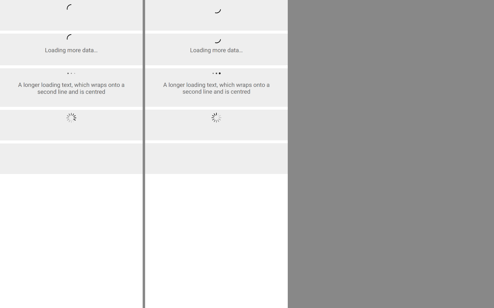

# ion-infinite-scroll — Comparison

Ionic 8.8.1, md, headless Chromium, 390 x 844 at 2x, beside Avonic headless (Skia) at the same size and scale. Each row is an
`ion-infinite-scroll` holding an `ion-infinite-scroll-content`, in a grey box that shows its size. In Chromium the loading ones
have the class `infinite-scroll-loading` set by hand, which the md rule reads as it reads Ionic's own; the behaviour is measured
separately, by scripts kept out of the repo, into [`ref/measurements.json`](ref/measurements.json).

```
node tools/ionic-ref/render.js ion-infinite-scroll --bare --html '<ion-app><ion-content><div style="background:#eee;margin-bottom:8px"><ion-infinite-scroll class="infinite-scroll-loading"><ion-infinite-scroll-content></ion-infinite-scroll-content></ion-infinite-scroll></div><div style="background:#eee;margin-bottom:8px"><ion-infinite-scroll class="infinite-scroll-loading"><ion-infinite-scroll-content loading-text="Loading more data…"></ion-infinite-scroll-content></ion-infinite-scroll></div><div style="background:#eee;margin-bottom:8px"><ion-infinite-scroll class="infinite-scroll-loading"><ion-infinite-scroll-content loading-spinner="dots" loading-text="A longer loading text, which wraps onto a second line and is centred"></ion-infinite-scroll-content></ion-infinite-scroll></div><div style="background:#eee;margin-bottom:8px"><ion-infinite-scroll class="infinite-scroll-loading"><ion-infinite-scroll-content loading-spinner="lines-sharp" loading-text=""></ion-infinite-scroll-content></ion-infinite-scroll></div><div style="background:#eee;margin-bottom:8px"><ion-infinite-scroll><ion-infinite-scroll-content loading-text="Not loading: only the min-height"></ion-infinite-scroll-content></ion-infinite-scroll></div><div style="background:#eee"><ion-infinite-scroll disabled class="infinite-scroll-loading"><ion-infinite-scroll-content loading-text="Disabled: display none"></ion-infinite-scroll-content></ion-infinite-scroll></div></ion-content></ion-app>'
```

Avonic's frame is `AvonicInfiniteScrollCaptureTests.Reference_Page`, saved as [`compare/avonic-page.png`](compare/avonic-page.png).
There the rows load through a real scroll, with a threshold that any scroll is inside.



## Visual

Boxes in CSS pixels, from Chromium's `getBoundingClientRect` and Avonic's `Bounds` (`B17`).

| | Ionic | Avonic | |
|---|---|---|---|
| Crescent, no text: host; loading part; spinner | 84; y 10, 32 high; 181, 10, 28 x 28 | the same | Match |
| With "Loading more data…": host; text box | 87; x 32, y 36 in it, 326 wide | the same | Match. Chromium's line is 19, Avalonia's 18.75, which layout rounding makes 87 |
| Two lines of text | 106 | 106 | Match |
| `loading-text=""` | 84, the loading part 36 high at y 8 | the same | Match: the text box is there, with no height |
| Not loading | 84, empty | 84, empty | Match |
| Disabled | 0 | 0 | Match |
| Text colour | `rgb(102, 102, 102)`, 16 px Roboto 400 | `Avonic.TextColorStep400Brush`, `#666666`, Roboto at the inherited 16 | Match |
| Spinner colour | `rgb(0, 0, 0)`, inherited: md's rule for it can't reach the shadow root | inherited | Match |
| Spinner pose | Chromium's frame time | the test clock's 32 ms | Not compared: each is a moment of an animation `ion-spinner`'s own comparison covers |

## Behaviour

| # | Behaviour | Ionic | Avonic | |
|---|---|---|---|---|
| B1 | Bottom, 15%, 30 rows of 50 | fires at 530, not 529; once | the same | Match |
| B2 | `threshold="100px"` | 557, not 556 | the same | Match. A change of threshold, `parseFloat`'s reading and NaN follow `thresholdChanged` |
| B3 | When it checks | at the next frame's `scroll` | at the next `RequestFrame`, once for every change in it | Match |
| B4 | Nothing to scroll | never fires | never fires | Match |
| B5 | `complete()` at the bottom | the next scroll can fire | the same | Match |
| B6 | Disabled | `display: none`, no listener, loading cleared | hidden at style priority, no listener, loading cleared | Match |
| B7 | Disabled while loading, then enabled | `complete()` does nothing, never fires again | the same | Match: Ionic's quirk, kept |
| B8 | Top: start | `scrollTop` 740, the end | 740 at the first frame | Match |
| B9 | Top `complete()` with 10 rows added above | 30, 30, 30, then 530 at the fourth frame | 210 until the fourth frame, then 710 (the same 500 more) | Match |
| B10 | Reads | force a layout | `UpdateLayout()` first | Match |
| B11 | `ionInfinite` | bubbles | bubbles | Match |
| B12 | Outside `ion-content` | `console.error` | an error in Avalonia's log, `LogArea.Control` | Match, in Avalonia's terms |
| B12 | `.ion-content-scroll-host` | the nearest such element scrolls | the nearest such element, or the `ScrollViewer` in its template | Match: only a `ScrollViewer` scrolls in Avalonia |
| B13 | Removed | stops listening; back before the frame, it hears the scroll | the same | Match |
| B14 | Hidden by an ancestor | `offsetHeight` 0, no check | the same | Match |
| B15 | The content outside a loading scroll | nothing shown | nothing shown | Match |
| B16 | The content's default spinner | `crescent`, or the config's | `Crescent`, or `AvonicConfig.Spinner` | Match, except `infiniteLoadingSpinner`: see below |
| B18 | `<b>bold</b> &amp;amp; x` | shown as written | shown as written | Match |

## Deliberate differences

- **`complete()`'s first read doesn't force a layout.** In Chromium it does. Ionic's own comment, and its Angular, React and Vue
  examples, have the rows not yet in the DOM at that point; in Avalonia they're in the tree at once and laid out later, so not
  forcing it keeps what Ionic means: the rows shown stay put. With plain DOM appends before `complete()`, Chromium keeps the same
  `scrollTop` and the rows jump (measured: 30 stays 30).
- **`infiniteLoadingSpinner`**, Ionic's config key for this alone, has no `AvonicConfig` member, as that file is shared; the
  content reads `AvonicConfig.Spinner`, then `Crescent`. Proposed in the PR.
- **`loadingText`** is plain text, always: Ionic's default. Its opt-in HTML (`innerHTMLTemplatesEnabled`) has no counterpart.

## Not tried

- A real window, and a device: a touch flick's momentum changes the offset each frame, which checks each frame as Chromium's
  `scroll` does, but that hasn't been seen on a phone.
