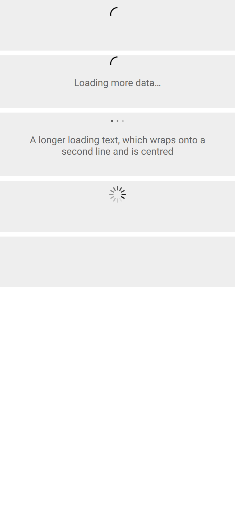

# ion-infinite-scroll — reference render (Ionic 8.8.1, md, 390×844@2x)

Generated by `node tools/ionic-ref/render.js ion-infinite-scroll --bare --html "<ion-app><ion-content><div style=\"background:#eee;margin-bottom:8px\"><ion-infinite-scroll class=\"infinite-scroll-loading\"><ion-infinite-scroll-content></ion-infinite-scroll-content></ion-infinite-scroll></div><div style=\"background:#eee;margin-bottom:8px\"><ion-infinite-scroll class=\"infinite-scroll-loading\"><ion-infinite-scroll-content loading-text=\"Loading more data…\"></ion-infinite-scroll-content></ion-infinite-scroll></div><div style=\"background:#eee;margin-bottom:8px\"><ion-infinite-scroll class=\"infinite-scroll-loading\"><ion-infinite-scroll-content loading-spinner=\"dots\" loading-text=\"A longer loading text, which wraps onto a second line and is centred\"></ion-infinite-scroll-content></ion-infinite-scroll></div><div style=\"background:#eee;margin-bottom:8px\"><ion-infinite-scroll class=\"infinite-scroll-loading\"><ion-infinite-scroll-content loading-spinner=\"lines-sharp\" loading-text=\"\"></ion-infinite-scroll-content></ion-infinite-scroll></div><div style=\"background:#eee;margin-bottom:8px\"><ion-infinite-scroll><ion-infinite-scroll-content loading-text=\"Not loading: only the min-height\"></ion-infinite-scroll-content></ion-infinite-scroll></div><div style=\"background:#eee\"><ion-infinite-scroll disabled class=\"infinite-scroll-loading\"><ion-infinite-scroll-content loading-text=\"Disabled: display none\"></ion-infinite-scroll-content></ion-infinite-scroll></div></ion-content></ion-app>"`

```html
<ion-app><ion-content><div style="background:#eee;margin-bottom:8px"><ion-infinite-scroll class="infinite-scroll-loading"><ion-infinite-scroll-content></ion-infinite-scroll-content></ion-infinite-scroll></div><div style="background:#eee;margin-bottom:8px"><ion-infinite-scroll class="infinite-scroll-loading"><ion-infinite-scroll-content loading-text="Loading more data…"></ion-infinite-scroll-content></ion-infinite-scroll></div><div style="background:#eee;margin-bottom:8px"><ion-infinite-scroll class="infinite-scroll-loading"><ion-infinite-scroll-content loading-spinner="dots" loading-text="A longer loading text, which wraps onto a second line and is centred"></ion-infinite-scroll-content></ion-infinite-scroll></div><div style="background:#eee;margin-bottom:8px"><ion-infinite-scroll class="infinite-scroll-loading"><ion-infinite-scroll-content loading-spinner="lines-sharp" loading-text=""></ion-infinite-scroll-content></ion-infinite-scroll></div><div style="background:#eee;margin-bottom:8px"><ion-infinite-scroll><ion-infinite-scroll-content loading-text="Not loading: only the min-height"></ion-infinite-scroll-content></ion-infinite-scroll></div><div style="background:#eee"><ion-infinite-scroll disabled class="infinite-scroll-loading"><ion-infinite-scroll-content loading-text="Disabled: display none"></ion-infinite-scroll-content></ion-infinite-scroll></div></ion-content></ion-app>
```

 

## Element 1

- attributes: `{"class":"infinite-scroll-loading md infinite-scroll-enabled hydrated"}`
- classes: `infinite-scroll-loading md infinite-scroll-enabled hydrated`
- rect: `{"x":0,"y":0,"w":390,"h":84}`

### Host computed

| prop | value |
|---|---|
| display | `block` |
| position | `static` |
| box-sizing | `border-box` |
| width | `390px` |
| height | `84px` |
| min-height | `0px` |
| min-width | `0px` |
| padding | `0px` |
| margin | `0px` |
| border | `0px none rgb(0, 0, 0)` |
| border-radius | `0px` |
| background-color | `rgba(0, 0, 0, 0)` |
| color | `rgb(0, 0, 0)` |
| font-size | `16px` |
| font-weight | `400` |
| font-family | `Roboto, "Helvetica Neue", sans-serif` |
| line-height | `normal` |
| letter-spacing | `normal` |
| text-transform | `none` |
| opacity | `1` |
| overflow | `visible` |
| contain | `none` |
| pointer-events | `auto` |
| transition | `all` |
| transform | `none` |
| box-shadow | `none` |
| outline | `rgb(0, 0, 0) none 0px` |
| cursor | `auto` |

### DOM tree

```
<ion-infinite-scroll>
  <ion-infinite-scroll-content.md.infinite-scroll-content-md.hydrated>
    <div.infinite-loading>
      <div.infinite-loading-spinner>
        <ion-spinner.md.spinner-crescent.hydrated>
          #shadow-root
            <svg>
              <circle>
```

## Element 2

- attributes: `{"class":"infinite-scroll-loading md infinite-scroll-enabled hydrated"}`
- classes: `infinite-scroll-loading md infinite-scroll-enabled hydrated`
- rect: `{"x":0,"y":92,"w":390,"h":87}`

### Host computed

| prop | value |
|---|---|
| display | `block` |
| position | `static` |
| box-sizing | `border-box` |
| width | `390px` |
| height | `87px` |
| min-height | `0px` |
| min-width | `0px` |
| padding | `0px` |
| margin | `0px` |
| border | `0px none rgb(0, 0, 0)` |
| border-radius | `0px` |
| background-color | `rgba(0, 0, 0, 0)` |
| color | `rgb(0, 0, 0)` |
| font-size | `16px` |
| font-weight | `400` |
| font-family | `Roboto, "Helvetica Neue", sans-serif` |
| line-height | `normal` |
| letter-spacing | `normal` |
| text-transform | `none` |
| opacity | `1` |
| overflow | `visible` |
| contain | `none` |
| pointer-events | `auto` |
| transition | `all` |
| transform | `none` |
| box-shadow | `none` |
| outline | `rgb(0, 0, 0) none 0px` |
| cursor | `auto` |

### DOM tree

```
<ion-infinite-scroll>
  <ion-infinite-scroll-content.md.infinite-scroll-content-md.hydrated>
    <div.infinite-loading>
      <div.infinite-loading-spinner>
        <ion-spinner.md.spinner-crescent.hydrated>
          #shadow-root
            <svg>
              <circle>
      <div.infinite-loading-text>
```

## Element 3

- attributes: `{"class":"infinite-scroll-loading md infinite-scroll-enabled hydrated"}`
- classes: `infinite-scroll-loading md infinite-scroll-enabled hydrated`
- rect: `{"x":0,"y":187,"w":390,"h":106}`

### Host computed

| prop | value |
|---|---|
| display | `block` |
| position | `static` |
| box-sizing | `border-box` |
| width | `390px` |
| height | `106px` |
| min-height | `0px` |
| min-width | `0px` |
| padding | `0px` |
| margin | `0px` |
| border | `0px none rgb(0, 0, 0)` |
| border-radius | `0px` |
| background-color | `rgba(0, 0, 0, 0)` |
| color | `rgb(0, 0, 0)` |
| font-size | `16px` |
| font-weight | `400` |
| font-family | `Roboto, "Helvetica Neue", sans-serif` |
| line-height | `normal` |
| letter-spacing | `normal` |
| text-transform | `none` |
| opacity | `1` |
| overflow | `visible` |
| contain | `none` |
| pointer-events | `auto` |
| transition | `all` |
| transform | `none` |
| box-shadow | `none` |
| outline | `rgb(0, 0, 0) none 0px` |
| cursor | `auto` |

### DOM tree

```
<ion-infinite-scroll>
  <ion-infinite-scroll-content.md.infinite-scroll-content-md.hydrated>
    <div.infinite-loading>
      <div.infinite-loading-spinner>
        <ion-spinner.md.spinner-dots.hydrated>
          #shadow-root
            <svg>
              <circle>
            <svg>
              <circle>
            <svg>
              <circle>
      <div.infinite-loading-text>
```

## Element 4

- attributes: `{"class":"infinite-scroll-loading md infinite-scroll-enabled hydrated"}`
- classes: `infinite-scroll-loading md infinite-scroll-enabled hydrated`
- rect: `{"x":0,"y":301,"w":390,"h":84}`

### Host computed

| prop | value |
|---|---|
| display | `block` |
| position | `static` |
| box-sizing | `border-box` |
| width | `390px` |
| height | `84px` |
| min-height | `0px` |
| min-width | `0px` |
| padding | `0px` |
| margin | `0px` |
| border | `0px none rgb(0, 0, 0)` |
| border-radius | `0px` |
| background-color | `rgba(0, 0, 0, 0)` |
| color | `rgb(0, 0, 0)` |
| font-size | `16px` |
| font-weight | `400` |
| font-family | `Roboto, "Helvetica Neue", sans-serif` |
| line-height | `normal` |
| letter-spacing | `normal` |
| text-transform | `none` |
| opacity | `1` |
| overflow | `visible` |
| contain | `none` |
| pointer-events | `auto` |
| transition | `all` |
| transform | `none` |
| box-shadow | `none` |
| outline | `rgb(0, 0, 0) none 0px` |
| cursor | `auto` |

### DOM tree

```
<ion-infinite-scroll>
  <ion-infinite-scroll-content.md.infinite-scroll-content-md.hydrated>
    <div.infinite-loading>
      <div.infinite-loading-spinner>
        <ion-spinner.md.spinner-lines-sharp.hydrated>
          #shadow-root
            <svg>
              <line>
            <svg>
              <line>
            <svg>
              <line>
            <svg>
              <line>
            <svg>
              <line>
            <svg>
              <line>
            <svg>
              <line>
            <svg>
              <line>
            <svg>
              <line>
            <svg>
              <line>
            <svg>
              <line>
            <svg>
              <line>
      <div.infinite-loading-text>
```

## Element 5

- attributes: `{"class":"md infinite-scroll-enabled hydrated"}`
- classes: `md infinite-scroll-enabled hydrated`
- rect: `{"x":0,"y":393,"w":390,"h":84}`

### Host computed

| prop | value |
|---|---|
| display | `block` |
| position | `static` |
| box-sizing | `border-box` |
| width | `390px` |
| height | `84px` |
| min-height | `0px` |
| min-width | `0px` |
| padding | `0px` |
| margin | `0px` |
| border | `0px none rgb(0, 0, 0)` |
| border-radius | `0px` |
| background-color | `rgba(0, 0, 0, 0)` |
| color | `rgb(0, 0, 0)` |
| font-size | `16px` |
| font-weight | `400` |
| font-family | `Roboto, "Helvetica Neue", sans-serif` |
| line-height | `normal` |
| letter-spacing | `normal` |
| text-transform | `none` |
| opacity | `1` |
| overflow | `visible` |
| contain | `none` |
| pointer-events | `auto` |
| transition | `all` |
| transform | `none` |
| box-shadow | `none` |
| outline | `rgb(0, 0, 0) none 0px` |
| cursor | `auto` |

### DOM tree

```
<ion-infinite-scroll>
  <ion-infinite-scroll-content.md.infinite-scroll-content-md.hydrated>
    <div.infinite-loading>
      <div.infinite-loading-spinner>
        <ion-spinner.md.spinner-crescent.hydrated>
          #shadow-root
            <svg>
              <circle>
      <div.infinite-loading-text>
```

## Element 6

- attributes: `{"disabled":"","class":"infinite-scroll-loading md hydrated"}`
- classes: `infinite-scroll-loading md hydrated`
- rect: `{"x":0,"y":0,"w":0,"h":0}`

### Host computed

| prop | value |
|---|---|
| display | `none` |
| position | `static` |
| box-sizing | `border-box` |
| width | `100%` |
| height | `auto` |
| min-height | `0px` |
| min-width | `0px` |
| padding | `0px` |
| margin | `0px` |
| border | `0px none rgb(0, 0, 0)` |
| border-radius | `0px` |
| background-color | `rgba(0, 0, 0, 0)` |
| color | `rgb(0, 0, 0)` |
| font-size | `16px` |
| font-weight | `400` |
| font-family | `Roboto, "Helvetica Neue", sans-serif` |
| line-height | `normal` |
| letter-spacing | `normal` |
| text-transform | `none` |
| opacity | `1` |
| overflow | `visible` |
| contain | `none` |
| pointer-events | `auto` |
| transition | `all` |
| transform | `none` |
| box-shadow | `none` |
| outline | `rgb(0, 0, 0) none 0px` |
| cursor | `auto` |

### DOM tree

```
<ion-infinite-scroll>
  <ion-infinite-scroll-content.md.infinite-scroll-content-md.hydrated>
    <div.infinite-loading>
      <div.infinite-loading-spinner>
        <ion-spinner.md.spinner-crescent.hydrated>
          #shadow-root
            <svg>
              <circle>
      <div.infinite-loading-text>
```
