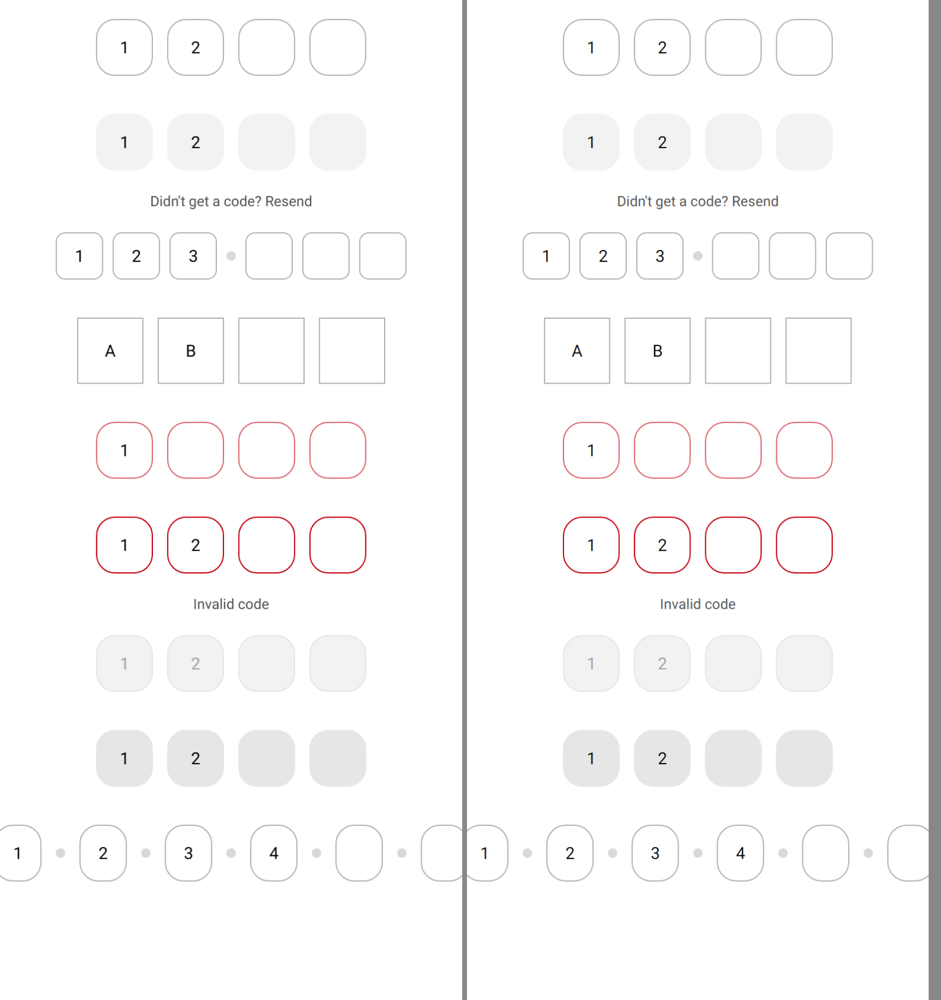
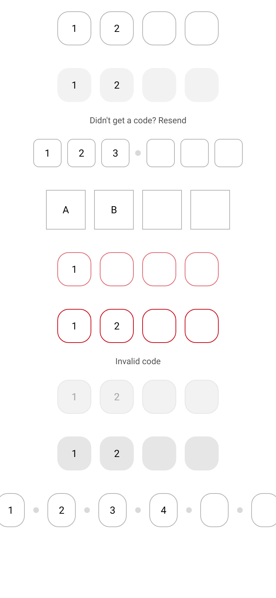
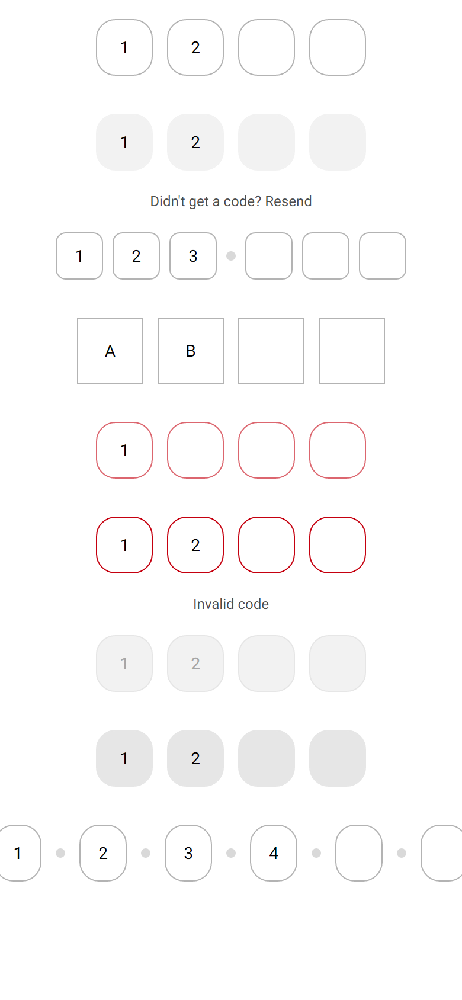

# ion-input-otp — Comparison against the web component

> Ionic side: `node tools/ionic-ref/render.js ion-input-otp --bare --html '<the snippet below>'` (Chromium, md, 390×844@2x) → [`ref/`](ref/).
> `ref/README.md` holds the exact command, and `ref/page.html` the page.
> Avonic side: `AVONIC_CAPTURE_DIR=… dotnet test` → `AvonicInputOtpCaptureTests.Reference_Page` and `.Focused` (headless Skia, 2×) → [`compare/`](compare/).
> Not tried in a real window (queued), or on a device.

```html
<ion-app style="position:static;display:block;contain:none;overflow:visible"><div style="padding:0 16px">
<ion-input-otp value="12"></ion-input-otp>
<ion-input-otp fill="solid" value="12">Didn't get a code? Resend</ion-input-otp>
<ion-input-otp length="6" separators="3" shape="soft" size="small" value="123"></ion-input-otp>
<ion-input-otp shape="rectangular" size="large" type="text" value="AB"></ion-input-otp>
<ion-input-otp color="danger" value="1"></ion-input-otp>
<ion-input-otp class="ion-touched ion-invalid" value="12">Invalid code</ion-input-otp>
<ion-input-otp disabled value="12"></ion-input-otp>
<ion-input-otp readonly fill="solid" value="12"></ion-input-otp>
<ion-input-otp length="6" separators="all" value="1234"></ion-input-otp>
</div></ion-app>
```

(One line in the real command.) `Reference_Page` lays out the same nine controls in a `StackPanel` with a 16 px margin at the
sides.

The behaviours were measured with throwaway Playwright scripts, in a desktop context with a mouse and keyboard, on a page of OTPs
with an `<input>` after them to take focus: `behave.js` (typing, refused characters, completing, Backspace, the arrows, clicks on
empty and filled boxes, blur, Tab in and out, a value set in code, `setFocus`, three pastes, an autofill, read-only, `type="text"`),
`behave2.js` (the autofill's delayed focus, the Tab flag, Tab into a full group, select-all, the caret at the start, Delete,
disabled) and `measure.js` (every box, separator and description, and the computed border, background, text and caret colours of
each state at rest and focused). The traces quoted below are theirs.

## Frames

Ionic on the left, Avonic on the right:



The focused box (Ionic's caret was mid-blink):


| Ionic | Avonic |
|---|---|
|  |  |

The rows line up: each host is 80 high (100 with a description), the page 760, and `B20` asserts every box and separator against
the measured positions to 0.6 px, including the two rows that overflow both sides (from x = −7 and −5). The colours of every state
in the frame are asserted in `B21`.

## Behaviours

| # | Behaviour | Result |
|---|---|---|
| 1 | The boxes show the value cut to the length, refused characters dropped, and the value rewritten (`"1a2"` → `"12"`) | Match (`initial b (1a2)`) |
| 2 | Typing fills an empty box, raises `IonInput`, moves on; the tab stop follows | Match (`type 1`: `1|||`, focus 1, tab `-1,0,-1,-1`) |
| 3 | A refused character changes nothing; `Text` takes `é`, not `-`; a new pattern applies at the next edit | Match (`type a`, `text type -`, `text é`) |
| 4 | `IonComplete` after `IonInput` whenever an edit leaves every box filled | Match (`type 34`, `type 5 in full last box`) |
| 5 | In a filled box: insert and shift while the last is empty; otherwise the character before the caret replaces the box's | Match (`type 9 in filled box 0` → `9|1||`, `type 7 caret start` → `7|9|1|`, `box2 caret 0 type 7 full` → `1579`) |
| 6 | Backspace: a filled box loses its character, the rest shift left; an empty box moves back and deletes there. Delete edits natively, and the emptied box is refocused by the redirect | Match (`backspace on last`, `backspace again`, `backspace 3`, `box1 caret0 backspace`, `box0 caret0 Delete` → `79`, focus 1) |
| 7 | Right only from a filled box; Left back; swapped in RTL | Match (`ArrowLeft`, `ArrowRight`); RTL from `onKeyDown`, not measured |
| 8 | A click lands on a filled box or the first empty one; not after Tab in a box | Match (`click empty box 2` → 0, `click filled box 0` → 0, `click empty box 3 after Tab` → 3) |
| 9 | One tab stop; empty boxes past it hidden from automation | Match (`tab`, `hidden` columns of every trace). **Difference:** Stencil can leave two boxes at `tabIndex` 0 after an autofill (`-1,0,0,-1`); here there's one |
| 10 | `IonFocus` and `IonBlur` once for the group; `IonChange` after `IonBlur` if the value isn't what it was at focus, even set in code | Match (`blur to other`: `ionBlur`, `ionChange:91`; `value 43 while focused` then `blur`) |
| 11 | Paste from the first box; none valid clears; empty clipboard only `IonInput` | Match (`paste "x1 2-3"` → `1|2|3|` focus 3; `paste "ab"` → cleared, focus 0; `paste "987654"` → `9876`, complete). The clipboard is read asynchronously, so the boxes fill a dispatcher turn later than Chromium's synchronous `clipboardData` |
| 12 | Autofill spreads from the first box; focus 20 ms later | Match (`insertText 56`: focus 0 at once, 2 after 100 ms; `insertText 8a9 in box` → `8|9||`). Avalonia's equivalent is a text input of several characters, which a soft keyboard's code suggestion or an IME gives |
| 13 | `SetFocus(index)` clamps and is redirected; `SetFocus()` the tab stop | Match (`setFocus(1)`, `setFocus(3) on empty` → 2) |
| 14 | A value set in code raises nothing, shows, moves the tab stop | Match (`value set in code`) |
| 15 | Separators after listed boxes, not the last; `all`; duplicates and positions past the length warn | Match (rows 3 and 9, and `1,1,9` on three boxes → one separator, two warnings) |
| 16 | Disabled can't be focused; read-only can, ignores typing, but Backspace and paste still edit | Match (`click disabled`; `readonly backspace` → `1`, `readonly type`, `readonly paste 55` → `55`) |
| 17 | `Type`, `Inputmode`, `Autocapitalize` reach each box | Match, as `TextInputOptions` (no keyboard to see headless) |
| 18 | The group is named "One-time password input", or by the host; each box "Input n of length" | Match, through the automation peer |
| 19 | The description: 12 px on 20, centred, `#4d4d4d`; none without content | Match (`desc` rows: 20 high with text, 0 without) |
| 20 | Sizes 40, 48, 56; gaps 8 and 12; 16 above and below; shrinking to 40 and overflowing centred; 8 px round separators | Match to 0.6 px (`REST`) |
| 21 | Every state's colours, the focused box's 2 px and caret, valid, invalid, a colour at 0.6 and 0.3 | Match (`REST` and `FOCUS` rows, each asserted) |

## Deliberate differences

- **Read-only Backspace and paste edit the value**, as Ionic's own handlers do (measured). Avalonia's `TextBox` keeps a paste on a
  read-only box to itself, so the control raises Ionic's paste for the platform's paste gesture there.
- **Backspace in an empty box** deletes in the box focus moved to, as Chromium's default action follows focus; Avalonia's key
  stays with the box it started in, so the control does that deletion itself.
- **An invalid `Pattern`** accepts nothing and logs a warning; Ionic's handlers throw.
- **The description** is hidden with no content or only white space; Ionic's first render never hides it, but an empty one is
  0 high there too.

## Gaps

- **The `requestAnimationFrame` clear** after an autofill with nothing valid isn't reproduced: there's no browser autofill to undo.
- **`autocomplete="one-time-code"`**: Avalonia 12's `TextInputOptions` has no such content type, so a phone's keyboard won't
  offer the code from a message on its own. It types it if the user picks it, which is the autofill path.
- **`cursor: not-allowed`** when disabled.
- **The paste is read asynchronously.** Avalonia's clipboard is read with `await`, where Chromium hands `onPaste` the text
  with the event, so a key typed while a slow platform reads it lands first and the paste then replaces it. Headless reads it at
  once, so this can't be shown in a test; Ionic has no guard for it, so none is added.
- **A soft keyboard's Backspace on an empty box** isn't measured: Android sends Backspace as a key there, which this handles as a
  keyboard's, but it's not tried on a device.
