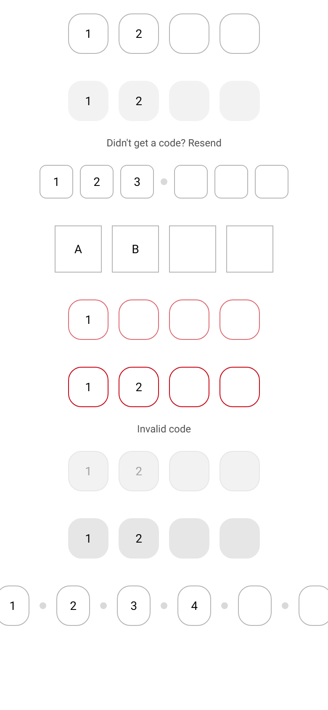

# ion-input-otp — reference render (Ionic 8.8.1, md, 390×844@2x)

Generated by `node tools/ionic-ref/render.js ion-input-otp --bare --html "<ion-app style=\"position:static;display:block;contain:none;overflow:visible\"><div style=\"padding:0 16px\"><ion-input-otp value=\"12\"></ion-input-otp><ion-input-otp fill=\"solid\" value=\"12\">Didn't get a code? Resend</ion-input-otp><ion-input-otp length=\"6\" separators=\"3\" shape=\"soft\" size=\"small\" value=\"123\"></ion-input-otp><ion-input-otp shape=\"rectangular\" size=\"large\" type=\"text\" value=\"AB\"></ion-input-otp><ion-input-otp color=\"danger\" value=\"1\"></ion-input-otp><ion-input-otp class=\"ion-touched ion-invalid\" value=\"12\">Invalid code</ion-input-otp><ion-input-otp disabled value=\"12\"></ion-input-otp><ion-input-otp readonly fill=\"solid\" value=\"12\"></ion-input-otp><ion-input-otp length=\"6\" separators=\"all\" value=\"1234\"></ion-input-otp></div></ion-app>"`

```html
<ion-app style="position:static;display:block;contain:none;overflow:visible"><div style="padding:0 16px"><ion-input-otp value="12"></ion-input-otp><ion-input-otp fill="solid" value="12">Didn't get a code? Resend</ion-input-otp><ion-input-otp length="6" separators="3" shape="soft" size="small" value="123"></ion-input-otp><ion-input-otp shape="rectangular" size="large" type="text" value="AB"></ion-input-otp><ion-input-otp color="danger" value="1"></ion-input-otp><ion-input-otp class="ion-touched ion-invalid" value="12">Invalid code</ion-input-otp><ion-input-otp disabled value="12"></ion-input-otp><ion-input-otp readonly fill="solid" value="12"></ion-input-otp><ion-input-otp length="6" separators="all" value="1234"></ion-input-otp></div></ion-app>
```

 

## Element 1

- attributes: `{"value":"12","class":"sc-ion-input-otp-md-h md input-otp-size-medium input-otp-shape-round input-otp-fill-outline sc-ion-input-otp-md hydrated"}`
- classes: `sc-ion-input-otp-md-h md input-otp-size-medium input-otp-shape-round input-otp-fill-outline sc-ion-input-otp-md hydrated`
- rect: `{"x":16,"y":0,"w":358,"h":80}`

### CSS custom properties (resolved)

| var | value |
|---|---|
| `--background` | `none` |
| `--border-color` | `#b3b3b3` |
| `--border-radius` | `16px` |
| `--border-width` | `1px` |
| `--color` | `(unset)` |
| `--height` | `48px` |
| `--highlight-color-focused` | `#0054e9` |
| `--highlight-color-invalid` | `#c5000f` |
| `--highlight-color-valid` | `#2dd55b` |
| `--margin-bottom` | `0` |
| `--margin-end` | `0` |
| `--margin-start` | `0` |
| `--margin-top` | `0` |
| `--min-width` | `40px` |
| `--padding-bottom` | `16px` |
| `--padding-end` | `0` |
| `--padding-start` | `0` |
| `--padding-top` | `16px` |
| `--separator-border-radius` | `999px` |
| `--separator-color` | `#d9d9d9` |
| `--separator-height` | `8px` |
| `--separator-width` | `8px` |
| `--width` | `48px` |

### Host computed

| prop | value |
|---|---|
| display | `block` |
| position | `relative` |
| box-sizing | `border-box` |
| width | `358px` |
| height | `80px` |
| min-height | `0px` |
| min-width | `0px` |
| padding | `0px` |
| margin | `0px` |
| border | `0px none rgb(0, 0, 0)` |
| border-radius | `0px` |
| background-color | `rgba(0, 0, 0, 0)` |
| color | `rgb(0, 0, 0)` |
| font-size | `14px` |
| font-weight | `400` |
| font-family | `Roboto, "Helvetica Neue", sans-serif` |
| line-height | `normal` |
| letter-spacing | `normal` |
| text-transform | `none` |
| opacity | `1` |
| overflow | `visible` |
| contain | `none` |
| pointer-events | `auto` |
| transition | `all` |
| transform | `none` |
| box-shadow | `none` |
| outline | `rgb(0, 0, 0) none 0px` |
| cursor | `auto` |

### DOM tree

```
<ion-input-otp>

```

## Element 2

- attributes: `{"fill":"solid","value":"12","class":"sc-ion-input-otp-md-h md input-otp-size-medium input-otp-shape-round input-otp-fill-solid sc-ion-input-otp-md hydrated"}`
- classes: `sc-ion-input-otp-md-h md input-otp-size-medium input-otp-shape-round input-otp-fill-solid sc-ion-input-otp-md hydrated`
- rect: `{"x":16,"y":80,"w":358,"h":100}`

### CSS custom properties (resolved)

| var | value |
|---|---|
| `--background` | `#f2f2f2` |
| `--border-color` | `#f2f2f2` |
| `--border-radius` | `16px` |
| `--border-width` | `1px` |
| `--color` | `(unset)` |
| `--height` | `48px` |
| `--highlight-color-focused` | `#0054e9` |
| `--highlight-color-invalid` | `#c5000f` |
| `--highlight-color-valid` | `#2dd55b` |
| `--margin-bottom` | `0` |
| `--margin-end` | `0` |
| `--margin-start` | `0` |
| `--margin-top` | `0` |
| `--min-width` | `40px` |
| `--padding-bottom` | `16px` |
| `--padding-end` | `0` |
| `--padding-start` | `0` |
| `--padding-top` | `16px` |
| `--separator-border-radius` | `999px` |
| `--separator-color` | `#d9d9d9` |
| `--separator-height` | `8px` |
| `--separator-width` | `8px` |
| `--width` | `48px` |

### Host computed

| prop | value |
|---|---|
| display | `block` |
| position | `relative` |
| box-sizing | `border-box` |
| width | `358px` |
| height | `100px` |
| min-height | `0px` |
| min-width | `0px` |
| padding | `0px` |
| margin | `0px` |
| border | `0px none rgb(0, 0, 0)` |
| border-radius | `0px` |
| background-color | `rgba(0, 0, 0, 0)` |
| color | `rgb(0, 0, 0)` |
| font-size | `14px` |
| font-weight | `400` |
| font-family | `Roboto, "Helvetica Neue", sans-serif` |
| line-height | `normal` |
| letter-spacing | `normal` |
| text-transform | `none` |
| opacity | `1` |
| overflow | `visible` |
| contain | `none` |
| pointer-events | `auto` |
| transition | `all` |
| transform | `none` |
| box-shadow | `none` |
| outline | `rgb(0, 0, 0) none 0px` |
| cursor | `auto` |

### DOM tree

```
<ion-input-otp>

```

## Element 3

- attributes: `{"length":"6","separators":"3","shape":"soft","size":"small","value":"123","class":"sc-ion-input-otp-md-h md input-otp-size-small input-otp-shape-soft input-otp-fill-outline sc-ion-input-otp-md hydrated"}`
- classes: `sc-ion-input-otp-md-h md input-otp-size-small input-otp-shape-soft input-otp-fill-outline sc-ion-input-otp-md hydrated`
- rect: `{"x":16,"y":180,"w":358,"h":72}`

### CSS custom properties (resolved)

| var | value |
|---|---|
| `--background` | `none` |
| `--border-color` | `#b3b3b3` |
| `--border-radius` | `8px` |
| `--border-width` | `1px` |
| `--color` | `(unset)` |
| `--height` | `40px` |
| `--highlight-color-focused` | `#0054e9` |
| `--highlight-color-invalid` | `#c5000f` |
| `--highlight-color-valid` | `#2dd55b` |
| `--margin-bottom` | `0` |
| `--margin-end` | `0` |
| `--margin-start` | `0` |
| `--margin-top` | `0` |
| `--min-width` | `40px` |
| `--padding-bottom` | `16px` |
| `--padding-end` | `0` |
| `--padding-start` | `0` |
| `--padding-top` | `16px` |
| `--separator-border-radius` | `999px` |
| `--separator-color` | `#d9d9d9` |
| `--separator-height` | `8px` |
| `--separator-width` | `8px` |
| `--width` | `40px` |

### Host computed

| prop | value |
|---|---|
| display | `block` |
| position | `relative` |
| box-sizing | `border-box` |
| width | `358px` |
| height | `72px` |
| min-height | `0px` |
| min-width | `0px` |
| padding | `0px` |
| margin | `0px` |
| border | `0px none rgb(0, 0, 0)` |
| border-radius | `0px` |
| background-color | `rgba(0, 0, 0, 0)` |
| color | `rgb(0, 0, 0)` |
| font-size | `14px` |
| font-weight | `400` |
| font-family | `Roboto, "Helvetica Neue", sans-serif` |
| line-height | `normal` |
| letter-spacing | `normal` |
| text-transform | `none` |
| opacity | `1` |
| overflow | `visible` |
| contain | `none` |
| pointer-events | `auto` |
| transition | `all` |
| transform | `none` |
| box-shadow | `none` |
| outline | `rgb(0, 0, 0) none 0px` |
| cursor | `auto` |

### DOM tree

```
<ion-input-otp>

```

## Element 4

- attributes: `{"shape":"rectangular","size":"large","type":"text","value":"AB","class":"sc-ion-input-otp-md-h md input-otp-size-large input-otp-shape-rectangular input-otp-fill-outline sc-ion-input-otp-md hydrated"}`
- classes: `sc-ion-input-otp-md-h md input-otp-size-large input-otp-shape-rectangular input-otp-fill-outline sc-ion-input-otp-md hydrated`
- rect: `{"x":16,"y":252,"w":358,"h":88}`

### CSS custom properties (resolved)

| var | value |
|---|---|
| `--background` | `none` |
| `--border-color` | `#b3b3b3` |
| `--border-radius` | `0` |
| `--border-width` | `1px` |
| `--color` | `(unset)` |
| `--height` | `56px` |
| `--highlight-color-focused` | `#0054e9` |
| `--highlight-color-invalid` | `#c5000f` |
| `--highlight-color-valid` | `#2dd55b` |
| `--margin-bottom` | `0` |
| `--margin-end` | `0` |
| `--margin-start` | `0` |
| `--margin-top` | `0` |
| `--min-width` | `40px` |
| `--padding-bottom` | `16px` |
| `--padding-end` | `0` |
| `--padding-start` | `0` |
| `--padding-top` | `16px` |
| `--separator-border-radius` | `999px` |
| `--separator-color` | `#d9d9d9` |
| `--separator-height` | `8px` |
| `--separator-width` | `8px` |
| `--width` | `56px` |

### Host computed

| prop | value |
|---|---|
| display | `block` |
| position | `relative` |
| box-sizing | `border-box` |
| width | `358px` |
| height | `88px` |
| min-height | `0px` |
| min-width | `0px` |
| padding | `0px` |
| margin | `0px` |
| border | `0px none rgb(0, 0, 0)` |
| border-radius | `0px` |
| background-color | `rgba(0, 0, 0, 0)` |
| color | `rgb(0, 0, 0)` |
| font-size | `14px` |
| font-weight | `400` |
| font-family | `Roboto, "Helvetica Neue", sans-serif` |
| line-height | `normal` |
| letter-spacing | `normal` |
| text-transform | `none` |
| opacity | `1` |
| overflow | `visible` |
| contain | `none` |
| pointer-events | `auto` |
| transition | `all` |
| transform | `none` |
| box-shadow | `none` |
| outline | `rgb(0, 0, 0) none 0px` |
| cursor | `auto` |

### DOM tree

```
<ion-input-otp>

```

## Element 5

- attributes: `{"color":"danger","value":"1","class":"sc-ion-input-otp-md-h ion-color ion-color-danger md input-otp-size-medium input-otp-shape-round input-otp-fill-outline sc-ion-input-otp-md hydrated"}`
- classes: `sc-ion-input-otp-md-h ion-color ion-color-danger md input-otp-size-medium input-otp-shape-round input-otp-fill-outline sc-ion-input-otp-md hydrated`
- rect: `{"x":16,"y":340,"w":358,"h":80}`

### CSS custom properties (resolved)

| var | value |
|---|---|
| `--background` | `none` |
| `--border-color` | `#b3b3b3` |
| `--border-radius` | `16px` |
| `--border-width` | `1px` |
| `--color` | `(unset)` |
| `--height` | `48px` |
| `--highlight-color-focused` | `#c5000f` |
| `--highlight-color-invalid` | `#c5000f` |
| `--highlight-color-valid` | `#2dd55b` |
| `--margin-bottom` | `0` |
| `--margin-end` | `0` |
| `--margin-start` | `0` |
| `--margin-top` | `0` |
| `--min-width` | `40px` |
| `--padding-bottom` | `16px` |
| `--padding-end` | `0` |
| `--padding-start` | `0` |
| `--padding-top` | `16px` |
| `--separator-border-radius` | `999px` |
| `--separator-color` | `#d9d9d9` |
| `--separator-height` | `8px` |
| `--separator-width` | `8px` |
| `--width` | `48px` |

### Host computed

| prop | value |
|---|---|
| display | `block` |
| position | `relative` |
| box-sizing | `border-box` |
| width | `358px` |
| height | `80px` |
| min-height | `0px` |
| min-width | `0px` |
| padding | `0px` |
| margin | `0px` |
| border | `0px none rgb(0, 0, 0)` |
| border-radius | `0px` |
| background-color | `rgba(0, 0, 0, 0)` |
| color | `rgb(0, 0, 0)` |
| font-size | `14px` |
| font-weight | `400` |
| font-family | `Roboto, "Helvetica Neue", sans-serif` |
| line-height | `normal` |
| letter-spacing | `normal` |
| text-transform | `none` |
| opacity | `1` |
| overflow | `visible` |
| contain | `none` |
| pointer-events | `auto` |
| transition | `all` |
| transform | `none` |
| box-shadow | `none` |
| outline | `rgb(0, 0, 0) none 0px` |
| cursor | `auto` |

### DOM tree

```
<ion-input-otp>

```

## Element 6

- attributes: `{"class":"ion-touched ion-invalid sc-ion-input-otp-md-h md input-otp-size-medium input-otp-shape-round input-otp-fill-outline sc-ion-input-otp-md hydrated","value":"12"}`
- classes: `ion-touched ion-invalid sc-ion-input-otp-md-h md input-otp-size-medium input-otp-shape-round input-otp-fill-outline sc-ion-input-otp-md hydrated`
- rect: `{"x":16,"y":420,"w":358,"h":100}`

### CSS custom properties (resolved)

| var | value |
|---|---|
| `--background` | `none` |
| `--border-color` | `#c5000f` |
| `--border-radius` | `16px` |
| `--border-width` | `1px` |
| `--color` | `(unset)` |
| `--height` | `48px` |
| `--highlight-color-focused` | `#0054e9` |
| `--highlight-color-invalid` | `#c5000f` |
| `--highlight-color-valid` | `#2dd55b` |
| `--margin-bottom` | `0` |
| `--margin-end` | `0` |
| `--margin-start` | `0` |
| `--margin-top` | `0` |
| `--min-width` | `40px` |
| `--padding-bottom` | `16px` |
| `--padding-end` | `0` |
| `--padding-start` | `0` |
| `--padding-top` | `16px` |
| `--separator-border-radius` | `999px` |
| `--separator-color` | `#d9d9d9` |
| `--separator-height` | `8px` |
| `--separator-width` | `8px` |
| `--width` | `48px` |

### Host computed

| prop | value |
|---|---|
| display | `block` |
| position | `relative` |
| box-sizing | `border-box` |
| width | `358px` |
| height | `100px` |
| min-height | `0px` |
| min-width | `0px` |
| padding | `0px` |
| margin | `0px` |
| border | `0px none rgb(0, 0, 0)` |
| border-radius | `0px` |
| background-color | `rgba(0, 0, 0, 0)` |
| color | `rgb(0, 0, 0)` |
| font-size | `14px` |
| font-weight | `400` |
| font-family | `Roboto, "Helvetica Neue", sans-serif` |
| line-height | `normal` |
| letter-spacing | `normal` |
| text-transform | `none` |
| opacity | `1` |
| overflow | `visible` |
| contain | `none` |
| pointer-events | `auto` |
| transition | `all` |
| transform | `none` |
| box-shadow | `none` |
| outline | `rgb(0, 0, 0) none 0px` |
| cursor | `auto` |

### DOM tree

```
<ion-input-otp>

```

## Element 7

- attributes: `{"disabled":"","value":"12","class":"sc-ion-input-otp-md-h md input-otp-size-medium input-otp-shape-round input-otp-fill-outline input-otp-disabled sc-ion-input-otp-md hydrated"}`
- classes: `sc-ion-input-otp-md-h md input-otp-size-medium input-otp-shape-round input-otp-fill-outline input-otp-disabled sc-ion-input-otp-md hydrated`
- rect: `{"x":16,"y":520,"w":358,"h":80}`

### CSS custom properties (resolved)

| var | value |
|---|---|
| `--background` | `#f2f2f2` |
| `--border-color` | `#e6e6e6` |
| `--border-radius` | `16px` |
| `--border-width` | `1px` |
| `--color` | `#a6a6a6` |
| `--height` | `48px` |
| `--highlight-color-focused` | `#0054e9` |
| `--highlight-color-invalid` | `#c5000f` |
| `--highlight-color-valid` | `#2dd55b` |
| `--margin-bottom` | `0` |
| `--margin-end` | `0` |
| `--margin-start` | `0` |
| `--margin-top` | `0` |
| `--min-width` | `40px` |
| `--padding-bottom` | `16px` |
| `--padding-end` | `0` |
| `--padding-start` | `0` |
| `--padding-top` | `16px` |
| `--separator-border-radius` | `999px` |
| `--separator-color` | `#d9d9d9` |
| `--separator-height` | `8px` |
| `--separator-width` | `8px` |
| `--width` | `48px` |

### Host computed

| prop | value |
|---|---|
| display | `block` |
| position | `relative` |
| box-sizing | `border-box` |
| width | `358px` |
| height | `80px` |
| min-height | `0px` |
| min-width | `0px` |
| padding | `0px` |
| margin | `0px` |
| border | `0px none rgb(0, 0, 0)` |
| border-radius | `0px` |
| background-color | `rgba(0, 0, 0, 0)` |
| color | `rgb(0, 0, 0)` |
| font-size | `14px` |
| font-weight | `400` |
| font-family | `Roboto, "Helvetica Neue", sans-serif` |
| line-height | `normal` |
| letter-spacing | `normal` |
| text-transform | `none` |
| opacity | `1` |
| overflow | `visible` |
| contain | `none` |
| pointer-events | `auto` |
| transition | `all` |
| transform | `none` |
| box-shadow | `none` |
| outline | `rgb(0, 0, 0) none 0px` |
| cursor | `not-allowed` |

### DOM tree

```
<ion-input-otp>

```

## Element 8

- attributes: `{"readonly":"","fill":"solid","value":"12","class":"sc-ion-input-otp-md-h md input-otp-size-medium input-otp-shape-round input-otp-fill-solid input-otp-readonly sc-ion-input-otp-md hydrated"}`
- classes: `sc-ion-input-otp-md-h md input-otp-size-medium input-otp-shape-round input-otp-fill-solid input-otp-readonly sc-ion-input-otp-md hydrated`
- rect: `{"x":16,"y":600,"w":358,"h":80}`

### CSS custom properties (resolved)

| var | value |
|---|---|
| `--background` | `#e6e6e6` |
| `--border-color` | `#e6e6e6` |
| `--border-radius` | `16px` |
| `--border-width` | `1px` |
| `--color` | `(unset)` |
| `--height` | `48px` |
| `--highlight-color-focused` | `#0054e9` |
| `--highlight-color-invalid` | `#c5000f` |
| `--highlight-color-valid` | `#2dd55b` |
| `--margin-bottom` | `0` |
| `--margin-end` | `0` |
| `--margin-start` | `0` |
| `--margin-top` | `0` |
| `--min-width` | `40px` |
| `--padding-bottom` | `16px` |
| `--padding-end` | `0` |
| `--padding-start` | `0` |
| `--padding-top` | `16px` |
| `--separator-border-radius` | `999px` |
| `--separator-color` | `#d9d9d9` |
| `--separator-height` | `8px` |
| `--separator-width` | `8px` |
| `--width` | `48px` |

### Host computed

| prop | value |
|---|---|
| display | `block` |
| position | `relative` |
| box-sizing | `border-box` |
| width | `358px` |
| height | `80px` |
| min-height | `0px` |
| min-width | `0px` |
| padding | `0px` |
| margin | `0px` |
| border | `0px none rgb(0, 0, 0)` |
| border-radius | `0px` |
| background-color | `rgba(0, 0, 0, 0)` |
| color | `rgb(0, 0, 0)` |
| font-size | `14px` |
| font-weight | `400` |
| font-family | `Roboto, "Helvetica Neue", sans-serif` |
| line-height | `normal` |
| letter-spacing | `normal` |
| text-transform | `none` |
| opacity | `1` |
| overflow | `visible` |
| contain | `none` |
| pointer-events | `auto` |
| transition | `all` |
| transform | `none` |
| box-shadow | `none` |
| outline | `rgb(0, 0, 0) none 0px` |
| cursor | `auto` |

### DOM tree

```
<ion-input-otp>

```

## Element 9

- attributes: `{"length":"6","separators":"all","value":"1234","class":"sc-ion-input-otp-md-h md input-otp-size-medium input-otp-shape-round input-otp-fill-outline sc-ion-input-otp-md hydrated"}`
- classes: `sc-ion-input-otp-md-h md input-otp-size-medium input-otp-shape-round input-otp-fill-outline sc-ion-input-otp-md hydrated`
- rect: `{"x":16,"y":680,"w":358,"h":80}`

### CSS custom properties (resolved)

| var | value |
|---|---|
| `--background` | `none` |
| `--border-color` | `#b3b3b3` |
| `--border-radius` | `16px` |
| `--border-width` | `1px` |
| `--color` | `(unset)` |
| `--height` | `48px` |
| `--highlight-color-focused` | `#0054e9` |
| `--highlight-color-invalid` | `#c5000f` |
| `--highlight-color-valid` | `#2dd55b` |
| `--margin-bottom` | `0` |
| `--margin-end` | `0` |
| `--margin-start` | `0` |
| `--margin-top` | `0` |
| `--min-width` | `40px` |
| `--padding-bottom` | `16px` |
| `--padding-end` | `0` |
| `--padding-start` | `0` |
| `--padding-top` | `16px` |
| `--separator-border-radius` | `999px` |
| `--separator-color` | `#d9d9d9` |
| `--separator-height` | `8px` |
| `--separator-width` | `8px` |
| `--width` | `48px` |

### Host computed

| prop | value |
|---|---|
| display | `block` |
| position | `relative` |
| box-sizing | `border-box` |
| width | `358px` |
| height | `80px` |
| min-height | `0px` |
| min-width | `0px` |
| padding | `0px` |
| margin | `0px` |
| border | `0px none rgb(0, 0, 0)` |
| border-radius | `0px` |
| background-color | `rgba(0, 0, 0, 0)` |
| color | `rgb(0, 0, 0)` |
| font-size | `14px` |
| font-weight | `400` |
| font-family | `Roboto, "Helvetica Neue", sans-serif` |
| line-height | `normal` |
| letter-spacing | `normal` |
| text-transform | `none` |
| opacity | `1` |
| overflow | `visible` |
| contain | `none` |
| pointer-events | `auto` |
| transition | `all` |
| transform | `none` |
| box-shadow | `none` |
| outline | `rgb(0, 0, 0) none 0px` |
| cursor | `auto` |

### DOM tree

```
<ion-input-otp>

```
