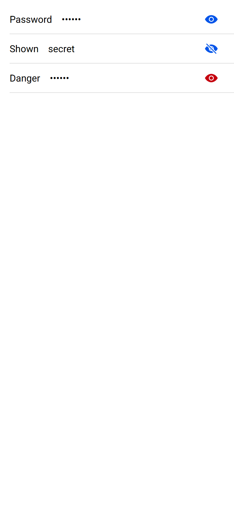

# ion-input-password-toggle — reference render (Ionic 8.8.1, md, 390×844@2x)

Generated by `node tools/ionic-ref/render.js ion-input-password-toggle --bare --html "<ion-app style=\"position:static;display:block;contain:none;overflow:visible\"><ion-list><ion-item><ion-input label=\"Password\" type=\"password\" value=\"secret\"><ion-input-password-toggle slot=\"end\"></ion-input-password-toggle></ion-input></ion-item><ion-item><ion-input label=\"Shown\" type=\"text\" value=\"secret\"><ion-input-password-toggle slot=\"end\"></ion-input-password-toggle></ion-input></ion-item><ion-item><ion-input label=\"Danger\" type=\"password\" value=\"secret\"><ion-input-password-toggle slot=\"end\" color=\"danger\"></ion-input-password-toggle></ion-input></ion-item></ion-list></ion-app>"`

```html
<ion-app style="position:static;display:block;contain:none;overflow:visible"><ion-list><ion-item><ion-input label="Password" type="password" value="secret"><ion-input-password-toggle slot="end"></ion-input-password-toggle></ion-input></ion-item><ion-item><ion-input label="Shown" type="text" value="secret"><ion-input-password-toggle slot="end"></ion-input-password-toggle></ion-input></ion-item><ion-item><ion-input label="Danger" type="password" value="secret"><ion-input-password-toggle slot="end" color="danger"></ion-input-password-toggle></ion-input></ion-item></ion-list></ion-app>
```

 

## Element 1

- attributes: `{"slot":"end","class":"md hydrated"}`
- classes: `md hydrated`
- rect: `{"x":329.97,"y":8,"w":44.03,"h":48.03}`

### Host computed

| prop | value |
|---|---|
| display | `block` |
| position | `static` |
| box-sizing | `border-box` |
| width | `44.0312px` |
| height | `48.0312px` |
| min-height | `auto` |
| min-width | `auto` |
| padding | `0px` |
| margin | `0px 0px 0px 16px` |
| border | `0px none rgb(0, 0, 0)` |
| border-radius | `0px` |
| background-color | `rgba(0, 0, 0, 0)` |
| color | `rgb(0, 0, 0)` |
| font-size | `16px` |
| font-weight | `400` |
| font-family | `Roboto, "Helvetica Neue", sans-serif` |
| line-height | `normal` |
| letter-spacing | `normal` |
| text-transform | `none` |
| opacity | `1` |
| overflow | `visible` |
| contain | `none` |
| pointer-events | `auto` |
| transition | `all` |
| transform | `none` |
| box-shadow | `none` |
| outline | `rgb(0, 0, 0) none 0px` |
| cursor | `default` |

### DOM tree

```
<ion-input-password-toggle>
  #shadow-root
    <ion-button.md.button.button-round.button-clear.button-has-icon-only.ion-activatable.ion-focusable.hydrated>
      #shadow-root
        <button.button-native part="native">
          <span.button-inner>
            <slot name="icon-only">
            <slot name="start">
            <slot name="">
            <slot name="end">
          <ion-ripple-effect.md.hydrated>
            #shadow-root
      <ion-icon.md.hydrated slot="icon-only">
        #shadow-root
          <div.icon-inner>
            <svg>
              <circle>
              <path>
```

## Element 2

- attributes: `{"slot":"end","class":"md hydrated"}`
- classes: `md hydrated`
- rect: `{"x":329.97,"y":57.03,"w":44.03,"h":48.03}`

### Host computed

| prop | value |
|---|---|
| display | `block` |
| position | `static` |
| box-sizing | `border-box` |
| width | `44.0312px` |
| height | `48.0312px` |
| min-height | `auto` |
| min-width | `auto` |
| padding | `0px` |
| margin | `0px 0px 0px 16px` |
| border | `0px none rgb(0, 0, 0)` |
| border-radius | `0px` |
| background-color | `rgba(0, 0, 0, 0)` |
| color | `rgb(0, 0, 0)` |
| font-size | `16px` |
| font-weight | `400` |
| font-family | `Roboto, "Helvetica Neue", sans-serif` |
| line-height | `normal` |
| letter-spacing | `normal` |
| text-transform | `none` |
| opacity | `1` |
| overflow | `visible` |
| contain | `none` |
| pointer-events | `auto` |
| transition | `all` |
| transform | `none` |
| box-shadow | `none` |
| outline | `rgb(0, 0, 0) none 0px` |
| cursor | `default` |

### DOM tree

```
<ion-input-password-toggle>
  #shadow-root
    <ion-button.md.button.button-round.button-clear.button-has-icon-only.ion-activatable.ion-focusable.hydrated>
      #shadow-root
        <button.button-native part="native">
          <span.button-inner>
            <slot name="icon-only">
            <slot name="start">
            <slot name="">
            <slot name="end">
          <ion-ripple-effect.md.hydrated>
            #shadow-root
      <ion-icon.md.hydrated slot="icon-only">
        #shadow-root
          <div.icon-inner>
            <svg>
              <path>
              <path>
```

## Element 3

- attributes: `{"slot":"end","color":"danger","class":"ion-color ion-color-danger md hydrated"}`
- classes: `ion-color ion-color-danger md hydrated`
- rect: `{"x":329.97,"y":106.06,"w":44.03,"h":48.03}`

### Host computed

| prop | value |
|---|---|
| display | `block` |
| position | `static` |
| box-sizing | `border-box` |
| width | `44.0312px` |
| height | `48.0312px` |
| min-height | `auto` |
| min-width | `auto` |
| padding | `0px` |
| margin | `0px 0px 0px 16px` |
| border | `0px none rgb(0, 0, 0)` |
| border-radius | `0px` |
| background-color | `rgba(0, 0, 0, 0)` |
| color | `rgb(0, 0, 0)` |
| font-size | `16px` |
| font-weight | `400` |
| font-family | `Roboto, "Helvetica Neue", sans-serif` |
| line-height | `normal` |
| letter-spacing | `normal` |
| text-transform | `none` |
| opacity | `1` |
| overflow | `visible` |
| contain | `none` |
| pointer-events | `auto` |
| transition | `all` |
| transform | `none` |
| box-shadow | `none` |
| outline | `rgb(0, 0, 0) none 0px` |
| cursor | `default` |

### DOM tree

```
<ion-input-password-toggle>
  #shadow-root
    <ion-button.ion-color.ion-color-danger.md.button.button-round.button-clear.button-has-icon-only.ion-activatable.ion-focusable.hydrated>
      #shadow-root
        <button.button-native part="native">
          <span.button-inner>
            <slot name="icon-only">
            <slot name="start">
            <slot name="">
            <slot name="end">
          <ion-ripple-effect.md.hydrated>
            #shadow-root
      <ion-icon.md.hydrated slot="icon-only">
        #shadow-root
          <div.icon-inner>
            <svg>
              <circle>
              <path>
```
