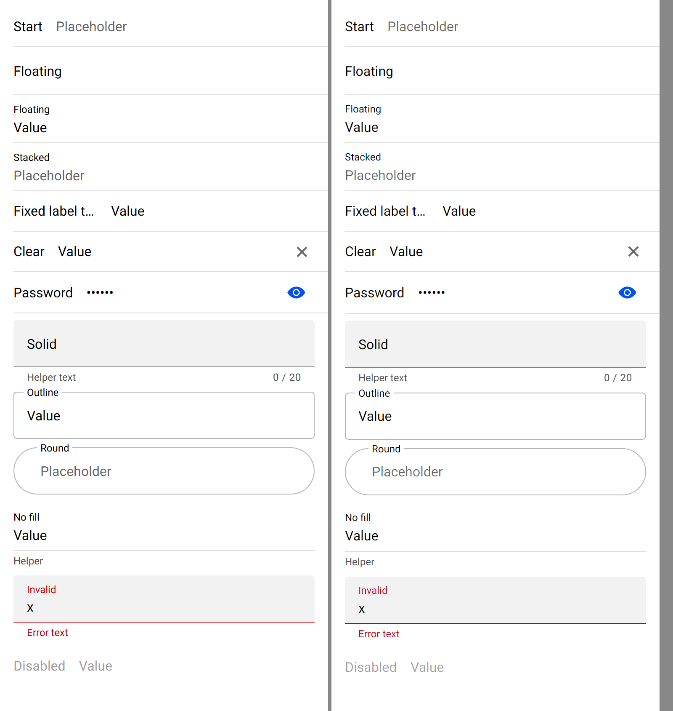
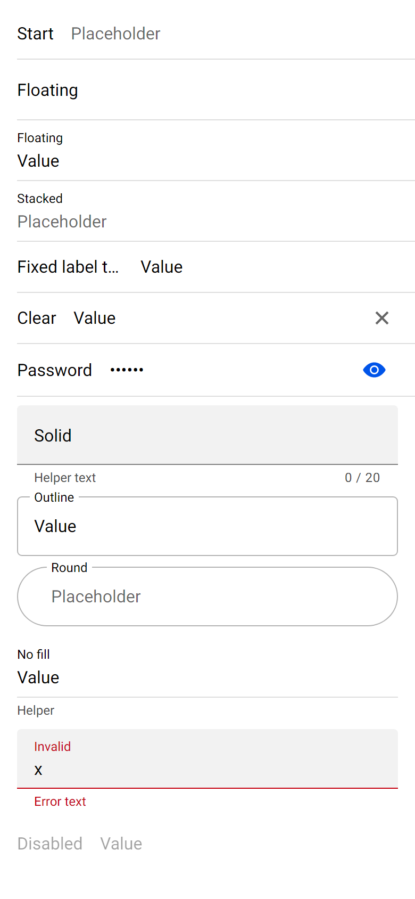

# ion-input — Comparison against the web component

> Ionic side: `node tools/ionic-ref/render.js ion-input --bare --html '<the snippet below>'` (Chromium, md, 390×844@2x) → [`ref/`](ref/).
> `ref/README.md` holds the exact command, and `ref/page.html` the page. The password toggle's own frame:
> `node tools/ionic-ref/render.js ion-input-password-toggle --bare --html '…'` → [`../ion-input-password-toggle/ref/`](../ion-input-password-toggle/ref/).
> Avonic side: `AVONIC_CAPTURE_DIR=… dotnet test` → `AvonicInputCaptureTests.Reference_Page` (headless Skia, 2×) → [`compare/`](compare/).
> Not tried in a real window (queued), or on a device.

```html
<ion-app style="position:static;display:block;contain:none;overflow:visible"><ion-list>
<ion-item><ion-input label="Start" placeholder="Placeholder"></ion-input></ion-item>
<ion-item><ion-input label="Floating" label-placement="floating"></ion-input></ion-item>
<ion-item><ion-input label="Floating" label-placement="floating" value="Value"></ion-input></ion-item>
<ion-item><ion-input label="Stacked" label-placement="stacked" placeholder="Placeholder"></ion-input></ion-item>
<ion-item><ion-input label="Fixed label that is long" label-placement="fixed" value="Value"></ion-input></ion-item>
<ion-item><ion-input label="Clear" clear-input value="Value"></ion-input></ion-item>
<ion-item><ion-input label="Password" type="password" value="secret"><ion-input-password-toggle slot="end"></ion-input-password-toggle></ion-input></ion-item>
</ion-list><div style="padding:0 16px;display:flex;flex-direction:column;gap:10px">
<ion-input fill="solid" label="Solid" label-placement="floating" helper-text="Helper text" counter maxlength="20"></ion-input>
<ion-input fill="outline" label="Outline" label-placement="floating" value="Value"></ion-input>
<ion-input fill="outline" shape="round" label="Round" label-placement="stacked" placeholder="Placeholder"></ion-input>
<ion-input label="No fill" label-placement="stacked" helper-text="Helper" value="Value"></ion-input>
<ion-input class="ion-touched ion-invalid" fill="solid" label="Invalid" label-placement="floating" helper-text="Helper" error-text="Error text" value="x"></ion-input>
<ion-input label="Disabled" disabled value="Value"></ion-input>
</div></ion-app>
```

(One line in the real command.) `Reference_Page` lays out the same content; the inputs outside the list sit in a 10 px
`StackPanel` with the page's 16 px Roboto.

The behaviours were measured with throwaway Playwright scripts against pages of inputs with ids (a mouse and keyboard in a
desktop context for the events, focus and hover; a mobile context for the boxes): the event order of typing, Enter, blur, a
value set in code, `clearOnEdit` with Shift, an arrow, a letter and Tab, the clear button focused and not, Tab to it and Enter,
the password toggle, a click on the label, `debounce`, the focused colours of each fill, hover, and the boxes of every
placement, fill, shape, slot and RTL. The numbers are in [PLAN.md](PLAN.md) and the tests.

## Frames

Ionic on the left, Avonic on the right:



| Ionic | Avonic |
|---|---|
|  |  |

The rows line up to a pixel down to the password row. From there Avonic drifts by 1 to 2 px: the password row is 49 in both,
but each 12 px line under a field is 15 px high in Avalonia and 14 in Chromium (Roboto's line height is 14.06 px, which
Chromium lays out at 14 and Avalonia rounds up), so each bottom is 1 px taller.

## Behaviours

| # | Behaviour | Result |
|---|---|---|
| 1 | `IonFocus`, then `IonInput` per edit with the value | Match |
| 2 | Enter commits `IonChange` once | Match |
| 3 | Blur commits `IonChange` if edited, then `IonBlur`; none without an edit, or after Enter committed it | Match |
| 4 | A value set in code raises nothing; an `IonInput` handler can replace the value | Match |
| 5 | `Debounce`: one `IonInput` with the last value, after the wait | Match, on `AvonicConfig`'s clock |
| 6 | `ClearOnEdit` on the first editing key, once per focus; ignored keys don't use it | Match. Text with no key down (a soft keyboard) also clears, where Chromium's `keydown` is `Unidentified` |
| 7 | The clear button: shown with a value, clears, keeps or takes focus; a press doesn't move focus; Tab and Enter reach it | Match |
| 8 | A click in the label focuses the field; not on the bottom or on a button in a slot | Match. **Difference:** while focused, Chromium blurs and refocuses (`ionBlur`, `ionFocus`, and an `ionChange` if edited); Avalonia keeps focus, so none of those |
| 9 | `SetFocus()`, `GetInputElement()` | Match. `GetInputElement()` is null before the input is in a tree, where Ionic's promise waits |
| 10 | An item's padding tap focuses the input | Match |
| 11 | Placements, measured | Match to 0.6 px: start, end, fixed, a long start label at 200, stacked's 377 px room, floating at rest and raised, slots floating the label |
| 12 | A floating field is transparent until focus or a value | Match |
| 13 | 44 and 56 high | Match; a field with bottom text is 1 px taller (above) |
| 14 | The highlight: 2 px, grows from the centre over 200 ms, not in an item or with the outline | Match |
| 15 | Highlight colours: primary, a colour's base, valid, invalid; the label, caret and borders take it | Match |
| 16 | Solid: rest, hover (mouse and pen only), focus | Match |
| 17 | Outline: start, notch and end; the notch opens for a floating label; 2 px focused | Match; the notch for a slotted label is its width × 0.75 + 8 |
| 18 | Round shapes | Match |
| 19 | The bottom, the error replacing the helper, the counter and its formatter | Match |
| 20 | The clear button's box, icon and colour | Match |
| 21 | Slots 16 px from the field | Match |
| 22 | Disabled (0.38 as one, through an `OpacityMask`) and read-only | Match |
| 23 | Placeholder at 0.6 | Match |
| 24 | Type, inputmode, enterkeyhint, autocapitalize, autocorrect reach `TextInputOptions`; password masks | Set and tested on the `TextBox`. **Not tried with a soft keyboard**: there's no device |
| 25 | Autofocus | Match |
| 26 | Automation name, help text and required | Match; `Required` is set on the native input and tested, but nothing in Avalonia 12.1.4 reads `IsRequiredForForm`, and no screen reader was tried |
| 27 | The password toggle | Match; it doesn't take focus. 44 × 48 at the end of an item, as measured |
| 28 | RTL | Match: the row, the outline's start on the right, the label scaled from its top right |

## Deliberate differences and gaps

- **A click on the label while the field has focus** keeps focus; Chromium blurs and focuses again (above).
- **The date and time types** aren't declared, and a `number` field doesn't drop what isn't a number, as Chromium does.
- **An icon-only `ion-button` in a slot**: `input.md.css` makes it 40 px round with 8 px padding. That needs the button's own
  padding and radius keys per instance, which a `::slotted` rule can't set here; the button keeps its own look. Not measured
  further.
- **An app's `--background` and `--border-color` with a fill.** ion-input is scoped, not shadow DOM, so `:host(.input-fill-solid)`
  is `.sc-ion-input-md-h.input-fill-solid` in the page, and beats `ion-input.custom { --background: red }`: measured, the solid
  input stays `#f2f2f2` at rest, `#e6e6e6` hovered and `#d9d9d9` focused. A resource key has no specificity, so here the app's key
  wins at rest, which is the only way to set it, and the hover and focus colours beat it, as in Ionic.
- **`:host-context(ion-item)[slot=start|end] { width: auto }`** now matches (#131): the input is as wide as its content, where
  the native input wants Chromium's width for 20 characters, `ceil(ceil(20 × x) + round(xMax − xMin) − x)`, where `x` is the
  `x` glyph's advance and `xMax − xMin` is from the font's `head` table. Measured in Chromium at 16 px Roboto: 199 wide whatever
  the value, the label's 34.48 and 16 more. Fitted at 14 sizes from 12 to 32 px: the same at 11 (161, 186, 199, 211, 229, 249
  and 298 at 13, 15, 16, 17, 18.5, 20 and 24 px are tested), and 1 px out at 12, 28 and 32 px (150, 347, 397 against 149, 348,
  398), where Chromium's own advance seems to be whole. That's Chromium on Windows, which takes the `x` glyph as the character;
  Chromium on Android may take the font's average width, which isn't measured. Elsewhere, a container that sizes to its content
  still gives the input its text's width. The native input is `width: 100%`, which makes it compressible: with too little room
  an end slot's input gives way to a start slot's, 127 beside a 199, as in Chromium (#155), where it used to keep its 199.
- **The notch's `max-width`** for a label wider than the field isn't applied.
- **Bottom text** is 1 px taller (Avalonia's line height for 12 px Roboto).
- **A slotted label's text is read when it's set**, and when the slot's element is made, not each time its text changes, where
  Ionic's `aria-labelledby` follows the element. The field's own `Label` is always current.
- **The soft keyboard, IME composition, and haptics** are untested: there's no device here. A value set during composition waits,
  as Ionic's `isComposing` check does; that's tested with a preedit set by hand.
