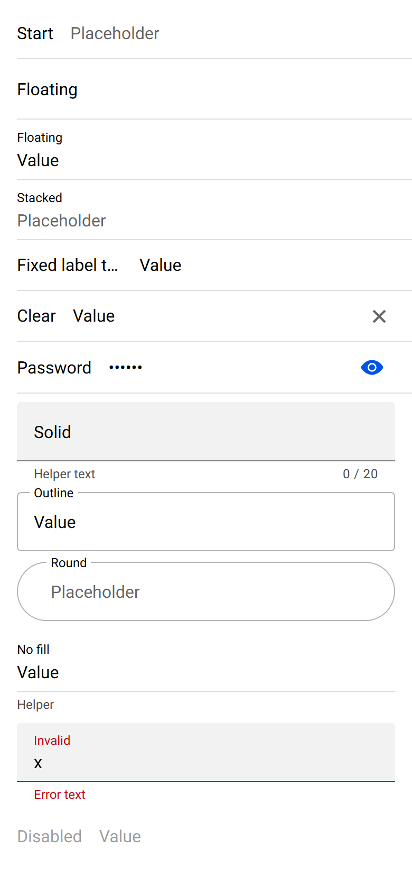

# ion-input — reference render (Ionic 8.8.1, md, 390×844@2x)

Generated by `node tools/ionic-ref/render.js ion-input --bare --html "<ion-app style=\"position:static;display:block;contain:none;overflow:visible\"><ion-list><ion-item><ion-input label=\"Start\" placeholder=\"Placeholder\"></ion-input></ion-item><ion-item><ion-input label=\"Floating\" label-placement=\"floating\"></ion-input></ion-item><ion-item><ion-input label=\"Floating\" label-placement=\"floating\" value=\"Value\"></ion-input></ion-item><ion-item><ion-input label=\"Stacked\" label-placement=\"stacked\" placeholder=\"Placeholder\"></ion-input></ion-item><ion-item><ion-input label=\"Fixed label that is long\" label-placement=\"fixed\" value=\"Value\"></ion-input></ion-item><ion-item><ion-input label=\"Clear\" clear-input value=\"Value\"></ion-input></ion-item><ion-item><ion-input label=\"Password\" type=\"password\" value=\"secret\"><ion-input-password-toggle slot=\"end\"></ion-input-password-toggle></ion-input></ion-item></ion-list><div style=\"padding:0 16px;display:flex;flex-direction:column;gap:10px\"><ion-input fill=\"solid\" label=\"Solid\" label-placement=\"floating\" helper-text=\"Helper text\" counter maxlength=\"20\"></ion-input><ion-input fill=\"outline\" label=\"Outline\" label-placement=\"floating\" value=\"Value\"></ion-input><ion-input fill=\"outline\" shape=\"round\" label=\"Round\" label-placement=\"stacked\" placeholder=\"Placeholder\"></ion-input><ion-input label=\"No fill\" label-placement=\"stacked\" helper-text=\"Helper\" value=\"Value\"></ion-input><ion-input class=\"ion-touched ion-invalid\" fill=\"solid\" label=\"Invalid\" label-placement=\"floating\" helper-text=\"Helper\" error-text=\"Error text\" value=\"x\"></ion-input><ion-input label=\"Disabled\" disabled value=\"Value\"></ion-input></div></ion-app>"`

```html
<ion-app style="position:static;display:block;contain:none;overflow:visible"><ion-list><ion-item><ion-input label="Start" placeholder="Placeholder"></ion-input></ion-item><ion-item><ion-input label="Floating" label-placement="floating"></ion-input></ion-item><ion-item><ion-input label="Floating" label-placement="floating" value="Value"></ion-input></ion-item><ion-item><ion-input label="Stacked" label-placement="stacked" placeholder="Placeholder"></ion-input></ion-item><ion-item><ion-input label="Fixed label that is long" label-placement="fixed" value="Value"></ion-input></ion-item><ion-item><ion-input label="Clear" clear-input value="Value"></ion-input></ion-item><ion-item><ion-input label="Password" type="password" value="secret"><ion-input-password-toggle slot="end"></ion-input-password-toggle></ion-input></ion-item></ion-list><div style="padding:0 16px;display:flex;flex-direction:column;gap:10px"><ion-input fill="solid" label="Solid" label-placement="floating" helper-text="Helper text" counter maxlength="20"></ion-input><ion-input fill="outline" label="Outline" label-placement="floating" value="Value"></ion-input><ion-input fill="outline" shape="round" label="Round" label-placement="stacked" placeholder="Placeholder"></ion-input><ion-input label="No fill" label-placement="stacked" helper-text="Helper" value="Value"></ion-input><ion-input class="ion-touched ion-invalid" fill="solid" label="Invalid" label-placement="floating" helper-text="Helper" error-text="Error text" value="x"></ion-input><ion-input label="Disabled" disabled value="Value"></ion-input></div></ion-app>
```

 

## Element 1

- attributes: `{"label":"Start","placeholder":"Placeholder","class":"sc-ion-input-md-h md input-label-placement-start in-item sc-ion-input-md hydrated"}`
- classes: `sc-ion-input-md-h md input-label-placement-start in-item sc-ion-input-md hydrated`
- rect: `{"x":16,"y":9.5,"w":358,"h":44}`

### CSS custom properties (resolved)

| var | value |
|---|---|
| `--background` | `transparent` |
| `--border-color` | `rgba(0, 0, 0, 0.13)` |
| `--border-radius` | `0px` |
| `--border-style` | `solid` |
| `--border-width` | `1px` |
| `--color` | `(unset)` |
| `--highlight-color-focused` | `#0054e9` |
| `--highlight-color-invalid` | `#c5000f` |
| `--highlight-color-valid` | `#2dd55b` |
| `--highlight-height` | `2px` |
| `--padding-bottom` | `0px` |
| `--padding-end` | `0px` |
| `--padding-start` | `0px` |
| `--padding-top` | `0px` |
| `--placeholder-color` | `(unset)` |
| `--placeholder-font-style` | `(unset)` |
| `--placeholder-font-weight` | `(unset)` |
| `--placeholder-opacity` | `0.6` |

### Host computed

| prop | value |
|---|---|
| display | `block` |
| position | `relative` |
| box-sizing | `border-box` |
| width | `358px` |
| height | `44px` |
| min-height | `44px` |
| min-width | `auto` |
| padding | `0px` |
| margin | `0px` |
| border | `0px none rgb(0, 0, 0)` |
| border-radius | `0px` |
| background-color | `rgba(0, 0, 0, 0)` |
| color | `rgb(0, 0, 0)` |
| font-size | `16px` |
| font-weight | `400` |
| font-family | `Roboto, "Helvetica Neue", sans-serif` |
| line-height | `normal` |
| letter-spacing | `normal` |
| text-transform | `none` |
| opacity | `1` |
| overflow | `visible` |
| contain | `none` |
| pointer-events | `auto` |
| transition | `all` |
| transform | `none` |
| box-shadow | `none` |
| outline | `rgb(0, 0, 0) none 0px` |
| cursor | `auto` |

### DOM tree

```
<ion-input>

```

## Element 2

- attributes: `{"label":"Floating","label-placement":"floating","class":"sc-ion-input-md-h md input-label-placement-floating in-item sc-ion-input-md hydrated"}`
- classes: `sc-ion-input-md-h md input-label-placement-floating in-item sc-ion-input-md hydrated`
- rect: `{"x":16,"y":56,"w":358,"h":56}`

### CSS custom properties (resolved)

| var | value |
|---|---|
| `--background` | `transparent` |
| `--border-color` | `rgba(0, 0, 0, 0.13)` |
| `--border-radius` | `0px` |
| `--border-style` | `solid` |
| `--border-width` | `1px` |
| `--color` | `(unset)` |
| `--highlight-color-focused` | `#0054e9` |
| `--highlight-color-invalid` | `#c5000f` |
| `--highlight-color-valid` | `#2dd55b` |
| `--highlight-height` | `2px` |
| `--padding-bottom` | `0px` |
| `--padding-end` | `0px` |
| `--padding-start` | `0px` |
| `--padding-top` | `0px` |
| `--placeholder-color` | `(unset)` |
| `--placeholder-font-style` | `(unset)` |
| `--placeholder-font-weight` | `(unset)` |
| `--placeholder-opacity` | `0.6` |

### Host computed

| prop | value |
|---|---|
| display | `block` |
| position | `relative` |
| box-sizing | `border-box` |
| width | `358px` |
| height | `56px` |
| min-height | `56px` |
| min-width | `auto` |
| padding | `0px` |
| margin | `0px` |
| border | `0px none rgb(0, 0, 0)` |
| border-radius | `0px` |
| background-color | `rgba(0, 0, 0, 0)` |
| color | `rgb(0, 0, 0)` |
| font-size | `16px` |
| font-weight | `400` |
| font-family | `Roboto, "Helvetica Neue", sans-serif` |
| line-height | `normal` |
| letter-spacing | `normal` |
| text-transform | `none` |
| opacity | `1` |
| overflow | `visible` |
| contain | `none` |
| pointer-events | `auto` |
| transition | `all` |
| transform | `none` |
| box-shadow | `none` |
| outline | `rgb(0, 0, 0) none 0px` |
| cursor | `auto` |

### DOM tree

```
<ion-input>

```

## Element 3

- attributes: `{"label":"Floating","label-placement":"floating","value":"Value","class":"sc-ion-input-md-h md has-value label-floating input-label-placement-floating in-item sc-ion-input-md hydrated"}`
- classes: `sc-ion-input-md-h md has-value label-floating input-label-placement-floating in-item sc-ion-input-md hydrated`
- rect: `{"x":16,"y":113,"w":358,"h":56}`

### CSS custom properties (resolved)

| var | value |
|---|---|
| `--background` | `transparent` |
| `--border-color` | `rgba(0, 0, 0, 0.13)` |
| `--border-radius` | `0px` |
| `--border-style` | `solid` |
| `--border-width` | `1px` |
| `--color` | `(unset)` |
| `--highlight-color-focused` | `#0054e9` |
| `--highlight-color-invalid` | `#c5000f` |
| `--highlight-color-valid` | `#2dd55b` |
| `--highlight-height` | `2px` |
| `--padding-bottom` | `0px` |
| `--padding-end` | `0px` |
| `--padding-start` | `0px` |
| `--padding-top` | `0px` |
| `--placeholder-color` | `(unset)` |
| `--placeholder-font-style` | `(unset)` |
| `--placeholder-font-weight` | `(unset)` |
| `--placeholder-opacity` | `0.6` |

### Host computed

| prop | value |
|---|---|
| display | `block` |
| position | `relative` |
| box-sizing | `border-box` |
| width | `358px` |
| height | `56px` |
| min-height | `56px` |
| min-width | `auto` |
| padding | `0px` |
| margin | `0px` |
| border | `0px none rgb(0, 0, 0)` |
| border-radius | `0px` |
| background-color | `rgba(0, 0, 0, 0)` |
| color | `rgb(0, 0, 0)` |
| font-size | `16px` |
| font-weight | `400` |
| font-family | `Roboto, "Helvetica Neue", sans-serif` |
| line-height | `normal` |
| letter-spacing | `normal` |
| text-transform | `none` |
| opacity | `1` |
| overflow | `visible` |
| contain | `none` |
| pointer-events | `auto` |
| transition | `all` |
| transform | `none` |
| box-shadow | `none` |
| outline | `rgb(0, 0, 0) none 0px` |
| cursor | `auto` |

### DOM tree

```
<ion-input>

```

## Element 4

- attributes: `{"label":"Stacked","label-placement":"stacked","placeholder":"Placeholder","class":"sc-ion-input-md-h md label-floating input-label-placement-stacked in-item sc-ion-input-md hydrated"}`
- classes: `sc-ion-input-md-h md label-floating input-label-placement-stacked in-item sc-ion-input-md hydrated`
- rect: `{"x":16,"y":170,"w":358,"h":56}`

### CSS custom properties (resolved)

| var | value |
|---|---|
| `--background` | `transparent` |
| `--border-color` | `rgba(0, 0, 0, 0.13)` |
| `--border-radius` | `0px` |
| `--border-style` | `solid` |
| `--border-width` | `1px` |
| `--color` | `(unset)` |
| `--highlight-color-focused` | `#0054e9` |
| `--highlight-color-invalid` | `#c5000f` |
| `--highlight-color-valid` | `#2dd55b` |
| `--highlight-height` | `2px` |
| `--padding-bottom` | `0px` |
| `--padding-end` | `0px` |
| `--padding-start` | `0px` |
| `--padding-top` | `0px` |
| `--placeholder-color` | `(unset)` |
| `--placeholder-font-style` | `(unset)` |
| `--placeholder-font-weight` | `(unset)` |
| `--placeholder-opacity` | `0.6` |

### Host computed

| prop | value |
|---|---|
| display | `block` |
| position | `relative` |
| box-sizing | `border-box` |
| width | `358px` |
| height | `56px` |
| min-height | `56px` |
| min-width | `auto` |
| padding | `0px` |
| margin | `0px` |
| border | `0px none rgb(0, 0, 0)` |
| border-radius | `0px` |
| background-color | `rgba(0, 0, 0, 0)` |
| color | `rgb(0, 0, 0)` |
| font-size | `16px` |
| font-weight | `400` |
| font-family | `Roboto, "Helvetica Neue", sans-serif` |
| line-height | `normal` |
| letter-spacing | `normal` |
| text-transform | `none` |
| opacity | `1` |
| overflow | `visible` |
| contain | `none` |
| pointer-events | `auto` |
| transition | `all` |
| transform | `none` |
| box-shadow | `none` |
| outline | `rgb(0, 0, 0) none 0px` |
| cursor | `auto` |

### DOM tree

```
<ion-input>

```

## Element 5

- attributes: `{"label":"Fixed label that is long","label-placement":"fixed","value":"Value","class":"sc-ion-input-md-h md has-value input-label-placement-fixed in-item sc-ion-input-md hydrated"}`
- classes: `sc-ion-input-md-h md has-value input-label-placement-fixed in-item sc-ion-input-md hydrated`
- rect: `{"x":16,"y":228.5,"w":358,"h":44}`

### CSS custom properties (resolved)

| var | value |
|---|---|
| `--background` | `transparent` |
| `--border-color` | `rgba(0, 0, 0, 0.13)` |
| `--border-radius` | `0px` |
| `--border-style` | `solid` |
| `--border-width` | `1px` |
| `--color` | `(unset)` |
| `--highlight-color-focused` | `#0054e9` |
| `--highlight-color-invalid` | `#c5000f` |
| `--highlight-color-valid` | `#2dd55b` |
| `--highlight-height` | `2px` |
| `--padding-bottom` | `0px` |
| `--padding-end` | `0px` |
| `--padding-start` | `0px` |
| `--padding-top` | `0px` |
| `--placeholder-color` | `(unset)` |
| `--placeholder-font-style` | `(unset)` |
| `--placeholder-font-weight` | `(unset)` |
| `--placeholder-opacity` | `0.6` |

### Host computed

| prop | value |
|---|---|
| display | `block` |
| position | `relative` |
| box-sizing | `border-box` |
| width | `358px` |
| height | `44px` |
| min-height | `44px` |
| min-width | `auto` |
| padding | `0px` |
| margin | `0px` |
| border | `0px none rgb(0, 0, 0)` |
| border-radius | `0px` |
| background-color | `rgba(0, 0, 0, 0)` |
| color | `rgb(0, 0, 0)` |
| font-size | `16px` |
| font-weight | `400` |
| font-family | `Roboto, "Helvetica Neue", sans-serif` |
| line-height | `normal` |
| letter-spacing | `normal` |
| text-transform | `none` |
| opacity | `1` |
| overflow | `visible` |
| contain | `none` |
| pointer-events | `auto` |
| transition | `all` |
| transform | `none` |
| box-shadow | `none` |
| outline | `rgb(0, 0, 0) none 0px` |
| cursor | `auto` |

### DOM tree

```
<ion-input>

```

## Element 6

- attributes: `{"label":"Clear","clear-input":"","value":"Value","class":"sc-ion-input-md-h md has-value input-label-placement-start in-item sc-ion-input-md hydrated"}`
- classes: `sc-ion-input-md-h md has-value input-label-placement-start in-item sc-ion-input-md hydrated`
- rect: `{"x":16,"y":276.5,"w":358,"h":44}`

### CSS custom properties (resolved)

| var | value |
|---|---|
| `--background` | `transparent` |
| `--border-color` | `rgba(0, 0, 0, 0.13)` |
| `--border-radius` | `0px` |
| `--border-style` | `solid` |
| `--border-width` | `1px` |
| `--color` | `(unset)` |
| `--highlight-color-focused` | `#0054e9` |
| `--highlight-color-invalid` | `#c5000f` |
| `--highlight-color-valid` | `#2dd55b` |
| `--highlight-height` | `2px` |
| `--padding-bottom` | `0px` |
| `--padding-end` | `0px` |
| `--padding-start` | `0px` |
| `--padding-top` | `0px` |
| `--placeholder-color` | `(unset)` |
| `--placeholder-font-style` | `(unset)` |
| `--placeholder-font-weight` | `(unset)` |
| `--placeholder-opacity` | `0.6` |

### Host computed

| prop | value |
|---|---|
| display | `block` |
| position | `relative` |
| box-sizing | `border-box` |
| width | `358px` |
| height | `44px` |
| min-height | `44px` |
| min-width | `auto` |
| padding | `0px` |
| margin | `0px` |
| border | `0px none rgb(0, 0, 0)` |
| border-radius | `0px` |
| background-color | `rgba(0, 0, 0, 0)` |
| color | `rgb(0, 0, 0)` |
| font-size | `16px` |
| font-weight | `400` |
| font-family | `Roboto, "Helvetica Neue", sans-serif` |
| line-height | `normal` |
| letter-spacing | `normal` |
| text-transform | `none` |
| opacity | `1` |
| overflow | `visible` |
| contain | `none` |
| pointer-events | `auto` |
| transition | `all` |
| transform | `none` |
| box-shadow | `none` |
| outline | `rgb(0, 0, 0) none 0px` |
| cursor | `auto` |

### DOM tree

```
<ion-input>

```

## Element 7

- attributes: `{"label":"Password","type":"password","value":"secret","class":"sc-ion-input-md-h md has-value input-label-placement-start in-item sc-ion-input-md hydrated"}`
- classes: `sc-ion-input-md-h md has-value input-label-placement-start in-item sc-ion-input-md hydrated`
- rect: `{"x":16,"y":323,"w":358,"h":48.03}`

### CSS custom properties (resolved)

| var | value |
|---|---|
| `--background` | `transparent` |
| `--border-color` | `rgba(0, 0, 0, 0.13)` |
| `--border-radius` | `0px` |
| `--border-style` | `solid` |
| `--border-width` | `1px` |
| `--color` | `(unset)` |
| `--highlight-color-focused` | `#0054e9` |
| `--highlight-color-invalid` | `#c5000f` |
| `--highlight-color-valid` | `#2dd55b` |
| `--highlight-height` | `2px` |
| `--padding-bottom` | `0px` |
| `--padding-end` | `0px` |
| `--padding-start` | `0px` |
| `--padding-top` | `0px` |
| `--placeholder-color` | `(unset)` |
| `--placeholder-font-style` | `(unset)` |
| `--placeholder-font-weight` | `(unset)` |
| `--placeholder-opacity` | `0.6` |

### Host computed

| prop | value |
|---|---|
| display | `block` |
| position | `relative` |
| box-sizing | `border-box` |
| width | `358px` |
| height | `48.0312px` |
| min-height | `44px` |
| min-width | `auto` |
| padding | `0px` |
| margin | `0px` |
| border | `0px none rgb(0, 0, 0)` |
| border-radius | `0px` |
| background-color | `rgba(0, 0, 0, 0)` |
| color | `rgb(0, 0, 0)` |
| font-size | `16px` |
| font-weight | `400` |
| font-family | `Roboto, "Helvetica Neue", sans-serif` |
| line-height | `normal` |
| letter-spacing | `normal` |
| text-transform | `none` |
| opacity | `1` |
| overflow | `visible` |
| contain | `none` |
| pointer-events | `auto` |
| transition | `all` |
| transform | `none` |
| box-shadow | `none` |
| outline | `rgb(0, 0, 0) none 0px` |
| cursor | `auto` |

### DOM tree

```
<ion-input>
  <ion-input-password-toggle.md.hydrated slot="end">
    #shadow-root
      <ion-button.md.button.button-round.button-clear.button-has-icon-only.ion-activatable.ion-focusable.hydrated>
        #shadow-root
          <button.button-native part="native">
            <span.button-inner>
              <slot name="icon-only">
              <slot name="start">
              <slot name="">
              <slot name="end">
            <ion-ripple-effect.md.hydrated>
              #shadow-root
        <ion-icon.md.hydrated slot="icon-only">
          #shadow-root
            <div.icon-inner>
              <svg>
                <circle>
                <path>
```

## Element 8

- attributes: `{"fill":"solid","label":"Solid","label-placement":"floating","helper-text":"Helper text","counter":"","maxlength":"20","class":"sc-ion-input-md-h md input-fill-solid input-label-placement-floating sc-ion-input-md hydrated"}`
- classes: `sc-ion-input-md-h md input-fill-solid input-label-placement-floating sc-ion-input-md hydrated`
- rect: `{"x":16,"y":380.03,"w":358,"h":75}`

### CSS custom properties (resolved)

| var | value |
|---|---|
| `--background` | `#f2f2f2` |
| `--border-color` | `gray` |
| `--border-radius` | `4px` |
| `--border-style` | `solid` |
| `--border-width` | `1px` |
| `--color` | `(unset)` |
| `--highlight-color-focused` | `#0054e9` |
| `--highlight-color-invalid` | `#c5000f` |
| `--highlight-color-valid` | `#2dd55b` |
| `--highlight-height` | `2px` |
| `--padding-bottom` | `0px` |
| `--padding-end` | `16px` |
| `--padding-start` | `16px` |
| `--padding-top` | `0px` |
| `--placeholder-color` | `(unset)` |
| `--placeholder-font-style` | `(unset)` |
| `--placeholder-font-weight` | `(unset)` |
| `--placeholder-opacity` | `0.6` |

### Host computed

| prop | value |
|---|---|
| display | `block` |
| position | `relative` |
| box-sizing | `border-box` |
| width | `358px` |
| height | `75px` |
| min-height | `56px` |
| min-width | `auto` |
| padding | `0px` |
| margin | `0px` |
| border | `0px none rgb(0, 0, 0)` |
| border-radius | `0px` |
| background-color | `rgba(0, 0, 0, 0)` |
| color | `rgb(0, 0, 0)` |
| font-size | `16px` |
| font-weight | `400` |
| font-family | `Roboto, "Helvetica Neue", sans-serif` |
| line-height | `normal` |
| letter-spacing | `normal` |
| text-transform | `none` |
| opacity | `1` |
| overflow | `visible` |
| contain | `none` |
| pointer-events | `auto` |
| transition | `all` |
| transform | `none` |
| box-shadow | `none` |
| outline | `rgb(0, 0, 0) none 0px` |
| cursor | `auto` |

### DOM tree

```
<ion-input>

```

## Element 9

- attributes: `{"fill":"outline","label":"Outline","label-placement":"floating","value":"Value","class":"sc-ion-input-md-h md has-value label-floating input-fill-outline input-label-placement-floating sc-ion-input-md hydrated"}`
- classes: `sc-ion-input-md-h md has-value label-floating input-fill-outline input-label-placement-floating sc-ion-input-md hydrated`
- rect: `{"x":16,"y":465.03,"w":358,"h":56}`

### CSS custom properties (resolved)

| var | value |
|---|---|
| `--background` | `transparent` |
| `--border-color` | `#b3b3b3` |
| `--border-radius` | `4px` |
| `--border-style` | `solid` |
| `--border-width` | `1px` |
| `--color` | `(unset)` |
| `--highlight-color-focused` | `#0054e9` |
| `--highlight-color-invalid` | `#c5000f` |
| `--highlight-color-valid` | `#2dd55b` |
| `--highlight-height` | `2px` |
| `--padding-bottom` | `0px` |
| `--padding-end` | `16px` |
| `--padding-start` | `16px` |
| `--padding-top` | `0px` |
| `--placeholder-color` | `(unset)` |
| `--placeholder-font-style` | `(unset)` |
| `--placeholder-font-weight` | `(unset)` |
| `--placeholder-opacity` | `0.6` |

### Host computed

| prop | value |
|---|---|
| display | `block` |
| position | `relative` |
| box-sizing | `border-box` |
| width | `358px` |
| height | `56px` |
| min-height | `56px` |
| min-width | `auto` |
| padding | `0px` |
| margin | `0px` |
| border | `0px none rgb(0, 0, 0)` |
| border-radius | `0px` |
| background-color | `rgba(0, 0, 0, 0)` |
| color | `rgb(0, 0, 0)` |
| font-size | `16px` |
| font-weight | `400` |
| font-family | `Roboto, "Helvetica Neue", sans-serif` |
| line-height | `normal` |
| letter-spacing | `normal` |
| text-transform | `none` |
| opacity | `1` |
| overflow | `visible` |
| contain | `none` |
| pointer-events | `auto` |
| transition | `all` |
| transform | `none` |
| box-shadow | `none` |
| outline | `rgb(0, 0, 0) none 0px` |
| cursor | `auto` |

### DOM tree

```
<ion-input>

```

## Element 10

- attributes: `{"fill":"outline","shape":"round","label":"Round","label-placement":"stacked","placeholder":"Placeholder","class":"sc-ion-input-md-h md label-floating input-fill-outline input-shape-round input-label-placement-stacked sc-ion-input-md hydrated"}`
- classes: `sc-ion-input-md-h md label-floating input-fill-outline input-shape-round input-label-placement-stacked sc-ion-input-md hydrated`
- rect: `{"x":16,"y":531.03,"w":358,"h":56}`

### CSS custom properties (resolved)

| var | value |
|---|---|
| `--background` | `transparent` |
| `--border-color` | `#b3b3b3` |
| `--border-radius` | `28px` |
| `--border-style` | `solid` |
| `--border-width` | `1px` |
| `--color` | `(unset)` |
| `--highlight-color-focused` | `#0054e9` |
| `--highlight-color-invalid` | `#c5000f` |
| `--highlight-color-valid` | `#2dd55b` |
| `--highlight-height` | `2px` |
| `--padding-bottom` | `0px` |
| `--padding-end` | `32px` |
| `--padding-start` | `32px` |
| `--padding-top` | `0px` |
| `--placeholder-color` | `(unset)` |
| `--placeholder-font-style` | `(unset)` |
| `--placeholder-font-weight` | `(unset)` |
| `--placeholder-opacity` | `0.6` |

### Host computed

| prop | value |
|---|---|
| display | `block` |
| position | `relative` |
| box-sizing | `border-box` |
| width | `358px` |
| height | `56px` |
| min-height | `56px` |
| min-width | `auto` |
| padding | `0px` |
| margin | `0px` |
| border | `0px none rgb(0, 0, 0)` |
| border-radius | `0px` |
| background-color | `rgba(0, 0, 0, 0)` |
| color | `rgb(0, 0, 0)` |
| font-size | `16px` |
| font-weight | `400` |
| font-family | `Roboto, "Helvetica Neue", sans-serif` |
| line-height | `normal` |
| letter-spacing | `normal` |
| text-transform | `none` |
| opacity | `1` |
| overflow | `visible` |
| contain | `none` |
| pointer-events | `auto` |
| transition | `all` |
| transform | `none` |
| box-shadow | `none` |
| outline | `rgb(0, 0, 0) none 0px` |
| cursor | `auto` |

### DOM tree

```
<ion-input>

```

## Element 11

- attributes: `{"label":"No fill","label-placement":"stacked","helper-text":"Helper","value":"Value","class":"sc-ion-input-md-h md has-value label-floating input-label-placement-stacked sc-ion-input-md hydrated"}`
- classes: `sc-ion-input-md-h md has-value label-floating input-label-placement-stacked sc-ion-input-md hydrated`
- rect: `{"x":16,"y":597.03,"w":358,"h":76}`

### CSS custom properties (resolved)

| var | value |
|---|---|
| `--background` | `transparent` |
| `--border-color` | `rgba(0, 0, 0, 0.13)` |
| `--border-radius` | `(unset)` |
| `--border-style` | `solid` |
| `--border-width` | `1px` |
| `--color` | `(unset)` |
| `--highlight-color-focused` | `#0054e9` |
| `--highlight-color-invalid` | `#c5000f` |
| `--highlight-color-valid` | `#2dd55b` |
| `--highlight-height` | `2px` |
| `--padding-bottom` | `0px` |
| `--padding-end` | `0px` |
| `--padding-start` | `0px` |
| `--padding-top` | `0px` |
| `--placeholder-color` | `(unset)` |
| `--placeholder-font-style` | `(unset)` |
| `--placeholder-font-weight` | `(unset)` |
| `--placeholder-opacity` | `0.6` |

### Host computed

| prop | value |
|---|---|
| display | `block` |
| position | `relative` |
| box-sizing | `border-box` |
| width | `358px` |
| height | `76px` |
| min-height | `56px` |
| min-width | `auto` |
| padding | `0px` |
| margin | `0px` |
| border | `0px none rgb(0, 0, 0)` |
| border-radius | `0px` |
| background-color | `rgba(0, 0, 0, 0)` |
| color | `rgb(0, 0, 0)` |
| font-size | `16px` |
| font-weight | `400` |
| font-family | `Roboto, "Helvetica Neue", sans-serif` |
| line-height | `normal` |
| letter-spacing | `normal` |
| text-transform | `none` |
| opacity | `1` |
| overflow | `visible` |
| contain | `none` |
| pointer-events | `auto` |
| transition | `all` |
| transform | `none` |
| box-shadow | `none` |
| outline | `rgb(0, 0, 0) none 0px` |
| cursor | `auto` |

### DOM tree

```
<ion-input>

```

## Element 12

- attributes: `{"class":"ion-touched ion-invalid sc-ion-input-md-h md has-value label-floating input-fill-solid input-label-placement-floating sc-ion-input-md hydrated","fill":"solid","label":"Invalid","label-placement":"floating","helper-text":"Helper","error-text":"Error text","value":"x"}`
- classes: `ion-touched ion-invalid sc-ion-input-md-h md has-value label-floating input-fill-solid input-label-placement-floating sc-ion-input-md hydrated`
- rect: `{"x":16,"y":683.03,"w":358,"h":75}`

### CSS custom properties (resolved)

| var | value |
|---|---|
| `--background` | `#f2f2f2` |
| `--border-color` | `#c5000f` |
| `--border-radius` | `4px` |
| `--border-style` | `solid` |
| `--border-width` | `1px` |
| `--color` | `(unset)` |
| `--highlight-color-focused` | `#0054e9` |
| `--highlight-color-invalid` | `#c5000f` |
| `--highlight-color-valid` | `#2dd55b` |
| `--highlight-height` | `2px` |
| `--padding-bottom` | `0px` |
| `--padding-end` | `16px` |
| `--padding-start` | `16px` |
| `--padding-top` | `0px` |
| `--placeholder-color` | `(unset)` |
| `--placeholder-font-style` | `(unset)` |
| `--placeholder-font-weight` | `(unset)` |
| `--placeholder-opacity` | `0.6` |

### Host computed

| prop | value |
|---|---|
| display | `block` |
| position | `relative` |
| box-sizing | `border-box` |
| width | `358px` |
| height | `75px` |
| min-height | `56px` |
| min-width | `auto` |
| padding | `0px` |
| margin | `0px` |
| border | `0px none rgb(0, 0, 0)` |
| border-radius | `0px` |
| background-color | `rgba(0, 0, 0, 0)` |
| color | `rgb(0, 0, 0)` |
| font-size | `16px` |
| font-weight | `400` |
| font-family | `Roboto, "Helvetica Neue", sans-serif` |
| line-height | `normal` |
| letter-spacing | `normal` |
| text-transform | `none` |
| opacity | `1` |
| overflow | `visible` |
| contain | `none` |
| pointer-events | `auto` |
| transition | `all` |
| transform | `none` |
| box-shadow | `none` |
| outline | `rgb(0, 0, 0) none 0px` |
| cursor | `auto` |

### DOM tree

```
<ion-input>

```

## Element 13

- attributes: `{"label":"Disabled","disabled":"","value":"Value","class":"sc-ion-input-md-h md has-value input-label-placement-start input-disabled sc-ion-input-md hydrated"}`
- classes: `sc-ion-input-md-h md has-value input-label-placement-start input-disabled sc-ion-input-md hydrated`
- rect: `{"x":16,"y":768.03,"w":358,"h":44}`

### CSS custom properties (resolved)

| var | value |
|---|---|
| `--background` | `transparent` |
| `--border-color` | `rgba(0, 0, 0, 0.13)` |
| `--border-radius` | `(unset)` |
| `--border-style` | `solid` |
| `--border-width` | `1px` |
| `--color` | `(unset)` |
| `--highlight-color-focused` | `#0054e9` |
| `--highlight-color-invalid` | `#c5000f` |
| `--highlight-color-valid` | `#2dd55b` |
| `--highlight-height` | `2px` |
| `--padding-bottom` | `0px` |
| `--padding-end` | `0px` |
| `--padding-start` | `0px` |
| `--padding-top` | `0px` |
| `--placeholder-color` | `(unset)` |
| `--placeholder-font-style` | `(unset)` |
| `--placeholder-font-weight` | `(unset)` |
| `--placeholder-opacity` | `0.6` |

### Host computed

| prop | value |
|---|---|
| display | `block` |
| position | `relative` |
| box-sizing | `border-box` |
| width | `358px` |
| height | `44px` |
| min-height | `44px` |
| min-width | `auto` |
| padding | `0px` |
| margin | `0px` |
| border | `0px none rgb(0, 0, 0)` |
| border-radius | `0px` |
| background-color | `rgba(0, 0, 0, 0)` |
| color | `rgb(0, 0, 0)` |
| font-size | `16px` |
| font-weight | `400` |
| font-family | `Roboto, "Helvetica Neue", sans-serif` |
| line-height | `normal` |
| letter-spacing | `normal` |
| text-transform | `none` |
| opacity | `0.38` |
| overflow | `visible` |
| contain | `none` |
| pointer-events | `auto` |
| transition | `all` |
| transform | `none` |
| box-shadow | `none` |
| outline | `rgb(0, 0, 0) none 0px` |
| cursor | `auto` |

### DOM tree

```
<ion-input>

```
