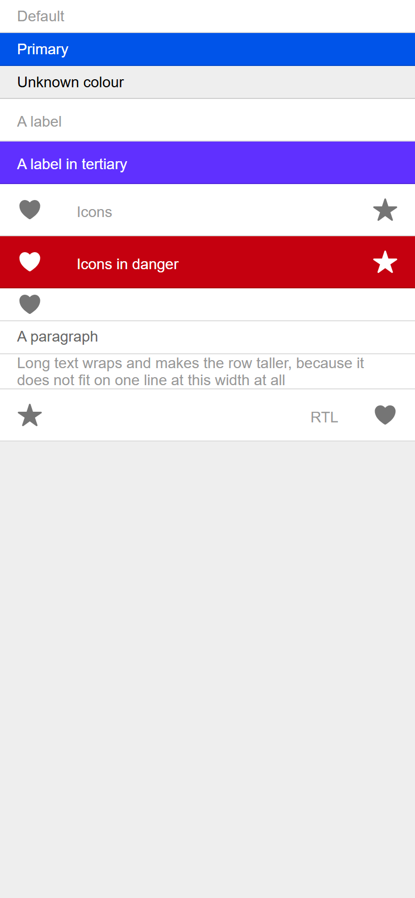
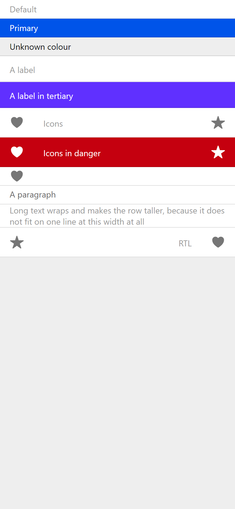
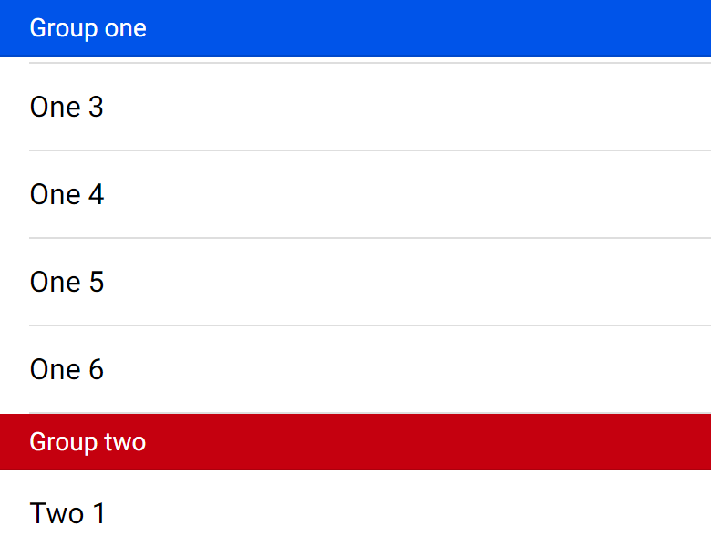
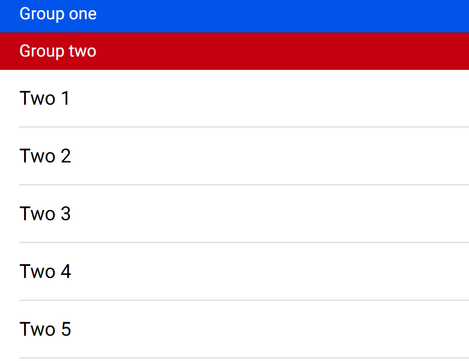
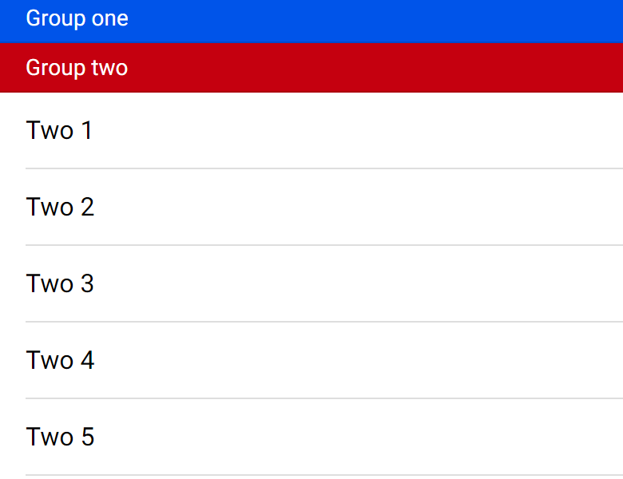
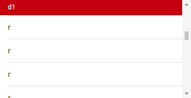

# ion-item-divider — Comparison against the web component

> Ionic side, exactly:
>
> ```
> node tools/ionic-ref/render.js ion-item-divider --bare --html '<div style="background:#eeeeee;height:844px"><ion-item-divider>Default</ion-item-divider><ion-item-divider color="primary">Primary</ion-item-divider><ion-item-divider color="nonexistent">Unknown colour</ion-item-divider><ion-item-divider><ion-label>A label</ion-label></ion-item-divider><ion-item-divider color="tertiary"><ion-label>A label in tertiary</ion-label></ion-item-divider><ion-item-divider><ion-icon name="heart" slot="start"></ion-icon><ion-label>Icons</ion-label><ion-icon name="star" slot="end"></ion-icon></ion-item-divider><ion-item-divider color="danger"><ion-icon name="heart" slot="start"></ion-icon><ion-label>Icons in danger</ion-label><ion-icon name="star" slot="end"></ion-icon></ion-item-divider><ion-item-divider><ion-icon name="heart"></ion-icon></ion-item-divider><ion-item-divider><p>A paragraph</p></ion-item-divider><ion-item-divider>Long text wraps and makes the row taller, because it does not fit on one line at this width at all</ion-item-divider><div dir="rtl"><ion-item-divider><ion-icon name="heart" slot="start"></ion-icon><ion-label>RTL</ion-label><ion-icon name="star" slot="end"></ion-icon></ion-item-divider></div></div>'
> ```
>
> (Chromium, md, 390×844@2x) → [`ref/`](ref/). The scrolled frames come from a throwaway script: a scroller 300 high, with a list
> holding two groups, each a sticky divider and six items, at `scrollTop` 100 and 300.
> Avonic side: `AVONIC_CAPTURE_DIR=… dotnet test` → `AvonicListCaptureTests` (headless Skia, 2×) → [`compare/`](compare/). Tried in a real
> window on Windows at 125%, by wheel and by touch through Windows' touch injection: [the second divider sticks](compare/real-window-sticky.png).
> The first being pushed away wasn't caught in a frame there, so that rests on the headless frames.

## Frames

| Ionic | Avonic |
|---|---|
|  |  |

Rows from the top: default, primary, an unknown colour, a label, a label in tertiary, icons, icons in danger, an icon in the
default slot, a paragraph, long text, and RTL.

Sticky, scrolled 100: the first group's divider is stuck.

| Ionic | Avonic |
|---|---|
|  |  |

Sticky, scrolled 300: the second group's divider pushes it out, 4 above the top.

| Ionic | Avonic |
|---|---|
|  |  |

In a flat `AvonicList` with a `VirtualizingStackPanel`, 1,000 rows, scrolled 15,000: the panel has recycled the divider's row,
and the list draws it, stuck (`D18_In_A_Flat_Virtualising_Panel_It_Stays_Stuck_While_Its_Section_Scrolls`, headless, 390 by
200). Ionic has no virtualising panel; in CSS it stays stuck to the end of the list, as in the frames above.



**Match.** Text is drawn from the same Roboto files on both sides since #100 ([`tools/fonts/roboto/`](../../../tools/fonts/roboto/README.md)). A row with a label is 13 + its line + 10 + 1,
and a line of 14 px text is 16.4, which Chromium rounds to 16, so such a row is 40.5 here against 40.

## Behaviours

| # | Behaviour | Result |
|---|---|---|
| 1 | Size, padding, text | Match: 31, inner 30, wrapper 16 to 374 |
| 2 | Colours | Match |
| 3 | `Color`, and an unknown one | Match: `rgb(0, 73, 203)` where the line is over primary |
| 4 | Tokens | Match |
| 5 | Slots and icons | Match: 24, 54%, 49 high, inner from 72, wrapper to 334, end icon from 350 |
| 6 | A label's margins | Match |
| 7 | A label acts as in an item | Match |
| 8 | A `p` | Match: `#666666`, even in a colour |
| 9 | Long text | Match |
| 10 | Clips | Match |
| 11 | RTL | Match: 350 and 16 |
| 12 | Sticks, and a later one covers it | Match: every offset measured on `s-flat` |
| 13 | Stays in its parent | Match: every offset measured on `s-group`, including −4 at 300 and −104 at 400 |
| 14 | Not in an inset list | Match: −26 at 50 |
| 15 | Off by default, and live | Match |
| 16 | Nothing scrolling | Match |
| 17 | Takes input when stuck | Match |
| 18 | Drawn above later rows | Match, including from a template, and in a flat virtualising `AvonicList`, where the list draws it once its row is recycled, under the next divider, after a jump, and with a focused row kept above ([#68](https://github.com/wdcossey/Avonic/issues/68)). **Deliberate difference:** after a jump more than 200 rows past a divider the list hasn't seen, none is drawn until the rows between are known, where CSS keeps it; making every row between cost 40.6 ms for 10,000 rows |
| 19 | An app's transform wins | No equivalent: CSS's `position` isn't a transform |

## Found here, not by the tests

- **A translucent border over a colour looked lighter,** in the primary row. See [`ion-list-header`'s comparison](../ion-list-header/COMPARISON.md).

## Found by the tests

- **Icons were 25, not 24.** `1.7142857143 × 14` is a hair over 24, and layout rounding rounds up. The factor is now `12/7` to double precision.
