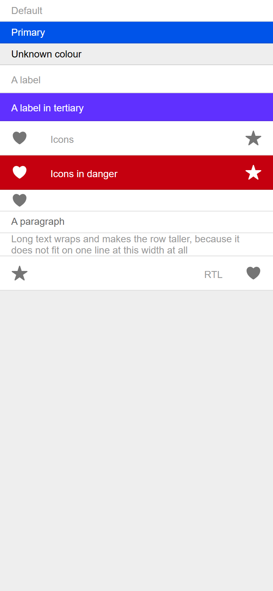

# ion-item-divider — reference render (Ionic 8.8.1, md, 390×844@2x)

Generated by `node tools/ionic-ref/render.js ion-item-divider --bare --html "<div style=\"background:#eeeeee;height:844px\"><ion-item-divider>Default</ion-item-divider><ion-item-divider color=\"primary\">Primary</ion-item-divider><ion-item-divider color=\"nonexistent\">Unknown colour</ion-item-divider><ion-item-divider><ion-label>A label</ion-label></ion-item-divider><ion-item-divider color=\"tertiary\"><ion-label>A label in tertiary</ion-label></ion-item-divider><ion-item-divider><ion-icon name=\"heart\" slot=\"start\"></ion-icon><ion-label>Icons</ion-label><ion-icon name=\"star\" slot=\"end\"></ion-icon></ion-item-divider><ion-item-divider color=\"danger\"><ion-icon name=\"heart\" slot=\"start\"></ion-icon><ion-label>Icons in danger</ion-label><ion-icon name=\"star\" slot=\"end\"></ion-icon></ion-item-divider><ion-item-divider><ion-icon name=\"heart\"></ion-icon></ion-item-divider><ion-item-divider><p>A paragraph</p></ion-item-divider><ion-item-divider>Long text wraps and makes the row taller, because it does not fit on one line at this width at all</ion-item-divider><div dir=\"rtl\"><ion-item-divider><ion-icon name=\"heart\" slot=\"start\"></ion-icon><ion-label>RTL</ion-label><ion-icon name=\"star\" slot=\"end\"></ion-icon></ion-item-divider></div></div>"`

```html
<div style="background:#eeeeee;height:844px"><ion-item-divider>Default</ion-item-divider><ion-item-divider color="primary">Primary</ion-item-divider><ion-item-divider color="nonexistent">Unknown colour</ion-item-divider><ion-item-divider><ion-label>A label</ion-label></ion-item-divider><ion-item-divider color="tertiary"><ion-label>A label in tertiary</ion-label></ion-item-divider><ion-item-divider><ion-icon name="heart" slot="start"></ion-icon><ion-label>Icons</ion-label><ion-icon name="star" slot="end"></ion-icon></ion-item-divider><ion-item-divider color="danger"><ion-icon name="heart" slot="start"></ion-icon><ion-label>Icons in danger</ion-label><ion-icon name="star" slot="end"></ion-icon></ion-item-divider><ion-item-divider><ion-icon name="heart"></ion-icon></ion-item-divider><ion-item-divider><p>A paragraph</p></ion-item-divider><ion-item-divider>Long text wraps and makes the row taller, because it does not fit on one line at this width at all</ion-item-divider><div dir="rtl"><ion-item-divider><ion-icon name="heart" slot="start"></ion-icon><ion-label>RTL</ion-label><ion-icon name="star" slot="end"></ion-icon></ion-item-divider></div></div>
```

 

## Element 1

- attributes: `{"class":"md item hydrated"}`
- classes: `md item hydrated`
- rect: `{"x":0,"y":0,"w":390,"h":31}`

### CSS custom properties (resolved)

| var | value |
|---|---|
| `--background` | `#fff` |
| `--color` | `#999999` |
| `--inner-padding-bottom` | `0px` |
| `--inner-padding-end` | `16px` |
| `--inner-padding-start` | `0px` |
| `--inner-padding-top` | `0px` |
| `--padding-bottom` | `0px` |
| `--padding-end` | `0px` |
| `--padding-start` | `16px` |
| `--padding-top` | `0px` |

### Host computed

| prop | value |
|---|---|
| display | `flex` |
| position | `static` |
| box-sizing | `border-box` |
| width | `390px` |
| height | `31px` |
| min-height | `30px` |
| min-width | `0px` |
| padding | `0px 0px 0px 16px` |
| margin | `0px` |
| border-radius | `0px` |
| background-color | `rgb(255, 255, 255)` |
| color | `rgb(153, 153, 153)` |
| font-size | `14px` |
| font-weight | `400` |
| font-family | `Roboto, "Helvetica Neue", sans-serif` |
| line-height | `normal` |
| letter-spacing | `normal` |
| text-transform | `none` |
| opacity | `1` |
| overflow | `hidden` |
| contain | `none` |
| pointer-events | `auto` |
| transition | `all` |
| transform | `none` |
| box-shadow | `none` |
| outline | `rgb(153, 153, 153) none 0px` |
| cursor | `auto` |

### Shadow parts

#### part="inner" (`div`) rect `{"x":16,"y":0,"w":374,"h":30}`

| prop | value |
|---|---|
| display | `flex` |
| position | `static` |
| box-sizing | `content-box` |
| width | `358px` |
| height | `30px` |
| min-height | `30px` |
| min-width | `auto` |
| padding | `0px 16px 0px 0px` |
| margin | `0px` |
| border | `0px none rgb(153, 153, 153)` |
| border-radius | `0px` |
| background-color | `rgba(0, 0, 0, 0)` |
| color | `rgb(153, 153, 153)` |
| font-size | `14px` |
| font-weight | `400` |
| font-family | `Roboto, "Helvetica Neue", sans-serif` |
| line-height | `normal` |
| letter-spacing | `normal` |
| text-transform | `none` |
| opacity | `1` |
| overflow | `hidden` |
| contain | `none` |
| pointer-events | `auto` |
| transition | `all` |
| transform | `none` |
| box-shadow | `none` |
| outline | `rgb(153, 153, 153) none 0px` |
| cursor | `auto` |

#### part="container" (`div`) rect `{"x":16,"y":0,"w":358,"h":30}`

| prop | value |
|---|---|
| display | `flex` |
| position | `static` |
| box-sizing | `content-box` |
| width | `358px` |
| height | `30px` |
| min-height | `auto` |
| min-width | `auto` |
| padding | `0px` |
| margin | `0px` |
| border | `0px none rgb(153, 153, 153)` |
| border-radius | `0px` |
| background-color | `rgba(0, 0, 0, 0)` |
| color | `rgb(153, 153, 153)` |
| font-size | `14px` |
| font-weight | `400` |
| font-family | `Roboto, "Helvetica Neue", sans-serif` |
| line-height | `normal` |
| letter-spacing | `normal` |
| text-transform | `none` |
| opacity | `1` |
| overflow | `hidden` |
| contain | `none` |
| pointer-events | `auto` |
| transition | `all` |
| transform | `none` |
| box-shadow | `none` |
| outline | `rgb(153, 153, 153) none 0px` |
| cursor | `auto` |

### DOM tree

```
<ion-item-divider>
  #shadow-root
    <slot name="start">
    <div.item-divider-inner part="inner">
      <div.item-divider-wrapper part="container">
        <slot name="">
      <slot name="end">
```

## Element 2

- attributes: `{"color":"primary","class":"ion-color ion-color-primary md item hydrated"}`
- classes: `ion-color ion-color-primary md item hydrated`
- rect: `{"x":0,"y":31,"w":390,"h":31}`

### CSS custom properties (resolved)

| var | value |
|---|---|
| `--background` | `#fff` |
| `--color` | `#999999` |
| `--inner-padding-bottom` | `0px` |
| `--inner-padding-end` | `16px` |
| `--inner-padding-start` | `0px` |
| `--inner-padding-top` | `0px` |
| `--padding-bottom` | `0px` |
| `--padding-end` | `0px` |
| `--padding-start` | `16px` |
| `--padding-top` | `0px` |

### Host computed

| prop | value |
|---|---|
| display | `flex` |
| position | `static` |
| box-sizing | `border-box` |
| width | `390px` |
| height | `31px` |
| min-height | `30px` |
| min-width | `0px` |
| padding | `0px 0px 0px 16px` |
| margin | `0px` |
| border-radius | `0px` |
| background-color | `rgb(0, 84, 233)` |
| color | `rgb(255, 255, 255)` |
| font-size | `14px` |
| font-weight | `400` |
| font-family | `Roboto, "Helvetica Neue", sans-serif` |
| line-height | `normal` |
| letter-spacing | `normal` |
| text-transform | `none` |
| opacity | `1` |
| overflow | `hidden` |
| contain | `none` |
| pointer-events | `auto` |
| transition | `all` |
| transform | `none` |
| box-shadow | `none` |
| outline | `rgb(255, 255, 255) none 0px` |
| cursor | `auto` |

### Shadow parts

#### part="inner" (`div`) rect `{"x":16,"y":31,"w":374,"h":30}`

| prop | value |
|---|---|
| display | `flex` |
| position | `static` |
| box-sizing | `content-box` |
| width | `358px` |
| height | `30px` |
| min-height | `30px` |
| min-width | `auto` |
| padding | `0px 16px 0px 0px` |
| margin | `0px` |
| border | `0px none rgb(255, 255, 255)` |
| border-radius | `0px` |
| background-color | `rgba(0, 0, 0, 0)` |
| color | `rgb(255, 255, 255)` |
| font-size | `14px` |
| font-weight | `400` |
| font-family | `Roboto, "Helvetica Neue", sans-serif` |
| line-height | `normal` |
| letter-spacing | `normal` |
| text-transform | `none` |
| opacity | `1` |
| overflow | `hidden` |
| contain | `none` |
| pointer-events | `auto` |
| transition | `all` |
| transform | `none` |
| box-shadow | `none` |
| outline | `rgb(255, 255, 255) none 0px` |
| cursor | `auto` |

#### part="container" (`div`) rect `{"x":16,"y":31,"w":358,"h":30}`

| prop | value |
|---|---|
| display | `flex` |
| position | `static` |
| box-sizing | `content-box` |
| width | `358px` |
| height | `30px` |
| min-height | `auto` |
| min-width | `auto` |
| padding | `0px` |
| margin | `0px` |
| border | `0px none rgb(255, 255, 255)` |
| border-radius | `0px` |
| background-color | `rgba(0, 0, 0, 0)` |
| color | `rgb(255, 255, 255)` |
| font-size | `14px` |
| font-weight | `400` |
| font-family | `Roboto, "Helvetica Neue", sans-serif` |
| line-height | `normal` |
| letter-spacing | `normal` |
| text-transform | `none` |
| opacity | `1` |
| overflow | `hidden` |
| contain | `none` |
| pointer-events | `auto` |
| transition | `all` |
| transform | `none` |
| box-shadow | `none` |
| outline | `rgb(255, 255, 255) none 0px` |
| cursor | `auto` |

### DOM tree

```
<ion-item-divider>
  #shadow-root
    <slot name="start">
    <div.item-divider-inner part="inner">
      <div.item-divider-wrapper part="container">
        <slot name="">
      <slot name="end">
```

## Element 3

- attributes: `{"color":"nonexistent","class":"ion-color ion-color-nonexistent md item hydrated"}`
- classes: `ion-color ion-color-nonexistent md item hydrated`
- rect: `{"x":0,"y":62,"w":390,"h":31}`

### CSS custom properties (resolved)

| var | value |
|---|---|
| `--background` | `#fff` |
| `--color` | `#999999` |
| `--inner-padding-bottom` | `0px` |
| `--inner-padding-end` | `16px` |
| `--inner-padding-start` | `0px` |
| `--inner-padding-top` | `0px` |
| `--padding-bottom` | `0px` |
| `--padding-end` | `0px` |
| `--padding-start` | `16px` |
| `--padding-top` | `0px` |

### Host computed

| prop | value |
|---|---|
| display | `flex` |
| position | `static` |
| box-sizing | `border-box` |
| width | `390px` |
| height | `31px` |
| min-height | `30px` |
| min-width | `0px` |
| padding | `0px 0px 0px 16px` |
| margin | `0px` |
| border-radius | `0px` |
| background-color | `rgba(0, 0, 0, 0)` |
| color | `rgb(0, 0, 0)` |
| font-size | `14px` |
| font-weight | `400` |
| font-family | `Roboto, "Helvetica Neue", sans-serif` |
| line-height | `normal` |
| letter-spacing | `normal` |
| text-transform | `none` |
| opacity | `1` |
| overflow | `hidden` |
| contain | `none` |
| pointer-events | `auto` |
| transition | `all` |
| transform | `none` |
| box-shadow | `none` |
| outline | `rgb(0, 0, 0) none 0px` |
| cursor | `auto` |

### Shadow parts

#### part="inner" (`div`) rect `{"x":16,"y":62,"w":374,"h":30}`

| prop | value |
|---|---|
| display | `flex` |
| position | `static` |
| box-sizing | `content-box` |
| width | `358px` |
| height | `30px` |
| min-height | `30px` |
| min-width | `auto` |
| padding | `0px 16px 0px 0px` |
| margin | `0px` |
| border | `0px none rgb(0, 0, 0)` |
| border-radius | `0px` |
| background-color | `rgba(0, 0, 0, 0)` |
| color | `rgb(0, 0, 0)` |
| font-size | `14px` |
| font-weight | `400` |
| font-family | `Roboto, "Helvetica Neue", sans-serif` |
| line-height | `normal` |
| letter-spacing | `normal` |
| text-transform | `none` |
| opacity | `1` |
| overflow | `hidden` |
| contain | `none` |
| pointer-events | `auto` |
| transition | `all` |
| transform | `none` |
| box-shadow | `none` |
| outline | `rgb(0, 0, 0) none 0px` |
| cursor | `auto` |

#### part="container" (`div`) rect `{"x":16,"y":62,"w":358,"h":30}`

| prop | value |
|---|---|
| display | `flex` |
| position | `static` |
| box-sizing | `content-box` |
| width | `358px` |
| height | `30px` |
| min-height | `auto` |
| min-width | `auto` |
| padding | `0px` |
| margin | `0px` |
| border | `0px none rgb(0, 0, 0)` |
| border-radius | `0px` |
| background-color | `rgba(0, 0, 0, 0)` |
| color | `rgb(0, 0, 0)` |
| font-size | `14px` |
| font-weight | `400` |
| font-family | `Roboto, "Helvetica Neue", sans-serif` |
| line-height | `normal` |
| letter-spacing | `normal` |
| text-transform | `none` |
| opacity | `1` |
| overflow | `hidden` |
| contain | `none` |
| pointer-events | `auto` |
| transition | `all` |
| transform | `none` |
| box-shadow | `none` |
| outline | `rgb(0, 0, 0) none 0px` |
| cursor | `auto` |

### DOM tree

```
<ion-item-divider>
  #shadow-root
    <slot name="start">
    <div.item-divider-inner part="inner">
      <div.item-divider-wrapper part="container">
        <slot name="">
      <slot name="end">
```

## Element 4

- attributes: `{"class":"md item hydrated"}`
- classes: `md item hydrated`
- rect: `{"x":0,"y":93,"w":390,"h":40}`

### CSS custom properties (resolved)

| var | value |
|---|---|
| `--background` | `#fff` |
| `--color` | `#999999` |
| `--inner-padding-bottom` | `0px` |
| `--inner-padding-end` | `16px` |
| `--inner-padding-start` | `0px` |
| `--inner-padding-top` | `0px` |
| `--padding-bottom` | `0px` |
| `--padding-end` | `0px` |
| `--padding-start` | `16px` |
| `--padding-top` | `0px` |

### Host computed

| prop | value |
|---|---|
| display | `flex` |
| position | `static` |
| box-sizing | `border-box` |
| width | `390px` |
| height | `40px` |
| min-height | `30px` |
| min-width | `0px` |
| padding | `0px 0px 0px 16px` |
| margin | `0px` |
| border-radius | `0px` |
| background-color | `rgb(255, 255, 255)` |
| color | `rgb(153, 153, 153)` |
| font-size | `14px` |
| font-weight | `400` |
| font-family | `Roboto, "Helvetica Neue", sans-serif` |
| line-height | `normal` |
| letter-spacing | `normal` |
| text-transform | `none` |
| opacity | `1` |
| overflow | `hidden` |
| contain | `none` |
| pointer-events | `auto` |
| transition | `all` |
| transform | `none` |
| box-shadow | `none` |
| outline | `rgb(153, 153, 153) none 0px` |
| cursor | `auto` |

### Shadow parts

#### part="inner" (`div`) rect `{"x":16,"y":93,"w":374,"h":39}`

| prop | value |
|---|---|
| display | `flex` |
| position | `static` |
| box-sizing | `content-box` |
| width | `358px` |
| height | `39px` |
| min-height | `30px` |
| min-width | `auto` |
| padding | `0px 16px 0px 0px` |
| margin | `0px` |
| border | `0px none rgb(153, 153, 153)` |
| border-radius | `0px` |
| background-color | `rgba(0, 0, 0, 0)` |
| color | `rgb(153, 153, 153)` |
| font-size | `14px` |
| font-weight | `400` |
| font-family | `Roboto, "Helvetica Neue", sans-serif` |
| line-height | `normal` |
| letter-spacing | `normal` |
| text-transform | `none` |
| opacity | `1` |
| overflow | `hidden` |
| contain | `none` |
| pointer-events | `auto` |
| transition | `all` |
| transform | `none` |
| box-shadow | `none` |
| outline | `rgb(153, 153, 153) none 0px` |
| cursor | `auto` |

#### part="container" (`div`) rect `{"x":16,"y":93,"w":358,"h":39}`

| prop | value |
|---|---|
| display | `flex` |
| position | `static` |
| box-sizing | `content-box` |
| width | `358px` |
| height | `39px` |
| min-height | `auto` |
| min-width | `auto` |
| padding | `0px` |
| margin | `0px` |
| border | `0px none rgb(153, 153, 153)` |
| border-radius | `0px` |
| background-color | `rgba(0, 0, 0, 0)` |
| color | `rgb(153, 153, 153)` |
| font-size | `14px` |
| font-weight | `400` |
| font-family | `Roboto, "Helvetica Neue", sans-serif` |
| line-height | `normal` |
| letter-spacing | `normal` |
| text-transform | `none` |
| opacity | `1` |
| overflow | `hidden` |
| contain | `none` |
| pointer-events | `auto` |
| transition | `all` |
| transform | `none` |
| box-shadow | `none` |
| outline | `rgb(153, 153, 153) none 0px` |
| cursor | `auto` |

### DOM tree

```
<ion-item-divider>
  #shadow-root
    <slot name="start">
    <div.item-divider-inner part="inner">
      <div.item-divider-wrapper part="container">
        <slot name="">
      <slot name="end">
  <ion-label.sc-ion-label-md-h.md.sc-ion-label-md.sc-ion-label-md-s.hydrated>
```

## Element 5

- attributes: `{"color":"tertiary","class":"ion-color ion-color-tertiary md item hydrated"}`
- classes: `ion-color ion-color-tertiary md item hydrated`
- rect: `{"x":0,"y":133,"w":390,"h":40}`

### CSS custom properties (resolved)

| var | value |
|---|---|
| `--background` | `#fff` |
| `--color` | `#999999` |
| `--inner-padding-bottom` | `0px` |
| `--inner-padding-end` | `16px` |
| `--inner-padding-start` | `0px` |
| `--inner-padding-top` | `0px` |
| `--padding-bottom` | `0px` |
| `--padding-end` | `0px` |
| `--padding-start` | `16px` |
| `--padding-top` | `0px` |

### Host computed

| prop | value |
|---|---|
| display | `flex` |
| position | `static` |
| box-sizing | `border-box` |
| width | `390px` |
| height | `40px` |
| min-height | `30px` |
| min-width | `0px` |
| padding | `0px 0px 0px 16px` |
| margin | `0px` |
| border-radius | `0px` |
| background-color | `rgb(96, 48, 255)` |
| color | `rgb(255, 255, 255)` |
| font-size | `14px` |
| font-weight | `400` |
| font-family | `Roboto, "Helvetica Neue", sans-serif` |
| line-height | `normal` |
| letter-spacing | `normal` |
| text-transform | `none` |
| opacity | `1` |
| overflow | `hidden` |
| contain | `none` |
| pointer-events | `auto` |
| transition | `all` |
| transform | `none` |
| box-shadow | `none` |
| outline | `rgb(255, 255, 255) none 0px` |
| cursor | `auto` |

### Shadow parts

#### part="inner" (`div`) rect `{"x":16,"y":133,"w":374,"h":39}`

| prop | value |
|---|---|
| display | `flex` |
| position | `static` |
| box-sizing | `content-box` |
| width | `358px` |
| height | `39px` |
| min-height | `30px` |
| min-width | `auto` |
| padding | `0px 16px 0px 0px` |
| margin | `0px` |
| border | `0px none rgb(255, 255, 255)` |
| border-radius | `0px` |
| background-color | `rgba(0, 0, 0, 0)` |
| color | `rgb(255, 255, 255)` |
| font-size | `14px` |
| font-weight | `400` |
| font-family | `Roboto, "Helvetica Neue", sans-serif` |
| line-height | `normal` |
| letter-spacing | `normal` |
| text-transform | `none` |
| opacity | `1` |
| overflow | `hidden` |
| contain | `none` |
| pointer-events | `auto` |
| transition | `all` |
| transform | `none` |
| box-shadow | `none` |
| outline | `rgb(255, 255, 255) none 0px` |
| cursor | `auto` |

#### part="container" (`div`) rect `{"x":16,"y":133,"w":358,"h":39}`

| prop | value |
|---|---|
| display | `flex` |
| position | `static` |
| box-sizing | `content-box` |
| width | `358px` |
| height | `39px` |
| min-height | `auto` |
| min-width | `auto` |
| padding | `0px` |
| margin | `0px` |
| border | `0px none rgb(255, 255, 255)` |
| border-radius | `0px` |
| background-color | `rgba(0, 0, 0, 0)` |
| color | `rgb(255, 255, 255)` |
| font-size | `14px` |
| font-weight | `400` |
| font-family | `Roboto, "Helvetica Neue", sans-serif` |
| line-height | `normal` |
| letter-spacing | `normal` |
| text-transform | `none` |
| opacity | `1` |
| overflow | `hidden` |
| contain | `none` |
| pointer-events | `auto` |
| transition | `all` |
| transform | `none` |
| box-shadow | `none` |
| outline | `rgb(255, 255, 255) none 0px` |
| cursor | `auto` |

### DOM tree

```
<ion-item-divider>
  #shadow-root
    <slot name="start">
    <div.item-divider-inner part="inner">
      <div.item-divider-wrapper part="container">
        <slot name="">
      <slot name="end">
  <ion-label.sc-ion-label-md-h.md.sc-ion-label-md.sc-ion-label-md-s.hydrated>
```

## Element 6

- attributes: `{"class":"md item hydrated"}`
- classes: `md item hydrated`
- rect: `{"x":0,"y":173,"w":390,"h":49}`

### CSS custom properties (resolved)

| var | value |
|---|---|
| `--background` | `#fff` |
| `--color` | `#999999` |
| `--inner-padding-bottom` | `0px` |
| `--inner-padding-end` | `16px` |
| `--inner-padding-start` | `0px` |
| `--inner-padding-top` | `0px` |
| `--padding-bottom` | `0px` |
| `--padding-end` | `0px` |
| `--padding-start` | `16px` |
| `--padding-top` | `0px` |

### Host computed

| prop | value |
|---|---|
| display | `flex` |
| position | `static` |
| box-sizing | `border-box` |
| width | `390px` |
| height | `49px` |
| min-height | `30px` |
| min-width | `0px` |
| padding | `0px 0px 0px 16px` |
| margin | `0px` |
| border-radius | `0px` |
| background-color | `rgb(255, 255, 255)` |
| color | `rgb(153, 153, 153)` |
| font-size | `14px` |
| font-weight | `400` |
| font-family | `Roboto, "Helvetica Neue", sans-serif` |
| line-height | `normal` |
| letter-spacing | `normal` |
| text-transform | `none` |
| opacity | `1` |
| overflow | `hidden` |
| contain | `none` |
| pointer-events | `auto` |
| transition | `all` |
| transform | `none` |
| box-shadow | `none` |
| outline | `rgb(153, 153, 153) none 0px` |
| cursor | `auto` |

### Shadow parts

#### part="inner" (`div`) rect `{"x":72,"y":173,"w":318,"h":48}`

| prop | value |
|---|---|
| display | `flex` |
| position | `static` |
| box-sizing | `content-box` |
| width | `302px` |
| height | `48px` |
| min-height | `30px` |
| min-width | `auto` |
| padding | `0px 16px 0px 0px` |
| margin | `0px` |
| border | `0px none rgb(153, 153, 153)` |
| border-radius | `0px` |
| background-color | `rgba(0, 0, 0, 0)` |
| color | `rgb(153, 153, 153)` |
| font-size | `14px` |
| font-weight | `400` |
| font-family | `Roboto, "Helvetica Neue", sans-serif` |
| line-height | `normal` |
| letter-spacing | `normal` |
| text-transform | `none` |
| opacity | `1` |
| overflow | `hidden` |
| contain | `none` |
| pointer-events | `auto` |
| transition | `all` |
| transform | `none` |
| box-shadow | `none` |
| outline | `rgb(153, 153, 153) none 0px` |
| cursor | `auto` |

#### part="container" (`div`) rect `{"x":72,"y":173,"w":262,"h":48}`

| prop | value |
|---|---|
| display | `flex` |
| position | `static` |
| box-sizing | `content-box` |
| width | `262px` |
| height | `48px` |
| min-height | `auto` |
| min-width | `auto` |
| padding | `0px` |
| margin | `0px` |
| border | `0px none rgb(153, 153, 153)` |
| border-radius | `0px` |
| background-color | `rgba(0, 0, 0, 0)` |
| color | `rgb(153, 153, 153)` |
| font-size | `14px` |
| font-weight | `400` |
| font-family | `Roboto, "Helvetica Neue", sans-serif` |
| line-height | `normal` |
| letter-spacing | `normal` |
| text-transform | `none` |
| opacity | `1` |
| overflow | `hidden` |
| contain | `none` |
| pointer-events | `auto` |
| transition | `all` |
| transform | `none` |
| box-shadow | `none` |
| outline | `rgb(153, 153, 153) none 0px` |
| cursor | `auto` |

### DOM tree

```
<ion-item-divider>
  #shadow-root
    <slot name="start">
    <div.item-divider-inner part="inner">
      <div.item-divider-wrapper part="container">
        <slot name="">
      <slot name="end">
  <ion-icon.md.hydrated slot="start">
    #shadow-root
      <div.icon-inner>
        <svg>
          <path>
  <ion-label.sc-ion-label-md-h.md.sc-ion-label-md.sc-ion-label-md-s.hydrated>
  <ion-icon.md.hydrated slot="end">
    #shadow-root
      <div.icon-inner>
        <svg>
          <path>
```

## Element 7

- attributes: `{"color":"danger","class":"ion-color ion-color-danger md item hydrated"}`
- classes: `ion-color ion-color-danger md item hydrated`
- rect: `{"x":0,"y":222,"w":390,"h":49}`

### CSS custom properties (resolved)

| var | value |
|---|---|
| `--background` | `#fff` |
| `--color` | `#999999` |
| `--inner-padding-bottom` | `0px` |
| `--inner-padding-end` | `16px` |
| `--inner-padding-start` | `0px` |
| `--inner-padding-top` | `0px` |
| `--padding-bottom` | `0px` |
| `--padding-end` | `0px` |
| `--padding-start` | `16px` |
| `--padding-top` | `0px` |

### Host computed

| prop | value |
|---|---|
| display | `flex` |
| position | `static` |
| box-sizing | `border-box` |
| width | `390px` |
| height | `49px` |
| min-height | `30px` |
| min-width | `0px` |
| padding | `0px 0px 0px 16px` |
| margin | `0px` |
| border-radius | `0px` |
| background-color | `rgb(197, 0, 15)` |
| color | `rgb(255, 255, 255)` |
| font-size | `14px` |
| font-weight | `400` |
| font-family | `Roboto, "Helvetica Neue", sans-serif` |
| line-height | `normal` |
| letter-spacing | `normal` |
| text-transform | `none` |
| opacity | `1` |
| overflow | `hidden` |
| contain | `none` |
| pointer-events | `auto` |
| transition | `all` |
| transform | `none` |
| box-shadow | `none` |
| outline | `rgb(255, 255, 255) none 0px` |
| cursor | `auto` |

### Shadow parts

#### part="inner" (`div`) rect `{"x":72,"y":222,"w":318,"h":48}`

| prop | value |
|---|---|
| display | `flex` |
| position | `static` |
| box-sizing | `content-box` |
| width | `302px` |
| height | `48px` |
| min-height | `30px` |
| min-width | `auto` |
| padding | `0px 16px 0px 0px` |
| margin | `0px` |
| border | `0px none rgb(255, 255, 255)` |
| border-radius | `0px` |
| background-color | `rgba(0, 0, 0, 0)` |
| color | `rgb(255, 255, 255)` |
| font-size | `14px` |
| font-weight | `400` |
| font-family | `Roboto, "Helvetica Neue", sans-serif` |
| line-height | `normal` |
| letter-spacing | `normal` |
| text-transform | `none` |
| opacity | `1` |
| overflow | `hidden` |
| contain | `none` |
| pointer-events | `auto` |
| transition | `all` |
| transform | `none` |
| box-shadow | `none` |
| outline | `rgb(255, 255, 255) none 0px` |
| cursor | `auto` |

#### part="container" (`div`) rect `{"x":72,"y":222,"w":262,"h":48}`

| prop | value |
|---|---|
| display | `flex` |
| position | `static` |
| box-sizing | `content-box` |
| width | `262px` |
| height | `48px` |
| min-height | `auto` |
| min-width | `auto` |
| padding | `0px` |
| margin | `0px` |
| border | `0px none rgb(255, 255, 255)` |
| border-radius | `0px` |
| background-color | `rgba(0, 0, 0, 0)` |
| color | `rgb(255, 255, 255)` |
| font-size | `14px` |
| font-weight | `400` |
| font-family | `Roboto, "Helvetica Neue", sans-serif` |
| line-height | `normal` |
| letter-spacing | `normal` |
| text-transform | `none` |
| opacity | `1` |
| overflow | `hidden` |
| contain | `none` |
| pointer-events | `auto` |
| transition | `all` |
| transform | `none` |
| box-shadow | `none` |
| outline | `rgb(255, 255, 255) none 0px` |
| cursor | `auto` |

### DOM tree

```
<ion-item-divider>
  #shadow-root
    <slot name="start">
    <div.item-divider-inner part="inner">
      <div.item-divider-wrapper part="container">
        <slot name="">
      <slot name="end">
  <ion-icon.md.hydrated slot="start">
    #shadow-root
      <div.icon-inner>
        <svg>
          <path>
  <ion-label.sc-ion-label-md-h.md.sc-ion-label-md.sc-ion-label-md-s.hydrated>
  <ion-icon.md.hydrated slot="end">
    #shadow-root
      <div.icon-inner>
        <svg>
          <path>
```

## Element 8

- attributes: `{"class":"md item hydrated"}`
- classes: `md item hydrated`
- rect: `{"x":0,"y":271,"w":390,"h":31}`

### CSS custom properties (resolved)

| var | value |
|---|---|
| `--background` | `#fff` |
| `--color` | `#999999` |
| `--inner-padding-bottom` | `0px` |
| `--inner-padding-end` | `16px` |
| `--inner-padding-start` | `0px` |
| `--inner-padding-top` | `0px` |
| `--padding-bottom` | `0px` |
| `--padding-end` | `0px` |
| `--padding-start` | `16px` |
| `--padding-top` | `0px` |

### Host computed

| prop | value |
|---|---|
| display | `flex` |
| position | `static` |
| box-sizing | `border-box` |
| width | `390px` |
| height | `31px` |
| min-height | `30px` |
| min-width | `0px` |
| padding | `0px 0px 0px 16px` |
| margin | `0px` |
| border-radius | `0px` |
| background-color | `rgb(255, 255, 255)` |
| color | `rgb(153, 153, 153)` |
| font-size | `14px` |
| font-weight | `400` |
| font-family | `Roboto, "Helvetica Neue", sans-serif` |
| line-height | `normal` |
| letter-spacing | `normal` |
| text-transform | `none` |
| opacity | `1` |
| overflow | `hidden` |
| contain | `none` |
| pointer-events | `auto` |
| transition | `all` |
| transform | `none` |
| box-shadow | `none` |
| outline | `rgb(153, 153, 153) none 0px` |
| cursor | `auto` |

### Shadow parts

#### part="inner" (`div`) rect `{"x":16,"y":271,"w":374,"h":30}`

| prop | value |
|---|---|
| display | `flex` |
| position | `static` |
| box-sizing | `content-box` |
| width | `358px` |
| height | `30px` |
| min-height | `30px` |
| min-width | `auto` |
| padding | `0px 16px 0px 0px` |
| margin | `0px` |
| border | `0px none rgb(153, 153, 153)` |
| border-radius | `0px` |
| background-color | `rgba(0, 0, 0, 0)` |
| color | `rgb(153, 153, 153)` |
| font-size | `14px` |
| font-weight | `400` |
| font-family | `Roboto, "Helvetica Neue", sans-serif` |
| line-height | `normal` |
| letter-spacing | `normal` |
| text-transform | `none` |
| opacity | `1` |
| overflow | `hidden` |
| contain | `none` |
| pointer-events | `auto` |
| transition | `all` |
| transform | `none` |
| box-shadow | `none` |
| outline | `rgb(153, 153, 153) none 0px` |
| cursor | `auto` |

#### part="container" (`div`) rect `{"x":16,"y":271,"w":358,"h":30}`

| prop | value |
|---|---|
| display | `flex` |
| position | `static` |
| box-sizing | `content-box` |
| width | `358px` |
| height | `30px` |
| min-height | `auto` |
| min-width | `auto` |
| padding | `0px` |
| margin | `0px` |
| border | `0px none rgb(153, 153, 153)` |
| border-radius | `0px` |
| background-color | `rgba(0, 0, 0, 0)` |
| color | `rgb(153, 153, 153)` |
| font-size | `14px` |
| font-weight | `400` |
| font-family | `Roboto, "Helvetica Neue", sans-serif` |
| line-height | `normal` |
| letter-spacing | `normal` |
| text-transform | `none` |
| opacity | `1` |
| overflow | `hidden` |
| contain | `none` |
| pointer-events | `auto` |
| transition | `all` |
| transform | `none` |
| box-shadow | `none` |
| outline | `rgb(153, 153, 153) none 0px` |
| cursor | `auto` |

### DOM tree

```
<ion-item-divider>
  #shadow-root
    <slot name="start">
    <div.item-divider-inner part="inner">
      <div.item-divider-wrapper part="container">
        <slot name="">
      <slot name="end">
  <ion-icon.md.hydrated>
    #shadow-root
      <div.icon-inner>
        <svg>
          <path>
```

## Element 9

- attributes: `{"class":"md item hydrated"}`
- classes: `md item hydrated`
- rect: `{"x":0,"y":302,"w":390,"h":31}`

### CSS custom properties (resolved)

| var | value |
|---|---|
| `--background` | `#fff` |
| `--color` | `#999999` |
| `--inner-padding-bottom` | `0px` |
| `--inner-padding-end` | `16px` |
| `--inner-padding-start` | `0px` |
| `--inner-padding-top` | `0px` |
| `--padding-bottom` | `0px` |
| `--padding-end` | `0px` |
| `--padding-start` | `16px` |
| `--padding-top` | `0px` |

### Host computed

| prop | value |
|---|---|
| display | `flex` |
| position | `static` |
| box-sizing | `border-box` |
| width | `390px` |
| height | `31px` |
| min-height | `30px` |
| min-width | `0px` |
| padding | `0px 0px 0px 16px` |
| margin | `0px` |
| border-radius | `0px` |
| background-color | `rgb(255, 255, 255)` |
| color | `rgb(153, 153, 153)` |
| font-size | `14px` |
| font-weight | `400` |
| font-family | `Roboto, "Helvetica Neue", sans-serif` |
| line-height | `normal` |
| letter-spacing | `normal` |
| text-transform | `none` |
| opacity | `1` |
| overflow | `hidden` |
| contain | `none` |
| pointer-events | `auto` |
| transition | `all` |
| transform | `none` |
| box-shadow | `none` |
| outline | `rgb(153, 153, 153) none 0px` |
| cursor | `auto` |

### Shadow parts

#### part="inner" (`div`) rect `{"x":16,"y":302,"w":374,"h":30}`

| prop | value |
|---|---|
| display | `flex` |
| position | `static` |
| box-sizing | `content-box` |
| width | `358px` |
| height | `30px` |
| min-height | `30px` |
| min-width | `auto` |
| padding | `0px 16px 0px 0px` |
| margin | `0px` |
| border | `0px none rgb(153, 153, 153)` |
| border-radius | `0px` |
| background-color | `rgba(0, 0, 0, 0)` |
| color | `rgb(153, 153, 153)` |
| font-size | `14px` |
| font-weight | `400` |
| font-family | `Roboto, "Helvetica Neue", sans-serif` |
| line-height | `normal` |
| letter-spacing | `normal` |
| text-transform | `none` |
| opacity | `1` |
| overflow | `hidden` |
| contain | `none` |
| pointer-events | `auto` |
| transition | `all` |
| transform | `none` |
| box-shadow | `none` |
| outline | `rgb(153, 153, 153) none 0px` |
| cursor | `auto` |

#### part="container" (`div`) rect `{"x":16,"y":302,"w":358,"h":30}`

| prop | value |
|---|---|
| display | `flex` |
| position | `static` |
| box-sizing | `content-box` |
| width | `358px` |
| height | `30px` |
| min-height | `auto` |
| min-width | `auto` |
| padding | `0px` |
| margin | `0px` |
| border | `0px none rgb(153, 153, 153)` |
| border-radius | `0px` |
| background-color | `rgba(0, 0, 0, 0)` |
| color | `rgb(153, 153, 153)` |
| font-size | `14px` |
| font-weight | `400` |
| font-family | `Roboto, "Helvetica Neue", sans-serif` |
| line-height | `normal` |
| letter-spacing | `normal` |
| text-transform | `none` |
| opacity | `1` |
| overflow | `hidden` |
| contain | `none` |
| pointer-events | `auto` |
| transition | `all` |
| transform | `none` |
| box-shadow | `none` |
| outline | `rgb(153, 153, 153) none 0px` |
| cursor | `auto` |

### DOM tree

```
<ion-item-divider>
  #shadow-root
    <slot name="start">
    <div.item-divider-inner part="inner">
      <div.item-divider-wrapper part="container">
        <slot name="">
      <slot name="end">
  <p>
```

## Element 10

- attributes: `{"class":"md item hydrated"}`
- classes: `md item hydrated`
- rect: `{"x":0,"y":333,"w":390,"h":33}`

### CSS custom properties (resolved)

| var | value |
|---|---|
| `--background` | `#fff` |
| `--color` | `#999999` |
| `--inner-padding-bottom` | `0px` |
| `--inner-padding-end` | `16px` |
| `--inner-padding-start` | `0px` |
| `--inner-padding-top` | `0px` |
| `--padding-bottom` | `0px` |
| `--padding-end` | `0px` |
| `--padding-start` | `16px` |
| `--padding-top` | `0px` |

### Host computed

| prop | value |
|---|---|
| display | `flex` |
| position | `static` |
| box-sizing | `border-box` |
| width | `390px` |
| height | `33px` |
| min-height | `30px` |
| min-width | `0px` |
| padding | `0px 0px 0px 16px` |
| margin | `0px` |
| border-radius | `0px` |
| background-color | `rgb(255, 255, 255)` |
| color | `rgb(153, 153, 153)` |
| font-size | `14px` |
| font-weight | `400` |
| font-family | `Roboto, "Helvetica Neue", sans-serif` |
| line-height | `normal` |
| letter-spacing | `normal` |
| text-transform | `none` |
| opacity | `1` |
| overflow | `hidden` |
| contain | `none` |
| pointer-events | `auto` |
| transition | `all` |
| transform | `none` |
| box-shadow | `none` |
| outline | `rgb(153, 153, 153) none 0px` |
| cursor | `auto` |

### Shadow parts

#### part="inner" (`div`) rect `{"x":16,"y":333,"w":374,"h":32}`

| prop | value |
|---|---|
| display | `flex` |
| position | `static` |
| box-sizing | `content-box` |
| width | `358px` |
| height | `32px` |
| min-height | `30px` |
| min-width | `auto` |
| padding | `0px 16px 0px 0px` |
| margin | `0px` |
| border | `0px none rgb(153, 153, 153)` |
| border-radius | `0px` |
| background-color | `rgba(0, 0, 0, 0)` |
| color | `rgb(153, 153, 153)` |
| font-size | `14px` |
| font-weight | `400` |
| font-family | `Roboto, "Helvetica Neue", sans-serif` |
| line-height | `normal` |
| letter-spacing | `normal` |
| text-transform | `none` |
| opacity | `1` |
| overflow | `hidden` |
| contain | `none` |
| pointer-events | `auto` |
| transition | `all` |
| transform | `none` |
| box-shadow | `none` |
| outline | `rgb(153, 153, 153) none 0px` |
| cursor | `auto` |

#### part="container" (`div`) rect `{"x":16,"y":333,"w":358,"h":32}`

| prop | value |
|---|---|
| display | `flex` |
| position | `static` |
| box-sizing | `content-box` |
| width | `358px` |
| height | `32px` |
| min-height | `auto` |
| min-width | `auto` |
| padding | `0px` |
| margin | `0px` |
| border | `0px none rgb(153, 153, 153)` |
| border-radius | `0px` |
| background-color | `rgba(0, 0, 0, 0)` |
| color | `rgb(153, 153, 153)` |
| font-size | `14px` |
| font-weight | `400` |
| font-family | `Roboto, "Helvetica Neue", sans-serif` |
| line-height | `normal` |
| letter-spacing | `normal` |
| text-transform | `none` |
| opacity | `1` |
| overflow | `hidden` |
| contain | `none` |
| pointer-events | `auto` |
| transition | `all` |
| transform | `none` |
| box-shadow | `none` |
| outline | `rgb(153, 153, 153) none 0px` |
| cursor | `auto` |

### DOM tree

```
<ion-item-divider>
  #shadow-root
    <slot name="start">
    <div.item-divider-inner part="inner">
      <div.item-divider-wrapper part="container">
        <slot name="">
      <slot name="end">
```

## Element 11

- attributes: `{"class":"md item hydrated"}`
- classes: `md item hydrated`
- rect: `{"x":0,"y":366,"w":390,"h":49}`

### CSS custom properties (resolved)

| var | value |
|---|---|
| `--background` | `#fff` |
| `--color` | `#999999` |
| `--inner-padding-bottom` | `0px` |
| `--inner-padding-end` | `16px` |
| `--inner-padding-start` | `0px` |
| `--inner-padding-top` | `0px` |
| `--padding-bottom` | `0px` |
| `--padding-end` | `0px` |
| `--padding-start` | `16px` |
| `--padding-top` | `0px` |

### Host computed

| prop | value |
|---|---|
| display | `flex` |
| position | `static` |
| box-sizing | `border-box` |
| width | `390px` |
| height | `49px` |
| min-height | `30px` |
| min-width | `0px` |
| padding | `0px 16px 0px 0px` |
| margin | `0px` |
| border-radius | `0px` |
| background-color | `rgb(255, 255, 255)` |
| color | `rgb(153, 153, 153)` |
| font-size | `14px` |
| font-weight | `400` |
| font-family | `Roboto, "Helvetica Neue", sans-serif` |
| line-height | `normal` |
| letter-spacing | `normal` |
| text-transform | `none` |
| opacity | `1` |
| overflow | `hidden` |
| contain | `none` |
| pointer-events | `auto` |
| transition | `all` |
| transform | `none` |
| box-shadow | `none` |
| outline | `rgb(153, 153, 153) none 0px` |
| cursor | `auto` |

### Shadow parts

#### part="inner" (`div`) rect `{"x":0,"y":366,"w":318,"h":48}`

| prop | value |
|---|---|
| display | `flex` |
| position | `static` |
| box-sizing | `content-box` |
| width | `302px` |
| height | `48px` |
| min-height | `30px` |
| min-width | `auto` |
| padding | `0px 0px 0px 16px` |
| margin | `0px` |
| border | `0px none rgb(153, 153, 153)` |
| border-radius | `0px` |
| background-color | `rgba(0, 0, 0, 0)` |
| color | `rgb(153, 153, 153)` |
| font-size | `14px` |
| font-weight | `400` |
| font-family | `Roboto, "Helvetica Neue", sans-serif` |
| line-height | `normal` |
| letter-spacing | `normal` |
| text-transform | `none` |
| opacity | `1` |
| overflow | `hidden` |
| contain | `none` |
| pointer-events | `auto` |
| transition | `all` |
| transform | `none` |
| box-shadow | `none` |
| outline | `rgb(153, 153, 153) none 0px` |
| cursor | `auto` |

#### part="container" (`div`) rect `{"x":56,"y":366,"w":262,"h":48}`

| prop | value |
|---|---|
| display | `flex` |
| position | `static` |
| box-sizing | `content-box` |
| width | `262px` |
| height | `48px` |
| min-height | `auto` |
| min-width | `auto` |
| padding | `0px` |
| margin | `0px` |
| border | `0px none rgb(153, 153, 153)` |
| border-radius | `0px` |
| background-color | `rgba(0, 0, 0, 0)` |
| color | `rgb(153, 153, 153)` |
| font-size | `14px` |
| font-weight | `400` |
| font-family | `Roboto, "Helvetica Neue", sans-serif` |
| line-height | `normal` |
| letter-spacing | `normal` |
| text-transform | `none` |
| opacity | `1` |
| overflow | `hidden` |
| contain | `none` |
| pointer-events | `auto` |
| transition | `all` |
| transform | `none` |
| box-shadow | `none` |
| outline | `rgb(153, 153, 153) none 0px` |
| cursor | `auto` |

### DOM tree

```
<ion-item-divider>
  #shadow-root
    <slot name="start">
    <div.item-divider-inner part="inner">
      <div.item-divider-wrapper part="container">
        <slot name="">
      <slot name="end">
  <ion-icon.md.hydrated slot="start">
    #shadow-root
      <div.icon-inner>
        <svg>
          <path>
  <ion-label.sc-ion-label-md-h.md.sc-ion-label-md.sc-ion-label-md-s.hydrated>
  <ion-icon.md.hydrated slot="end">
    #shadow-root
      <div.icon-inner>
        <svg>
          <path>
```
